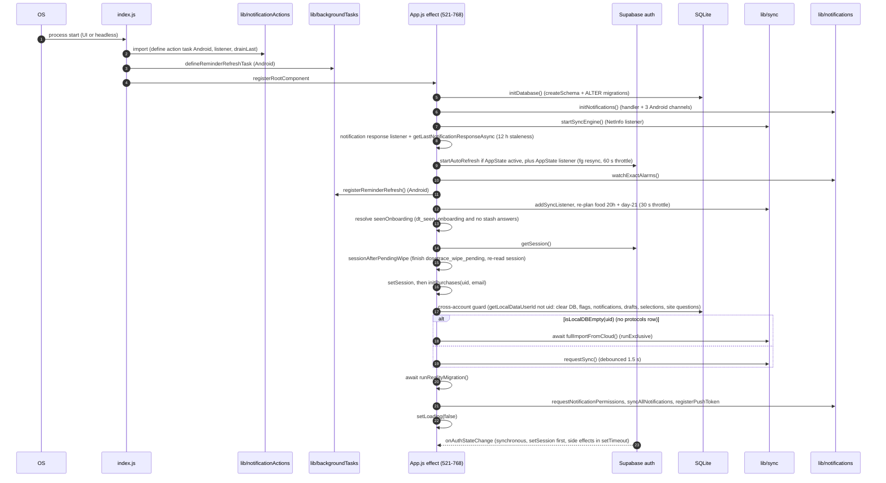
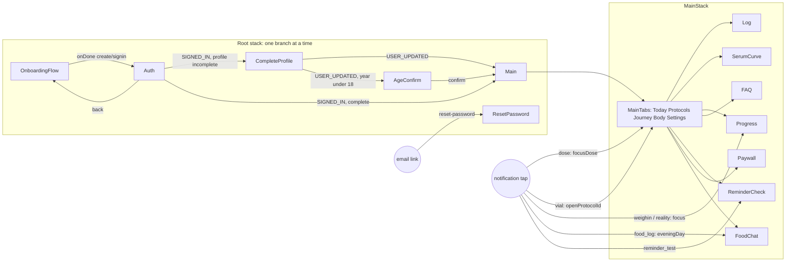
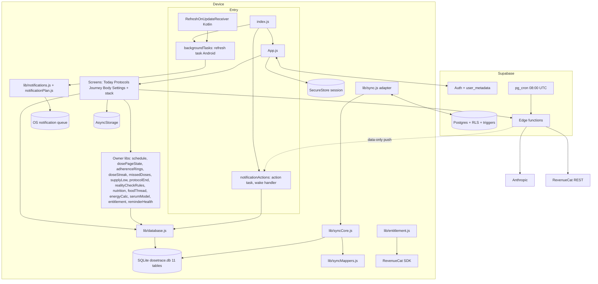
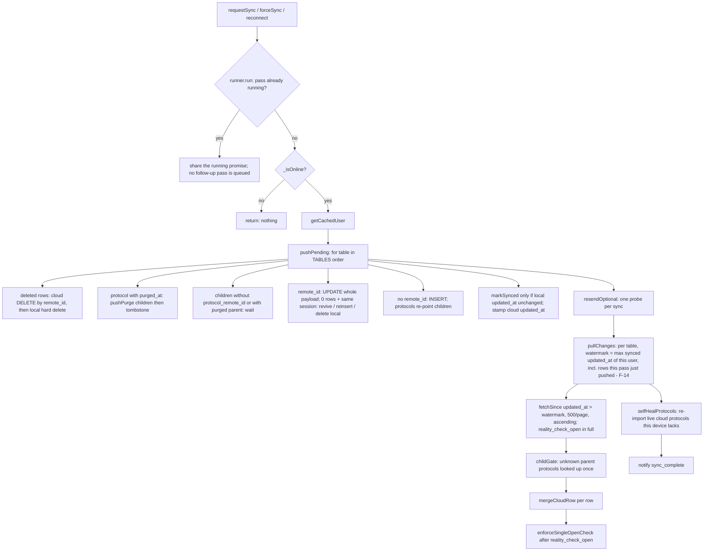

# DoseTrace — Technical Requirements Document (TRD)

- Status: **DRAFT for founder review** — written 2026-10-12 on branch `redesign/graduated` (HEAD `976ef9e`). No code was changed to write it.
- Founder brief (2026-10-12, `docs/decisions.md:638-639`): "sem cortar caminhos… sem nada curto" — a detailed PRD, TRD and drawn flows before more code.
- Companion documents: `docs/product/PRD.md` (behaviour), `docs/product/flows/` (drawn journeys), `docs/product/research/01..08-*.md` (the factual dossiers this TRD consolidates).
- Reconciled 2026-10-12 with `PRD.md`, `DIVERGENCES.md` (every TRD finding is a DV row; see its crosswalk) and `OPEN-DECISIONS.md` (the single list of founder questions; §9 uses its canonical IDs).
- Sources read for this TRD: all eight dossiers in full (incl. every STATE OWNERSHIP AUDIT and the 08 addendum on live triggers), `CLAUDE.md`, `docs/decisions.md`, `docs/specs/*.md` (README, background-refresh, reminders-guaranteed, exact-alarms; the rest through the dossiers), `.claude/skills/ship-check/SKILL.md`, and the code itself: `index.js`, `App.js`, `lib/sync.js`, `lib/syncCore.js`, `lib/syncMappers.js`, `lib/syncRunner.js`, `lib/database.js`, `lib/supabase.js`, `lib/localDate.js`, `lib/backgroundTasks.js`, `lib/reminderRefresh.js`, `lib/notificationActions.js`, `lib/notificationPlan.js`, `lib/schedule.js`, `lib/realityCheckNow.js`, `lib/featureExplainers.js`, `lib/syringes.js`, `app.json`, `eas.json`, `package.json`, `__tests__/helpers/syncHarness.js`, `__tests__/entitlementGuard.test.js`, plus targeted greps listed where used.
- **Live evidence gathered for this TRD (2026-10-12, read-only, metadata only — no user rows read):** Supabase `list_migrations`, `list_edge_functions`, `information_schema.columns`, `information_schema.triggers`, `pg_constraint`, `pg_policies`, `cron.job` on project `mqfvnqfusqyhqhowfweh`. Test suite run (`node --test`) and `node scripts/spec-audit.cjs`.

> **Verification status (2026-10-12).** This TRD was independently verified against the code, the live Supabase metadata and the ledger: `docs/product/verification/06-platform-trd.md` (360 claims: 298 VERIFIED, 40 PARTLY, 10 WRONG, 12 UNVERIFIABLE), plus the TRD rows checked in `verification/01`…`05`, the cross-document check `verification/07-consistency.md`, the reference check `00-mechanical.md` and the diagram check `00b-diagrams.md`. Every WRONG / PARTLY correction that concerns this TRD has been applied in place; corrected passages carry "(verified 2026-10-12, verification/NN)". The main changes: the delete hole (H-1 / DV-182) also **resurrects** a deleted dose on the deleting phone (the vial half is not reachable in 1.3.0 — round 2); the sync test harness **can** express a two-device delete (only the missing-trigger blind spot is real); offset paging (F-11) can skip a row permanently; a new watermark-vs-transaction-time race (F-13) applies to every synced table; the test-kind figure is 45 pure source-text files, not 184; Apple sign-in on Android is live (client secret expires 2027-04-04, new risk R-52); several "founder decision" markers now point at the canonical decision IDs, and the items the consistency check sent back to the founder are marked with their canonical OPEN id (see OPEN-DECISIONS.md "Reclassified on 2026-10-12"; round 2 moved several of them on to AD / DL ids, written here with their destination). Where this TRD and a verification report disagree, the verification wins.
>
> **Round 2 applied (2026-10-12).** Every finding of `docs/product/verification/round2/R2-04-trd-dossiers.md` (checked against the code first; the rejected ones are listed in the round-2 hand-off) and the TRD rows of `R2-06-divergences.md` and `R2-07-consistency.md` are applied in place; every OPEN / AD / DL / DV id now carries its final status from `verification/round2/id-map.md` (moved ids are written as moved). Main round-2 changes: a new S1 sync hole — a phone's own push moves its pull watermark past another phone's rows (F-14 / H-15 / R-54 / TR-SYNC-13, DV-222); the vial half of the delete resurrection is not reachable in 1.3.0; §3.5 lists the three ways a device does learn of a delete; F-11 has a second trigger (rows sharing one `updated_at`); the sync-hole and risk severities follow this TRD's own P-scale, with the register's S-severity noted next to each; the iPhone 64-notification thresholds follow DV-053's recomputation; the unsupported "founder signed in with Apple on the Fold" claim is removed (`STATE.md:17` lists the real Android sign-in as a pending founder device test).

## How to read this document

- `path:line` = read in the code at the HEAD above. Line numbers drift; the function name is given too so a reader can re-find it.
- Dossier references use `NN:ID`, e.g. `02:D6` = dossier `research/02-doses-today.md`, divergence D6; `01:D-13` = dossier 01, D-13; `08:D4` = dossier 08 §8.2 row D4; `03:G16` = dossier 03 gap G16.
- **CONFIRMED** = proven by reading code (and, where said, a run or a live query). **SUSPECTED** = follows from code but depends on runtime/device. **UNVERIFIED** = could not be checked from the repo or the read-only live queries.
- **PROPOSED** = a single owner that does not exist yet; the code sweep (process step 4 in `docs/product/README.md`) creates it test-first. Nothing PROPOSED here is built.
- Section 4 (State Ownership Registry) is the contract the code sweep enforces. Section 5 (Invariants) is what must hold at every build. Section 9 is the prioritized debt/risk list.

## Headline findings (what this TRD adds to the dossiers)

1. **Deletes of non-protocol rows never reach another device that already holds the row** (CONFIRMED in code, §3.9 H-1). Every table except protocols/vials/dose_logs-with-purge deletes by a cloud hard `DELETE`; the pull is incremental by `updated_at`, so a deleted row simply stops existing in the cloud and the other device never learns. The only absence-delete runs inside `fullImport`, which runs only when the device has **no protocol row** (`lib/syncCore.js:847-850`). A dose, weigh-in, food entry, lab value, vaccine or saved reality-check result deleted on phone A stays on phone B indefinitely. **Worse for doses (verified 2026-10-12, verification/06 S3-31):** if B later edits that dose, `pushPending` gets 0 rows, sees a live parent protocol and **re-inserts the row into the cloud** (`reinsertRow`, `lib/syncCore.js:692-698`); A's next pull then brings the deleted dose **back on the deleting phone**. Reproduced with the repo harness ("doses back on A = 1"). A weigh-in edited on B after A deleted it also comes back, by design (DL-90, A-92). The vial re-insert path exists in code but no 1.3.0 action reaches it: a cloud vial is removed only by Delete forever, and the cloud then refuses the re-insert (`refuse_child_of_purged_protocol`, `lib/syncCore.js:116-121, 697-698`) (round 2, R2-04 A-OC-2). The live exposure is `dose_logs`, including the Missed rows an inactivity End tombstones (`lib/protocolEnd.js:67`).
2. **`reality_checks` edits do not propagate** (CONFIRMED, §3.10). The client never sends `updated_at` in any payload (`lib/syncMappers.js:55-172` has no `updated_at`), and production has no `updated_at` trigger on `reality_checks` (live trigger list 2026-10-12; 08 addendum). An UPDATE leaves the cloud `updated_at` at its insert time, so `fetchSince(updated_at > watermark)` on other devices never returns the edited row, and `fullImport` skips rows a device already has. The test harness masks this because its fake cloud stamps `updated_at` on every update (`__tests__/helpers/syncHarness.js:67-68`). (This trigger blind spot is real; the harness does model deletes correctly — see H-12.)
3. **Absolute counters are last-writer-wins** (CONFIRMED by design, §3.9 H-3): `vials.doses_taken` and `protocols.units_taken` are pushed as whole values with the whole row (`lib/syncMappers.js:87,109`), so two devices each logging one dose offline end at `n+1`, not `n+2`, and any whole-row push from one device reverts a field edited on the other.
4. **`created_at` drift is fixed for protocols but not for other tables**: protocols now send `created_at` (`lib/syncMappers.js:101-103`, commit `e85519c`, so `01:D-20` is stale), but **8 tables** do not: `biomarkers`, `food_logs`, `calc_snapshots`, `calc_targets`, `calc_inputs`, `reality_checks`, `vaccines`, `vials` (verified 2026-10-12, verification/06 S3-34: `calc_inputs` was missing from this list); the cloud stamps its own time and other devices inherit it (root cause of `06:D-3`). For protocols a residual remains: a pull never rewrites an existing local `created_at` (`lib/syncCore.js:405-415`).
5. **Repo ↔ live schema drift is large**: production has **29** applied migrations (`list_migrations`), the repo `supabase/migrations/` has **12** files (with **different version stamps** from live, and three still headed "NOT APPLIED" although they are applied) and 15 loose root `supabase_*.sql` files; the core DDL (`profiles`, `protocols`, `vials`, `dose_logs`, `biomarkers`, `reminders`, `handle_new_user`) is not in git; the repo's `notification_sends` table does not exist live; `parse-food-next` is still deployed although RL-1 (2026-10-03) said remove it (§2.3).
6. **About 60 derived states, of which roughly half have two or more implementations** (§4). The worst clusters: the dose schedule (5 implementations), "taken today" (8+), streaks (3), adherence (3), reality-check state (2 assemblers + date-only copies in 6 places), vial days-left (3), current weight (5 rules), report grouping (2), protocol display name (2 rules on one flow).
7. Current gates: `node --test` = **1,872 tests, 1,871 pass, 0 fail, 1 todo** (run 2026-10-12); `spec-audit` = **FAIL, 31 criteria block the build, 2 warnings**.
8. **Added by verification (2026-10-12, verification/06 and round 2):** incremental pulls can lose rows for good in three ways — offset paging across a mid-pull update or across rows that share one `updated_at` (F-11, rare: needs > 500 rows in one pull; DV-210); the `updated_at = now()` transaction-start time racing the watermark (F-13, every synced table, timing-dependent; DV-209); and, most often, **a phone's own push moving its pull watermark past rows another phone pushed earlier** (F-14, round 2: ordinary sequential use of two phones, harness-reproduced; DV-222). None is covered by a test. All three are S1 in the register and P0 here; when they ship is the founder's question OPEN-16 (b).

---

## 1. System architecture

### 1.1 Runtime stack

| Layer | Choice | Version / setting | Evidence |
|---|---|---|---|
| Framework | Expo SDK 54 managed + CNG (`/ios`, `/android` generated at prebuild, git-ignored) | `expo ~54.0.33` | `package.json`; 08 §1.1 |
| JS runtime / RN | React Native 0.81.5, React 19.1.0, **New Architecture on**, Hermes | `newArchEnabled: true` | `app.json:10` |
| Navigation | `@react-navigation/native` 7, stack + bottom-tabs | root stack → MainStack → 5 tabs | `App.js:108-341` |
| Local DB | `expo-sqlite ~16.0.10`, file `dosetrace.db`, WAL, `foreign_keys=ON` (no FK declared, so not enforced) | `lib/database.js:23-35` | 08 §3.1 |
| Cloud | Supabase (Postgres + Auth + Edge Functions + pg_cron + pg_net), project `mqfvnqfusqyhqhowfweh` | `@supabase/supabase-js ^2.101.1` | `lib/supabase.js:13-33` |
| Auth token storage | `expo-secure-store` (Keychain/Keystore, `AFTER_FIRST_UNLOCK`, chunked ≤2000 B, two-slot ping-pong + `.__meta`) | `lib/secureStore.js` | 08 §5.1 |
| Purchases | RevenueCat `react-native-purchases ^9.15.2`; entitlement id `DoseTrace Pro` | `lib/purchases.js:12-19` | 07 R40 |
| Notifications | `expo-notifications ~0.32.16` (local one-shot dated triggers), `expo-task-manager`, `expo-background-task ~1.0.10` (Android only) | `lib/notifications.js`, `lib/backgroundTasks.js` | 03 §2 |
| Graphics / motion | `react-native-svg 15.12.1`, `react-native-reanimated ~4.1.1`, `react-native-worklets 0.5.1`, gesture-handler | — | 08 §1.1 |
| Fonts | Plus Jakarta Sans (every `fontWeight` mapped at module load), Geist, Geist Mono | `lib/fonts.js installFontMapping()` (`App.js:39`) | 08 §1.1 |
| Native code | Local Expo module `modules/dt-exact-alarm` (Kotlin, Android only) | §1.5 | 03 §6.2 |
| iOS | bundle `io.outcom.dosetrace`, deployment target 16.0, `useFrameworks: static`, `supportsTablet: false`, Sign in with Apple, 6 `CFBundleLocalizations` | `app.json:15-38`, `:72-77` | — |
| Android | package `io.outcom.dosetrace`, `edgeToEdgeEnabled`, `SCHEDULE_EXACT_ALARM`, `google-services.json` (FCM client config), R8 minify + shrink with custom keep rules | `app.json:39-50`, `:78-83` | 03 §7.4 |
| Tests | Node 24 `node --test`; `better-sqlite3` for the sync harness | `package.json` `"test": "node --test"` | §7 |

Local native iOS builds are blocked on the founder's Mac (CocoaPods 1.11.3 / Ruby 2.6 vs RN 0.81 podspecs) — builds are EAS only (memory `ios-store-screenshots-and-build`; 08 §10).

### 1.2 Process entry and app startup sequence

`index.js` runs three things, in this order, before React mounts:

1. `import './lib/notificationActions'` (`index.js:4`) — module scope: on Android defines the TaskManager task `dosetrace-notification-actions` and calls `N.registerTaskAsync` (`lib/notificationActions.js:197-210`); on both platforms adds a response listener, drains `getLastNotificationResponseAsync` once, and adds an AppState listener that drains again on every return to the foreground and syncs only if an action was handled while the app was not active (`syncWhenActive`, `:110`, `:129`, `:211-219`; verified 2026-10-12, verification/06 T1-18).
2. `defineReminderRefreshTask()` (`index.js:7-8` → `lib/backgroundTasks.js:56-72`) — Android only: defines `dosetrace-reminder-refresh`. iOS returns immediately (the package is excluded from iOS autolinking, `package.json` `expo.autolinking.ios.exclude`).
3. `registerRootComponent(App)` (`index.js:15`).

`App` render tree (`App.js:800-846`): `WindowSizeRoot` → `SafeAreaProvider` → `ErrorBoundary` → `LanguageProvider` → `ThemeProvider` → `ThemedRoot` (`NavigationContainer` + root stack + one app-level `DTSheet` for email-link messages). While `loading || !fontsLoaded || seenOnboarding === null` a `ThemedLoading` spinner renders instead (`App.js:786-798`). Note: the loading tree has no `ErrorBoundary`, and the `ErrorBoundary` itself renders outside `ThemeProvider` with hard-coded white (`App.js:73-82`, 08 G10).



(Diagram fixed 2026-10-12, verification/00b-diagrams: the `;` inside messages split them into invalid statements; `registerReminderRefresh` belongs to `lib/backgroundTasks`, verification/06 T1-28.)

Line references for each step: `App.js:523` initDatabase; `:526` initNotifications; `:529` startSyncEngine; `:533-554` listener and launch response; `:563-576` auto-refresh and foreground resync; `:579-581` exact alarms and refresh registration; `:586-596` food / day-21 re-plan on sync; `:605-607` onboarding flag; `:609-658` session, wipe completion, guard, import/sync, migration, notifications; `:664-736` auth listener; `:744-757` Apple revoke listener (iOS → local sign-out, not intentional, data kept).

`onAuthStateChange` (`App.js:664-736`) is synchronous: `setSession(session)` first; `SIGNED_OUT` → `onSignedOutNow(...)` (synchronous local calls, no `supabase`, no `await`: ref writes plus `endStashFreshness`, `consumeIntentionalSignOut` and, on an intended sign-out, `discardStashNow`, `clearAuthDraft`, `setSeenOnboarding(false)`, `lib/signedOut.js:15-26`; verified 2026-10-12, verification/06 T1-39) + `setTimeout(afterSignedOut)`; `SIGNED_IN` → `bumpSignInGeneration()` inline, then everything else in `setTimeout(async …)`: wipe-marker check, clear auth entry/draft, consume a stale intentional flag, `initPurchases`, `startSyncEngine`, `applyPendingProfile`, cross-account guard, import or sync, reality migration, permissions + resync + push token. This matches CLAUDE.md Gate B (INV-01).

### 1.3 Navigation — every route and its params

**Root stack** (`App.js:290-336`), exactly one branch mounted, evaluated top-down on every render:

| # | Condition (exact) | Route | Screen |
|---|---|---|---|
| 0 | `loading \|\| !fontsLoaded \|\| seenOnboarding === null` | (no navigator) | `ThemedLoading` |
| 1 | `recovery` truthy (password-reset link, ≤1 h, survives kill) | `ResetPassword` | `ResetPasswordScreen` |
| 2 | `!session && seenOnboarding` | `Auth` | `AuthScreen onBack initialMode={authEntry.mode}` |
| 3 | `!session && !seenOnboarding` | `OnboardingFlow` | `OnboardingFlowScreen onDone` (pre-account) |
| 4 | `session && !isProfileComplete(session.user)` (8 fields, `PROFILE_GATE_SINCE` 2020 → nobody grandfathered, `lib/supabase.js:203-236`) | `CompleteProfile` | `OnboardingFlowScreen session` (signed-in mode) |
| 5 | `session && needsAdultConfirmation(user_metadata)` (`lib/adultGate.js:19-24`) | `AgeConfirm` | `AgeConfirmScreen` |
| 6 | otherwise | `Main` | `MainStack` |

**MainStack** (`App.js:224-241`): `MainTabs`, `Log`, `SerumCurve`, `Progress`, `FAQ`, `ReminderCheck`, `Paywall`, `FoodChat` (vertical card interpolator, swipe-down gesture).

**MainTabs** (`App.js:178-222`): `Today`, `Protocols`, `Journey`, `Body`, `Settings` (labels `tab_today`, `tabbar_protocols`, `tab_journey`, `tab_body`, `tabbar_settings`; active `colors.ink`, inactive `colors.ink3`).

| Route | Params read (file:line) | Navigated from |
|---|---|---|
| `Today` | `focusDose {protocolId, dayKey, ti, slotMs, take?, nonce}` (`screens/TodayScreen.js:171-175`) | Protocols "Mark complete" (`screens/ProtocolsScreen.js:2119`); dose notification tap / `MARK_TAKEN` / `morning_summary` (`lib/notificationPlan.js:173-187`; `MARK_TAKEN` and `morning_summary` open Today **without** `focusDose`, verification/06 T1-51) |
| `Protocols` | `openProtocolId`, `openVialId` (`screens/ProtocolsScreen.js:1083-1155`) | Today cards and alerts (`TodayScreen.js:1544,1576,1779,1857,2014,2181`); `vial_low` / `vial_expiry` taps (`notificationPlan.js:179-181`) |
| `Journey` | none | tab bar |
| `Body` | `initialSection` (`screens/BodyScreen.js:231-237`) | Today "Bloodwork due" `{initialSection:'labs'}` (`TodayScreen.js:1520`) |
| `Settings` | none | tab bar |
| `Log` | none (embedded: `embedded`, `refreshKey`, `onChanged`, `popupGate` props, `LogScreen.js:43-62`) | Today tracker (`TodayScreen.js:2170`), Protocols hero (`ProtocolsScreen.js:2454`), Fold push (`components/BookPanes.js:59`) |
| `SerumCurve` | none (embedded variant gets props) | Journey (`JourneyScreen.js:207`), Body (`BodyScreen.js:849`), Log (`LogScreen.js:522`, Premium), Fold push |
| `Progress` | `focus` ('reality' \| 'weighin'), `nonce` (`ProgressScreen.js:65-66`; dropped on a book page) | Journey tile (`JourneyScreen.js:166`), Today reality alert (`TodayScreen.js:1498`, sends no `nonce`), `checkin_reminder` / `reality_check` taps |
| `FoodChat` | `eveningDay`, `nonce`, `logIt` (`FoodChatScreen.js:178-180`) | `FoodLogHero` (`FoodLogHero.js:85`) on Today (`TodayScreen.js:2174`) and on Journey (`JourneyScreen.js:153, 158`; `:75` is only a comment — verification/06 T1-61), 8 PM `food_log` tap |
| `FAQ` | none | Settings (`SettingsScreen.js:878`) |
| `ReminderCheck` | `focus` ('alarms' \| 'battery' \| 'hibernation' \| 'refresh') (`ReminderCheckScreen.js:32`) | Today reminder cards (`TodayScreen.js:1587-1653`), Settings (`SettingsScreen.js:679,789`), `lib/reminderSetup.js:20` (auto-open once per phone), `reminder_test` tap |
| `Paywall` | `source`, `onSuccess` (`PaywallScreen.js:73-74`) | 12+ sources (08 §2.2): `bloodwork_upload`, `serum_preview_sheet`, `export_pdf`, `journey_serum`, `log_serum`, `protocol_limit`, `serum_direct` (replace), `settings`, `reality_check`, `food_grace`, `food_hero`, and two calls with no source (`CalculatorSection.js:1148`, `FoodChatScreen.js:720`) |

**Notification tap routing** (`App.js:402-432`): pure `notifTapTarget(response, now)` (`lib/notificationPlan.js:161-193`) → `routeTap` dedupes (in-memory `routedRef` + AsyncStorage `dosetrace_nav_handled`, last 30) → a launch response older than 12 h is ignored → target parked in `pendingNavRef` until the root route names include `Main` → `nav.navigate('Main', { screen, params })`. Action buttons `SNOOZE_HOUR`, `SNOOZE_TOMORROW`, `FOOD_DAY_DONE` never navigate (R-25 in 03).

**Deep links** (`App.js:440-519`): `dosetrace://reset-password` (isolated recovery client, `lib/recoveryLink.js:43-69`; other account → `switchAsk` sheet), `dosetrace://confirm-email` (ignored with a session; else `exchangeAuthCodeFromUrl`), `…auth-callback` (Android Apple web flow after a kill). Each link handled once (in memory at once; on disk `dosetrace_links_handled`, last 20, only after success or a non-transient error). Ship-check Gate B's redirect allow-list text does not list `dosetrace://auth-callback` (07 gap 13).

**Fold / book layout** (`components/BookPanes.js`, `lib/bookLayout.js`, `lib/bookSelection.js`, `lib/windowSize.js`): two pages at ≥700×560 pt **and** the Android posture rule (`lib/bookLayout.js:7-20`; BK-1; verification/06 T1-72); `useFoldPush(tab)` pushes `Log` / `Progress` / `SerumCurve` / `FoodChat` when folding with an explicitly chosen right page; `useUnfoldToPage(route)` pops back with `popTo('MainTabs', { screen })` and stores the selection. MainActivity does not recreate on fold (`plugins/withFoldConfigChanges.js`).



### 1.4 Headless entry points

A headless start is any JS run without the UI: Android may start the JS process just for a task. Every headless path must obey INV-14…INV-19 (§5).

| Entry | Platform | Trigger | What runs | Auth | DB | Writes / pushes | Evidence |
|---|---|---|---|---|---|---|---|
| Notification action task `dosetrace-notification-actions` | Android (headless); iOS via listener + `drainLast` on launch and on foreground | User presses an action button (Mark complete, In 1 hour, Tomorrow, Nothing else today) | `handleNotificationResponse` → claim key `id\|action\|date` in `dosetrace_notif_handled` (last 60) → `runAction`: oral Mark complete → `recordDoseTaken`; injectable → saves a site question only; snooze → `snoozeNotification`; food → `closeFoodDay` | `getCachedUser()` → `supabase.auth.getSession()`; **may refresh the token over the network** in this path (comment at `lib/supabase.js:19-25`) — reached only **after** the dose write, through `restoreSnoozes` (`lib/notifications.js:372`, `:995`); the write itself uses `protocol.user_id` (`lib/doseActions.js:54`) (corrected round 2, R2-06) | `ensureDb()` — sets `dbReady = true` even when `initDatabase` throws (`lib/notificationActions.js:31-35`), unlike the refresh task which retries (`lib/backgroundTasks.js:25-29`) | Local SQLite writes; **no cloud sync while not active** (`syncWhenActive` → `requestSync` on next foreground, `:211-218`) | `lib/notificationActions.js:1-220`; 02 §3.11; 03 R-13…R-17 |
| Silent wake-up (same task) | Android | Data-only Expo push `{type:'refresh_wake'}` from `wake-refresh` (pg_cron 08:00 UTC, ≥20 h apart) | `isWakePayload` → `refreshNow()` | stored session only | as below | none | `lib/notificationActions.js:203-206`; `lib/reminderRefresh.js:45-58` |
| Reminder refresh task `dosetrace-reminder-refresh` | Android only (`expo-background-task`, `minimumInterval` 360 min; WorkManager decides; library adds a **network CONNECTED** constraint, 03 §7.4) | Periodic in effect: the library chains one-time work with an initial delay, and when the app is in front a run is re-queued in 60 min (`node_modules/expo-background-task/android/src/main/java/expo/modules/backgroundtask/BackgroundTaskScheduler.kt:76-130, 207-214`; verification/03 §D) | `runReminderRefresh`: skip when `dosetrace_wipe_pending` set; `ensureDb`; `setBackgroundRun(true)` (stored-session-only, no immediate notifications); `readStoredUser`; `syncAllNotifications()`; always `setBackgroundRun(false)`; record `{at, ok, reason, lastOkAt}` in `dosetrace_refresh_last` | `readStoredUser()` raw Keychain read, never `getSession` (`lib/supabase.js:48-58`) | `initDatabase()` retried on next run if it fails | none (no push, no sync, no vial-low) | `lib/backgroundTasks.js`, `lib/reminderRefresh.js`; BR-1…BR-11 |
| `RefreshOnUpdateReceiver` | Android (`MY_PACKAGE_REPLACED`, `BOOT_COMPLETED`) | App update / reboot | Enqueues expo-background-task's worker **by class name** (`expo.modules.backgroundtask.BackgroundTaskWork`, input key `appScopeKey`) as unique work `DOSETRACE_REFRESH_AFTER_UPDATE` (no constraint) | as refresh task | as refresh task | none | `modules/dt-exact-alarm/android/src/main/java/expo/modules/dtexactalarm/RefreshOnUpdateReceiver.kt:18-33`; class-name fragility 03:G24 is pinned by an existing guard test (`__tests__/updateRestore.test.js:45-53`, "expo-background-task still has the worker class and the input key the receiver uses"); only the device proof (A-111) is open |
| iOS | — | — | No background mode at all (`plugins/withoutIosBackgroundFetch.js` strips `UIBackgroundModes: fetch`); reminders are renewed only when the app is opened (window 10 days). The OS keeps at most 64 pending notifications. Dose reminders get `total = 40 − min(V, 8)` shared per protocol (floor 2, cap 24, `lib/notificationPlan.js:301-310`); on top come one expiry alert per active vial, up to 7 morning summaries, the weekly check-in, and during an open reality check up to 7 food nudges and the day-21 alert, plus up to 4 snoozes. Recomputed in round 2 with the real `doseBudget` (DV-053), **assuming every protocol fills its share and at most one active vial per protocol**: without an open check or snoozes (extras 8) 64 is exceeded from **29 protocols with no vials, 25 with 8 vials, or 19 protocols each with a vial**; with an open check and 4 snoozes (extras 20) from **23 protocols with no vials, 19 with 8 vials, or 15 each with a vial**. Lower vial counts (R2-04's "13 vials with 2 protocols") need several active vials per protocol, reachable only through DV-016. (The round-1 "≥ 23 / ≥ 21 with 3 vials / ≥ 14–15 vials" figures held only for some protocol counts.) | — | — | — | BR-11; 03:G1 |

Not headless but process-wide: the AppState listener in `lib/notificationActions.js:213-218` and in `App.js:565-576` both run on foreground; the first drains a pending action and syncs only if an action was handled while the app was not active, the second resyncs (≤1/min).

### 1.5 Native module and config plugins

- `modules/dt-exact-alarm` (Expo module, Kotlin, Android only; JS wrapper returns `null` elsewhere, `modules/dt-exact-alarm/index.js:14-17`):
  - `canScheduleExactAlarms()` — Android < 12 → true; else `AlarmManager.canScheduleExactAlarms()` (`DtExactAlarmModule.kt:15-20`).
  - `isExemptFromHibernation()` — Android < 11 → true; else `packageManager.isAutoRevokeWhitelisted()` (`:24-28`; OEM equivalence UNVERIFIED, 03:D-7).
  - `RefreshOnUpdateReceiver` + manifest (`RECEIVE_BOOT_COMPLETED`, receiver for `MY_PACKAGE_REPLACED` / `BOOT_COMPLETED`).
- Config plugins (`plugins/`): `withAndroidBackupDisabled` (`android:allowBackup="false"`), `withFoldConfigChanges` (MainActivity `configChanges` += screenSize, smallestScreenSize, screenLayout, orientation), `withoutIosBackgroundFetch`.
- R8 keep rules (`app.json:82`, `extraProguardRules`): `expo.modules.notifications.**`; Serializable members (`serialVersionUID`, `writeObject`, `readObject`, `writeReplace`, `readResolve`, `serialPersistentFields`) — without them every scheduled reminder failed with `NotSerializableException` (root cause of the 2026-10-05 Android incident, `docs/decisions.md:565`); `expo.modules.adapters.react.apploader.**` (headless loader); `expo.modules.taskManager.**`; `expo.modules.backgroundtask.**` (the receiver starts the worker by class name). Guard test: `__tests__/androidKeepRules.test.js`.

### 1.6 Backend (Supabase) — live as of 2026-10-12

**Tables (public schema, live).** All have RLS enabled (`pg_class.relrowsecurity = true`).

| Table | Role | Policies (live) | `updated_at` trigger (live) | Other triggers (live) | FK / delete (live) |
|---|---|---|---|---|---|
| `profiles` | one row per auth user (`plan` read by admin RPC) | ALL (own) | — | — | `id → auth.users` CASCADE |
| `protocols` | synced | INSERT+check, SELECT, UPDATE+check — **no DELETE** (A-88) | `set_updated_at` | `protocols_blank_purged` (BEFORE INSERT/UPDATE), `protocols_purge_children` (AFTER UPDATE) | `user_id → profiles` CASCADE |
| `vials` | synced | DELETE (guarded: live or purged parent), INSERT+check, SELECT, UPDATE+check | `set_updated_at` | `vials_refuse_purged_parent` | `protocol_id → protocols` CASCADE; `user_id → profiles` CASCADE |
| `dose_logs` | synced | ALL (own) | `set_updated_at` | `dose_logs_refuse_purged_parent` | `protocol_id → protocols` CASCADE; `user_id → profiles` CASCADE |
| `biomarkers` | synced | ALL (own) | `set_updated_at` | — | `user_id → profiles` CASCADE |
| `vaccines` | synced | per command, UPDATE+check | `vaccines_set_updated_at` | — | `user_id → auth.users` CASCADE |
| `food_logs` | synced | per command | `food_logs_set_updated_at` | — | `→ auth.users` CASCADE |
| `reality_checks` | synced | per command | **NONE** | — | `→ auth.users` CASCADE |
| `calc_snapshots` | synced | per command | `calc_snapshots_set_updated_at` | — | `→ auth.users` CASCADE |
| `calc_targets` | synced | per command | `calc_targets_set_updated_at` | — | `→ auth.users` CASCADE |
| `reality_check_open` | synced | per command | `reality_check_open_set_updated_at` | `reality_check_open_keep_stop` (BEFORE UPDATE: `stopped_at` never cleared) | `→ auth.users` CASCADE |
| `calc_inputs` | synced, `UNIQUE(user_id)` | per command | `calc_inputs_set_updated_at` | — | `→ auth.users` CASCADE |
| `reminders` | legacy, unused by the client | ALL | — | — | `→ profiles`, `→ protocols` CASCADE |
| `push_tokens` | Expo tokens, `UNIQUE(user_id, expo_token)` | per command | — | — | `→ auth.users` CASCADE |
| `analytics_events` | anonymous events (`user_id` forced NULL) | INSERT+check ×2, SELECT | — | `analytics_events_anonymize` (BEFORE INSERT/UPDATE) | `→ auth.users` CASCADE |
| `ai_food_usage`, `ai_scan_usage`, `ai_assistant_usage`, `apple_tokens` | server-only ledgers | none (service role only) | — | — | `→ auth.users` CASCADE |
| `wake_refresh_runs` | server-only **global** run ledger (columns `id bigint, ran_at timestamptz`) | none (service role only) | — | — | **no `user_id`, no FK** (verified live 2026-10-12, verification/06 L1-5; earlier text said "→ auth.users CASCADE") |
| `referral_codes`, `referrals` | unwired feature | own-only | — | — | `→ auth.users` CASCADE |

Server functions (repo + 08 §3.2; existence of each live function body is UNVERIFIED except where a migration applied it): `set_updated_at()`, `protocols_purge_children()`, `refuse_child_of_purged_protocol()`, `protocols_blank_purged()`, `reality_check_open_keep_stop()`, `analytics_events_anonymize()`, `claim_wake_refresh()` (SECURITY DEFINER, service_role only, advisory lock, ≥20 h), `redeem_referral_code(text)` (execute revoked), `admin_metrics()` / `admin_activity()` / `admin_feature_adoption()` (service_role, web admin panel), `handle_new_user()` (body not in repo; **verified live** 2026-10-12 via `pg_get_functiondef`: `insert into public.profiles (id, email) values (new.id, new.email)`, fired by trigger `on_auth_user_created` on `auth.users`), plus an unlisted live `moddatetime()` (verification/06 L1-6). All listed functions exist live (`pg_proc`).

**Cron (live):** `dosetrace-wake-refresh`, `0 8 * * *`, active → `net.http_post` to `/functions/v1/wake-refresh` (migration `20261007000000`).

**Edge functions (live versions 2026-10-12):**

| Function | Live version | verify_jwt | Purpose | External |
|---|---|---|---|---|
| `delete-user` | v17 | on | Apple revoke (best effort) → delete rows of 20 tables + referrals → `auth.admin.deleteUser` (it names neither `profiles` nor `ai_assistant_usage`; both go by cascade) | Apple |
| `extract-bloodwork` | v20 | on | lab / vaccine / vial image or PDF → values (transcription only); quota 3 free / 20 Premium per UTC month, reserve-then-call, fails open | Anthropic `claude-haiku-4-5-20251001`; RevenueCat REST |
| `parse-food` | v10 | on | meal text → items + kcal/macros; 25 parses + 25 follow-ups per `entry_date`, 60 / rolling 24 h. Only the 25 parses are in the ledger (`docs/decisions.md:251`, signed FL-21: "follow-up answers don't count"); the 25-follow-up cap and the shared 60 / 24 h ceiling are builder choices with no approval — keep as built or change waits for the founder: **OPEN-18 (3)** · DV-213 (verification/07 X-09) | Anthropic Haiku |
| `parse-food-next` | v2 | on | **should be gone** (RL-1, `docs/decisions.md` 2026-10-03 "remove parse-food-next") — still ACTIVE live | Anthropic |
| `protocol-assistant` | v1 | on | `start` / `understand`, 10 conversations / rolling 7 days | Anthropic `claude-haiku-4-5` (structured outputs) |
| `apple-link` | v2 | on | exchange Apple code → store refresh token | Apple |
| `wake-refresh` | v2 | **off** | daily silent data push to Android tokens, guarded by `claim_wake_refresh()` | Expo push |
| `send-reminders` | **not deployed** (repo only; client flag `SERVER_PUSH_ACTIVE = false`, `lib/notifications.js:1079`) | — | dormant server push sender | Expo push |

Repo-side deployed-code equality (does live v20 equal git?) is UNVERIFIED; the dashboards record deploy decisions (`docs/decisions.md:564` extract-bloodwork v20; parse-food v9 → live shows v10).

### 1.7 Third parties

| Party | Used for | Where | Data sent | Notes |
|---|---|---|---|---|
| Supabase | Auth, Postgres, Edge Functions, cron | everywhere | all synced user data | anon key public by design; RLS is the perimeter (`eas.json` env) |
| Expo push service → FCM | Android silent wake-up only | `wake-refresh` | push token + `{type:'refresh_wake'}` | iOS tokens are registered (`lib/notifications.js:1029-1072`) but nothing is sent to iOS (03:G21) |
| APNs | none (iOS reminders are local notifications) | — | — | no iOS background refresh |
| RevenueCat | purchases, entitlement | client SDK (`lib/purchases.js`); server REST (`extract-bloodwork/quota.ts`) | app user id = Supabase uid | server treats "unreachable" as Premium for scans (07:D-1) |
| Anthropic (Claude Haiku 4.5) | food parse, lab/vaccine/vial transcription, protocol assistant | 3 edge functions | user text / images, after AI consent | consent is per device (07:D-18); key is a Supabase secret only |
| Apple | Sign in with Apple, token revoke on delete | `lib/supabase.js:303-360`, `apple-link`, `delete-user` | — | **Android Apple web flow is live** since 2026-10-03 (Apple + Supabase setup done by the founder, redirect `dosetrace://auth-callback` added, `STATE.md:17`; live probe 2026-10-12 returns 302 to Apple, so `appleWebReady` is true). A real Android Apple sign-in is **not recorded in the repo**: `STATE.md:17` still lists "the real Android sign-in" as a founder device test (round 2, R2-04 A-ABSW-6 removed an unsourced "signed in on the Fold" claim). The earlier "not configured server-side (07 gap 13)" was copied from a stale spec line (verification/05 AUTH-7). **Risk:** the Apple web client secret expires **2027-04-04** — every Android Apple sign-in fails after that at the token exchange, while the button still shows (the probe checks only the /authorize 302, `lib/appleWebCheck.js`) (R-52; DV-211, an ops item; "Approvals still owed" item 5). Still true: ship-check Gate B's allow-list text lacks `dosetrace://auth-callback` |
| Google | Sign-in (native ID token) | `lib/supabase.js:147-190` | — | "Skip nonce check" on (decisions) |

### 1.8 Component diagram



---
## 2. Data model

### 2.1 Local SQLite (`lib/schema.js` canonical DDL; `lib/database.js initDatabase` additive migrations)

Common columns on every table: `id INTEGER PRIMARY KEY AUTOINCREMENT` (local, restarts after a wipe), `remote_id TEXT` (cloud uuid, null until first push), `user_id TEXT`, `updated_at TEXT DEFAULT datetime('now')` (device clock while pending; the **cloud** `updated_at` once synced, `lib/syncCore.js:47-65`), `sync_status TEXT DEFAULT 'pending'` ∈ `pending | synced | deleted`. No FOREIGN KEY is declared, so `PRAGMA foreign_keys = ON` (`lib/database.js:35`) enforces nothing; children link by local `protocol_id` and by `protocol_remote_id`.

Migrations: `ALTER TABLE … ADD COLUMN` in try/catch, no version table (`lib/database.js:31-89`); one one-time watermark rewind when `composition` is added (`:52-60`); `PE.addStatusAtColumn(db)` backfills `status_at` for rows left pending by older builds (`lib/protocolEnd.js:37-43`).

| Table | Columns beyond the common ones | Synced columns (`CLOUD_FIELDS`, `lib/syncMappers.js:11-32`) | Local-only columns | `created_at` sent? | Delete model | Writers (owner functions) |
|---|---|---|---|---|---|---|
| `protocols` | name, compound_id, type, color, amount, unit, water, diluent, dose, dose_unit, syringe_size, concentration, concentration_unit, frequency, reminder_time, interval_days, doses_per_day, start_date, schedule_total, vial_valid_days, goal, notes, note, composition, serving_*, container_units, units_taken, divisible, active, deleted_at, ended_at, history_from, purged_at, created_at + local-only | all content + `active`, `deleted_at` (status only when `status_at` set, first insert, or re-send — A-87, `:89-99`); optional `ended_at`, `history_from`, `purged_at` (`OPTIONAL_COLUMNS`, `:39-41`) | `optional_pending`, `restored_at`, `status_at` | **yes** (`:101-103`, since `e85519c`) | soft delete (`deleted_at`) → Recently deleted; Delete forever = positive tombstone `purged_at`; never deleted by absence | `insertProtocol`, `updateProtocol` (sets `status_at` on status change), `lib/protocolEnd.js` (`endProtocol`, `endAtLastDose`, `softDeleteRow`, `restoreDeleted`, `purgeProtocol`, `restartAsNew`) |
| `vials` | protocol_id (local), protocol_remote_id, mixed_on, water_ml, total_doses, doses_taken, expires_on, active, created_at | protocol_id ← protocol_remote_id, mixed_on, water_ml, total_doses, doses_taken, expires_on, active | — | no | tombstone (`sync_status='deleted'`) only via Delete forever (propagates through the protocol tombstone); otherwise `active=0`. The code would **re-insert** a vial deleted elsewhere and edited here (`reinsertRow`, `lib/syncCore.js:692-698`), but no 1.3.0 action reaches it: a cloud vial is removed only by Delete forever, and the cloud refuses a vial on a purged protocol (round 2, R2-04 A-OC-2; older builds could) | `insertVial`, `updateVial`, `deactivateVialsByProtocol`, `lib/markTaken.js` (counter), `lib/deleteDose.js`, `lib/newVial.js` |
| `dose_logs` | protocol_id, protocol_remote_id, outcome (`Taken`/`Skipped`/`Missed`), injection_site (JSON or text), logged_at (ISO UTC) | protocol_id, outcome, injection_site, logged_at | — | n/a (no local column; live has one, default now) | tombstone → cloud DELETE; a dose deleted elsewhere and edited here is **re-inserted** into the cloud and comes back on the deleting phone (H-1) | `insertDoseLog`, `updateDoseLog` (never touches a tombstone), `deleteDoseLog`; `recordDoseTaken`, `recordSkip*`, `scanMissedDoses` |
| `biomarkers` | report_date, marker, value REAL, unit, created_at (one upload = same report_date + created_at) | report_date, marker, value, unit | — | **no** (06:D-3) | tombstone → cloud DELETE | `insertBiomarkers`, `updateBiomarker`, `deleteBiomarker`, `deleteBiomarkerReport` |
| `vaccines` | name, date_given, next_due, notes, manufacturer, batch_lot, dose_number, provider, location, created_at | 9 content fields | — | no | tombstone → cloud DELETE | `insertVaccine`, `updateVaccine`, `deleteVaccine` |
| `food_logs` | entry_date, raw_text, parsed_items (JSON TEXT ↔ JSONB), kcal, protein_g, carb_g, fat_g, source (`ai`/`day_closed`/`ate_nothing`/`free_start`/legacy `not_recorded`), parse_status (`pending`/`done`/`refused`/`unparsed`/`too_old`), created_at | 9 fields | — | **no** (thread grouping `typedDay` and free-days anchor read `created_at`, `lib/foodThread.js:22-34`, `lib/database.js:441-448`) | tombstone → cloud DELETE | `insertFoodLog`, `updateFoodLog`, `insertFoodDayMarker` (idempotent per device/day/source), `deleteFoodLog`; `lib/foodLogActions.js` |
| `reality_checks` | entry_date (weigh-in date), tdee, rate_per_week_kg, created_at | entry_date, tdee, rate_per_week_kg | — | no | tombstone (Stop tombstones **all**, `clearRealityChecks`) → cloud DELETE | `upsertRealityCheck` (UPDATE when a row exists for that date), `clearRealityChecks` |
| `calc_snapshots` (weigh-ins) | entry_date, weight_kg, waist_cm, body_fat_pct, lbm, bmr, tdee, created_at | 7 fields | — | no | tombstone; a deleted-elsewhere row edited here is re-inserted (A-92 / DL-90, by design; `lib/syncCore.js:699-702`) | `upsertCalcSnapshot`, `correctCalcSnapshot`, `deleteCalcSnapshot` (`lib/database.js:596-603`; the fix / delete logic is `lib/weighInEdit.js correctWeighIn` / `deleteWeighIn`, which the database functions call) |
| `calc_targets` | entry_date, target_weight_kg, target_body_fat_pct, target_date, start_date, start_weight_kg, start_body_fat_pct, created_at | 7 fields | — | no | tombstone | `upsertCalcTarget`, `clearCalcTarget` |
| `reality_check_open` | start_date, start_weight_kg, stopped_at (set once, never cleared), created_at | start_date, start_weight_kg, stopped_at (only when set), created_at | — | **yes** (tie-break, `:166`) | no delete: Stop (`stopped_at`) is the tombstone; always pulled in full (`FULL_PULL`) | `insertRealityCheckOpen`, `updateRealityCheckWeight`, `stopOpenRealityChecks`, `commitRealityMigration`, `enforceSingleOpenCheck` |
| `calc_inputs` | payload (JSON TEXT ↔ JSONB), created_at — one row per user | payload | — | **no** (8th table, verification/06 S3-34) | none; insert = upsert on `user_id` (`lib/sync.js:135-137`) | `upsertCalcInputs` via `lib/realityCheckStore.js mergeCalcInputs` / `lib/realityCheck.js saveCalcInputs` |

Indexes (`lib/schema.js:238-261`): `idx_protocols_active(active,user_id)`, `idx_vials_protocol(protocol_id,active)`, `idx_dose_logs_date(logged_at,protocol_id)`, partial pending index on protocols, `idx_food_logs_date(user_id,entry_date)`, date indexes on reality/snapshot tables, per-user indexes on targets/open/inputs, one `remote_id` index per table (A-93).

Local integrity gaps (CONFIRMED): no unique key on `(user_id, entry_date)` for `calc_snapshots` / `reality_checks` (one-row-per-day is enforced by upsert + read dedupe, `lib/database.js:539-552`); no unique slot key on `dose_logs` (duplicate Missed rows possible across devices, `02:D15`); no guard against two active vials per protocol (`01:D-04`).

### 2.2 Cloud tables — live column lists (information_schema, 2026-10-12)

| Table | Live columns (type = default) | Notes for the client |
|---|---|---|
| `protocols` | id uuid=gen_random_uuid(), user_id, name, type, color, unit, **amount numeric**, **water numeric**, **dose numeric**, dose_unit, **syringe_size integer**, concentration numeric, frequency, reminder_time, goal, notes, active bool=true, created_at=utc now, interval_days int=1, doses_per_day int=1, **start_date date**, schedule_total int, deleted_at, concentration_unit='mg', updated_at=now, diluent, compound_id, vial_valid_days int, note, serving_strength float8, serving_strength_unit, serving_units float8, container_units float8, units_taken float8=0, divisible bool, composition, ended_at timestamptz, history_from date, purged_at timestamptz | Local `amount`/`water`/`dose` are TEXT: a legacy comma value ("0,5") would fail the numeric cast and stay pending forever (SUSPECTED; `canonicalDecimal` writes dot-decimals today, 08 §7.2). `syringe_size` is an integer on the U-100 scale (30…500, `lib/syringes.js:3-15`), consistent today; local `REAL` vs cloud `integer` would also reject a fractional value. |
| `vials` | id, user_id, protocol_id uuid, mixed_on **date**, water_ml numeric, total_doses int, doses_taken int=0, **expiry_alert_days int=5 (unused)**, active, created_at, updated_at, expires_on text | `expiry_alert_days` is never read or written by the app. |
| `dose_logs` | id, user_id, protocol_id, logged_at=utc now, outcome, injection_site, **notes, pre_tags[], checkin_scheduled_at, checkin_completed, checkin_tags[], checkin_notes (all unused)**, updated_at, **created_at** (live-only migration `add_created_at_to_dose_logs`) | LogScreen still renders `log.notes` / `log.pre_tags` that never exist locally (02:G19). |
| `biomarkers` | id, user_id, **report_date date**, marker, value numeric, unit, **reference_min, reference_max, status (unused — must never be filled: AI hard line)**, created_at=utc now, updated_at | created_at is server time of each row's own insert (06:D-3). |
| `vaccines` | id, user_id, name, date_given text, next_due text, notes, provider, location, manufacturer, batch_lot, dose_number int, created_at, updated_at | Repo DDL `supabase_vaccines_table.sql:9-18` lacks the five detail columns (drift). |
| `food_logs` | id, user_id, entry_date text, raw_text, parsed_items jsonb, kcal/protein_g/carb_g/fat_g numeric, source='ai', parse_status='pending', created_at, updated_at | — |
| `reality_checks` | id, user_id, entry_date text, tdee real, rate_per_week_kg real, created_at, updated_at | **no updated_at trigger** |
| `calc_snapshots` | id, user_id, entry_date text, weight_kg/body_fat_pct/lbm/bmr/tdee real, created_at, updated_at, waist_cm real | no unique `(user_id, entry_date)` |
| `calc_targets` | id, user_id, entry_date, target_weight_kg, target_body_fat_pct, target_date, start_date, start_weight_kg, start_body_fat_pct, created_at, updated_at | — |
| `reality_check_open` | id, user_id, start_date text, start_weight_kg float8, stopped_at timestamptz, created_at, updated_at | — |
| `calc_inputs` | id, user_id, payload jsonb, created_at, updated_at; `UNIQUE calc_inputs_one_per_user(user_id)` | — |
| `profiles` | id, email, name, plan='free', created_at | Every `protocols`/`vials`/`dose_logs`/`biomarkers` insert requires a `profiles` row (FK). It is created by `handle_new_user` (body not in repo; **verified live** 2026-10-12: inserts `(id, email)` from `auth.users` via trigger `on_auth_user_created`). |
| `push_tokens` | id, user_id, expo_token, platform, updated_at, timezone | — |
| `reminders` | legacy (time, frequency, days[], …) | No client code; still deleted by `delete-user`. |

### 2.3 Repo ↔ live drift (must be closed; §8.4)

| # | Drift | Evidence | Risk · DV row |
|---|---|---|---|
| DR-1 | 29 migrations applied live vs 12 files in `supabase/migrations/` + 15 root `supabase_*.sql` applied by hand. Live-only migrations include `add_created_at_to_dose_logs`, `admin_metrics_*`, `create_ai_scan_usage`, `create_food_logs_table`, `create_ai_food_usage_table`, `add_reality_checks_and_calc_snapshots_tables`, `add_waist_cm_to_calc_snapshots`, `create_calc_targets_table`, `add_updated_at_triggers_calc_tables`, `create_apple_tokens_table`, `rls_harden_referral_and_vaccines`, `create_push_tokens_table`, `add_timezone_to_push_tokens` | `list_migrations` 2026-10-12 vs `ls supabase/migrations` | The repo cannot recreate production; schema review happens against memory, not code (08 G3). **Added by verification/06 (D2-25, DV-119):** the 12 repo files carry **different version stamps** from live (e.g. repo `20261003010000_protocol_ended_at` vs live `20261004035607`), so `supabase db push` / migration diffing would treat them as unapplied; and three repo files still say "NOT APPLIED" in their header although they are applied live (`20261003010000_protocol_ended_at.sql`, `20261003020000_protocol_history_from.sql`, `20261004000000_protocol_purged_at.sql`). · DV-119 |
| DR-2 | Core DDL absent from git: `profiles`, `protocols`, `vials`, `dose_logs`, `biomarkers`, `reminders`, `handle_new_user`, `set_updated_at` attachment on the four core tables | 08 §3.2; live triggers exist (08 addendum) | Same as DR-1. · DV-119 |
| DR-3 | `notification_sends` exists in repo SQL, **not live**; `delete-user` lists it and `notification_preferences` (also absent), tolerated | live table list; `supabase/functions/delete-user/index.ts:113-164` | Dormant sender would fail if activated. · DV-011 |
| DR-4 | `parse-food-next` v2 still ACTIVE live; RL-1 (2026-10-03) said remove it | `list_edge_functions` | An undocumented AI endpoint with its own limits (UNVERIFIED which). · DV-188 (an ops item since round 2; the founder's go to delete it is given, decisions.md:513) |
| DR-5 | `vaccines` five detail columns live, not in repo DDL | 06 §7.2 | — · DV-119 |
| DR-6 | Unused live columns: `dose_logs.notes/pre_tags/checkin_*`, `vials.expiry_alert_days`, `biomarkers.reference_min/max/status` | live columns | `reference_*`/`status` must never be written (AI hard line). · DV-119 (AD-55) |
| DR-7 | Type mismatch local TEXT ↔ cloud numeric/date for protocol numbers and dates | §2.2 | Pending-forever row on a bad value (SUSPECTED). · DV-119 |
| DR-8 | `reality_checks` lacks the `updated_at` trigger every other synced table has | live triggers | §3.10. · DV-088 |
| DR-9 | `send-reminders` in repo, never deployed; header says "NOT ACTIVE YET" | `list_edge_functions`; `docs/decisions.md:564` | Its port of the schedule (`plan.ts`) drifts (03 §3.13; 08 G15). · DV-145 |

### 2.4 AsyncStorage inventory (device; consolidated from 08 §5.2, 03 §7.3, 07 §7.2)

Classes: **PREF** = device preference (correctly kept); **DEVICE** = per-phone technical state (correctly kept); **ACCOUNT** = belongs to one account (must not leak to another account on the phone); **USERDATA** = something the user entered (CLAUDE.md says it must be in synced storage).

| Key | Owner | Class | Wiped on intended sign-out | Wiped by cross-account guard | Issue |
|---|---|---|---|---|---|
| `dosetrace_wipe_pending` | `lib/signedOut.js`, `App.js`, `lib/accountActions.js`, `lib/backgroundTasks.js` | DEVICE | managed | — | — |
| `dt_onboarding_data` (stash) | `lib/onboardingStore.js` | USERDATA pre-account | yes | — | by design (pre-account) |
| `dt_seen_onboarding` | `lib/onboardingStore.js` | DEVICE | yes | — | — |
| `dosetrace_rc_start` | `lib/notifications.js:608`, `lib/realityCheck.js` | legacy USERDATA (migrated to `reality_check_open`) | yes | yes | — |
| `dosetrace_rc_pulled_<uid>`, `dosetrace_rc_store_migrated_<uid>` | `lib/realityCheck.js` | DEVICE flags | yes | yes | — |
| `dosetrace_site_questions` | `lib/siteQuestion.js` | **USERDATA** ("I took it" taps for injectables) | yes | yes | Device-only by decision S-25 (`docs/decisions.md:379`) — lost on reinstall (02:G18) |
| `dosetrace_snoozes` | `lib/notifications.js:902` | ACCOUNT | yes (inside `cancelAllNotifications`) | via cancel | — |
| `dosetrace_language`, `dosetrace_time_format`, `dosetrace_theme_mode` | `i18n/LanguageContext.js` (language, time format) / theme | PREF | no | no | — |
| `dosetrace_install_id` | `lib/analytics.js` | DEVICE (pseudonymous id) | no | no | — |
| `dosetrace_ai_extraction_consent_v4` | `lib/aiConsent.js:19` | **ACCOUNT (consent)** | **no** | **no** | 07:D-18 / 08 G1 — second account inherits consent |
| `dosetrace_entitlement_v1:<uid>`, `dosetrace_entitlement_last_uid` | `lib/entitlement.js:43-44` | ACCOUNT | no | no | 07:D-7 cross-account window (SUSPECTED) |
| `dosetrace_curve_view_<uid>` | key built in `lib/curveView.js:12` (`curveViewKey`), read/written by `lib/curveViewStore.js` | ACCOUNT pref (keyed by local ids) | no | no | lost meaning after a wipe (05:D10) |
| `dosetrace_explainers_v1:<uid>` | `lib/featureExplainers.js` | ACCOUNT ("shown" only; "used" derives from synced data, `:6-11`) | no | no | consistent with decision `docs/decisions.md:381` |
| `dosetrace_food_draft:<uid>` | `screens/FoodChatScreen.js:55` | USERDATA (draft) | **no** | no | conflicts with BK-14 "a real sign-out clears drafts" (07:D-17) |
| `orphanedPromptShown:<uid>` | `lib/orphanedPending.js` | ACCOUNT | no | no | — |
| `dosetrace_food_local_pending` | `lib/foodLogActions.js:20` | DEVICE (rows typed here) | no | no | — |
| `dosetrace_food_followups` | `lib/foodLogActions.js` | legacy | no | no | migrated then removed |
| `dosetrace_food_asked` | `FoodChatScreen.js:54` | ACCOUNT | no | no | — |
| `dosetrace_calc_history_migrated_v55` | `CalculatorSection.js:66` | DEVICE flag | no | no | not per uid |
| `dosetrace_missed_since`, `dosetrace_missed_tz`, `dosetrace_missed_tz_since`, `dosetrace_zone_history` | `lib/doseActions.js:123-129` | ACCOUNT-ish (scan watermark) | **no** | **no** | 02:D16 — account B scanned from A's watermark |
| `dosetrace_vial_low_sent` | `lib/notifications.js:474` | ACCOUNT (keyed by local vial id) | **no** | **no** | 03:G28/G32 — after a wipe, local ids restart, a new vial may be suppressed |
| `dosetrace_alert_snooze` | `TodayScreen.js:155` | ACCOUNT | **no** | **no** | 03:G28 |
| `dosetrace_tx_check_<localProtocolId>` | `TodayScreen.js:526-559` | ACCOUNT (local id) | no | no | stale ids after wipe |
| `dosetrace_fg_sync_at`, `dosetrace_refresh_last`, `dosetrace_deep_sleep_checked`, `dosetrace_reminder_setup_seen` | notifications / refresh / setup | DEVICE | no | no | per phone by spec (SP-5) |
| `dosetrace_notif_handled`, `dosetrace_nav_handled`, `dosetrace_links_handled` | action / nav / link dedupe | DEVICE | no | no | — |
| `dosetrace_settings_collapsed`, `dosetrace_protocols_sort`, `dosetrace_paywall_views` | Settings / Protocols / Paywall | PREF | no | no | — |

**Requirement (TR-STORE-1):** every ACCOUNT key is either keyed by the remote user id and removed by `runWipeSteps` + the cross-account guard, or documented here as intentionally per phone. Note (verification/06 R-20, verification/05): the entitlement cache, the food draft and the curve view are keyed by uid — they outlive sign-out as residue but no other account inherits them; the real cross-account leaks are the global keys (`dosetrace_missed_since` / `_tz` / `_tz_since` / `dosetrace_zone_history`, `dosetrace_vial_low_sent`, `dosetrace_alert_snooze`, `dosetrace_entitlement_last_uid`, AI consent). The key list lives in one module (PROPOSED `lib/deviceKeys.js` exporting `ACCOUNT_KEYS`, used by `lib/signedOut.js` and both guards in `App.js:621-634, 701-716`), with a guard test that fails when an `AsyncStorage.setItem` key outside the list appears in `lib/`, `screens/`, `components/`.

### 2.5 SecureStore

| Key | Owner | Content | On intended sign-out |
|---|---|---|---|
| auth-js `storageKey` (default `sb-mqfvnqfusqyhqhowfweh-auth-token`, exact name UNVERIFIED) + `.a.N` / `.b.N` / `.__meta` | `lib/supabase.js` via `SecureStoreAdapter` | session (access + refresh token, user) | removed by auth-js; strict removal verified (`setStrictRemoval`) |
| `<storageKey>-code-verifier` | auth-js PKCE; `lib/appleWeb.js`, `lib/recoveryLink.js` | PKCE verifier | removed after use; restored by the Apple Android flow if it replaced a pending one |
| `dosetrace_pending_recovery` | `lib/recoveryLink.js` | pending password reset (≤1 h) | not wiped; cleared by the reset flow |
| fallback | if SecureStore throws, the session goes to AsyncStorage under the same key | — | — |

iOS Keychain normally survives an uninstall, so after an iOS reinstall the session can come back while AsyncStorage is empty (07 §8 "iOS reinstall", SUSPECTED): the user lands in Main (or a gate) without onboarding and with an empty DB that is then fully imported.

### 2.6 `user_metadata` (Supabase Auth; not a table, no history, no tombstones)

| Key(s) | Writers | Readers | Merge discipline |
|---|---|---|---|
| `display_name`, `birth_year`, `birth_month`, `gender`, `country`, `primary_goal`, `tracking_types`, `has_provider`, `activity_level`, `activity_scale`, `activity_set_at`, `activity_level_legacy`, `consent_accepted`, `consent_date`, `onboarded_at`, `adult_confirmed_at` | the actual `updateUser` writers (verification/06 D2-37): `lib/onboardingStore.js:85`, `screens/OnboardingFlowScreen.js:274` (Finish setup), `screens/AgeConfirmScreen.js:70` (18+ confirm), Settings (`SettingsScreen.js:288`, `:300` `saveProfile`, `:321` analytics), Calculator `saveProfileSex` / `chooseActivity` (`CalculatorSection.js:258, 262, 411, 462`), Apple iOS name (`lib/supabase.js:339`). `lib/pendingProfile.js` and `lib/onboardingSteps.js accountPatch` only **build** patches; sign-up goes through `lib/authFlow.js` | profile gate, 18+ gate, BMR, Settings | top-level key merge (`updateUser({data})` merges keys). Settings `saveProfile` and `toggleAnalytics` ignore `{error}` (07:D-22). Apple iOS overwrites an existing name (07:D-20). |
| `dose_reminders`, `vial_alerts`, `checkin_reminders`, `food_reminders`, `persistent_reminders`, `notif_show_names`, `silent_mode` | Settings `toggleNotificationPref` (reverts + sheet on error, `SettingsScreen.js:282-296`), `NutritionLogger.js:98-107` | `lib/notifications.js` (cached `_silent` per full resync, 03:D-12) | per key |
| `analytics_opt_in` | Settings | `lib/analytics.js:39` | per key, errors ignored |
| `favorite_markers` (array), `report_tags` (`{date:[labels]}`) | `BodyScreen.js:411-441` | BodyScreen | **whole array/object written from the session's cached copy** — stale-read clobber across devices (06:D-5, D-6); conflicts with CLAUDE.md "never write back an array computed from a stale read". Registry A-14 (deferred) moves them to tables. |
| `calc_inputs`, `calc_reality_open` (mirrors), `calc_snapshots`, `calc_reality_checks` (legacy arrays, kept as backup), flags `rc_store_migrated`, `calc_history_migrated_v55` | `lib/realityCheck.js`, `CalculatorSection.js` | migration only (and the dormant server sender reads `calc_reality_open`) | write-only mirrors after migration |

**Requirement (TR-META-1):** no new user data goes into `user_metadata`. Every writer goes through one PROPOSED helper `lib/accountMeta.js updateMeta(patch)` that (a) merges per key, (b) reads `{error}` and returns it, (c) refuses array/object values computed from a cached read unless the caller passes the server's current value (fresh `getUser()`). A guard test fails on any `auth.updateUser(` outside that helper.

### 2.7 In-memory only

`lib/draftStore.js` (`protocolNote:<id>`, `progress:*`, `foodChat:*`), `lib/bookSelection.js` (right-page selections), `lib/authDraft.js` (typed email), `lib/authIntent.js` (intentional sign-out flag), `lib/onboardingStore.js` (`fresh`, `discarded`), `lib/signedOut.js` (sign-in generation), screen state (protocol wizard form — lost on kill, 01:G-18; assistant conversation — AP-33 accepted).

### 2.8 Survival matrix

| Event | Synced rows (`synced`) | Unsynced rows (`pending`/`deleted`) | AsyncStorage ACCOUNT keys | Scheduled notifications | Session |
|---|---|---|---|---|---|
| App update (store) | kept; ALTER migrations run on next start | kept (queue survives) | kept | iOS keeps; Android: receiver + expo restore re-plan (A-111, device proof pending) | kept |
| Token refresh failure / spurious `SIGNED_OUT` / Apple revoke | kept | kept (pushed after next sign-in of the same user) | kept | kept; the Android refresh records `signed_out` and stops renewing (03 §8) | gone |
| Intended sign-out | wiped locally (cloud copy kept) after `forceSync` | **blocked** unless "Sign out anyway" (Settings only), then lost | only the wipe list (§2.4) | cancelled + dismissed; push token removed | removed (strict) |
| Different account signs in (cross-account guard) | wiped | **discarded** (decision `docs/decisions.md:509`) | only partially (§2.4) | cancelled | new |
| Account delete | wiped locally; server deletes 20 tables + cascades | lost | wipe list | cancelled | removed |
| Reinstall, iOS | re-imported from cloud | lost | lost (AsyncStorage) — session may survive in Keychain | rebuilt after first start | may survive |
| Reinstall, Android | re-imported | lost | lost (`allowBackup=false`) | rebuilt | lost |
| New second device | imported (protocols, children of live protocols, all other tables) | n/a | n/a | rebuilt from its own DB | new |
| Row deleted on device A, device B already holds it | **B keeps it** (H-1) except protocols (tombstone) and vials removed by Delete forever (protocol tombstone); **if B then edits a deleted dose, B re-inserts it into the cloud and it comes back on A** (verified 2026-10-12, verification/06 D2-41); a weigh-in comes back the same way by design (DL-90); a vial cannot in 1.3.0 (round 2, R2-04 A-OC-2) | — | — | — | — |

---
## 3. Sync engine

Files: `lib/sync.js` (Supabase adapter, NetInfo, debounce, listeners, `forceSync`, `fullImportFromCloud`), `lib/syncCore.js` (pure algorithm over an injected `db` and `cloud`), `lib/syncMappers.js` (payloads, `CLOUD_FIELDS`, `OPTIONAL_COLUMNS`), `lib/syncRunner.js` (single flight). Design principle: **SQLite is the source of truth; the queue is the set of `pending`/`deleted` rows** (no separate outbox).

### 3.1 Triggers

| Trigger | Code | Notes |
|---|---|---|
| `requestSync()` after a local write | `lib/sync.js:82-85` (debounce 1.5 s) | called from Today (11×), Protocols (11×), Log (4×), Body (4×), VaccinesSection (3×), `lib/realityCheck.js` (4×), `lib/notificationActions.js` (foreground only), CalculatorSection, FoodChat, `lib/foodLogActions.js` (08 §4.1) |
| Cold start | `App.js:637-642` | `fullImportFromCloud()` if `isLocalDBEmpty`, else `requestSync()` |
| `SIGNED_IN` | `App.js:719-723` | same rule, deferred |
| Foreground | `App.js:565-576` | ≤1/min: `requestSync()` **and** `syncAllNotifications()` concurrently (03:G8) |
| Offline → online | `lib/sync.js:57-67` | NetInfo transition; `_isOnline` starts `true` |
| Today focus | `TodayScreen.js:323 → 597-602` | **implicit**: `cleanupOldDeletedProtocols` calls `requestSync` on every focus while the purge itself is paused (08:D9) |
| Notification action handled while not active | `lib/notificationActions.js:213-218` | sync deferred to the next foreground |
| Intended sign-out | `forceSync()` (`lib/sync.js:106-109`) | waits for the running pass, then a fresh one, before counting unsynced rows |
| Reality-check migration | `pullRealityCheckTable()` (`lib/sync.js:250-255`) | pulls `reality_check_open` in full and reports success |

### 3.2 One pass



- **Order** `TABLES = protocols, vials, dose_logs, biomarkers, vaccines, food_logs, reality_checks, calc_snapshots, calc_targets, reality_check_open, calc_inputs` (`lib/syncCore.js:25`) — parents before children on push and pull.
- **Single flight** (`lib/syncRunner.js:6-40`): `run()` starts a pass or returns the running one; `forceSync()` waits until idle and starts a fresh pass; `runExclusive(job)` waits until idle and runs alone (full import, the sign-out wipe's second clear); a job clears `running` only if it is still its own promise (A-93).
- **Exceptions are swallowed per row and per table** (`lib/syncCore.js:717-719`, `:742-744`): a failing row is retried next pass; nothing surfaces to the UI except the offline alert's unsynced count.

### 3.3 Push rules per row state (`pushPending`, `lib/syncCore.js:638-724`)

| Local row | Action | On success | On 0 rows updated (same session, `sameSession` `:179-182`) | On error |
|---|---|---|---|---|
| `deleted` | `cloud.delete(table, remote_id)` (skipped if no remote_id) | `hardDeleteSynced` | — | retried |
| protocol `pending` with `purged_at` | `pushPurge` (`:289-312`): DELETE its tombstoned vials/dose_logs in the cloud, then `writeTombstone` (UPDATE `purged_at`, `active:false`; row gone → INSERT tombstone with same id); cloud without the column → legacy hard DELETE + `optional_pending='purged_at'` | `finishLocalPurge` (synced children dropped; pending children kept, protocol stays hidden) | n/a | retried |
| vials / dose_logs without `protocol_remote_id`, or with a purged parent | skipped | — | — | stays pending (blocks sign-out; "Sign out anyway" exists) |
| `pending` with `remote_id` | `writeWithOptionalRetry(UPDATE)` (drops a missing optional column up to 4×) | `markSynced`; protocols: clear `restored_at`/`status_at`, adopt the cloud's status if this edit had no `status_at` (A-87, `:676-686`) | protocols → `reviveProtocol` (re-insert SOFT-DELETED with children; a pending Restore stays restored; a cloud tombstone wins) · vials/dose_logs with a live local parent → `reinsertRow` · `calc_snapshots` → `reinsertRow` (A-92) · **every other table → local row deleted ("deletions win")**. **Consequence (verification/06 S3-14):** the re-insert **resurrects** a row another device deleted — it comes back in the cloud and on the deleting device: a dose (the live exposure, H-1); a weigh-in (by design, DL-90); a vial only if its cloud row was removed while the protocol was live, which no 1.3.0 action does (round 2) | retried |
| `pending` without `remote_id` | INSERT (`calc_inputs`: upsert on `user_id`) | `markSynced(remote id)`; protocols → `updateChildRemoteIds` | n/a | retried |

`markSynced` (`:47-65`) flips to `synced` only if the row's `updated_at` still equals the value read before the request (an edit during the request stays pending) and stamps the **cloud** `updated_at` locally so the pull watermark compares cloud time to cloud time.

### 3.4 Pull rules (`pullChanges`, `:726-747`; `mergeCloudRow`, `:617-636`)

| Local row for that `remote_id` | Result |
|---|---|
| none | import (`importSingleRow`); children only if their protocol is known here or live in the cloud (`childGate`/`childAllowed`, `:586-600`); purged protocols and their children never imported |
| `synced` | overwritten by the cloud (`updateLocalFromCloud`, `:401-482`); protocols then `applyOptionalColumns` (merge-only: a cloud NULL never clears a local value); cloud `purged_at` → `finishLocalPurge` |
| `pending`, `reality_check_open` and cloud has `stopped_at` | **Stop wins**: `stopped_at = COALESCE(local, cloud)`, row stays pending |
| `pending` protocol, cloud has `purged_at` | tombstone adopted (`purged_at` set), leaves on next push |
| `pending` protocol without `status_at` | takes the cloud's `active`, `deleted_at`, `ended_at` (A-87 End/Delete wins); the content edit stays pending |
| any other `pending` | local wins (cloud row ignored this pass) |

After `reality_check_open`: `enforceSingleOpenCheck` (`:789-799`) stops every open row but the newest (`start_date DESC, created_at DESC, remote_id DESC`) and queues the stop. After all tables: `selfHealProtocols` (`:755-783`) re-imports live cloud protocols this device lacks, with their children, only under a verified same-user session before and after (`lib/sync.js:167-195`), never deletes.

### 3.5 Full import (`fullImport`, `:819-845`; `isLocalDBEmpty`, `:847-850`)

- Runs on cold start / `SIGNED_IN` when the device has **no `protocols` row for the user**, and in `AgeConfirmScreen.js:85` before an export.
- Per table: fetch all rows (500/page, ordered by `created_at`), insert the ones not present (existing `remote_id` skipped — **never updated**), then, only if the fetch succeeded and the table is not in `NO_ABSENCE_DELETE = {protocols, dose_logs, vials}`, delete local **synced** rows whose `remote_id` is absent from the cloud.
- Consequence (CONFIRMED, 08 G5): a user with food logs / weigh-ins but no protocol runs the full import on **every** cold start and sign-in; edits to rows the device already has arrive only through the later `requestSync`.
- Consequence (added by verification/06 S3-46; **narrowed in round 2, R2-04 A-OC-1** — the round-1 text called this absence delete the "only" path): `fullImport` never updates existing rows and the incremental pull never sees a delete (it fetches only `updated_at > watermark`). Without TR-SYNC-2, a device converges on another device's delete only through: (1) a **full import** — protocol-less users on every launch, or any user after an intended sign-out wipe or a reinstall, because `isLocalDBEmpty` is then true again (`lib/syncCore.js:847-850`); (2) its **own later edit** of a non-child row (biomarkers, vaccines, food_logs, calc_targets, reality_checks): the push finds 0 rows and the local row is deleted ("deletions win", `deleteLocalRow`, `lib/syncCore.js:703`; H-1); (3) the **protocol tombstone** for the children of a purged protocol (`finishLocalPurge`). A device that keeps its DB and holds a protocol never runs an absence delete again (`lib/syncCore.js:603-610, 832, 847-850`). The same offset paging as F-11 feeds this absence delete through `fetchAll` (`lib/sync.js:216-232`), so a skipped page row can delete a live local row (DV-210, round 2).

### 3.6 Conflict rules per table

Base rule (all tables): **row-level, device-first** — a pending local row beats the cloud; a synced local row is replaced by the cloud; between two devices the later push overwrites the whole row in the cloud (no field merge, no timestamp comparison).

| Table | Extra rule | Where | Gap |
|---|---|---|---|
| `protocols` | Status (active / deleted_at / ended_at) only from the device that changed it (`status_at`); End/Delete wins; tombstone `purged_at` wins; vanished row revived soft-deleted; self-heal; `created_at` sent | `syncMappers.js:89-103`; `syncCore.js:140-175, 625-635, 676-693` | whole-row LWW for content incl. `units_taken` counter (H-3) |
| `vials` | revived with a live parent; refused child of purged parent stays pending | `:692-698`; server trigger | no status rule (A-87b, 01:G-3): an offline dose on B can push `active=1` onto a vial A's end deactivated; `doses_taken` absolute (H-3) |
| `dose_logs` | as vials | same | duplicate Missed rows (no unique slot key, 02:D15); deletes do not propagate (H-1); Missed rows removed by an end reach only this phone (A-86b, 01:G-2) |
| `biomarkers`, `vaccines`, `food_logs`, `calc_targets` | deletions win on push | `:703` | deletes do not propagate (H-1); `created_at` not sent (H-4) |
| `calc_snapshots` | a deleted-elsewhere row edited here is re-inserted (A-92) | `:699-702` | deletes do not propagate (H-1) |
| `reality_checks` | deletions win | `:703` | **edits do not propagate** (§3.10); Stop's "delete all results" does not propagate (H-1) |
| `reality_check_open` | Stop wins (client + `reality_check_open_keep_stop` trigger); full pull every pass; one open check | `:470-474, 623-624, 789-799` | — |
| `calc_inputs` | one row per user (upsert); whole payload LWW | `lib/sync.js:135-137` | concurrent devices overwrite each other's `rcTypedKcal`, `rcResultSources`, `legacyBurn` (04 §7, SUSPECTED) |

### 3.7 Tombstones and purge

- Local soft delete = `sync_status='deleted'` (all tables) → pushed as cloud DELETE → local hard delete. **Only the deleting device and devices that later full-import learn of it**, plus the two narrow paths of §3.5 (H-1); a later edit on a device that still holds a dose re-inserts it everywhere (a weigh-in by design, DL-90; a vial cannot in 1.3.0).
- Protocols: never hard-deleted by absence (decision 2026-10-04, `docs/decisions.md:520`); Recently deleted = `deleted_at` set; Delete forever = positive tombstone `purged_at` (`lib/protocolEnd.js:79-88`), server blanks content and deletes children (`protocols_blank_purged`, `protocols_purge_children`), refuses new children (`refuse_child_of_purged_protocol`), no client DELETE policy on protocols (A-88).
- Automatic 7-day purge of soft-deleted protocols: **paused** (`AUTO_PURGE_PAUSED = true`, `lib/protocolEnd.js:188`), registry A-84; paused through 1.3.0 by logic (DL-94, was AD-50); what happens after 1.3.0 waits for the founder (OPEN-04).
- `reality_check_open`: `stopped_at` is the tombstone, never cleared.

### 3.8 Failure modes

| # | Failure | Behaviour | Status |
|---|---|---|---|
| F-1 | Offline | `syncPass` returns at once; rows stay pending; Today shows "Waiting to back up" only when NetInfo says offline and unsynced > 0 (`lib/offlineAlert.js:4-6`) | CONFIRMED |
| F-2 | No session / RLS returns 0 rows | 0 rows only counts under the same user's session; otherwise kept pending | CONFIRMED (`:688`, `:704`) |
| F-3 | Cloud lacks an optional column (PGRST204) | column dropped from the payload, remembered in `optional_pending`, re-sent once accepted | CONFIRMED |
| F-4 | Child before parent | waits for `protocol_remote_id`; pull `childGate` waits a whole table when the parent lookup fails | CONFIRMED |
| F-5 | Purged parent | child stays pending forever (blocks intended sign-out; "Sign out anyway" in Settings only) | CONFIRMED, by decision |
| F-6 | Bad value for a cloud type (e.g. comma text into `numeric`) | row errors every pass, stays pending, blocks sign-out | SUSPECTED (no current writer produces it) |
| F-7 | Write during a running pass | the 1.5 s debounced `requestSync` calls `run()`, which returns the running pass; **no follow-up pass is queued**, so the row waits for the next trigger (next write, foreground ≥60 s, reconnect, Today focus). Scope (verification/06 S3-30): only when the pass is still running when the 1.5 s debounce fires **and** the row's table was already read by `getPendingChanges` (read per table at loop time, `lib/syncCore.js:640`); a write into a not-yet-pushed table goes up in the same pass | CONFIRMED (`lib/syncRunner.js:23`, `lib/sync.js:82-102`) |
| F-8 | App killed mid-pass | rows not yet marked stay pending; a row pushed but not marked is pushed again: UPDATE is idempotent; an INSERT whose response was lost creates a **duplicate** cloud row (no client-generated id on first insert) | SUSPECTED (insert has no idempotency key) |
| F-9 | Exception inside a row / table | swallowed; retried next pass; no telemetry | CONFIRMED |
| F-10 | Clock skew | pending rows use device time but never feed the watermark; `markSynced` stamps cloud time; a row marked synced **without** a cloud stamp keeps device time (`:58`, `:62-63`) and can move the watermark | CONFIRMED path, rare |
| F-11 | Pagination by offset while rows change | `fetchSince` pages by **offset** over `updated_at > since ORDER BY updated_at` (`lib/sync.js:140-157`). If a row on an earlier page is updated mid-pull it moves to the end, and the row at the page boundary shifts back and is **skipped**. The moved row is newer, so it is fetched and merged, and the watermark (max synced `updated_at`, `lib/syncCore.js:731-735`) passes the skipped row; every later pull uses `gt(watermark)`, so the skipped row is **never fetched again** on this device (only a full import recovers it). **Second trigger (round 2, R2-04 B-6):** the order has no tie-break, so when more than 500 rows share one `updated_at` (one transaction, e.g. the `protocols_purge_children` trigger or a bulk update) Postgres may return them in a different order per page query, and some are skipped or duplicated **without any concurrent edit**. `fetchAll` (`lib/sync.js:216-232`, ordered by `created_at`) has the same offset paging and feeds `fullImport`'s absence delete (`lib/syncCore.js:828-841`), which can then delete a live local row. Fix: keyset paging on `(updated_at, id)` for `fetchSince` and `fetchAll`, with the pager extracted into a pure module so it can be tested (TR-SYNC-11) | CONFIRMED by reading (verification/06 S3-41; earlier "picked up next pass, benign" was wrong). Rare: needs > 500 rows in one pull. **Not benign** · DV-210 |
| F-12 | Duplicate open checks from two offline devices | `enforceSingleOpenCheck` stops all but the newest; the stop is pushed in the **next** pass (FX-9 F2 `todo`, A-48 parked) | CONFIRMED |
| F-13 | Watermark vs transaction time (added by verification/06 S3-45) | Live `set_updated_at()` is `NEW.updated_at = now()`, and `now()` is the **transaction start** time. A write whose transaction starts at t1 but commits after another write that started at t2 > t1 can land below a watermark a device already advanced to ≥ t2 during the gap; the pull uses `gt(watermark)`, so that row is never fetched incrementally. Applies to **every synced table**, for concurrent devices and for a single slow request. Fix: a pull cursor that cannot pass a row committed later — re-read an overlap below the watermark that covers the longest transaction (merged idempotently by `remote_id`), or a commit-ordered server sequence as the cursor. `clock_timestamp()` alone does **not** fix it: the stamp is still taken before the commit (round 2, DV-209) | CONFIRMED mechanism (live function body); frequency unmeasured · DV-209 |
| F-14 | A phone's own push moves its pull watermark past another phone's rows (added in round 2, R2-06 M-1) | The watermark is the newest `updated_at` among this phone's **synced** rows (`lib/syncCore.js:729-735`); `markSynced` stamps this phone's own pushed rows with the cloud's `updated_at` (`:47-65`); every pass pushes before it pulls (`lib/sync.js:92-93`), and the pull uses `.gt('updated_at', since)` (`lib/sync.js:147`). So once phone B pushes any row of a table, every row another phone pushed earlier into that table and B has not pulled yet sits below B's watermark and is **skipped for good**. Only `reality_check_open` (`FULL_PULL`, `lib/syncCore.js:30`) and missing protocol ids (`selfHealProtocols`) are protected; `fullImport` repairs it only for users with no protocol row. Reached by ordinary sequential use: offline logging on either phone, an Android "Mark complete" from a notification (it syncs push-first on the next foreground), or any write before the first pull. Fix: a stored per-table pull cursor advanced only by pull results, never by this phone's own pushes (TR-SYNC-13) | CONFIRMED (harness, reproduced twice: A logs X and syncs; B logs Y and syncs → cloud 2 doses, B 1, still 1 after two more passes) · DV-222 |

### 3.9 Multi-device guarantees and known holes

**Guaranteed today (with tests):** a created row reaches the cloud and a second device (`__tests__/sync.test.js`); remote edits fetched by cloud-time watermark (fix #3/#4); watermark scoped by user (fix #5); optimistic concurrency (edit mid-push stays pending); full import absence-delete for non-protocol tables, never protocols (Final Gate B); Stop wins in both orders (`__tests__/realityCheckSync.test.js`); positive tombstones, self-heal, revive (`__tests__/purge*.test.js`); single open check.

**Holes** (decision context: "concurrent multi-device use is not a real use case", A-48 parked 2026-09-28 — but *sequential* multi-device use, phone + tablet or an old phone kept signed in, is real; the founder's own Fold + iPhone is that case):

| # | Hole | Evidence | Effect | Severity · DV row |
|---|---|---|---|---|
| H-1 | **Deletes of non-protocol rows never propagate** to a device that already holds the row | push = hard DELETE (`:648-654`); pull = `updated_at > watermark` only; absence delete only in `fullImport`, which runs only with no protocol row (`:847-850`); no test asserts it (`grep` of `__tests__/sync.test.js`), although the stock harness can express it — a two-device delete test written on 2026-10-12 **fails** today (verification/06 reproduction "B after sync: biomarkers 1 doses 1") | a dose deleted in the Dose log on A still counts on B (rings, report, supply already moved on A only); a deleted weigh-in, food entry, lab value, vaccine or Stop-cleared reality-check result stays on B. B's next edit of that row: biomarkers / vaccines / food_logs / calc_targets / reality_checks → deleted locally on B (deletions win); `calc_snapshots` → re-inserted (by design, DL-90 / A-92); **`dose_logs` with a live parent → re-inserted into the cloud (`reinsertRow`, `lib/syncCore.js:692-698`), and A's next pull brings the deleted dose back on A** (reproduced: "doses back on A = 1") (verified 2026-10-12, verification/06 S3-31). Vials: the same code path exists, but no 1.3.0 action reaches it — a cloud vial is removed only by Delete forever, which propagates through the protocol tombstone (`finishLocalPurge`), and the cloud refuses a re-insert onto a purged protocol (round 2, R2-04 A-OC-2) | **P0** (health record diverges silently; a deleted dose resurrects on the deleting phone) · register S1 · DV-182 |
| H-2 | **`reality_checks` edits invisible to other devices** | §3.10 | a re-computed result for the same weigh-in date stays old elsewhere | P1 (rare path; a wrong number shown) · register S2 · DV-088 |
| H-3 | Whole-row last-writer-wins and absolute counters | payload = all `CLOUD_FIELDS` (`lib/syncMappers.js:55-172`); `doses_taken`, `units_taken` absolute | two devices each logging one oral dose offline → `units_taken` +1 not +2; a vial count lost; a note edited on A reverted by B's dose push | **P0** (silently reverts a user-entered field and corrupts the supply count; round 2 aligned P1 → P0 with this TRD's scale) · register S1 · DV-183 |
| H-4 | `created_at` not sent for 8 tables: biomarkers, food_logs, calc_snapshots, calc_targets, calc_inputs, reality_checks, vaccines, vials | `CLOUD_FIELDS`; reproduced: B inherits the cloud's insert time (verification/06 S3-34) | hub test count = one per marker on every non-scanning device (06:D-3); food thread grouping and free-days anchor by typed day may shift (SUSPECTED); report card keys differ by device | P1 (biomarkers), P2 others · register S2 · DV-001 |
| H-5 | `isLocalDBEmpty` = no protocols | `:847-850` | full import every launch for protocol-less users (bandwidth, absence deletes each time) | P2 · register S3 · DV-120 |
| H-6 | Write during a running pass waits for the next trigger (F-7; only when that row's table was already read in the running pass) | `lib/syncRunner.js:23`; `lib/syncCore.js:640` | delayed backup; offline alert / sign-out check may count it | P2 · register S3 · DV-187 |
| H-7 | Duplicate Missed rows (per-device watermark, no unique key) | 02:D15 | double-counted Missed in the report; slot assignment shifts | P1 (a wrong number in the provider report; round 2 aligned P2 → P1; truly simultaneous edits stay under AD-32, A-48 parked) · register S2 (SUSPECTED) · DV-041 |
| H-8 | Vial status has no device-of-origin rule | 01:G-3 (A-87b) | an ended protocol's vial re-activated by another phone | P1 · register S2 · DV-021 (rule decided by logic: DL-88, "vials follow the same rule") |
| H-9 | Pull completion does not re-plan dose reminders | `App.js:586-596` re-plans only food + day-21 | a dose logged / protocol ended on A keeps reminding on B until B's next full resync (03:G8) | P1 · register S2 · DV-052 |
| H-10 | `getLocalDataUserId` skips `vials` | `lib/database.js:820-829` | a device holding only another user's vials does not trigger the guard (edge) | P3 · register S4 · DV-169 |
| H-11 | First INSERT not idempotent (F-8) | `cloud.insert` without client id | duplicate cloud rows after a lost response | P1 (SUSPECTED; a duplicated dose shows as two on every phone — a wrong number; round 2 aligned P2 → P1) · register S2 · DV-185 |
| H-12 | The test harness models an `updated_at` trigger on every table (live has none on `reality_checks`), so H-2 cannot fail a test today. **Corrected 2026-10-12 (verification/06 S3-39):** the harness *does* model delete invisibility — its `delete()` removes the row and `fetchSince` returns only live rows, exactly like production — so H-1 *can* fail a test today; the suite is green only because **no test asserts a cross-device delete** | `__tests__/helpers/syncHarness.js:67-68` (stock harness gives B 2700 where a no-trigger cloud gives 2500) | H-2 invisible to tests; H-1 untested | P2 (test debt = robustness by this TRD's scale, as R-26; round 2 aligned P1 → P2) · DV-088 (DV-189 merged into DV-088 in round 2; register S2) |
| H-13 | Offset paging can permanently skip a row (F-11) | `lib/sync.js:140-157`; `lib/syncCore.js:731-735` | a row stays missing on one device until a full import; also when > 500 rows share one `updated_at`, and through `fetchAll` a live local row can be absence-deleted (round 2) | **P0** (a health record silently missing for good; rare — round 2 aligned P2 → P0) · register S1 · DV-210 |
| H-14 | Watermark vs transaction-start `now()` (F-13) | live `set_updated_at()` | a row committed late can stay missing on a device that pulled in between | **P0** (every synced table, silent; timing-dependent, SUSPECTED — round 2 aligned P1 → P0) · register S1 · DV-209 |
| H-15 | A phone's own push moves its pull watermark past another phone's rows (F-14, added in round 2) | `lib/syncCore.js:47-65, 729-735`; `lib/sync.js:92-93, 147`; harness two-phone repro | a dose, meal, weigh-in or lab value saved on one phone never reaches the other; ordinary sequential use of two phones reaches it | **P0** (a health record silently missing for good, in ordinary use) · register S1 · DV-222 |

### 3.10 Conclusion on `reality_checks` without an `updated_at` trigger

Question from the 08 addendum: does the client send `updated_at` on push, making the missing trigger harmless? **No.**

1. `toCloudPayload('reality_checks', row)` sends only `entry_date`, `tdee`, `rate_per_week_kg` (`lib/syncMappers.js:142-145`); `pushPending` adds only `user_id` (`lib/syncCore.js:667-668`). No table's payload carries `updated_at`.
2. The UPDATE path is real: `upsertRealityCheck` updates the existing row when one exists for that `entry_date` (`lib/database.js:555-577`), setting `sync_status='pending'`.
3. On push, `cloud.update(...).select('id, updated_at')` returns the **unchanged** insert-time `updated_at` (no trigger), and `markSynced` stamps that old value locally (`lib/syncCore.js:675`).
4. Other devices pull with `updated_at > watermark` (`lib/sync.js:147`); the row's `updated_at` never moves past their watermark, so they never fetch the new `tdee`. `fullImport` skips rows that already exist. Only a device that wipes or reinstalls sees the new value.
5. Inserts and deletes are unaffected (insert sets `updated_at = now()` by default; deletes are hard deletes — but see H-1).

**Required fix (TR-SYNC-1):** a migration adding `reality_checks_set_updated_at BEFORE UPDATE … EXECUTE FUNCTION set_updated_at()` (same pattern as `add_updated_at_triggers_calc_tables`), applied with the founder's go after a rolled-back dry run; plus a harness change so the fake cloud stamps `updated_at` **only for tables listed in a live-schema snapshot** (§7.3), and a test "an edited reality check reaches device B" that fails before the migration snapshot is updated.

### 3.11 Sync requirements (target)

| ID | Requirement | Closes |
|---|---|---|
| TR-SYNC-1 | `updated_at` trigger on `reality_checks`; a schema check (PROPOSED `scripts/schema-check.cjs`, §7.2 L6 / §8.4) asserts every synced table has one | H-2 |
| TR-SYNC-2 | Positive tombstones for every synced table: a `deleted_at` column (or a shared `sync_tombstones(table, row_id, user_id, deleted_at)` table) written instead of a hard DELETE; pull applies tombstones; server purges tombstones older than N days only after every device of the user has pulled past them (or never). The principle (deletes must reach every device) is logic, restated in OPEN-16 (DL-72 withdrawn); **which build and at what risk is the founder's call** — **OPEN-16 (b)** (verification/07 D-03: a delete-semantics rewrite before a store release is a risk/scope question). The migration also needs the founder's go before it is applied ("Approvals still owed" item 1) | H-1 |
| TR-SYNC-3 | Counters become events: `doses_taken` / `units_taken` derived from dose rows (or pushed as increments through an RPC — a further server change) instead of absolute values; pushes carry only the fields changed since the last sync for protocols and vials. Principle restated in OPEN-16 (DL-74 withdrawn); timing **OPEN-16 (b)** (verification/07 D-03); a server RPC needs the founder's go ("Approvals still owed" item 1). Test: the note-revert case needs an **oral** protocol (injectable doses write `vials`, not `protocols`, `lib/doseActions.js:81-96`) | H-3 |
| TR-SYNC-4 | `created_at` (device time) sent for every table that keeps one locally | H-4 |
| TR-SYNC-5 | `isLocalDBEmpty` = "this device has never completed a full import for this user" (a per-user flag), not "no protocols" | H-5 |
| TR-SYNC-6 | `requestSync` during a running pass marks `again = true`; the runner runs one follow-up pass (same pattern as the notification resync, BR-6) | H-6 |
| TR-SYNC-7 | Client-generated uuid for first insert (`id` in payload) so a retried insert is idempotent | H-11 |
| TR-SYNC-8 | Vial status carries `status_at` like protocols (A-87b) | H-8 |
| TR-SYNC-9 | A `sync_complete` that changed `protocols` / `dose_logs` / `vials` rows triggers one dose-reminder re-plan (throttled), and the resume path runs resync **after** the pull | H-9 |
| TR-SYNC-10 | Harness reads the live-schema snapshot (PROPOSED `supabase/schema.snapshot.json`) for triggers/uniques, so a table without a live trigger is not stamped; plus the missing two-device delete test (the stock harness already models delete invisibility) | H-12 |
| TR-SYNC-11 | Keyset paging on `(updated_at, id)` in `fetchSince` and `fetchAll`; the pager extracted into a pure module and tested with a fake query builder (`cloud.fetchSince` is private inside `lib/sync.js`, which imports NetInfo and supabase, and the stock harness never pages) (added by verification/06; widened in round 2, DV-210) | H-13 |
| TR-SYNC-12 | A pull cursor that cannot pass a later-committed row: re-read an overlap below the watermark that covers the longest transaction (merged idempotently by `remote_id`), or a commit-ordered server sequence as the cursor; `clock_timestamp()` alone does not fix it (added by verification/06; corrected in round 2, DV-209). The test needs a harness extension with deferred visibility — the stock harness stamps from one synchronous counter. The server change needs the founder's go ("Approvals still owed" item 1) | H-14 |
| TR-SYNC-13 | A stored per-table pull cursor advanced only by pull results, never by this phone's own pushes (owner `lib/syncCore.js` pull); one change with TR-SYNC-11 and TR-SYNC-12; client-only, no migration (added in round 2, DV-222). Test: the two-phone harness repro (A logs X and syncs; B logs Y and syncs → B holds X and Y) | H-15 |

---
## 4. STATE OWNERSHIP REGISTRY

### 4.0 The contract

1. Every **derived state** below has exactly **one owner**: a pure function in `lib/` (no React, no Expo, CommonJS or plain ESM so `node --test` can run it), fed by explicit inputs. Reads of storage happen in a thin **assembler** next to it (one per state that needs storage), never inside a screen.
2. Every consumer listed — screen, component, notification planner, report, server function — **calls the owner** (or receives its result as a prop). A consumer may format the result (words, colour token, number format) but never re-decide it.
3. A second implementation is a bug, even if it agrees today (A-118 was two agreeing copies until one changed). The sweep removes it test-first: a failing test that shows the divergence, then the switch to the owner.
4. A server-side copy (edge function, dormant `send-reminders/plan.ts`) is allowed only as a declared **port** with a parity test (pattern: `__tests__/serverPlanParity.test.js`).
5. The guard test (§7.2 L2) encodes this table: each row lists "signatures" (function names, constants, SQL fragments) that may appear only in the owner's file.

Columns: **Owner** = file + function that must decide it (PROPOSED when it does not exist). **Inputs** = what the owner needs. **Consumers** = every surface that shows or acts on it. **Divergent today** = other places that compute it now, with dossier IDs. **Sweep** = what changes.

### 4.1 Schedule and doses

| ID | Derived state | Owner | Inputs | Consumers (must read the owner) | Divergent implementations today | Sweep |
|---|---|---|---|---|---|---|
| S-01 | **Dose slots of a protocol on a local day** (count + times; creation-day rule; end rule; interval from `start_date`; course total; policy for "no reminder time" and "fewer times than doses/day") | PROPOSED `lib/schedule.js doseSlotsOn(p, dayKey)` → `[{ti, hhmm, slotMs \| null}]`; `expectedDosesOn` / `expectedSlotTimesOn` become thin wrappers | protocol row (`start_date`, `interval_days`, `doses_per_day`, `reminder_time`, `created_at`, `ended_at`, `schedule_total`), local day | Today cards / header / rings / streaks / week circles, Missed scan, pending-from-yesterday, Protocols sort and Mark complete, reminders (`dueDateKeys`), morning summary, reminder health `dueInWindow`, curve (`scheduledDoses`), adherence report, `send-reminders/plan.ts` (port) | `lib/schedule.js:31-108` ignores `schedule_total` (02:D4, 01:D-08a, 08:D4); `lib/notificationPlan.js:35-53 dueDateKeys` honours it, anchors on today without `start_date`, no creation/end rule (01:D-08b, 02:D5); no-time protocol: count = dpd but 0 slots (02:D1, 01:D-09), rings at 12:00 (`adherenceRings.js:22-40`), reminders at 08:00 (`notificationPlan.js:57-58`, 03:D-18); dpd > times (02:D2); creation-day floor of 1 vs rings dropping the slot (02:D3); curve uses fixed hours `DOSE_SLOTS` (05:D6, R12) | One function; `dueDateKeys` = keys of days where `doseSlotsOn` is non-empty; a single declared policy for no-time / fewer-times rows (decided by logic: DL-06 — one slot list everywhere; DL-77 — a protocol without a reminder time uses **08:00** everywhere, as its reminders already do, `lib/notificationPlan.js:57-58`; round 2 closed OPEN-19 (c) with DL-77, replacing the round-1 "form's default slot list" wording, R2-07 R2-02); curve keeps its fixed hours only as a disclosed display rule fed by the same day counts |
| S-02 | Reminder due days / budgeted reminder slots | `lib/notificationPlan.js dueDateKeys` + `doseBudget` — **derived from S-01** | S-01, window, budget | `lib/notifications.js scheduleDoseReminder`, `morningSummaryPlan`, `reminderHealth.dueInWindow`, `send-reminders` (port) | see S-01 | becomes a projection of S-01 |
| S-03 | **Slot state today** (upcoming / due ≤5 min / taken / skipped; "next open slot") | `lib/dosePageState.js cardPlan` | protocol, today's logs, now | Today dose card, focused card (A-44), Protocols "Mark complete" (`lib/protocolTake.js:9-18`), Fold right page slot pick, notification focus | `cardSlot` treats Missed as filled, `cardPlan` as open (02:D11); `planDosePage` dead since A-115 (02:G14); list placement uses Taken-only `nextDoseAt` while the card uses Taken+Skipped (02:D10); focus `slotMs`/`ti` ignored for today (02:D12, D25); "Due" tag not re-rendered on time without a re-render (02 §8, SUSPECTED) | one function returns `{slots, next, due}`; delete `planDosePage`/`cardSlot` or derive them; a 60 s tick drives "Due" |
| S-04 | **Taken count for a protocol on a day** | PROPOSED `lib/doseDay.js takenOn(p, logs, dayKey)` (logged rows, Taken only, slot-assigned per S-01) | dose_logs, S-01 | Today header, Today card, reminders skip-first-N (`notifications.js:244-248`), `readReminderHealth` (`:1165-1167`), `doseSlotResolved` snooze drop (`:922-932`), notification action cancel-up-to (`notificationActions.js:99-103`), `markTaken` cap (`markTaken.js:52`), send-reminders (port) | 8+ copies (02 §6.2 a–j): calendar-day count incl. declared (`TodayScreen.js:722-740`), `res.takenAfter`, `dosePageState.takenOn`, proximity matching in rings (`adherenceRings.js:42-65`), `toDateString` keys (`TodayScreen.js:770-776`), server "any Taken suppresses all" | one function; reminders resolve by slot, not by count (out-of-order taking, 03 §6.10 SUSPECTED) |
| S-05 | **Skipped slot resolves its reminder** | owner of S-04 extended: `resolvedOn(p, logs, dayKey)` (Taken **or** Skipped) | as S-04 | reminder scheduler, snooze resolution, `cancelTodaysDoseReminders` on Skip (target — no such call on Skip exists today; only a take cancels, `TodayScreen.js:891`) | Skip never cancels reminders; reminders count Taken only (02:D9, G8) | **decided: DL-08** (a skipped slot's reminders stop); then one function. Whether Skip shows an Undo bar is a UX choice that waits for the founder — **OPEN-19 (d)** (DL-08 keeps only the cancel) (verification/07 D-09, K-02: the Pending "Didn't take" path shows an Undo bar today, `TodayScreen.js:710-717`) |
| S-06 | Header "{x} of {y} complete" | PROPOSED `lib/todayModel.js todayCounts(protocols, logs, now)` = Σ min(takenOn, slot count) ÷ Σ slot count | S-01, S-04 | Today header | inline `TodayScreen.js:1280-1286`; differs from the ring on active-only vs active+ended, declared included, calendar vs proximity (02:D8) | move into the Today view-model |
| S-07 | **Adherence rings** (today / 7 d / 30 d %, "Nothing due") | `lib/adherenceRings.js adherenceRings` — must consume S-01 slots and match a dose **only within its own slot window** | S-01, logged Taken rows (A-30), protocols active+ended | `TodayTracker` | late dose credited to the next slot (02:D6, D7, script-verified; the matching pool holds every Taken log, not only logs inside each slot's window, `adherenceRings.js:45-66`. The code follows AD-06's "± half interval" wording; the late-dose case lies outside that window, so the real contradiction is with the Missed scan's same-day rule — verification/02 S-07, verification/06 R-08); creation day (02:D3); no-time noon slots (02:D1) | fix matching window: a dose logged on the slot's own local day belongs to that slot, however late (**AD-70**, fix F1 of the approved Today v2.1, decisions.md:140; it closed OPEN-19 (a) in round 2), shared with the Missed scan (DL-04); no-time slots at 08:00 (DL-77); consume S-01 |
| S-08 | Adherence % in the 30-day report | `lib/adherenceReport.js adherenceStats` | rows (Taken+Skipped+Missed), `reportProtocols` | Settings report (to providers) | rows-only, misses unrecorded slots (02:D18); "monthly consistency" computed and never rendered (`TodayScreen.js:807-819`) | **decided: DL-02** — report adherence = the rings' slots (the same number for the same window; verification/02 S-08); delete the dead day-based figure |
| S-09 | **Protocol streak** (doses in a row) | `lib/doseStreak.js doseStreak` | S-01, logged Taken per day, 365-day lookback | Today card streak, **Settings report streak** | report computes calendar days with any Taken (`SettingsScreen.js:390-401`; 08:D2, 02:D17) | report calls `doseStreak` |
| S-10 | Tracker streak (days all due protocols complete) + week circles | PROPOSED `lib/trackerStreak.js trackerStreak(protocols, logs, now)` + `weekCircles(...)` | S-01, S-04 | `TodayTracker` | inline `TodayScreen.js:753-805, 821-830`; capped at 31 days (02:D19); "missed" circle ≠ Missed rows (02:D14) | extract; lookback 365 like S-09 (DL-03 set 365). The unit — days (as PRD-TODAY-33, flows/03 and this row say) or doses in a row (as AD-07 says for the protocol card) — and its copy ×6 wait for the founder: **OPEN-17** (DL-03 keeps only the 365-day look-back) (verification/07 X-03, D-01) |
| S-11 | **Missed rows** (which past slots become `Missed`) | `lib/missedDoses.js computeMissedDoses` via `lib/doseActions.js scanMissedDoses` (writer) + `missedScanWatermark` | S-01 slot times, logs, watermark, zone history | Today focus, new day, Log focus, Settings report (writers); Log / report / Protocols hero counts (readers) | active protocols only, while rings include ended (02:D13); no slot for no-time rows (02:D1); per-device watermark → duplicate rows (02:D15); watermark survives account switch (02:D16) | consume S-01; scan ended protocols up to their end; watermark keyed by uid |
| S-12 | Pending from yesterday | `lib/pendingYesterday.js pendingFromYesterday` (+ `pendingPromptFor`) | S-01 slot times, logs, zone history, now | Today pending block, Today "yesterday or today" sheet, Protocols Mark complete | dead fallback in `dosePageState.js:133-137` (02 §6.5c) | delete dead copy |
| S-13 | Next dose moment / Today list membership / Tomorrow / Next 5 days / "N more later" | `lib/schedule.js nextDoseAt` (+ PROPOSED `upcomingByDay(protocols, logs, now, 6)`) | S-01, S-04 | Today lists, Protocols "Due next" sort (`lib/protocolSort.js`), morning summary | morning summary uses `dueDateKeys` (02 §6.8b); Tomorrow shows only the first time and counts protocols as doses (02:D21) | one upcoming list from S-01 (count doses, not protocols) |
| S-14 | "All caught up" | PROPOSED `lib/todayModel.js caughtUp` | S-13 + S-06 | Today | inline `TodayScreen.js:1471-1473` (02 §6.7) | move; define with S-05 (a skipped slot) |
| S-15 | **Course state** ("Day X of Y", course complete) | PROPOSED `lib/schedule.js courseState(p, now)` | `schedule_total`, S-01 | Today card "Day X of Y", reminders stop (BR-12), Missed scan stop, curve, Protocols detail "Total doses" | `TodayScreen.js:1674-1684 getProgress` (calendar index, no test), `dueDateKeys` total (01:D-11, 08:D4); no UI sets `schedule_total` (01:G-6) | one function; whether courses exist at all waits for the founder (OPEN-03) |
| S-16 | Declared vs logged dose | `lib/declared.js isDeclared / loggedOnly / outcomeCounts` | log, protocol `created_at` | rings, streaks, report, Protocols hero, Dose log counts | `created_at` drift between devices **fixed** for protocols (`lib/syncMappers.js:101-103`; 01:D-20 stale); legacy declared rows still feed the inactivity prompt (01:D-21; **code-confirmed**: `TodayScreen.js:507` `getTakenLogsSince` without `loggedOnly`, `protocolEnd.js:60` `MAX(logged_at)` over all Taken — only the existence of such rows is data-dependent, verification/02 S-16) | inactivity reference uses logged rows only |
| S-17 | Last injection site recall ("Last: {site} · {n}d ago") | PROPOSED `lib/bodySites.js lastSiteFor(protocol, logs, now)` (calendar days) | logs 30 days | Today card, site picker (`BodyMapModal`) "longest unused" | inline `TodayScreen.js:569-594` uses elapsed 24 h, not calendar days (02 §6.12, SUSPECTED wording) | one function in local days |

### 4.2 Supply and vials

| ID | Derived state | Owner | Inputs | Consumers | Divergent today | Sweep |
|---|---|---|---|---|---|---|
| S-20 | **Vial capacity / doses left** | `lib/supplyLow.js vialCapacity / supplyState` | vial, protocol | Today alert + dose card, Protocols card/detail/hero, vial-low push, Settings report, vial-finished decision (`markTaken`), give-back (`deleteDose`) | inline copies `TodayScreen.js:1941-1945`, `lib/markTaken.js:121-126`, `lib/deleteDose.js:60-66` (01:D-03); report `total_doses − doses_taken` can go negative (`SettingsScreen.js:415`; 01:D-02, 08:D3); recon `total_doses` stale after a dose edit (01:D-13) | all call `supplyState`; capacity recomputed on dose edit (decided: DL-15); a manual recon vial edit (mix date / window / doses used) is OPEN-01 (verification/01 S-20b) |
| S-21 | **Supply low** (1–3 doses left) | `lib/supplyLow.js supplyState().low` | S-20 | Today alert, Protocols badge/hero, vial-low push | push evaluates every active vial, screens only the newest per protocol (01:D-04); orals have no low rule (01:D-15, 02 alert table) | one "active vial of a protocol" resolver (S-23); oral low rule waits for the founder (OPEN-02) |
| S-22 | **Vial days left / expiry / past window / tone** | PROPOSED `lib/vialExpiry.js vialDaysLeft(vial, protocol, now)` + `expiryTone(days)` (theme token names, not hex) | `mixed_on` + `vial_valid_days` (recon) or `expires_on` (rtu), local midnight | Today alert + card colour, Protocols card/detail, "Vial age" sort, expiry push plan | `ProtocolsScreen.js:191-195`, `TodayScreen.js:1553-1560, 1946-1960`, `notificationPlan.js:261-283` (01:D-06, D-06b, 08:D6); `expiryColor` raw hex unused (01:G-25); colours differ (01:D-06); sort ignores validity and rtu (01:D-07) | one function in whole local days; push uses its date |
| S-23 | **Active vial of a protocol; vial finished; reactivation** | PROPOSED `lib/vialState.js activeVialFor(protocolId, vials)` + `giveDoseBack(...)` | vials, protocol status | Today, Protocols, Undo, Dose-log delete, Restore, vial-low push | "newest active" per screen vs every active vial in push (01:D-04); Undo reopens a vial an end deactivated, delete does not (01:D-17); Restore reactivates an empty vial (01:D-18); empty rtu vial cannot be replaced (01:D-12); recon new vial only from Today (01:D-12b); Dose-log Missed→Complete misses the vial-finished prompt (02:G12) | one resolver + one give-back rule |
| S-24 | Oral bottle units left / days left / low | `lib/oralMath.js` (`supplyDaysLeft` must take `interval_days`) | protocol `container_units`, `units_taken`, dose, interval | Protocols serving hero | divides by doses/day only (01:D-14); no low rule (01:D-15) | fix; oral low rule = OPEN-02 |

### 4.3 Protocol lifecycle

| ID | Derived state | Owner | Inputs | Consumers | Divergent today | Sweep |
|---|---|---|---|---|---|---|
| S-30 | **Protocol status** (active / not started / ended / deleted / purged) | `lib/protocolEnd.js` (`SQL_ACTIVE`, `SQL_ENDED`, `SQL_HISTORY`, `isEnded`, `endedAtMs`) | row | every list and query; schedule end rule; curve; report; rings; sync merge | JS checks repeated in `doseActions.js:15,30,56,112`, `markTaken.js:257`, `pendingYesterday.js:44,96`, `notifications.js:424,925`, `adherenceRings.js:70-71` — equivalent for "is active" in `doseActions`, `markTaken`, `pendingYesterday`; `notifications.js:424,925` skip the `sync_status` test (harmless, soft delete sets `active = 0`); `adherenceRings.js:70-71` is a different "active **or ended**" predicate (verification/01 S-30) (01:D-01) | PROPOSED `isActiveRow(p)` in `protocolEnd.js`; copies replaced; the "active or ended" predicate named in `protocolEnd.js` too |
| S-31 | Free-plan active-protocol count / over limit | PROPOSED `lib/freeLimit.js overFreeLimit({activeCount, premium})` | active count, S-60 | + Add, save, restart, restore | inline `ProtocolsScreen.js:1879-1885, 2046-2050`; client only, not across devices or after a lapse (01:D-22, 07:D-3) | one function; server rule = OPEN-05 |
| S-32 | Recently deleted age ("Deleted Nd ago") | PROPOSED `lib/protocolEnd.js deletedDaysAgo(deleted_at, now)` (local days) | `deleted_at` | Recently deleted list | `Math.ceil` of elapsed ms → "1d" one minute after delete (`ProtocolsScreen.js:2218`; 01:D-19) | local days |
| S-33 | Inactivity prompt ("Still going?") eligibility + end date | PROPOSED `lib/protocolEnd.js inactivityDue(p, loggedTaken, now)` | logged Taken (not declared), interval, snooze | Today | inline `TodayScreen.js:497-537`; uses declared rows (01:D-21, SUSPECTED) | extract; logged rows only |
| S-34 | **Protocol display name** | PROPOSED `lib/protocolName.js displayName(p, t)` = `compound_id ? t(compound_id) : name`, blend component label | protocol, language | every screen, sheet, notification title/body, report, curve picker, export | stored `name` used in Skip sheet, site picker title, vial prompt, Dose log rows, supply push, dose reminder title, morning summary, report (01:D-05, 02:D26, 03:D-19); curve picker drops the blend name (05:D4) | one function; notification texts re-planned on language change (03:G6) |

### 4.4 Reminders and notification health

| ID | Derived state | Owner | Inputs | Consumers | Divergent today | Sweep |
|---|---|---|---|---|---|---|
| S-40 | **"Protocol with a reminder time"** | PROPOSED `lib/reminderHealth.js hasReminderTime(p)` = the protocol has a slot under S-01's single slot list (DL-06); with DL-77 a no-time protocol has its 08:00 slot, so it counts. (Not `sortedDoseTimes(p).length > 0`: `lib/schedule.js:23-25` returns `[]` for a null `reminder_time` — the "real times only" rule that contradicts DL-06 / DL-77; round 2, R2-04 A-ABSW-1) | protocol | `activeWithTime`, Today warnings, `scheduleState`, setup auto-open | `readReminderHealth` filters with `reminderTimes()`, which returns 08:00 for null → always true (02:D22, 03 §6.10, D-18) | follows S-01's decided policy (DL-06 · DL-77): a no-time protocol *is* reminded at 08:00, so it counts as "with a reminder time" for warnings (verification/03 S-40) |
| S-41 | **Schedule state** (silent / off / none_needed / pending / ok / block) | `lib/reminderHealth.js scheduleState` | switches, `activeWithTime`, scheduled count, `dueInWindow`, `syncedOnce` | Reminder check screen, Settings row, Today blocked card | "ok" as soon as ONE dose reminder exists (03:D-4); morning/food/weigh-in never checked | per-protocol coverage (decided: DL-46) |
| S-42 | **Reminder check rows + blocking count + Today warnings** (blocked, late, battery, stop, stale, silent, combined) | `lib/reminderHealth.js` (`reminderChecks`, `blockingCount`, `shouldWarn*`, `staleRefreshDays`, `reminderWarnings`) fed by one reader `lib/notifications.js readReminderHealth` | OS reads (permission, channel importance, battery, exact alarms, hibernation), `dosetrace_refresh_last`, `dosetrace_fg_sync_at`, switches, S-40, S-41 | Today alerts, Settings row (both platforms), ReminderCheck screen, onboarding setup step | Settings "blocked" ignores the "reminders matter" gate that Today applies (03:D-1 — as the signed SP-1 / RC-1 say, AD-71: a difference, not a defect); Today Blocked ignores Silent (03:D-2); `shouldWarnLate` re-implements `remindersMatter` (03:D-5); never-successful refresh never "late" (03:D-8); stale masked by any foreground resync (03:D-9); `ok:true` even if nothing rescheduled (03:D-10); scheduled count dropped (03:D-11); only `dose-reminders` channel checked (03:G16) | D-2 is decided by DL-45 / AD-25: Silent is never "blocked" anywhere (BR-4), so Today's Blocked card excludes Silent. D-1 is **not a defect**: Settings shows red on any readable block whichever reminder kinds are switched on, as the signed SP-1 / RC-1 say (**AD-71**, round 2; it closed OPEN-20 (a)) — a denied permission also blocks the food question, check-in, day-21 and vial alerts. So: one `remindersMatter` gate for Today's warnings; Settings keeps the signed block rule |
| S-43 | **"N of M ready" / "All set"** | `lib/reminderHealth.js setupSteps` + `setupRowState` | S-42 | Setup list (screen + onboarding), Settings row | bar ignores `scheduleState` (03:D-14); SP-1/RG-2 text stale vs SP-10 (03:D-15) | bar includes the schedule state |
| S-44 | Scheduled count / next reminder / "scheduled until" | `lib/notifications.js readReminderHealth` (one OS-queue read) | OS queue | ReminderCheck, Settings "All set · next", ReminderSetupList | two counts (03:D-16); snoozed copy keyed by its past slot never "next" (03:D-17) | one count definition |
| S-45 | Dose slot resolved (drop a snooze, skip a reminder) | `lib/notifications.js doseSlotResolved` → must call S-04/S-05 | as S-04 | snooze restore, resync | Taken-only (02:D9) | via S-05 |
| S-46 | Notification tap target | `lib/notificationPlan.js notifTapTarget` | response, now | `App.js routeTap` | none (single) | keep; A-116 Fold right page extends it |
| S-47 | Food 20:00 days / day-21 reminder plan | `lib/notificationPlan.js foodNudgeDays` + `remindersForAccess`; `lib/notifications.js syncRealityCheckReminder` | open check (S-50), closed days, S-56 access | OS queue, `send-reminders` (port) | day-21 fires after the weigh-in (04:D-2) — must read S-50 | planners read S-50 |

### 4.5 Reality check, food log, Progress

| ID | Derived state | Owner | Inputs | Consumers | Divergent today | Sweep |
|---|---|---|---|---|---|---|
| S-50 | **Reality-check state** (none / running / due / needs_food / ready{ok,maintenance,implausible,too_short} / ready_locked / saved / stopped) | `lib/realityCheckRules.js checkOutcome` (pure) + **one assembler** `lib/realityCheckNow.js readCheckNow` (extended with `canSeeResult` and `checkSaved` per check) | open check (`reality_check_open` via `getRealityStart`), weigh-ins, food run (S-53), typed kcal, saved results, access (S-58), local today | Today alert (`checkAlert`), FoodLogHero line, Progress status line + result branch + auto-finish, day-21 reminder, 20:00 planner, Journey food card | Progress assembles its own inputs once per mount (`CalculatorSection.js:299-304, 816-842`; 04:D-4, 08:D5); Progress status line ignores "weighed in" (04:D-1); Today says "ready" when Progress will not show a result (04:D-3); `checkSaved` makes the next check invisible (04:D-7); notifications read `getRealityStart({strict:true})` vs UI non-strict (08:D5) | Progress, notifications and hero all call the assembler; Progress subscribes to sync events and re-reads on focus and day change |
| S-51 | Weigh-in due date (start + 21) and its flip time | PROPOSED `lib/realityCheckRules.js dueDateFor(startISO)` + `REALITY_CHECK_DAYS` exported from `realityCheckRules.js` (not from `notifications.js`) | start date | checkOutcome, Today, Progress `rcRemindOn`, day-21 reminder, FoodGraceNote `weighInDay`, hero policy | 6 computations, constant 21 duplicated (`FoodLogHero.js:27`, `foodThread.js:297,307`) (04 §6.2); flips at 00:00 / 10:00 / 12:00 (04:D-6) | one function; flip rule = local 00:00 (notification time stays 10:00 as a delivery time, not a state) |
| S-52 | Weighed in (a weigh-in ≥ due) | inside `checkOutcome` | weigh-ins, due | Today, hero, Progress line, day-21 reminder | not read by Progress line (04:D-1) or day-21 (04:D-2) | via S-50 |
| S-53 | **Intake run** ("n of 7 in a row", avg kcal) | `lib/nutrition.js intakeRun` | food rows (done), markers (`day_closed`, `ate_nothing`), start, today | checkOutcome, Today hero, Progress status + "so far" footer, FoodGraceNote | `checkSoFar` re-derives its own trailing average (04:D-9); FoodGraceNote counts days with kcal > 0 (04 §6.3); closing a day with only unparsed rows breaks the run silently (04:D-16) | one run object `{ok, avgKcal, current, days}` shown everywhere |
| S-54 | **Current weight / Your-numbers weight** | `lib/numbersWeight.js numbersWeight` extended to `currentWeight({weightAt, savedWeight, snapshots})` | `calc_inputs.weight`, `weightAt`, weigh-ins | Progress hero, Your numbers, TDEE input, Journey Progress tile, target "current", start-sheet prefill, Weigh-ins summary | 5 rules (04 §6.5): hero = latest snapshot even weightless (04:D-12); tile = latest weighed snapshot ignoring `weightAt` (08:D1, 04:D-11); fix/delete paths do not refresh the weight (04:D-10) | one function used by tile and Progress |
| S-55 | **Daily burn (TDEE) estimated vs measured, goals** | `lib/energyCalc.js energyPlan` + PROPOSED `lib/progressModel.js dailyBurn({inputs, profile, checks})` | S-54, height, profile age/sex (S-71), activity (newest stamp, `lib/activityLevels.js`), saved results | Progress hero + "Your daily plan", Journey tile | tile uses saved weight while showing the adopted one (04:D-11, 08:D1); tile ignores a non-number `tdee`, hero does not (05:D8) | tile and hero share `dailyBurn` |
| S-56 | **Food access** (premium / trial(free days) / grace / locked, `canLog`, `until`, `reason`) | `lib/foodThread.js foodLogAccess` via `lib/foodLogActions.js loadFoodAccess` | S-60 premium + `endedOn`, free-start marker, open check, today | FoodChat, FoodLogHero, Progress (`rcFree`), 20:00 planner, **parse-food (server)** | server never checks (04:D-15, 07:D-2); grace grants a new check + result (04:D-13); typed-kcal link audience (04:D-14); free-days anchor from typed day (`created_at` not synced, H-4, SUSPECTED) | server port of the access rule (decided: AD-16) |
| S-57 | Today food summary / day closed | `lib/foodThread.js todaySummary` + `lib/nutrition.js` markers | food rows, today | FoodLogHero (Today + Journey), FoodChat | midnight staleness of the hero (04:D-5) | re-read on day change |
| S-58 | **Reality-check access** (can start / can see result) | `lib/weighInAccess.js realityCheckAccess` | S-60, S-56 | Progress start sheet, result, typed-kcal link (target — today the typed link and the result branch use `rcAllowed = premium \|\| rcFree` directly, `CalculatorSection.js:813, 1477`, verification/04 S-58), S-50 `ready_locked` | Today does not use it → D-3 | S-50 consumes it |

### 4.6 Dose accumulation curve and Journey

| ID | Derived state | Owner | Inputs | Consumers | Divergent today | Sweep |
|---|---|---|---|---|---|---|
| S-60 | **Premium / entitlement** (`premium`, `known`, `expiresAt`, `endedOn`) | `lib/entitlement.js getEntitlement / hasPremium` (guard test `entitlementGuard`) | RevenueCat live answer, per-uid cache | every gate: curve, PDF export, reality-check result, target ETA, protocol limit, food access, Paywall, Settings badge | server scan quota treats RevenueCat-unreachable as Premium (07:D-1, by decision); purchase result vs entitlement (07:D-5); cache window across accounts (07:D-7, SUSPECTED); Journey `premium === null` reads as free and a tap goes to the Paywall (05:D7) | keep; add `known` handling on Journey (wait, do not route) |
| S-61 | **Charted protocol list + default / remembered compound** | PROPOSED `lib/curveView.js curveSelection({saved, history, now})` over `serumModel.curveHistoryProtocols` + `splitCurveProtocols` | protocols active + ended ≤365 d, saved view | SerumCurve, Journey tile, My Body card | screen uses history, tile/Body use active only → different compound after End/Restart (05:D1) | tile and Body call `curveSelection` |
| S-62 | **Est. level now** | `lib/serumModel.js estimatedLevelNow` | S-61 selection, schedule (S-01 day counts), half-lives | Journey tile, My Body card, curve hero / stats | grid start 14 d vs 3 d → different number for up to 14 days after DST (05:D2, script-verified 0.0 vs 0.25 mg); My Body has no `data_changed:'curve'` listener (05:D3) | grid anchored to a fixed epoch (not the window); Body listens |
| S-63 | Doses counted (curve stat) | PROPOSED `serumModel.dosesInEstimate` | doses used by the level | curve stats | counts only the visible window (05:D5, A-96) | count what the level uses or relabel (founder copy) |

### 4.7 My Body

| ID | Derived state | Owner | Inputs | Consumers | Divergent today | Sweep |
|---|---|---|---|---|---|---|
| S-70a | Latest lab date | PROPOSED `lib/bodyHub.js latestLabDate(rows, today)` (ignores future dates) | biomarkers | Today bloodwork alert, hub card, curve lab chips | three equivalent computations (06:D-1); future-dated report suppresses the alert (06 E-6) | one function |
| S-70b | Labs due ("Bloodwork due", 182 days) | PROPOSED `lib/bodyHub.js labsDue(latest, today)` | S-70a | Today alert | inline `TodayScreen.js:153, 1512-1524` (06:D-2); app-chosen interval (06:G-13, regulatory review) | extract; waits for the founder (OPEN-13; regulatory) |
| S-70c | **Report grouping / test count** | PROPOSED `lib/bodyHub.js reportCards(rows)` + `testCount(rows)` = number of cards | biomarkers (`report_date`, batch `created_at`) | Lab journal cards, hub count, Export visibility, book selection keys | hub count per batch (`BodyScreen.js:824`, `bodyHub.js:8,30`) vs merged cards (`BodyScreen.js:99-121`) (06:D-3); per-row `created_at` on pulled devices (H-4) | count = cards; send `created_at` |
| S-70d | Marker series latest value / favourite state | PROPOSED `lib/bodyHub.js markerSeries(rows)` with one tie-break (date, then batch) | biomarkers, favourites | marker list, marker detail, hub star rows, export | tie-break differs (06:D-4); favourites by raw label, cannot clear (06:D-5) | one series function; favourites keyed canonical (and moved to a table, A-14) |
| S-70e | Vaccine next due (hub) | `lib/bodyHub.js nextDueVaccine` | vaccines, local today | hub | presentation-only difference with cards (06:D-9) | keep; PRD states it |
| S-70f | Scan quota left | server `extract-bloodwork/quota.ts` (UTC month) | `ai_scan_usage` | refusal message only | none client-side (06:D-7) | showing the scans used this month waits for the founder (**OPEN-14 (b)**); no scan number in Premium strings and the free number never shown to Premium are decided (AD-69, round 2) |

### 4.8 Account, onboarding, platform

| ID | Derived state | Owner | Inputs | Consumers | Divergent today | Sweep |
|---|---|---|---|---|---|---|
| S-71 | **Profile complete / missing fields** | `lib/supabase.js missingProfileFields / isProfileComplete` | `user_metadata` | App root gate, signed-in onboarding steps, **Settings Edit profile validation** | Settings keeps its own 8-check list without `tracking` (07:D-10); gate checks presence, onboarding checks validity (07:D-11) | Settings calls the owner + a PROPOSED `validProfileField` |
| S-72 | Adult confirmation needed | `lib/adultGate.js needsAdultConfirmation` | `birth_year`, `adult_confirmed_at` | App root gate | year-only test (07 gap 19, counsel) | keep |
| S-73 | Onboarding seen / entry step | `lib/onboardingStore.js` + `lib/onboardingSteps.js entryStep` | `dt_seen_onboarding`, stash, freshness | App root (`App.js:605-607`), onboarding | persisted flag vs routing state by design (07:D-14); double `markSeenOnboarding` | keep; dead `authEntry.consent` removed (07:D-15) |
| S-74 | Signed-in user / session valid | `lib/supabase.js getCachedUser` (UI) / `readStoredUser` (headless) | SecureStore | every reader | `getSession()` error = signed out in `App.js:609-617` but = still signed in in `signOutCore.hasSession` (07:D-16, SUSPECTED offline expired token routes to Auth) | one `sessionState()` with an explicit `unknown` |
| S-75 | Local data owner | `lib/database.js getLocalDataUserId` | 10 tables (not `vials`) | cross-account guards, wipe marker, unsynced count | skips `vials` (H-10) | include vials |
| S-76 | AI consent | `lib/aiConsent.js hasAIConsent / grantAIConsent` | device key | every AI entry (lab, vaccine, vial, food, assistant) | per device, not per account, not wiped (07:D-18) | per-account key wiped with the account keys (DL-55, in force); its new Settings withdraw row is a new screen element shown as a picture first (OPEN-24 item 1) and its build target is **OPEN-16 (a)** (verification/07 D-08); server proof of consent (A-95) is on the counsel list by logic (DL-83) |
| S-77 | Online / unsynced count ("Waiting to back up") | `lib/sync.js isOnlineNow` + `lib/offlineAlert.js offlinePendingAlert` + count of pending rows: **the owner already exists** — `lib/recoveryFlow.js:89-95 unsyncedCount(db, userId, tables, getPending)` (verification/02 S-77; the earlier "PROPOSED `lib/database.js unsyncedCount`" was wrong) | NetInfo, pending rows | Today alert (calls `unsyncedCount`, `TodayScreen.js:389`), Settings sign-out check (`pendingForSignOut`, `lib/recoveryFlow.js:101-105`, via `lib/accountActions.js:127`) | the only divergence: Today counts the local owner only, sign-out sums the same function over owner + session user | one scope rule for both callers |
| S-78 | **Local day key / start of day / days between** | `lib/localDate.js` (extended API, §6) | `Date`, device zone | everything dated by the user's day | 24 inline day-key formatters in 21 files, plus 4 keys built from picker parts, 1 UTC variant and 9 `toDateString` sites (§6.3; 08:D7; measured by verification/06 T6-6) | one module |
| S-79 | Alert snooze state | `lib/todayFormat.js snoozeUntil` + PROPOSED `isSnoozed(id, map, now)` | `dosetrace_alert_snooze` | Today alerts | `offline_pending` ignores its snooze (02 alert table); snooze expiry needs a re-render (02:D24) | one `isSnoozed`; key per uid |
| S-80 | Book layout mode / right-page default | `lib/bookLayout.js`, `lib/bookSelection.js`, `lib/windowSize.js` | window size, hinge, selection | every tab + pushed screen | none found (dossiers) | keep |

### 4.9 Ownership rules for derived values on the server

| Server value | Owner | Client consumers | Rule |
|---|---|---|---|
| AI scan quota (3 free / 20 Premium, UTC month) | `supabase/functions/extract-bloodwork/quota.ts` | refusal message (`lib/scanQuotaMessage.js`) | client never hard-codes the number (A-60) — note: the paywall does (`FREE_SCANS_PER_MONTH = 3`, `paywallPlans.js:13`, mirrors `quota.ts:10`; verification/07 K-08) |
| Food parse limits (25 + 25 per `entry_date`, 60 / 24 h; only the 25 parses are approved — the follow-up cap and the 60 / 24 h ceiling are builder choices; keep or change waits for the founder, **OPEN-18 (3)** · DV-213, verification/07 X-09) | `parse-food/index.ts:27-30,155-183` | `nutri_quota` notice | `entry_date` is the client's local day (S-78) |
| Assistant budget (10 / rolling 7 days) | `protocol-assistant/budget.ts:8` | assistant limit sheet | copy says "in the last 7 days" (decision 2026-10-04) |
| Wake-refresh claim (≥20 h) | `claim_wake_refresh()` | none | — |
| Purge semantics | triggers `protocols_blank_purged`, `protocols_purge_children`, `refuse_child_of_purged_protocol` | `lib/syncCore.js` | client treats "was deleted forever" as stay-pending |
| Stop wins | trigger `reality_check_open_keep_stop` | `lib/syncCore.js` | — |
| Analytics anonymity | trigger `analytics_events_anonymize` | `lib/analyticsEvent.js` | `user_id` always NULL |
| Food access (missing) | PROPOSED port of S-56 in `parse-food` | — | decided: AD-16 (enforce on the server; verification/07 X-10) |

---
## 5. Invariants

Each invariant must hold at every build. "Tested now" = the existing evidence; "Must be tested by" = the target (§7). An invariant without an automated test is checked by a named device step in the build report.

### 5.1 Auth and session

| ID | Invariant | Source | Tested now | Must be tested by |
|---|---|---|---|---|
| INV-01 | `onAuthStateChange` is synchronous: `setSession` first; no `await` and no `supabase.*` call inline; every side effect inside `setTimeout` | CLAUDE.md Gate B; `App.js:664-736` | Code holds (not async, no inline `await` / `supabase.`). The cited `__tests__/signedOutHandler.test.js:40` only tests `lib/signedOut.onSignedOutNow`; its check on `App.js` is a source regex (`:102`), so "tested" is overstated (verification/06 INV-01); Gate B review | an AST test over `App.js`: the callback body contains no `await`, no `supabase.` member call outside `setTimeout` |
| INV-02 | The local wipe runs **only** on an intended sign-out or an account deletion of the local owner, never on a token refresh, a session hiccup, an Apple revoke, or a re-auth of the same user | CLAUDE.md never-destroy; `lib/signedOut.js`, `lib/authIntent.js` | `__tests__/wipeOwner.test.js`, `wipePending.test.js`, `signOutNoEvent.test.js`, `signOutOffline.test.js`, `signOutStorage.test.js`, `coldStartRace.test.js` (no test covers the Apple-revoke case) | + device: airplane-mode cold start with an expired token keeps data (07:D-16); + an Apple-revoke test |
| INV-03 | An intended sign-out pushes first and refuses while rows are unsynced, except an explicit "Sign out anyway" (Settings only) | A-46; `lib/signOutCore.js:59-92` | `__tests__/unsyncedCheck.test.js`, `settingsSignOutUnsynced.test.js`, `unsyncedOwner.test.js` | + the gates (Finish setup, 18+) get "Sign out anyway" (A-94, decided 2026-10-04, not built) |
| INV-04 | A different account never sees the previous account's data: cross-account guard on cold start and `SIGNED_IN` clears DB, reminders, drafts, selections, site questions **and every ACCOUNT key of §2.4** | decision 2026-10-03 (`docs/decisions.md:509`) | `__tests__/foldAndAccountGuards.test.js` (partial: source-only, checks drafts / selections / questions only) | guard test over the ACCOUNT key list (TR-STORE-1); AI consent and entitlement cache included (07:D-7, D-18) |
| INV-05 | An interrupted wipe completes on the next cold start only for the data's own owner (`wipe:<owner>` / `deleted:<id>`) | `lib/signedOut.js:72-116` | `wipePending.test.js`, `deletionTeardown.test.js` | keep |
| INV-06 | Headless code never refreshes or rotates the auth token: client created with `autoRefreshToken:false`; auto refresh only while `AppState === 'active'`; background refresh reads the stored user only | BR-9; `lib/supabase.js:13-32, 40-58`; `App.js:563-566` | `__tests__/headlessAuthRefresh.test.js` | + the notification action path stops calling `getSession()` headless (it can still refresh, `lib/supabase.js:19-25`) |
| INV-07 | Account deletion removes every synced table server-side (`delete-user` table list ⊇ `syncCore.TABLES`) | S-07/FX-12 | `__tests__/deleteUserCoverage.test.js` | + live check that each listed table exists (DR-3) |
| INV-08 | Every auth write is proven to resolve (profile Save closes, delete returns to welcome, sign-out returns to welcome) | Gate B | device smoke test per build | + Settings `saveProfile` reads `{error}` (07:D-22) |

### 5.2 Never lose user-entered data

| ID | Invariant | Source | Tested now | Must be tested by |
|---|---|---|---|---|
| INV-10 | Every user write goes to SQLite first as `pending`; the queue is the pending rows; nothing user-entered lives only in AsyncStorage or `user_metadata` (exceptions recorded: S-25 site questions, curve view, explainer "shown", drafts) | CLAUDE.md 2026-09-12 | per-table tests; `__tests__/sync.test.js` | guard test: `AsyncStorage.setItem` keys and `auth.updateUser` calls only through the allowed lists (TR-STORE-1, TR-META-1); `favorite_markers` / `report_tags` moved to tables (A-14) |
| INV-11 | No device deletes a protocol, dose log or vial because it is absent from the cloud; Delete forever is a positive tombstone | decision 2026-10-04 (`docs/decisions.md:520-531`) | `__tests__/purgeNoAbsence.test.js`, `purgeTombstone.test.js`, `purgeSelfHeal.test.js`, `purgeRevive.test.js` | keep |
| INV-12 | A pending local edit is never overwritten by a pull, except the declared winners: Stop (reality check), tombstone (protocol), status from the device that changed it (A-87) | `lib/syncCore.js:617-636` | `realityCheckSync.test.js`, A-87 tests (`endDeleteWins.test.js`, `syncMappers` tests) | keep |
| INV-13 | Writes merge, never clobber: `calc_inputs` via `mergeCalcInputs`; metadata per key; no array/object written back from a stale read | CLAUDE.md | partial | TR-META-1; `favorite_markers` fix |
| INV-14 | When a screen/flow is replaced, its data is migrated in the same change; every storage/auth/sync change is proven by update-over-old-version + re-auth on device | CLAUDE.md | device step | build report lists the update-over-old-version run |
| INV-15 | A deleted row is deleted on every device of the user (not only the deleting one) | this TRD H-1 | **none — violated today** (reproduced; worse: an edit on another device resurrects a deleted dose) | TR-SYNC-2 + a two-device delete test (the stock harness can express it now) |
| INV-16 | An edited or new row reaches every device of the user | this TRD H-2/H-3, H-13, H-14, H-15 | `sync.test.js` (harness masks triggers); **violated today** by H-15 (round 2: a phone's own push hides another phone's earlier rows, harness-reproduced) | TR-SYNC-1, TR-SYNC-10, TR-SYNC-11, TR-SYNC-12, TR-SYNC-13 |

### 5.3 Scheduling and headless safety

| ID | Invariant | Source | Tested now | Must be tested by |
|---|---|---|---|---|
| INV-20 | Scheduling is non-destructive: schedule wanted ids first (fixed ids replace), then cancel only ids of that kind no longer wanted; an unknown state (DB not ready, failed read, no user) cancels nothing | BR-1/BR-2; `lib/notifications.js:228-231, 311-318, 390-399` | `__tests__/nonDestructiveSchedule.test.js` | keep |
| INV-21 | One full resync at a time; calls during a run share one follow-up | BR-6; `lib/notifications.js:837-857` | `reminderRefresh.test.js` "AC6" | keep; same pattern for sync (TR-SYNC-6) |
| INV-22 | Switches are respected: Silent mode schedules nothing except the user's test reminder; a kind switched off cancels its scheduled items | BR-4, A-108/A-109 | `notificationSwitches.test.js` | + `notifyNothingLogged` (`lib/notificationActions.js:134`) goes through `scheduleReq` (03:D-13) |
| INV-23 | A headless run opens the DB first, does nothing when a wipe is pending or no user is stored, sends no immediate notification, writes nothing that would be pushed, never runs a cloud sync, always leaves background mode | BR-7/BR-8; `lib/reminderRefresh.js:14-40`; `lib/notificationActions.js:99-113` | `reminderRefresh.test.js` AC5/AC7/AC8 (AC5 and AC7 are source-only). **Holds for the refresh task only — violated on the action path** (round 2, R2-04 B-1): the headless Android action path calls `notifyNothingLogged()` (`lib/notificationActions.js:94`, `:134-146`), an immediate `N.scheduleNotificationAsync({ trigger: null })` that bypasses `scheduleReq` and Silent mode (DV-048, S2) | + `notifyNothingLogged` goes through `scheduleReq` with the dose channel (INV-22, 03:D-13); + `notificationActions.ensureDb` retries on failure like the refresh task |
| INV-24 | Each notification response is handled at most once (in-flight set + persisted key) | R-15; `lib/notificationActions.js:51-60, 147-167` | **none** — the code is right, but no test of response de-duplication exists (verification/06 INV-24) | a behaviour test: the same response delivered twice (listener + `drainLast`) runs the action once |
| INV-25 | iOS never links, configures or loads the background task | BR-11; `package.json` autolinking exclude; `plugins/withoutIosBackgroundFetch.js` | `reminderRefresh.test.js` "AC11" | keep |
| INV-26 | Android release keeps the R8 rules for notifications serialization, headless loader, task manager, background task | incident 2026-10-05 | `__tests__/androidKeepRules.test.js` | + device: adb shows scheduled alarms after install |
| INV-27 | Reminders keep being renewed until the protocol is ended or deleted (course total excepted, BR-12) | founder 2026-10-07 | design + BR tests (no single named test) | iPhone: OPEN-06 (03:G1) |

### 5.4 i18n, theme, emoji, AI line

| ID | Invariant | Source | Tested now | Must be tested by |
|---|---|---|---|---|
| INV-30 | 6 languages (en, es, pt, fr, de, it) with identical key sets, no empty values, matching `{placeholders}`, every static `t('…')` key exists | CLAUDE.md | `__tests__/i18n.test.js` | + every `t(` with a dynamic key resolves for the known values (e.g. `substance_boldenone` missing ×6, 05:G7); Android channel names localized (03:G17) |
| INV-31 | Translations are natural, one term per concept | CLAUDE.md 2026-10-02 | not testable | human review per string (founder) |
| INV-32 | Colours come from `lib/theme.js` tokens (LIGHT and DARK have identical keys); hard-coded colour only on declared fixed surfaces (toast, share/export paper, brand marks, protocol palette, store-owned sign-in buttons) | CLAUDE.md 2026-09-11/18 | `protocolColors.test.js`; partial source tests | a guard test listing allowed files/lines for raw hex, `'white'`, `'black'`, literal `rgba(`; known offenders: `App.js:73-82` ErrorBoundary (the only visible bug); `FeatureIcon.js:10` default `#000000` (every caller passes `color`); `SettingsScreen.js:1480-1492` (`settingsLegacy`, on a solid accent card); `lib/vialExpiry.js:30-35` (`expiryColor`, never called → dead code); `BodyMapModal.js:96` is a **declared** fixed light surface (allowed) (08 §7.3; verification/06 INV-32, R-46). LIGHT / DARK have identical keys (37 / 37) but **no test checks it** |
| INV-33 | Both themes checked per screen, incl. every modal/sheet/picker | CLAUDE.md hard line | manual | agent-device journey run in light and dark (§7.4) |
| INV-34 | No emoji in any UI string or notification title | CLAUDE.md | none named ("partial grep tests" could not be identified, verification/06 INV-34) | guard test over `screens/`, `components/`, `App.js`, `i18n/translations.js` values, notification titles |
| INV-35 | AI only transcribes or surfaces the user's data: JSON-only responses, no model prose to the screen, app-written sentences ×6, advice-shaped requests deflected, raw text not logged, `reference_min/max/status` never written | CLAUDE.md AI HARD LINE | `assistantAdviceGuard`, `assistantSchema`; `serverPrivacyLogs` covers only `extract-bloodwork`; `scanCopy` tests quota copy, **not** the AI line (verification/06 INV-35) | + a test that no client payload or mapper writes `reference_min`, `reference_max`, `status` to biomarkers |
| INV-36 | AI consent is asked before every AI call for **the signed-in account** | ledger AI rules | no named test (verification/06 INV-36) | per-account consent (07:D-18) + a named consent-gate test |

### 5.5 Time and dates

| ID | Invariant | Source | Tested now | Must be tested by |
|---|---|---|---|---|
| INV-40 | Anything dated by the user's day uses the **local** calendar day (never `toISOString().split('T')[0]`) | `docs/decisions.md` 2026-10-03; `lib/localDate.js:8-13` (`:1-7` is the comment) | `__tests__/localToday.test.js` ("no screen or lib builds a day from a UTC date string") | + guard: day keys only from `lib/localDate.js` (§6) |
| INV-41 | Day stepping is calendar stepping (`new Date(y, m, d + i)` / `setDate`), never `+ 86400000` | A-101b (curve 25 h day) | `__tests__/curveDstDoses.test.js` (guards the curve only; fixed-ms day windows remain at `missedDoses.js:110`, `pendingYesterday.js:97`, `schedule.js:207`, `doseActions.js:189` — verification/06 INV-41) | guard test for `86400000` / `864e5` arithmetic outside `lib/localDate.js` and declared duration math |
| INV-42 | Whole-day differences are noon-anchored or `Math.round` of local midnights | `lib/schedule.js:41-42`, `CalculatorSection.js:94-97`, `notificationPlan.js:29-31` | partial | `daysBetween` in one module |
| INV-43 | Instants are stored as ISO UTC (`logged_at`, `created_at`, `deleted_at`, `ended_at`, `stopped_at`); local days as `YYYY-MM-DD` strings (`start_date`, `entry_date`, `report_date`, `mixed_on`, `expires_on`, `date_given`) | schema | — | column-type check in PROPOSED `scripts/schema-check.cjs` (§8.4) |
| INV-44 | A slot belongs to the zone of its own day (zone history), so travel never rewrites past slots | A-51; `lib/zoneHistory.js`, `zoneSlots` in `lib/missedDoses.js:54-66` (`:186-208` is the A-49 watermark guard, cited wrongly before — verification/06 INV-44) | `__tests__/zoneSafeSlots.test.js` | keep |
| INV-45 | Values that span a DST change are identical regardless of the visible window (curve level, tile) | 05:D2 | **violated** (script-verified) | test with a transition inside the window (TZ America/New_York, Europe/Berlin) |

### 5.6 Ownership

| ID | Invariant | Tested now | Must be tested by |
|---|---|---|---|
| INV-50 | No screen or component computes a state listed in §4; it calls the owner | `entitlementGuard` (premium only) | PROPOSED `__tests__/ownershipGuard.test.js` (§7.2 L2) |
| INV-51 | A server port of an owner rule has a parity test | `serverPlanParity` | + parse-food access port |

---

## 6. Time and dates

### 6.1 Concepts

| Concept | Meaning | Storage | Example |
|---|---|---|---|
| Instant | a moment, zone-free | ISO UTC string | `logged_at`, `created_at`, `ended_at`, `stopped_at` |
| Local day key | the user's calendar day in the device zone at the moment of writing | `YYYY-MM-DD` | `start_date`, `entry_date`, `report_date`, `mixed_on`, `expires_on`, food `entry_date` |
| Wall time | `HH:MM` in the device zone on a given day | text list | `reminder_time` "08:00,20:00" |
| Server month / day | UTC-based buckets on the server | — | scan quota month (`extract-bloodwork/index.ts:159-160`); food quota uses the client's `entry_date` |

### 6.2 The one helper (PROPOSED API of `lib/localDate.js`, CommonJS-compatible)

| Function | Returns | Replaces |
|---|---|---|
| `localISO(d = new Date())` (exists) | local `YYYY-MM-DD` | every inline `getFullYear()-getMonth()-getDate()` formatter |
| `dayKeyAt(ms)` | local key of an instant | `lib/dayChange.js:5-8`, `TodayScreen.js:142`, `LogScreen.js:155`, `siteQuestion.js:12`, `markTaken.js:19`, `pendingYesterday.js:17`, `dosePageState.js:35` |
| `parseDayKey(key)` | local-midnight `Date` | `notificationPlan.js:17-20 parseYmd`, `new Date(key + 'T00:00:00')` (`schedule.js:41`) |
| `startOfLocalDay(ms)` / `endOfLocalDay(ms)` | ms | `adherenceRings.js:19`, `missedDoses.js:162-165`, `deleteDose.js:124-126`, `bodySites.js:131`, `protocolsHero.js:24-25`, `schedule.js:17` |
| `addLocalDays(key, n)` | key (calendar stepping) | `notificationPlan.js:22-26`, `realityCheckRules.js:8-12 shift`, `foodThread.js:223 shiftDay`, `nutrition.js:117-121 nextDay`, `nutrition.js:146-154`, `foodEntryDay.js:17-31`, `localDaysAgoISO` |
| `daysBetween(aKey, bKey)` | integer (noon-anchored) | `CalculatorSection.js:94-97`, `notificationPlan.js:29-31 dayDiff`, `foodThread.js:217 daysFrom`, `energyCalc.js:328 daysBetweenISO`, `schedule.js:41-42`, `foodEntryDay.js:26`. (Not `daysBetween`: `protocolEnd.js:124-128` is a same-day check → `sameLocalDay`; `ProtocolsScreen.js:2218` is elapsed days since delete → S-32 `deletedDaysAgo` — verification/06 T6-2f) |
| `wallTimeOn(key, 'HH:MM')` | ms (DST gap normalized by JS `Date`, documented) | `dosePageState.js:57`, `notificationPlan.js` slot builders, `todayFormat.js:38`, `notificationPlan.js:210, 278` |
| `msUntilNextLocalMidnight(ms)` | ms | `lib/dayChange.js:11-14` |
| `sameLocalDay(a, b)` | bool | `protocolSort.js:7-9`, `toDateString()` comparisons (`schedule.js:59, 97`) |

### 6.3 Copies to consolidate (grep 2026-10-12)

Day-key formatters: `lib/realityCheckRules.js:12`, `lib/database.js:112`, `lib/foodThread.js:12`, `lib/entitlement.js:20`, `lib/featureExplainers.js:28`, `lib/purchases.js:89`, `lib/protocolEnd.js:127`, `lib/notificationPlan.js:13`, `lib/pendingYesterday.js:17`, `lib/notificationActions.js:72, 98, 122`, `lib/serumModel.js:206`, `lib/siteQuestion.js:12`, `lib/dayChange.js:7`, `lib/nutrition.js:121, 153`, `lib/markTaken.js:19`, `lib/assistantClient.js:36`, `lib/dosePageState.js:35`, `screens/TodayScreen.js:142`, `screens/LogScreen.js:155` (and `:379`, an unpadded 0-based grouping key), `lib/protocolAssistant.js:36-38`, `lib/protocolForm.js:21-23`. Keys built from picker parts: `screens/ProtocolsScreen.js:1503, 1514`, `lib/schedule.js:152`, `lib/protocolForm.js:174`. UTC variant: `lib/foodEntryDay.js`. (`screens/components/CalculatorSection.js:92` already calls `localISO()`; `:94-97` is a `daysBetween` — it is not a formatter copy, verification/06 T6-3c.) Measured total (verification/06 T6-6): **24 inline formatter copies in 21 files**, + 4 from picker parts, + 1 UTC variant, + 9 `toDateString` sites. Day-identity by `toDateString()`: `lib/doseStreak.js:11`, `lib/schedule.js:59, 97`, `screens/TodayScreen.js:619, 773, 786, 790`, `screens/SettingsScreen.js:393, 399`. Plus the server side: `parse-food` buckets by the client's `entry_date`; `extract-bloodwork` by UTC month.

Formulas are identical today (08:D7), except `LogScreen.js:379` and the UTC variant in `lib/foodEntryDay.js`; the requirement is one implementation so a future rule (e.g. a stored protocol zone, A-51 full fix) changes in one place.

### 6.4 Rules

1. **Local day everywhere the user thinks in days** (INV-40): food entry day, reality-check start and due date, weigh-in day, start date, mix date, expiry day, lab date, vaccine dates, "today" on every screen (`docs/decisions.md` 2026-10-03).
2. **DST:** day arithmetic by calendar stepping; differences noon-anchored; a wall time inside the spring-forward gap resolves to what JS `Date` produces (02:03 → 03:03 local; UNVERIFIED on device, 02 §8, 03 §8); the 25 h fall-back day must count once (A-101b, fixed in the curve). **Open:** the curve's 6-hour grid snap is anchored to the window start, so the same moment snaps differently on each side of a transition (05:D2) — anchor the grid to a fixed local origin (e.g. local midnight of 2000-01-01 stepped in 6-hour wall slots) or compute the level at exact dose times.
3. **Time-zone change (travel):** past slots use the zone of their own day (zone history, A-51); today's slots use the current zone; scheduled one-shot reminders keep firing at the old zone's absolute time until the next resync re-plans in the new zone (03 §8); the Missed scan never scans the day of a zone-name change without history (S-19). Push token timezone refreshes on cold start / sign-in only.
4. **Midnight rollover:** Today re-dates on foreground and with a timer at the next local midnight (`TodayScreen.js:356-381`, `lib/dayChange.js`). **Gaps:** Progress / CalculatorSection memos and `FoodLogHero` do not re-date while mounted (04:D-5); the curve's `now` is frozen in its memo (05 E19); the "Due" tag has no tick in one-column Today (02 §8). Requirement: one app-level `useLocalDay()` hook (PROPOSED `lib/useLocalDay.js`, driven by `msUntilNextLocalMidnight` + AppState) that every screen showing day-dependent state subscribes to.
5. **Server buckets:** scan quota month is UTC (a 21:00 New York scan on Oct 31 counts for November, 06:D-7) — already decided: "calendar month, UTC" (`docs/decisions.md:275`; verification/07 X-10); food quota is per client local day.
6. **Never parse a display string** back into a date or number (`lib/localeFormat.js`, CLAUDE.md "Numbers").

---
## 7. Testing strategy

### 7.1 Current state (run 2026-10-12)

- `node --test`: **1,872 tests — 1,871 pass, 0 fail, 1 todo** (`__tests__/realityCheckSync.test.js:175` "FX-9 F2 … syncOnce not built yet", A-48 parked). ~1.7 s. The runner also picks up `docs/research/bmr-calculator/reference/energy.test.ts`.
- 256 entries in `__tests__/` (255 test files + `helpers/`: `extractFn.js` cuts one real function out of an app file and runs it with fakes; `syncHarness.js` = real SQLite via better-sqlite3 + in-memory cloud; `modalStacking.js` = Babel AST check for sibling modals; `localISO.cjs`).
- Kinds (corrected 2026-10-12, verification/06 T7-4): 184 of 255 files call `readFileSync`, but only **45 are pure source-text tests** (assert code shape, pass when the text exists even if unreachable); **139 mix** regex checks with tests that execute real code (`require('../lib/…')`, `extractFn`, or the sync harness); **68 are behaviour-only**; 3 other. 28 use the sync harness. ("184 source-text test files" overstated the problem about 4×.) Method (reproduced exactly in round 2, R2-04): a file "executes app code" when it `require`s / imports app modules (`lib/`, `screens/`, `components/`, `i18n/`, `supabase/`, `modules/`, `plugins/`, `scripts/`), uses `extractFn`, or uses the sync harness; "pure" = reads source text and executes nothing. The count depends on that method: 27 of the 45 "pure" files still evaluate data or parse an AST (19 run `i18n/translations.js` through `new Function`, 8 use `@babel/parser`), so under a stricter definition the pure source-text count is about 18–26.
- Guard-style tests that already enforce single ownership: `entitlementGuard.test.js` (no Premium decision outside `lib/entitlement.js` / `lib/purchases.js`), `deleteUserCoverage.test.js`, `localToday.test.js` (no UTC day strings), `__tests__/i18n.test.js`, `androidKeepRules.test.js`, `serverPlanParity.test.js`.
- **Harness blind spots:** the fake cloud stamps `updated_at` on every update for every table (`__tests__/helpers/syncHarness.js:67-68`), so a missing live trigger (H-2) cannot fail. It **does** model that a hard delete is invisible to another device's incremental pull (its `delete()` removes the row; `fetchSince` returns only live rows) — a two-device delete test fails today; none is in the suite (corrected 2026-10-12, verification/06 T7-8). No RLS, no type casts (DR-7), no triggers other than what the harness hand-codes.
- `node scripts/spec-audit.cjs`: **FAIL — 31 criteria block the build, 2 warnings**: book-layout BK-1…BK-22 partial (22), background-refresh BR-9/BR-10 partial, exact-alarms EA-7 partial, fold-right-page FR-6 missing, release-1.2.5 RL-1 partial, reminder-setup-placement SP-9 missing, reminders-guaranteed RG-6/RG-7 partial + RG-8 missing; admin-panel and premium-and-auth checklists not signed (08 §9; rerun 2026-10-12 same result).
- **No test renders a screen or drives the app.** Screen wiring (focus re-reads, params, both themes, Fold layout) is verified only by manual simulator/device passes. Live Supabase (RLS, triggers, applied migrations, deployed functions) is not exercised by any test. Native pieces (Kotlin module, R8 output, notification delivery, WorkManager timing) only by device checks.
- Device tooling present: `scripts/sim-load-main.sh` (embedded Hermes bundle into the iOS simulator, account Test03); `agent-device` CLI 0.21.24 (`~/.nvm/versions/node/v24.20.0/bin/agent-device`) with the `dogfood` skill; no repo script uses agent-device yet.

### 7.2 Target test layers

| Layer | What | Where | Blocks a build when |
|---|---|---|---|
| **L1 Owner unit tests** | Every owner in §4 has behaviour tests on its inputs, including the edge cases the dossiers found: no reminder time, dpd > times, creation day after the slot, course total, ended mid-day, late dose across midnight, twice-daily 12 h gap, DST spring/fall in America/New_York and Europe/Berlin, time-zone change, account switch | PROPOSED `__tests__/owners/*.test.js` (one file per owner; the directory does not exist yet) | any fails |
| **L2 Ownership guard** | The guard test reads a registry (PROPOSED `docs/product/ownership.json` generated from §4: `{id, owner: "lib/x.js", signatures: [regex…], allow: [files]}`) and fails when a signature appears outside its owner/allowed files. Initial signatures: `doses_per_day` arithmetic + `reminder_time.split` outside `lib/schedule.js`; `total_doses -` / `doses_taken` arithmetic outside `lib/supplyLow.js` / PROPOSED `lib/vialState.js`; `expires_on` / `vial_valid_days` date math outside `lib/vialExpiry.js`; `REALITY_CHECK_DAYS` / literal `21` with `start` outside `lib/realityCheckRules.js`; `checkOutcome(` outside `lib/realityCheckNow.js` and the rules file; `estimatedLevelNow(` / `getActiveProtocols` in curve consumers; `toDateString()` and inline day-key formatters outside `lib/localDate.js`; `AsyncStorage.setItem(` with a key not in PROPOSED `lib/deviceKeys.js`; `auth.updateUser(` outside PROPOSED `lib/accountMeta.js`; `compound_id ? t(` outside PROPOSED `lib/protocolName.js`; raw colour literals outside the fixed-surface allow-list. Pattern = `entitlementGuard.test.js` (comments skipped, file allow-list) | PROPOSED `__tests__/ownershipGuard.test.js` + PROPOSED `docs/product/ownership.json` | any offender not in the declared temporary allow-list; the allow-list may only shrink |
| **L3 Sync harness, realistic** | Harness cloud configured from a committed live-schema snapshot (PROPOSED `supabase/schema.snapshot.json`, §8.4): per-table triggers (stamp `updated_at` only where a trigger exists), unique keys, numeric/date columns reject bad values (delete invisibility is already modelled by the stock harness). New tests: delete on A disappears on B, and an edit on B of a row deleted on A does not resurrect it (both fail until TR-SYNC-2); paging across a mid-pull update or across > 500 rows sharing one `updated_at` loses no row (on the extracted pure pager; fails until TR-SYNC-11); a row another phone pushed earlier reaches B after B's own push (fails until TR-SYNC-13, DV-222); edited reality check reaches B (fails until TR-SYNC-1); two offline oral doses on A and B give +2 (fails until TR-SYNC-3); biomarkers keep one card on B (fails until TR-SYNC-4) | `__tests__/sync*.test.js` | any fails |
| **L4 View-model tests** | Each screen gets a pure view-model (all PROPOSED: `lib/todayModel.js`, `lib/progressModel.js`, `lib/journeyModel.js`, `lib/bodyModel.js`) assembled from owners; tests assert the same fixture gives the same state on every surface (e.g. one fixture → Today alert text key, hero line key, Progress status key all say "weighed in") | PROPOSED `__tests__/viewModels/*.test.js` (the directory does not exist yet) | any fails |
| **L5 Journey scripts on devices** | The flows in `docs/product/flows/` scripted for `agent-device`: iOS simulator (iPhone, account Test03) and Android (founder's Galaxy Z Fold folded and unfolded), each run in **light and dark**; screenshots saved under `docs/specs/evidence/<build>/<flow>/<platform>-<theme>-<step>.png`; each step asserts visible text from the accessibility tree, not pixels. Core flows: onboarding → sign-up → profile gate; create protocol (recon / rtu / oral) → Today card → Mark complete (oral; injectable with site) → Undo; skip; pending from yesterday (clock-faked); Dose log edit/delete; vial finished → new vial; End / Restart / Delete / Restore / Delete forever; reality check start → weigh-in day 21 → result (fixture data); food chat log → close day; curve open → selection remembered; labs scan (fixture) → cards → delete; vaccine add/edit/delete; reminder check rows; sign out (blocked by unsynced → sign out anyway) → sign in on second device → data present; theme switch on every modal/sheet/picker | PROPOSED `scripts/journeys/*.yaml` + PROPOSED runner `scripts/run-journeys.cjs` (neither exists yet) | any step fails or a screenshot is missing for a theme |
| **L6 Live schema check** | `scripts/schema-check.cjs` (PROPOSED, read-only): queries `information_schema` / `pg_trigger` / `pg_policies` / `cron.job` / function list and diffs against PROPOSED `supabase/schema.snapshot.json` | §8.4 | drift not reflected in the snapshot + a migration file |
| **L7 Spec audit** | `node scripts/spec-audit.cjs` (exists) + spec-auditor agent | Gate S | any blocking row |
| **L8 Native / delivery proofs** | adb `dumpsys alarm` (exact alarms, counts), WorkManager job info, reboot/update restore; iOS pending notification count; recorded in the build report | device | proof missing for a changed native piece |

Rules for every bug (CLAUDE.md evolution rule 1): the failing test is written at the lowest layer that can express it (L1 > L3 > L4 > L5); a source-text regex test is acceptable only for wiring that no higher layer can reach yet, and each such test names the L5 step that will replace it.

### 7.3 What blocks a build (consolidated gate)

1. `npm test` fully green (0 fail; todos must carry a founder-parked registry id).
2. `npx expo export --platform ios` completes.
3. i18n parity (INV-30) and the ownership guard (INV-50) pass.
4. `node scripts/spec-audit.cjs` exits 0 (Gate S).
5. Schema check clean (L6) for any change touching sync, storage or server code.
6. Journey scripts (L5) pass on iOS simulator and Android Fold, light and dark, for every flow the change touches — and the **full set** before every build (CLAUDE.md evolution rule 4: every app-map link walked).
7. Gate B (+ code review + founder device test) for auth / session / sync / delete changes.
8. dt-council → ship-check → founder go.

### 7.4 Both-theme verification

Every L5 step captures light and dark. A modal, sheet, picker or dropdown counts as its own step (the ones that slip, CLAUDE.md 2026-09-11). Contrast is checked by a script over the theme tokens (`lib/theme.js` LIGHT/DARK pairs used as foreground/background) — PROPOSED `__tests__/themeContrast.test.js` asserting ≥4.5:1 for text tokens and ≥3:1 for protocol palette dots on `raised` (decision 2026-10-02: ≥3:1 on #FFFFFF and #282B30).

---

## 8. Release and operations

### 8.1 EAS profiles (`eas.json`)

| Profile | Purpose | Distribution | Env |
|---|---|---|---|
| `development` | dev client | internal | none in eas.json (local `.env`, UNVERIFIED) |
| `development-sim` | iOS simulator dev client | — | Supabase URL + anon key |
| `preview` | internal Android APK | internal | same |
| `simulator` | iOS simulator build | — | same |
| `production` | store builds, `autoIncrement: true` | store | same |

CLI ≥ 18.5.0, `appVersionSource: "remote"` (EAS mints build numbers; `app.json` buildNumber/versionCode ignored); marketing version `app.json` 1.3.0 (`package.json` 1.0.0 is unused). The anon key is public by design; RLS is the perimeter.

### 8.2 Submit and post-submit verification

| Step | iOS | Android |
|---|---|---|
| Submit | `eas submit -p ios --profile production` → ASC app `6761788157` | `eas submit -p android --profile production` (track `production`, `releaseStatus: completed`) or `--profile internal` (track `internal`), service account `./google-play-service-account.json` (git-ignored) |
| Make it visible | add the build to the internal group (founder) and the **Early Birds** external group; submit external beta review (CLAUDE.md "TestFlight") | confirm the internal track is Active and the tester list is saved (memory `play-internal-testing-verify-active`) |
| Verify | `/tf-status` → `scripts/asc-tf-status.cjs`: build grouped, beta review `WAITING_FOR_REVIEW` with a real `submittedDate`; never say "on TestFlight" before that | `scripts/play-track-status.cjs` |
| Store release | `scripts/asc-create-and-submit.cjs` (version, build, What's New ×6, submit); `scripts/asc-appstore-status.cjs` read-only | `scripts/play-upload-and-promote.cjs`, `scripts/play-promote-production.cjs` |

Current release policy (latest decisions win): test builds go to iOS internal TestFlight + Play internal (`docs/decisions.md` 2026-10-04 "Android test build through the Play internal testing track"); **no production submit while any item is open** (2026-10-07 night #6 "Vamos resolver tudo. Sem pendência"); when production goes, both stores at 100% (memory `release-full-no-staging`). Stale gate text to fix: ship-check Gate C still says "straight to the stores, no TestFlight" and "Android `eas submit` is blocked (no Play service account)"; Gate R still allows "the known energy test" to fail.

### 8.3 Migrations workflow (server)

1. Write the SQL as `supabase/migrations/<timestamp>_<name>.sql` (never a loose root file; DR-1). Header: purpose, decision line, rollback.
2. Make the client tolerant **before** the migration where a column is new (`OPTIONAL_COLUMNS` + PGRST204 retry, `lib/syncCore.js:380-399`) so old and new builds both work.
3. Dry run inside a transaction that is rolled back (pattern used for A-88, `docs/decisions.md:556`), with the behavioural probes (e.g. "protocol delete 0 rows").
4. Founder's explicit go (production change; `docs/decisions.md` Release & process).
5. Apply via the Supabase MCP `apply_migration` with the **same name** as the file — and reconcile the **version stamp** too: today the repo files carry different versions from live (e.g. `20261003010000_protocol_ended_at` vs live `20261004035607`), so a matching name alone is not enough for `supabase db push` / diffing (verification/06 D2-25). Remove stale "NOT APPLIED" headers once applied.
6. Verify via `information_schema` / `pg_trigger` / `pg_policies` (queries in §8.4) and record the result in `docs/decisions.md` the same day.
7. Update PROPOSED `supabase/schema.snapshot.json` (L6) in the same commit.

Pending server work identified here: `reality_checks` updated_at trigger (TR-SYNC-1); back-port DR-1/DR-2 into `supabase/migrations/` as a baseline (a PROPOSED `00000000000000_baseline.sql` generated from the live schema, applied nowhere, marked as baseline); remove `parse-food-next` (DR-4, needs the founder's go per RL-1 already given); decide `notification_sends` (DR-3).

### 8.4 How to verify the live schema (read-only)

```sql
-- columns and defaults of the synced tables
select table_name, column_name, data_type, column_default
from information_schema.columns
where table_schema = 'public'
  and table_name in ('protocols','vials','dose_logs','biomarkers','vaccines','food_logs',
                     'reality_checks','calc_snapshots','calc_targets','reality_check_open','calc_inputs')
order by table_name, ordinal_position;

-- triggers (every synced table must have a BEFORE UPDATE updated_at trigger)
select event_object_table, trigger_name, action_timing, string_agg(event_manipulation, '/')
from information_schema.triggers where trigger_schema = 'public'
group by 1, 2, 3 order by 1, 2;

-- RLS on and policies per command
select c.relname, c.relrowsecurity, string_agg(p.cmd, ',' order by p.cmd)
from pg_class c left join pg_policies p on p.tablename = c.relname and p.schemaname = 'public'
where c.relnamespace = 'public'::regnamespace and c.relkind = 'r'
group by 1, 2 order by 1;

-- foreign keys and their delete rule
select conrelid::regclass, conname, confdeltype, confrelid::regclass
from pg_constraint where contype = 'f' and connamespace = 'public'::regnamespace;

-- cron
select jobname, schedule, active from cron.job;
```

Plus `list_migrations` (names must match `supabase/migrations/`) and `list_edge_functions` (slug, version, `verify_jwt`; expected set: delete-user, extract-bloodwork, parse-food, protocol-assistant, apple-link, wake-refresh; `send-reminders` absent by decision). Result on 2026-10-12: §1.6 and §2.2–2.3.

### 8.5 Operational runbook items

- **Secrets:** Anthropic key = never-expiring workspace key in Supabase secrets only; RevenueCat secret = Edge Function secret; ASC `.p8` in `~/.appstoreconnect/private_keys` (`scripts/ascKey.cjs`); Play service account and `.env` git-ignored; `STATE.md` tracked — grep it for key patterns before every commit (08 G16).
- **Admin panel:** view-only, `Bearer ADMIN_TOKEN` header, fails closed (`docs/specs/admin-panel.md`; checklist not signed).
- **Wake-up:** `wake_refresh_runs` keeps 30 days; a failed or missing wake changes nothing on the phone (RG-6).
- **Monitoring:** none automated. Function logs via Supabase dashboard / MCP `query_logs` on demand; no client error reporting (exceptions in sync are swallowed, §3.8 F-9). PROPOSED: a privacy-safe counter of sync failures per table in `dosetrace_refresh_last`-style device state, shown on the Reminder check screen for support.

---

## 9. Technical debt and risk register

Priority: **P0** = can silently corrupt or lose a health record, or exposes another person's data, or blocks a store review; **P1** = wrong number shown or user-visible divergence; **P2** = robustness / drift; **P3** = hygiene. "Decision" = the canonical ID in `OPEN-DECISIONS.md` (OPEN-xx = waits for the founder; AD-xx = already decided by the ledger or a signed spec; DL-xx = decided by product logic, founder may override; "No (bug)" = plain defect). "DV" = the row in `DIVERGENCES.md`, the one register of defects (reconciled 2026-10-12); the register's own severity (S1 data loss / wrong health record / privacy; S2 wrong information; S3 missing approved feature or unprovable; S4 cosmetic / docs; OPS = dated operation) is noted next to each DV id. **Round 2:** every P below follows this TRD's own scale; where it differs from the register's S, the row says why.

| ID | P | Risk / debt | Evidence | Fix (owner / requirement) | Decision (canonical) | DV |
|---|---|---|---|---|---|---|
| R-01 | P0 | Non-protocol deletes never reach other devices; **an edit on device B of a dose deleted on A re-inserts it into the cloud and it comes back on A** (`lib/syncCore.js:692-698`, reproduced — verification/06 R-01); a weigh-in comes back the same way by design (DL-90); the vial path is not reachable in 1.3.0 (round 2) | §3.9 H-1 | TR-SYNC-2 tombstones; L3 tests (delete + no resurrection) | build/timing **OPEN-16 (b)** (the principle is restated there; DL-72 withdrawn) (verification/07 D-03); the migration needs the founder's go ("Approvals still owed" item 1) | DV-182 (S1) |
| R-02 | P0 | AI consent per device, not per account; survives sign-out; no server proof | 07:D-18, 08 G1, A-95 | per-account key + wipe list (S-76) | DL-55 (in force; the Settings withdraw row is OPEN-24 item 1; build target **OPEN-16 (a)**); server proof of consent: DL-83 (counsel list) | DV-007 (S1) |
| R-03 | P0 | Schedule has 5 implementations: `schedule_total`, no-time rows, dpd > times, creation day, curve hours | 01:D-08/D-09/D-11, 02:D1–D5, 03:D-18, 05:D6, 08:D4 | S-01 single `doseSlotsOn` | DL-06 · DL-77 (08:00 for no-time protocols), DL-04, DL-07, DL-31; courses OPEN-03. (P0 here although the register rates the rows S2: the split schedule writes Missed rows for doses that were not due — DV-012, DV-014 — which corrupts the dose record) | DV-012 (S2), DV-014 (S2), DV-028 (S2), DV-029 (S2), DV-069 (S2) |
| R-04 | P0 | Spec gate red (31 blocking rows) | §7.1 | close or get deviations signed | AD-42, AD-52 (founder signs the deviation list). AD-52 does not cover the three **unsigned checklists** (fold-right-page, premium-and-auth, admin-panel) — signing them is "Approvals still owed" item 7 in OPEN-DECISIONS (verification/07 A-04, Q-08); spec-audit itself reads an empty signature as signed (DV-229). (P0 here although the register rates DV-118 S3: it blocks every build, Gate S) | DV-118 (S3) |
| R-05 | P0 | Concurrent counters and whole-row LWW (doses_taken, units_taken, notes): a note edited on one phone is silently reverted by another phone's dose push; the supply count ends one short (round 2 aligned P1 → P0 with this TRD's scale) | §3.9 H-3 | TR-SYNC-3 | build/timing **OPEN-16 (b)** (the principle is restated there; DL-74 withdrawn) (verification/07 D-03); a server RPC needs the founder's go | DV-183 (S1) |
| R-06 | P1 | `reality_checks` edits invisible elsewhere | §3.10 | TR-SYNC-1 migration | DL-64 (the migration needs the founder's go) | DV-088 (S2) |
| R-07 | P1 | Reality-check state still split (Progress line, day-21 after weigh-in, "ready" when unsavable/locked, next check hidden) | 04:D-1, D-2, D-3, D-7, D-4 | S-50 one assembler; S-51 | DL-25 (absorbs AD-12, moved in round 2: A-118 is a registry line, not a founder answer — verification/04 N-5), DL-26 (its new Today texts: OPEN-24 item 7); unsavable results OPEN-09 | DV-056 (S2), DV-057 (S2), DV-058 (S2), DV-059 (S2), DV-060 (S2) |
| R-08 | P1 | Late dose credited to the next slot in rings | 02:D6, D7 (script-verified); the defect is the unbounded matching pool (`adherenceRings.js:45-66`) | S-07 | AD-06 · **AD-70** (a dose on the slot's own local day belongs to that slot; closed OPEN-19 (a) in round 2) · DL-04 | DV-030 (S2) |
| R-09 | P1 | Three streaks, three adherence numbers; provider report uses schedule-blind streak | 02:D17, D18, 08:D2 | S-08, S-09, S-10 | DL-02 (report); DL-03 (365-day look-back); tracker streak unit **OPEN-17** (days vs doses + copy ×6, verification/07 D-01) | DV-032 (S2), DV-033 (S2), DV-034 (S2) |
| R-10 | P1 | Biomarker `created_at` not synced → hub count inflation on other devices | 06:D-3, H-4 | TR-SYNC-4, S-70c | No (bug); hub count AD-21 | DV-001 (S2), DV-073 (S2) |
| R-11 | P1 | Current weight has 5 rules; tile TDEE from saved weight | 04:D-10, D-11, D-12, 08:D1 | S-54, S-55 | AD-13 | DV-062 (S2), DV-063 (S2) |
| R-12 | P1 | Curve tile ≠ curve after End/Restart and across DST | 05:D1, D2 | S-61, S-62 | AD-18 | DV-067 (S2), DV-068 (S2) |
| R-13 | P1 | Vial: empty rtu not replaceable, recon new vial only from Today, Undo reopens ended vial, Restore reactivates empty, stale recon capacity | 01:D-12, D-12b, D-13, D-17, D-18 | S-20, S-23 | DL-22 (rtu: an empty ready-to-use vial is replaced by a new row); **OPEN-01** (recon "New vial" on the protocol page, the new rtu box date, the vial edit — round 1 and round 2 moved these parts of DL-22 there); DL-15, DL-20; AD-11 (in 1.3.0) with its rules placed in round 2: DL-87 (inactivity end, A-86), DL-88 (End / Delete wins, vials included, A-87b), DL-89 (Restore, A-89); build target OPEN-16 (a) (verification/07 D-10) | DV-015 (S2), DV-021 (S2), DV-022 (S2), DV-027 (S2), DV-093 (S3), DV-094 (S3) |
| R-14 | P1 | Reminder health: Settings vs Today "blocked", Silent ignored, "ok" with one reminder, never-run refresh never late | 03:D-1, D-2, D-4, D-8, D-9 | S-41–S-43 | DL-45 (Silent is never "blocked"; Today excludes it), DL-46, DL-47; Settings red on any readable block is as signed — **AD-71** (closed OPEN-20 (a) in round 2), so "Settings vs Today" is a difference, not a defect | DV-042 (S2), DV-043 (S2), DV-045 (S2) |
| R-15 | P1 | iPhone reminders end after ~10 days without opening; founder principle not platform-scoped | 03:G1 | — | OPEN-06 | DV-097 (S3) |
| R-16 | P1 | Server does not enforce food access; protocol limit client-only | 04:D-15, 07:D-2, D-3 | S-56 server port; S-31 | AD-16 (food); OPEN-05 (protocol limit) | DV-103 (S3), DV-095 (S3) |
| R-17 | P1 | Skip does not cancel reminders (the Pending "Didn't take" path does show an Undo bar, `TodayScreen.js:710-717`) | 02:D9, G8 | S-05 | DL-08 (cancel); the Undo bar **OPEN-19 (d)** (verification/07 D-09, K-02) | DV-035 (S2), DV-130 (S4) |
| R-18 | P1 | Pull does not re-plan dose reminders; resume runs pull and resync concurrently | 03:G8, H-9 | TR-SYNC-9 | No (bug) | DV-052 (S2) |
| R-19 | P1 | `favorite_markers` / `report_tags` in `user_metadata` with whole-array writes; star cannot be cleared | 06:D-5, D-6, A-14 | tables (A-14) | AD-02; labels DL-39. (P1 here although the register rates DV-006 S1: favourite stars and report labels are the user's own lists, not a health record; the loss is visible) | DV-006 (S1), DV-075 (S2) |
| R-20 | P1 | ACCOUNT keys survive sign-out (missed watermark, vial-low sent, alert snooze, entitlement cache, food draft). Nuance (verification/06 R-20): the entitlement cache and food draft are keyed by uid (residue, no leak); the cross-account leaks are the global keys `missed_since` / zone history, `vial_low_sent`, `alert_snooze`, `entitlement_last_uid`, AI consent | §2.4, 02:D16, 03:G28, 07:D-7, D-17 | TR-STORE-1 | AD-05, DL-52, DL-53 | DV-081 (S2), DV-082 (S2) |
| R-21 | P1 | Lab charts not Premium although decided; no manual lab entry although approved | 06:D-8, G-1 | — | AD-24 (charts; picture owed, "Approvals still owed" item 3); manual entry ships in 1.3.0: **AD-68** (closed OPEN-12 in round 2) | DV-108 (S3), DV-107 (S3) |
| R-22 | P1 | Today alerts naming one protocol do not open it | 01:D-23, 02:D23 | Today alert tap params | AD-08 | DV-089 (S3) |
| R-23 | P1 | Protocol display name differs across one flow and in notifications / report | 01:D-05, 02:D26, 03:D-19, 05:D4 | S-34 | DL-13 | DV-013 (S2), DV-153 (S4) (05:D4 belongs to DV-153, missing before — verification/06 R-23) |
| R-24 | P2 | Repo cannot recreate production (17 live-only migrations, core DDL missing; the 12 repo files carry different version stamps from live, and 3 still say "NOT APPLIED" although applied) | DR-1, DR-2 | baseline migration + PROPOSED snapshot; reconcile version stamps | No (bug) | DV-119 (S3) |
| R-25 | P2 | `parse-food-next` still deployed | DR-4 | delete function | AD-63 (the founder's go is already given, decisions.md:513) | DV-188 (OPS: moved to the ops items in round 2) |
| R-26 | P2 | Test harness masks the missing `reality_checks` trigger; no test asserts cross-device delete (the harness can — corrected, verification/06 R-26) | H-12 | TR-SYNC-10 + the missing delete test | No (bug) | DV-088 (S2) (DV-189 merged into DV-088 in round 2) |
| R-27 | P2 | No rendered-screen tests; 45 pure source-text test files (139 more mix regex checks with real execution; 184 call `readFileSync` — verification/06 R-27) | §7.1 | L4 + L5 | No (bug) | DV-173 (OPS: moved to the ops items in round 2) |
| R-28 | P2 | Write during a running sync waits for the next trigger (only if its table was already read in that pass) | F-7 | TR-SYNC-6 | No (bug) | DV-187 (S3) |
| R-29 | P1 | First insert not idempotent (duplicate cloud row on lost response; a duplicated dose shows as two — round 2 aligned P2 → P1, SUSPECTED) | F-8 | TR-SYNC-7 | No (bug) | DV-185 (S2) |
| R-30 | P2 | `isLocalDBEmpty` = no protocols → full import every launch for protocol-less users | H-5 | TR-SYNC-5 | No (bug) | DV-120 (S3) |
| R-31 | P2 | Implicit sync on every Today focus via the paused purge call | 08:D9 | explicit focus pull | No (bug) | DV-172 (S4) |
| R-32 | P0 | Headless notification action (Android, app closed): the claim key is stored before the write (`lib/notificationActions.js:160-161`), any throw inside `markTaken` is swallowed (`:179`) and the banner is dismissed (`:182`), so a "Mark complete" that was not written is never retried while the user believes it was logged; `ensureDb` never retries; `getSession` (which may rotate the token, INV-06) is reached only after the write (corrected round 2, R2-06: the dose write itself does not read the user, `lib/doseActions.js:54`). Round 2 aligned P2 → P0 (a health record can be silently lost; SUSPECTED) | §1.4 | INV-06, INV-23; claim only after a successful write; the test makes the dose WRITE throw | No (bug) | DV-184 (S1) |
| R-33 | P2 | `RefreshOnUpdateReceiver` depends on expo-background-task internals by class name | 03:G24 | the version-pinned guard test **already exists** (`__tests__/updateRestore.test.js:45-53` pins `BackgroundTaskWork` + `appScopeKey` against `node_modules`, passes); only the device proof (A-111) is open (verification/03 R-33) | No (bug) | DV-118 (S3) (device proof A-111; DV-100 closed by the verification — its premise was wrong) |
| R-34 | P2 | WorkManager refresh needs network (library constraint) | 03:G23 | document. **No mitigation exists today** — the wake-up push also travels over FCM, so an offline phone receives neither; offline Android is covered only by the update/reboot receiver and the 21-day window (the earlier "wake push covers" was false, verification/03 R-34) | No (bug) | DV-099 (S3) |
| R-35 | P1 | Missed scan ignores ended protocols; duplicate Missed rows across devices (wrong counts in the Dose log and the provider report — round 2 aligned P2 → P1) | 02:D13, D15 | S-11 | DL-05; duplicates AD-32 | DV-031 (S2), DV-041 (S2) |
| R-36 | P2 | Midnight/now staleness in Progress, hero, curve, "Due" tag | 04:D-5, 05 E19, 02 §8 | PROPOSED `useLocalDay` (§6.4) | No (bug) | DV-148 (S4) |
| R-37 | P1 | Offline cold start with expired token routes to Auth (a user-visible divergence — round 2 aligned P2 → P1; SUSPECTED) | 07:D-16 (SUSPECTED) | S-74 `unknown` state | DL-54 (device check first) | DV-083 (S2) |
| R-38 | P1 | Settings profile save and analytics toggle ignore write errors: offline, "Save" closes as if saved and the old values come back with no message (round 2 aligned P2 → P1: a user-visible divergence; not P0 because the lost values are profile fields, not a health record, and the user can see them revert) | 07:D-22 | TR-META-1 | DL-56 | DV-008 (S1) |
| R-39 | P2 | Gates (Finish setup, 18+) cannot be answered offline, no "Sign out anyway" | A-94 (decided 2026-10-04, not built) | build | **DL-92** (was AD-29, moved in round 2; the "Sign out anyway" button on the gates is OPEN-24 item 10) | DV-114 (S3) |
| R-40 | P1 | Weigh-in range validated only in the edit sheet (an impossible weight saved elsewhere feeds wrong numbers — round 2 aligned P2 → P1) | 04:G-7 | one validator | DL-27 | DV-065 (S2) |
| R-41 | P0 | Food entry Remove has no confirm (every delete asks first): one mis-tap loses a meal record, which can also break the 7-day run of the reality check; saving "Fix this entry" with every item cleared also deletes without asking (verification/04 N-4; DV-206 merged into DV-003 in round 2). Round 2 aligned P2 → P0 (a health record lost without confirmation) | 04:G-16 | add sheet | AD-01 | DV-003 (S1) |
| R-42 | P1 | Oral supply days ignore interval (a wrong "days left" shown — round 2 aligned P2 → P1); no oral low rule | 01:D-14, D-15 | S-24 | No (bug) for the days; OPEN-02 for the low rule | DV-020 (S2), DV-092 (S3) |
| R-43 | P1 | Vaccine scan never fills detail fields; export omits them (an incomplete record handed to a provider — round 2 aligned P2 → P1) | 06:D-12, G-7 | prompt + export | DL-41, DL-42 | DV-109 (S3), DV-079 (S2) |
| R-44 | P1 | Two privacy-policy texts (in-app vs web); the in-app text omits the food log, the assistant and the vial scan (DV-231, round 2). Round 2 aligned P2 → P1 (user-visible divergence); not P0 because no data is exposed — the store-review risk is closed by the wording approval before submit | 07:D-21, A-117 | A-117 (the founder's wording approval, "Approvals still owed" item 2.7) | **DL-81** (was AD-28, moved in round 2) · AD-72 (the policy names Anthropic and covers the AI food log) | DV-085 (S2), DV-231 (S1) |
| R-45 | P3 | ErrorBoundary hard-coded white in dark mode | 08 G10 | tokens | AD-41 | DV-170 (S4) |
| R-46 | P3 | Hard-coded colours — **overstated before (verification/06 R-46):** `BodyMapModal.js:96` is a declared fixed surface, `settingsLegacy` sits on a solid accent card and every `FeatureIcon` caller passes `color`; none is a visible bug (only R-45 is). What remains is hygiene for the INV-32 guard allow-list | 08 §7.3 | INV-32 guard (allow-list the declared surfaces) | AD-41; DV-018 (S2) is the days-left colour divergence itself — P1 by this scale, owned by S-22; this row keeps only the hard-coded-colour hygiene; days-left colours **AD-65** (Today card, the founder's Q9 = B; DL-16 moved there) · DL-80 (My Protocols the same, picture first: OPEN-24 item 11) | DV-170 (S4), DV-018 (S2) |
| R-47 | P3 | Dead code: `vialExpiry.expiryColor` (raw hex, imported but never called; moved here from R-46), `planDosePage`, `undoRecordsRef`, Today ring animation values, `getFoodLogDayCount`, `rollingAvgKcal`, `unloggedCheckDays`, `endProtocol` import, `totalDoses` state, `authEntry.consent`, `BIRTH_YEARS`, unused strings (`today_alert_rc_remove_*`, `cal_overview_title`, `notif_morning_body`) | 02:G14, D20; 04:G-11; 01:G-25; 07:D-13, D-15; 03:G32 | delete (Rebuild = REPLACE) | No (bug) | DV-181 (S4) |
| R-48 | P3 | Stale docs: app-map L-03/L-12/L-13/L-20/L-21/L-34/L-42, features.md rows, APP-HANDOFF §4, ship-check Gate C/R text, spec rows EA-3/RG-2/SP-1/FX-25/FL-3/AP-27/BK-3/BK-16 | 01:G-13…G-15, 02:G13, 03:G10–G13, 04:G-15, 05:G14, 08 G11 | doc sweep | site-question age: **AD-76** (the founder's own line `docs/decisions.md:379`, "kept until answered"; moved from DL-01 in round 2); the signed FX-25 evidence cell still cites a test that no longer exists (spec owner); doc sweep | DV-175 (S4), DV-176 (S4), DV-177 (S4), DV-178 (S4), DV-179 (S4) |
| R-49 | P3 | `getLocalDataUserId` skips vials | H-10 | include | No (bug) | DV-169 (S4) |
| R-50 | P3 | `substance_boldenone` missing ×6; Android channel names English | 05:G7, 03:G17 | i18n | No (bug); strings ×6 need the founder's wording approval (decisions.md:85) | DV-070 (S4), DV-141 (S4) (round 2: the register lowered DV-070 to S4 — a raw key on screen is an i18n defect, not wrong information — which matches P3 here) |
| R-51 | P0 | **Watermark vs transaction-start `now()`** (added by verification/06 S3-45): a row committed after a later-started transaction can sit below an already-advanced pull watermark and is never fetched incrementally — every synced table; timing-dependent (SUSPECTED). Round 2 aligned P1 → P0 (a health record silently missing for good) | §3.8 F-13, H-14 | TR-SYNC-12 (an overlap re-read covering the longest transaction, or a commit-ordered cursor; `clock_timestamp()` alone does not fix it) | No (bug); shipped with the sync hardening per **OPEN-16 (b)**; the server change needs the founder's go | DV-209 (S1) |
| R-52 | P1 | **Apple web client secret expires 2027-04-04** (added by verification/05 O-1): Android Apple sign-in is live since 2026-10-03, so when the secret lapses every Android Apple sign-in fails — Android users with an Apple-created account are locked out (corrected round 2: the button still shows — the probe checks only the /authorize 302 — and the sign-in errors at the token exchange) | `STATE.md:17`; spec PA-123; §1.7 | a dated release-checklist item: rotate the secret before 2027-03-01; the pre-build pass reads the expiry from `STATE.md` | No (ops): the founder's console step with the .p8 he keeps — "Approvals still owed" item 5 | DV-211 (OPS) |
| R-53 | P0 | **Offset paging can skip a row permanently** (verification/06 S3-41) — rare, needs > 500 rows in one pull; also with no concurrent edit when > 500 rows share one `updated_at`, and through `fetchAll` a live local row can be absence-deleted (round 2). Round 2 aligned P2 → P0 (a health record silently missing for good) | §3.8 F-11, H-13 | TR-SYNC-11 keyset paging on the extracted pure pager | No (bug); shipped with the sync hardening per **OPEN-16 (b)** (client-only) | DV-210 (S1) |
| R-54 | P0 | **A phone's own push moves its pull watermark past another phone's rows** (added in round 2, R2-06 M-1): once a phone pushes any row of a table, the rows another phone pushed earlier into that table and this phone has not pulled yet are skipped for good — a dose, meal, weigh-in or lab value saved on one phone never reaches the other, in ordinary sequential use | §3.8 F-14, H-15 | TR-SYNC-13 per-table pull cursor advanced only by pulls (client-only) | No (bug); shipped with the sync hardening per **OPEN-16 (b)** | DV-222 (S1) |

### 9.1 Founder questions — see OPEN-DECISIONS.md

The TRD no longer keeps its own question list. Its nine questions were reconciled on 2026-10-12 with the single list in `docs/product/OPEN-DECISIONS.md` under the CLAUDE.md rule "decide what is already decided":

| # | Question (former §9.1) | Canonical |
|---|---|---|
| 1 | Server tombstones so deletes reach every device (R-01) | **OPEN-16 (b)** — in which build / at what risk waits for the founder (the principle is restated there; DL-72 withdrawn) (verification/07 D-03); it now also covers DV-209, DV-210 and DV-222; the production migration still needs the founder's go |
| 2 | Protocols with no or fewer reminder times (R-03) | DL-06 (one slot list) · DL-77 (08:00 for no-time protocols; closed OPEN-19 (c) in round 2) |
| 3 | Courses with a total: keep with a UI, or retire (R-03 / BR-12) | OPEN-03 |
| 4 | Report streak / adherence = Today's; lift the 31-day tracker cap (R-09) | DL-02 (report); DL-03 (365-day look-back); tracker streak unit and copy **OPEN-17** (verification/07 D-01) |
| 5 | Skip stops reminders; Undo (R-17) | DL-08 (cancel); the Undo bar **OPEN-19 (d)** (verification/07 D-09) |
| 6 | Server enforcement of food access and of the 3-protocol limit (R-16) | AD-16 (food, already decided) · OPEN-05 (limit) |
| 7 | iPhone reminders without opening the app (R-15) | OPEN-06 |
| 8 | Recon vial edit / manual new vial (R-13, A-08); oral low supply (R-42) | OPEN-01 (incl. the recon "New vial" and the rtu box date) · DL-22 (rtu) · OPEN-02 |
| 9 | Lab charts Premium; manual lab entry (R-21) | AD-24 · AD-68 (closed OPEN-12 in round 2) |

Production changes that follow from a DL (the `reality_checks` trigger, DL-64) need the founder's explicit go before they are applied (§8.3 step 4; OPEN-DECISIONS "Approvals still owed" item 1). After verification/07 (D-03), the **timing** of the sync hardening (tombstones, counters, paging, the watermark race and the pull cursor — DV-182, DV-183, DV-209, DV-210, DV-222: in 1.3.0 or the next build, with the risk stated) is a founder question, **OPEN-16 (b)**; DL-72 and DL-74, which had decided it by logic, were withdrawn in round 1 and their principles are restated in OPEN-16. Every OPEN id in this TRD waits for the founder's answer; every moved or withdrawn id is written with its destination.

---

## Appendix A — Requirement index

| Prefix | Meaning | Section |
|---|---|---|
| TR-STORE-1 | ACCOUNT AsyncStorage keys listed, wiped and guarded | §2.4 |
| TR-META-1 | One `user_metadata` write helper | §2.6 |
| TR-SYNC-1…13 | Sync fixes | §3.11 |
| S-01…S-80 | Owned derived states | §4 |
| INV-01…INV-51 | Invariants | §5 |
| DR-1…DR-9 | Repo ↔ live drift | §2.3 |
| H-1…H-15 / F-1…F-14 | Sync holes / failure modes | §3.8–3.9 |
| R-01…R-54 | Risks | §9 |

## Appendix B — Corrections to the dossiers found while writing this TRD

- `01:D-20` / `01:G-27` ("created_at is not synced" for protocols) is **stale**: `lib/syncMappers.js:101-103` sends `created_at` since commit `e85519c` (A-30 e). The hole remains for other tables (H-4).
- `08 §3.2` ("`notification_sends` RLS on, 0 policies") describes the repo SQL; the table **does not exist** in production (live list 2026-10-12).
- `08 §3.3` / `08 §3.2` "which versions are deployed is UNVERIFIED": now verified (§1.6), incl. `parse-food-next` still active and `parse-food` at v10.
- `07 §7.3` "profiles cascade UNVERIFIED": verified — `profiles.id → auth.users ON DELETE CASCADE`, and `protocols`, `vials`, `dose_logs`, `biomarkers`, `reminders` cascade from `profiles` (live `pg_constraint`).
- `08 §3.2` "FK dose_logs → protocols cascades (UNVERIFIED in repo SQL)": verified live (`dose_logs_protocol_id_fkey ON DELETE CASCADE`, also `vials_protocol_id_fkey`).
- Added by the 2026-10-12 verification (applied to the dossiers too): `07 §8` / `§9 item 13` "Apple on Android not configured" is **wrong** — live since 2026-10-03 (`STATE.md:17`; verification/05). The elided Kotlin paths in `03` and `08` (written with "..." in the middle, and one with the wrong root `modules/` for `node_modules/`) are corrected to full paths (verification/06 "Missing files"). `03:G24` already has a guard test (`__tests__/updateRestore.test.js`); `03:G23`'s "wake push covers" offline phones is false. `08` "184 source-text test files" = 45 pure + 139 mixed. `wake_refresh_runs` has no `user_id` / FK. `handle_new_user` body verified live.
