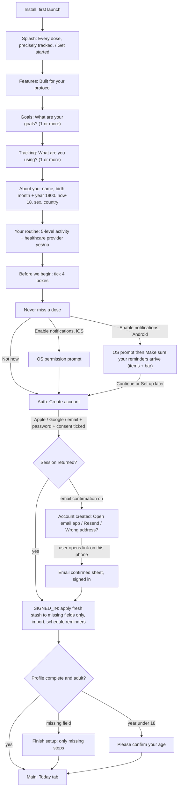
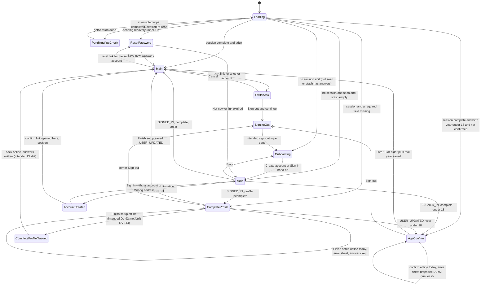
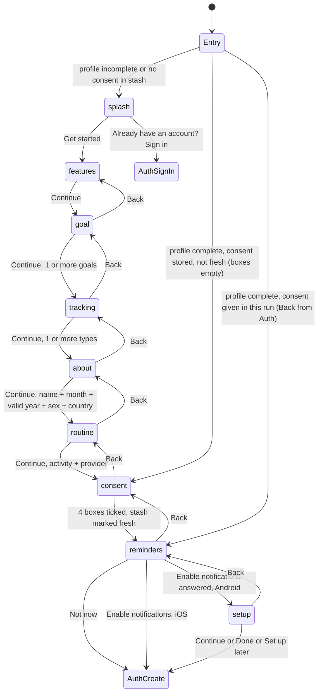
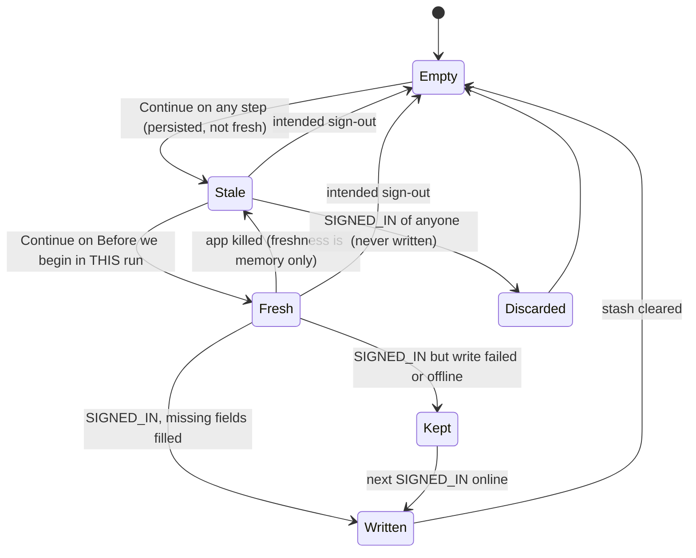

# 01 — Onboarding, sign-up and sign-in

> Draft for founder review, written 2026-10-12 from `docs/product/research/07-onboarding-account-premium.md` (main source), `08-platform.md`, `03-reminders.md`, `docs/decisions.md` (Onboarding & auth, Data & privacy, Premium/Auth 2026-10-03 rounds) and `docs/specs/premium-and-auth.md`, `docs/specs/reminder-setup-placement.md`. Code read on `redesign/graduated` @ 4dade55.
> This document shows the **intended** behaviour. Where the code differs today, a **Divergence today** note names the dossier finding (`07 D-18` = `research/07-…md` §6 D-18; `07 Gap 6` = §9 item 6).

---

## 1. Goal

Turn a first-time install into a signed-in account with a complete profile, in the order the founder approved: **value first, account last** (decisions.md:296, 2026-09-08; :297, 2026-09-29). Also: let a returning user sign in, recover a password, finish a missing profile (build-49 gate, "I need the data"), and confirm they are 18+ — without ever losing what they typed and without ever writing one person's answers into another person's account.

## 2. Actors

| Actor | Role |
|---|---|
| New user | Installs, answers 8 onboarding steps, creates an account (email, Apple or Google). |
| Returning user | Signs in on a new phone / reinstall / after sign-out. |
| Incomplete-profile user | Any account missing one of the 8 required fields (gate since 2020-01-01: nobody grandfathered). |
| Under-18 legacy user | Old account whose stored birth year makes them under 18. |
| Shared-device second person | Uses the same phone after someone else typed onboarding answers. |
| Supabase Auth | Sign-up, sign-in, email confirmation, password reset, `user_metadata`. |
| Apple / Google | Native ID token (iOS Apple, Google both); Android Apple = web OAuth, **live since 2026-10-03** (founder decisions.md:483, AD-30; server setup done, `STATE.md:17`; button shown while the server probe passes; web client secret expires **2027-04-04**, DV-211 ops item, rotation = Approvals item 5). |
| OS | Notification permission prompt (iOS / Android 13+). |
| Sync engine | Import from cloud after SIGNED_IN (`fullImportFromCloud` when local DB empty). |

## 3. Preconditions

- App installed; fonts loaded; `seenOnboarding` resolved (loading gate, `App.js:786`).
- Network needed for sign-up / sign-in / confirmation / reset; onboarding answers work offline (stash in AsyncStorage `dt_onboarding_data`).
- Root router is the only router (`App.js:291-335`): Recovery → Onboarding / Auth → CompleteProfile → AgeConfirm → Main.

## 4. What may already have happened before

| # | Prior state the user arrives in | How it shows | What the flow must do |
|---|---|---|---|
| P1 | Never opened the app | No stash, no `dt_seen_onboarding` | Start at splash (step 0). |
| P2 | Typed some answers, killed the app | Stash has answers; freshness was memory-only | Reopen onboarding at step 0, or at "Before we begin" with boxes empty when profile + consent are complete (R5). Every typed answer kept except the consent ticks. |
| P3 | Finished onboarding, tapped Create account, killed before submitting | Stash complete, email draft was in memory | Reopen on "Before we begin" (PA-92); the email must be retyped (never stored). |
| P4 | Signed up by email, never opened the confirmation link | Account exists, unconfirmed | Sign in shows "Please confirm your email…" sheet with **Resend** (30 s cooldown). |
| P5 | Opens the confirmation link on a different phone | No PKCE verifier there | Sheet "This link didn't work" variant: "Your email may already be confirmed. Sign in with your email and password." |
| P6 | Already has an account (other phone, older version) | Session absent; cloud data exists | "Already have an account? Sign in" from splash → Auth (Sign in) → import from cloud. |
| P7 | Account created with Apple, now on Android | Apple button on Android shows: the server probe passes (live since 2026-10-03). A real Android Apple sign-in is not recorded in the repo — it is a founder device test (F01-26; AD-30 corrected round 2) | Show "Continue with Apple" on Android (founder decisions.md:483 "3 sim", AD-30). If the web client secret lapses (2027-04-04) every Android Apple sign-in fails — rotate it before then (DV-211, ops item; Approvals item 5). |
| P8 | Account older than build 49 with missing fields (e.g. no country, no tracking types) | `missingProfileFields != []` | Route to **Finish setup** showing only the missing steps. |
| P9 | Account with a birth year under 18 (old data) | `needsAdultConfirmation` | Route to **Please confirm your age** after the profile gate. |
| P10 | Another person used this phone and left a stash | Stash exists, not fresh | Never written into this person's account; cleared unwritten on SIGNED_IN (PA-71…PA-73, built; a coordinator rule, decisions.md:472-473, not a founder answer — its premium-and-auth checklist awaits the founder's signature, Approvals item 7). |
| P11 | Password forgotten | — | "Forgot password?" → email → link opens Reset password inside the app (pending ≤ 1 h survives a kill). |
| P12 | Reinstall on iPhone | Keychain session may survive, AsyncStorage empty | Goes straight to Main (or a gate); DB re-imported. (SUSPECTED platform behaviour, `07 §8`.) |
| P13 | Offline at first launch | — | Onboarding works; Create account / Sign in show the network sheet; nothing typed is lost. |
| P14 | Notification permission already denied at OS level | — | "Enable notifications" opens no prompt; flow continues to Create account. |

## 5. Happy path

## 6. States and transitions

### 6.1 Root route (who sees which screen)

### 6.2 Pre-account step machine

### 6.3 Stash freshness (shared-device rule, PA-71…73 — coordinator rule decisions.md:472-473, built; checklist signature owed, Approvals item 7)

### 6.4 Transition table (data-bearing)

| From → To | Trigger | Guard | Writes |
|---|---|---|---|
| any step → next | Continue | `canContinue(step)` | `dt_onboarding_data` (merge, filled keys only; consent true/false every time) |
| consent → reminders | Continue | 4 boxes ticked | stash `consent_accepted`, `consent_date`; in-memory `fresh = true` |
| reminders → setup | Enable notifications (Android) | — | OS permission; `dosetrace_reminder_setup_seen = '1'` |
| reminders → Auth | Not now / Enable (iOS) / setup Continue | — | `dt_seen_onboarding = '1'` |
| Auth → AccountCreated | Create account (email) | email regex, password ≥ 6 (trimmed), consent ticked | `signUp` with `user_metadata = signupMetadata(stash, fresh)`; fresh stash cleared |
| Auth → SIGNED_IN | Apple / Google / Sign in | consent ticked for Apple/Google from Create | session in SecureStore; `applyPendingProfile` fills only missing fields |
| SIGNED_IN → Main | profile complete + adult | — | `initPurchases`, sync engine, cross-account guard, import or sync, reality migration, permission + `syncAllNotifications` + push token |
| CompleteProfile → Main | Finish setup | shown steps answered | `updateUser({data: accountPatch})` — only the shown steps' fields, `activity_scale: 5`, consent only if never recorded |
| AgeConfirm → Main | I'm 18 or older + year | year picked (this year − 18 … 1900) | one merge write `{adult_confirmed_at, birth_year}` |
| ResetPassword → Main | Save new password | match, different from old | isolated client `updateUser({password})`, then main `setSession` |

## 7. Alternative and exception paths

### 7.1 Offline
- Onboarding steps: work fully offline; stash persists every Continue.
- Create account / Sign in / Apple / Google offline: DoseTrace sheet "Connection problem. Check your internet and try again." (`error_network`); typed answers kept; password field cleared on errors.
- **Intended (DL-92, decided by logic — was AD-29 / OPEN-21 (5); source decisions.md:542, a coordinator line):** Finish setup and the 18+ confirmation may be answered offline — answers are kept on the phone and written when back online. The same **Sign out anyway** (with its confirmation) as Settings on both gates is new UI: **pending OPEN-24 item 10 (Portuguese question 2)**.
  - **Divergence today (07 D-22 area; 07 Gap 6; registry A-94 "Not started"; DV-114):** both gates show an error sheet titled "Error" / "Erro" (offline the body is `error_network` "Connection problem. Check your internet and try again."; `OnboardingFlowScreen.js:275-277`, `AgeConfirmScreen.js:73-75`; the generic title and circle glyph = DV-233) and stay locked offline; neither offers "Sign out anyway" (they offer only to discard entries of a protocol deleted forever on another device, `OnboardingFlowScreen.js:292-294`). An offline user with unsynced rows can be trapped.
- Offline cold start with an expired access token: **intended (DL-54)** the stored session is still the user's; the app must not route to Auth.
  - **Divergence today (07 D-16, confirmed in code):** `App.js:609-617` ignores the `getSession()` error, so `{session:null, error}` routes to Onboarding/Auth until a later refresh event (commit 495ebab confirms the auth-js behaviour). Still worth a device check (airplane mode, token > 1 h old).

### 7.2 App killed
| Killed during | Next launch |
|---|---|
| Any onboarding step | Onboarding reopens (stash has answers); step 0, or "Before we begin" with boxes empty if profile is complete (R5). |
| Android reminder setup step (Android killed the app while the user was in system settings) | Onboarding reopens at "Before we begin", every answer kept except the consent tick (SP-4, Gate B). |
| Create account screen | Back on "Before we begin"; email retyped. |
| After `signUp`, before confirmation | Metadata is already on the account; the confirm link later gives a session. |
| Reset password | Reset password screen comes back for up to 1 h (pending recovery in SecureStore). |
| Apple on Android, mid web flow | PKCE verifier of any pending reset/confirm restored; relaunch with `auth-callback` signs in once. |

### 7.3 Second device / other account
- Same account on a second phone: Sign in → full import; profile already complete → Main directly; Android once-per-phone reminder setup opens from Today (flow 06).
- **A different account signs in on a phone holding another account's local data:** today the previous account's local data — unsynced rows included — is discarded without a warning, and its reminders are cancelled before import (cross-account guard, `App.js:621-633`). The only source is a coordinator line (decisions.md:508-509, "final Gate B"), never put to the founder, and it collides with CLAUDE.md "NEVER lose user-entered data": **pending OPEN-21 (11) (Portuguese question 22)** — keep as built, warn first ("Sign in as {previous} first" / "Discard and continue", the recommendation), or keep the rows hidden until that account returns.
- Shared phone, stash typed by person A, person B signs up with Apple: stash not fresh for B → never written to B (PA-71…73; coordinator rule decisions.md:472, built; checklist signature owed, Approvals item 7).
- **Divergence today (07 D-18; 08 Gap 1):** AI consent (`dosetrace_ai_extraction_consent_v4`) is per device and survives sign-out, so person B inherits person A's AI consent. Ledger rule: "AI consent before every AI call" (decisions.md:323). Decided by logic → DL-55 (consent per account, version and date, cleared on sign-out); the Settings row to withdraw it is new UI, **pending OPEN-24 item 1 (Portuguese question 2)**; server proof of consent is a counsel item (DL-83). → DV-007.
- **Divergence today (07 D-7, confirmed in code):** entitlement cache keys survive sign-out; `cacheUid` uses `dosetrace_entitlement_last_uid` until `initPurchases` runs, so a short window on SIGNED_IN can read the previous account's cached Premium. Intended (DL-53): the cache is bound to the session user at sign-in, before any read. → DV-082.

### 7.4 Timezone / DST / midnight
- Birth year/month only; no time-of-day logic. 18+ test is **year only** (someone born in December of this year − 18 passes while 17): AD-43, the floor uses the typed birth year (decisions.md:300); no counsel flag (AD-43 narrowed round 2 — decisions.md:388 is not about age); `07 Gap 19`, DV-168.
- `consent_date` and `onboarded_at` are timestamps; no local-day logic depends on them.

### 7.5 Notification tap
- A notification tap that launched the app while signed out: dropped on sign-out; ignored when older than 12 h; held in `pendingNavRef` until `Main` exists (flows 03, 06).

### 7.6 Fold open / closed
- Paywall, sign-in, onboarding, reset password and every sheet stay **one centred column** on the unfolded Fold (BK-11). Fold/unfold never loses typed text (BK-10). No two-page layout in this flow.

### 7.7 Free vs Premium
- No paywall inside onboarding. Every new account starts Free; Premium is decided after SIGNED_IN by RevenueCat (`initPurchases(uid, email)`), developer e-mail list, or cached entitlement (flow 13).
- The onboarding features list shows "Dose accumulation" (Premium) as an Example hero — never as a promise of the user's data.

### 7.8 Notifications choice
- iOS "Enable notifications" → OS prompt → Create account.
- Android "Enable notifications" → OS prompt → **Make sure your reminders arrive** (items + bar only; no schedule or test; "Continue" reads "Done" when all readable items are OK; "Set up later"). Marks setup seen on this phone (SP-4).
- "Not now" → straight to Create account; the setup step is skipped.
- **Not decided — pending OPEN-20 (b) (Portuguese question 11 (a)); AD-27 was withdrawn (moved to OPEN-20 (b)).** When the system should ask for notification permission after "Not now" is the founder's call. The recommendation (option A): no system dialog at start; ask when a protocol with a reminder time is first saved on the phone **or first arrives on it by sync** (new install, sign-in on a new phone — the iPhone case, since SP-5's screen is Android-only), and on Android through the SP-5 setup screen (which Today opens once per phone for anyone with a reminder time — "Not now" users included, decisions.md:626). Options B (ask once more at the next start) and C (as built) stay open.
  - **Today (03 G25; 07 §8 row "Not now"):** `requestNotificationPermissions()` runs at every signed-in cold start and on SIGNED_IN (`App.js:650`, `:730`) and inside the push-token registration (`notifications.js:1033`), so the OS prompt appears right after sign-in anyway. The system dialog itself appears only while the status is undetermined (`notifications.js:157-160`): once on iPhone, at most twice on Android 13+. → DV-054 (S3).
  - **Not a divergence (X-05):** Android shows the setup step after any answer to the OS dialog, a denial included. Signed SP-4 says the step comes "right after 'Turn on notifications' is answered", and a denial is an answer, so the code matches SP-4. DL-50 was withdrawn (moot) and DV-142 closed by the verification; the behaviour stays.

### 7.9 Email confirmation and links
| Link | Behaviour |
|---|---|
| Confirm link on this phone, signed out | Exchange code → sheet "Email confirmed" / "Your email is verified and you are signed in. Welcome to DoseTrace." |
| Confirm link while signed in | Silently remembered; never switches accounts. |
| Confirm link on another phone | "This link didn't work" + "Your email may already be confirmed. Sign in with your email and password." |
| Reset link, same account or nobody signed in | Reset password screen. |
| Reset link for another account while signed in | Sheet "Reset the password of another account?" naming both; "Sign out and continue" runs an intended sign-out **without force** (blocked if unsynced). |
| Each link | Handled once (memory + `dosetrace_links_handled`, last 20). |

### 7.10 Errors (all DoseTrace sheets, never raw server text — PA-64)
Email already registered; incorrect email or password; email not confirmed (+ Resend); too many attempts; weak password; Apple/Google cancelled (stash restored, nothing written); Apple/Google from Create without the consent box ticked ("You must accept the data & privacy terms…").
- **Divergence today (DV-233, No (bug)):** the sign-in, reset-password, onboarding, email-link and 18+ error sheets use the circle `alert` glyph instead of the warning triangle (decisions.md:64), and the gates' error sheets are titled the generic "Error" against the founder's Q4 = A (titles say what happened, decisions.md:121).

## 8. What every surface shows

| State | Onboarding / Auth screen | Today | Settings | Notifications | Data on phone |
|---|---|---|---|---|---|
| First launch | Splash: droplet logo, "Every dose, precisely tracked.", **Get started**, "Already have an account? Sign in", language pill | — | — | none scheduled | nothing |
| Mid-onboarding | Progress bar, Back, one **Continue** dimmed until answered | — | — | none | stash `dt_onboarding_data` |
| About you, year < 1900 or > now − 18 | Note "DoseTrace is for adults: enter a year of birth between 1900 and {max}."; Continue dim | — | — | — | — |
| Never miss a dose | **Enable notifications** / **Not now** | — | — | — | — |
| Android setup step | "Make sure your reminders arrive", intro, bar "{n} of {total} ready", rows with Turn on / Adjust / Open, **Continue** or **Done**, **Set up later** | — | — | — | `dosetrace_reminder_setup_seen` |
| Create account | Apple (first), Google, email + password, consent row "I agree to the Terms of service and Privacy policy" (ticked only for a fresh stash with consent) | — | — | — | email in memory only |
| Account created (confirm pending) | "Account created" + "We sent a confirmation link to {email}…", Open email app, Resend link (30 s), Wrong address? Go back | — | — | — | stash cleared if fresh |
| Signed in, incomplete profile | Finish setup: only missing steps + "Finish setup" + corner Sign out | not reachable | not reachable | reminders may still fire from earlier sessions | session + imported DB |
| Signed in, under 18 | "Please confirm your age", year wheel (none preselected), **I'm 18 or older**, Download my data, Delete account, Sign out | not reachable | not reachable | as above | — |
| Main | — | Today (empty state "No protocols yet" + **Add a protocol** for a new user) | Profile card filled from onboarding answers | first schedule after first protocol | full DB |
| Reset password | "Set a new password", New / Confirm password, **Save new password**, **Not now** | — | — | — | pending recovery (SecureStore, ≤ 1 h) |

Theme: every screen above uses theme tokens; only the Apple and Google buttons are store-owned surfaces (Apple HIG / Google branding, founder decisions.md:40, 2026-10-02). Both themes must be checked (Gate A). The Android "Continue with Apple" must use Apple's official artwork (AD-74); today it draws its own Apple glyph (`AuthScreen.js:65-73`, DV-239) — the artwork download needs the founder's go (Approvals item 4).

The "Privacy policy" link on Create account and the consent step opens the web policy (`lib/legalLinks.js:6`, dosetrace.io/privacy-policy); the in-app text that Settings opens differs and omits the food log, assistant and vial scan (DV-085, DV-231 — flow 12).

## 9. Data written at each step

| Step | Store | Fields | Synced | Survives intended sign-out |
|---|---|---|---|---|
| Language pill | AsyncStorage `dosetrace_language` | code | no | yes (device pref) |
| Each Continue | AsyncStorage `dt_onboarding_data` | goals, tracking_types, display_name, birth_month, birth_year, gender, country, activity_level (5-level), has_provider, consent_accepted/date | no | no (wiped) |
| Before we begin | memory | `fresh = true` | — | — |
| Enable notifications (Android) | AsyncStorage | `dosetrace_reminder_setup_seen = '1'` | no | yes (per phone) |
| Hand-off to Auth | AsyncStorage | `dt_seen_onboarding = '1'` | no | no |
| Create account | Supabase Auth `user_metadata` | all stash fields + `consent_accepted:true`, `consent_date`, `onboarded_at`, `activity_scale:5` | server | yes |
| Apple iOS first sign-in | `user_metadata.display_name` | Apple-provided name (if returned) | server | yes |
| SIGNED_IN | SecureStore | session tokens (chunked) | — | removed |
| SIGNED_IN | `user_metadata` | fresh stash → only missing fields | server | yes |
| SIGNED_IN | AsyncStorage `dosetrace_entitlement_v1:<uid>` | Premium cache with expiry | no | **yes (07 D-7)** |
| SIGNED_IN | Supabase `push_tokens` | expo_token, platform, timezone | server | removed on intended sign-out |
| Finish setup | `user_metadata` | shown steps only, consent if never recorded | server | yes |
| 18+ confirm | `user_metadata` | `adult_confirmed_at`, `birth_year` (one merge write) | server | yes |
| Reset password | Supabase Auth | password; pending recovery discarded | server | — |

Never written: the password anywhere on the phone; the typed email to storage (memory `authDraft` only).

## 10. Rules (with sources)

1. Steps exactly `splash, features, goal, tracking, about, routine, consent, reminders`; no "You're all set" (founder decisions.md:297, 2026-09-29; `lib/onboardingSteps.js:12`).
2. Continue only when the step is answered (R2, `lib/onboardingSteps.js:44-55`; decisions.md:297 "one Continue dimmed until answered").
3. Birth year 4 digits, 1900…this year − 18 (founder decisions.md:300, 2026-09-15; AD-43).
4. Stash: only filled keys; fresh only after "Before we begin" in this run; a non-fresh stash is never written to any account (PA-71…73, built — a coordinator rule, decisions.md:472, not a founder answer; the premium-and-auth checklist is unsigned: signature owed, Approvals item 7, DV-229).
5. Onboarding answers fill ONLY missing fields, never overwrite a stored value (CLAUDE.md "Writes merge, never clobber", founder 2026-09-12; applied by the coordinator line decisions.md:473 and PA-72; the display-name case is DL-57).
6. Create account always shows the consent row with Terms + Privacy; Apple/Google from Create need it ticked (PA-80, Gate B blocker; same unsigned checklist, Approvals item 7).
7. Duplicate sign-up detected by `identities.length === 0` → "Email already registered".
8. Every auth message is a DoseTrace sheet; raw server text never shown (PA-64). Error sheets use the warning triangle and a title that says what happened (decisions.md:64, :121) — today they do not (DV-233).
9. Store buttons per Apple HIG / Google branding (founder decisions.md:40, 2026-10-02); on Android the Apple button uses Apple's official artwork (AD-74; download = Approvals item 4; today a drawn glyph, DV-239).
10. Profile gate: 8 required fields (name, birth month + year, sex male/female, country, goal, activity, tracking, provider); PROFILE_GATE_SINCE 2020-01-01 — "I need the data" (founder decisions.md:299, 2026-09-09, do not re-litigate). The gate can be answered offline (DL-92); its "Sign out anyway" is OPEN-24 item 10.
11. Under-18 legacy accounts get a one-time "I'm 18 or older" confirmation; if not confirmed, export and delete stay available (founder decisions.md:482, 2026-10-03 "2 sim"). The confirmation also asks the real birth year on the year wheel (this year − 18 back to 1900, nothing preselected) — a coordinator line (decisions.md:496; PA-106…PA-108, built), not a founder answer; its checklist awaits the founder's signature (Approvals item 7).
12. `onAuthStateChange` stays synchronous (CLAUDE.md).
13. Google always shows the account chooser; Apple on Android only when the server probe passes; "Continue with Apple" on Android is a founder decision (decisions.md:483, 2026-10-03 "3 sim"; AD-30) and is **live** since the server setup of 2026-10-03 (`STATE.md:17`). The Apple web client secret expires **2027-04-04**: regenerate it before then with `scripts/apple-client-secret.cjs` and paste it into Supabase → Auth → Apple, or every Android Apple sign-in fails (DV-211, ops item; the founder's console step, Approvals item 5). The ship-check Gate B allow-list text still lacks `dosetrace://auth-callback` (doc fix only, DV-115).
14. Password trimmed on sign-up, sign-in and reset alike (PA-86).

## 11. Divergences today (summary)

| ID | Intended | Today | Source | DV |
|---|---|---|---|---|
| D01-1 | Gates answerable offline (DL-92) + "Sign out anyway" (pending OPEN-24 item 10) | Error sheet, no force | DL-92 (was AD-29 / OPEN-21 (5); decisions.md:542 is a coordinator line); `07 Gap 6` (A-94) | DV-114 |
| D01-2 | Offline cold start keeps a stored session (DL-54) | Routes to Auth (the `getSession` error is ignored, `App.js:609-617`) | `07 D-16` (confirmed in code) | DV-083 |
| D01-3 | AI consent belongs to the person who gave it (DL-55; the Settings withdraw row = pending OPEN-24 item 1) | Device-wide, survives sign-out | `07 D-18`, `08 Gap 1` | DV-007 |
| D01-4 | *Pending OPEN-20 (b) (Portuguese question 11 (a)).* Recommendation A: no OS prompt at start after "Not now"; ask when a protocol with a reminder time is first saved or arrives by sync (and the SP-5 screen on Android) | OS prompt at the first signed-in start | `03 G25`, `07 §8`; AD-27 withdrawn → OPEN-20 (b) | DV-054 |
| D01-5 | *Closed — not a divergence (X-05).* The setup step after any answer, a denial included, is what signed SP-4 says | Same | `03 G26`; DL-50 withdrawn | — (DV-142 closed) |
| D01-6 | A sign-in fills the display name only when it is missing, from the Apple or Google profile (DL-57) | Google and Apple-on-Android never write it (the `about` step shows again if the stash was not fresh); Apple iOS overwrites an existing name when Apple returns one (first authorization only). Live for Android Apple accounts too | `07 D-20` | DV-084 |
| D01-7 | Settings and onboarding validate the same profile rules | Gate checks presence only (a bad stored year or 4-level activity passes) | `07 D-11` | DV-162 |
| D01-8 | Android Apple sign-in live (founder decisions.md:483; AD-30) and kept live | **Live — no behaviour divergence.** Server setup done 2026-10-03 (`STATE.md:17`); probe 2026-10-12 → 302 to Apple, button shown; a real Android Apple sign-in is a founder device test (F01-26), not recorded in the repo. Remaining: the web client secret expires 2027-04-04 (DV-211, ops item; Approvals item 5) and the ship-check Gate B allow-list text lacks `dosetrace://auth-callback` (DV-115). The old "setup pending" line (premium-and-auth.md Manual setup step 7) is stale | `STATE.md:17`; verification 05 PRD-AUTH-7 / O-1 | DV-115, DV-211 (ops) |
| D01-9 | Onboarding analytics funnel complete — no analytics before sign-in for now (DL-62, counsel) | `onboarding_completed` dropped for email sign-ups that need confirmation (no user yet) | `07 Gap 18` | DV-167 |
| D01-10 | Restart after typing answers then "Sign in" lands on Sign in (DL-59) | Lands back on onboarding (stash has answers) | `07 D-14` | DV-163 |
| D01-11 | Android "Continue with Apple" uses Apple's official artwork (AD-74; download = Approvals item 4) | Drawn Apple glyph (`AuthScreen.js:65-73`) | verification round 2 R2-01 (OPEN-18 (6), closed → AD-74) | DV-239 |
| D01-12 | Error sheets use the warning triangle and a title that says what happened (decisions.md:64, :121) | Sign-in, reset, onboarding, email-link and 18+ error sheets use the circle glyph; the gates' sheets are titled "Error" | verification round 2 R2-03 #6 | DV-233 |

## 12. Founder questions (canonical IDs — `docs/product/OPEN-DECISIONS.md`)

Reconciled 2026-10-12: every question this flow raised has one canonical ID in `OPEN-DECISIONS.md` — **OPEN-xx** waits for the founder (asked in the one Portuguese round there), **AD-xx** is already decided by the ledger or a signed spec, **DL-xx** is decided by product logic (recorded in `docs/decisions.md`; the founder may override). DV-xxx is the defect row in `DIVERGENCES.md`.

**Open — waiting for the founder:**
- **OPEN-20 (b) — System notification permission after "Not now"** (Portuguese question 11 (a)). Recommendation A: no dialog at start; ask when a protocol with a reminder time is first saved or arrives by sync, and on Android through the SP-5 screen. Was AD-27 (withdrawn). → D01-4, DV-054.
- **OPEN-21 (11) — The cross-account guard** (Portuguese question 22). Whether another account's unsynced rows are still discarded without a warning when a different account signs in (§7.3; coordinator line decisions.md:508-509). Recommendation B: warn and offer "Sign in as {previous} first" / "Discard and continue". → DV-081, DV-169.
- **OPEN-24 — New UI from logic decisions** (Portuguese question 2): item 1 (Settings row to withdraw AI consent, DL-55 → D01-3, DV-007) and item 10 (the gates' "Sign out anyway", DL-92 → D01-1, DV-114). Pictures first.
- **OPEN-16 (a) — Scope of 1.3.0** (Portuguese question 1): no DL or DV row of this flow has a target build yet (e.g. DL-55, DL-92, DL-54, DL-57, DL-59).

**Decided — moved or corrected in round 2 (final ids):**
- **DL-92** (was AD-29 / OPEN-21 (5)) — the 18+ and profile gates can be answered offline. → D01-1, DV-114. The `CompleteProfileQueued` state in §6.1 is this intended path, not built.
- **AD-74** (was OPEN-18 (6)) — the Android Apple button uses Apple's official artwork; the download = **Approvals still owed item 4**. → D01-11, DV-239.
- **AD-30** (corrected) — Android Apple sign-in is live; "the founder signed in on the Fold 2026-10-07" has no source and was removed. Secret rotation before 2027-04-04 = **Approvals item 5** (DV-211, ops item). → D01-8, DV-115.
- **AD-43** (narrowed) — the 18+ floor uses the typed birth year (decisions.md:300); the counsel flag was dropped (decisions.md:388 is not about age). → DV-168.
- **DL-50** withdrawn and DV-142 closed (the Android setup step after a denial matches signed SP-4). → D01-5.
- **Approvals still owed item 7** — the premium-and-auth checklist (PA-71…73 stash rules, PA-80 consent, PA-106…108 real-year ask) is unsigned; the build gate does not catch it today (DV-229).

**Decided — unchanged, applied here:**
- **DL-55 — AI consent scope** (`07 D-18`). Decided by logic: consent belongs to the account (version and date recorded), is cleared on the intended sign-out, and can be withdrawn in Settings; the withdraw row is OPEN-24 item 1; server proof of consent is a counsel item (DL-83). → DV-007.
- **DL-53** (entitlement cache bound to the session user, → DV-082), **DL-54** (offline with a stored session = signed in, → DV-083), **DL-57** (display name only when missing, → DV-084), **DL-59** (Sign in remembered, → DV-163), **DL-62** (no analytics before sign-in, counsel, → DV-167).

## 13. Acceptance checks (agent-device QA script)

Conventions for every check: fresh install unless stated; screenshot before every tap; run each check in **light and dark** (Settings → Preferences → Appearance) and read every sheet in both; Portuguese run = choose **PT** on the splash language pill (or Settings → Preferências → Idioma → PT). Never use the founder's main account; email checks use a `+qa` alias of the test account (decisions: "Run test steps yourself").

**F01-01 — Splash and language**
- Do: launch fresh install.
- Expect EN: "Every dose, precisely tracked.", button **Get started**, link "Already have an account? Sign in".
- Expect PT (tap language pill → PT): "Cada dose, com precisão.", **Começar**, "Já tem uma conta? Entrar".

**F01-02 — Continue stays dim until answered**
- Do: Get started → Continue on Features → on Goals tap nothing.
- Expect: Continue dimmed; title "What are your goals?" / PT "Quais são os seus objetivos?". Tap one goal → Continue enabled.

**F01-03 — Tracking step**
- Expect title "What are you using?" / PT "O que você está usando?"; options Peptides / Hormones / GLP-1 / Oral supplements (PT Peptídeos / Hormônios / GLP-1 / Suplementos orais).

**F01-04 — Adults-only year**
- Do: About you → type birth year = current year − 17.
- Expect: note "DoseTrace is for adults: enter a year of birth between 1900 and {current − 18}." / PT "O DoseTrace é para adultos: informe um ano de nascimento entre 1900 e {…}."; Continue dim. Type a valid year + name + month + sex + country → Continue enabled.

**F01-05 — Your routine**
- Expect title "Your routine" / "Sua rotina"; 5 activity levels ("Desk job, little or no exercise" … "Very high — physical job + daily training" / PT "Trabalho sentado, pouco ou nenhum exercício" … "Muito alto — trabalho físico + treino diário"); provider "Do you work with a healthcare provider?" / "Você é acompanhado por um profissional de saúde?" Yes/No.

**F01-06 — Before we begin needs all 4 ticks**
- Expect title "Before we begin" / "Antes de começar"; 4 rows: "Not a medical device", "Estimates, not advice", "AI only when you use it", "Your privacy" (PT "Não é um dispositivo médico", "Estimativas, não aconselhamento", "IA só quando você usa", "Sua privacidade"). Continue enabled only with all 4 ticked. The AI row names Anthropic and the AI food log.

**F01-07 — Kill mid-onboarding keeps answers**
- Do: fill through Your routine, kill the app, relaunch.
- Expect: onboarding (not Auth); step 0; walking forward shows every answer prefilled. When profile + consent were complete before the kill: opens on "Before we begin" with all 4 boxes **empty**.

**F01-08 — iOS: Enable notifications**
- Do: Never miss a dose ("Nunca perca uma dose") → **Enable notifications** ("Ativar notificações").
- Expect: iOS permission prompt; after answering → Create account screen. No setup step on iPhone.

**F01-09 — Android: setup step after Enable**
- Do (Android): Enable notifications → allow.
- Expect: "Make sure your reminders arrive" / "Garanta que seus lembretes cheguem"; bar "{n} of {total} ready" / "{n} de {total} prontos"; rows Notifications, Alarms & reminders, Battery, Pause app activity if unused (Samsung: "Manage app if unused", plus Deep sleeping apps with **Open** and **I checked**); buttons **Continue** (reads **Done** when all readable rows OK) and **Set up later** / "Configurar depois". No "Next reminder" and no test button.
- Then: tap Alarms & reminders → Turn on → Android screen → enable → Back. Expect the row OK and the bar +1 without reopening.

**F01-10 — Android: Not now skips setup**
- Do: Not now / "Agora não".
- Expect: straight to Create account; later Today opens the setup screen once only after a protocol with a reminder time exists (flow 06, SP-5).

**F01-11 — Create account consent row**
- Expect: Apple button first, Google second (both themes). iOS: the system Apple button (Apple's own artwork). Android: Apple's official artwork is intended (AD-74); until it is downloaded (Approvals item 4) the button draws its own glyph — record D01-11 / DV-239. Then email + password fields with show-password eye, row "I agree to the Terms of service and Privacy policy" / "Concordo com os Termos de uso e a Política de privacidade" — ticked because this run passed Before we begin.
- Untick it → tap Continue with Google → sheet "You must accept the data & privacy terms to create an account." / "Você precisa aceitar os termos de dados e privacidade para criar uma conta."; nothing written.

**F01-12 — Email validation sheets**
- Do: Create account with "abc" → sheet "Please enter a valid email address." / "Digite um e-mail válido."; with 5-char password → "Password must be at least 6 characters." / "A senha deve ter pelo menos 6 caracteres."

**F01-13 — Email sign-up with confirmation**
- Do: valid new `+qa` email, password ≥ 6, Create account.
- Expect: "Account created" / "Conta criada"; "We sent a confirmation link to {email}…"; buttons "Open email app" / "Abrir app de e-mail", "Resend link" / "Reenviar link" (disabled 30 s after tap; then "Confirmation link sent again"), "Wrong address? Go back" / "Endereço errado? Voltar".
- Data: Supabase user exists with `user_metadata` = onboarding answers (check via the admin tooling, read-only).

**F01-14 — Confirm link on this phone**
- Do: open the confirmation email link on the same phone.
- Expect: sheet "Email confirmed" / "E-mail confirmado" + "Your email is verified and you are signed in. Welcome to DoseTrace."; lands on Today empty state "No protocols yet" / "Nenhum protocolo ainda" + **Add a protocol** / "Adicionar protocolo".

**F01-15 — Existing email**
- Do: Create account with an existing email.
- Expect: "Email already registered" / "E-mail já cadastrado" + the "Sign in with your password, or with Apple or Google…" body; password field cleared.

**F01-16 — Sign in, unconfirmed**
- Do: sign in with the unconfirmed account.
- Expect: "Please confirm your email address before signing in — check your inbox…" / "Confirme seu e-mail antes de entrar…" with Resend.

**F01-17 — Wrong password**
- Expect: "Incorrect email or password." / "E-mail ou senha incorretos." (DoseTrace sheet, no native alert).

**F01-18 — Forgot password**
- Do: Sign in → type email → "Forgot password?" / "Esqueceu a senha?".
- Expect: "Reset link sent" / "Link enviado" + "If an account exists for {email}, we sent it a password reset link…". Open the link on this phone → "Set a new password" / "Crie uma nova senha"; save → "Password updated" / "Senha atualizada" + "You're signed in with your new password." / "Você entrou com sua nova senha."
- Kill on the Reset screen and relaunch within 1 h → the Reset screen returns. Tap **Not now** → leaves without changing anything.

**F01-19 — Reset link for another account**
- Setup: signed in as Test03; open a reset link for the `+qa` account.
- Expect: "Reset the password of another account?" / "Redefinir a senha de outra conta?" naming both addresses; "Sign out and continue" / "Sair e continuar"; with unsynced rows (airplane mode + a dose logged) → not signed out, sheet "Some changes on this phone aren't backed up yet, so DoseTrace didn't sign you out…".

**F01-20 — Finish setup shows only missing steps**
- Setup: test account with `country` removed (admin, test account only).
- Expect after sign-in: Finish setup with only "About you" (prefilled except country) and the finish step "Finish setup" / "Concluir configuração" + "Save your details and start tracking."; corner **Sign out**. Saving → Today.
- Intended offline (D01-1, DL-92): in airplane mode Finish setup saves locally and enters Main; reconnect → the field appears in Settings → Edit profile. **Today this fails** (sheet "Error" + "Connection problem. Check your internet and try again.") — record it as the divergence (DV-114).

**F01-21 — 18+ confirmation**
- Setup: test account with birth_year = current year − 16, no `adult_confirmed_at`.
- Sources: the gate itself is the founder's (decisions.md:482); the real-year ask is a coordinator line (decisions.md:496, PA-106…108, checklist signature owed — Approvals item 7).
- Expect: "Please confirm your age" / "Confirme sua idade"; body names the stored year; year field "Choose your birth year" / "Escolha seu ano de nascimento" with nothing chosen (wheel this year − 18 … 1900); **I'm 18 or older** / "Tenho 18 anos ou mais" disabled until a year is picked; "Download my data", "Delete account", "Sign out" present. Confirm with a valid year → Today; Settings → Edit profile shows the new year.

**F01-22 — Shared device: stale stash is never written**
- Do: fresh install; fill onboarding to "Before we begin" without ticking; kill; relaunch; tap "Already have an account? Sign in"; sign in as Test03.
- Expect: Test03's profile unchanged (name/country not replaced by the typed ones); stash cleared.

**F01-23 — Sign in imports the account**
- Do: fresh install → splash → "Already have an account? Sign in" → Test03.
- Expect: Today shows Test03's protocols within the first sync; My Protocols list complete; no onboarding steps shown.

**F01-24 — Fold: one centred column**
- Do (unfolded Fold): run F01-01…F01-13.
- Expect: every screen a centred column; fold/unfold mid-step keeps typed name and selection; no right page.

**F01-25 — Both themes on every sheet**
- For each sheet raised in F01-11…F01-21: text readable in light and dark (no white-on-white); Apple button per HIG — light theme: black button with white logo and text; dark theme: white button with black logo and text (iOS `AuthScreen.js:93`; Android drawn button `:83`, glyph pending the official artwork, AD-74 / DV-239).

**F01-26 — Android: full "Continue with Apple" sign-in (live since 2026-10-03)**
- Do (Android, signed out): Auth → "Continue with Apple" / "Continuar com a Apple" → complete the Apple web sign-in with the test account's Apple ID → return to the app through `dosetrace://auth-callback`.
- Expect: the button is visible (probe passes); the browser returns to DoseTrace and the account is signed in (Today, or a gate if the profile is incomplete); no "This link didn't work" sheet. Record the date: the web client secret expires 2027-04-04, and after that this check fails until it is regenerated.
