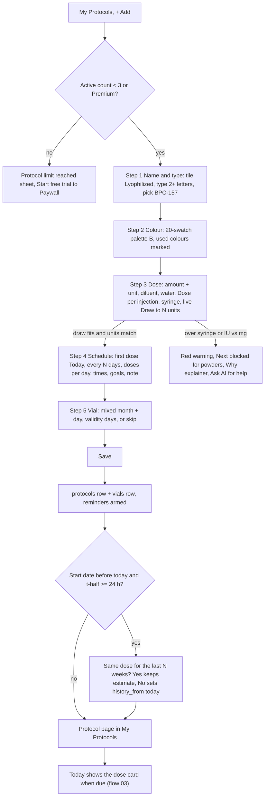
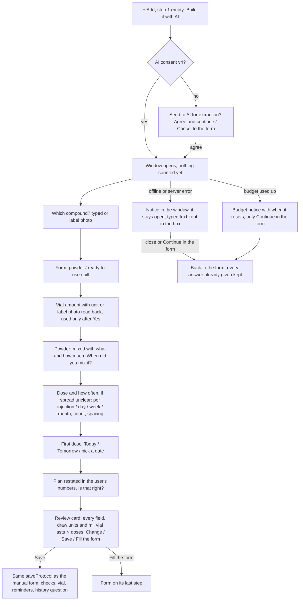
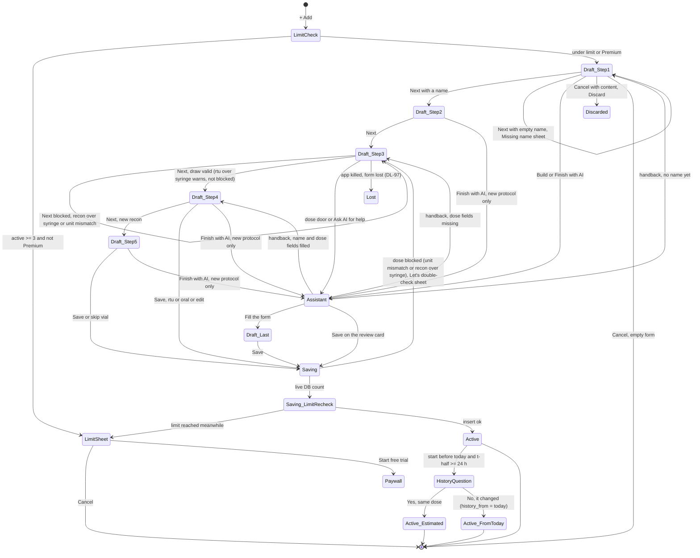
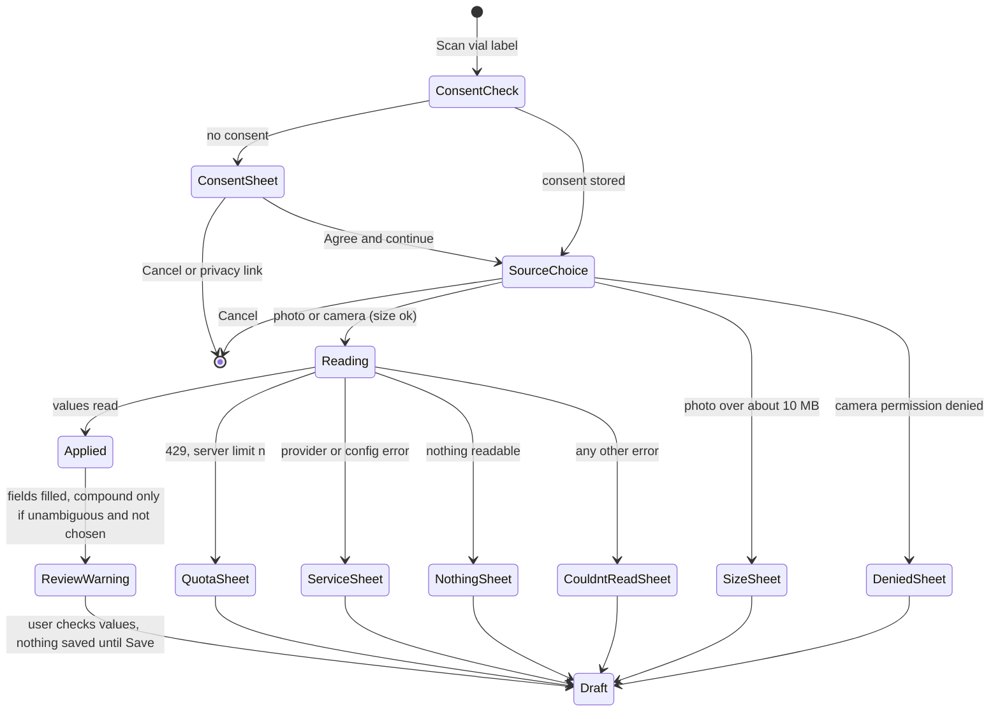

# 02 — Create and edit a protocol (incl. past start + history question, AI assistant, vial scan)

> Draft for founder review, written 2026-10-12 from `docs/product/research/01-protocols.md` (main source), `02-doses-today.md`, `03-reminders.md`, `05-curve-journey.md`, `docs/decisions.md` (Protocols & dose math; AI rules; AI protocol assistant 2026-10-03; dt-council 2026-10-04) and `docs/specs/ai-protocol-assistant.md` (AP-0…AP-35). Code @ 4dade55.
> Shows the **intended** behaviour. **Divergence today** notes cite the dossier (`01 G-5` = research/01 §9 G-5; `01 D-13` = §6 D-13).
> Corrected 2026-10-12 against `docs/product/verification/01-protocols.md` §7 (code @ 897f01d, same code as 4dade55). "OPEN-xx (was <id>)" marked a choice that was not decided yet; the founder answered every one on 2026-10-15, so each now cites its AD id ("was OPEN-xx").
> Corrected again 2026-10-12 after verification round 2 (`docs/product/verification/round2/R2-05-flows-picture.md`, `R2-07`); every id carries its final status from `verification/round2/id-map.md`. "Intended" is backed by a founder line (decisions.md:NNN), a signed spec row, an AD-xx or a DL-xx, or an AD-xx decided by the founder on 2026-10-15 (was OPEN-xx), or says "wording to approve (Approvals item 2.N)" or "approved, picture owed (Approvals item 3)".

---

## 1. Goal

Let a user record **what** they take, **how much**, **how often** and **from which container**, with pure math (draw to N units) and no advice — by hand (the default, free) or with the optional AI assistant, optionally reading the vial label — and later change only what they mean to change. Every other module reads this record: Today, reminders, the Missed scan, the Dose log, the curve, the report, supply alerts.

## 2. Actors

| Actor | Role |
|---|---|
| User | Fills the 4–5 step wizard (or talks to the assistant), saves, edits. |
| Wizard (`screens/ProtocolsScreen.js` pageSheet) | Steps 1 Name & type · 2 Colour · 3 Dose · 4 Schedule · 5 Vial (new recon only). |
| AI protocol assistant (`lib/protocolAssistant.js` + `protocol-assistant` function) | Asks, understands, transcribes. Never suggests or questions a value (AP-3). |
| Vial-label scan (`extract-bloodwork` kind `vial`) | Reads compound / strength / volume; review before save; never writes `compound_id`. |
| Calculator (`lib/doseMath.js`) | Every number on screen and in the DB. |
| Notifications (`scheduleDoseReminder`) | Arms reminders after save (flow 06). |
| Entitlement (`hasPremium`) | Free limit: 3 active protocols. |

## 3. Preconditions

- Signed in (`getCachedUser`), profile complete (flow 01).
- Free plan: fewer than 3 active protocols, or Premium (checked at + Add, at Save, at Restart, at Restore).
- AI paths only: shared AI consent v4 granted; network; assistant budget (10 conversations / rolling 7 days, counted at the first AI answer — signed AP-18; the server also caps 40 answers per conversation, a 24-hour conversation life and 200 answers per rolling 24 h, `supabase/functions/protocol-assistant/budget.ts:10-12` — kept as abuse ceilings, each with its own true message when hit, ×6: AD-105, was OPEN-18 (3); today the message is generic, DV-240); scan pool (3 free / 20 Premium a month, shared with labs and vaccines).

## 4. What may already have happened before

| # | Prior state | What the flow must do |
|---|---|---|
| P1 | Started the compound weeks ago (the founder's flagship journey miss) | Start date accepts any past date; on save, compounds with t½ ≥ 24 h get "Same dose for the last N weeks?" (A-30 option C). Nothing is logged; the curve estimates the pre-install part (dashed, "estimated"). |
| P2 | Vial already mixed days ago | Step 5 asks month + day (most recent past occurrence); assistant asks "When did you mix it?" (≤ 365 days). Validity counts from that date. |
| P3 | Vial already half used | No "doses already used" field (A-08 / F7; AP-28 accepted "mirrors the form"). New vial starts at 0 taken. → Intended (AD-80, decided 2026-10-15, was OPEN-01): the protocol page gets "Edit vial" (mix date, validity days, doses already used) and "New vial"; picture first, 1.3.0. Today not built (DV-094). |
| P4 | Not mixed yet | "I haven't mixed this vial yet — skip"; Today shows "+ Add vial" later (flow 04). |
| P5 | Typed a weekly total as the dose (240 mg customer case) | "Dose per injection" label + hint; over-capacity warning with "Why" explainer and "Ask AI for help" (AP-11, AP-12). |
| P6 | Long-interval ester (e.g. every 12 weeks) | Custom interval; reminders still renewed within the rolling window (flow 06). |
| P7 | Already at 3 active protocols (free) | Limit sheet before the wizard opens; re-checked at Save. |
| P8 | Same compound already active (second device / duplicate) | Allowed on create (no warning today on create; warning exists on Restart only). |
| P9 | Wizard interrupted (call, iOS memory, kill) | **Intended (DL-97, decided by logic from the founder's draft rule BK-14, decisions.md:378; was AD-35):** a half-filled new protocol lives, like every draft, until it is saved or the app closes; Cancel asks before discarding it; a kill loses the form (like the assistant conversation, signed AP-33). The form lives in screen state today, which matches (DV-127). |
| P10 | Assistant budget used up this week | Assistant says when it resets; manual form keeps working. |
| P11 | Scan pool used up this month | "Monthly scan limit reached" with the server's number; manual entry keeps working. |
| P12 | Offline | Manual form works fully. The assistant shows "I can't connect right now. You can continue in the form — everything you answered is kept." and stays open; closing it returns to the form with every answer already given kept (AP-16). The step-3 scan shows its error sheet; the form is untouched. |
| P13 | Language is pt/es/fr/de/it | Typed "0,5" = 0.5; "1.250" = 1250 (app language parse); prefilled values never grouped. |

## 5. Happy path (manual, lyophilized, started today)

### 5.1 Assistant path ("Build it with AI")

## 6. States and transitions

### 6.1 Protocol draft → saved

Handback (`stepForHandback`, `lib/protocolAssistant.js:949-956`): step 1 when there is no name; step 3 when the dose fields of the chosen form are missing (powder: amount or dose; ready to use: dose or concentration; pill: dose or strength per serving); otherwise step 4.

"Build it with AI" is a door inside step 1 of a new protocol (`!editingId`, `ProtocolsScreen.js:2566-2571`), so it is reached only after the + Add limit check (`openAdd`, `:2052-2053`). A Save whose dose cannot be drawn (reachable from the assistant's review card or "Fill the form") goes back to step 3 with "Let's double-check" (`saveProtocol`, `:1834-1837`) before the limit re-check.

### 6.2 Edit

### 6.3 Vial-label scan (inside step 3)

Inside the assistant the label photo is not applied as review drafts: the values are read back and used only after Yes (`labelRead` / `answerLabel`, `lib/protocolAssistant.js:814-857`); a quota or unreadable result becomes an in-chat notice (`ap_label_quota` / `ap_label_none`), not a sheet.

## 7. Alternative and exception paths

### 7.1 Past start and the history question (A-30 option C)
- Start date: any past or future date; stored as local `YYYY-MM-DD`; default **Today** for a new protocol (founder, decisions.md:178); "Tomorrow" bar; date wheel (DTWheel on iOS, native on Android).
- Hint under the bar, only when Today is chosen with 2–3 doses a day (`ProtocolsScreen.js:3042`): "Starting today: only dose times from now on count today. Earlier times begin tomorrow." (creation-day rule, flow 03).
- After Save, when the start is before today AND the compound's t½ ≥ 24 h: sheet "Same dose for the last {n} weeks?" (≥ 14 days, rounded) or "…{n} days?" with body "The curve estimates the time before today from your start date and this dose. If the dose was different, it starts from today instead. Nothing is added to your dose log." → **Yes, same dose** (nothing written) / **No, it changed** (`history_from = today`).
- N = min(5 × t½, days since start). Example: Testosterone Cypionate (t½ 192 h) started 42 days ago → N = 40 days → "6 weeks".
- **Intended (DL-86, decided by logic; was AD-10):** the answer can be corrected — the question is asked again when an Edit moves the start date earlier, and "Yes" then clears `history_from`. The question naming the compound ("Same {compound} dose for the last 6 weeks?") is wording to approve (Approvals item 2.9).
  - **Divergence today (01 G-5; registry A-94 "Not started"; DV-091):** no compound name (EN "Same dose for the last {n} weeks?" / PT "A mesma dose há {n} semanas?"); Edit never re-asks (the edit branch, `ProtocolsScreen.js:1844-1873`, has no history question).
- Dismissing the sheet = Yes (no write). Compounds without a half-life entry, insulin, or t½ < 24 h get no question.
- Adherence, streaks and the Dose log counts start at creation; doses before `created_at − 1 h` are "declared", never counted (flow 03).
- **Divergence today (DV-001 residual; 01 D-20 / G-27 are out of date):** protocols send `created_at` since e85519c (`lib/syncMappers.js:101-103`). Two residuals remain: a pull never rewrites a local `created_at` (`lib/syncCore.js:405-415`), so a device that imported the protocol before its creator's first push from a build with e85519c keeps the server time and its declared/Missed/estimated boundaries move; and vials do not send `created_at` at all.

### 7.2 Dose step guards and the explainer
- Recon: compound amount + unit (mg/mcg/IU), diluent pills (none preselected: Bacteriostatic / Sterile / NaCl 0.9 % / Other), water stepper ±0.5 ml (min 0.5), "Dose per injection" + hint "How much you inject each time — not your weekly total.", IU→mass converter (mg/mcg vials only), syringe 0.3 / 0.5 / 1 ml.
- RTU: dose + unit, concentration (optional), syringe picker (insulin + 2/3/5 ml), vial size ml, box expiry month + year.
- Oral: dose + unit (mg/mcg/IU/g), form, "Can it be divided?", strength per serving, units per serving, units per container (optional).
- Live result: "Draw to N units" (ml on ml syringes), drawn syringe numbered every 10, small-draw fact under 10 units ("This dose is {u} units — small marks are harder to read accurately."), red full syringe over capacity.
- Over capacity: recon blocks Next and Save ("Let's double-check"); rtu shows red but does not block (AP-21). IU with mg/mcg blocks ("Cannot mix IU with mg/mcg…").
  - **Divergence today (D02-12, DV-198):** an oral dose in IU is blocked too — at Next and at Save — by a spurious unit mismatch against the hidden concentration unit (`unitsOk` compares `concentrationUnit || 'mg'` with the dose unit for every non-recon type; orals never set a concentration unit; `ProtocolsScreen.js:1793-1795, :1812`). The mismatch warning box is hidden for orals (`:2956`), so the user only sees "Let's double-check" at Next.
- "?" on the field, the red warning and the red syringe open the 4-step "Why it does not fit" explainer (your vial · your syringe · {dose} does not fit · is it what you take in a whole week? with split buttons "2 × 120 mg") — never a water amount (founder, decisions.md:186; AP-22).

### 7.3 AI assistant exceptions
| Case | Behaviour |
|---|---|
| No consent | DoseTrace consent sheet; Cancel returns to the form (AP-15). |
| Advice-shaped answer ("is that ok?", 6 languages) | Fixed deflection card, nothing taken (AP-3). |
| Plain number typed | Read on the phone, never sent (local understand). |
| Offline / server error | Notice in the window ("I can't connect right now. You can continue in the form — everything you answered is kept." / "The AI isn't available right now. …"); the window stays open and the typed text stays in the box. Closing it (or "Continue in the form") returns to the form with every answer already given kept (AP-16). No use counted when the start itself fails. |
| Budget (10 / 7 days) reached | App-written message with when it resets; manual form works (AP-18). A use counts at the first answer to the AI or the label-photo start — never on open. Today the message says "this week" (EN "You've used AI help {limit} times this week…" / PT "Você usou a ajuda da IA {limit} vezes nesta semana…") while the limit is a rolling 7 days (DV-192) — wording to approve (Approvals item 2.10). |
| Server caps not in AP-18 | **Divergence today (DV-240):** the server also stops a conversation at 40 answers or after 24 hours, and at 200 answers in any 24 h (`supabase/functions/protocol-assistant/budget.ts:10-12`); the user then sees only "The AI isn't available right now. You can continue in the form — everything you answered is kept." / "A IA não está disponível agora. …". Intended (AD-105, decided 2026-10-15, was OPEN-18 (3)): the caps stay as abuse ceilings, each with its own true message when hit (×6); the generic message is the divergence. |
| "Finish with AI" | Reads the form, says it back, asks only what is missing; never changes filled fields (AP-10). |
| Doesn't fit | Explains with the user's numbers, asks per injection / day / week / month, divides the user's number; if it really is one injection: facts only (larger syringe for rtu; "the amount of water decides how much is in each ml"; ask your healthcare provider) (AP-11, AP-22, AP-35). |
| Weekday schedules ("3 a week") | Only storable every-N-days spacings offered, stated honestly (AP-29). |
| App killed mid-conversation | Conversation lost (memory); answers already filled into the form stay (AP-33, accepted). |
| Saved protocol page | No AI there (AP-34). |
| Spec text AP-27 | **Divergence today (01 G-13, DV-179):** spec text AP-27 still mentions the old "log the past doses" backfill; the code asks the A-30 history question. Spec text stale. |

### 7.4 Vial-label scan exceptions
- Cancelled → nothing. Camera permission denied → permission sheet. Too big (> ~10 MB) → size sheet (**divergence today, DV-201:** its body reuses "This file is too large. Please choose a PDF under 10 MB." / "Este arquivo é muito grande. Escolha um PDF com menos de 10 MB.", the wrong word for a photo — own photo wording to approve, Approvals item 2.12). **Divergence today (DV-233):** the size and camera-denied sheets are titled with the generic "Error" / "Erro" (`ProtocolsScreen.js:1671`, `:1681`) against the founder's Q4 = A (titles say what happened, decisions.md:121) — titles to approve, Approvals item 2.16. Any other error → "Couldn't read that label". Service down → "The scan service is temporarily unavailable. Your photo is fine…". Nothing readable → "Nothing readable on that label…". Quota → "Monthly scan limit reached" + "You've used your {n} scans for this month (labs, vaccine cards, and vials combined)…".
- Applied values: form type (solution → rtu, powder → recon, only when unambiguous); compound resolved deterministically (exact → alias → preferred; ambiguous → none) and only when the user has not chosen one, else the printed name (≤ 60 chars) seeds the name; rtu concentration only for a clean per-ml unit; vial ml; recon amount + unit. Warning "We filled these in from your vial label. Check every value before you save…". Nothing saved until Save.
- **Copy note (round 2):** the assistant's fit fact keeps "Check with your supplier how much liquid the vial holds." / "Confirme com o seu fornecedor quanto líquido o frasco comporta." — the founder's own words (AD-75; decisions.md:186, signed AP-22); the earlier "the product label or manufacturer" note (a coordinator line, decisions.md:544) is withdrawn. The assistant limit message ("this week") is wording to approve (Approvals item 2.10, DV-192; see §7.3).

### 7.5 Cancel
- New protocol with any typed content → "Discard this protocol?" / "What you entered will be lost." (Cancel / Discard). Empty form → closes. Edit → closes silently, nothing written.

### 7.6 Offline / killed / second device
- Save offline: written to SQLite `pending`, reminders armed locally, Today updated via `notifyDataChanged`; pushed on reconnect.
- Killed after Save: protocol persists; the history sheet may not have shown → no `history_from` (= Yes). Acceptable (no write = estimate).
- Second device: protocol arrives on next pull; reminders scheduled there on the next foreground resync (flow 06); free-limit count is local only (**Divergence today 01 D-22**: a second device can exceed 3).
  - **Divergence today (DV-222):** an EDIT made on phone A can be skipped for good by phone B: B's pull watermark is the newest `updated_at` of its own synced rows, and B pushes before it pulls, so once B pushes any protocol change, A's earlier edit is never pulled (`lib/syncCore.js:727-733`, `lib/sync.js:92-93`, `:147`). A new protocol is protected (missing protocol ids are self-healed); an edit to an existing one is not. Fix = AD-77 / A-119 (one active device per account, decided 2026-10-15): with one writer at a time and the server refusing a non-active device, the other phone never pushes over this edit.
  - **Divergence today (DV-241, suspected):** a local protocol number or date that the cloud column type rejects leaves the row pending forever, so the edit never reaches the cloud or the other phone.

### 7.7 Timezone / DST
- Start date and mix date are local calendar days (noon-anchored); day differences use `round` (DST-safe). Reminder times are wall-clock "HH:MM".

### 7.8 Notification tap
- Not applicable to create/edit. After save, reminders follow flow 06.

### 7.9 Fold
- The add/edit wizard stays one centred column on the unfolded Fold (BK-11); sheets live outside the page switch so fold/unfold never closes them; the assistant window too. After save, the book's right page shows the new protocol (BK-4 default = opened item).

### 7.10 Free vs Premium
- Free: 3 active protocols (founder, decisions.md:465 "3 mantém"); + Add at the limit → "Protocol limit reached" / "The free plan includes up to 3 active protocols. Go Premium for unlimited — and try it free for 7 days." → **Start free trial** → Paywall (`source: protocol_limit`). The 7-day trial is the founder's (decisions.md:287, signed MB-11 — AD-49) and is configured on iOS and Play (decisions.md:451, read 2026-10-03); the app offers it only when the store says the person is eligible (DL-82).
  - **Divergence today (01 G-11, DV-126):** the limit sheet says "Start free trial" without checking store eligibility (`ProtocolsScreen.js:2035-2044`; the paywall checks), so a user who already used the trial is promised one.
- Assistant: same budget on every plan. Vial scan: free for everyone, counts in the shared pool.
- **Decided as built (AD-84, founder 2026-10-15, was OPEN-05; was DL-24, withdrawn; 01 D-22; 07 D-3):** the free 3-protocol limit stays a phone check (the server does not enforce it; protocols synced from another device, created while Premium or revived by sync are not counted against it); a lapsed payer keeps every active protocol but cannot add, restart or restore above 3 until subscribing again. DV-095 is closed (accepted as built).

### 7.11 Edit specifics
- Edit opens with stored numbers in the app language; rtu vial ml from the active vial or amount ÷ concentration; 4 steps (no vial step); writes only changed columns (founder, decisions.md:179; a Save with no change alters nothing).
- "How often?" on Edit: Every day / Custom with the stored N typed in the field (AD-66).
  - **Divergence today (DV-230):** a protocol whose interval is 2–7, 10 or 14 days opens on Custom with an EMPTY "Every _ days" field showing the grey placeholder "14" (`formFromProtocol` fills the text only for intervals outside `PRESET_INTERVALS`, `lib/protocolForm.js:16`, `:94`; the form shows Custom for any interval ≠ 1, `ProtocolsScreen.js:3070`, `:3076`) — an every-3-days protocol reads like "every 14 days".
- **Intended (DL-15, decided by logic, one capacity rule):** a dose edit recomputes the current vial's capacity from the mass left — new total = taken + floor((total − taken) × old dose ÷ new dose) — for recon and rtu alike.
  - **Divergence today (01 D-13, DV-015):** changing a recon dose does NOT recompute the active vial's stored `total_doses` → stale "N of M doses left" and the vial "finishes" at the old count.
  - **Divergence today (DV-223):** an rtu dose edit recomputes `total_doses = vial ÷ new dose` and ignores the doses already taken (`rtuVialFields` / `rtuVialPatch`, `lib/protocolForm.js:167-187`): a 10 mg vial at 1 mg with 4 taken, edited to 0.5 mg, shows 16 doses left instead of 12.
- **Intended (AD-80, decided 2026-10-15, was OPEN-01; 1.3.0, picture first):** the protocol page offers "Edit vial" (mix date, validity days, doses already used) and "New vial" — recon like Today's new-vial prompt; ready-to-use asks the new box's expiry month/year (blank allowed). Flow 04.
  - **Divergence today (01 G-9, DV-094):** recon mix date, validity window and vial capacity are not editable after creation, and there is no "doses already used" field.

## 8. What every surface shows

| State | My Protocols list / page | Today | Reminders (OS) | Curve / Journey | Settings |
|---|---|---|---|---|---|
| Draft (wizard open) | wizard sheet; list unchanged | unchanged | none | unchanged | — |
| Limit reached | "Protocol limit reached" sheet | — | — | — | Premium card |
| Saved, start today, slot later today | card: dot, name, size · dose · frequency, vial cells "N of M doses left" · days left; page: syringe hero "Draw to N units", vial block, Schedule & reminders, Dose details, Notes, Edit, Delete | card in Doses with grey "reminder" tag (see 02 G9 in flow 03) then "Due" ≤ 5 min | dose reminders for the window (iPhone 10 d / Android 21 d) | curve offers it if recon/rtu with half-life; tile only if it's the remembered first compound | adherence report includes it |
| Saved, start in the future | page as above; Due-next sort shows it later | Next 5 days / "N more scheduled later" | reminders from the start day | 0 now, projection only | — |
| Saved, start in the past, "Yes" | as above | creation-day rule: only slots from created − 1 h count today | from today | dashed marker "Before {date}: estimated from your start date" when the creation day is in the window | — |
| Saved, "No, it changed" | as above | as above | as above | nothing before today | — |
| Edited: time changed | page Schedule row new time | card time changes | old banners dismissed, new times armed | curve unaffected (fixed slot hours, flow 10) | — |
| Edited: dose changed | syringe hero new draw | card draw | body text new dose | intended (AD-95, decided 2026-10-15, was OPEN-10): the change is stored with the date it took effect and the past keeps the old dose (if that is not right in time, the interim notice on the curve "uses your current dose for past dates" ships and the founder is told); today the whole curve is re-drawn with the new dose for past AND future (flow 10, DV-005) | — |
| Recon saved with "skip vial" | vial block: "M doses per vial" capacity, no cells | card "+ Add vial" row | reminders armed | charted | — |

## 9. Data written at each step

| Step | Table / store | Columns | Synced |
|---|---|---|---|
| Wizard typing | screen state only | form | no (lost on kill, as decided — DL-97, DV-127) |
| Note typed on a saved page | memory `draftStore` `protocolNote:<id>` | text | no (lost on app close; cleared on sign-out) |
| Save (new) | `protocols` | name, compound_id, type, color, amount (rtu: conc × vial ml), unit, water, diluent, dose, dose_unit, syringe_size, concentration, concentration_unit, frequency (label words), reminder_time "HH:MM,…", interval_days, doses_per_day, start_date, schedule_total NULL, vial_valid_days, goal (csv), notes (oral form), note, composition (blends), serving fields, units_taken 0, divisible, active 1, created_at now, sync_status pending | yes (created_at included since e85519c; a pull does not rewrite it — DV-001 residual) |
| Save recon, not skipped | `vials` | mixed_on (past occurrence), water_ml, total_doses = floor(amount ÷ dose), doses_taken 0, active 1 | yes (except created_at — not sent for vials, DV-001) |
| Save rtu with ml + conc + dose | `vials` | water_ml = bottle ml, total_doses, expires_on = last day of chosen month | yes (except created_at, DV-001) |
| Save | OS queue | dose reminders via `scheduleDoseReminder` (shares the budget) | — |
| History "No" | `protocols.history_from` | today | yes (optional column) |
| Edit | `protocols` | only changed columns, `updated_at`; `status_at` only if status changed | yes |
| Edit rtu vial field | `vials` | patch; or a new vial if none | yes |
| Assistant use | server `ai_assistant_usage` | conversation start at first AI answer | server only |
| Vial scan | server `ai_scan_usage` kind `vial` | one row per delivered 200 | server only |
| AI consent | AsyncStorage `dosetrace_ai_extraction_consent_v4` | 'granted' | no (07 D-18) |
| Analytics | `analytics_events` | anonymous `protocolCreated` (no compound/dose) | server |

## 10. Rules (with sources)

R-01 name required ("Missing name"); typed text equal to a listed compound selects it; else own label (2026-10-02). R-02 suggestions after 2 letters. R-05 blends show the common composition "varies by source"; vial label is journaling only. R-06 new protocol first dose Today, default time now rounded to 5 min. R-07 any past/future start. R-08 "How often?" = Every day / Custom with a typed N, no preset buttons (AD-66: the binding prototype, founder decisions.md:34, `prototype.html:1380`, supersedes the 2026-09-04 presets of decisions.md:200 — not a divergence); the bound is 1–365 (DL-19) — today the field takes digits only, max 3 → 1–999 (DV-123); `PRESET_INTERVALS` only decides whether a stored value opens with its number filled (DV-230); doses per day 1–3 only when interval ≤ 2. R-09 times array length = doses per day. R-10 no numeric presets. R-11 diluent none preselected. R-13 "Dose per injection". R-14 recon over syringe / unit mismatch blocks; rtu warns. R-15 2/3/5 ml syringes rtu only. R-16 never a water amount. R-17 small-draw fact under 10 units. R-18 Edit writes only changes. R-19 Discard question for new only. R-20 vial step new recon only, skippable. R-23/R-24 number parsing per app language. R-35/R-36 history question and estimated curve. R-59 free = 3 active. R-69/R-70 AI rails (all from `01 §4`).

## 11. Divergences today (summary)

| ID | Intended | Today | Source | DV |
|---|---|---|---|---|
| D02-1 | History question re-asked when the start moves earlier, "Yes" clears `history_from` (DL-86); it names the compound (wording to approve, Approvals item 2.9) | No name, no re-ask | `01 G-5`; DL-86 | DV-091 |
| D02-2 | Drafts kept until saved or the app closes (DL-97) | Lost on a kill — as decided; recorded only | `01 G-18`; DL-97 | DV-127 |
| D02-3 | Recon dose edit recomputes vial capacity from the mass left (DL-15) | Stale stored `total_doses` | `01 D-13` | DV-015 |
| D02-4 | *Closed — decided as built (AD-84, was OPEN-05).* The limit stays a phone check; a lapsed payer keeps every active protocol but cannot add, restart or restore above 3 | Same (local only) | `01 D-22`, `07 D-3` | — (DV-095 closed) |
| D02-5 | `created_at` identical on every device | Protocols send it since e85519c; a pull never updates a local `created_at` (`syncCore.js:405-415`), so an early-imported copy keeps the server time; vials do not send it | `01 D-20 / G-27` (out of date); `syncMappers.js:101-103` | DV-001 (residual) |
| D02-6 | Mix date "Feb 31" handled the same everywhere | Wizard clamps, Today refuses, assistant refuses > 1 year | `01 D-14b` | DV-019 |
| D02-7 | Custom interval 1–365 in form and assistant (DL-19) | 1–999 vs 1–365 | `01 D-16` | DV-123 |
| D02-8 | Protocol page "Edit vial" (mix date, validity days, doses already used) and "New vial" (AD-80, was OPEN-01; picture first) | Not editable after create; no "doses already used" | `01 G-9`; AD-80 | DV-094 |
| D02-9 | Delete sheet and assistant-limit copy true (wording to approve, Approvals items 2.8 and 2.10); "supplier" stays (AD-75) | "recoverable for 7 days"; assistant limit "this week" | `01 G-4`; Approvals item 2 | DV-023, DV-192 |
| D02-10 | Today empty-state "Add a protocol" opens the wizard | Opens the tab only | `01 G-24` (observation) | DV-124 |
| D02-11 | AP-27 spec text matches the A-30 question | Spec still says "log the past doses" | `01 G-13` | DV-179 |
| D02-12 | Oral dose in IU saves like any oral unit (PRD-PROT-15) | Blocked at step 3 and Save by a spurious unit mismatch against the hidden concentration unit | verification/01 SD-6.1c, NEW-A; `ProtocolsScreen.js:1793-1795, :1812` | DV-198 |
| D02-13 | The vial-photo size message speaks of a photo (wording to approve, Approvals item 2.12) | "Please choose a PDF under 10 MB." | verification/01 NEW-D; `ProtocolsScreen.js:1681` | DV-201 |
| D02-14 | Scan error sheets titled by what happened (founder Q4 = A, decisions.md:121; titles to approve, Approvals item 2.16) | Generic "Error" title on the camera-denied and size sheets | R2-05 (H5-F10 pattern); `ProtocolsScreen.js:1671`, `:1681` | DV-233 |
| D02-15 | rtu dose edit recomputes capacity from the mass left (DL-15) | `total_doses` = vial ÷ new dose, doses taken ignored | R2-06 N-1; `protocolForm.js:167-187` | DV-223 |
| D02-16 | Edit shows the stored interval N in the Custom field (AD-66) | Empty field with a grey "14" for intervals 2–7, 10, 14 | R2-03 #4; `protocolForm.js:16`, `:94` | DV-230 |
| D02-17 | AP-18 budget (10 conversations / 7 days) plus the extra ceilings kept as abuse limits, each with its own true message when hit, ×6 (AD-105, was OPEN-18 (3)) | 40 answers per conversation, 24 h life, 200 answers / 24 h, shown as "The AI isn't available right now" | R2-03 #13; `budget.ts:10-12` | DV-240 |
| D02-18 | The review card shows the dose time with Change (signed AP-32; approved, picture owed, Approvals item 3) | No dose-time row (`reviewRows`, `lib/protocolAssistant.js:472-500`) | PRD G-133; registry A-91 | DV-191 |
| D02-19 | An edit on one phone reaches the other (fix = AD-77 / A-119, one active device per account, decided 2026-10-15) | Skipped for good once the other phone pushes its own protocol change | R2-06 M-1; `syncCore.js:727-733` | DV-222 |
| D02-20 | A protocol edit always reaches the cloud | A value the cloud type rejects leaves the row pending forever (suspected) | R2-06 (DR-7) | DV-241 |
| D02-21 | The limit sheet offers the trial only when the store says eligible (AD-49, DL-82) | "Start free trial" for everyone | `01 G-11` | DV-126 |

## 12. Founder questions (canonical IDs — `docs/product/OPEN-DECISIONS.md`)

Reconciled 2026-10-12; closed 2026-10-15: every question this flow raised has one canonical ID in `OPEN-DECISIONS.md`. The founder answered the whole round on 2026-10-15 ("siga as recomendações"), so no question of this flow is open. **AD-xx** is decided by the founder, the ledger or a signed spec, **DL-xx** is decided by product logic (recorded in `docs/decisions.md`; the founder may override). DV-xxx is the defect row in `DIVERGENCES.md`.

**Decided by the founder on 2026-10-15 (all questions answered):**

- **AD-80** (was OPEN-01) — "Edit vial" (mix date, validity days, doses already used) and "New vial" on the protocol page; ready-to-use asks the new box's expiry month/year (blank allowed); picture first, 1.3.0. → P3, §7.11, D02-8; DV-094.
- **AD-84** (was OPEN-05; was DL-24, withdrawn) — as built: the 3-protocol limit stays a phone check; a lapsed payer keeps every active protocol but cannot add, restart or restore above 3. DV-095 closed. → §7.10, D02-4.
- **AD-95** (was OPEN-10) — every protocol change is stored with the date it took effect and the past uses the old values (pharmacometrics review); interim A (a notice on the curve) only if B is not right in time, and the founder is told. → §8 "Edited: dose changed"; DV-005.
- **AD-77** (was OPEN-16 (b)) — fix = AD-77 / A-119 (one active device per account, decided 2026-10-15). → §7.6, D02-19; DV-222.
- **AD-105** (was OPEN-18 (3)) — the protocol assistant's 40 answers per conversation / 24 h conversation life / 200 answers per 24 h stay as abuse ceilings, each with its own true message when hit (×6). → §3, §7.3, D02-17; DV-240.
- **AD-78** (was OPEN-16 (a)) — scope rule: every DL and DV row of this flow has a target, 1.3.0 or 1.3.1, in DIVERGENCES.md and the registry.

Items this flow relies on that moved in round 2 (decided — no question):

- **DL-97** (was AD-35) — a half-filled wizard lives until it is saved or the app closes; Cancel asks. → P9, D02-2; DV-127.
- **DL-86** (was AD-10) — the history question is re-asked on an earlier start and "Yes" clears `history_from`; naming the compound is wording to approve (Approvals item 2.9). → §7.1, D02-1; DV-091.
- **AD-66** — "How often?" = Every day / Custom with a typed N, no presets (decisions.md:34 over :200); R-08 is not a divergence. With **DL-19** (bound 1–365; today 1–999, DV-123) and DV-230 (Edit field). → R-08, D02-7, D02-16.
- **AD-75** — "Check with your supplier" stays (decisions.md:186, AP-22); the earlier "product label or manufacturer" note is withdrawn. → §7.4.
- **DL-15** — one capacity rule from the mass left, recon and rtu alike. → §7.11, D02-3, D02-15; DV-015, DV-223.
- **AD-49** (re-cited to the founder's decisions.md:287 + signed MB-11) and **DL-82** (new: claim the trial only when eligible). → §7.10, D02-21; DV-126.
- **Approvals still owed** — item 2.8 (delete sheet, DV-023), 2.9 (history question names the compound, DV-091), 2.10 (assistant limit without "this week", DV-192), 2.12 (photo size message without "PDF", DV-201), 2.16 (error-sheet titles, DV-233); item 3 (picture of the dose-time row on the assistant's review card, DV-191; the AD-80 "Edit vial" / "New vial" picture); item 2 also holds the AD-105 cap messages.

## 13. Acceptance checks (agent-device QA script)

Account: Test03 (free tier; Premium only via a temporary RevenueCat promo the founder grants). Light and dark for every screen and sheet. PT run: Settings → Preferências → Idioma → PT. Screenshot before every tap.

**F02-01 — Limit sheet at 3 active (free)**
- Setup: 3 active protocols, no Premium.
- Do: My Protocols ("Meus protocolos") → **+ Add** ("+ Adicionar").
- Expect: sheet "Protocol limit reached" / "Limite de protocolos atingido"; body "The free plan includes up to 3 active protocols. Go Premium for unlimited — and try it free for 7 days." / "O plano gratuito inclui até 3 protocolos ativos…"; **Start free trial** / "Começar teste grátis" → Paywall. Wizard did not open.

**F02-02 — Name required**
- Setup: 2 active protocols.
- Do: + Add → Lyophilized ("Liofilizado") → Next with empty name.
- Expect: "Missing name" / "Nome ausente" + "Please enter a compound name." / "Digite o nome do composto."; stays on step 1.

**F02-03 — Search after 2 letters, custom name**
- Do: type "B" → no suggestions; type "BP" → list including "BPC-157" (max 8 + "+N more — keep typing to narrow down").
- Then: type "My blend X" → row "Add "My blend X"" / "Adicionar "My blend X""; tap it → hint "Saved as your own label — not from the list." / "Salvo com o nome que você digitou — não vem da lista."

**F02-04 — Colour step**
- Expect title "Pick a color" / "Escolha uma cor"; 20 swatches; a dot on colours used by other active protocols; picking one shows "This color is already used by another protocol. That's fine if you're grouping them on purpose." Readable in both themes.

**F02-05 — Recon draw math**
- Do: BPC-157 · compound 5 mg · diluent Bacteriostatic water · water 2 ml · Dose per injection 250 mcg · syringe 1 ml.
- Expect: label "Dose per injection" / "Dose por injeção" with hint "How much you inject each time — not your weekly total."; result "Draw to" "10.0" units ("Aspirar até"); syringe drawn to 10 with numbers every 10. No small-draw fact (10.0 is not under 10).
- Change dose to 200 mcg → "8.0" units and "This dose is 8.0 units — small marks are harder to read accurately." / "Esta dose é de 8,0 unidades — marcas pequenas são mais difíceis de ler com precisão."

**F02-06 — Recon over capacity blocks**
- Do: dose 6 mg on 1 ml syringe (5 mg in 2 ml).
- Expect: red full syringe; warning "This dose needs 240.0u, more than your 100u syringe holds…"; Next blocked → "Let's double-check" / "Vamos conferir". "?" opens "Why it does not fit" / "Por que não cabe" 4-step explainer with "mg = how much of the compound" / "mg = quanto de composto" and "ml = how much liquid".

**F02-07 — RTU over syringe warns but does not block**
- Do: Ready to use → Testosterone Cypionate · 100 mg · concentration 200 mg/ml · syringe 0.3 ml.
- Expect: red warning "This dose needs 50.0u, more than your 30u syringe holds…" (a 0.3 ml syringe is an insulin syringe, so the wording is in units; ml wording only on a 2 / 3 / 5 ml syringe); **Next works** (AP-21). Syringe picker shows insulin sizes and 2 / 3 / 5 ml; the 2 / 3 / 5 ml are absent on a Lyophilized protocol.

**F02-08 — Schedule step defaults**
- Expect: "When is your first dose?" / "Quando é sua primeira dose?" with **Today** selected; "How often?" Every day / Custom (Custom = a typed number of days; no preset buttons, as intended — AD-66). Bound: intended 1–365 (DL-19); **today** the field takes up to 3 digits (1–999) — record D02-7 (DV-123); "How many doses per day?" visible only for interval ≤ 2; one time picker per dose; default time = now rounded to 5 min. The hint "Starting today: only dose times from now on count today…" is not shown on the defaults; it appears once 2 or 3 doses a day are chosen with Today.

**F02-09 — Vial step and skip**
- Expect title "Vial mix date" / "Data de reconstituição do frasco"; month + day, "Days the vial stays good" default 30; link "I haven't mixed this vial yet — skip" / "Ainda não reconstituí este frasco — pular" → "No problem — you can log your vial mix anytime from Today (+ Add vial)."; summary rows Compound / Amount / Water / Dose / Draw / Frequency.

**F02-10 — Save creates protocol, vial and reminders**
- Do: Save.
- Expect: page with syringe hero first, then vial block "N of M doses left" · days left, Schedule & reminders, Dose details, Notes; Edit top right; Delete at the bottom. Today shows the card when due. Reminder check (flow 06) "Next reminder" names it.
- Data: `protocols` row active 1, start_date today; `vials` row doses_taken 0, total_doses 20 (5 mg ÷ 0.25 mg).

**F02-11 — Past start: history question (≥ 14 days → weeks)**
- Do: create Testosterone Cypionate (rtu) with start date 42 days ago.
- Expect after Save: sheet "Same dose for the last 6 weeks?" / "A mesma dose há 6 semanas?" + body "The curve estimates the time before today…Nothing is added to your dose log." / PT equivalent; **Yes, same dose** / "Sim, a mesma"; **No, it changed** / "Não, mudou".
- Yes → curve (flow 10) shows the pre-creation part with "Before {date}: estimated from your start date" when that date is in the window; Dose log unchanged; no Missed rows before today.
- Repeat with No → `history_from` = today; curve starts today.
- Intended (D02-1): an Edit that moves the start earlier asks again and "Yes" clears `history_from` (DL-86); the title names the compound once the wording is approved (Approvals item 2.9). **Today neither** — record.

**F02-12 — Past start: days**
- Do: Testosterone Cypionate started 10 days ago → "Same dose for the last 10 days?" / "A mesma dose há 10 dias?". BPC-157 (t½ 0.5 h) started 10 days ago → no sheet.

**F02-13 — Discard question**
- Do: + Add, type a name, Cancel.
- Expect "Discard this protocol?" / "Descartar este protocolo?" + "What you entered will be lost." / "O que você inseriu será perdido."; Cancel keeps the form; Discard closes, nothing written.

**F02-14 — Edit with no change writes nothing**
- Do: open a protocol → Edit → Next × 3 → Save.
- Expect: no field changes; `updated_at` unchanged in SQLite; reminders identical.

**F02-15 — Edit time clears delivered banners**
- Do: Edit → Schedule → change time → Save.
- Expect: Today card shows the new time; Reminder check "Next reminder" shows the new time; an already delivered banner for the old time is removed.

**F02-16 — Comma decimals in Portuguese**
- Setup: app language PT.
- Do: compound "5", water "2,5", dose "0,25" mg.
- Expect: draw computed with 0.25 mg and 2.5 ml (= 12.5 → "12,5" units in PT). Prefilled values on Edit show "2,5" and "0,25" (never "2.5").

**F02-17 — Assistant: consent then one question at a time**
- Do: + Add → **Build it with AI** / "Montar com IA" on the empty step 1.
- Expect (consent not given on this phone): "Send to AI for extraction?" / "Enviar para a IA extrair?" with "View privacy policy" and **Agree & continue** / "Aceitar e continuar". Then "Which compound do you want to set up? Type its name, or take a photo of the label." / "Qual composto você quer configurar?…".
- Answer "bpc 157" → "Got it: bpc 157. Is it a powder you mix, ready to use, or a pill?" (the user's own characters are kept); after Powder the name becomes BPC-157; continue to the review card "Your protocol. Check it before it is saved." / "Seu protocolo. Confira antes de salvar." with draw units and ml.

**F02-18 — Assistant: weekly total split**
- Do: in the dose question answer "240 mg a week".
- Expect: "In how many doses a week do you take the 240 mg?"; answer 2 → spacing options (storable every-N-days only) and a restated plan "2 × 120 mg …". No word "recommended", "safe", "high", "low".

**F02-19 — Assistant: advice deflection**
- Do: type "how much should I take?" (and PT "quanto devo tomar?").
- Expect: fixed deflection card (cannot advise on dosing; ask a healthcare provider); nothing filled.

**F02-20 — Assistant offline hand-back**
- Do: airplane mode → Build it with AI → answer the compound.
- Expect: "I can't connect right now. You can continue in the form — everything you answered is kept." / "Não consigo me conectar agora. Você pode continuar no formulário — tudo o que você respondeu fica guardado." in the window; the window stays open and the typed text stays in the box; closing it returns to the form (no compound filled, since it was never understood); no use counted.

**F02-21 — Assistant: Finish with AI never changes filled fields**
- Do: fill name + dose manually → step 4 → **Finish with AI** / "Terminar com IA".
- Expect: "Here is what you filled in so far: … Is that right?"; it asks only the missing items; name and dose unchanged after Save.

**F02-22 — Vial-label scan review before save**
- Do: step 3 → **Scan vial label** / "Escanear rótulo do frasco" → Choose a photo of a labelled vial.
- Expect: "Reading label…" then fields filled + warning "We filled these in from your vial label. Check every value before you save — the app read the label, it didn't verify it."; nothing saved; Cancel → "Discard this protocol?".

**F02-23 — Scan quota**
- Setup: free account with 3 scans used this UTC month.
- Expect: "Monthly scan limit reached" / "Limite mensal de leituras atingido" + "You've used your 3 scans for this month (labs, vaccine cards, and vials combined)…"; form still editable.

**F02-24 — Fold: wizard in one column**
- Do (unfolded Fold): + Add → fill to step 3 → fold → unfold.
- Expect: one centred column; values kept; after Save the right page shows the new protocol (BK-4).

**F02-25 — Both themes**
- For the wizard steps 1–5, the explainer, the syringe picker, the assistant window, review card, consent sheet, limit sheet, history sheet: readable in light and dark; protocol colour only as a 9 pt dot or line.
