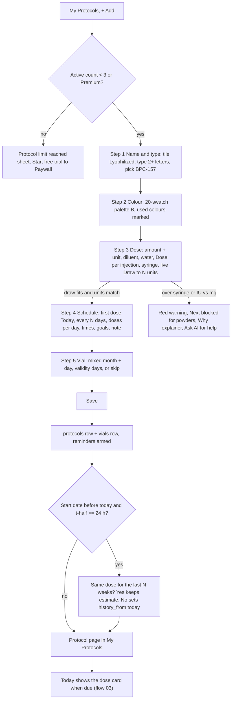
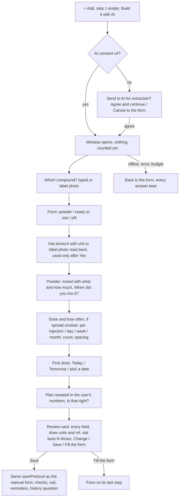
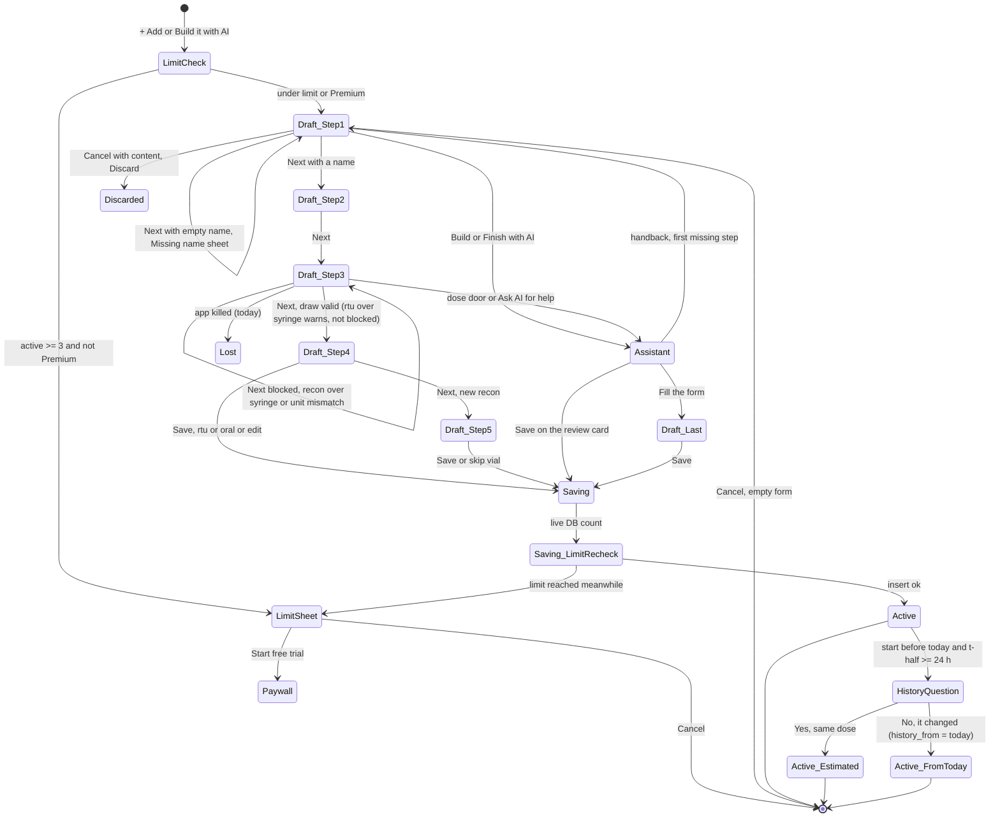
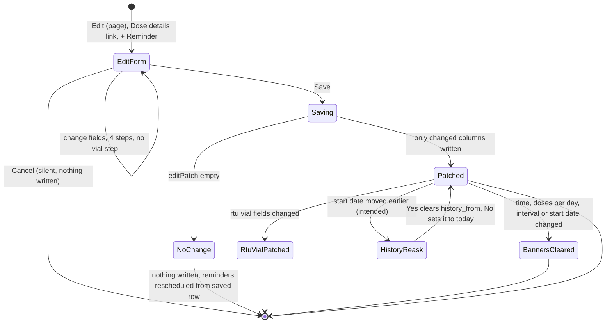
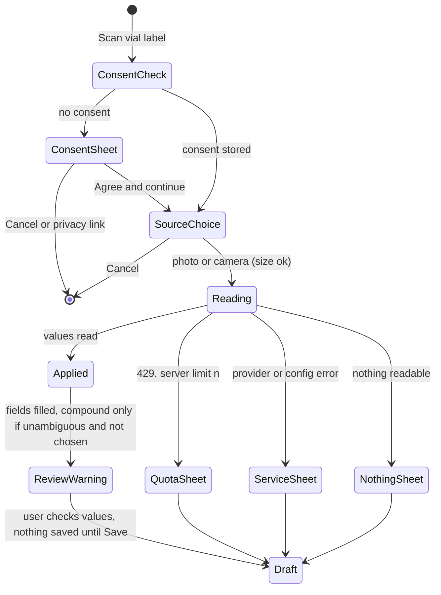

# 02 — Create and edit a protocol (incl. past start + history question, AI assistant, vial scan)

> Draft for founder review, written 2026-10-12 from `docs/product/research/01-protocols.md` (main source), `02-doses-today.md`, `03-reminders.md`, `05-curve-journey.md`, `docs/decisions.md` (Protocols & dose math; AI rules; AI protocol assistant 2026-10-03; dt-council 2026-10-04) and `docs/specs/ai-protocol-assistant.md` (AP-0…AP-35). Code @ 4dade55.
> Shows the **intended** behaviour. **Divergence today** notes cite the dossier (`01 G-5` = research/01 §9 G-5; `01 D-13` = §6 D-13).

---

## 1. Goal

Let a user record **what** they take, **how much**, **how often** and **from which container**, with pure math (draw to N units) and no advice — by hand (the default, free) or with the optional AI assistant, optionally reading the vial label — and later change only what they mean to change. Every other module reads this record: Today, reminders, the Missed scan, the Dose log, the curve, the report, supply alerts.

## 2. Actors

| Actor | Role |
|---|---|
| User | Fills the 4–5 step wizard (or talks to the assistant), saves, edits. |
| Wizard (`screens/ProtocolsScreen.js` pageSheet) | Steps 1 Name & type · 2 Colour · 3 Dose · 4 Schedule · 5 Vial (new recon only). |
| AI protocol assistant (`lib/protocolAssistant.js` + `protocol-assistant` function) | Asks, understands, transcribes. Never suggests or questions a value (AP-3). |
| Vial-label scan (`extract-bloodwork` kind `vial`) | Reads compound / strength / volume; review before save; never writes `compound_id`. |
| Calculator (`lib/doseMath.js`) | Every number on screen and in the DB. |
| Notifications (`scheduleDoseReminder`) | Arms reminders after save (flow 06). |
| Entitlement (`hasPremium`) | Free limit: 3 active protocols. |

## 3. Preconditions

- Signed in (`getCachedUser`), profile complete (flow 01).
- Free plan: fewer than 3 active protocols, or Premium (checked at + Add, at Save, at Restart, at Restore).
- AI paths only: shared AI consent v4 granted; network; assistant budget (10 conversations / rolling 7 days, counted at the first AI answer); scan pool (3 free / 20 Premium a month, shared with labs and vaccines).

## 4. What may already have happened before

| # | Prior state | What the flow must do |
|---|---|---|
| P1 | Started the compound weeks ago (the founder's flagship journey miss) | Start date accepts any past date; on save, compounds with t½ ≥ 24 h get "Same dose for the last N weeks?" (A-30 option C). Nothing is logged; the curve estimates the pre-install part (dashed, "estimated"). |
| P2 | Vial already mixed days ago | Step 5 asks month + day (most recent past occurrence); assistant asks "When did you mix it?" (≤ 365 days). Validity counts from that date. |
| P3 | Vial already half used | No "doses already used" field (A-08 / F7; AP-28 accepted "mirrors the form"). New vial starts at 0 taken. → OPEN-01. |
| P4 | Not mixed yet | "I haven't mixed this vial yet — skip"; Today shows "+ Add vial" later (flow 04). |
| P5 | Typed a weekly total as the dose (240 mg customer case) | "Dose per injection" label + hint; over-capacity warning with "Why" explainer and "Ask AI for help" (AP-11, AP-12). |
| P6 | Long-interval ester (e.g. every 12 weeks) | Custom interval; reminders still renewed within the rolling window (flow 06). |
| P7 | Already at 3 active protocols (free) | Limit sheet before the wizard opens; re-checked at Save. |
| P8 | Same compound already active (second device / duplicate) | Allowed on create (no warning today on create; warning exists on Restart only). |
| P9 | Wizard interrupted (call, iOS memory, kill) | **Intended (AD-35; BK-14, decisions.md:378):** unsaved drafts are kept until saved or the app closes; a kill loses the form (accepted, like the assistant conversation, AP-33). The form lives in screen state today, which matches. |
| P10 | Assistant budget used up this week | Assistant says when it resets; manual form keeps working. |
| P11 | Scan pool used up this month | "Monthly scan limit reached" with the server's number; manual entry keeps working. |
| P12 | Offline | Manual form works fully; assistant and scan hand back to the form with answers kept (AP-16). |
| P13 | Language is pt/es/fr/de/it | Typed "0,5" = 0.5; "1.250" = 1250 (app language parse); prefilled values never grouped. |

## 5. Happy path (manual, lyophilized, started today)

### 5.1 Assistant path ("Build it with AI")

## 6. States and transitions

### 6.1 Protocol draft → saved

### 6.2 Edit

### 6.3 Vial-label scan (inside step 3 or the assistant)

## 7. Alternative and exception paths

### 7.1 Past start and the history question (A-30 option C)
- Start date: any past or future date; stored as local `YYYY-MM-DD`; default **Today** for a new protocol (decision 2026-10-02); "Tomorrow" bar; date wheel (DTWheel on iOS, native on Android).
- Hint under the bar: "Starting today: only dose times from now on count today. Earlier times begin tomorrow." (creation-day rule, flow 03).
- After Save, when the start is before today AND the compound's t½ ≥ 24 h: sheet "Same dose for the last {n} weeks?" (≥ 14 days, rounded) or "…{n} days?" with body "The curve estimates the time before today from your start date and this dose. If the dose was different, it starts from today instead. Nothing is added to your dose log." → **Yes, same dose** (nothing written) / **No, it changed** (`history_from = today`).
- N = min(5 × t½, days since start). Example: Testosterone Cypionate (t½ 192 h) started 42 days ago → N = 40 days → "6 weeks".
- **Intended (decision 2026-10-04, copy must be true):** the question names the compound ("Same {compound} dose for the last 6 weeks?") and is asked again when an Edit moves the start date earlier; "Yes" then clears `history_from`.
  - **Divergence today (01 G-5; registry A-94 "Not started"):** no compound name; Edit never re-asks.
- Dismissing the sheet = Yes (no write). Compounds without a half-life entry, insulin, or t½ < 24 h get no question.
- Adherence, streaks and the Dose log counts start at creation; doses before `created_at − 1 h` are "declared", never counted (flow 03).
- **Divergence today (01 D-20 / G-27):** `created_at` is not in the sync payload; on a second device the creation moment becomes the first-push time, moving the declared/Missed/estimated boundaries.

### 7.2 Dose step guards and the explainer
- Recon: compound amount + unit (mg/mcg/IU), diluent pills (none preselected: Bacteriostatic / Sterile / NaCl 0.9 % / Other), water stepper ±0.5 ml (min 0.5), "Dose per injection" + hint "How much you inject each time — not your weekly total.", IU→mass converter (mg/mcg vials only), syringe 0.3 / 0.5 / 1 ml.
- RTU: dose + unit, concentration (optional), syringe picker (insulin + 2/3/5 ml), vial size ml, box expiry month + year.
- Oral: dose + unit (mg/mcg/IU/g), form, "Can it be divided?", strength per serving, units per serving, units per container (optional).
- Live result: "Draw to N units" (ml on ml syringes), drawn syringe numbered every 10, small-draw fact under 10 units ("This dose is {u} units — small marks are harder to read accurately."), red full syringe over capacity.
- Over capacity: recon blocks Next and Save ("Let's double-check"); rtu shows red but does not block (AP-21). IU with mg/mcg blocks ("Cannot mix IU with mg/mcg…").
- "?" on the field, the red warning and the red syringe open the 4-step "Why it does not fit" explainer (your vial · your syringe · {dose} does not fit · is it what you take in a whole week? with split buttons "2 × 120 mg") — never a water amount (decision 2026-10-02).

### 7.3 AI assistant exceptions
| Case | Behaviour |
|---|---|
| No consent | DoseTrace consent sheet; Cancel returns to the form (AP-15). |
| Advice-shaped answer ("is that ok?", 6 languages) | Fixed deflection card, nothing taken (AP-3). |
| Plain number typed | Read on the phone, never sent (local understand). |
| Offline / server error | "can't connect" + back to the form with every answer kept (AP-16). |
| Budget (10 / 7 days) reached | App-written message with when it resets; manual form works (AP-18). A use counts at the first answer to the AI or the label-photo start — never on open. |
| "Finish with AI" | Reads the form, says it back, asks only what is missing; never changes filled fields (AP-10). |
| Doesn't fit | Explains with the user's numbers, asks per injection / day / week / month, divides the user's number; if it really is one injection: facts only (larger syringe for rtu; "the amount of water decides how much is in each ml"; ask your healthcare provider) (AP-11, AP-22, AP-35). |
| Weekday schedules ("3 a week") | Only storable every-N-days spacings offered, stated honestly (AP-29). |
| App killed mid-conversation | Conversation lost (memory); answers already filled into the form stay (AP-33, accepted). |
| Saved protocol page | No AI there (AP-34). |
| **Divergence today (01 G-13):** spec text AP-27 still mentions the old "log the past doses" backfill; the code asks the A-30 history question. Spec text stale. |

### 7.4 Vial-label scan exceptions
- Cancelled → nothing. Too big (> ~10 MB) → size sheet. Service down → "The scan service is temporarily unavailable. Your photo is fine…". Nothing readable → "Nothing readable on that label…". Quota → "Monthly scan limit reached" + "You've used your {n} scans for this month (labs, vaccine cards, and vials combined)…".
- Applied values: form type (solution → rtu, powder → recon, only when unambiguous); compound resolved deterministically (exact → alias → preferred; ambiguous → none) and only when the user has not chosen one, else the printed name (≤ 60 chars) seeds the name; rtu concentration only for a clean per-ml unit; vial ml; recon amount + unit. Warning "We filled these in from your vial label. Check every value before you save…". Nothing saved until Save.
- **Copy note (decision 2026-10-04 "copy must be true"):** "supplier" → "the product label or manufacturer"; assistant limit says "in the last 7 days". Verify on device.

### 7.5 Cancel
- New protocol with any typed content → "Discard this protocol?" / "What you entered will be lost." (Cancel / Discard). Empty form → closes. Edit → closes silently, nothing written.

### 7.6 Offline / killed / second device
- Save offline: written to SQLite `pending`, reminders armed locally, Today updated via `notifyDataChanged`; pushed on reconnect.
- Killed after Save: protocol persists; the history sheet may not have shown → no `history_from` (= Yes). Acceptable (no write = estimate).
- Second device: protocol arrives on next pull; reminders scheduled there on the next foreground resync (flow 06); free-limit count is local only (**Divergence today 01 D-22**: a second device can exceed 3).

### 7.7 Timezone / DST
- Start date and mix date are local calendar days (noon-anchored); day differences use `round` (DST-safe). Reminder times are wall-clock "HH:MM".

### 7.8 Notification tap
- Not applicable to create/edit. After save, reminders follow flow 06.

### 7.9 Fold
- The add/edit wizard stays one centred column on the unfolded Fold (BK-11); sheets live outside the page switch so fold/unfold never closes them; the assistant window too. After save, the book's right page shows the new protocol (BK-4 default = opened item).

### 7.10 Free vs Premium
- Free: 3 active protocols (decision 2026-10-03 "3 mantém"); + Add at the limit → "Protocol limit reached" / "The free plan includes up to 3 active protocols. Go Premium for unlimited — and try it free for 7 days." → **Start free trial** → Paywall (`source: protocol_limit`). Trial claim verified true on iOS and Play (decisions 2026-10-03).
- Assistant: same budget on every plan. Vial scan: free for everyone, counts in the shared pool.
- **Divergence today (01 D-22; 07 D-3):** limit is client-only; protocols synced from another device, created while Premium or revived by sync are never counted; a lapsed Premium user keeps all active protocols (as decided by logic, DL-24; server enforcement is OPEN-05).

### 7.11 Edit specifics
- Edit opens with stored numbers in the app language; rtu vial ml from the active vial or amount ÷ concentration; 4 steps (no vial step); writes only changed columns (decision 2026-10-02; a Save with no change alters nothing).
- **Divergence today (01 D-13):** changing a recon dose does NOT recompute the active vial's stored `total_doses` (rtu does) → stale "N of M doses left" and the vial "finishes" at the old count. **Intended (by logic, one capacity owner):** a dose edit recomputes the remaining capacity of the current vial from its amount and water (DL-15).
- **Divergence today (01 G-9):** recon mix date, validity window and vial capacity are not editable after creation (→ OPEN-01).

## 8. What every surface shows

| State | My Protocols list / page | Today | Reminders (OS) | Curve / Journey | Settings |
|---|---|---|---|---|---|
| Draft (wizard open) | wizard sheet; list unchanged | unchanged | none | unchanged | — |
| Limit reached | "Protocol limit reached" sheet | — | — | — | Premium card |
| Saved, start today, slot later today | card: dot, name, size · dose · frequency, vial cells "N of M doses left" · days left; page: syringe hero "Draw to N units", vial block, Schedule & reminders, Dose details, Notes, Edit, Delete | card in Doses with grey "reminder" tag (see 02 G9 in flow 03) then "Due" ≤ 5 min | dose reminders for the window (iPhone 10 d / Android 21 d) | curve offers it if recon/rtu with half-life; tile only if it's the remembered first compound | adherence report includes it |
| Saved, start in the future | page as above; Due-next sort shows it later | Next 5 days / "N more scheduled later" | reminders from the start day | 0 now, projection only | — |
| Saved, start in the past, "Yes" | as above | creation-day rule: only slots from created − 1 h count today | from today | dashed marker "Before {date}: estimated from your start date" when the creation day is in the window | — |
| Saved, "No, it changed" | as above | as above | as above | nothing before today | — |
| Edited: time changed | page Schedule row new time | card time changes | old banners dismissed, new times armed | curve unaffected (fixed slot hours, flow 10) | — |
| Edited: dose changed | syringe hero new draw | card draw | body text new dose | whole curve re-drawn with the new dose for past AND future (flow 10, F2 open) | — |
| Recon saved with "skip vial" | vial block: "M doses per vial" capacity, no cells | card "+ Add vial" row | reminders armed | charted | — |

## 9. Data written at each step

| Step | Table / store | Columns | Synced |
|---|---|---|---|
| Wizard typing | screen state only | form | no (lost on kill — 01 G-18) |
| Note typed on a saved page | memory `draftStore` `protocolNote:<id>` | text | no (lost on app close; cleared on sign-out) |
| Save (new) | `protocols` | name, compound_id, type, color, amount (rtu: conc × vial ml), unit, water, diluent, dose, dose_unit, syringe_size, concentration, concentration_unit, frequency (label words), reminder_time "HH:MM,…", interval_days, doses_per_day, start_date, schedule_total NULL, vial_valid_days, goal (csv), notes (oral form), note, composition (blends), serving fields, units_taken 0, divisible, active 1, created_at now, sync_status pending | yes (except created_at — D-20) |
| Save recon, not skipped | `vials` | mixed_on (past occurrence), water_ml, total_doses = floor(amount ÷ dose), doses_taken 0, active 1 | yes |
| Save rtu with ml + conc + dose | `vials` | water_ml = bottle ml, total_doses, expires_on = last day of chosen month | yes |
| Save | OS queue | dose reminders via `scheduleDoseReminder` (shares the budget) | — |
| History "No" | `protocols.history_from` | today | yes (optional column) |
| Edit | `protocols` | only changed columns, `updated_at`; `status_at` only if status changed | yes |
| Edit rtu vial field | `vials` | patch; or a new vial if none | yes |
| Assistant use | server `ai_assistant_usage` | conversation start at first AI answer | server only |
| Vial scan | server `ai_scan_usage` kind `vial` | one row per delivered 200 | server only |
| AI consent | AsyncStorage `dosetrace_ai_extraction_consent_v4` | 'granted' | no (07 D-18) |
| Analytics | `analytics_events` | anonymous `protocolCreated` (no compound/dose) | server |

## 10. Rules (with sources)

R-01 name required ("Missing name"); typed text equal to a listed compound selects it; else own label (2026-10-02). R-02 suggestions after 2 letters. R-05 blends show the common composition "varies by source"; vial label is journaling only. R-06 new protocol first dose Today, default time now rounded to 5 min. R-07 any past/future start. R-08 interval presets 1–7, 10, 14 + custom; doses per day 1–3 only when interval ≤ 2. R-09 times array length = doses per day. R-10 no numeric presets. R-11 diluent none preselected. R-13 "Dose per injection". R-14 recon over syringe / unit mismatch blocks; rtu warns. R-15 2/3/5 ml syringes rtu only. R-16 never a water amount. R-17 small-draw fact under 10 units. R-18 Edit writes only changes. R-19 Discard question for new only. R-20 vial step new recon only, skippable. R-23/R-24 number parsing per app language. R-35/R-36 history question and estimated curve. R-59 free = 3 active. R-69/R-70 AI rails (all from `01 §4`).

## 11. Divergences today (summary)

| ID | Intended | Today | Source | DV |
|---|---|---|---|---|
| D02-1 | History question names the compound and is re-asked when the start moves earlier | No name, no re-ask | `01 G-5`; decision 2026-10-04 | DV-091 |
| D02-2 | Drafts kept until saved or the app closes (AD-35) | Lost on a kill — as decided; recorded only | `01 G-18` (no decision) | DV-127 |
| D02-3 | Recon dose edit recomputes vial capacity | Stale stored `total_doses` | `01 D-13` | DV-015 |
| D02-4 | Free limit counted the same on every device | Local only | `01 D-22`, `07 D-3` | DV-095 |
| D02-5 | `created_at` identical on every device | Not synced | `01 D-20 / G-27` | DV-001 |
| D02-6 | Mix date "Feb 31" handled the same everywhere | Wizard clamps, Today refuses, assistant refuses > 1 year | `01 D-14b` | DV-019 |
| D02-7 | Custom interval bound the same in form and assistant | 1–999 vs 1–365 | `01 D-16` | DV-123 |
| D02-8 | Recon mix date / validity / capacity editable | Not editable after create | `01 G-9` | DV-094 |
| D02-9 | Delete sheet / scan copy true | "recoverable for 7 days"; "supplier" | `01 G-4`, decision 2026-10-04 | DV-023, DV-192 |
| D02-10 | Today empty-state "Add a protocol" opens the wizard | Opens the tab only | `01 G-24` (observation) | DV-124 |
| D02-11 | AP-27 spec text matches the A-30 question | Spec still says "log the past doses" | `01 G-13` | DV-179 |

## 12. Founder questions (canonical IDs — `docs/product/OPEN-DECISIONS.md`)

Reconciled 2026-10-12: every question this flow raised has one canonical ID in `OPEN-DECISIONS.md` — **OPEN-xx** waits for the founder (asked in the one Portuguese round there), **AD-xx** is already decided by the ledger or a signed spec, **DL-xx** is decided by product logic (recorded in `docs/decisions.md`; the founder may override). DV-xxx is the defect row in `DIVERGENCES.md`.

- **OPEN-01 — Doses already used from a vial (A-08 / F7)** — waits for the founder (with the vial edit). → DV-094.
- **AD-35 — Half-filled wizard after a kill.** Already decided: unsaved drafts are kept until saved or the app closes (BK-14, decisions.md:378; the assistant's conversation lost on a kill is accepted, AP-33). This flow had recommended keeping the draft; the ledger answers it — the founder may reopen it. → DV-127.
- **DL-15 — Recon dose changed mid-vial.** Decided by logic: recompute the vial's remaining doses from the mass left (one capacity rule, FX-11). → DV-015.
- **DL-24 — Lapsed Premium with more than 3 active protocols.** Decided by logic: they stay active (ending them would stop their reminders); only new adds hit the limit. Server enforcement of the limit is OPEN-05. → DV-095.

## 13. Acceptance checks (agent-device QA script)

Account: Test03 (free tier; Premium only via a temporary RevenueCat promo the founder grants). Light and dark for every screen and sheet. PT run: Settings → Preferências → Idioma → PT. Screenshot before every tap.

**F02-01 — Limit sheet at 3 active (free)**
- Setup: 3 active protocols, no Premium.
- Do: My Protocols ("Meus protocolos") → **+ Add** ("+ Adicionar").
- Expect: sheet "Protocol limit reached" / "Limite de protocolos atingido"; body "The free plan includes up to 3 active protocols. Go Premium for unlimited — and try it free for 7 days." / "O plano gratuito inclui até 3 protocolos ativos…"; **Start free trial** / "Começar teste grátis" → Paywall. Wizard did not open.

**F02-02 — Name required**
- Setup: 2 active protocols.
- Do: + Add → Lyophilized ("Liofilizado") → Next with empty name.
- Expect: "Missing name" / "Nome ausente" + "Please enter a compound name." / "Digite o nome do composto."; stays on step 1.

**F02-03 — Search after 2 letters, custom name**
- Do: type "B" → no suggestions; type "BP" → list including "BPC-157" (max 8 + "N more — keep typing to narrow down").
- Then: type "My blend X" → row "Add "My blend X"" / "Adicionar "My blend X"" + hint "Saved as your own label — not from the list." / "Salvo com o nome que você digitou — não vem da lista."

**F02-04 — Colour step**
- Expect title "Pick a color" / "Escolha uma cor"; 20 swatches; a dot on colours used by other active protocols; picking one shows "This color is already used by another protocol. That's fine if you're grouping them on purpose." Readable in both themes.

**F02-05 — Recon draw math**
- Do: BPC-157 · compound 5 mg · diluent Bacteriostatic water · water 2 ml · Dose per injection 250 mcg · syringe 1 ml.
- Expect: label "Dose per injection" / "Dose por injeção" with hint "How much you inject each time — not your weekly total."; result "Draw to" "10.0" units ("Aspirar até"); syringe drawn to 10 with numbers every 10. No small-draw fact (10.0 is not under 10).
- Change dose to 200 mcg → "8.0" units and "This dose is 8 units — small marks are harder to read accurately." / "Esta dose é de 8 unidades…".

**F02-06 — Recon over capacity blocks**
- Do: dose 6 mg on 1 ml syringe (5 mg in 2 ml).
- Expect: red full syringe; warning "This dose needs {units}u, more than your 100u syringe holds…"; Next blocked → "Let's double-check" / "Vamos conferir". "?" opens "Why it does not fit" / "Por que não cabe" 4-step explainer with "mg = how much of the compound" / "mg = quanto de composto" and "ml = how much liquid".

**F02-07 — RTU over syringe warns but does not block**
- Do: Ready to use → Testosterone Cypionate · 100 mg · concentration 200 mg/ml · syringe 0.3 ml.
- Expect: red warning in ml terms; **Next works** (AP-21). Syringe picker shows insulin sizes and 2 / 3 / 5 ml; the 2 / 3 / 5 ml are absent on a Lyophilized protocol.

**F02-08 — Schedule step defaults**
- Expect: "When is your first dose?" / "Quando é sua primeira dose?" with **Today** selected; hint "Starting today: only dose times from now on count today…"; "How often?" Every day / Custom; "How many doses per day?" visible only for interval ≤ 2; one time picker per dose; default time = now rounded to 5 min.

**F02-09 — Vial step and skip**
- Expect title "Vial mix date" / "Data de reconstituição do frasco"; month + day, "Days the vial stays good" default 30; link "I haven't mixed this vial yet — skip" / "Ainda não reconstituí este frasco — pular" → "No problem — you can log your vial mix anytime from Today (+ Add vial)."; summary rows Compound / Amount / Water / Dose / Draw / Frequency.

**F02-10 — Save creates protocol, vial and reminders**
- Do: Save.
- Expect: page with syringe hero first, then vial block "N of M doses left" · days left, Schedule & reminders, Dose details, Notes; Edit top right; Delete at the bottom. Today shows the card when due. Reminder check (flow 06) "Next reminder" names it.
- Data: `protocols` row active 1, start_date today; `vials` row doses_taken 0, total_doses 20 (5 mg ÷ 0.25 mg).

**F02-11 — Past start: history question (≥ 14 days → weeks)**
- Do: create Testosterone Cypionate (rtu) with start date 42 days ago.
- Expect after Save: sheet "Same dose for the last 6 weeks?" / "A mesma dose há 6 semanas?" + body "The curve estimates the time before today…Nothing is added to your dose log." / PT equivalent; **Yes, same dose** / "Sim, a mesma"; **No, it changed** / "Não, mudou".
- Yes → curve (flow 10) shows the pre-creation part with "Before {date}: estimated from your start date" when that date is in the window; Dose log unchanged; no Missed rows before today.
- Repeat with No → `history_from` = today; curve starts today.
- Intended (D02-1): the title names the compound. **Today it does not** — record.

**F02-12 — Past start: days**
- Do: Testosterone Cypionate started 10 days ago → "Same dose for the last 10 days?" / "A mesma dose há 10 dias?". BPC-157 (t½ 0.5 h) started 10 days ago → no sheet.

**F02-13 — Discard question**
- Do: + Add, type a name, Cancel.
- Expect "Discard this protocol?" / "Descartar este protocolo?" + "What you entered will be lost." / "O que você inseriu será perdido."; Cancel keeps the form; Discard closes, nothing written.

**F02-14 — Edit with no change writes nothing**
- Do: open a protocol → Edit → Next × 3 → Save.
- Expect: no field changes; `updated_at` unchanged in SQLite; reminders identical.

**F02-15 — Edit time clears delivered banners**
- Do: Edit → Schedule → change time → Save.
- Expect: Today card shows the new time; Reminder check "Next reminder" shows the new time; an already delivered banner for the old time is removed.

**F02-16 — Comma decimals in Portuguese**
- Setup: app language PT.
- Do: compound "5", water "2,5", dose "0,25" mg.
- Expect: draw computed with 0.25 mg and 2.5 ml (= 12.5 → "12,5" units in PT). Prefilled values on Edit show "2,5" and "0,25" (never "2.5").

**F02-17 — Assistant: consent then one question at a time**
- Do: + Add → **Build it with AI** / "Montar com IA" on the empty step 1.
- Expect (consent not given on this phone): "Send to AI for extraction?" / "Enviar para a IA extrair?" with "View privacy policy" and **Agree & continue** / "Aceitar e continuar". Then "Which compound do you want to set up? Type its name, or take a photo of the label." / "Qual composto você quer configurar?…".
- Answer "bpc 157" → "Got it: BPC-157. Is it a powder you mix, ready to use, or a pill?"; continue to the review card "Your protocol. Check it before it is saved." / "Seu protocolo. Confira antes de salvar." with draw units and ml.

**F02-18 — Assistant: weekly total split**
- Do: in the dose question answer "240 mg a week".
- Expect: "In how many doses a week do you take the 240 mg?"; answer 2 → spacing options (storable every-N-days only) and a restated plan "2 × 120 mg …". No word "recommended", "safe", "high", "low".

**F02-19 — Assistant: advice deflection**
- Do: type "how much should I take?" (and PT "quanto devo tomar?").
- Expect: fixed deflection card (cannot advise on dosing; ask a healthcare provider); nothing filled.

**F02-20 — Assistant offline hand-back**
- Do: airplane mode → Build it with AI → answer the compound.
- Expect: "can't connect" message; back to the form with the compound filled; no use counted.

**F02-21 — Assistant: Finish with AI never changes filled fields**
- Do: fill name + dose manually → step 4 → **Finish with AI** / "Terminar com IA".
- Expect: "Here is what you filled in so far: … Is that right?"; it asks only the missing items; name and dose unchanged after Save.

**F02-22 — Vial-label scan review before save**
- Do: step 3 → **Scan vial label** / "Escanear rótulo do frasco" → Choose a photo of a labelled vial.
- Expect: "Reading label…" then fields filled + warning "We filled these in from your vial label. Check every value before you save — the app read the label, it didn't verify it."; nothing saved; Cancel → "Discard this protocol?".

**F02-23 — Scan quota**
- Setup: free account with 3 scans used this UTC month.
- Expect: "Monthly scan limit reached" / "Limite mensal de leituras atingido" + "You've used your 3 scans for this month (labs, vaccine cards, and vials combined)…"; form still editable.

**F02-24 — Fold: wizard in one column**
- Do (unfolded Fold): + Add → fill to step 3 → fold → unfold.
- Expect: one centred column; values kept; after Save the right page shows the new protocol (BK-4).

**F02-25 — Both themes**
- For the wizard steps 1–5, the explainer, the syringe picker, the assistant window, review card, consent sheet, limit sheet, history sheet: readable in light and dark; protocol colour only as a 9 pt dot or line.
