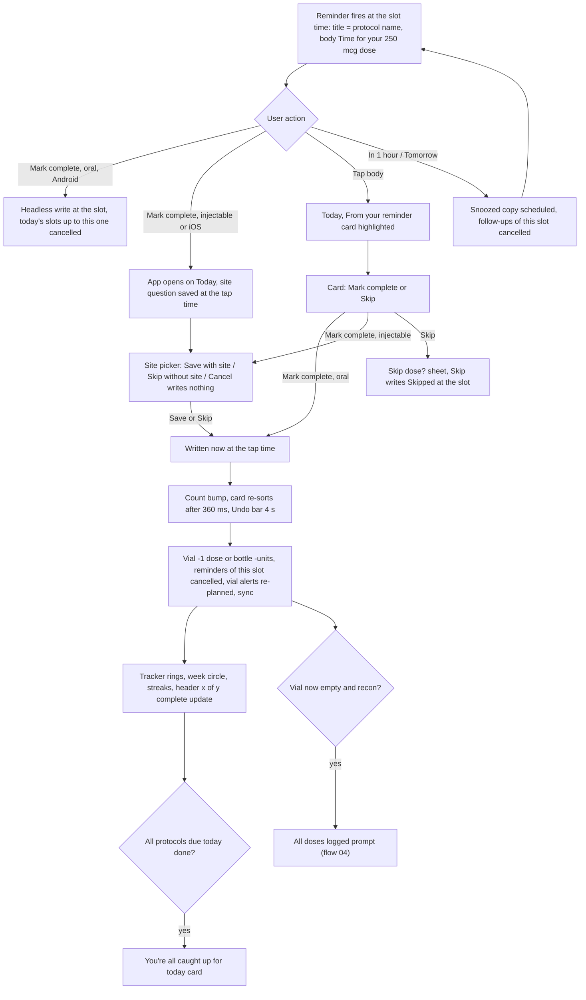
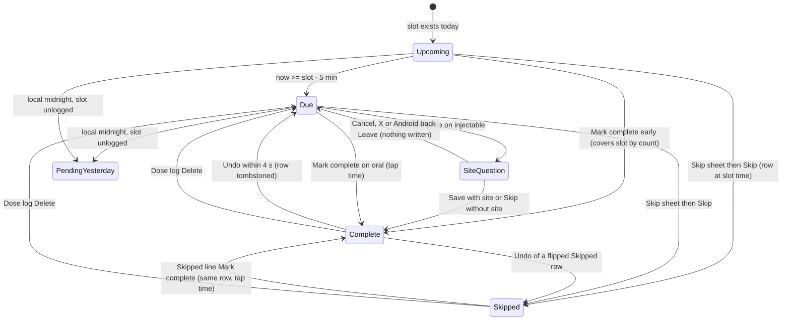
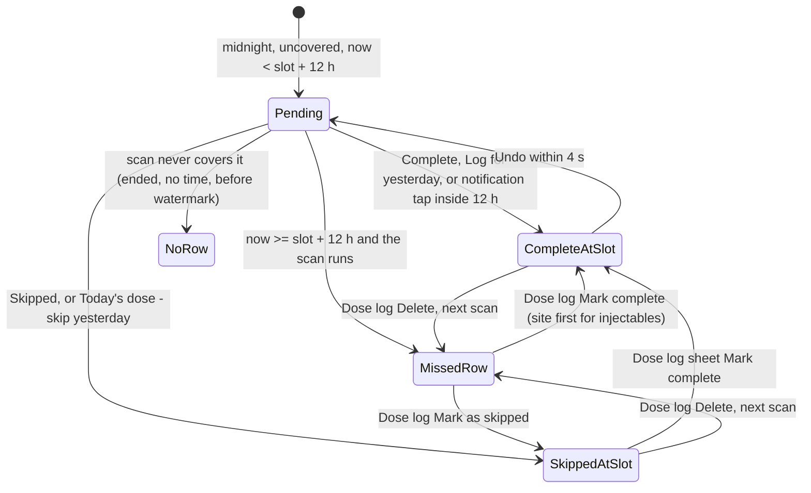
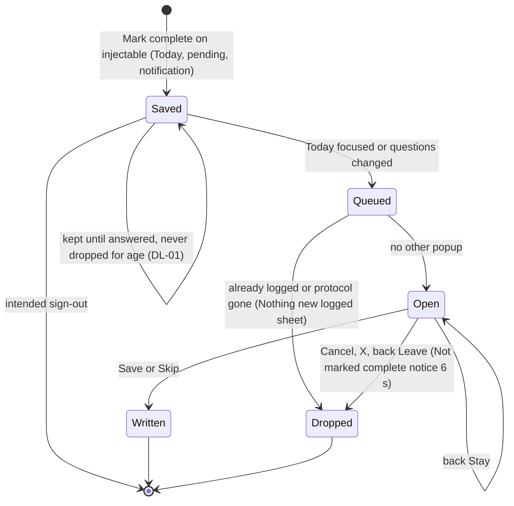
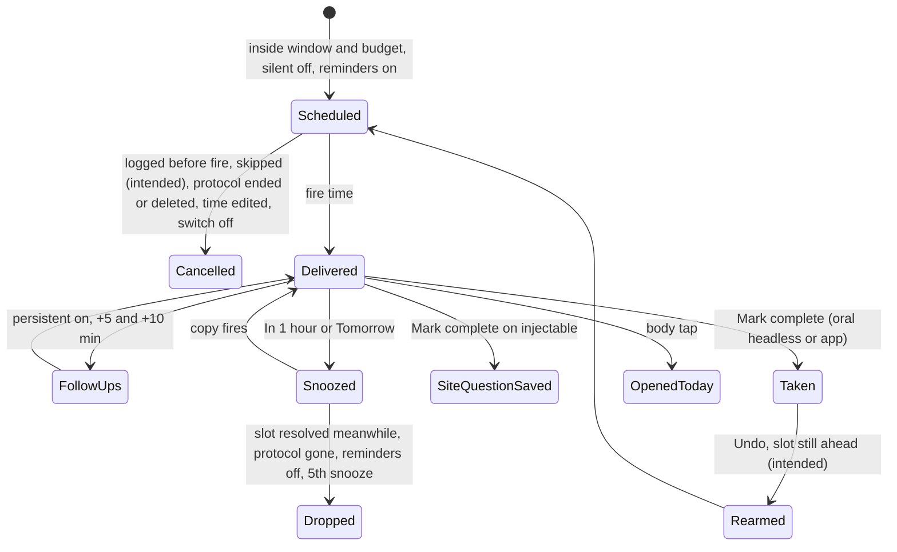
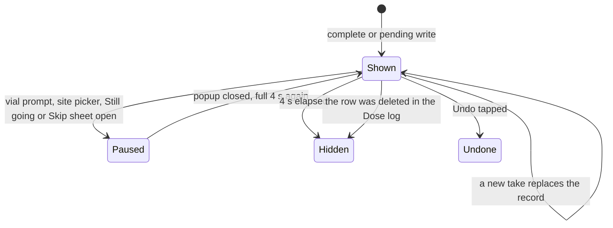

# 03 — A dose day: reminder → mark complete / skip / snooze / undo → rings, streak, curve, vial

> Draft for founder review, written 2026-10-12 from `docs/product/research/02-doses-today.md` (main source), `03-reminders.md`, `01-protocols.md`, `05-curve-journey.md`, `docs/decisions.md` (Today; Protocols & dose math) and `docs/specs/fixes-1.2.5.md` (S-25, FX-22…FX-29), `fold-right-page.md`. Code @ 3100161/4dade55.
> Shows the **intended** behaviour. **Divergence today** notes cite the dossier (`02 D6` = research/02 §6 D6; `02 G8` = §9 G8).
> Words: the UI says **Complete** ("Mark complete", "{x} of {y} complete"); the database outcome is `Taken`. Both words below mean the same state.

---

## 1. Goal

On every scheduled dose the user is reminded at their time, records what really happened (complete, skipped, or — if nothing is recorded — missed) in one tap from the notification or Today, and every surface that counts doses (Today header, tracker rings, week circles, streaks, vial supply, the Dose log, the adherence report) agrees with what was recorded. The journal is honest: a dose is stamped at the time it happened, never at a time the app invents.

## 2. Actors

| Actor | Role |
|---|---|
| User | Takes or skips a dose; answers the site question for injectables. |
| OS notification + action buttons | "Mark complete", "In 1 hour", "Tomorrow" (interval > 1). Android orals log headless; iOS and injectables open the app. |
| Today screen | Dose cards, Pending from yesterday, tracker, Undo bar, sheets (one popup at a time). |
| Site picker (`BodyMapModal`) | Injection site BEFORE the write (S-25). |
| `recordDoseTaken` / `planMarkTaken` | The ONE mark-complete path for every entry point. |
| Missed scan (`scanMissedDoses`) | Writes `Missed` rows for slots ≥ 12 h old and uncovered (never today's). |
| Dose log (`LogScreen`) | Edit / delete past outcomes. |
| Vial / bottle | `doses_taken` / `units_taken` move with Taken (flow 04). |

## 3. Preconditions

- At least one **active** protocol whose schedule expects a dose today (`expectedDosesOn`), or a pending slot from yesterday.
- Reminders scheduled (flow 06) unless Silent mode / Dose reminders off.
- Signed in; works offline (writes are local first).

## 4. What may already have happened before

| # | Prior state | What the flow must do |
|---|---|---|
| P1 | The dose was already logged on another device or from the notification | Today refreshes on `data_changed`; a second tap shows "Nothing new logged" with the reason ("That dose was already logged (from a notification or another device). It now shows on Today."). |
| P2 | Yesterday's 20:00 dose not logged, now 00:30 | "Pending from yesterday" block until slot + 12 h; marking it logs at 20:00 yesterday. |
| P3 | Took it early (before the slot time) | Early same-day dose covers its slot (A-43); card stops offering it. |
| P4 | Already skipped today's slot | Line "Skipped — you can still log it"; Mark complete turns the same row into Complete (A-78). |
| P5 | Protocol created tonight at 21:00 with an 08:00 time | Creation-day rule: only slots from created − 1 h count; floor of 1 so a dose just taken stays loggable (R14). |
| P6 | Started weeks ago (declared history) | Doses before `created_at − 1 h` never count in rings, streaks, counts (A-30). |
| P7 | Snoozed the reminder an hour ago | The snoozed copy fires; "Mark complete" on it logs to the slot while inside slot + 12 h. |
| P8 | Injectable "Mark complete" tapped on the notification while the app was killed | A site question was saved at the tap time; Today asks it on the next focus (never dropped while the dose window is open). |
| P9 | Travelled across time zones | Past slots rebuilt in the zone of their own day (A-51); today's slots in the new zone. |
| P10 | Vial is on its last dose | Taking it deactivates the vial → recon: "All doses logged" prompt (flow 04). |
| P11 | Protocol has no reminder time (legacy/imported) | Intended: no slot time → no Due, no Missed; reminders none. **Divergence (02 D1, D22):** rings expect it at 12:00; reminders fire at 08:00; health warnings count it. |
| P12 | Ended protocol on another device | Today drops it after the pull; its reminders cancelled at the next resync. |

## 5. Happy path

## 6. States and transitions

### 6.1 One slot of TODAY

### 6.2 One slot of YESTERDAY or earlier

### 6.3 Site question (S-25)

### 6.4 Notification slot (OS view)

### 6.5 Undo bar

## 7. Alternative and exception paths

### 7.1 Time written (honest journal)
- Today's Complete = **tap time** (S-25), even when the site question is answered later or after midnight.
- A flipped Missed row and any past-day write keep the **slot time** (noon of that day without a slot).
- Pending from yesterday = slot time (a 00:30 tap is recorded as 20:00 yesterday).
- Skip = slot time (tap time only without reminder times) (A-78).

### 7.2 Multi-dose days
- Doses per day 2–3: one card, the earliest open slot; rows at a slot's exact time belong to it; Skipped counts as filled; never more Taken rows than `doses_per_day` (R2).
- A notification for the 20:00 slot tapped (body) while 08:00 is still open: the card logs the earliest open slot (A-43 "early logs count by number").
  - **Divergence today (02 D12):** the body tap cancels only the 08:00 reminders while the 20:00 follow-ups keep firing; the notification **button** cancels both. Intended: both entry points cancel every reminder of slots now covered by count.

### 7.3 Skip
- Today card **Skip** → "Skip dose?" / "Skip today's dose of {name}?" (Cancel / Skip) → Skipped at the slot; never moves supply.
- **Intended (by logic — a skipped dose needs no reminder; founder may override):** the skipped slot's reminder, follow-ups and snoozed copy are cancelled (DL-08). No Undo bar: the skipped line keeps "Mark complete" and the Dose log can delete the row.
  - **Divergence today (02 D9, G8; 03 §6.10):** no reminder cancel; a slot skipped before its time still fires.

### 7.4 Undo
- 4 s Undo bar after a take (paused while any popup covers it). Undo: tombstone the row (or restore a flipped Missed/Skipped row with its old time and site), give back the vial dose (reopening a vial this dose closed, if no other is active) or the bottle units, revert the count, close the vial prompt of that dose.
- **Intended (by logic, A-36 open):** reminders cancelled by the take are re-armed when their slot is still ahead.
  - **Divergence today (02 §3.6; 03 G9):** not re-armed until a later full resync, and never for a slot whose time has passed.
- **Divergence today (01 D-17):** Undo can reopen a vial that the end/delete of its protocol deactivated, while deleting the same dose in the Dose log would not (two rules for "give one dose back").

### 7.5 Yesterday or today?
- With a pending slot from yesterday, Mark complete on today's card asks "Yesterday's dose isn't logged" / "{name} from yesterday at {time} has no entry. Is this dose for yesterday or for today?" → **Log for yesterday** / **Today's dose — skip yesterday** / Cancel. The day prompt comes first, then the site question, then one commit.

### 7.6 Missed
- A slot is Missed when ≥ 12 h past, uncovered by any log in its window or later the same local day, after the scan watermark, after `created_at − 1 h`, within a 14-day lookback, for an **active** protocol. Today's slots are never scanned. Scan runs on Today focus, new day, Dose log focus, adherence report.
- Dose log: a Missed row → "Update this dose" / "This dose was auto-marked missed after 12 hours without a log…" → Mark complete (site first for injectables) / Mark as skipped. Missed rows cannot be deleted.
- **Divergence today (02 D13):** the scan skips ENDED protocols while rings and week circles count them — an unlogged slot before an end never becomes a Missed row (report and Dose log miss it).
- **Divergence today (02 D15, SUSPECTED; A-48 parked):** two devices can each write a Missed row for one slot before syncing.

### 7.7 Rings, week circles, streaks (counting rules)
- **Rings (decision 2026-09-29):** doses not days; today = all slots of today; 7 / 30 days = passed slots, rolling; nothing due → "Nothing due", never 0 %; a late dose matches **its own slot** within ± half the interval; a skip is not taken; never above 100 %; declared history excluded.
  - **Divergence today (02 D6, D7, G2, script-verified):** the matching pool is not limited to the slot's own window — a daily 08:00 dose taken yesterday at 21:00 fills TODAY's ring at 07:00 (100 % with nothing taken today) while the header says "0 of 1" and the card still offers Mark complete.
  - **Divergence today (02 D3):** protocol created at 21:00 with an 08:00 time — card "Due", header "0 of 1", tracker "Nothing due", streak counts the day: three surfaces disagree.
- **Header** "{x} of {y} complete" = Σ min(Taken today, expected) ÷ Σ expected over active protocols due today.
  - **Divergence today (02 D8):** header (active only, calendar day, includes declared) and today ring (active + ended, proximity, excludes declared) are different definitions.
- **Tracker streak (days):** consecutive days where every due protocol had all its doses; rest days neutral; "On fire!" ≥ 7.
  - **Divergence today (02 D19, G11):** capped at 31 days (loop stops at 30) — no decision sets a cap; the per-protocol streak looks back 365 days.
- **Protocol streak (doses in a row, founder 2026-10-05):** "Day X of Y · Last: {site} · {n} doses without a miss" on the card.
- **Report streak (Settings → Adherence report):** **Intended:** the same "doses, never days" rule. **Divergence today (02 D17; 08 D2):** calendar days with any Taken, schedule-blind (a weekly protocol reads 0 or 1).
- **Week circles:** rest / complete / partial / missed per day.
  - **Divergence today (02 D14):** "missed" in the circles = no dose at all that day; the report counts per-slot Missed rows — two meanings.

### 7.8 All caught up
- Shown when no protocol is left in Today's list AND at least one was due today.
- **Divergence today (02 D10):** a skipped slot keeps the protocol in the list (Taken-only placement), so a day with any skip never reaches "all caught up" (DL-12: the day counts as caught up once every due dose is complete or skipped; the skipped line stays visible above the card).

### 7.9 Offline
- Every write is local first (`pending`), sync on reconnect. Today shows the alert "Waiting to back up" / "You're offline. Your changes are saved on this phone…" only when offline is known AND something is unsynced (A-46).
- Notification "Mark complete" headless: writes locally, cancels today's slots up to the tapped one, defers sync and the full resync to the next foreground.

### 7.10 App killed
- Killed with the site question open → asked again on next Today focus, written at the original tap time.
- Killed between the dose row and the vial update → **SUSPECTED (02 §7.3):** dose saved, supply unchanged (no transaction).
- Killed with the Undo bar showing → the take stays (Undo lost — acceptable).

### 7.11 Second device
- Phone A logs; phone B shows it after its pull; B keeps reminding until B pulls in the foreground (BR-5 accepted deviation) and **may need a second resync** because pull and resync run concurrently (03 G8).
- B's take refused "already logged" if A's row arrived first.

### 7.12 Timezone, DST, midnight
- Midnight while Today is open → re-dates (timer at midnight + 1 s). Yesterday's open slots move to "Pending from yesterday".
- **SUSPECTED (02 §8):** a slot becoming due while Today stays open is not re-rendered as "Due" until something re-renders.
- DST: day keys from date methods; a 02:30 slot on the spring-forward day resolves to whatever JS gives (03:30) — unverified on device. Curve DST fix A-101b is in flow 10.
- Travel: reminders fire at the old zone's wall time until the next resync re-plans in the new zone.

### 7.13 Notification tap specifics
- Body tap → Today with `focusDose`; the matching card is shown under "From your reminder" (A-44); a pending slot from yesterday is highlighted instead when the tap was after midnight. A focus for a dose already logged shows nothing (no message — 02 D25).
- A tap older than 12 h that launched the app is ignored.
- Morning summary tap → Today, no focus.

### 7.14 Fold open / closed
- Unfolded Fold: tapping a dose card (today's, pending or upcoming) opens **that protocol's page on the right** (A-115); Mark complete / Skip / Undo stay **on the left card only**; the right page has no Delete. Nothing tapped → the Dose log on the right. Taking a dose on the left updates the embedded Dose log at once (BK-19); one popup at a time across both pages (BK-20).
- **Intended (A-116, founder 2026-10-07; waiting by founder instruction 2026-10-12):** a dose notification tapped on the unfolded Fold opens its protocol on the right page. Today: it lands on the left page only.

### 7.15 Free vs Premium
- Logging doses, reminders, rings, streaks, Dose log, adherence report: free. The Dose log's "Curve" button and Journey's curve are Premium (flow 10).

### 7.16 "Still going?" (inactivity)
- After `max(7, 3 × interval)` days with no Taken dose: "Still going?" / "No doses logged for this one in a while. Is the protocol finished?…" → **Yes, it's finished** (ended at the last Taken dose, A-86) / **Still going** (snoozed for that window). Detailed in flow 05.

## 8. What every surface shows

| State | Today card / block | Notification | Tracker / header | Dose log | My Protocols | Curve | Vial |
|---|---|---|---|---|---|---|---|
| Upcoming (slot later today) | Card in Doses with time, grey "reminder" tag (AD-38: only "Due" — the tag goes) | scheduled | header counts it in y | — | "Due next" sort | schedule-driven projection (dashed) | unchanged |
| Due (≤ 5 min or past) | outline **Due** tag ("Agora" in PT), **Skip** · **Mark complete** ("Pular" · "Concluir"), "Draw to N units" + syringe, Day X of Y · Last site · streak | delivered (+5/+10 if persistent) | — | — | card shows **Mark complete** (A-42) | — | — |
| Site question open | — | Android banner kept for injectables until answered | — | — | — | — | — |
| Complete | card leaves Doses into the "Complete" fold; Undo bar "Dose logged" / "Site saved · {site}" 4 s | banners of this slot dismissed; future slots of today still armed | count +1, ring fills, week circle done/partial | row "Dose complete" ✓ with time and site | supply −1, "N of M doses left" | unchanged (schedule-driven) | doses_taken +1; finished at capacity |
| Skipped | line "Skipped — you can still log it" + Mark complete | intended: cancelled; today: still fires | not taken (ring unchanged) | "Dose skipped" (neutral colour) | — | unchanged | unchanged |
| Pending from yesterday | block "Pending from yesterday" row "{name} · yesterday, {time}" with **Skipped** / **Complete** | a tap inside slot + 12 h logs to the slot | yesterday's ring counts it when written | — | card shows Mark complete for the pending slot | — | — |
| Missed (row written) | gone from Today | — | 7/30-day rings count it as not taken; week circle | "Dose missed" (red) → "Update this dose" | Dose log hero Missed count | — | — |
| All done | "You're all caught up for today" | — | header y of y | — | — | — | — |
| Offline with unsynced rows | Alert "Waiting to back up" | — | — | — | — | — | — |

## 9. Data written at each step

| Step | Table / store | Write | Synced |
|---|---|---|---|
| Mark complete (oral) | `dose_logs` | INSERT outcome Taken, logged_at = tap time — or UPDATE of the slot's Missed/Skipped row | yes |
| Mark complete (injectable) | AsyncStorage `dosetrace_site_questions` → then `dose_logs` | question saved at tap time; on Save/Skip one row with `injection_site` JSON or none | question: no; row: yes |
| Take moves supply | `vials.doses_taken + 1` (+ `active 0` at capacity) or `protocols.units_taken += units` | separate statement (no transaction) | yes |
| Skip | `dose_logs` | INSERT Skipped at slot time | yes |
| Pending Complete / Skipped | `dose_logs` | at yesterday's slot | yes |
| Undo | `dose_logs` tombstone (`sync_status 'deleted'`) or restore flipped row; supply back | yes |
| Missed scan | `dose_logs` | INSERT Missed at slot time; AsyncStorage watermark `dosetrace_missed_since` + zone history | rows yes; watermark no |
| Dose log Delete | `dose_logs` tombstone; vial −1 when attributable; oral units back | yes |
| Change site | `dose_logs.injection_site` (empty save never erases) | yes |
| Notification action | AsyncStorage `dosetrace_notif_handled` (each response once) | no |
| Snooze | AsyncStorage `dosetrace_snoozes` + OS copy `snz-…` | no |
| Reminders cancelled | OS queue + delivered banners | — |
| Still going "Still going" | AsyncStorage `dosetrace_tx_check_<id>` | no |

## 10. Rules (with sources)

R1 one mark-complete path (S-02/FX-2/FX-7). R2 never more Taken than doses/day. R3 a Missed row is flipped, never duplicated. R4 a Skipped row flips only when named, slot-matched, or all slots filled (A-78). R5 time written (S-25 FX-24). R6 Skip stamped at its slot. R7 skip never moves supply. R8 site before write for injectables (decision 2026-10-01). R9 site optional. R11 pending rule. R12 Missed rule. R14 creation-day rule. R16 Due ≤ 5 min. R18 Today/Tomorrow/Next 5 buckets. R21 rings (decision 2026-09-29). R24 protocol streak doses in a row (founder 2026-10-05). R30 one popup at a time. R32 notification target within slot + 12 h (decision 2026-09-28/10-01). (All `02 §4`.)

## 11. Divergences today (summary)

| ID | Intended | Today | Source | DV |
|---|---|---|---|---|
| D03-1 | Late dose matches its own slot in the rings | Credited to the next slot | `02 D6, D7, G2` (script-verified) | DV-030 |
| D03-2 | One "expected today" for header, ring, card, streak | Creation-day / no-time / dpd>times disagree | `02 D1, D2, D3, D8` | DV-028, DV-029 |
| D03-3 | Skip cancels its reminders (no Undo bar, DL-08) | Not cancelled | `02 D9, G8` (by logic) | DV-035 |
| D03-4 | Undo re-arms a future slot's reminder | Not re-armed | `02 §3.6`, `03 G9` (A-36) | DV-040 |
| D03-5 | Site questions never dropped for age (DL-01; S-25 "kept until answered", decisions.md:379) | Code and test match; decisions.md:459 and the FX-25 evidence still say 7 days (documentation fix) | `02 G1`; ledger "Resolved 2026-10-03" | DV-175 |
| D03-6 | Missed rows for ended protocols up to the end | Scan skips ended | `02 D13` | DV-031 |
| D03-7 | One streak rule ("doses, never days") incl. the report | Three streaks; report schedule-blind; tracker capped 31 | `02 D17, D19`, `08 D2` | DV-032, DV-034 |
| D03-8 | Body tap and button cancel the same reminders | Different | `02 D12` | DV-036 |
| D03-9 | Dose log Missed → Complete that empties a recon vial shows the vial prompt | No prompt | `02 G12` | DV-038 |
| D03-10 | One name per protocol in every sheet | Card translated, sheets use stored name | `02 D26, G20` | DV-013 |
| D03-11 | Course total honoured everywhere | Only reminders honour it | `02 D4`, `01 D-08` (flow 05) | DV-012 |
| D03-12 | Day-complete pulse / ring count-up | Animation drives nothing visible | `02 D20, G7` | DV-132 |
| D03-13 | A notification tap opens on the Fold's right page | Left page only | A-116 (waiting) | DV-117 |
| D03-14 | Dose and supply change are one write | Two statements | `02 §7.3` (SUSPECTED) | DV-039 |

## 12. Founder questions (canonical IDs — `docs/product/OPEN-DECISIONS.md`)

Reconciled 2026-10-12: every question this flow raised has one canonical ID in `OPEN-DECISIONS.md` — **OPEN-xx** waits for the founder (asked in the one Portuguese round there), **AD-xx** is already decided by the ledger or a signed spec, **DL-xx** is decided by product logic (recorded in `docs/decisions.md`; the founder may override). DV-xxx is the defect row in `DIVERGENCES.md`.

- **DL-08 — Skip and reminders** (D03-3). Decided by logic: a skip cancels that slot's remaining reminders and snoozed copies; **no Undo bar** — a skip is already recoverable ("you can still log it", Dose-log delete). → DV-035, DV-130.
- **DL-12 — "All caught up" with a skip.** Decided by logic: a day where every due dose is complete or skipped is caught up; the skipped line stays visible above the card (picture first). → DV-129.
- **AD-38 — Grey "reminder" tag before Due** (`02 G9`, conflict #22). Already decided: Today's only tag is "Due" (decisions.md:133); the grey tag goes. → DV-131.
- **DL-03 — Tracker streak.** Decided by logic: the same rule as the cards (doses in a row, AD-07), looking back 365 days — no 31-day cap. → DV-034.
- **DL-02 — Report streak and adherence.** Decided by logic: the provider report uses `doseStreak` and the rings' slots, so it matches Today. → DV-032, DV-033.
- No OPEN question remains in this flow.

## 13. Acceptance checks (agent-device QA script)

Account Test03. Test protocols: **Zinc** (oral, daily, 1 capsule, time T), **BPC-157** (recon, daily, time T2), **Twice** (oral, 2×/day 08:00 and 20:00). Clock changes only via the simulator/emulator date settings. Light and dark; PT run via Settings → Preferências → Idioma.

**F03-01 — Card in Due state**
- Setup: Zinc time = now + 3 min.
- Expect at T − 5 min: card with outline tag **Due** / PT **Agora**; buttons **Skip** / **Pular** and **Mark complete** / **Concluir**; header "0 of N complete" / "0 de N concluídas".

**F03-02 — Oral Mark complete + Undo**
- Do: Mark complete on Zinc.
- Expect: drop animation lands in ~360 ms; header "1 of N complete"; Undo bar "Dose logged" / "Dose registrada" with **Undo** / **Desfazer** for 4 s; Zinc moves to the "Complete" fold; bottle "Left" −1 on the protocol page; Dose log row "Dose complete" / "Dose concluída" at the tap time.
- Do: Undo within 4 s → card back to Due; bottle +1; row gone.

**F03-03 — Injectable: site BEFORE write**
- Do: Mark complete on BPC-157.
- Expect: site picker titled "Injection site" / "Local da injeção" with the protocol name and the tap time; Subcutaneous / Intramuscular; Right | Left | Both bar; **Save**, **Skip** ("Pular"), Cancel. No row in SQLite yet.
- Do: Cancel → notice "Not marked complete. Mark it again to log it." / "Não foi marcada como concluída. Marque de novo para registrar." for 6 s; card still Due; no row.
- Do: Mark complete → pick "Abdomen, upper left" → Save → toast "Site saved · Abdomen, upper left" / "Local salvo · Abdômen, superior esquerdo" (17 pt, 4 s); vial "N−1 of M doses left".

**F03-04 — Android back on the site picker**
- Do (Android): open picker → system back.
- Expect: "Leave the site picker?" / "Sair do seletor de local?" + "If you leave, this dose will not be marked complete." → **Stay** / **Leave** ("Ficar" / "Sair"). Leave = nothing written.

**F03-05 — Skip sheet**
- Do: Skip on Zinc.
- Expect: "Skip dose?" / "Pular dose?" + "Skip today's dose of Zinc?" / "Pular a dose de hoje de Zinc?" → Cancel / Skip. Skip → line "Skipped — you can still log it" / "Pulada — você ainda pode registrá-la" + Mark complete; Dose log "Dose skipped" (neutral colour); supply unchanged.
- Intended (D03-3): Reminder check count drops by this slot's reminders. **Record today's result.**

**F03-06 — Mark complete on a skipped slot (A-78)**
- Do: on the skipped line tap Mark complete.
- Expect: the same row turns Complete at the tap time (one row only in SQLite); header +1.

**F03-07 — Notification Mark complete (oral, Android, app killed)**
- Setup: Zinc time = now + 1 min; kill the app.
- Do: on the banner tap **Mark complete** / **Marcar como concluída**.
- Expect: no app opens; banner dismissed; open the app → Zinc complete at the slot time; reminders of today's Zinc slot gone. Tap Mark complete again on an old copy → Android notification "Nothing new logged" / "Nada novo registrado".

**F03-08 — Notification Mark complete (injectable)**
- Expect: the app opens on Today with the site picker; time shown = the tap time; answering after a minute still writes the tap time.

**F03-09 — Snooze**
- Do: on a daily dose banner tap **In 1 hour** / **Em 1 hora** (no "Tomorrow" on a daily protocol; a weekly protocol shows **Tomorrow** / **Amanhã** too).
- Expect: a copy arrives 60 min later with only **Mark complete**; Reminder check unchanged count except the copy; logging the dose before the copy fires drops the copy.

**F03-10 — Body tap focuses the card**
- Do: tap the banner body.
- Expect: Today opens with "From your reminder" / "Do seu lembrete" above the highlighted card.

**F03-11 — Pending from yesterday**
- Setup: Twice with 20:00 unlogged yesterday; set clock to 00:30.
- Expect: block "Pending from yesterday" / "Pendente de ontem", row "Twice · yesterday, 20:00" / "Twice · ontem, 20:00" with **Skipped** / **Pulada** and **Complete** / **Concluída**.
- Complete → Dose log row at 20:00 yesterday. Clock 08:31 next day (> slot + 12 h) → block gone, Missed row written on Today focus.

**F03-12 — Yesterday or today prompt**
- Setup: as F03-11 at 07:00; Twice 08:00 slot today.
- Do: Mark complete on today's card.
- Expect: "Yesterday's dose isn't logged" / "A dose de ontem não foi registrada"; buttons **Log for yesterday** / "Registrar para ontem" and **Today's dose — skip yesterday** / "Dose de hoje — pular a de ontem". The second writes Today Complete + yesterday Skipped; Undo removes both.

**F03-13 — Missed row edit in the Dose log**
- Do: Today tracker "View history ›" / "Ver histórico" → tap a "Dose missed" row.
- Expect: "Update this dose" / "Atualizar esta dose" with the 12-hour explanation; **Mark complete** / **Mark as skipped**; complete keeps the slot time; for an injectable the site picker opens first.

**F03-14 — Delete a dose**
- Do: Dose log → tap a complete BPC-157 row → "Delete this dose" / "Excluir esta dose".
- Expect: "Delete this dose?" / "Excluir esta dose?" + "{name} · {when} is removed from your log, and one dose goes back to the vial. It cannot be undone." → Delete; vial +1; a past-day deleted dose shows "Dose missed" after the next scan.

**F03-15 — Rings: nothing due**
- Setup: only a weekly protocol, not due today.
- Expect: Today ring "Nothing due" / "Nada pendente" (never 0 %).

**F03-16 — Rings: late dose matches its own slot (intended)**
- Setup: daily 08:00 protocol; log yesterday's dose at 21:00; clock today 07:00.
- Expect (intended): Today ring 0 %, 7-day ring counts yesterday as taken. **Today (D03-1): Today ring shows 100 %** — record.

**F03-17 — Creation-day rule**
- Setup: create a daily 08:00 protocol at 21:00.
- Expect: card offers Mark complete today (floor of 1); after taking it, header "1 of 1"; tracker should agree (intended). **Today (D03-2): tracker "Nothing due"** — record.

**F03-18 — All caught up**
- Do: complete every due dose today.
- Expect: "You're all caught up for today" / "Tudo em dia por hoje"; no duplicate text.

**F03-19 — Last dose of a recon vial**
- Setup: BPC-157 vial with 1 dose left (Protocols shows "Low · 1 left").
- Do: Mark complete → Save site.
- Expect: after the picker fades: "All doses logged" / "Todas as doses registradas" + **Log new vial** / **Protocol finished** (flow 04). Undo bar paused while the prompt is open.

**F03-20 — Offline write and backup alert**
- Do: airplane mode → Mark complete Zinc.
- Expect: written; alert "Waiting to back up" / "Aguardando backup"; reconnect → alert gone after sync.

**F03-21 — Second device**
- Do: log on phone A; open phone B.
- Expect: B shows Complete after its pull; B's Mark complete on the same slot → "Nothing new logged" with "That dose was already logged (from a notification or another device)…".

**F03-22 — Midnight while open**
- Do: keep Today open across midnight (clock change).
- Expect: header date changes; yesterday's open slot appears under "Pending from yesterday".

**F03-23 — Fold: right page adds**
- Do (unfolded Fold): tap the BPC-157 card body.
- Expect: right page = BPC-157 protocol page (syringe, vial block, schedule, notes, Edit), no Mark complete / Skip / Delete on the right; left card keeps its buttons; taking the dose on the left updates the right page's vial count and the Dose log without switching tabs.

**F03-24 — Still going?**
- Setup: a daily protocol with no Taken for 8 days.
- Expect on Today focus: "Still going?" / "Ainda em andamento?" + **Yes, it's finished** / **Still going** ("Sim, terminou" / "Ainda em andamento") — continue in flow 05.

**F03-25 — Both themes**
- Card, Due tag, Undo bar, toast, Skip sheet, site picker (mannequin and lists), yesterday-or-today sheet, Nothing new logged sheet, Dose log rows (Complete green check, Skipped neutral, Missed red) — readable in light and dark.
