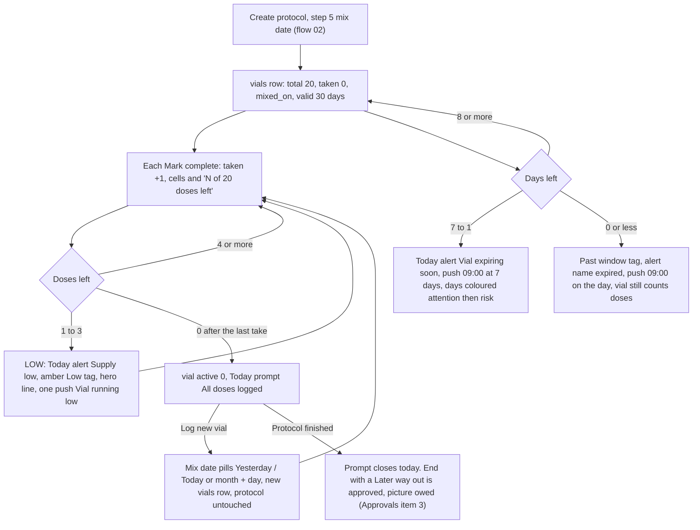
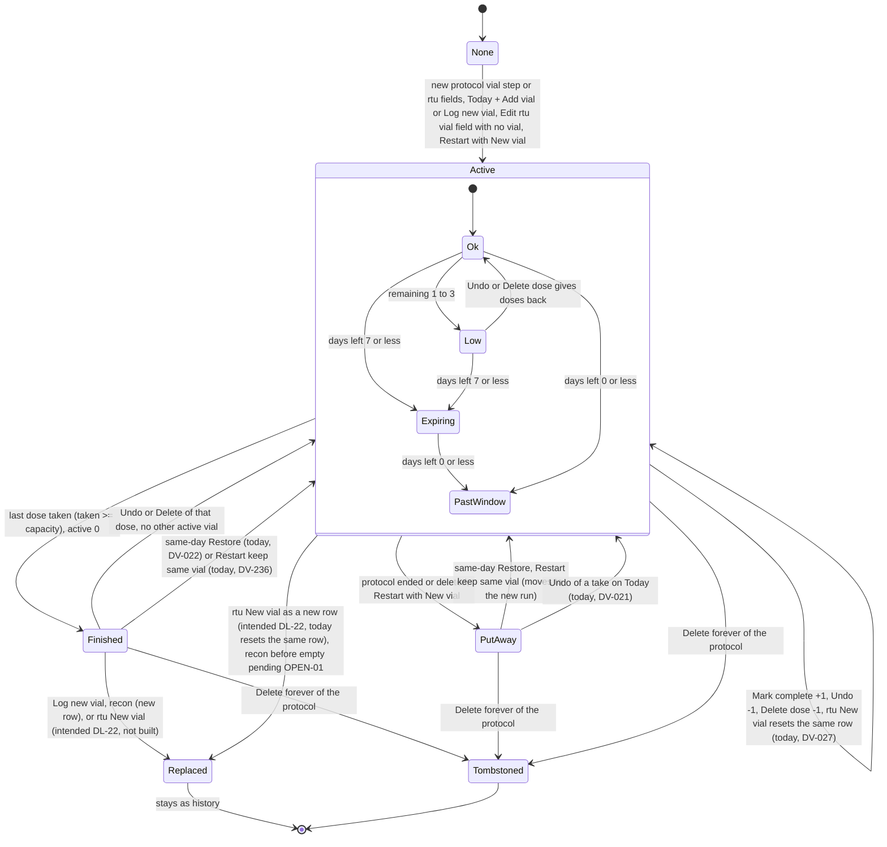
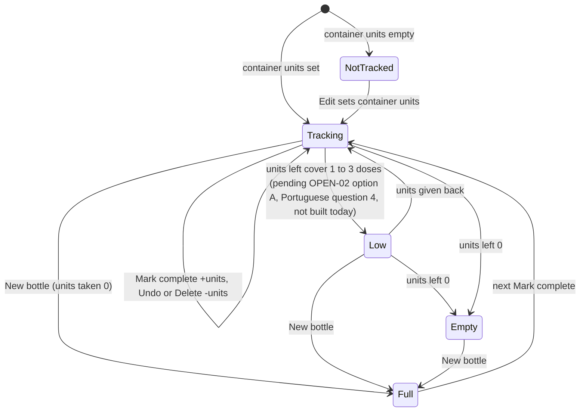
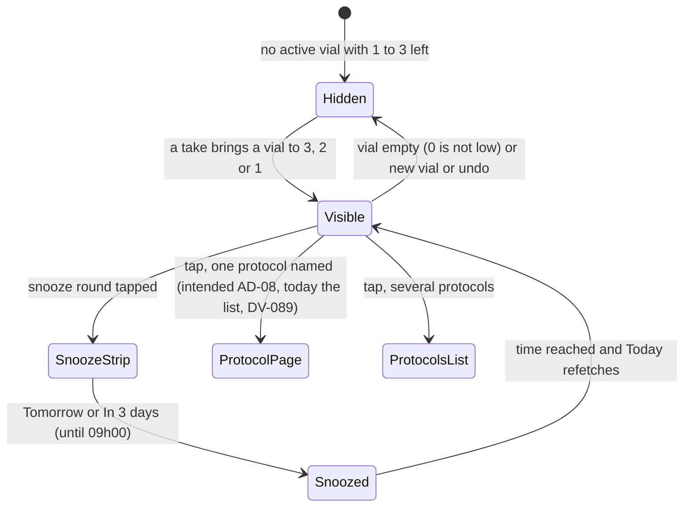

# 04 — Vial and supply: mix, use, low, expiry, new vial, bottle refill, empty

> Draft for founder review, written 2026-10-12 from `docs/product/research/01-protocols.md` (§3.12, §5.2–5.3, §6.2–6.11), `02-doses-today.md` (§3.7, alerts), `03-reminders.md` (§3.5–3.6), `docs/decisions.md` (Protocols & dose math; Today) and `docs/specs/fixes-1.2.5.md` (FX-1, FX-6, FX-11, FX-22). Code @ 4dade55.
> Shows the **intended** behaviour; **Divergence today** notes cite the dossier.
> Corrected 2026-10-12 after verification round 2 (`docs/product/verification/round2/R2-05-flows-picture.md`, `R2-07`); every id carries its final status from `verification/round2/id-map.md`. "Intended" is backed by a founder line (decisions.md:NNN), a signed spec row, an AD-xx or a DL-xx, or says "pending OPEN-xx (Portuguese question N)", "wording to approve (Approvals item 2.N)" or "approved, picture owed (Approvals item 3)".

---

## 1. Goal

Tell the user, truthfully and without advice, how much is left in the container they are using and until when they set it to be good — so they are never surprised by an empty vial or a vial past their own window — and let them start the next container in one step, keeping every logged dose in history.

## 2. Actors and containers

| Container | Type | Where it lives | "Left" means |
|---|---|---|---|
| Mixed vial | recon (lyophilized) | `vials` row: `mixed_on`, `water_ml`, `total_doses`, `doses_taken`, `active` | doses left = capacity − taken; days left = `mixed_on + vial_valid_days (30)` − today |
| Ready-to-use vial | rtu | `vials` row: `water_ml` = bottle ml, `total_doses`, `doses_taken`, `expires_on` (last day of the box month) | doses left; days left to `expires_on` |
| Bottle | oral | on the protocol row: `container_units`, `units_taken` | units left = container − taken; days of supply |

Other actors: Today (alerts, dose card vial cells, "+ Add vial", vial prompt), My Protocols (card cells, page vial block, "New vial" / "New bottle", hero low-supply line), notifications (`vial_low` immediate once per vial at 3 doses left — AD-60; `vial_expiry` 09:00 at 7 days and on the day — lead time and words pending OPEN-20 (c), Portuguese question 11 (b)), Mark complete / Undo / Delete dose (flow 03).

## 3. Preconditions

- An active injectable protocol (recon / rtu) or an oral protocol with a container size.
- Supply **pushes**: "Vial expiry alerts" switch on (it also gates "Vial running low" — 03 G4; one switch for both is AD-26, its new label "Vial alerts" is wording to approve, Approvals item 2.4, DV-140). Today's in-app supply and expiry alerts ignore the switch.

## 4. What may already have happened before

| # | Prior state | What the flow must do |
|---|---|---|
| P1 | Vial mixed days before installing | Step 5 / assistant ask the mix date; days left count from it. |
| P2 | Vial half used before installing | Pending **OPEN-01** (A-08/F7; Portuguese question 3): no field for doses already used; count starts at 0 → doses left over-reported (DV-094). |
| P3 | Never logged a mix ("skip") | Today card "+ Add vial"; Protocols shows "M doses per vial" capacity only. |
| P4 | Mixed a second vial early (two open at once) | Screens use the newest active vial per protocol; the push looks at every active vial (01 D-04). |
| P5 | Dose changed mid-vial | Capacity follows the new dose from the mass left (DL-15); today a recon edit does not recompute (01 D-13, DV-015) and an rtu edit ignores the doses taken (DV-223) — see flow 02. |
| P6 | rtu vial ran out last week | Intended (DL-22): an empty rtu vial can be replaced, as a new row (where the button sits = picture first; asking the new box's date = pending OPEN-01, Portuguese question 3); today none (01 D-12, DV-027). |
| P7 | Recon vial past its window but not empty | Pending **OPEN-01** (recon "New vial" on the protocol page; Portuguese question 3); today a new vial only when empty or absent (01 D-12b, DV-093). |
| P8 | Bottle with no container size | Not tracked; no supply line. |
| P9 | Oral every other day | Days of supply must use the interval (01 D-14). |
| P10 | Protocol restarted | New container question: New vial / Keep using the same vial (flow 05). |
| P11 | Another device took the last dose | Vial arrives inactive after pull; this phone's push may still announce low (once per vial id). |

## 5. Happy path (recon vial, 20 doses, daily)

## 6. States and transitions

### 6.1 Vial (recon / rtu)

Note: Low, Expiring and Past window are **derived**, never stored. An expired vial stays active and keeps counting doses (the window is the user's own tracking, never advice).

The transitions marked "(today, DV-…)" are defects, not intended: an empty vial is never put back in use (DL-20) — a same-day Restore re-activates the newest vial even when it was finished by doses (`ProtocolsScreen.js:1318-1319`, DV-022), and Restart with "Keep using the same vial" sets the moved vial active even when it is empty (`lib/protocolEnd.js:155`, DV-236; intended: the container moves to the new run unchanged, founder decisions.md:614); an Undo on Today reopens a vial that an end or delete put away (`lib/markTaken.js:231`, DV-021; intended: End / Delete wins, DL-88).

### 6.2 Oral bottle

### 6.3 Supply alert on Today (generic alert machine)

## 7. Alternative and exception paths

### 7.1 Low supply (one rule everywhere — founder decisions.md:148, signed FX-11; AD-60)
- Low = 1, 2 or 3 doses left; 0 is not "low" (it is finished). Capacity = stored `total_doses`, else derived floor(amount ÷ dose).
- Surfaces: Today alert "Supply low" ("{name} — {n} doses left" / one name / "{names} running low" / "{count} protocols running low"), Protocols card amber tag "Low · {n} left", page vial block, Protocols hero line, one push "Vial running low" / "{name} has {n} doses left" — **once per vial**, first at 3 doses left (AD-60: decided by the signed FX-11 deviation and decisions.md:148), only with the app running (BR-7).
- **Intended (AD-08, founder decisions.md:146):** an alert that names one protocol opens that protocol.
  - **Divergence today (01 D-23, 02 D23, DV-089):** Today alerts open the Protocols tab with no protocol (heroes). The push does open the protocol.
- **Divergence today (01 D-04, DV-016):** the push evaluates every active vial while screens use the newest per protocol — two open vials can produce a push the screens never show (intended: never two active vials, DL-14).
- **Divergence today (01 D-05, 03 D-19, DV-013):** the push names `protocol.name` (creation language) while Today and the expiry push use the translated compound name (intended: one display name, DL-13).
- **Divergence today (03 G4, DV-140):** the switch "Vial expiry alerts" also silences "Vial running low" (copy says expiry only). One switch for both is AD-26; the label "Vial alerts" is wording to approve (Approvals item 2.4).
- **Divergence today (01 D-15 / G-19, DV-092):** oral bottles have no low-supply anywhere → pending OPEN-02 (Portuguese question 4).

### 7.2 Expiry
- Recon: `mixed_on + vial_valid_days` (default 30, "Days the vial stays good", hint "A general reference (~30 days). Adjust it to match your storage — this is your own tracking, not medical advice."). RTU: `expires_on` from the box month + year (last day of that month).
- Today alert ≤ 7 days: "Vial expiring soon" / "{name} — {n} days left" / "{name} — expired" / "{count} vials expiring soon". Protocols: days coloured attention (≤ 7) and risk (≤ 3); "Past window" tag at ≤ 0.
- Push (A-45, behind the vial switch — AD-26, decisions.md:165): 09:00 local, 7 days before and on the day, only the next one per vial, counted inside the iPhone budget. Built 2026-10-03; the lead time and the words are not confirmed by the founder yet → pending OPEN-20 (c) (Portuguese question 11 (b)); the words are also on the test-build look list (Approvals item 8, A-45).
- Colours: the Today card colours days left by deadline (≤ 3 risk, ≤ 7 attention, above 7 ok green) — AD-65 (the founder's Q9 = B, decisions.md:147). My Protocols uses the same colouring from one days-left function — DL-80 (decided by logic); its picture is pending OPEN-24 item 11 (Portuguese question 2).
  - **Divergence today (01 D-06, DV-018):** My Protocols shows days left in plain ink2, not the Today card's colours.
- **Divergence today (01 D-06b, 08 D6, DV-018):** three copies of the days-left rule with two methods (recon whole days, rtu `ceil` from now); they agree except on a DST-change night. Push at 09:00 while "Past window" shows from 00:00.
- **Divergence today (verification 01 NEW-C, DV-200):** an rtu vial already reads "Past window" / "Fora do prazo" from 00:00 of the box month's **last** day (`Math.ceil` gives -0, counted as ≤ 0, `ProtocolsScreen.js:191-196`); the Today alert has the same `ceil` and says "{name} — expired" on that day.
- **Divergence today (03 G19, DV-002):** a snoozed expiry push moves to the check-in channel and keeps the compound name with names off.

### 7.3 Empty / finished
- Recon: the take that reaches capacity deactivates the vial and opens **All doses logged** / "All doses from this vial have been logged. Would you like to log a new vial?" with mix date and "New vial: ~{n} doses (from your vial size and dose)." → **Log new vial** / "Registrar novo frasco" and **Protocol finished** / "Protocolo concluído" — only these two buttons (TodayScreen.js:2380-2393). "Protocol finished" only closes the prompt today, and the card then shows "+ Add vial" / "+ Adicionar frasco".
  - **Intended (AD-11: A-85 is in 1.3.0 by the founder, decisions.md:550; approved, picture owed — Approvals item 3):** the empty-vial prompt offers ending the protocol with a "Later" way out ("I'll mix the next vial tomorrow" is the common case). Until the picture is approved it only closes the prompt (Gate B correction, decisions.md:558). → DV-090.
  - **Divergence today (02 G12, DV-038):** finishing a vial from the Dose log (Missed → Complete) deactivates it silently, no prompt (intended: AD-48).
- RTU empty:
  - **Intended (DL-22, decided by logic from F-035's "New vial"):** an empty rtu vial can be replaced, and the new box is a new vial row. Where it is offered is not decided (picture first); asking the new box's printed date is pending OPEN-01 (Portuguese question 3).
  - **Divergence today (01 D-12 / G-8, device unverified, DV-027):** no prompt (Today's vial prompt and vial row are recon-only); "New vial" needs an ACTIVE vial with doses taken > 0, so an empty rtu vial cannot be replaced except by Edit → change the vial size or box date.
- Oral empty: units left 0 shown; no flag, no prompt (pending OPEN-02, Portuguese question 4).

### 7.4 New vial / new bottle
- Ask first (founder, decisions.md:180): "Start counting from a full vial? The doses already logged stay in your history." (Cancel / **Start new**). Bottle: same with "bottle".
- A new vial **never rewrites the protocol's start date** (S-01) — history, curve and adherence keep their past.
- Recon new vial: only through Today's prompt (after the last dose) or "+ Add vial" (no active vial) — mix date "Yesterday / Today" pills or month + day; capacity derived; water read with comma decimals.
  - **Divergence today (01 D-12b, G-7, DV-093):** no recon "New vial" on My Protocols, and none while a vial is still active (e.g. past window). Whether recon gets "New vial" on the protocol page = pending **OPEN-01** (Portuguese question 3; was part of DL-22, narrowed).
- RTU New vial today resets the **same** row (`doses_taken 0`, expiry and size kept; `refillVial`, `ProtocolsScreen.js:2103-2109`).
  - **Divergence today (verification 01 NEW-B, DV-199):** because the row id stays the same and stays active, the once-per-vial memory (`dosetrace_vial_low_sent`) keeps it marked as sent, so this vial's "Vial running low" push never fires again after the refill (`vialLowToSend`, `notificationPlan.js:243-255`).
  - **Intended (DL-22, decided by logic):** a new rtu vial is a new row, so the old vial stays as history and the low push and expiry alerts follow the new box (fixes DV-199 with DV-027). Asking the new box's printed date = pending OPEN-01 (Portuguese question 3).
- Oral New bottle: `units_taken = 0` on the protocol.

### 7.5 Undo / delete give doses back
- Undo of a take: −1 from the current count; reopens a vial this dose closed if no other vial is active.
- Dose log Delete: −1 only when the dose can be attributed to the vial; reopens only if the vial was finished by doses.
- **Divergence today (01 D-17, DV-021):** Undo reopens a vial that an END or DELETE deactivated; Delete would not (intended: End / Delete wins, DL-88).

### 7.6 Offline / killed / second device
- All supply changes are local writes; pushed later. The low push needs the app running (never from the background refresh, BR-7) — it is "owed" until the next foreground.
- **SUSPECTED (02 §7.3, DV-039):** app killed between the dose row and the vial update → dose saved, supply not moved.
- Two devices: vial counts merge row-level (last push wins on the whole row).
  - **Divergence today (DV-183):** `vials.doses_taken` and `protocols.units_taken` are absolute values pushed with the whole row, so two phones each logging one dose offline end at n+1 doses taken, not n+2 (both Dose-log rows exist; "N of M left" and the bottle count are one short). When the sync hardening ships = pending OPEN-16 (b) (Portuguese question 1 (b)).
  - **Divergence today (01 G-3, A-87b, DV-021):** another phone's offline dose can push `active = 1` on a vial an end deactivated (intended: vials follow End / Delete wins — DL-88).

### 7.7 Timezone / DST
- Mix date and box month are local calendar days. Recon days left uses whole local days; rtu uses ceil from now (D-06b). The expiry push fires at 09:00 local on its date.

### 7.8 Notification tap
- "Vial running low" and expiry pushes → Protocols opening that protocol (`openProtocolId`; older alerts via `openVialId`). Snooze "In 1 hour" / "Tomorrow" available (general category).

### 7.9 Fold
- Today's right page for a recon protocol with no vial: "No mixed vial right now" / "Without a vial the app doesn't know the concentration, so it can't show the syringe or what's left. Add the vial you're going to use." + "+ Add vial" (FR-3). Refill and zoom on the right page open the protocol in My Protocols (FR-2). My Protocols book: right page = protocol page with the vial block.

### 7.10 Free vs Premium
- Supply tracking, alerts and pushes are free.

### 7.11 Report
- **Divergence today (01 D-02, 08 D3):** the adherence report's "doses remaining" uses `total_doses − doses_taken` without the derived capacity — can read 0 or negative for older vials.

## 8. What every surface shows

| State | Today | My Protocols card / page | Notifications | Settings report |
|---|---|---|---|---|
| Ok | dose card vial cells (recon) "N doses remaining", days left in ok colour (AD-65) | cells + "N of M doses left" · "{n} days left" (plain today; the Today colours = DL-80, picture pending OPEN-24 item 11) | — | doses remaining |
| Low (1–3) | Alert "Supply low · {name} — {n} doses left" (amber) | amber "Low · {n} left"; hero line | one "Vial running low" (app running) | — |
| Expiring (≤ 7 days) | Alert "Vial expiring soon · {name} — {n} days left" | days in attention / risk | 09:00 at 7 days (lead time pending OPEN-20 (c)) | — |
| Past window (≤ 0) | Alert "{name} — expired" | "Past window" tag, risk | 09:00 on the day | — |
| Finished (recon) | Prompt "All doses logged" | "M doses per vial" (no cells) | — | — |
| Finished (rtu) | nothing (intended DL-22: an empty rtu vial can be replaced; where = picture first, not decided) | "M doses per vial"; New vial missing (D04-2) | — | — |
| No vial (recon skipped) | card "+ Add vial"; Fold right page "No mixed vial right now" | "M doses per vial" | — | — |
| Bottle tracking | — | serving hero "Based on the numbers you entered:" / "Com base nos números que você inseriu:" + "{N} {unit}" ("Take" is only its accessibility label); reads "Dose", "Left" / "Restam", "Days left" / "Dias restantes"; **New bottle** / "Novo frasco" when taken > 0 (`ProtocolsScreen.js:484-521`) | — | — |
| Bottle empty | — | Left 0 | — (no rule) | — |

## 9. Data written at each step

| Step | Table | Write | Synced |
|---|---|---|---|
| Create recon / rtu | `vials` | insert (flow 02) | yes |
| Mark complete | `vials` (oral: `protocols`) | `doses_taken + 1`; `active 0` at capacity; or `protocols.units_taken += units` | yes |
| Undo / Delete dose | `vials` (oral: `protocols`) | `doses_taken − 1`, maybe `active 1`; or units back | yes |
| Log new vial / + Add vial | `vials` | insert via `newVialRecords` (mixed_on past occurrence, water_ml, total_doses, doses_taken 0, active 1); protocol untouched | yes |
| RTU New vial (today) | `vials` | same row `doses_taken 0, active 1` | yes |
| New bottle | `protocols` | `units_taken = 0` | yes |
| Low push sent | AsyncStorage `dosetrace_vial_low_sent` | `{vialId:true}` | no (survives sign-out — 03 G28, DV-081) |
| Expiry push | OS queue | `vial-exp-{vialId}-{7\|0}` | — |
| Alert snooze | AsyncStorage `dosetrace_alert_snooze` | snooze until | no |

## 10. Rules (with sources)

R-38 one low rule 1–3, push at 3 (decisions.md:148, FX-11; AD-60). R-39 low push once per vial, app running only. R-40 low amber, days coloured by deadline (Q9 = B, decisions.md:147 — AD-65 on the Today card; DL-80 on My Protocols, picture pending OPEN-24 item 11). R-41 recon validity default 30, the user's own window. R-42 expiry push 7 days before and on the day 09:00, next only, inside the iPhone budget (A-45/RC-7; lead time and words pending OPEN-20 (c), Portuguese question 11 (b)). R-43 new vial never rewrites start_date (S-01). R-44 New vial / New bottle ask first; logged doses stay. R-45 mix date = most recent past occurrence. R-46 last dose deactivates; undo reopens unless another is active. R-21 rtu total = conc × ml; expiry = last day of the box month (`01 §4`).

## 11. Divergences today (summary)

| ID | Intended | Today | Source | DV |
|---|---|---|---|---|
| D04-1 | Alert naming one protocol opens it (AD-08) | Opens the list | `01 D-23`, `02 D23`, decisions.md:146 | DV-089 |
| D04-2 | Empty rtu vial can be replaced (DL-22) | No path except Edit | `01 D-12`, `G-8` | DV-027 |
| D04-3 | Recon new vial from Protocols / before empty — pending OPEN-01 (Portuguese question 3) | Only via Today when empty or absent | `01 D-12b`, `G-7` (A-08 F5) | DV-093 |
| D04-4 | rtu New vial = a new row (DL-22); asking its box date pending OPEN-01 | Same row reset, old expiry kept | `01 G-7` (A-08 F6) | DV-027 |
| D04-5 | Oral low supply (pending OPEN-02, Portuguese question 4) + interval-aware days left (bug) | No low rule; days ÷ doses/day only | `01 D-14, D-15, G-19` | DV-020, DV-092 |
| D04-6 | One capacity rule (supplyLow) everywhere | 3 inline copies + report negative | `01 D-02, D-03` | DV-017, DV-121 |
| D04-7 | Push and screens look at the same vial; never two active vials (DL-14) | Push = all active vials | `01 D-04` | DV-016 |
| D04-8 | One name per protocol in pushes (DL-13) | stored name vs translated | `01 D-05`, `03 D-19` | DV-013 |
| D04-9 | One days-left function; Today card colours (AD-65) also on My Protocols (DL-80, picture pending OPEN-24 item 11) | Two colours, three copies, two methods | `01 D-06, D-06b`, `08 D6` | DV-018 |
| D04-10 | Vial switch label matches what it silences (AD-26; label "Vial alerts" = wording to approve, Approvals item 2.4) | Also silences low | `03 G4` | DV-140 |
| D04-11 | Dose log finishing a vial shows the prompt (AD-48) | Silent | `02 G12` | DV-038 |
| D04-12 | Undo and Delete give doses back by one rule; End / Delete wins for vials (DL-88) | Two rules | `01 D-17` | DV-021 |
| D04-13 | Restore does not reactivate an empty vial (DL-20) | It does | `01 D-18`, `G-21` | DV-022 |
| D04-14 | "Protocol finished" offers the end with a "Later" way out (AD-11, A-85: approved, picture owed — Approvals item 3) | Only closes | `01 G-1` (A-85); decisions.md:550, :558 | DV-090 |
| D04-15 | "Vial age" sort uses the user's window and rtu box dates (DL-17) | mixed_on only | `01 D-07` | DV-122 |
| D04-16 | An rtu refill re-arms the "running low" push (DL-22: a new box is a new row) | Never fires again for that vial | verification 01 NEW-B | DV-199 |
| D04-17 | "Past window" only after the box month's last day | From 00:00 of the last day (Protocols tag and Today "expired") | verification 01 NEW-C | DV-200 |
| D04-18 | Two phones' offline doses both count on the vial / bottle (when = pending OPEN-16 (b)) | Counter ends one short (absolute values, last push wins) | TRD H-3 | DV-183 |
| D04-19 | Switching "Vial alerts" off also cancels already-snoozed vial copies | A snoozed `snz-vial-…` copy still arrives once | R2-06 N-3 | DV-225 |
| D04-20 | An empty vial is never put back in use (DL-20); Restart "same vial" moves it unchanged (decisions.md:614) | Restart with "Keep using the same vial" sets an empty vial active | R2-05 (05:146); `protocolEnd.js:155` | DV-236 |
| D04-21 | The "Invalid date" sheet's title says what happened (decisions.md:121; titles to approve, Approvals item 2.16) | Generic "Error" title (`TodayScreen.js:1249`) | R2-05 (F04-09) | DV-233 |

## 12. Founder questions (canonical IDs — `docs/product/OPEN-DECISIONS.md`)

Reconciled 2026-10-12: every question this flow raised has one canonical ID in `OPEN-DECISIONS.md` — **OPEN-xx** waits for the founder (asked in the one Portuguese round there), **AD-xx** is already decided by the ledger or a signed spec, **DL-xx** is decided by product logic (recorded in `docs/decisions.md`; the founder may override). DV-xxx is the defect row in `DIVERGENCES.md`.

Open questions that touch this flow (each waits for the founder):

- **OPEN-01** — Correcting the vial in use (doses already used, mix date, validity), recon "New vial" on the protocol page, and asking a new rtu box's date (Portuguese question 3). → P2, P6, P7, §7.3, §7.4, D04-3, D04-4; DV-094, DV-093, DV-027.
- **OPEN-02** — Low-supply warning for oral bottles (Portuguese question 4). The interval-aware days of supply is a plain bug, fixed regardless. → §6.2, §7.1, D04-5; DV-092, DV-020.
- **OPEN-20 (c)** — The vial-expiry push's lead time (7 days + the day, 09:00) and its words (Portuguese question 11 (b)). → §2, §7.2, R-42; A-45.
- **OPEN-24 item 11** — My Protocols days left coloured like the Today card, as a picture (Portuguese question 2). → §7.2, D04-9; DV-018.
- **OPEN-16 (b)** — When the sync hardening ships, incl. the vial / bottle counters (Portuguese question 1 (b)). → §7.6, D04-18; DV-183.

Items this flow relies on that moved in round 2 (decided — no question):

- **DL-22** (narrowed) — an empty rtu vial can be replaced, and a new box is a new row. The recon "New vial" on the protocol page and asking the new box's date moved to OPEN-01. → D04-2, D04-4, D04-16; DV-027, DV-199.
- **AD-11** — A-85 ("End protocol" and the empty-vial prompt's "Later") is in 1.3.0 by the founder (decisions.md:550): approved, picture owed (Approvals item 3). → §7.3, D04-14; DV-090.
- **AD-65** (narrowed to the Today card, founder Q9 = B, decisions.md:147) and **DL-80** (My Protocols uses the same colouring; picture = OPEN-24 item 11). → §7.2, D04-9, D04-17; DV-018, DV-200.
- **AD-60** — the supply push fires at 3 doses left (signed FX-11 deviation, decisions.md:148); no longer open (was OPEN-18 (5)). → §7.1, R-38.
- **DL-88** (was inside AD-11, A-87b) — End / Delete wins across devices, vials included. → §7.5, §7.6, D04-12; DV-021.
- **DL-20** — an empty vial is never put back in use (Restore; also Restart "same vial", DV-236). → D04-13, D04-20; DV-022, DV-236.
- **DL-15** — one capacity rule from the mass left, recon and rtu alike. → P5; DV-015, DV-223.
- **Approvals still owed** — item 2.4 (the "Vial alerts" label, DV-140), 2.16 (error-sheet titles, DV-233); item 8 (look at the vial-expiry alert words on the test build, A-45).

## 13. Acceptance checks (agent-device QA script)

Account Test03. Protocols: **BPC-157** recon 5 mg / 2 ml, dose 250 mcg (20 doses), daily; **Test Cyp** rtu 200 mg/ml, 10 ml, 100 mg weekly (20 doses), box expiry next month; **Zinc** oral, 1 capsule, container 60. Light and dark; PT via Settings → Preferências → Idioma.

**F04-01 — Vial block after create**
- Expect on BPC-157 page: vial cells + "20 of 20 doses left" / "20 de 20 doses restantes" · "30 days left" / "30 dias restantes".

**F04-02 — Doses count down**
- Do: Mark complete once (flow 03).
- Expect: "19 of 20 doses left"; Today card vial cells −1.

**F04-03 — Low at 3**
- Setup: set BPC-157 to 17 taken (via 17 takes on past days in a test DB, test account only).
- Do: Mark complete → 3 left.
- Expect: Today alert "Supply low" / "Estoque baixo" + "BPC-157 — 3 doses left" / "BPC-157 — restam 3 doses"; Protocols tag "Low · 3 left" / "Baixo · 3 restantes"; one notification "Vial running low" / "Frasco acabando" + "BPC-157 has 3 doses left" / "BPC-157 tem 3 doses restantes". A second take → alert "2 doses left"; **no second push** for the same vial.

**F04-04 — Alert tap opens the protocol (intended)**
- Do: tap the Supply low alert.
- Expect (intended, AD-08): My Protocols opens on BPC-157's page. **Today: lands on the heroes** — record D04-1.
- Do: tap the push instead → opens BPC-157's page (works today).

**F04-05 — Snooze an alert**
- Do: snooze round → "Tomorrow" / "Amanhã".
- Expect: alert hidden; returns after 09:00 next day on Today focus. Options are only "Tomorrow" and "In 3 days" / "Em 3 dias".

**F04-06 — Last dose → All doses logged**
- Do: take the last dose.
- Expect: "All doses logged" / "Todas as doses registradas" + "All doses from this vial have been logged. Would you like to log a new vial?"; mix date (Yesterday / Today pills, month + day); "New vial: ~20 doses (from your vial size and dose)." / "Novo frasco: ~20 doses…"; **Log new vial** / "Registrar novo frasco"; **Protocol finished** / "Protocolo concluído".
- Log new vial with "Today" → page shows "20 of 20 doses left", "30 days left"; protocol start date unchanged; Dose log keeps the 20 old doses.

**F04-07 — Protocol finished button (today)**
- Expect today: closes the prompt; protocol stays active; card shows "+ Add vial" / "+ Adicionar frasco". Intended (AD-11, A-85: approved, picture owed — Approvals item 3): offers End with a Later option once the picture is approved — record.

**F04-08 — + Add vial with no vial**
- Do: tap "+ Add vial" on the card.
- Expect: the same prompt asking the mix date; Save creates the vial.

**F04-09 — Invalid mix date on Today**
- Do: + Add vial → month February, day 31.
- Expect: sheet with body "Invalid date" / "Data inválida" (today titled "Error" / "Erro" — D04-21, DV-233). (Wizard step 5 clamps the same input — D02-6.)

**F04-10 — Expiry alert and push (recon)**
- Setup: BPC-157 mixed 24 days ago (valid 30).
- Expect: Today alert "Vial expiring soon" / "Frasco vencendo" + "BPC-157 — 6 days left" / "BPC-157 — vence em 6 dias"; Protocols days in attention colour; Reminder check unaffected. Mixed 31 days ago → "BPC-157 — expired" / "BPC-157 — vencido", "Past window" / "Fora do prazo" tag; vial still counts doses.
- Push: with the vial mixed 20 days ago (expiry in 10 days), the OS queue holds `vial-exp-{vialId}-7` at 09:00 in 3 days and nothing else for that vial; after that one fires, the next resync schedules `vial-exp-{vialId}-0` at 09:00 on the expiry day (check with adb `dumpsys alarm` on Android or the Reminder check count on iPhone).

**F04-11 — RTU box expiry**
- Setup: Test Cyp box expiry = this month.
- Expect: days left counts to the last day of this month. **Today:** "Past window" (and Today's "expired") from 00:00 of the LAST day of the box month — the printed month's last day already counts as past; record (D04-9 / D-06b, D04-17).

**F04-12 — RTU New vial**
- Setup: Test Cyp with 3 taken.
- Do: page → **New vial** / "Novo frasco".
- Expect: "Start counting from a full vial? The doses already logged stay in your history." / "Começar a contar a partir de um frasco cheio?…" → **Start new** / "Começar um novo" → "20 of 20 doses left". Intended (D04-4, DL-22): the new box is a new row and the old vial stays as history (asking the new box date = pending OPEN-01) — record today's behaviour (same row reset, old expiry kept).

**F04-13 — RTU empty cannot be replaced (divergence check)**
- Setup: take all 20 Test Cyp doses.
- Expect (intended, DL-22): a way to start a new vial (where = picture first). **Today:** no prompt, no New vial button, card "20 doses per vial" — record D04-2.

**F04-14 — Oral New bottle**
- Setup: Zinc with 10 taken.
- Expect: serving hero "Left 50" / "Restam 50", "Days left"; **New bottle** / "Novo frasco" → "Start counting from a full bottle?…" → Left 60.

**F04-15 — Oral every other day days-left (divergence check)**
- Setup: Zinc interval 2 days, 30 left.
- Expect (intended, plain bug DV-020): ~60 days left. **Today: 30** — record D04-5.

**F04-16 — Undo gives the dose back**
- Do: Mark complete → Undo.
- Expect: count back; if that take had finished the vial, the vial is active again and the prompt closes.

**F04-17 — Vial switch off**
- Do: Settings → Notifications → "Vial expiry alerts" / "Alertas de vencimento de frasco" off.
- Expect: no vial-exp alarms in the OS queue; Today alerts still show (in-app). Note: low pushes also stop (D04-10).

**F04-18 — Fold: no-vial page**
- Do (unfolded Fold): tap BPC-157 with no active vial.
- Expect: right page "No mixed vial right now" / "Nenhum frasco reconstituído agora" + body + "+ Add vial"; tapping it opens Today's vial prompt.

**F04-19 — Both themes**
- Alerts, Low tag, days colours, vial cells, prompt, New vial sheet, Past window tag: readable in light and dark; low stays amber in both.
