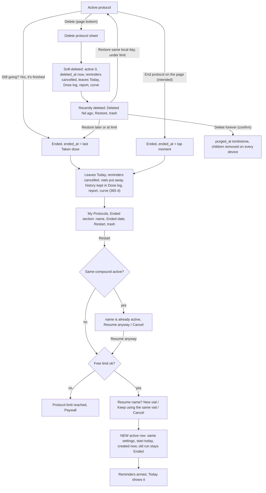
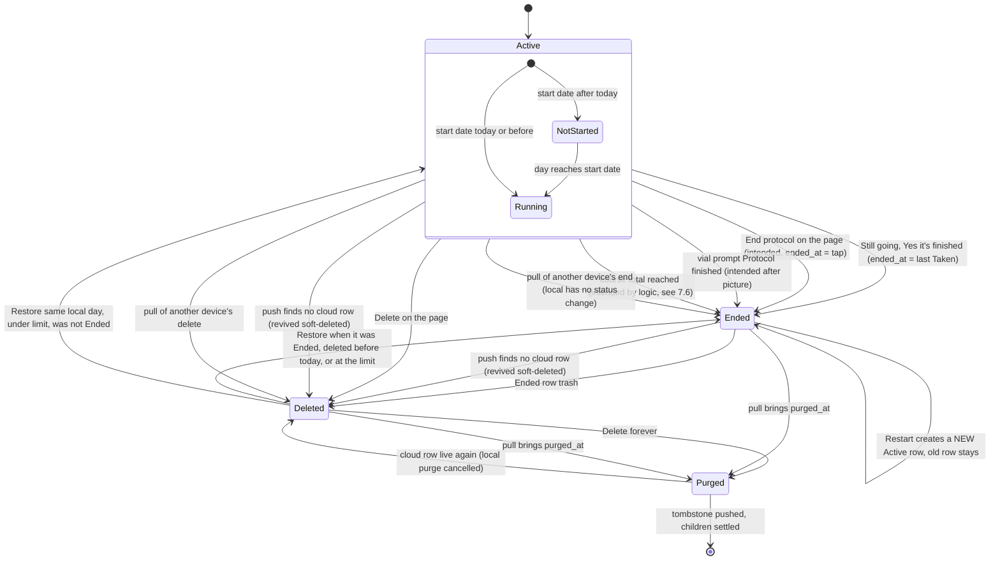
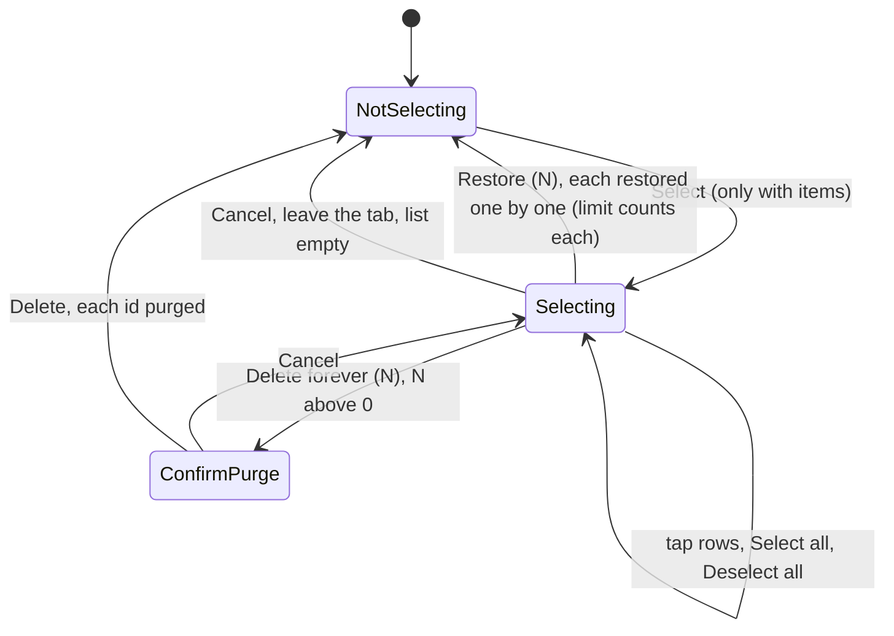

# 05 — End, restart and delete a protocol (incl. Recently deleted, Restore, Delete forever)

> Draft for founder review, written 2026-10-12 from `docs/product/research/01-protocols.md` (§3.8–3.11, §5.1, §6.16–6.17, §7.3–7.4, G-1…G-4, G-15, G-20…G-23), `02-doses-today.md` (§3.8), `03-reminders.md`, `05-curve-journey.md` (E1–E3, D1), `08-platform.md` (§4 sync), and `docs/decisions.md` (2026-10-03 rounds 4, 2026-10-04 Delete forever and dt-council, 2026-10-06 Restart, 2026-10-07 council 3). Code @ 4dade55.
> Shows the **intended** behaviour; **Divergence today** notes cite the dossier.

---

## 1. Goal

A protocol is a durable health record. When the user stops taking something, its reminders stop and it leaves Today — but its history stays (Ended). When they start again, a new run begins today without rewriting the old one (Restart). When they remove it by mistake, they get it back (Recently deleted → Restore). Only a deliberate "Delete forever" removes it from every device. Never destroy on a maybe.

## 2. Actors

| Actor | Role |
|---|---|
| User | Ends, restarts, deletes, restores, deletes forever. |
| Today "Still going?" prompt | Inactivity end, dated at the last logged dose (A-86). |
| Protocol page | Delete (bottom); **End protocol** (approved, placement picture pending). |
| Ended section | Restart pill, risk trash. |
| Recently deleted section | Restore pill, risk trash, Select mode (Select all, Restore (N), Delete forever (N)). |
| Sync engine | Status fields pushed only by the device that changed them (A-87); positive tombstone `purged_at`; revive soft-deleted when the cloud row vanished. |
| Server triggers | Purge deletes children and blanks the row; children of a purged protocol refused; client cannot DELETE protocols. |
| Notifications | Cancel on end / delete / purge; schedule on restore-to-active / restart. |
| Entitlement | Restart and Restore respect the free limit (A-89). |

## 3. Preconditions

- An active, ended or soft-deleted protocol owned by the signed-in user.
- Delete forever requires network to finish on the server (local tombstone works offline).

## 4. What may already have happened before

| # | Prior state | What the flow must do |
|---|---|---|
| P1 | Stopped taking it weeks ago and never told the app | "Still going?" after `max(7, 3 × interval)` days without a Taken dose → End dated at the last Taken dose; Missed rows the app wrote after it removed (A-86). |
| P2 | Finished the last vial and won't buy another | Vial prompt "Protocol finished" — **intended** ends the protocol once a picture with "Later" is approved; today it only closes the prompt. |
| P3 | Deleted by mistake today | Restore same day → back to Active (under the limit). |
| P4 | Deleted by mistake last week | Restore → Ended (its deleted days are never owed); Restart to resume. |
| P5 | 1.2.x "Yes, it's finished" soft-deleted protocols (old builds) | Cannot be told from deliberate deletes → automatic purge PAUSED in 1.3.0; all listed in Recently deleted (A-84 revisit next build). |
| P6 | Ended on phone A, phone B still has an offline edit | End wins across devices (A-87). |
| P7 | Restarting while the same compound is already active (duplicate) | Warn "{name} is already active" first (council 3). |
| P8 | Free user at 3 active wants to restart / restore a 4th | Restart → limit sheet; Restore → Ended (A-89). |
| P9 | Restarting while still using the old vial | Ask New vial / Keep using the same vial (council 3 #1). |
| P10 | Delete forever on another device | Synced children removed here; unsynced children stay pending ("Entries not saved" orphan sheet). |
| P11 | Protocol with a finite course (legacy `schedule_total`) | Reminders stop at the course end (BR-12); see §7.6 for the intended end. |

## 5. Happy path (end → restart, and delete → restore)

## 6. States and transitions

### 6.1 Recently deleted selection (UI)

### 6.2 Transition table

| From → To | Trigger | Guard | Writes | Side effects |
|---|---|---|---|---|
| Active → Ended | "Yes, it's finished" | prompt conditions | `ended_at = MAX(Taken.logged_at)` else created_at; `active 0`; `status_at` | app-written Missed rows after the end removed (unsynced deleted, synced tombstoned); vials deactivated; reminders cancelled; snooze key cleared |
| Active → Ended | End protocol (intended) | confirm | `ended_at = now`, `active 0`, `status_at` | as above (no Missed cleanup needed) |
| Active → Deleted | Delete | confirm sheet | `active 0`, `deleted_at now`, `restored_at NULL`, `status_at` | vials deactivated, reminders cancelled, delivered banners dismissed, back to list |
| Ended → Deleted | trash | confirm sheet | `ended_at` kept (or = updated_at), `deleted_at`, `status_at` | reminders cancelled |
| Ended → new Active | Restart | duplicate warning, limit, container question | new `protocols` row (copy except identity/status/start/units); `start_date = today`, `created_at = now`, `units_taken = same ? old : 0`; vial moved (same) or new vial (mixed today if it had a mix date, same water/total, 0 taken, expiry blank) — one SQL transaction | reminders scheduled, refresh, sync |
| Deleted → Active | Restore | same local day, under limit, not Ended before | `deleted_at NULL`, `restored_at`, `status_at` | newest vial active, reminders scheduled |
| Deleted → Ended | Restore | Ended before, or deleted before today, or at limit | `ended_at` kept or = `deleted_at` | none |
| Deleted → Purged | Delete forever | confirm | `purged_at`, pending; children `sync_status 'deleted'` | reminders + banners cancelled; server blanks the row, deletes children |

## 7. Alternative and exception paths

### 7.1 Ending
- **Inactivity prompt** (today's only end path): on Today focus, the first active, started protocol with no Taken log for `max(7, 3 × interval_days)` days (reference = last Taken in 90 days, else created_at / start_date), not snoozed for that window, no other popup → "Still going?" / "No doses logged for this one in a while. Is the protocol finished? Its doses stay in your history, and you can restart it from Ended in My Protocols." → **Yes, it's finished** / **Still going**.
- **Deliberate end (approved 2026-10-04, A-85):** an "End protocol" action on the protocol page; the end is the moment tapped; placement shown as a picture first.
  - **Divergence today (01 G-1):** not built (`endProtocol` exists, no caller). Only the inactivity prompt ends a protocol.
- **Vial prompt "Protocol finished"**: intended to end, only after a picture with a "Later" way out is approved (decision 2026-10-04 correction). Today it closes the prompt.
- **Missed cleanup across devices (A-86b, target 1.3.0):** app-written Missed rows after the end must disappear on every device.
  - **Divergence today (01 G-2):** removed on this phone only.
- **Divergence today (01 D-21, SUSPECTED, legacy rows):** with only old backfilled Taken rows, the prompt can fire early and date the end before the protocol existed.

### 7.2 Restart
- Duplicate warning first: "{name} is already active" / "You already have an active {name} protocol. Resuming creates another one, with duplicate reminders." → **Resume anyway** / Cancel.
- Container question: vial protocols "Resume {name}?" / "A new run starts today with zero doses taken; the previous run stays in your history. Will you use a new one or keep going with the same?" → **New vial** / **Keep using the same vial** / Cancel; orals "New bottle" / "Keep using the same bottle"; no container → plain confirm "Resume".
- New container: a full vial mixed today (only if the old one had a mix date), same water and capacity, 0 taken, **expiry blank** (user enters the new box date). Same container: the old vial moves to the new run unchanged (mix date, count); oral keeps `units_taken`.
- **Divergence today (01 G-20):** the body says "zero doses taken" even when "Keep using the same vial" keeps the count. Intended copy names what really happens (needs 6-language approval).
- Copied to the new run: history_from, schedule_total, reminder_time, colour, note, goals. The ended row stays as the first run's history.
- Restart is one at a time (guard) and fails atomically ("Couldn't save", nothing written).
- **Curve after restart:** two lines (old run decays, new run builds); same-substance runs can form a Combined total.
  - **Divergence today (05 D1):** the curve may reopen on the ENDED run (remembered id) while the Journey / My Body tile shows the new run → different compound and number (MB-4 says they must match). See flow 10.

### 7.3 Delete (soft)
- From the page bottom (red "Delete") or the Ended row trash → sheet "Delete protocol" / body.
- **Intended (decision 2026-10-04 "copy must be true"):** the body no longer promises "7 days" while the purge is paused, and says the doses leave the Dose log while the protocol is deleted.
  - **Divergence today (01 G-4):** "This protocol will be recoverable for 7 days from Recently deleted, at the bottom of your list."
- Effects: leaves Today, the Dose log (its logs hidden), hero counts, the report and the curve; reminders cancelled.

### 7.4 Recently deleted
- Lists every soft-deleted, non-purged protocol while the purge is paused, newest delete first: dot, name, "Deleted {days}d ago", **Restore**, trash.
  - **Divergence today (01 D-19, G-22):** `Math.ceil` shows "Deleted 1d ago" one minute after deleting; the app counts whole local days elsewhere.
- Restore rules (A-89): Ended before delete → Ended; deleted before today → Ended (dated at the delete); same-day → Active when under the free limit, else Ended. Only a still-deleted, unpurged row is restored. Restore N runs one by one so the limit counts each.
  - **Divergence today (01 D-18, G-21):** a same-day Restore re-activates the newest vial even when it was finished by doses.
- Delete forever: "Delete this protocol forever?" / "Delete {n} protocols forever?" + "Its dose history, vials and reminders are removed from all your devices. This can't be undone." → positive tombstone.
- Automatic 7-day purge: **paused** in 1.3.0 by founder-approved deferral (A-84, revisit next build).

### 7.5 Second device
- End / Delete wins: status fields are pushed only by the device that changed them (`status_at`); a pull never overwrites a local status change; another phone's pending edit cannot bring an ended or deleted protocol back to active.
- A push that finds 0 cloud rows never deletes: the protocol is re-inserted **soft-deleted** (lands in Recently deleted), children re-inserted; a pending Restore stays restored.
- Delete forever reaches others via `purged_at`; their synced children are removed; an unsynced child stays pending and Today asks "Entries not saved" / "{n} entries couldn't be saved: their protocol was deleted forever on another device…" → Keep for now / Discard.
- **Divergence today (01 G-3, A-87b):** vial status has no such rule — another phone's offline dose can push `active = 1` on a vial an end deactivated; Undo on this phone can reopen it too (01 D-17).
- Restart on two phones creates two runs (duplicate check is local) — A-48 parked.

### 7.6 Course total (legacy `schedule_total`)
- **Decided (BR-12, 2026-10-07):** protocols with a total number of doses end their reminders when that course ends.
- **Intended by logic (one schedule owner; founder may override):** when the course's last dose is due-and-past, Today, the Missed scan, rings and the curve stop expecting doses too, and the protocol is offered as finished (Ended at the last Taken dose, like the inactivity prompt).
- **Divergence today (01 D-08, D-11, G-6; 02 D4):** only reminders honour it; Today says "Day Y of Y" forever and Missed rows accumulate; no UI can set a course (the total-doses question was removed).

### 7.7 Offline / killed
- End, delete, restore, restart, delete forever: local writes first, pushed later; a kill mid-restart cannot leave a half state (one transaction).
- Delete forever offline: hidden locally at once; the cloud tombstone written on reconnect.

### 7.8 Timezone / DST
- "Same local day" (Restore → Active) and "Deleted Nd ago" use local days (intended); the end moment is an instant; the curve stops after the end day (on the end day only slots ≤ end).

### 7.9 Notification tap
- A reminder for an ended/deleted protocol should never exist (cancelled at end, orphan sweep at every resync). If a stale one is tapped: Today shows nothing; the notification button → "Nothing new logged" (Android) / nothing (iOS).

### 7.10 Fold
- My Protocols book: left page list incl. Ended and Recently deleted; right page = selected protocol page; Today's right page never offers Delete protocol (FR-2). The Recently deleted bottom bar replaces the tab bar while selecting.

### 7.11 Free vs Premium
- Ending frees a slot of the 3. Restart and same-day Restore respect the limit (limit sheet / → Ended). History of ended protocols is free and kept forever.

## 8. What every surface shows

| State | Today | My Protocols | Dose log / report | Curve / Journey tile | Reminders |
|---|---|---|---|---|---|
| Active | cards, alerts | list card; page with End (intended) and Delete | logs counted | charted; tile if first remembered | armed |
| Ended | gone (rings and week circles keep its past days; streak per protocol gone) | Ended section "Ended {date}", Restart, trash | logs visible; report includes it with records in the window | offered "· ended" for 365 days after the end; tile never shows ended (05 D1) | none |
| Deleted | gone | Recently deleted "Deleted Nd ago", Restore, trash; Select mode | logs hidden while deleted | not offered | none |
| Purged | gone | gone | gone on every device | gone | none |
| Restarted (new run) | new card from today | new active card; old row still in Ended | new run's logs separate | two runs | armed for the new run |
| Still going? shown | modal (one popup at a time) | — | — | — | — |

## 9. Data written at each step

| Step | Table | Columns | Synced |
|---|---|---|---|
| End (inactivity) | `protocols` | active 0, ended_at = last Taken, status_at, updated_at | yes (status from this device only) |
| | `dose_logs` | app-written Missed after end: unsynced deleted, synced tombstoned | yes |
| | `vials` | active 0 | yes |
| | AsyncStorage | remove `dosetrace_tx_check_<id>` | no |
| Still going | AsyncStorage `dosetrace_tx_check_<id>` | snooze until | no |
| Delete | `protocols` | active 0, deleted_at, restored_at NULL, status_at (ended_at kept if Ended) | yes |
| Restore | `protocols` | deleted_at NULL, restored_at (local), status_at; or ended_at | yes |
| Restart | `protocols` | new row; `vials` moved or new | yes (new row; created_at not synced — 01 D-20) |
| Delete forever | `protocols.purged_at`; children `sync_status 'deleted'` | yes; server blanks the row |
| Orphans | AsyncStorage `orphanedPromptShown:<uid>` | last count asked | no |

## 10. Rules (with sources)

R-47 Ended = active 0, not deleted; never auto-purged (A-83). R-48 inactivity end at the last Taken dose; app Missed rows after removed (A-86). R-49 deliberate end = moment tapped (2026-10-03). R-50 Restart = new run, today, created now; ended row stays. R-51 Restart asks container + duplicate warning (2026-10-06/07). R-52 Restart and Restore respect the free limit (A-89). R-53 Restore rules (A-89). R-54 purge paused in 1.3.0 (A-84). R-55 Delete forever = positive tombstone (2026-10-04). R-56 no device deletes because a row is absent. R-57 End / Delete wins (A-87). R-58 reminders renewed until delete/end; courses end their reminders (BR-12). (`01 §4`.)

## 11. Divergences today (summary)

| ID | Intended | Today | Source | DV |
|---|---|---|---|---|
| D05-1 | "End protocol" on the page | Missing | `01 G-1` (A-85, picture first) | DV-090 |
| D05-2 | Vial prompt "Protocol finished" ends (with Later) | Only closes | decision 2026-10-04 correction | DV-090 |
| D05-3 | Missed cleanup reaches every device | This phone only | `01 G-2` (A-86b) | DV-025 |
| D05-4 | Vial status follows End/Delete across devices | Can be revived | `01 G-3` (A-87b), `01 D-17` | DV-021 |
| D05-5 | Delete sheet copy true (no 7 days; doses leave the log) | Old copy | `01 G-4` (A-90) | DV-023 |
| D05-6 | Restart copy true for "same vial" | Says zero doses | `01 G-20` | DV-024 |
| D05-7 | Restore never re-activates an empty vial | Does | `01 D-18, G-21` | DV-022 |
| D05-8 | "Deleted Nd ago" in local days | ceil of hours | `01 D-19, G-22` | DV-023 |
| D05-9 | Course end honoured everywhere | Reminders only | `01 D-08, D-11, G-6` | DV-012 |
| D05-10 | Curve and tile on the same run after restart | Can differ | `05 D1` | DV-067 |
| D05-11 | Registry rows A-86/87/89 marked built | "Not started" | `01 G-15` (doc) | DV-176 |

## 12. Founder questions (canonical IDs — `docs/product/OPEN-DECISIONS.md`)

Reconciled 2026-10-12: every question this flow raised has one canonical ID in `OPEN-DECISIONS.md` — **OPEN-xx** waits for the founder (asked in the one Portuguese round there), **AD-xx** is already decided by the ledger or a signed spec, **DL-xx** is decided by product logic (recorded in `docs/decisions.md`; the founder may override). DV-xxx is the defect row in `DIVERGENCES.md`.

- **AD-11 — "End protocol" placement and the vial prompt's "Later".** Already approved (A-85, decisions.md:535, :558); pictures before code. → DV-090.
- **OPEN-03 — Course end** (D05-9). Waits for the founder. → DV-012.
- **OPEN-04 — Automatic purge after 1.3.0 (A-84).** Waits for the founder. This flow had recommended resuming the purge for protocols deleted from 1.3.0 on (option B there); OPEN-DECISIONS recommends never purging automatically (option A), since "Delete forever" with multi-select exists. → DV-125.

## 13. Acceptance checks (agent-device QA script)

Account Test03; protocols created for the test only. Light and dark; PT via Settings → Preferências → Idioma.

**F05-01 — Still going? appears**
- Setup: daily protocol "Test A" whose last Taken dose was 8 days ago.
- Do: open Today.
- Expect: "Still going?" / "Ainda em andamento?" with the body ending "…you can restart it from Ended in My Protocols."; buttons **Yes, it's finished** / "Sim, terminou" and **Still going** / "Ainda em andamento".

**F05-02 — Yes, it's finished**
- Do: Yes, it's finished.
- Expect: Test A leaves Today; My Protocols → list → section "Ended" / "Encerrados" row "Ended {date of the last dose}" / "Encerrado em {date}" with **Restart** / "Retomar" and a trash icon; Reminder check scheduled count drops; Dose log keeps its rows; Missed rows after the last dose gone.

**F05-03 — Still going snoozes**
- Do: Still going.
- Expect: no prompt again for that protocol for `max(7, 3 × interval)` days.

**F05-04 — Restart with duplicate warning**
- Setup: Ended "BPC-157" + an active BPC-157.
- Do: Restart.
- Expect: "BPC-157 is already active" / "BPC-157 já está ativo" + "…Resuming creates another one, with duplicate reminders." → **Resume anyway** / "Retomar mesmo assim".

**F05-05 — Restart container question**
- Expect: "Resume BPC-157?" / "Retomar BPC-157?"; **New vial** / "Frasco novo", **Keep using the same vial** / "Continuar o mesmo frasco", Cancel.
- New vial → new active card from today; page "20 of 20 doses left", mixed today; Ended row still listed.
- Repeat with Keep using the same vial → the old count carries over (intended copy must say so — record D05-6).

**F05-06 — Restart at the free limit**
- Setup: 3 active, free.
- Expect: Restart → "Protocol limit reached" sheet; nothing written.

**F05-07 — Delete from the page**
- Do: open an active protocol → scroll to the bottom → **Delete** / "Excluir".
- Expect sheet "Delete protocol" / "Excluir protocolo". Intended body: no "7 days", says doses leave the Dose log while deleted. **Today:** "…recoverable for 7 days from Recently deleted…" — record D05-5.
- Confirm → back to the list; section "Recently deleted" / "Excluídos recentemente" row "Deleted 0d ago" (intended) — today "1d ago" (D05-8); Today card gone; Dose log rows of it hidden.

**F05-08 — Same-day Restore → Active**
- Do: Restore / "Restaurar".
- Expect: back in the active list; reminders re-armed (Reminder check count back); Dose log rows visible again.

**F05-09 — Restore next day → Ended**
- Setup: delete, move the clock +1 day.
- Expect: Restore puts it in Ended (never Active); Restart then needed.

**F05-10 — Multi-select**
- Setup: 3 rows in Recently deleted.
- Do: **Select** / "Selecionar" → **Select all** / "Selecionar tudo" → bottom bar **Restore (3)** / "Restaurar (3)" and **Delete forever (3)** / "Excluir para sempre (3)" replaces the tab bar; Deselect all → both disabled at 0.

**F05-11 — Delete forever**
- Do: select 2 → Delete forever (2).
- Expect: "Delete 2 protocols forever?" / "Excluir 2 protocolos para sempre?" + "Their dose history, vials and reminders are removed from all your devices. This can't be undone." → Delete → rows gone.
- Second device: after its pull both protocols and their dose rows are gone; an unsynced dose there → "Entries not saved" / "Registros não salvos" with **Keep for now** / **Discard**.

**F05-12 — End wins across devices**
- Do: phone B offline edits the protocol's note; phone A ends it; B goes online.
- Expect: the protocol is Ended on both; B's note edit kept; never active again.

**F05-13 — Revive instead of delete**
- Setup (test DB only): remove the cloud row of a pending protocol.
- Expect: after push, the protocol appears in Recently deleted, not deleted and not active.

**F05-14 — Curve after restart**
- Setup: Testosterone Cypionate ended then restarted; curve last view = the ended run.
- Expect (intended): curve and Journey tile show the same run and number. **Today:** may differ — record D05-10.

**F05-15 — Fold**
- Do (unfolded Fold): My Protocols → tap an Ended row; Recently deleted Select mode.
- Expect: right page shows the protocol page; the bottom bar spans the full width; fold/unfold keeps the selection.

**F05-16 — Both themes**
- Still going modal, Ended row, Restart sheets, Delete sheet, Recently deleted rows, risk trash icons, Select bar, Delete forever sheet: readable in light and dark.
