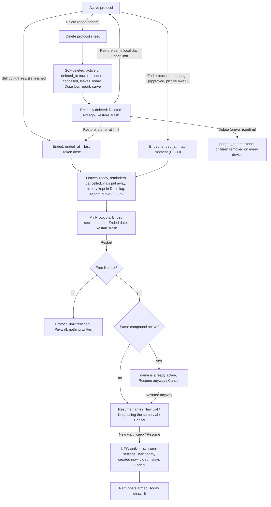
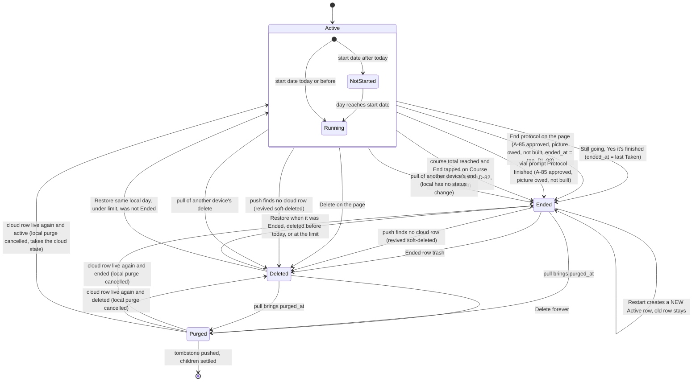
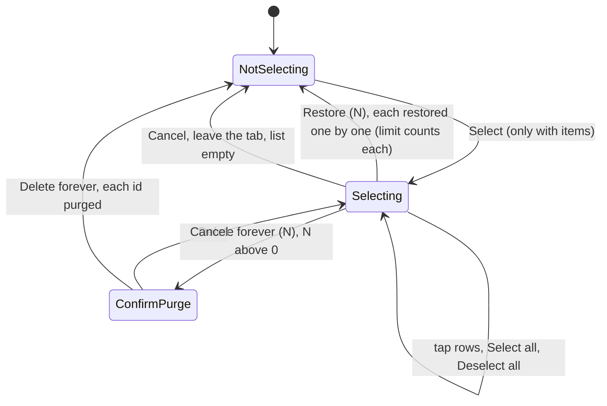

# 05 — End, restart and delete a protocol (incl. Recently deleted, Restore, Delete forever)

> Draft for founder review, written 2026-10-12 from `docs/product/research/01-protocols.md` (§3.8–3.11, §5.1, §6.16–6.17, §7.3–7.4, G-1…G-4, G-15, G-20…G-23), `02-doses-today.md` (§3.8), `03-reminders.md`, `05-curve-journey.md` (E1–E3, D1), `08-platform.md` (§4 sync), and `docs/decisions.md` (2026-10-03 rounds 4, 2026-10-04 Delete forever and dt-council, 2026-10-06 Restart, 2026-10-07 council 3). Code @ 4dade55.
> Shows the **intended** behaviour; **Divergence today** notes cite the dossier.
> Corrected 2026-10-12 after verification round 2 (`docs/product/verification/round2/R2-05`, `R2-07`); every id carries its final status from `verification/round2/id-map.md`. "Intended" is backed by a founder line (decisions.md:NNN), a signed spec row, an AD-xx or a DL-xx, or an AD-xx decided by the founder on 2026-10-15 (was OPEN-xx), or says "wording to approve (Approvals item 2.N)" or "approved, picture owed (Approvals item 3)".

---

## 1. Goal

A protocol is a durable health record. When the user stops taking something, its reminders stop and it leaves Today — but its history stays (Ended). When they start again, a new run begins today without rewriting the old one (Restart). When they remove it by mistake, they get it back (Recently deleted → Restore). Only a deliberate "Delete forever" removes it from every device. Never destroy on a maybe.

## 2. Actors

| Actor | Role |
|---|---|
| User | Ends, restarts, deletes, restores, deletes forever. |
| Today "Still going?" prompt | Inactivity end, dated at the last logged dose (A-86, DL-87). |
| Protocol page | Delete (bottom); **End protocol** (AD-11, A-85: approved, picture owed — Approvals item 3; not built). |
| Ended section | Restart pill, risk trash. |
| Recently deleted section | Restore pill, risk trash, Select mode (Select all, Restore (N), Delete forever (N)). |
| Sync engine | Status fields pushed only by the device that changed them (A-87, DL-88); positive tombstone `purged_at`; revive soft-deleted when the cloud row vanished. |
| Server triggers | Purge deletes children and blanks the row; children of a purged protocol refused; client cannot DELETE protocols. |
| Notifications | Cancel on end / delete / purge; schedule on restore-to-active / restart. |
| Entitlement | Restart and Restore respect the free limit (A-89, DL-89). |

## 3. Preconditions

- An active, ended or soft-deleted protocol owned by the signed-in user.
- Delete forever requires network to finish on the server (local tombstone works offline).

## 4. What may already have happened before

| # | Prior state | What the flow must do |
|---|---|---|
| P1 | Stopped taking it weeks ago and never told the app | "Still going?" after `max(7, 3 × interval)` days without a Taken dose → End dated at the last Taken dose; Missed rows the app wrote after it removed (A-86, DL-87). |
| P2 | Finished the last vial and won't buy another | Vial prompt "Protocol finished" — **intended** (AD-11, A-85: approved, picture owed — Approvals item 3): ends the protocol, with a "Later" way out; today it only closes the prompt. |
| P3 | Deleted by mistake today | Restore same day → back to Active (under the limit). |
| P4 | Deleted by mistake last week | Restore → Ended (its deleted days are never owed; DL-89); Restart to resume. |
| P5 | 1.2.x "Yes, it's finished" soft-deleted protocols (old builds) | Cannot be told from deliberate deletes → automatic purge PAUSED through 1.3.0 (DL-94); all listed in Recently deleted. After 1.3.0 too: Recently deleted never empties itself — items stay until the person deletes them forever (AD-83, decided 2026-10-15, was OPEN-04). |
| P6 | Ended on phone A, phone B still has an offline edit | End wins across devices (A-87, DL-88). |
| P7 | Restarting while the same compound is already active (duplicate) | Warn "{name} is already active" first (founder, decisions.md:614). |
| P8 | Free user at 3 active wants to restart / restore a 4th | Restart → the limit sheet first, before the duplicate warning and the container question (today it comes last — DV-217); Restore → Ended (A-89, DL-89). |
| P9 | Restarting while still using the old vial | Ask New vial / Keep using the same vial; "same" moves the container to the new run unchanged (founder, decisions.md:614). |
| P10 | Delete forever on another device | Synced children removed here; unsynced children stay pending ("Entries not saved" orphan sheet). |
| P11 | Protocol with a finite course (legacy `schedule_total`) | Reminders stop at the course end (BR-12, founder decisions.md:620); intended (AD-82, was OPEN-03): the app stops expecting doses everywhere and Today asks "Course complete — end {name}?" (End / Continue; see §7.6). |

## 5. Happy path (end → restart, and delete → restore)

## 6. States and transitions

### 6.1 Recently deleted selection (UI)

### 6.2 Transition table

| From → To | Trigger | Guard | Writes | Side effects |
|---|---|---|---|---|
| Active → Ended | "Yes, it's finished" | prompt conditions | `ended_at = MAX(Taken.logged_at)` else created_at; `active 0`; `status_at` | app-written Missed rows after the end removed (unsynced deleted, synced tombstoned); vials deactivated; reminders cancelled; snooze key cleared |
| Active → Ended | End protocol (AD-11, A-85: approved, picture owed — not built) | confirm | `ended_at = now` (DL-99), `active 0`, `status_at` | as above (no Missed cleanup needed) |
| Active → Deleted | Delete | confirm sheet | `active 0`, `deleted_at now`, `restored_at NULL`, `status_at` | vials deactivated, reminders cancelled, delivered banners dismissed, back to list |
| Ended → Deleted | trash | confirm sheet | `ended_at` kept (or = updated_at), `deleted_at`, `status_at` | reminders cancelled only — no vial deactivation, no delivered-banner dismissal (divergence DV-216, see §7.3) |
| Ended → new Active | Restart | free limit first, then the duplicate warning and the container question (today the limit is checked last, on the container button tap — DV-217); nothing written when refused | new `protocols` row (copy except identity/status/start/units); `start_date = today`, `created_at = now`, `units_taken = same ? old : 0`; vial moved (same — today set `active 1` even when empty, DV-236) or new vial (mixed today if it had a mix date, same water/total, 0 taken, expiry blank) — one SQL transaction | reminders scheduled, refresh, sync |
| Deleted → Active | Restore | same local day, under limit, not Ended before | `active 1`, `ended_at NULL`, `deleted_at NULL`, `restored_at`, `status_at` | newest vial active (today even when finished by doses — DV-022; intended DL-20), reminders scheduled |
| Deleted → Ended | Restore | Ended before, or deleted before today, or at limit | `active 0`, `ended_at` kept or = `deleted_at`, `deleted_at NULL`, `restored_at`, `status_at` | none |
| Deleted → Purged | Delete forever | confirm | `purged_at`, pending; children `sync_status 'deleted'` | reminders + banners cancelled; server blanks the row, deletes children |

## 7. Alternative and exception paths

### 7.1 Ending
- **Inactivity prompt** (today's only end path): on Today focus, the first active, started protocol with no Taken log for `max(7, 3 × interval_days)` days (reference = last Taken in 90 days, else created_at / start_date), not snoozed for that window, no other popup → "Still going?" / "No doses logged for this one in a while. Is the protocol finished? Its doses stay in your history, and you can restart it from Ended in My Protocols." → **Yes, it's finished** / **Still going**. The end is dated at the last logged Taken dose (DL-87).
  - **Divergence today (DV-202):** the prompt checks only three of Today's popup flags (`TodayScreen.js:530`), so it can open together with another Today sheet (the vial prompt, the orphan sheet, the Skip sheet) — "one popup at a time" is not kept.
- **Deliberate end (AD-11: A-85 is in 1.3.0 by the founder, decisions.md:550; approved, picture owed — Approvals item 3):** an "End protocol" action on the protocol page; the end is the moment tapped, no date question (DL-99 — the coordinator lines decisions.md:504 / :535 placed as logic; DV-090's test); placement shown as a picture first.
  - **Divergence today (01 G-1, DV-090):** not built (`endProtocol`, `lib/protocolEnd.js:46`, has no screen caller). Only the inactivity prompt ends a protocol.
- **Vial prompt "Protocol finished"** (same A-85 item: approved, picture owed — Approvals item 3): ends the protocol, with a "Later" way out. Until the picture is approved it only closes the prompt (Gate B correction, decisions.md:558). → DV-090.
- **Missed cleanup across devices (DL-87, from A-86b):** app-written Missed rows after the end disappear on every device (never a row the user entered).
  - **Divergence today (01 G-2, DV-025):** removed on this phone only.
- **Divergence today (01 D-21, legacy rows, DV-026):** with only old backfilled Taken rows, the prompt can fire early and date the end before the protocol existed (intended: logged Taken rows only, DL-21).

### 7.2 Restart
- Order: free-limit check first ("Protocol limit reached", nothing written) → duplicate warning → container question. A question whose answer is then refused must not be asked.
  - **Divergence today (DV-217):** the limit is checked last, inside `restartProtocol`, after a container button is tapped (`ProtocolsScreen.js:1253-1290`): the user picks a container before seeing "Protocol limit reached" (nothing is written).
- Duplicate warning first: "{name} is already active" / "You already have an active {name} protocol. Resuming creates another one, with duplicate reminders." → **Resume anyway** / Cancel.
- Container question: vial protocols "Resume {name}?" / "A new run starts today with zero doses taken; the previous run stays in your history. Will you use a new one or keep going with the same?" → **New vial** / **Keep using the same vial** / Cancel; orals "New bottle" / "Keep using the same bottle"; no container → plain confirm "Resume".
- New container: a full vial mixed today (only if the old one had a mix date), same water and capacity, 0 taken, **expiry blank** (user enters the new box date). Same container (founder, decisions.md:614): the old container moves to the new run **unchanged** — its mix date and count; oral keeps `units_taken`.
  - **Divergence today (DV-236):** the moved vial is set `active = 1` even when it was finished by doses (`lib/protocolEnd.js:155`), so a restarted protocol can show an empty vial as in use ("0 of N doses left") — against DL-20 (an empty vial is never put back in use), the same defect class as DV-022.
- **Divergence today (01 G-20, DV-024):** the body says "zero doses taken" (EN "A new run starts today with zero doses taken; the previous run stays in your history. Will you use a new one or keep going with the same?" / PT "Um novo ciclo começa hoje, com zero doses tomadas; …") even when "Keep using the same vial" keeps the count. Intended: the text names what each choice really does (AD-09, decisions.md:614) — wording to approve (Approvals item 2.8).
- Copied to the new run: history_from, schedule_total, reminder_time, colour, note, goals. The ended row stays as the first run's history.
- Restart is one at a time (guard) and fails atomically (sheet "Error" / "Erro" + "Couldn’t save your changes. Please try again." / "Não foi possível salvar as alterações. Tente novamente."; nothing written; `ProtocolsScreen.js:1293-1295`).
  - **Divergence today (DV-233):** the title is the generic "Error", against the founder's Q4 = A (titles say what happened, decisions.md:121) — title to approve (Approvals item 2.16).
- **Curve after restart:** two lines (old run decays, new run builds); same-substance runs can form a Combined total.
  - **Divergence today (05 D1):** the curve may reopen on the ENDED run (remembered id) while the Journey / My Body tile shows the new run → different compound and number (MB-4 says they must match). See flow 10.

### 7.3 Delete (soft)
- From the page bottom (red "Delete") or the Ended row trash → sheet "Delete protocol" / body.
- **Intended (copy must be true — a bug, DV-023):** the body no longer promises "7 days" while the purge is paused, and says the doses leave the Dose log while the protocol is deleted. The new words = wording to approve (Approvals item 2.8).
  - **Divergence today (01 G-4, DV-023):** "This protocol will be recoverable for 7 days from Recently deleted, at the bottom of your list." / "Este protocolo poderá ser recuperado por 7 dias em Excluídos recentemente, no final da sua lista."
- Effects: leaves Today, the Dose log (its logs hidden), hero counts, the report and the curve; reminders cancelled.
- **Divergence today (verification 01 PRD-PROT-100, DV-216):** only the protocol-page Delete also deactivates the vials and dismisses delivered banners (`ProtocolsScreen.js:2017-2019`). The Ended-row trash (`deleteEndedProtocol`, `:1231-1247`) only soft-deletes and cancels reminders (`:1240-1241`) — no vial deactivation, no banner dismissal (its vials were normally already deactivated at the end).

### 7.4 Recently deleted
- Lists every soft-deleted, non-purged protocol while the purge is paused, newest delete first: dot, name, "Deleted {days}d ago", **Restore**, trash.
  - **Divergence today (01 D-19, G-22, DV-023):** `Math.ceil` shows "Deleted 1d ago" / "Excluído há 1d" one minute after deleting (`ProtocolsScreen.js:2218`); intended: local calendar days, as elsewhere in the app (so the same day never reads "1d ago"; the same-day words are not approved yet).
- Restore rules (A-89, DL-89): Ended before delete → Ended; deleted before today → Ended (dated at the delete); same-day → Active when under the free limit, else Ended. Only a still-deleted, unpurged row is restored. Restore N runs one by one so the limit counts each.
  - **Divergence today (01 D-18, G-21, DV-022):** a same-day Restore re-activates the newest vial even when it was finished by doses (`ProtocolsScreen.js:1318-1319`; intended DL-20).
- Delete forever: "Delete this protocol forever?" / "Delete {n} protocols forever?" + "Its dose history, vials and reminders are removed from all your devices. This can’t be undone." → **Delete forever** / "Excluir para sempre" → positive tombstone.
- Automatic 7-day purge: **paused** through 1.3.0 — DL-94 (decided by logic, "never destroy on a maybe"; was AD-50, the coordinator line decisions.md:506; A-84). The founder approved the hand-delete multi-select (decisions.md:501, :515). **Intended (AD-83, decided 2026-10-15, was OPEN-04; 1.3.0):** the purge never returns — Recently deleted never empties itself; items stay until the person deletes them forever, and the delete notice says so (DV-125; the notice text is with Approvals item 2.8).

### 7.5 Second device
- End / Delete wins (DL-88, from A-87): status fields are pushed only by the device that changed them (`status_at`); a pull never overwrites a local status change; another phone's pending edit cannot bring an ended or deleted protocol back to active.
- A push that finds 0 cloud rows never deletes: the protocol is re-inserted **soft-deleted** (lands in Recently deleted), children re-inserted; a pending Restore stays restored.
- Delete forever reaches others via `purged_at`; their synced children are removed; an unsynced child stays pending and Today asks "Entries not saved" / "{n} entries couldn’t be saved: their protocol was deleted forever on another device…" → Keep for now / Discard.
- **Divergence today (01 G-3, A-87b, DV-021):** vial status has no such rule — another phone's offline dose can push `active = 1` on a vial an end deactivated; Undo on this phone can reopen it too (01 D-17). Intended: vials follow the same rule (DL-88).
- Restart on two phones creates two runs (duplicate check is local) — A-48 parked (founder decisions.md:199, AD-32).

### 7.6 Course total (legacy `schedule_total`)
- **Decided (founder decisions.md:620, BR-12):** protocols with a total number of doses end their reminders when that course ends.
- **Intended (AD-82, decided 2026-10-15, was OPEN-03; 1.3.0):** at the end of a fixed course the app stops expecting doses everywhere — Today, the Missed scan, the curve and reminders — and Today asks **"Course complete — end {name}?"** with **End** (ends the protocol, §7.1) / **Continue** (removes the total, the protocol goes on as an open-ended one). The total-doses field does not return to the form. Texts ×6 (Approvals item 2).
- **Divergence today (01 D-08, D-11, G-6; 02 D4; DV-012):** only reminders honour it; Today says "Day Y of Y" forever and Missed rows accumulate; no UI can set a course (the total-doses question was removed).

### 7.7 Offline / killed
- End, delete, restore, restart, delete forever: local writes first, pushed later; a kill mid-restart cannot leave a half state (one transaction).
- Delete forever offline: hidden locally at once; the cloud tombstone written on reconnect.

### 7.8 Timezone / DST
- "Same local day" (Restore → Active, DL-89) uses the local day; "Deleted {days}d ago" should too (intended, DV-023 — today `Math.ceil` of hours); the end moment is an instant; the curve stops after the end day (on the end day only slots ≤ end).

### 7.9 Notification tap
- A reminder for an ended/deleted protocol should never exist (cancelled at end, orphan sweep at every resync). If a stale one is tapped: Today shows nothing; the notification button → "Nothing new logged" (Android) / nothing (iOS).

### 7.10 Fold
- My Protocols book: left page list incl. Ended and Recently deleted; right page = selected protocol page; Today's right page never offers Delete protocol (FR-2). The Recently deleted bottom bar replaces the tab bar while selecting.

### 7.11 Free vs Premium
- Ending frees a slot of the 3. Restart and same-day Restore respect the limit (limit sheet / → Ended). History of ended protocols is free and kept forever.
- **Decided as built (AD-84, founder 2026-10-15, was OPEN-05):** the limit stays a phone check; a lapsed payer keeps every active protocol but cannot add, restart or restore above 3 until subscribing again. DV-095 is closed (accepted as built).

## 8. What every surface shows

| State | Today | My Protocols | Dose log / report | Curve / Journey tile | Reminders |
|---|---|---|---|---|---|
| Active | cards, alerts | list card; page with Delete (and "End protocol": approved, picture owed — Approvals item 3; not built) | logs counted | charted; tile if first remembered | armed |
| Ended | gone (rings and week circles keep its past days; streak per protocol gone) | Ended section "Ended {date}", Restart, trash | logs visible; report includes it with records in the window | offered "· ended" for 365 days after the end; tile never shows ended (05 D1, DV-067) | none |
| Deleted | gone | Recently deleted "Deleted {days}d ago", Restore, trash; Select mode | logs hidden while deleted | not offered | none |
| Purged | gone | gone | gone on every device | gone | none |
| Restarted (new run) | new card from today | new active card; old row still in Ended | new run's logs separate | two runs | armed for the new run |
| Still going? shown | modal (one popup at a time; today it can open over another Today sheet — DV-202) | — | — | — | — |

## 9. Data written at each step

| Step | Table | Columns | Synced |
|---|---|---|---|
| End (inactivity) | `protocols` | active 0, ended_at = last Taken, status_at, updated_at | yes (status from this device only) |
| | `dose_logs` | app-written Missed after end: unsynced deleted, synced tombstoned | yes |
| | `vials` | active 0 | yes |
| | AsyncStorage | remove `dosetrace_tx_check_<id>` | no |
| Still going | AsyncStorage `dosetrace_tx_check_<id>` | snooze until | no |
| Delete | `protocols` | active 0, deleted_at, restored_at NULL, status_at (ended_at kept if Ended) | yes |
| Restore | `protocols` | deleted_at NULL, restored_at (local), status_at; same-day under the limit: active 1 + ended_at NULL (and `vials`: newest vial active 1); otherwise active 0 + ended_at kept, or = deleted_at (`lib/protocolEnd.js:107-120`) | yes |
| Restart | `protocols` | new row; `vials` moved or new | yes (the new row sends its `created_at` since e85519c, syncMappers.js:101-103; residuals: a pull never rewrites a local `created_at`, and vials do not send `created_at`) |
| Delete forever | `protocols` (+ children) | `purged_at`; children `sync_status 'deleted'` | yes; server blanks the row (AD-67) |
| Orphans | AsyncStorage `orphanedPromptShown:<uid>` | last count asked | no |

## 10. Rules (with sources)

R-47 Ended = active 0, not deleted; never auto-purged (A-83). R-48 inactivity end at the last Taken dose; app Missed rows after removed, on every phone (A-86 / A-86b, DL-87). R-49 deliberate end = moment tapped (DL-99; the End action itself: A-85, approved, picture owed — AD-11, Approvals item 3). R-50 Restart = new run, today, created now; ended row stays. R-51 Restart asks container + duplicate warning; "same" moves the container unchanged (founder decisions.md:614; AD-09). R-52 Restart and Restore respect the free limit (A-89, DL-89). R-53 Restore rules (A-89, DL-89). R-54 purge paused through 1.3.0 (A-84, DL-94; never resumed — AD-83: items stay until deleted forever). R-55 Delete forever = positive tombstone (founder go decisions.md:552; AD-67). R-56 no device deletes because a row is absent. R-57 End / Delete wins, vials included (A-87 / A-87b, DL-88). R-58 reminders renewed until delete/end (founder decisions.md:597-601); courses end their reminders (BR-12, decisions.md:620). (`01 §4`.)

## 11. Divergences today (summary)

| ID | Intended | Today | Source | DV |
|---|---|---|---|---|
| D05-1 | "End protocol" on the page (AD-11, A-85: approved, picture owed — Approvals item 3) | Missing | `01 G-1`; decisions.md:550 | DV-090 |
| D05-2 | Vial prompt "Protocol finished" ends, with a "Later" way out (AD-11, A-85: approved, picture owed — Approvals item 3) | Only closes | `01 G-1`; decisions.md:550, :558 | DV-090 |
| D05-3 | Missed cleanup reaches every device (DL-87) | This phone only | `01 G-2` (A-86b) | DV-025 |
| D05-4 | Vial status follows End/Delete across devices (DL-88) | Can be revived | `01 G-3` (A-87b), `01 D-17` | DV-021 |
| D05-5 | Delete sheet copy true (no 7 days; doses leave the log; the item stays in Recently deleted until deleted forever, AD-83) — wording to approve, Approvals item 2.8 | Old copy | `01 G-4` (A-90) | DV-023 |
| D05-6 | Restart copy true for "same vial" (AD-09) — wording to approve, Approvals item 2.8 | Says zero doses | `01 G-20` | DV-024 |
| D05-7 | Restore never re-activates an empty vial (DL-20) | Does | `01 D-18, G-21` | DV-022 |
| D05-8 | "Deleted Nd ago" in local days (copy must be true) | ceil of hours | `01 D-19, G-22` | DV-023 |
| D05-9 | At the course end the app stops expecting doses everywhere and Today asks "Course complete — end {name}?" End / Continue (Continue removes the total); the total-doses field stays out of the form (AD-82, was OPEN-03) | Reminders only; "Day Y of Y" forever | `01 D-08, D-11, G-6` | DV-012 |
| D05-10 | Curve and tile on the same run after restart (AD-18) | Can differ | `05 D1` | DV-067 |
| D05-11 | Registry rows A-86/87/89 marked built | "Not started" | `01 G-15` (doc) | DV-176 |
| D05-12 | Ended-row delete has the same effects as the page delete (vials off, delivered banners dismissed) | Only cancels reminders | verification 01 PRD-PROT-100; `ProtocolsScreen.js:1231-1247` vs `:2005-2027` | DV-216 |
| D05-13 | Restart "same vial" moves the container unchanged (founder decisions.md:614); an empty vial is never put back in use (DL-20) | The moved vial is set active even when finished by doses | R2-05 (05:146, H5-F7); `protocolEnd.js:155` | DV-236 |
| D05-14 | The Restart failure sheet's title says what happened (decisions.md:121; titles to approve, Approvals item 2.16) | Generic "Error" | R2-05 (H5-F10); `ProtocolsScreen.js:1294` | DV-233 |
| D05-15 | "Still going?" never opens over another Today sheet (one popup at a time) | Checks only three popup flags; can open over the vial prompt, orphan or Skip sheet | verification 02 (new defect 3); `TodayScreen.js:530` | DV-202 |
| D05-16 | "Still going?" and the end date use logged Taken rows only (DL-21) | Declared (pre-creation) rows count; the end can be dated before the protocol existed | `01 D-21` | DV-026 |
| D05-17 | Restart checks the free limit first, before any question (bug) | Duplicate warning and container question first; the limit only after a container button is tapped | verification 01 (H5-S1, F05-06); `ProtocolsScreen.js:1253-1290` | DV-217 |

## 12. Founder questions (canonical IDs — `docs/product/OPEN-DECISIONS.md`)

Reconciled 2026-10-12; closed 2026-10-15: every question this flow raised has one canonical ID in `OPEN-DECISIONS.md`. The founder answered the whole round on 2026-10-15 ("siga as recomendações"), so no question of this flow is open. **AD-xx** is decided by the founder, the ledger or a signed spec, **DL-xx** is decided by product logic (recorded in `docs/decisions.md`; the founder may override). DV-xxx is the defect row in `DIVERGENCES.md`.

**Decided by the founder on 2026-10-15 (all questions answered):**

- **AD-82** (was OPEN-03) — at the end of a fixed course the app stops expecting doses everywhere (Today, Missed scan, curve, reminders) and Today asks "Course complete — end {name}?" (End / Continue; Continue removes the total); the total-doses field does not return to the form. → P11, §6, §7.6, D05-9; DV-012.
- **AD-83** (was OPEN-04) — Recently deleted never empties itself; items stay until deleted forever; the delete notice says so. → P5, §7.4, R-54, D05-5, F05-07; DV-125.
- **AD-84** (was OPEN-05) — as built: the limit stays a phone check; a lapsed payer keeps every active protocol but cannot add, restart or restore above 3. DV-095 closed. → §7.11.
- **AD-78** (was OPEN-16 (a)) — scope rule: every DL and DV row of this flow has a target, 1.3.0 or 1.3.1, in DIVERGENCES.md and the registry.

Items this flow relies on that moved in round 2 (decided — no question):

- **AD-11** — the founder put A-85…A-98 in 1.3.0 (decisions.md:550). A-85 ("End protocol" on the page; the empty-vial prompt's "Protocol finished" with "Later") is approved, picture owed (Approvals item 3); the earlier citation of decisions.md:535 (a coordinator line) is replaced. → §7.1, D05-1, D05-2; DV-090.
- **DL-99** (round 3; was the coordinator lines decisions.md:504 / :535) — a deliberate end is dated at the moment tapped; no date question. → §5, §6, §7.1; DV-090.
- **DL-87** (A-86 / A-86b) — the inactivity end is dated at the last Taken dose; app-written Missed rows after it are removed on every phone. → §7.1, D05-3; DV-025.
- **DL-88** (A-87 / A-87b) — End / Delete wins across devices, vials included. → §7.5, D05-4; DV-021.
- **DL-89** (A-89) — Restore rules (before today → Ended; same day → Active under the limit, else Ended). → §7.4.
- **DL-94** (was AD-50) — the automatic purge stays paused through 1.3.0; the "after" is AD-83 (was OPEN-04): it never resumes. → P5, §7.4; DV-125.
- **DL-20** — an empty vial is never put back in use (Restore DV-022; Restart "same vial" DV-236). → D05-7, D05-13.
- **AD-09** — Restart "same container" moves it unchanged (founder decisions.md:614); its copy rewording is in Approvals. → §7.2, D05-6, D05-13.
- **Approvals still owed** — item 2.8 (the delete sheet without "7 days", saying the doses leave the Dose log while deleted and that the item stays until deleted forever (AD-83), DV-023; the AD-82 "Course complete" texts; the Restart text per choice, DV-024), item 2.16 (error-sheet titles, DV-233); item 3 (the "End protocol" / "Later" picture, DV-090).

## 13. Acceptance checks (agent-device QA script)

Account Test03; protocols created for the test only. Light and dark; PT via Settings → Preferências → Idioma.

**F05-01 — Still going? appears**
- Setup: daily protocol "Test A" whose last Taken dose was 8 days ago.
- Do: open Today.
- Expect: "Still going?" / "Ainda em andamento?" with the body ending "…you can restart it from Ended in My Protocols."; buttons **Yes, it's finished** / "Sim, terminou" and **Still going** / "Ainda em andamento".

**F05-02 — Yes, it's finished**
- Do: Yes, it's finished.
- Expect: Test A leaves Today; My Protocols → list → section "Ended" / "Encerrados" row "Ended {date of the last dose}" / "Encerrado em {date}" with **Restart** / "Retomar" and a trash icon; Reminder check scheduled count drops; Dose log keeps its rows; Missed rows after the last dose gone.

**F05-03 — Still going snoozes**
- Do: Still going.
- Expect: no prompt again for that protocol for `max(7, 3 × interval)` days.

**F05-04 — Restart with duplicate warning**
- Setup: Ended "BPC-157" + an active BPC-157.
- Do: Restart.
- Expect: "BPC-157 is already active" / "BPC-157 já está ativo" + "…Resuming creates another one, with duplicate reminders." → **Resume anyway** / "Retomar mesmo assim".

**F05-05 — Restart container question**
- Expect: "Resume BPC-157?" / "Retomar BPC-157?"; **New vial** / "Frasco novo", **Keep using the same vial** / "Continuar o mesmo frasco", Cancel.
- New vial → new active card from today; page "20 of 20 doses left", mixed today; Ended row still listed.
- Repeat with Keep using the same vial → the old count carries over (founder decisions.md:614); the body still says "zero doses taken" — the per-choice text is wording to approve (Approvals item 2.8) — record D05-6.

**F05-06 — Restart at the free limit**
- Setup: 3 active, free.
- Expect: Restart → "Protocol limit reached" / "Limite de protocolos atingido" sheet at once, before the duplicate warning or "Resume {name}?"; nothing written. (Fails today: the sheet comes only after a container button is tapped — DV-217.)

**F05-07 — Delete from the page**
- Do: open an active protocol → scroll to the bottom → **Delete** / "Excluir".
- Expect sheet "Delete protocol" / "Excluir protocolo". Intended body (copy must be true, DV-023; wording to approve, Approvals item 2.8): no "7 days", says doses leave the Dose log while deleted and that it stays in Recently deleted until deleted forever (AD-83). **Today:** "…recoverable for 7 days from Recently deleted…" — record D05-5.
- Confirm → back to the list; section "Recently deleted" / "Excluídos recentemente" row counted in local calendar days (intended, DV-023: the same day never reads "1d ago"; the same-day words are not approved yet) — today "Deleted 1d ago" / "Excluído há 1d" (D05-8); Today card gone; Dose log rows of it hidden.

**F05-08 — Same-day Restore → Active**
- Do: Restore / "Restaurar".
- Expect: back in the active list; reminders re-armed (Reminder check count back); Dose log rows visible again.

**F05-09 — Restore next day → Ended**
- Setup: delete, move the clock +1 day.
- Expect: Restore puts it in Ended (never Active); Restart then needed.

**F05-10 — Multi-select**
- Setup: 3 rows in Recently deleted.
- Do: **Select** / "Selecionar" → **Select all** / "Selecionar tudo" → bottom bar **Restore (3)** / "Restaurar (3)" and **Delete forever (3)** / "Excluir para sempre (3)" replaces the tab bar; Deselect all → both disabled at 0.

**F05-11 — Delete forever**
- Do: select 2 → Delete forever (2).
- Expect: "Delete 2 protocols forever?" / "Excluir 2 protocolos para sempre?" + "Their dose history, vials and reminders are removed from all your devices. This can’t be undone." → **Delete forever** / "Excluir para sempre" → rows gone.
- Second device: after its pull both protocols and their dose rows are gone; an unsynced dose there → "Entries not saved" / "Registros não salvos" with **Keep for now** / **Discard**.

**F05-12 — End wins across devices**
- Do: phone B offline edits the protocol's note; phone A ends it; B goes online.
- Expect: the protocol is Ended on both; B's note edit kept; never active again.

**F05-13 — Revive instead of delete**
- Setup (test DB only): remove the cloud row of a pending protocol.
- Expect: after push, the protocol appears in Recently deleted, not deleted and not active.

**F05-14 — Curve after restart**
- Setup: Testosterone Cypionate ended then restarted; curve last view = the ended run.
- Expect (intended, AD-18): curve and Journey tile show the same run and number. **Today:** may differ — record D05-10.

**F05-15 — Fold**
- Do (unfolded Fold): My Protocols → tap an Ended row; Recently deleted Select mode.
- Expect: right page shows the protocol page; the bottom bar spans the full width; fold/unfold keeps the selection.

**F05-16 — Both themes**
- Still going modal, Ended row, Restart sheets, Delete sheet, Recently deleted rows, risk trash icons, Select bar, Delete forever sheet: readable in light and dark.
