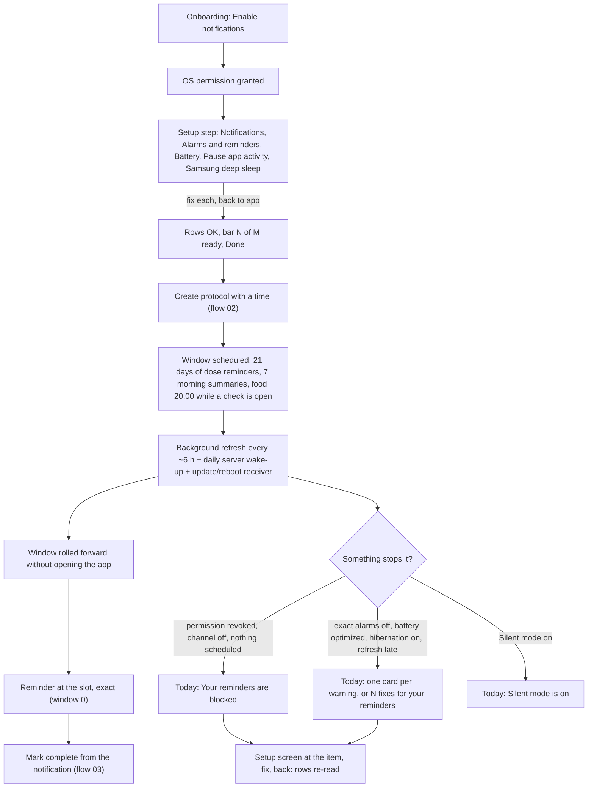
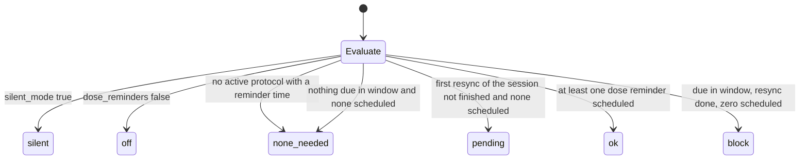
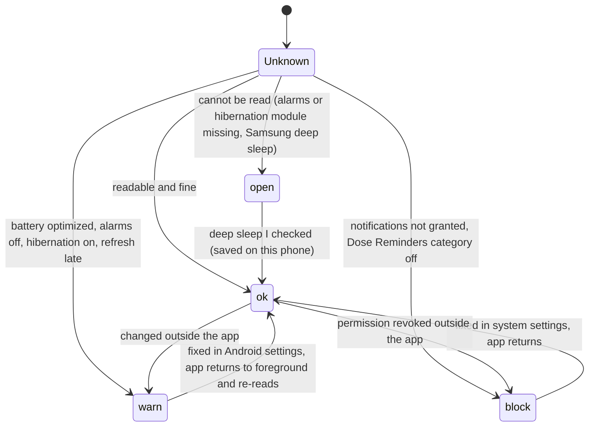
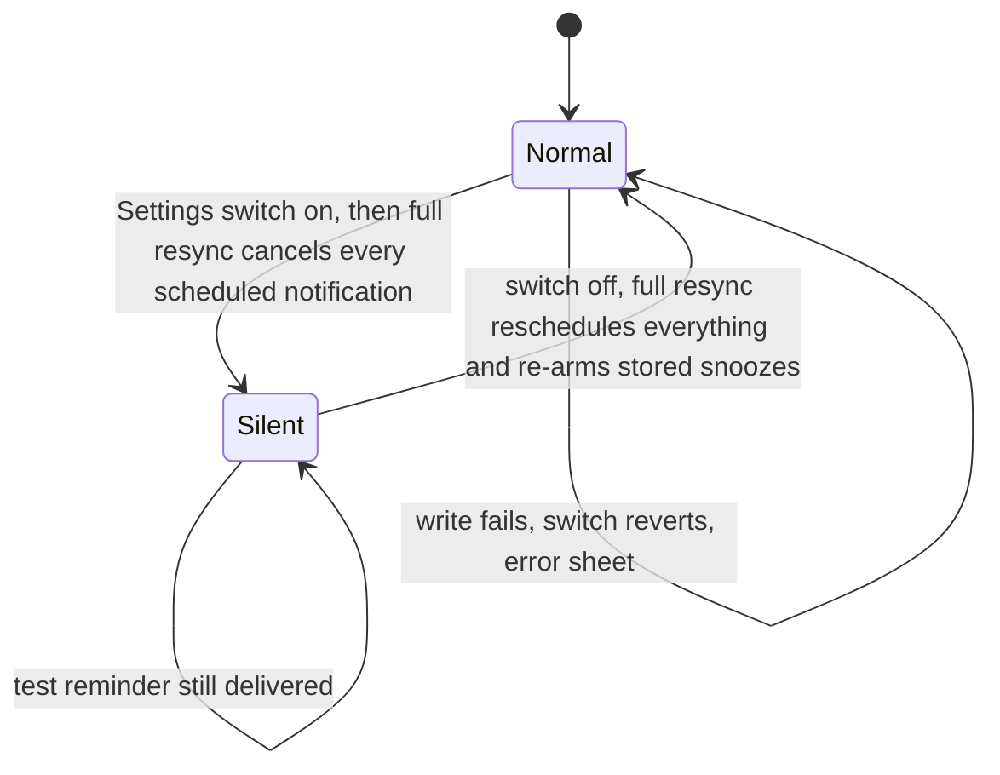
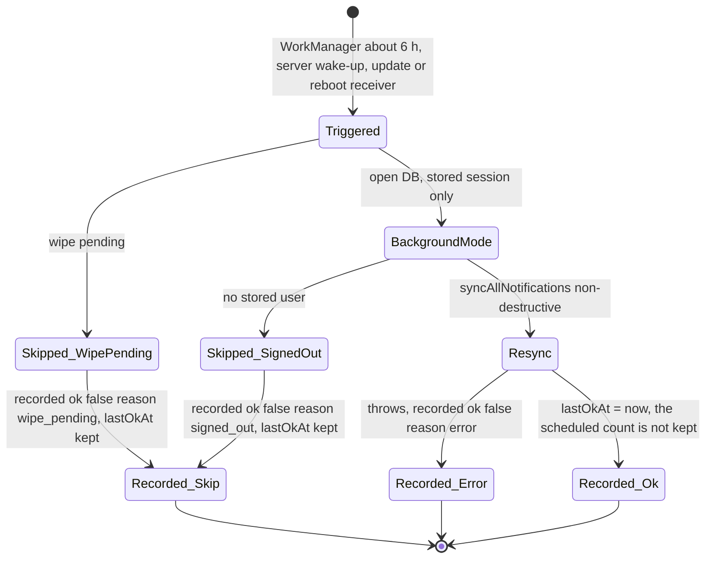
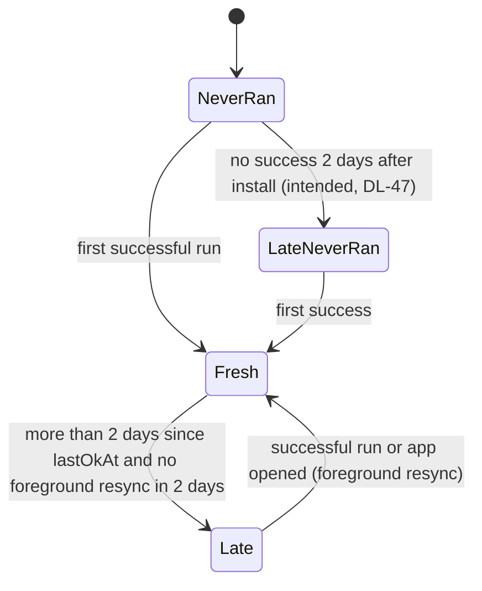
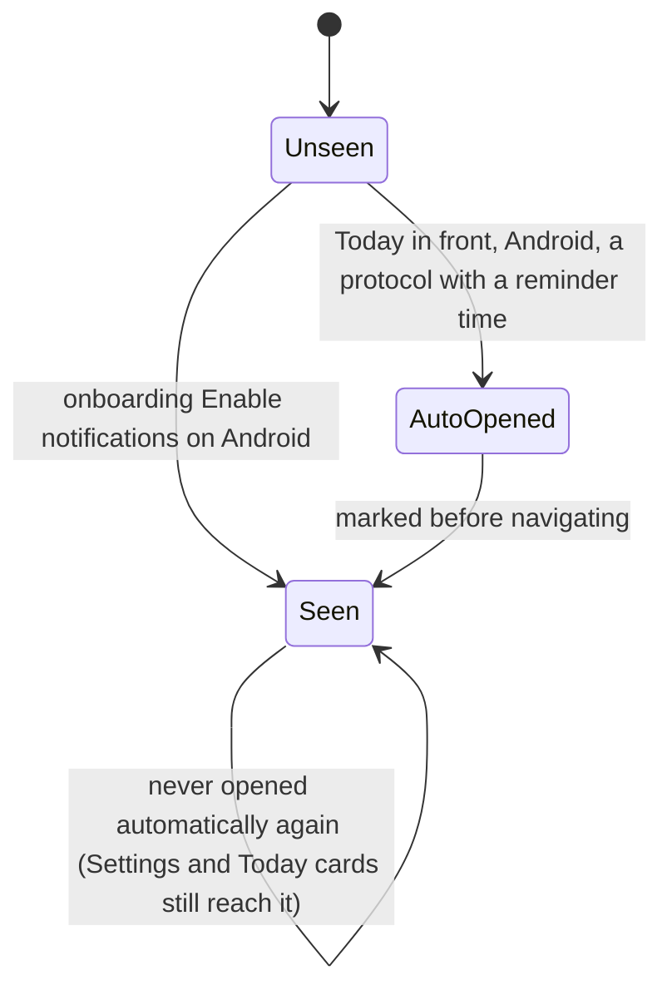

# 06 — Reminders reliability: setup screen, Android permissions, background refresh, update / reboot, Silent mode, iPhone window

> Draft for founder review, written 2026-10-12 from `docs/product/research/03-reminders.md` (main source), `02-doses-today.md` (§6.9 alerts), `07-onboarding-account-premium.md`, `08-platform.md` (§6 native), `docs/decisions.md` (2026-10-04…2026-10-07 reminder rounds) and the specs `reminder-check.md` (RC), `exact-alarms.md` (EA), `background-refresh.md` (BR), `reminders-guaranteed.md` (RG), `reminder-setup-placement.md` (SP). Code @ 4dade55.
> Shows the **intended** behaviour; **Divergence today** notes cite the dossier.

---

## 1. Goal

**Founder principle (2026-10-07):** a user still taking something keeps getting its reminders for as long as it lasts, whether or not they open the app, until they delete or end the protocol — "Não posso deixar o Android definir se vai continuar avisando". A reminder that never arrives is invisible, so the app reads what the phone allows, shows it with a fix, proves delivery with a test, and warns on Today. A reminder the user switched off (Silent mode, a switch) is respected — the opposite failure.

## 2. Actors

| Actor | Role |
|---|---|
| Local scheduler (`lib/notifications.js`) | One-shot dated notifications per slot in a rolling window; non-destructive (schedule wanted ids first, cancel only unwanted; unknown state cancels nothing). |
| Android background task `dosetrace-reminder-refresh` | Every ~6 h (WorkManager decides, needs network), stored session only, rebuilds the window. |
| `RefreshOnUpdateReceiver` | After a Play update or reboot runs the same refresh once, headless (A-111). |
| Server `wake-refresh` | Daily 08:00 UTC silent data push to Android tokens → local refresh (≤ once / 20 h). |
| Native `dt-exact-alarm` | Reads "Alarms & reminders" (Android 12+) and "Pause app activity if unused" (Android 11+). |
| Setup screen "Make sure your reminders arrive" (Android) / "Check reminders" (iPhone) | Rows with state + fix button; next reminder + count; test reminder. |
| Today reminder cards | Silent, combined, blocked, late, battery, stop, stale. |
| Settings → Notifications | 7 switches + the setup row. |
| OS | Permission, channels (Android), battery, hibernation, Samsung deep sleep, iOS 64-pending cap. |

## 3. Preconditions

- Signed in; at least one active protocol with a reminder time (for dose reminders).
- Notification permission granted; Android "Dose Reminders" channel on.
- Settings: `dose_reminders` on, `silent_mode` off.

## 4. What may already have happened before

| # | Prior state | What the flow must do |
|---|---|---|
| P1 | Said "Not now" to notifications in onboarding | Setup step skipped then; on Android, Today opens the setup screen once per phone when a timed protocol exists (SP-5; iPhone has no such screen). **Divergence today (DV-054):** the app calls the OS permission request at every signed-in cold start and sign-in (`App.js:650`, `:730`) and in the push-token registration; the system dialog itself shows while the answer is still undecided (once on iPhone, at most twice on Android 13+). **Intended (AD-88, decided 2026-10-15, was OPEN-20 (b)):** no permission request at app open; the app asks when a protocol with a reminder time is first saved on the phone or arrives from another device (the iPhone case included), and on Android also via the SP-5 setup screen. |
| P2 | Finished onboarding before this version (no setup step ever seen) | Today opens the screen once after the update (council 3 #5 → SP-5). |
| P3 | Signed in on a new install with timed protocols already synced | Same once-per-phone opening. |
| P4 | Android 14 default: "Alarms & reminders" off | Reminders up to 1 h late; row attention + Today "Reminders may be late" (A-106). |
| P5 | Battery "Optimized" (default on many phones) | Row warn + Today card (A-112 SP-6). |
| P6 | Hasn't opened the app for ~3 months | Android hibernation can freeze the app and drop its alarms → "Your reminders may stop" while exempt is off (A-110). |
| P7 | Samsung deep sleep list contains DoseTrace | Cannot be read → row Open + "I checked" (SP-10). |
| P8 | Play update or phone reboot | Receiver rebuilds reminders without opening the app (A-111). The Fold figure "238 restored, app not opened" (2026-10-07) was a **reboot handled by expo-notifications' own restore, before the receiver existed** — not the app's receiver; the same day the 47→48 **update** dropped 245 alarms to 8. The receiver's update path is still unproven on device (D06-16). |
| P9 | Silent mode turned on weeks ago and forgot | Today "Silent mode is on" · "No dose reminder will arrive. Tap to see." (council 3 #2). |
| P10 | iPhone user who never opens the app | Window: dose reminders end after ≤ 10 days. **Intended (AD-87, decided 2026-10-15, was OPEN-06):** in 1.3.0 the last notification of the window says "Open DoseTrace to keep getting your reminders" and Today warns when the window is ending; server-sent iPhone reminders are their own project, founder-deferred to 1.3.1. **Divergence (03 G1, DV-097):** nothing warns today. |
| P11 | Release build before the R8 keep-rule fix (≤ 1.2.4) | No Android reminder ever scheduled (root cause 2026-10-05); fixed by keep rules — device proof `dumpsys alarm`. |
| P12 | Two devices, dose logged on the other | This phone keeps reminding until it pulls in the foreground (BR-5 accepted). |
| P13 | Language changed | Pending notifications keep the old language until the next full resync (03 G6). **Also (03 NEW-1, DV-196):** the default device language is never stored, and notifications read the stored language or English — a user who never picked a language (e.g. a Portuguese phone) sees the app in Portuguese but gets every reminder, action button and "Nothing new logged" in English (intended DL-13: the app language rules every surface). |
| P14 | Session silently lost (token refresh failure) | Reminders stay; background refresh records `signed_out` and stops renewing → run out at the window end. |

## 5. Happy path (Android, first protocol, never opening again)

## 6. States and transitions

### 6.1 Schedule state (evaluated in this order)

### 6.2 Per-row state (setup screen)

- **Divergence today (03 NEW-3, DV-214):** an unreadable permission (read returns `null`) is `block` (red), not `open` — against "only what the app can read can block" (R-31); the setup bar also counts it as not ready (`reminderHealth.js:57`, `:140`).

### 6.3 Silent mode

### 6.4 Background refresh run

### 6.5 Refresh freshness

### 6.6 Setup seen (per phone)

## 7. Alternative and exception paths

### 7.1 The window and the budget
- iPhone: 10 days; total 40 − min(active vials, 8) (every active vial counts, with or without an expiry); per protocol min(24, max(2, ⌊total / n⌋)); mains + follow-ups count. Morning summary 7 days; food 7 days; weekly check-in repeating; weigh-in one.
- Android: 21 days; total 400; per protocol min(60, max(2, ⌊400 / n⌋)) (RC-7 — the 64 cap no longer cuts Android).
- **Divergence today (03 G18, DV-053):** the iPhone dose budget plus one expiry alert per vial, up to 7 morning summaries, the weekly check-in, and during an open check up to 7 food questions and the day-21 alert, plus up to 4 snoozes, can exceed 64 pending notifications. Recomputed in round 2 with the real `doseBudget` (every protocol filling its share, at most one active vial per protocol): with an open check and 4 snoozes from 23 protocols with no vials, 19 with 8 vials, or 15 protocols each with a vial; without them from 29, 25 or 19 (the register row states both assumption sets). iOS keeps only the soonest 64 (unverified).
- Persistent reminders: +5 and +10 min follow-ups.
  - **Divergence today (03 G3, DV-049):** Settings copy "Repeat reminders every 5 min until acknowledged" vs exactly two repeats. Intended (DL-48): the text describes the two repeats; the new wording ×6 needs the founder's approval (Approvals still owed item 2.2).
  - **Divergence today (DV-224):** a snooze cancels the slot's pending repeats (`notifications.js:969-973`), but the next resync re-adds every future repeat of that slot (`:289-307`) without reading the snooze list — the +5 / +10 repeats can still fire inside the snooze (on iPhone a snooze opens the app, so a resync follows).

### 7.2 iPhone (no background mode)
- Reminders are rebuilt on every app open / foreground (≤ 1 / min) / Settings change.
- **Decided earlier (signed BR-11, 2026-10-07):** iOS untouched (no background task; it would crash).
- **Intended (AD-87, decided 2026-10-15, was OPEN-06):** A in 1.3.0 — the last notification of the iPhone window says "Open DoseTrace to keep getting your reminders" and Today warns when the window is ending (texts ×6); B — server-sent iPhone reminders (send-reminders with everything A-62 lists) — is its own project right after, founder-deferred to 1.3.1.
  - **Divergence today (03 G1, DV-097):** a user who never opens the app on iPhone stops getting dose reminders after ≤ 10 days; nothing warns.

### 7.3 Android stop conditions and fixes
| Item | Read | State / Today card | Fix button opens |
|---|---|---|---|
| Notifications | permission | block → "Your reminders are blocked" | app notification settings |
| Dose Reminders category | channel importance | block | that channel's page |
| Alarms & reminders | `canScheduleExactAlarms` (12+) | warn → "Reminders may be late" | Android Alarms & reminders for DoseTrace |
| Battery | `isBatteryOptimizationEnabled` | warn → "Battery may delay reminders" | app's own Android page (RG-2 deviation accepted) |
| Pause app activity if unused (Samsung "Manage app if unused") | `isAutoRevokeWhitelisted` (11+) | warn → "Your reminders may stop" | the hibernation switch |
| Automatic refresh | last OK run > 2 days and no foreground resync in 2 days | warn → "Reminders not refreshed for {n} days" (the Today card opens the screen at the refresh row) | the row's **Adjust** opens the app's own Android page (same target as Battery, `fix: 'battery'`) |
| Samsung deep sleep | cannot read | open → "I checked" saves OK | Samsung Battery screen (ACTION_BATTERY), else app page |
- Two or more of blocked / late / battery / stop / stale → ONE card "{n} fixes for your reminders" / "Tap to make sure they arrive." (council 3 #3). Silent has its own card.
- When "Alarms & reminders" turns on (seen on return to foreground) → every reminder rescheduled exact + snoozes re-armed (EA-4).
- **Silent on Today (DL-45, the Silent half only; AD-25 = signed BR-4):** Silent is its own state, never "blocked"; Today's "Your reminders are blocked" card excludes Silent mode.
  - **Divergence today (03 D-2, G5; DV-042):** the Today Blocked card ignores Silent mode (every other warning excludes it) → with Silent on and permission denied, both Silent and Blocked show.
- **Settings row (AD-71 = signed SP-1 / RC-1; was OPEN-20 (a)):** Settings › Notifications shows red "Something is blocking your reminders" / "Algo está bloqueando seus lembretes" on any readable block — notifications denied, the Dose Reminders category off, or nothing scheduled while a protocol has a reminder time — whichever reminder kinds are switched on, as signed and built (`reminderHealth.js:57`, `:60`, `:150-153`). Silent mode itself is never a block (`scheduleState` returns `silent`, `reminderHealth.js:91`); with Silent on and the permission denied the red comes from the permission row, as SP-1 says. Today warns only when dose reminders matter (RC-6). No defect here (DV-042 was narrowed to the Today half).
- **Warnings for no-time protocols are correct (03 §E D06-5):** a protocol with no reminder time IS reminded at 08:00 (`reminderTimes`, R-4), so counting it as "with a reminder time" for warnings and the once-per-phone opening is right. Intended everywhere (DL-77, was OPEN-19 (c); DL-06 one slot list): 08:00 is that protocol's slot on every surface. The gap is on Today, not here: that 08:00 slot has no Due, no pending/Missed and its rings use noon (DV-028, flow 03).
- **Divergence today (03 D-4, D-14; DV-043, DV-044):** schedule "ok" as soon as ONE dose reminder is scheduled; the bar can read "4 of 4 ready" above a red "None scheduled". Intended (DL-46): "OK" only when every timed protocol due in the window has its reminders.
- **Divergence today (03 D-8, DV-045):** a refresh that never succeeded is "pending" forever ("Runs within the next few hours"), never late. Intended (DL-47): late after 2 days with no success (§6.5).
- **Divergence today (03 D-10, D-11, G14; DV-046):** "Last run OK" is recorded even when nothing was rescheduled; the scheduled count is counted but not stored (`reminderRefresh.js:36`, `backgroundTasks.js:48-53`). Intended (DL-47): OK only when reminders were rebuilt; the count is kept.
- **Divergence today (03 G16, DV-098):** only the dose channel is checked — turning off "Check-in Reminders" silently kills the 20:00 food question and the day-21 weigh-in. Intended (DL-49): the check covers the channel of every reminder kind the user has switched on; the new rows are AD-79 item 5 (decided 2026-10-15; they widen the signed RC-3; picture first, then 1.3.0).
- **Divergence today (03 G17, DV-141):** Android channel names are English literals in all languages.
- **Divergence today (03 G23, DV-099):** the 6-hourly WorkManager run needs network (library constraint); offline phones never refresh (update/reboot run has no constraint).

### 7.4 Silent mode and switches
- Silent on: every scheduled notification cancelled; nothing scheduled; only the user's own test reminder goes through; Today "Silent mode is on" / "No dose reminder will arrive. Tap to see."; setup screen "Silent mode is on in Settings: no notifications are sent".
- A switch turned off cancels what is already scheduled of that kind: Dose reminders (also morning summaries and snoozes), Vial expiry alerts (also low — 03 G4; one switch for both is the founder's, AD-26; its label "Vial alerts" ×6 waits for approval, Approvals still owed item 2.4, DV-140), Check-in reminders (the weekly check-in only, `notifications.js:573`), Food-log reminder (stays off for future checks), Show names (titles become "Dose reminder").
- The day-21 weigh-in reminder (`reality-check-weigh`) has no switch of its own: "Check-in reminders" does not stop it (`syncRealityCheckReminder`, `notifications.js:609-652`, reads no switch); only Silent mode or the end of the check does (DV-218).
- Vial expiry push: 7 days before and on the expiry day at 09:00, only the next one per vial (`notificationPlan.js:256-283`, built 2026-10-03, A-45). Kept as built — 7 days before and on the day, 09:00, Today's words (AD-89, decided 2026-10-15, was OPEN-20 (c)); the words are also on the test-build look list (Approvals still owed item 8).
- **Divergence today (DV-225):** switching off "Vial alerts" or "Check-in reminders" cancels the scheduled kind (`notifications.js:482`, `:573`) but not its already-snoozed copies (`snz-vial-…`, `snz-checkin-…`, `snz-reality-check-weigh`); the snooze restore filters only dose copies (`:996-998`) — a switched-off alert still arrives once.
- **Divergence today (03 D-13, G20; DV-048):** the Android "Nothing new logged" info notification bypasses Silent mode and has no channel (intended AD-25: Silent silences everything but the test).
- **Divergence today (03 D-12, SUSPECTED; DV-047):** a Silent change made on another device is picked up only at the next full resync here — and possibly not even then: the Silent flag is read from the cached session user (`notifications.js:61-66`, `getCachedUser` = `getSession().user`), whose metadata changes only on a token refresh.

### 7.5 Update / reboot / killed
- Android update or reboot: receiver runs the refresh once (A-111; proof pending on the founder's Fold for the update path). Force-stopped apps do not get receivers (Android rule, unverified here).
- iPhone update/reboot: iOS keeps pending local notifications (OS behaviour, unverified in repo).
- App killed by the user: scheduled alarms remain (Android, unless force-stopped); background task continues on its schedule.

### 7.6 Account events
- Intended sign-out / account delete: cancel all scheduled, dismiss delivered, drop snooze records, remove this device's push token.
- **Replaced phone (AD-77, decided 2026-10-15; not built → A-119):** when another phone takes the account over, the takeover removes the account's other push tokens (`push_tokens` gets a device id), so the replaced phone gets no server push (wake-up or reminder); its next background run with internet cancels all its reminders and stores the verdict, and its next open shows that the account was opened on another device, then signs out with the intended wipe (OD-16, OD-4; flow 12 §7.8). It acts only on the server's confirmed "replaced", never on a network error.
- Spurious SIGNED_OUT (token refresh failure, Apple revoke): reminders stay with names; refresh records `signed_out` and stops renewing.
- **Intended (DL-85, by logic; was AD-04):** when the server confirms the account was deleted or the session revoked, scheduled reminders are cancelled and the phone's data is wiped; a network failure never cancels anything. The same covers what stays on a second phone after an Apple-account delete.
  - **Divergence today (03 G2, DV-009):** not implemented.
- Cross-account sign-in: previous account's reminders cancelled before import. (The same guard discards the previous account's local data, unsynced rows included; intended AD-102 (decided 2026-10-15, was OPEN-21 (11)): it first warns and offers "Sign in as {previous account} first, to save" / "Discard and continue" — DV-242; the reminder half is unchanged.) **SUSPECTED (03 G28/G32; DV-081):** `dosetrace_vial_low_sent` survives and may suppress a new account's vial alert if ids collide.

### 7.7 Second device
- Each phone schedules from its own DB. A dose logged on A stops B's reminders only after B pulls in the foreground; the pull completion does not re-plan dose reminders and pull + resync run concurrently (03 G8, DV-052) → B may need a second open. Delivered banners on B not dismissed.

### 7.8 Timezone / DST
- Triggers are absolute timestamps: after travel, reminders fire at the old zone's wall time until the next resync re-plans in the new zone (foreground or Android refresh). Slots built from local day + wall time; DST keeps the wall time. Weekly check-in calendar trigger follows the device zone (unverified on Android).

### 7.9 Notification tap
- Test reminder tap → the setup screen. Today reminder cards → the setup screen: the late, battery, stop and stale cards open at their item (`focus: alarms | battery | hibernation | refresh`); the Blocked, combined ("{n} fixes…") and Silent cards open it with no focus (top of the screen).
- Every tap lands on its reason (A-44; the "From your reminder" outline and text ×6 are on the test-build look list, Approvals still owed item 8); see flow 03 for dose taps.

### 7.10 Fold
- The setup screen is a pushed full screen (one column). **Intended (A-116, founder decisions.md:634; waits by his own instruction, decisions.md:639 — AD-31):** on the unfolded Fold every tap and notification opens its item on the right page (DV-117).

### 7.11 Free vs Premium
- Reminders and the setup screen are free. The 20:00 food question follows food-log access (flow 07/13): none when the user cannot log.

## 8. What every surface shows

| State | Today | Setup screen (Android) / Check reminders (iPhone) | Settings → Notifications row | Notifications |
|---|---|---|---|---|
| All OK | no reminder card | bar "{n} of {total} ready" with every item ready, all rows OK, "Next reminder {day, time} · {name}", "{n} dose reminders scheduled", **Send a test reminder** | Android "All set · next reminder {when}" / iPhone "Check reminders · Nothing is blocking them" | on time, exact |
| Permission denied | "Your reminders are blocked · Dose reminders can't reach you. Tap to see why." (PT body "Os avisos de dose…" — a second word for reminders, DV-215) | Notifications row red "Turned off for DoseTrace" + Turn on; test hint "A red item above stops reminders…" | risk "Something is blocking your reminders" | none |
| Exact alarms off | "Reminders may be late · Turn on "Alarms & reminders" so they arrive on time." | Alarms row attention "Off: reminders can arrive up to 1 hour late" + Turn on | "{n} of {total} ready" (attention) | up to 1 h late |
| Battery optimized | "Battery may delay reminders" | Battery row "Optimized: Android may delay reminders" + Adjust | "{n} of {total} ready" | may be delayed |
| Hibernation on | "Your reminders may stop · Android can pause DoseTrace if you don't open the app. Tap to prevent it." | "On: after months without opening the app, Android can stop the reminders" + Turn off | "{n} of {total} ready" | stop after ~3 months unused |
| Refresh late | "Reminders not refreshed for {n} days · Android is holding DoseTrace…" | Refresh row "Hasn't run for {n} days: Android is holding DoseTrace" + Adjust | "Reminders not refreshed for {n} days" | window not rolled |
| ≥ 2 warnings | one card "{n} fixes for your reminders" · "Tap to make sure they arrive." | each row | "{n} of {total} ready"; risk "Something is blocking your reminders" when one of them is a block (Blocked) | — |
| Silent mode | "Silent mode is on · No dose reminder will arrive. Tap to see." | "Silent mode is on in Settings: no notifications are sent" | switch on | none (test only) |
| Dose reminders off | none (RC-6) | "Dose reminders are off in Settings" | switch off; the row is red while notifications are denied or the Dose Reminders category is off (AD-71, as signed and built, §7.3) | none |
| None scheduled | Blocked card | "None scheduled · Your protocols have reminder times, but none is scheduled on this phone." | risk | none |
| Samsung deep sleep unchecked | none (never raises the card) | row Open + **I checked**; bar counts 5 | not "All set" until checked | — |

## 9. Data written at each step

| Step | Store | Write |
|---|---|---|
| Settings switches | Supabase `user_metadata` | `dose_reminders`, `vial_alerts`, `checkin_reminders`, `food_reminders`, `notif_show_names`, `silent_mode`, `persistent_reminders` (revert + sheet on error) |
| Every resync | OS queue | ids `dose-{pid}-{day}-t{ti}`, `-f0/-f1`, `summary-{day}`, `vial-low-{vialId}`, `vial-exp-{vialId}-{7\|0}`, `checkin-weekly`, `reality-check-weigh`, `food-log-{day}`, `snz-…`, `reminder-test` |
| Foreground resync | AsyncStorage `dosetrace_fg_sync_at` | ms |
| Background run | AsyncStorage `dosetrace_refresh_last` | `{at, ok, reason, lastOkAt}` (every run, skipped ones included; the scheduled count is not kept, DV-046) |
| Setup seen | AsyncStorage `dosetrace_reminder_setup_seen` | '1' (per phone, survives sign-out by design) |
| Deep sleep checked | AsyncStorage `dosetrace_deep_sleep_checked` | ms |
| Snoozes | AsyncStorage `dosetrace_snoozes` | newest 4 |
| Push token | Supabase `push_tokens` | expo_token, platform, timezone (cold start, sign-in) |
| Server wake | `wake_refresh_runs` | one row per run (≥ 20 h apart) |
| Today card snooze | AsyncStorage `dosetrace_alert_snooze` | until 09:00 |

## 10. Rules (with sources)

R-1 local one-shot dated notifications in a rolling window (A-107 option B). R-2 window/budget (RC-7). R-4 no time → 08:00 (legacy; DL-77: 08:00 is that protocol's slot on every surface). R-5 past slot never re-armed; its future repeats stay (BR-3). R-7 non-destructive scheduling; unknown state cancels nothing (BR-1/BR-2). R-8 one resync at a time (BR-6). R-10 Silent mode (BR-4, A-108 — AD-25; Today's Blocked card excludes it, DL-45). R-11 switches cancel their kind (A-109). R-12 names on by default. R-20 vial low once, app running (BR-7). R-27 background refresh rules (BR-1/7/8/9). R-28 update/reboot receiver (A-111). R-29 daily silent wake-up (RG-6). R-30 alarms turned on → reschedule (EA-4). R-31 only readable items block; warnings never block (RC-6, EA-2, EA-5). R-34 ≥ 2 warnings = one card. R-35 setup counts (SP-2, SP-10). R-36 Settings row: red on any readable block (SP-1 / RC-1 — AD-71). R-37 once per phone (SP-4, SP-5). R-38 onboarding step Android only, shown once the OS dialog is answered — allowed or denied (code = signed SP-4; DL-50 withdrawn as moot and DV-142 closed by the verification). R-39/R-40/R-41 account events (confirmed delete / revoke cancels: DL-85). (`03 §4`.)

## 11. Divergences today (summary)

| ID | Intended | Today | Source | DV |
|---|---|---|---|---|
| D06-1 | Principle holds on iPhone (founder 2026-10-07): the window's last notification says "Open DoseTrace to keep getting your reminders" and Today warns when the window is ending (AD-87 A, 1.3.0); server-sent reminders 1.3.1 (AD-87 B) | Ends after ≤ 10 days unopened, no warning | `03 G1` | DV-097 |
| D06-2 | Cancel reminders and wipe on a confirmed deletion / revocation; never on a network failure (DL-85) | Not built | `03 G2` | DV-009 |
| D06-3 | Silent never shows as Blocked on Today (DL-45; AD-25 = BR-4) | Both cards | `03 D-2` | DV-042 |
| D06-5 | Re-scoped to Today: a no-time protocol shows the slot it is reminded at — 08:00 — for Due, pending/Missed and rings (DL-77; DL-06 one slot list). Reminder warnings counting it are correct (it IS reminded at 08:00) | Today: no Due, no pending/Missed, rings at noon | `02 D22`, `03 D-18`; verification 03 §E | DV-028 |
| D06-6 | "Never ran" turns late after 2 days (DL-47) | Pending forever | `03 D-8` | DV-045 |
| D06-7 | "Last run OK" means something was scheduled; count stored (DL-47) | Not | `03 D-10, D-11` | DV-046 |
| D06-8 | The check reads the channel of every reminder kind switched on (DL-49); the new rows are AD-79 item 5 (picture first) | Only dose channel | `03 G16` | DV-098 |
| D06-9 | Copy for persistent reminders true: two repeats, +5 and +10 (DL-48; wording ×6 = Approvals still owed item 2.2) | "every 5 min until acknowledged" | `03 G3` | DV-049 |
| D06-10 | Language change re-plans; the device-language default reaches notifications (DL-13) | Not; a user who never picked a language gets English notifications | `03 G6`; verification 03 NEW-1 | DV-050, DV-196 |
| D06-11 | Create/edit/delete re-plans morning summary and vial expiry (bug) | Only dose reminders | `03 G7` | DV-051 |
| D06-12 | A pull re-plans dose reminders (bug) | Only food + weigh-in | `03 G8` | DV-052 |
| D06-13 | Channel names translated (bug) | English | `03 G17` | DV-141 |
| D06-14 | Weekly check-in exact (bug) | Repeating trigger (inexact under Doze) | `03 G27` | DV-055 |
| D06-15 | Info notification respects Silent (AD-25) | Bypasses | `03 G20` | DV-048 |
| D06-16 | Device proofs SP-9, RG-8, BR-10, EA-7 (AD-42) | Missing / partial | `03 G22`; spec-audit red | DV-118 |
| D06-17 | An unreadable permission is `open`, never `block` (R-31) | Red "blocked" row; bar counts it not ready | verification 03 NEW-3 | DV-214 |
| D06-18 | One word for reminders in PT / ES ("lembretes" / "recordatorios"), no "garantidos" (wording = Approvals still owed item 2.13) | PT / ES Today body says "avisos"; PT `rc_refresh_until` "lembretes garantidos até" | verification 03 NEW-5 | DV-215 |
| D06-19 | A snooze also holds back the slot's persistent repeats after a resync (bug) | The resync re-adds the +5 / +10 repeats inside the snooze | round 2 (R2-06 N-2) | DV-224 |
| D06-20 | Switching a kind off also cancels its snoozed copies (A-109) | Snoozed vial / check-in / weigh-in copies still fire once | round 2 (R2-06 N-3) | DV-225 |
| D06-21 | A Silent change on another device applies at the next resync here (bug) | Read from the cached session; may not apply until a token refresh (SUSPECTED) | `03 D-12` | DV-047 |
| D06-22 | No OS permission request at app open after "Not now"; ask when a protocol with a reminder time is first saved or arrives from another device, Android also via SP-5 (AD-88, was OPEN-20 (b)) | The request runs at every signed-in cold start and sign-in | `03 G25` | DV-054 |
| D06-23 | Every scheduled reminder fits the iPhone's 64 pending notifications (bug) | Overflows with many protocols / vials (thresholds in the row) | `03 G18` | DV-053 |
| D06-24 | "OK" only when every timed protocol due in the window has its reminders; the bar shows "None scheduled" (DL-46) | "ok" from one reminder; "4 of 4 ready" above "None scheduled" | `03 D-4, D-14, D-16` | DV-043, DV-044 |
| D06-25 | The automatic refresh also runs offline (bug) | WorkManager waits for the network | `03 G23` | DV-099 |
| D06-26 | One "Vial alerts" switch for low and expiry, labelled so (AD-26; label ×6 = Approvals still owed item 2.4) | Label "Vial expiry alerts" hides the low alert | `03 G4` | DV-140 |
| D06-27 | Account-scoped device keys cleared at an intended sign-out and by the cross-account guard (bug) | `dosetrace_vial_low_sent` survives (SUSPECTED collision) | `03 G28` | DV-081 |

D06-4 (Settings red with Silent on and a block) was closed in round 2: Settings red on any readable block is what the signed SP-1 / RC-1 say (AD-71, was OPEN-20 (a)), Silent itself never counts as a block, and DV-042 was narrowed to the Today half (D06-3). The id is not reused.

## 12. Founder questions (canonical IDs — `docs/product/OPEN-DECISIONS.md`)

Reconciled 2026-10-12 (round 2); closed 2026-10-15: every question this flow raised has one canonical ID in `OPEN-DECISIONS.md`. The founder answered the whole round on 2026-10-15 ("siga as recomendações"), so no question of this flow is open. **AD-xx** is decided by the founder, the ledger or a signed spec, **DL-xx** is decided by product logic (recorded in `docs/decisions.md`; the founder may override). DV-xxx is the defect row in `DIVERGENCES.md`.

**Decided by the founder on 2026-10-15 (all questions answered):**
- **AD-87** (was OPEN-06) — iPhone: the window's last notification says "Open DoseTrace to keep getting your reminders" and Today warns when the window is ending (1.3.0); server-sent iPhone reminders founder-deferred to 1.3.1. §4 P10, §7.2, D06-1, F06-17 → DV-097.
- **AD-88** (was OPEN-20 (b)) — no permission request at app open; ask when a protocol with a reminder time is first saved or arrives from another device; Android also via SP-5. §4 P1, D06-22, F06-13 → DV-054.
- **AD-89** (was OPEN-20 (c)) — the vial-expiry push as built: 7 days before + on the day, 09:00, Today's words. §7.4; A-45.
- **AD-79** item 5 (was OPEN-24) — Reminder check rows for the food question, the weekly check-in and the vial alerts (DL-49); picture first, then 1.3.0. §7.3, D06-8 → DV-098.
- **AD-102** (was OPEN-21 (11)) — the cross-account guard warns before discarding another account's unsent data ("Sign in as {previous account} first, to save" / "Discard and continue"). §7.6 (the data half; cancelling the previous account's reminders is unchanged) → DV-242; DV-081 is the related key-cleanup bug.
- **AD-77** (was OPEN-16 (b)) — one active device per account: a replaced phone gets no server push and cancels its reminders on the confirmed verdict (OD-16; not built → A-119). §7.6.
- **AD-78** (was OPEN-16 (a)) — scope rule: every DL and DV row of this flow has a target, 1.3.0 or 1.3.1, in DIVERGENCES.md and the registry.

**Decided — moved or rewritten in round 2 (no question)**
- **AD-71** — Settings red on any readable block, whichever kinds are on; Silent never a block (signed SP-1 / RC-1; was OPEN-20 (a)). §7.3, §8, R-36; D06-4 closed.
- **DL-45 (narrowed)** — the Silent half only: Today's Blocked card excludes Silent mode (with AD-25). §7.3, D06-3 → DV-042.
- **DL-85** — cancel reminders and wipe on a confirmed delete / revoke (was AD-04). §7.6, D06-2 → DV-009.
- **DL-77** — 08:00 for no-time protocols on every surface (was OPEN-19 (c); DL-06 = one slot list). §7.3, R-4, D06-5 → DV-028.
- **DL-48** — the persistent-reminders text (wording ×6: Approvals still owed item 2.2). D06-9 → DV-049.
- **DL-49** — the check covers every switched-on kind's channel (rows: AD-79 item 5). D06-8 → DV-098.
- **AD-60** — the vial supply push fires at 3 doses left (was OPEN-18 (5)); R-20.
- **AD-26** — one "Vial alerts" switch (label: Approvals still owed item 2.4). D06-26 → DV-140.
- **DL-46, DL-47, DL-13, AD-25** — unchanged in round 2; cited in §7.3, §7.4, §11.
- **Approvals still owed item 8** — on the test build: the "From your reminder" outline and text ×6 (A-44) and the vial-expiry alert words (A-45, kept as built by AD-89).

## 13. Acceptance checks (agent-device QA script)

Android checks on the founder's Fold (or an Android 14 emulator) with `adb`; iPhone checks on the simulator. Account Test03. Light and dark; PT via Settings → Preferências → Idioma.

**F06-01 — Settings row (Android)**
- Do: Settings → Notifications ("Notificações").
- Expect: FIRST row "Make sure your reminders arrive" / "Garanta que seus lembretes cheguem" with its state: risk text on a block; "{n} of {total} ready" / "{n} de {total} prontos" in attention with a dot; or "All set · next reminder {when}" / "Tudo pronto · próximo lembrete {when}".

**F06-02 — Settings row (iPhone)**
- Expect: last row "Check reminders" / "Verificar lembretes" with "Nothing is blocking them" / "Nada está bloqueando" (or "Something is blocking your reminders").

**F06-03 — Setup screen contents**
- Do: tap the row.
- Expect title (Android) "Make sure your reminders arrive", intro "Android pauses apps to save battery…", bar, rows Notifications ("Notificações" · "Allowed" / "Permitidas"), Category "Dose Reminders" (only when that category is off — hidden when it is on), Alarms & reminders ("Alarmes e lembretes"), Battery ("Bateria"), Pause app activity if unused (Samsung "Manage app if unused" / "Gerenciar aplicativo não usado"), Automatic refresh ("Renovação automática" · "Last run: {when} · reminders scheduled until {date}"), Samsung deep sleep ("Deep sleeping apps", Samsung phones only); then "Scheduled on this phone" / "Agendados neste celular" · "Next reminder" / "Próximo lembrete" · "{n} dose reminders scheduled" / "{n} lembretes de dose agendados"; **Send a test reminder** / "Enviar um lembrete de teste".

**F06-04 — Test reminder**
- Do: Send a test reminder → close the app.
- Expect: "Test sent. It arrives in 10 seconds." / "Teste enviado. Chega em 10 segundos."; after 10 s a banner "DoseTrace · This is a test reminder. If you can see it, dose reminders can reach you." / PT equivalent; tap → setup screen. No dose logged.

**F06-05 — Exact alarms off → late**
- Setup: `adb shell appops set io.outcom.dosetrace SCHEDULE_EXACT_ALARM default` (Android 14).
- Expect: Today "Reminders may be late" / "Lembretes podem atrasar"; row "Off: reminders can arrive up to 1 hour late" + **Turn on** / "Ligar"; `dumpsys alarm` shows DoseTrace alarms with window +1h.
- Do: Turn on → enable → back.
- Expect: row "On: reminders arrive on time"; card gone without reopening; `dumpsys alarm` window=0 for every DoseTrace alarm.

**F06-06 — Battery optimized**
- Expect: card "Battery may delay reminders" / "A bateria pode atrasar os lembretes"; row "Optimized: Android may delay reminders" + **Adjust** → the app's Android page.

**F06-07 — Hibernation**
- Expect with "Pause app activity if unused" on: card "Your reminders may stop" / "Seus lembretes podem parar"; row + **Turn off** / "Desligar" → the switch; back → OK.

**F06-08 — Combined card**
- Setup: exact alarms off + battery optimized.
- Expect: ONE card "2 fixes for your reminders" / "2 ajustes para seus lembretes" + "Tap to make sure they arrive."; tap → setup screen.

**F06-09 — Samsung deep sleep**
- Expect (Samsung): row text "In Battery, tap Background usage limits › Deep sleeping apps. DoseTrace must not be on that list. The app can't read it."; **Open** → Samsung Battery screen; **I checked** / "Já conferi" → "You checked on {date}…"; bar counts 5; Settings "All set" only after it; Today card never raised by deep sleep.

**F06-10 — Permission revoked → blocked**
- Do: Android settings → notifications off for DoseTrace → back.
- Expect: Today "Your reminders are blocked" / "Seus lembretes estão bloqueados"; row red "Turned off for DoseTrace"; test hint "A red item above stops reminders: fix it first…".

**F06-11 — Silent mode**
- Do: Settings → Silent mode ("Modo silencioso") on.
- Expect: the OS queue holds no DoseTrace notification (adb `dumpsys alarm`; the screen shows the Silent line, never "None scheduled" as a block); Today "Silent mode is on" / "Modo silencioso ligado" + "No dose reminder will arrive. Tap to see."; setup screen "Silent mode is on in Settings: no notifications are sent"; test reminder still arrives.
- Intended (D06-3): no "Your reminders are blocked" card at the same time even with permission denied — record.
- Off → everything rescheduled; earlier snoozes still in the future come back.

**F06-12 — Dose reminders switch off**
- Expect: dose reminders and morning summaries cancelled; "Dose reminders are off in Settings" on the screen; no Today blocked card.

**F06-13 — Once-per-phone opening**
- Setup: fresh install, "Not now" in onboarding, create a protocol with a time.
- Expect: on the next Today focus (600 ms) the setup screen opens once; never again automatically.
- Intended (D06-22, AD-88): no OS permission dialog at app open or sign-in after "Not now"; the dialog appears when the first protocol with a reminder time is saved (iPhone: also when one arrives from another device). **Today (DV-054):** the request runs at every signed-in cold start and sign-in — record.

**F06-14 — Background refresh without opening (BR-10)**
- Setup: Android, protocol daily; do not open the app for 7+ days (or `adb shell cmd jobscheduler run` / WorkManager test hooks).
- Expect: morning summary "Good morning" / "Bom dia" still arrives each day; `dumpsys alarm` shows dose alarms beyond day 21 of the first schedule; `dosetrace_refresh_last` updated.

**F06-15 — Update and reboot (A-111)**
- Do: install the next build over the current one (Play internal); do not open. Reboot another time; do not open.
- Expect: `dumpsys alarm` lists DoseTrace alarms after each (count ≈ before).

**F06-16 — Refresh late card**
- Setup: do NOT rely on "no network for 3 days, then open offline": every open with a stored session runs the foreground resync, which sets `dosetrace_fg_sync_at` whenever a user is known, so the open itself counts as fresh and the card never shows. Instead (debug build, app in front): force `dosetrace_refresh_last` with `lastOkAt` 3 days ago and clear `dosetrace_fg_sync_at`, then refocus Today without sending the app to the background.
- Expect: "Reminders not refreshed for 3 days" / "Lembretes sem renovar há 3 dias"; setup screen refresh row "Hasn't run for 3 days: Android is holding DoseTrace" + **Adjust** (opens the app's Android page); after the next foreground resync (background → front) the card disappears.

**F06-17 — iPhone 10-day window**
- Setup: iPhone simulator, daily protocol; do not open for 11 days (clock change).
- Expect (intended, AD-87 A): the last notification of the window reads "Open DoseTrace to keep getting your reminders" / PT as approved, and Today (opened before the window ends) warns that it is ending. **Today:** no reminder after day 10 and no warning — record D06-1.

**F06-18 — Show names off**
- Do: Settings → "Show names in notifications" off.
- Expect: dose banner title "Dose reminder" / "Lembrete de dose"; morning summary "{n} scheduled today." / "{n} programadas hoje."; vial low "Your vial" / "Seu frasco".

**F06-19 — Both themes**
- Setup screen rows (ok, warn, block, open), the bar, every Today reminder card, the Settings row states: readable in light and dark; risk/attention colours from tokens.
