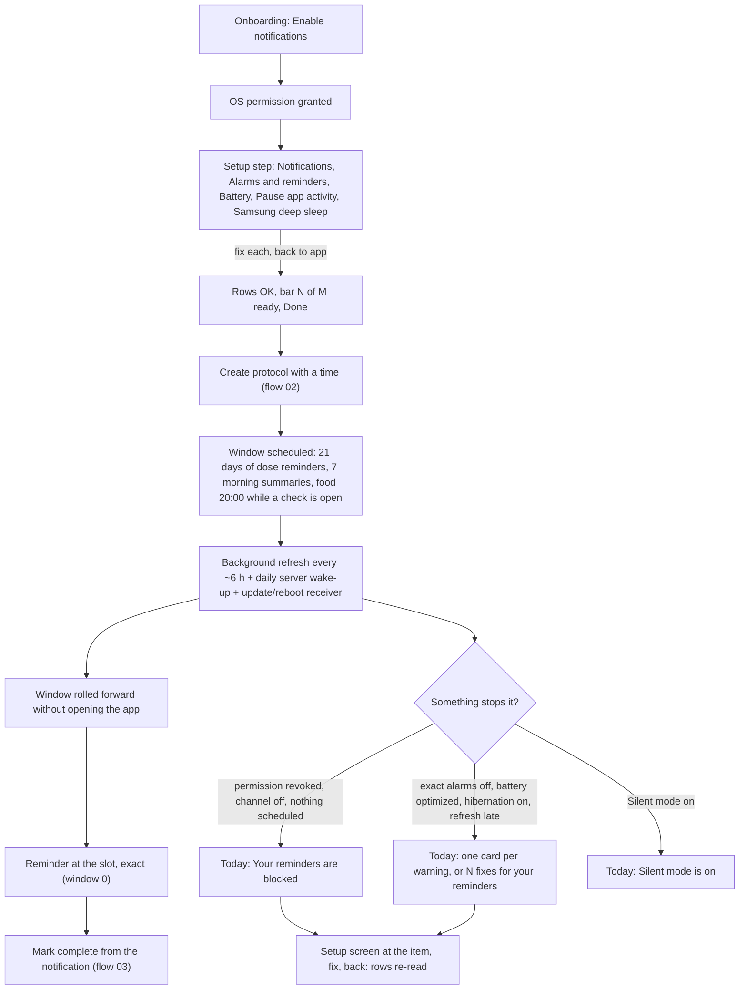
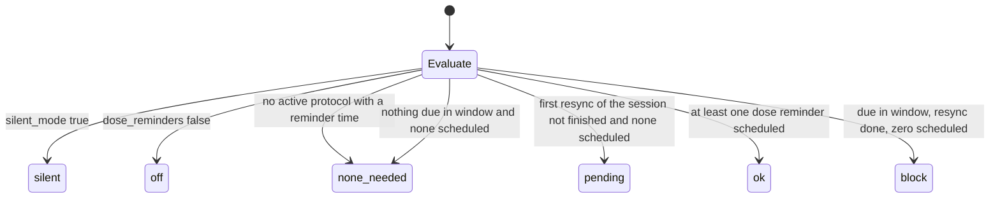
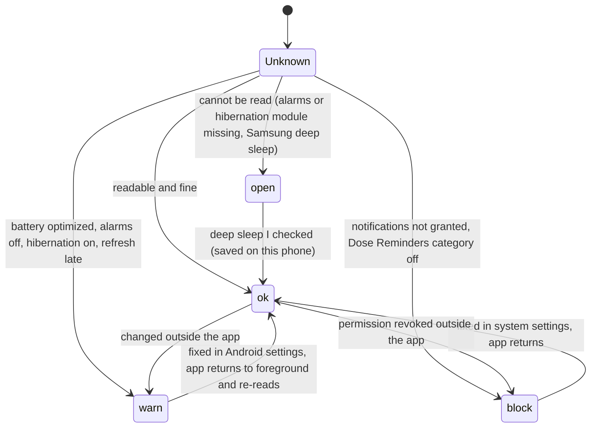
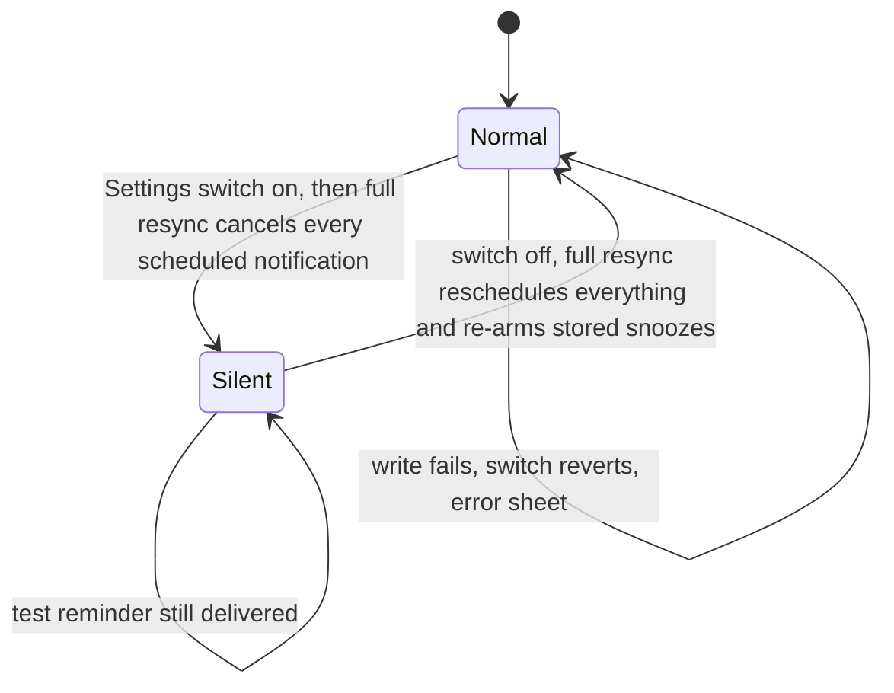
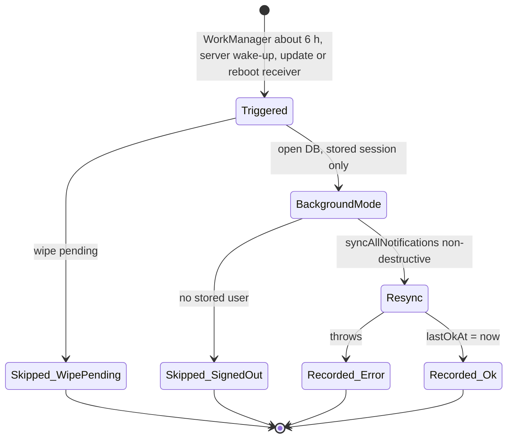
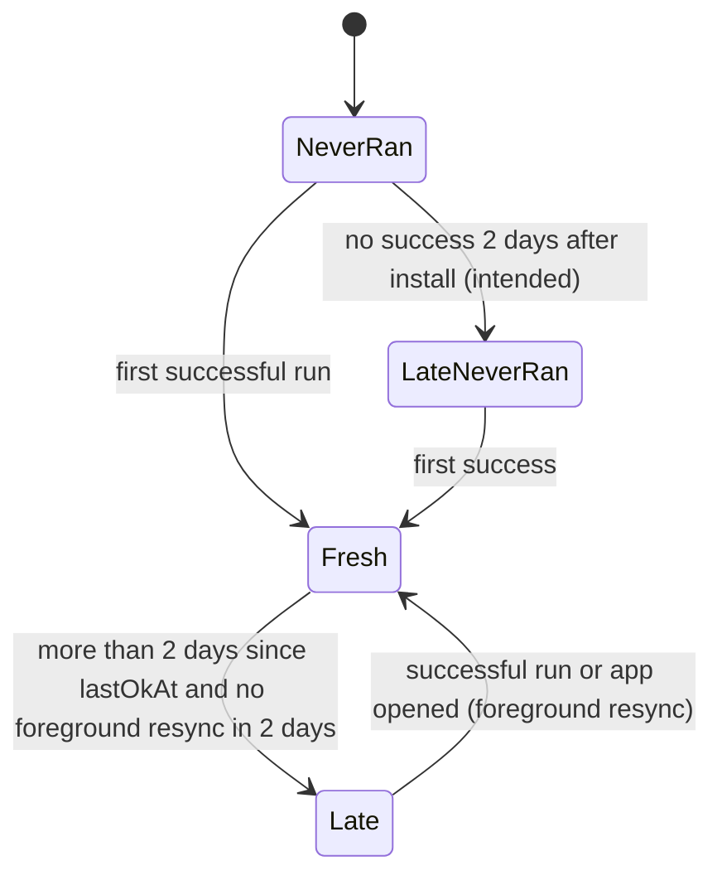
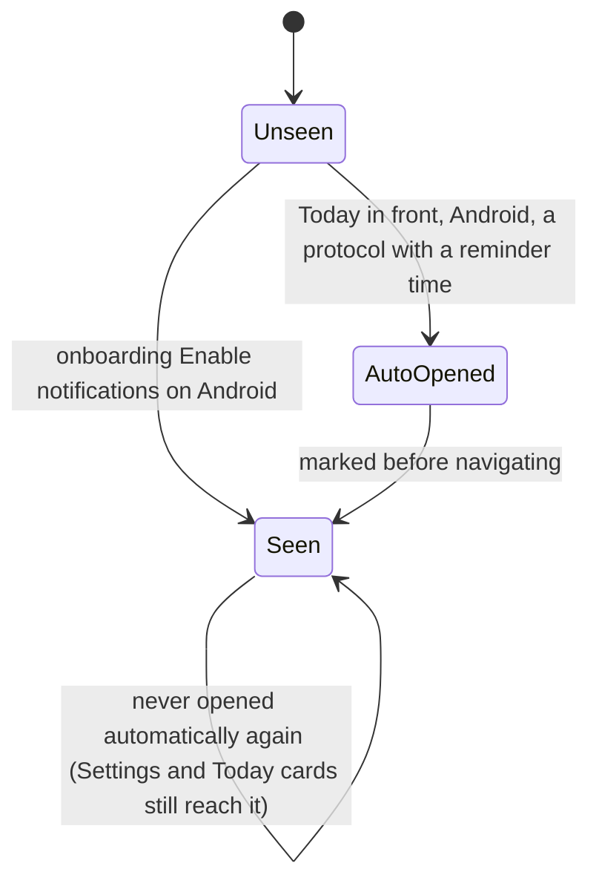

# 06 — Reminders reliability: setup screen, Android permissions, background refresh, update / reboot, Silent mode, iPhone window

> Draft for founder review, written 2026-10-12 from `docs/product/research/03-reminders.md` (main source), `02-doses-today.md` (§6.9 alerts), `07-onboarding-account-premium.md`, `08-platform.md` (§6 native), `docs/decisions.md` (2026-10-04…2026-10-07 reminder rounds) and the specs `reminder-check.md` (RC), `exact-alarms.md` (EA), `background-refresh.md` (BR), `reminders-guaranteed.md` (RG), `reminder-setup-placement.md` (SP). Code @ 4dade55.
> Shows the **intended** behaviour; **Divergence today** notes cite the dossier.

---

## 1. Goal

**Founder principle (2026-10-07):** a user still taking something keeps getting its reminders for as long as it lasts, whether or not they open the app, until they delete or end the protocol — "Não posso deixar o Android definir se vai continuar avisando". A reminder that never arrives is invisible, so the app reads what the phone allows, shows it with a fix, proves delivery with a test, and warns on Today. A reminder the user switched off (Silent mode, a switch) is respected — the opposite failure.

## 2. Actors

| Actor | Role |
|---|---|
| Local scheduler (`lib/notifications.js`) | One-shot dated notifications per slot in a rolling window; non-destructive (schedule wanted ids first, cancel only unwanted; unknown state cancels nothing). |
| Android background task `dosetrace-reminder-refresh` | Every ~6 h (WorkManager decides, needs network), stored session only, rebuilds the window. |
| `RefreshOnUpdateReceiver` | After a Play update or reboot runs the same refresh once, headless (A-111). |
| Server `wake-refresh` | Daily 08:00 UTC silent data push to Android tokens → local refresh (≤ once / 20 h). |
| Native `dt-exact-alarm` | Reads "Alarms & reminders" (Android 12+) and "Pause app activity if unused" (Android 11+). |
| Setup screen "Make sure your reminders arrive" (Android) / "Check reminders" (iPhone) | Rows with state + fix button; next reminder + count; test reminder. |
| Today reminder cards | Silent, combined, blocked, late, battery, stop, stale. |
| Settings → Notifications | 7 switches + the setup row. |
| OS | Permission, channels (Android), battery, hibernation, Samsung deep sleep, iOS 64-pending cap. |

## 3. Preconditions

- Signed in; at least one active protocol with a reminder time (for dose reminders).
- Notification permission granted; Android "Dose Reminders" channel on.
- Settings: `dose_reminders` on, `silent_mode` off.

## 4. What may already have happened before

| # | Prior state | What the flow must do |
|---|---|---|
| P1 | Said "Not now" to notifications in onboarding | Setup step skipped then; Today opens the setup screen once per phone when a timed protocol exists (SP-5). |
| P2 | Finished onboarding before this version (no setup step ever seen) | Today opens the screen once after the update (council 3 #5 → SP-5). |
| P3 | Signed in on a new install with timed protocols already synced | Same once-per-phone opening. |
| P4 | Android 14 default: "Alarms & reminders" off | Reminders up to 1 h late; row attention + Today "Reminders may be late" (A-106). |
| P5 | Battery "Optimized" (default on many phones) | Row warn + Today card (A-112 SP-6). |
| P6 | Hasn't opened the app for ~3 months | Android hibernation can freeze the app and drop its alarms → "Your reminders may stop" while exempt is off (A-110). |
| P7 | Samsung deep sleep list contains DoseTrace | Cannot be read → row Open + "I checked" (SP-10). |
| P8 | Play update or phone reboot | Receiver rebuilds reminders without opening the app (A-111; Fold check 238/248 restored). |
| P9 | Silent mode turned on weeks ago and forgot | Today "Silent mode is on — No dose reminder will arrive." (council 3 #2). |
| P10 | iPhone user who never opens the app | Window: dose reminders end after ≤ 10 days. **Divergence (03 G1)**: principle not met on iPhone — OPEN. |
| P11 | Release build before the R8 keep-rule fix (≤ 1.2.4) | No Android reminder ever scheduled (root cause 2026-10-05); fixed by keep rules — device proof `dumpsys alarm`. |
| P12 | Two devices, dose logged on the other | This phone keeps reminding until it pulls in the foreground (BR-5 accepted). |
| P13 | Language changed | Pending notifications keep the old language until the next full resync (03 G6). |
| P14 | Session silently lost (token refresh failure) | Reminders stay; background refresh records `signed_out` and stops renewing → run out at the window end. |

## 5. Happy path (Android, first protocol, never opening again)

## 6. States and transitions

### 6.1 Schedule state (evaluated in this order)

### 6.2 Per-row state (setup screen)

### 6.3 Silent mode

### 6.4 Background refresh run

### 6.5 Refresh freshness

### 6.6 Setup seen (per phone)

## 7. Alternative and exception paths

### 7.1 The window and the budget
- iPhone: 10 days; total 40 − min(active vials with expiry, 8); per protocol min(24, max(2, ⌊total / n⌋)); mains + follow-ups count. Morning summary 7 days; food 7 days; weekly check-in repeating; weigh-in one.
- Android: 21 days; total 400; per protocol min(60, max(2, ⌊400 / n⌋)) (RC-7 — the 64 cap no longer cuts Android).
- **Divergence today (03 G18):** above 20 protocols / 8 vials the iPhone floor of 2 per protocol overflows 64; iOS keeps only the soonest 64 (unverified).
- Persistent reminders: +5 and +10 min follow-ups.
  - **Divergence today (03 G3):** Settings copy "Repeat reminders every 5 min until acknowledged" vs exactly two repeats.

### 7.2 iPhone (no background mode)
- Reminders are rebuilt on every app open / foreground (≤ 1 / min) / Settings change.
- **Decided earlier (BR-11):** iOS untouched (no background task; it would crash).
- **Divergence today (03 G1) — OPEN:** a user who never opens the app on iPhone stops getting dose reminders after ≤ 10 days; nothing warns. Options in §12.

### 7.3 Android stop conditions and fixes
| Item | Read | State / Today card | Fix button opens |
|---|---|---|---|
| Notifications | permission | block → "Your reminders are blocked" | app notification settings |
| Dose Reminders category | channel importance | block | that channel's page |
| Alarms & reminders | `canScheduleExactAlarms` (12+) | warn → "Reminders may be late" | Android Alarms & reminders for DoseTrace |
| Battery | `isBatteryOptimizationEnabled` | warn → "Battery may delay reminders" | app's own Android page (RG-2 deviation accepted) |
| Pause app activity if unused (Samsung "Manage app if unused") | `isAutoRevokeWhitelisted` (11+) | warn → "Your reminders may stop" | the hibernation switch |
| Automatic refresh | last OK run > 2 days and no foreground resync in 2 days | warn → "Reminders not refreshed for {n} days" | screen at the refresh row |
| Samsung deep sleep | cannot read | open → "I checked" saves OK | Samsung Battery screen (ACTION_BATTERY), else app page |
- Two or more of blocked / late / battery / stop / stale → ONE card "{n} fixes for your reminders" / "Tap to make sure they arrive." (council 3 #3). Silent has its own card.
- When "Alarms & reminders" turns on (seen on return to foreground) → every reminder rescheduled exact + snoozes re-armed (EA-4).
- **Divergence today (03 D-2, G5):** Today "Your reminders are blocked" ignores Silent mode (every other warning excludes it) → with Silent on and permission denied, both Silent and Blocked show. Intended (BR-4): Silent is its own state, never "blocked".
- **Divergence today (03 D-1):** Settings shows red "Something is blocking your reminders" even when Dose reminders are off or no protocol has a time; Today warns only when they matter. (Each matches its own spec row — RC-1/SP-1 vs RC-6; flag for one rule.)
- **Divergence today (02 D22, 03 D-18):** "a protocol with a reminder time" counts every active protocol (null time = 08:00), so warnings fire for protocols without times.
- **Divergence today (03 D-4, D-14):** schedule "ok" as soon as ONE dose reminder is scheduled; the bar can read "4 of 4 ready" above a red "None scheduled".
- **Divergence today (03 D-8):** a refresh that never succeeded is "pending" forever ("Runs within the next few hours"), never late. Intended: late after 2 days with no success (§6.5).
- **Divergence today (03 D-10, D-11, G14):** "Last run OK" is recorded even when nothing was rescheduled; the scheduled count is not stored.
- **Divergence today (03 G16):** only the dose channel is checked — turning off "Check-in Reminders" silently kills the 20:00 food question and the day-21 weigh-in.
- **Divergence today (03 G17):** Android channel names are English literals in all languages.
- **Divergence today (03 G23):** the 6-hourly WorkManager run needs network (library constraint); offline phones never refresh (update/reboot run has no constraint).

### 7.4 Silent mode and switches
- Silent on: every scheduled notification cancelled; nothing scheduled; only the user's own test reminder goes through; Today "Silent mode is on" / "No dose reminder will arrive. Tap to see."; setup screen "Silent mode is on in Settings: no notifications are sent".
- A switch turned off cancels what is already scheduled of that kind: Dose reminders (also morning summaries and snoozes), Vial expiry alerts (also low — 03 G4), Check-in reminders, Food-log reminder (stays off for future checks), Show names (titles become "Dose reminder").
- **Divergence today (03 D-13, G20):** the Android "Nothing new logged" info notification bypasses Silent mode and has no channel.
- **Divergence today (03 D-12, SUSPECTED):** a Silent change made on another device is picked up only at the next full resync here.

### 7.5 Update / reboot / killed
- Android update or reboot: receiver runs the refresh once (A-111; proof pending on the founder's Fold for the update path). Force-stopped apps do not get receivers (Android rule, unverified here).
- iPhone update/reboot: iOS keeps pending local notifications (OS behaviour, unverified in repo).
- App killed by the user: scheduled alarms remain (Android, unless force-stopped); background task continues on its schedule.

### 7.6 Account events
- Intended sign-out / account delete: cancel all scheduled, dismiss delivered, drop snooze records, remove this device's push token.
- Spurious SIGNED_OUT (token refresh failure, Apple revoke): reminders stay with names; refresh records `signed_out` and stops renewing.
- **Intended (decision 2026-10-07 by logic):** when the server confirms the account was deleted or the session revoked, scheduled reminders are cancelled; a network failure never cancels anything.
  - **Divergence today (03 G2):** not implemented.
- Cross-account sign-in: previous account's reminders cancelled before import. **SUSPECTED (03 G28/G32):** `dosetrace_vial_low_sent` survives and may suppress a new account's vial alert if ids collide.

### 7.7 Second device
- Each phone schedules from its own DB. A dose logged on A stops B's reminders only after B pulls in the foreground; the pull completion does not re-plan dose reminders and pull + resync run concurrently (03 G8) → B may need a second open. Delivered banners on B not dismissed.

### 7.8 Timezone / DST
- Triggers are absolute timestamps: after travel, reminders fire at the old zone's wall time until the next resync re-plans in the new zone (foreground or Android refresh). Slots built from local day + wall time; DST keeps the wall time. Weekly check-in calendar trigger follows the device zone (unverified on Android).

### 7.9 Notification tap
- Test reminder tap → the setup screen. Today reminder cards → the setup screen at their item (`focus: alarms | battery | hibernation | refresh`).
- Every tap lands on its reason (A-44); see flow 03 for dose taps.

### 7.10 Fold
- The setup screen is a pushed full screen (one column). **Intended (A-116, waiting):** on the unfolded Fold every tap and notification opens its item on the right page.

### 7.11 Free vs Premium
- Reminders and the setup screen are free. The 20:00 food question follows food-log access (flow 07/13): none when the user cannot log.

## 8. What every surface shows

| State | Today | Setup screen (Android) / Check reminders (iPhone) | Settings → Notifications row | Notifications |
|---|---|---|---|---|
| All OK | no reminder card | bar "N of N ready", all rows OK, "Next reminder {day, time} · {name}", "{n} dose reminders scheduled", **Send a test reminder** | Android "All set · next reminder {when}" / iPhone "Check reminders · Nothing is blocking them" | on time, exact |
| Permission denied | "Your reminders are blocked · Dose reminders can't reach you. Tap to see why." | Notifications row red "Turned off for DoseTrace" + Turn on; test hint "A red item above stops reminders…" | risk "Something is blocking your reminders" | none |
| Exact alarms off | "Reminders may be late · Turn on "Alarms & reminders" so they arrive on time." | Alarms row attention "Off: reminders can arrive up to 1 hour late" + Turn on | "N of M ready" (attention) | up to 1 h late |
| Battery optimized | "Battery may delay reminders" | Battery row "Optimized: Android may delay reminders" + Adjust | "N of M ready" | may be delayed |
| Hibernation on | "Your reminders may stop · Android can pause DoseTrace if you don't open the app. Tap to prevent it." | "On: after months without opening the app, Android can stop the reminders" + Turn off | "N of M ready" | stop after ~3 months unused |
| Refresh late | "Reminders not refreshed for {n} days · Android is holding DoseTrace…" | Refresh row "Hasn't run for {n} days: Android is holding DoseTrace" + Adjust | "Reminders not refreshed for {n} days" | window not rolled |
| ≥ 2 warnings | one card "{n} fixes for your reminders · Tap to make sure they arrive." | each row | "N of M ready" | — |
| Silent mode | "Silent mode is on · No dose reminder will arrive. Tap to see." | "Silent mode is on in Settings: no notifications are sent" | switch on | none (test only) |
| Dose reminders off | none (intended); today Settings row may still show red (03 D-1) | "Dose reminders are off in Settings" | switch off | none |
| None scheduled | Blocked card | "None scheduled · Your protocols have reminder times, but none is scheduled on this phone." | risk | none |
| Samsung deep sleep unchecked | none (never raises the card) | row Open + **I checked**; bar counts 5 | not "All set" until checked | — |

## 9. Data written at each step

| Step | Store | Write |
|---|---|---|
| Settings switches | Supabase `user_metadata` | `dose_reminders`, `vial_alerts`, `checkin_reminders`, `food_reminders`, `notif_show_names`, `silent_mode`, `persistent_reminders` (revert + sheet on error) |
| Every resync | OS queue | ids `dose-{pid}-{day}-t{ti}`, `-f0/-f1`, `summary-{day}`, `vial-low-{vialId}`, `vial-exp-{vialId}-{7|0}`, `checkin-weekly`, `reality-check-weigh`, `food-log-{day}`, `snz-…`, `reminder-test` |
| Foreground resync | AsyncStorage `dosetrace_fg_sync_at` | ms |
| Background run | AsyncStorage `dosetrace_refresh_last` | `{at, ok, reason, lastOkAt}` |
| Setup seen | AsyncStorage `dosetrace_reminder_setup_seen` | '1' (per phone, survives sign-out by design) |
| Deep sleep checked | AsyncStorage `dosetrace_deep_sleep_checked` | ms |
| Snoozes | AsyncStorage `dosetrace_snoozes` | newest 4 |
| Push token | Supabase `push_tokens` | expo_token, platform, timezone (cold start, sign-in) |
| Server wake | `wake_refresh_runs` | one row per run (≥ 20 h apart) |
| Today card snooze | AsyncStorage `dosetrace_alert_snooze` | until 09:00 |

## 10. Rules (with sources)

R-1 local one-shot dated notifications in a rolling window (A-107 option B). R-2 window/budget (RC-7). R-4 no time → 08:00 (legacy). R-5 past slot never re-armed; its future repeats stay (BR-3). R-7 non-destructive scheduling; unknown state cancels nothing (BR-1/BR-2). R-8 one resync at a time (BR-6). R-10 Silent mode (BR-4, A-108). R-11 switches cancel their kind (A-109). R-12 names on by default. R-20 vial low once, app running (BR-7). R-27 background refresh rules (BR-1/7/8/9). R-28 update/reboot receiver (A-111). R-29 daily silent wake-up (RG-6). R-30 alarms turned on → reschedule (EA-4). R-31 only readable items block; warnings never block (RC-6, EA-2, EA-5). R-34 ≥ 2 warnings = one card. R-35 setup counts (SP-2, SP-10). R-36 Settings row (SP-1). R-37 once per phone (SP-4, SP-5). R-38 onboarding step Android only (SP-4). R-39/R-40/R-41 account events. (`03 §4`.)

## 11. Divergences today (summary)

| ID | Intended | Today | Source |
|---|---|---|---|
| D06-1 | Principle holds on iPhone | Ends after ≤ 10 days unopened, no warning | `03 G1` (OPEN) |
| D06-2 | Cancel on confirmed deletion / revocation | Not built | `03 G2` |
| D06-3 | Silent never shows as Blocked | Both cards | `03 D-2` |
| D06-4 | One "blocked" rule across Settings and Today | Two | `03 D-1` |
| D06-5 | "Protocol with a reminder time" means a real time | Every active protocol | `02 D22`, `03 D-18` |
| D06-6 | "Never ran" turns late after 2 days | Pending forever | `03 D-8` |
| D06-7 | "Last run OK" means something was scheduled; count stored | Not | `03 D-10, D-11` |
| D06-8 | All channels that carry reminders checked | Only dose channel | `03 G16` |
| D06-9 | Copy for persistent reminders true | "every 5 min until acknowledged" | `03 G3` |
| D06-10 | Language change re-plans | Not | `03 G6` |
| D06-11 | Create/edit/delete re-plans morning summary and vial expiry | Only dose reminders | `03 G7` |
| D06-12 | A pull re-plans dose reminders | Only food + weigh-in | `03 G8` |
| D06-13 | Channel names translated | English | `03 G17` |
| D06-14 | Weekly check-in exact | Repeating trigger (inexact under Doze) | `03 G27` |
| D06-15 | Info notification respects Silent | Bypasses | `03 G20` |
| D06-16 | Device proofs SP-9, RG-8, BR-10, EA-7 | Missing / partial | `03 G22`; spec-audit red |

## 12. Open founder questions

1. **iPhone without opening the app (D06-1):** (a) accept and show an iPhone-only Today line "Open DoseTrace at least every 10 days to keep reminders coming", (b) turn on the dormant server push for iPhone only (needs Mark complete / Show names / Silent parity first), or (c) iOS background app refresh (opportunistic, not guaranteed). Recommendation: (a) now, (b) as its own spec.
2. **Settings vs Today "blocked" (D06-4):** should Settings also stay neutral when Dose reminders are off or no protocol has a time? Recommendation: yes (one rule).
3. **Persistent reminders copy (D06-9):** change the copy to "Repeat twice, 5 and 10 minutes later" or make them repeat until acknowledged? Recommendation: copy change (6 languages).

## 13. Acceptance checks (agent-device QA script)

Android checks on the founder's Fold (or an Android 14 emulator) with `adb`; iPhone checks on the simulator. Account Test03. Light and dark; PT via Settings → Preferências → Idioma.

**F06-01 — Settings row (Android)**
- Do: Settings → Notifications ("Notificações").
- Expect: FIRST row "Make sure your reminders arrive" / "Garanta que seus lembretes cheguem" with its state: risk text on a block; "N of M ready" / "N de M prontos" in attention with a dot; or "All set · next reminder {when}" / "Tudo pronto · próximo lembrete {when}".

**F06-02 — Settings row (iPhone)**
- Expect: last row "Check reminders" / "Verificar lembretes" with "Nothing is blocking them" / "Nada está bloqueando" (or "Something is blocking your reminders").

**F06-03 — Setup screen contents**
- Do: tap the row.
- Expect title (Android) "Make sure your reminders arrive", intro "Android pauses apps to save battery…", bar, rows Notifications ("Notificações" · "Allowed" / "Permitidas"), Category "Dose Reminders", Alarms & reminders ("Alarmes e lembretes"), Battery ("Bateria"), Pause app activity if unused (Samsung "Manage app if unused" / "Gerenciar aplicativo não usado"), Automatic refresh ("Renovação automática" · "Last run: {when} · reminders scheduled until {date}"), Samsung deep sleep; then "Scheduled on this phone" / "Agendados neste celular" · "Next reminder" / "Próximo lembrete" · "{n} dose reminders scheduled" / "{n} lembretes de dose agendados"; **Send a test reminder** / "Enviar um lembrete de teste".

**F06-04 — Test reminder**
- Do: Send a test reminder → close the app.
- Expect: "Test sent. It arrives in 10 seconds." / "Teste enviado. Chega em 10 segundos."; after 10 s a banner "DoseTrace · This is a test reminder. If you can see it, dose reminders can reach you." / PT equivalent; tap → setup screen. No dose logged.

**F06-05 — Exact alarms off → late**
- Setup: `adb shell appops set io.outcom.dosetrace SCHEDULE_EXACT_ALARM default` (Android 14).
- Expect: Today "Reminders may be late" / "Lembretes podem atrasar"; row "Off: reminders can arrive up to 1 hour late" + **Turn on** / "Ligar"; `dumpsys alarm` shows DoseTrace alarms with window +1h.
- Do: Turn on → enable → back.
- Expect: row "On: reminders arrive on time"; card gone without reopening; `dumpsys alarm` window=0 for every DoseTrace alarm.

**F06-06 — Battery optimized**
- Expect: card "Battery may delay reminders" / "A bateria pode atrasar os lembretes"; row "Optimized: Android may delay reminders" + **Adjust** → the app's Android page.

**F06-07 — Hibernation**
- Expect with "Pause app activity if unused" on: card "Your reminders may stop" / "Seus lembretes podem parar"; row + **Turn off** / "Desligar" → the switch; back → OK.

**F06-08 — Combined card**
- Setup: exact alarms off + battery optimized.
- Expect: ONE card "2 fixes for your reminders" / "2 ajustes para seus lembretes" + "Tap to make sure they arrive."; tap → setup screen.

**F06-09 — Samsung deep sleep**
- Expect (Samsung): row text "In Battery, tap Background usage limits › Deep sleeping apps. DoseTrace must not be on that list. The app can't read it."; **Open** → Samsung Battery screen; **I checked** / "Já conferi" → "You checked on {date}…"; bar counts 5; Settings "All set" only after it; Today card never raised by deep sleep.

**F06-10 — Permission revoked → blocked**
- Do: Android settings → notifications off for DoseTrace → back.
- Expect: Today "Your reminders are blocked" / "Seus lembretes estão bloqueados"; row red "Turned off for DoseTrace"; test hint "A red item above stops reminders: fix it first…".

**F06-11 — Silent mode**
- Do: Settings → Silent mode ("Modo silencioso") on.
- Expect: the OS queue holds no DoseTrace notification (adb `dumpsys alarm`; the screen shows the Silent line, never "None scheduled" as a block); Today "Silent mode is on" / "Modo silencioso ligado" + "No dose reminder will arrive. Tap to see."; setup screen "Silent mode is on in Settings: no notifications are sent"; test reminder still arrives.
- Intended (D06-3): no "Your reminders are blocked" card at the same time even with permission denied — record.
- Off → everything rescheduled; earlier snoozes still in the future come back.

**F06-12 — Dose reminders switch off**
- Expect: dose reminders and morning summaries cancelled; "Dose reminders are off in Settings" on the screen; no Today blocked card.

**F06-13 — Once-per-phone opening**
- Setup: fresh install, "Not now" in onboarding, create a protocol with a time.
- Expect: on the next Today focus (600 ms) the setup screen opens once; never again automatically.

**F06-14 — Background refresh without opening (BR-10)**
- Setup: Android, protocol daily; do not open the app for 7+ days (or `adb shell cmd jobscheduler run` / WorkManager test hooks).
- Expect: morning summary "Good morning" / "Bom dia" still arrives each day; `dumpsys alarm` shows dose alarms beyond day 21 of the first schedule; `dosetrace_refresh_last` updated.

**F06-15 — Update and reboot (A-111)**
- Do: install the next build over the current one (Play internal); do not open. Reboot another time; do not open.
- Expect: `dumpsys alarm` lists DoseTrace alarms after each (count ≈ before).

**F06-16 — Refresh late card**
- Setup: block the task (no network for 3 days) and do not open the app; then open with network off.
- Expect: "Reminders not refreshed for 3 days" / "Lembretes sem renovar há 3 dias"; after opening with network the card disappears (foreground resync).

**F06-17 — iPhone 10-day window**
- Setup: iPhone simulator, daily protocol; do not open for 11 days (clock change).
- Expect today: no reminder after day 10 and no warning — record D06-1.

**F06-18 — Show names off**
- Do: Settings → "Show names in notifications" off.
- Expect: dose banner title "Dose reminder" / "Lembrete de dose"; morning summary "{n} scheduled today." / "{n} programadas hoje."; vial low "Your vial" / "Seu frasco".

**F06-19 — Both themes**
- Setup screen rows (ok, warn, block, open), the bar, every Today reminder card, the Settings row states: readable in light and dark; risk/attention colours from tokens.
