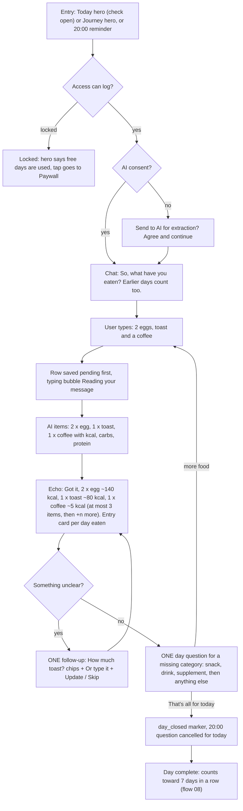
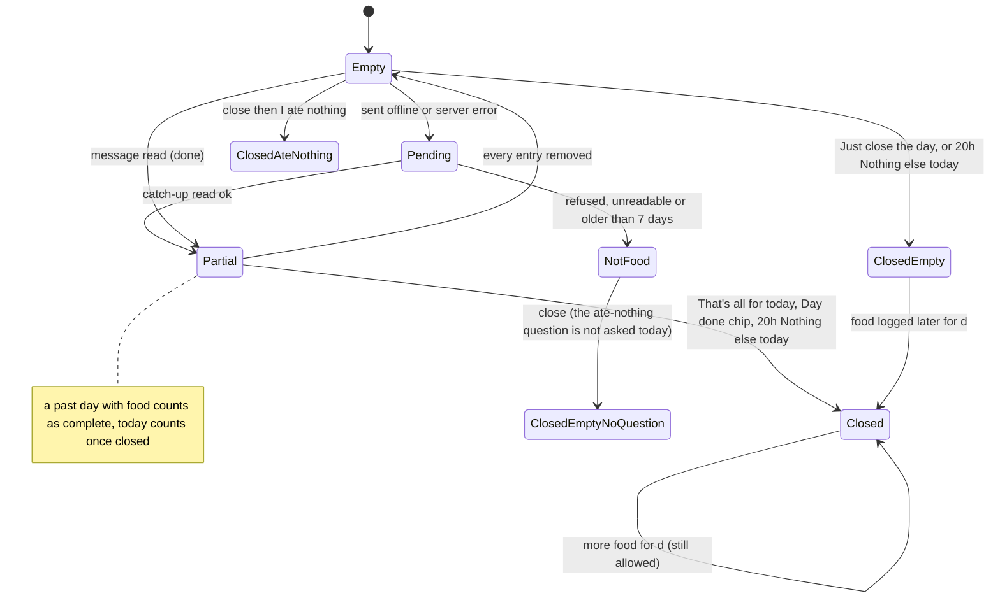
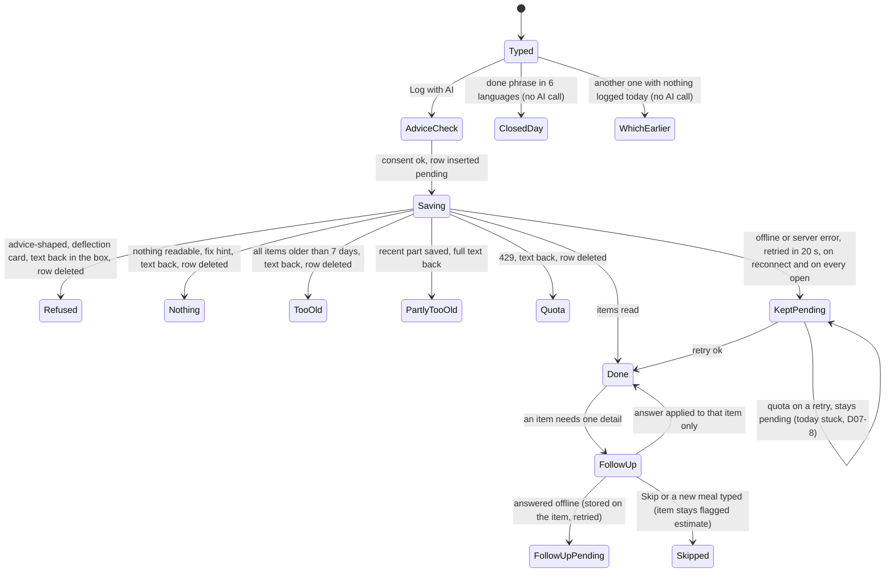
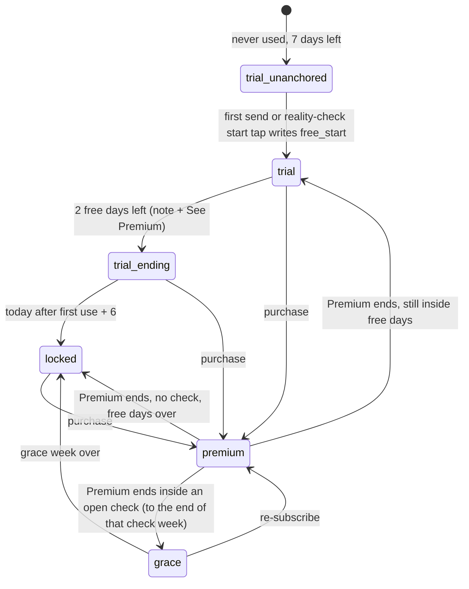
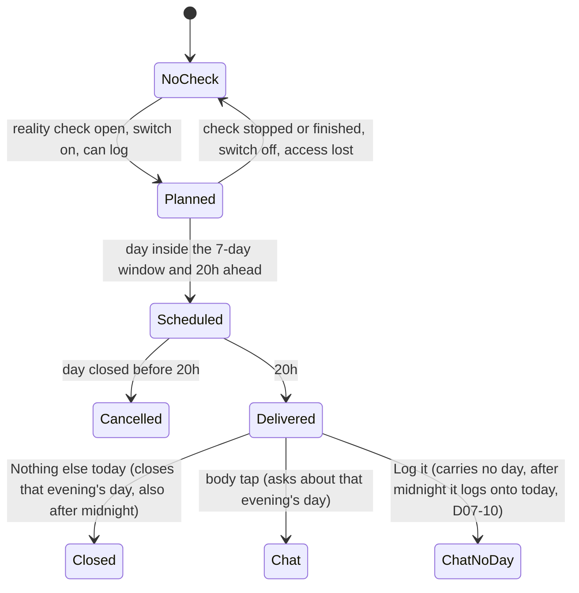

# 07 — A food-log day (AI food log)

> Draft for founder review, written 2026-10-12 from `docs/product/research/04-food-reality-progress.md` (§3.1, §4 R-F/R-A, §5.2–5.3, §6.3/6.7/6.8, §8, G-1/G-4/G-11/G-16), `03-reminders.md` (§3.9, §5.10), `07-onboarding-account-premium.md` (food access), `docs/decisions.md` (Journey/Progress/Reality check/food log; AI rules; Premium) and `docs/specs/food-log.md` (FL-1…FL-48). Code @ 4dade55.
> Shows the **intended** behaviour; **Divergence today** notes cite the dossier.

---

## 1. Goal

The food log is a **retention engine** (founder 2026-09-27): a friendly daily chat in which the user says what they ate in their own words, the AI only transcribes it into items with calories / carbs / protein, the app asks one kind question at a time until the day is complete, and a complete run of 7 days in a row feeds the reality check (flow 08), which feeds the daily plan. Never advice, never a comment on food, never a lost entry.

## 2. Actors

| Actor | Role |
|---|---|
| User | Types meals (today or up to 7 days back), answers follow-ups, closes the day. |
| FoodChat (`screens/FoodChatScreen.js`) | ONE chat for every entry point; thread rebuilt from stored rows only. |
| `parse-food` edge function (Claude Haiku) | Returns structured items only (food ≤ 60 chars, unit ≤ 16, options ≤ 40 × 4) or a refusal. |
| Food access (`foodLogAccess`) | Premium / 7 free days / grace / locked. |
| 20:00 notification "Anything else today?" | Only while a reality check is open; Log it / Nothing else today. |
| Today hero (only while a check is open), Journey hero (always), Progress reality-check card | Show the day and the 7-day run. |
| Settings / Progress switch "Food-log reminder" | `user_metadata.food_reminders` — one off switch shared by Settings and Progress, no every-other-day backoff (AD-73, decisions.md:249; as built). |

## 3. Preconditions

- Signed in. AI consent v4 (asked before the first send). Network for the AI read (offline entries are saved and read later).
- Access: Premium, or within the 7 free days (counted from the first use: first send or the reality-check start tap), or in a lapsed payer's grace week.

## 4. What may already have happened before

| # | Prior state | What the flow must do |
|---|---|---|
| P1 | Never used the food log | `trial` with 7 days left and no anchor; the first send writes the `free_start` marker = today. |
| P2 | Ate something 3 days ago and forgot | "an ice cream 3 days ago" → logged on that day without asking when (FL-2). |
| P3 | Typed food from 9 days ago | Not logged; "I can log food from the last 7 days…" and the typed text comes back (FL-45). |
| P4 | Typed offline yesterday | Row saved `pending`; read on the next chat open / hero focus / reconnect, by this device only (FL-19). |
| P5 | Closed yesterday with nothing logged | Asked "Did you really eat nothing?" at that time; if "Just close the day", yesterday breaks the run (FL-47). |
| P6 | Tapped last night's 20:00 reminder this morning | Body tap: the chat asks about yesterday, not "today" (FL-40). The **Log it** button carries no day, so a meal sent from it logs onto today (D07-10). |
| P7 | Reached the 25 AI reads today | "You've reached today's logging limit — it resets tomorrow."; text kept (FL-20). |
| P8 | Free days ended | Hero locked → Paywall; chat shows the locked card; no 20:00 questions (FL-41). |
| P9 | Premium ended during a running check | Grace to the end of the current check week; note explains with the user's numbers. |
| P10 | A follow-up was left open yesterday | Resumed on reopen only while it still applies (FL-28 / R-F4). |
| P11 | Logged the same day on another phone | Rows sync; the thread shows both; re-parse only by the typing device. (Today a meal can be skipped by the other phone's pull, and a removed entry stays on the other phone — D07-14.) |
| P12 | Midnight passes while the chat is open | Day divider; a send that crosses midnight lands on the typed day. |

## 5. Happy path

## 6. States and transitions

### 6.1 One food day `d`

Run meaning (flow 08): complete = a `done` food row (past day) or closed with food, or closed + "I ate nothing" (0 kcal). Breaks the run: empty, closed-empty, a legacy "not recorded" marker, NotFood-only days.

### 6.2 One message

### 6.3 Food access

### 6.4 The 20:00 question (per day)

## 7. Alternative and exception paths

### 7.1 Catch-ups and dates
- Up to 7 days back, the item's own `days_ago` wins; one message eaten on several days = one bubble with one entry card per day (FL-38). Older than 7 days → refused kindly, text kept (FL-45).
- "Fix this entry": items, kcal / carbs / protein editable, day bar Today / Yesterday / Earlier day (2–7 days ago — DL-95: FL-2 allows 7 days back, Today = 0, Yesterday = 1; as built, `lib/foodEntryDay.js:53-65`); category set by the AI, not editable ("Categoria não importa, as calorias sim").
- **Divergence today (04 G-16):** "Remove entry" in the fix sheet deletes without asking, although every delete asks first (AD-01, decisions.md:46). Saving "Fix this entry" with every item cleared also deletes the entry without asking (`FoodEntryEditor.js:86`). Intended (AD-01): ask first in both cases (DV-003, which absorbed DV-206).
- **Divergence today (DV-226):** in the chat, the "Remove entry" / "Remover registro" pill under a refused or too-old row (`FoodChatScreen.js:549`, `:559`) calls `removeRow` (`:470`) and deletes the typed text at once; tapping an unread or pending row asks first (`confirmRemove`, `:463-469`). Intended (AD-01): the pill asks first too.

### 7.2 Questions and closing
- After each entry dated today: ONE question per missing category (meal → snack → drink → supplement → "anything else"), past tense from 19:00; none once the day is closed (FL-4/FL-5).
- Only explicit phrases close a day ("that's it", 6 languages; chip "That's all for today"); a bare "no" never does (FL-6/FL-29).
- Closing a day with no food → "Nothing logged for this day" / "Did you really eat nothing? Your reality check measures your real daily calories… Only a day you confirm as "nothing eaten" counts toward your 7 days in a row." → Cancel / **Just close the day** / **I ate nothing** (FL-47).
- The 20:00 "Nothing else today" closes without asking (accepted FL-47 deviation) → an empty day closed there breaks the run.
- **Divergence today (04 D-16):** closing a day whose only rows are refused / unreadable / too old / pending does not ask "I ate nothing" (the check counts any non-marker row) → the day silently breaks the run.
- **Divergence today (04 G-4):** "Not recorded" day marks: the signed rule (FL-3) says a manual mark breaks the run, but no UI writes it any more (legacy read only). Strings `nutri_mark_not_recorded`, `nutri_unlogged_*` are unused, and so is `nutri_run_rule` ("A day counts when it has food logged or you closed it with "That's all for today"…"), which also contradicts FL-47 (dead copy, DV-181). Whether the mark is retired (FL-3 amended with the founder's signature) or brought back in the UI is **OPEN-18 (2)** (was DL-66; Portuguese question 23 (b)).

### 7.3 Offline
- Row saved `pending` before the call; "Saved — I'll estimate the calories when you're back online." only when NetInfo says offline (FL-46); otherwise "Saved — the AI couldn't be reached just now. I'll try again in a moment, and each time you open the log."; retried after 20 s, on reconnect, on each chat open and hero focus — by the typing device only (FL-19).
- **Divergence today (04 §8.5; CONFIRMED by reading, DV-066):** a quota hit on a retry keeps the row `pending` forever (retried on every open; `foodLogActions.js:77`). `parse-food` counts the cap per `entry_date` (`index.ts:161-171`) and the row's date never changes, so once that date has 25 reads every retry is refused.
- **Intended (DL-28, rewritten 2026-10-12 — logic, the founder may override):** `parse-food` counts the 25 by the user's local day of the **request**, not by the entry's date (decisions.md:251: "resets at local midnight"); a re-parse refused by the cap marks the row "not read yet — daily limit reached", keeps the text, explains, and retries the next day. The new row state and its notice are new UI (**OPEN-24 item 8**, Portuguese question 2); the server deploy waits for the founder's go (Approvals still owed, item 1).

### 7.4 App killed / chat closed
- Draft per user survives closing (`dosetrace_food_draft:<uid>`), also text put back after a failed send (FL-36). Auto-close after 30 s idle with the keyboard down or on background — never with text in the box, while sending, with a sheet open, or with a screen reader on; never when embedded on the Fold (FL-32, BK-17).
- Open follow-ups stored on the item → survive closing (FL-35).
- **Divergence today (07 D-17):** the chat draft survives an intended sign-out (keyed by user, not in the wipe), unlike BK-14 "a real sign-out clears drafts" (AD-05, decisions.md:378; DL-52).

### 7.5 Second device
- Rows sync; markers idempotent per device per day (duplicates harmless). Re-parse only by the device that typed it. The 20:00 plan re-syncs on sync events.
- **Divergence today (DV-222, DV-182; when the fix ships = OPEN-16 (b), Portuguese question 1 (b)):** once phone B pushes any food row, meals phone A pushed earlier and B has not pulled yet are skipped by B's pull for good (DV-222); a food entry removed on A stays on B, because the cloud delete is a hard delete the other phone never hears of (DV-182). Intended: every meal and every removal reaches every device (never lose user-entered data, AD-02).

### 7.6 Timezone / DST / midnight
- A food day runs local midnight to midnight (FL-24); stored `entry_date` is the local day at write time and never moves; thread dividers may shift after a zone change.
- The 25-read quota bucket today is the `entry_date` sent (`parse-food/index.ts:163`): today for a normal send — a typed catch-up such as "yesterday I had…" is sent with today's date and moved by the AI's `days_ago` (`FoodChatScreen.js:346`, `:371`), so it counts against today; the chosen day when the chat logs for an earlier day (the chat's evening bubble "Log it" on a past evening — "Logging for {day}", `logDay`, `FoodChatScreen.js:656`); and the row's own date for an offline re-parse. A **new** date starts at 0, but a given date's counter never resets — a date that is already full stays full. (FL-22 says only that the limit resets at the user's local midnight, not UTC; it does not set the bucket.) Intended: the request's local day (DL-28 rewritten, §7.3).
- **Divergence today (04 D-5, SUSPECTED):** the Today/Journey hero and Progress compute on focus only — after midnight "Today: N items" can show yesterday until refocus.

### 7.7 Notification tap
- 20:00 body → FoodChat with the evening question for that day (the tap carries `eveningDay`); **Nothing else today** → no navigation, closes that day (headless on Android, opens the app on iOS).
- **Log it** → FoodChat with the composer focused. **Divergence today (03 §F, NEW-2):** the button carries no day — `foodTapParams` returns only `{ logIt }` (`notificationPlan.js:153`) and `FoodChatScreen.js:185-189` only focuses the composer — so after midnight, "Log it" on last night's question logs onto **today**, not the evening's day (DV-197). Intended (FL-40; a plain bug, no decision needed): it logs onto the day the question was about (as the body tap does). FL-40's "Log it for an earlier day" is the in-chat bubble, not this button.
- The evening bubble in the chat offers Log it / Nothing else today / I'll eat later.

### 7.8 Fold
- Journey food card → the chat on the right page with no Done and no auto-close (BK-17); Today's hero on the Fold opens the chat pushed (Today's right page is the Dose log / protocol). **Intended (A-116 — waits for these docs, then resumes for 1.3.0, AD-31):** the 20:00 notification opens the chat on the right page.
- **Divergence today (DV-238):** the Journey AI food log hero on the left page keeps the old line after a meal is sent from the chat on the right: `FoodLogHero` reloads only in `useFocusEffect` (`screens/components/FoodLogHero.js:36`), the Journey tab never loses focus in the book layout, and `JourneyScreen.js:123-125` listens only for `data_changed 'calc'` (BK-19 covers doses and weigh-ins). Intended (DL-98, logic): the left page follows every write on the right, the food log included.

### 7.9 Free vs Premium (FL-41)
- 7 free days from the first use; last 2 days: note "Your 7 free days end on {until} — food logged on {logged} days so far…" + See Premium; then locked: hero "Your free days are used — Premium keeps the log going." → Paywall; chat locked card "Log your day in a sentence" + Unlock Premium; no 20:00 questions.
- Lapsed payer: grace to the end of the current check week, never "free days" wording.
- **Divergence today (04 D-15, 07 D-2, G-1):** `parse-food` never checks access on the server (AD-16, decisions.md:288: "the server stays authoritative for paid AI calls") — an old or modified client can log while locked. The server deploy waits for the founder's go (Approvals still owed, item 1).
- **Divergence today (04 D-9, presentation):** on a phone, Progress shows two day counts (the status line and the "so far" footer), identical until a run of 7 or more exists, then different; all three (with the grace note, which renders only in the food card and the chat) appear side by side only in the Fold book layout (Journey + Progress).

### 7.10 AI hard line
- The AI never writes a sentence shown to the user (FL-16); advice-shaped requests ("what should I eat to lose weight?") → fixed card "I don't give diet advice" / "DoseTrace logs and totals what you eat — it doesn't recommend what to eat. For guidance, talk to a doctor or registered dietitian." (FL-15). Fat stored, not shown (FL-17). Raw text never logged on the server.

## 8. What every surface shows

| State | Today hero (check open only) | Journey hero | Chat | 20:00 notification | Progress reality-check card |
|---|---|---|---|---|---|
| No check, nothing today | hidden | "AI food log" · "Nothing logged yet today" · Log food | intro + composer | none | — |
| No check, food today | hidden | "Today: {n} items · ~{kcal} kcal" | thread of the last 7 typed days | none | — |
| Check running, day n | "AI food log" · "Reality check · day {n} of 21 · {n} of 7 days in a row" (PT "… · {n} de 7 seguidos") · today's line | today's line + "{n} of 7 days in a row" | as above | 20:00 daily unless closed | "{n} of 7 so far" |
| Today closed | "Today is closed · ~{kcal} kcal" | same | "All set for today — thanks. See you tomorrow." | cancelled for today | run +1 at once (today counts once closed, `nutrition.js:98`) |
| Offline entry | line counts done rows only | same | entry card "Saved — I'll estimate…" | — | not counted until read |
| Free days ending (2 left) | + note | + note "Your 7 free days end on {until}…" + See Premium | caveat line | — | — |
| Locked (free days used) | "Your free days are used — Premium keeps the log going." → Paywall | same | locked card + Unlock Premium | none | locked: intro line + "See how it works" (flow 08) |
| Grace (lapsed payer, inside the check week) | today's line ("Today: {n} items · ~{kcal} kcal") + the check line + grace note "Your Premium has ended. Your reality check is on day {day}…" (`FoodLogHero.js:96`, `:100`) | today's line + run + grace note | logging allowed to {until} | until {until} | — |
| Locked (lapsed payer, after grace) | "Your Premium has ended — Premium keeps the log going." → Paywall | same | locked card + Unlock Premium | none | locked: intro line + "See how it works" (flow 08) |

## 9. Data written at each step

| Step | Store | Write | Synced |
|---|---|---|---|
| First send / start tap | `food_logs` | marker `source='free_start'` (today) | yes |
| Send | `food_logs`; AsyncStorage `dosetrace_food_local_pending` | row `entry_date`, `raw_text`, `parse_status 'pending'`; the row id is remembered as typed here | row yes |
| AI read ok | `food_logs` | same row `parsed_items` (JSON: food, qty, unit, kcal, protein_g, carb_g, fat_g, confidence, category, days_ago, msg, ask…), totals, `parse_status 'done'`; extra rows per other day (same `msg`) | yes |
| Refused / nothing / too old / quota — live send | `food_logs` | row tombstoned; text back in the box (`FoodChatScreen.js:376-418`) | yes (tombstone) |
| Refused / nothing / too old — offline row re-read later | `food_logs` | row kept with `parse_status` `'refused'` / `'unparsed'` / `'too_old'`, removable (`foodLogActions.js:78-83`) | yes |
| Quota — offline row re-read later | `food_logs` | row stays `'pending'` (`foodLogActions.js:77`; D07-8) | — (unchanged) |
| Follow-up answer | `food_logs` | the asked item + totals; `ask_done`; offline → `ask_pending` on the item | yes |
| Fix this entry | `food_logs` | items / totals / `entry_date`; changed item `confidence 'user'` | yes |
| Remove entry | `food_logs` | tombstone | yes |
| That's all for today / Nothing else today | `food_logs` | marker `day_closed` (+ `ate_nothing` when confirmed) | yes |
| Draft | AsyncStorage | `dosetrace_food_draft:<uid>` | no |
| Questions asked | AsyncStorage | `dosetrace_food_asked` | no |
| Server | `ai_food_usage` | user, entry_date, kind parse / followup | server only |
| Reminder switch | `user_metadata` | `food_reminders` | server |

## 10. Rules (with sources)

R-F1 thread rebuilt from stored rows only (FL-35). R-F2 one message = one bubble (FL-38). R-F3 catch-ups ≤ 7 days (FL-2/45). R-F4 one question per missing category (FL-4/5). R-F5 only explicit phrases close (FL-6/29). R-F6 empty closed day breaks unless "I ate nothing" (FL-47). R-F7 AI writes no sentences (FL-16). R-F8 refusal → fixed deflection (FL-15). R-F9 quota 25 AI parses per user per local day, reserved before the call; answering a follow-up never uses one of the 25 (decisions.md:251, FL-20/21/22) — counted today per `entry_date` sent, intended per the request's local day (DL-28 rewritten). As built the server also caps 25 follow-up answers per entry_date and 60 calls per rolling 24 h — builder choices with no ledger line, against decisions.md:251 / FL-21: keep or change is **OPEN-18 (3)** (Portuguese question 23 (c)), DV-213. R-F10 offline-first, re-parse by the typing device only (FL-19). R-F11 fat stored, not shown (FL-17). R-F12 auto-close rules (FL-32/36). R-A1…A5 access (FL-41). R-R11 20:00 question (FL-18/42). (`04 §4`.)

## 11. Divergences today (summary)

| ID | Intended | Today | Source | DV |
|---|---|---|---|---|
| D07-1 | Server enforces food access (AD-16; deploy = Approvals item 1) | Client only | `04 D-15`, `07 D-2` | DV-103 |
| D07-2 | Closing a not-food-only day asks "I ate nothing" (AD-17) | Not asked | `04 D-16` | DV-064 |
| D07-3 | Remove entry and an all-cleared save ask first (AD-01) | No confirm | `04 G-16`; verification 04 N-4 | DV-003 (DV-206 merged here) |
| D07-4 | Hero / Progress re-date at midnight | Focus only | `04 D-5` | DV-148 |
| D07-5 | Each "days" count labelled by what it counts (DL-30; the labels = OPEN-24 item 3) | Two unlabelled counts on a phone (Progress); three only on the Fold book layout | `04 D-9` | DV-146 |
| D07-6 | Sign-out clears the chat draft (AD-05, DL-52) | Survives | `07 D-17` | DV-081 |
| D07-7 | Per **OPEN-18 (2)** (was DL-66): the "Not recorded" mark comes back in the UI (FL-3), or is retired with FL-3 amended by the founder's signature | No UI; strings dead | `04 G-4`, `G-11` | DV-151, DV-181 |
| D07-8 | DL-28 (rewritten): the 25 counted by the request's local day; a refused re-parse marked "not read yet — daily limit reached", text kept, retried next day (row state + notice = OPEN-24 item 8) | Counted per `entry_date`; a quota hit on a retry stays pending forever (CONFIRMED by reading) | `04 §8.5` | DV-066 |
| D07-9 | 20:00 copy identical in server push (AD-37: server push stays off until A-62) | Dormant server copy differs | `04 G-12` | DV-145 |
| D07-10 | Notification "Log it" logs onto the evening's day (FL-40) | Carries no day; after midnight logs onto today | `03 verification §F` (NEW-2) | DV-197 |
| D07-11 | The chat's "Remove entry" pill asks first (AD-01) | Deletes a refused / too-old row at once | verification round 2 R2-06 N-4 | DV-226 |
| D07-12 | Totals per day, week and whole window (decisions.md:250, FL-24) — keep or change = OPEN-18 (9) | Only the day's total since Journey part 8 | verification round 2 R2-03 #7 | DV-232 |
| D07-13 | Fold: the left Journey food hero follows a send on the right page (DL-98) | Keeps the old line until Journey is refocused | verification round 2 R2-05 (F07-18) | DV-238 |
| D07-14 | Every meal and every removal reaches every device (AD-02; timing = OPEN-16 (b)) | A meal can be skipped by the other phone's pull; a removed entry stays on the other phone | TRD §3.9 H-1; verification round 2 R2-06 M-1 | DV-222, DV-182 |
| D07-15 | Only the approved limits (follow-ups free, 25 reads a local day) or the builder's ceilings kept — OPEN-18 (3) | 25 follow-ups per entry_date + 60 calls per rolling 24 h | verification 07 X-09 | DV-213 |

## 12. Founder questions (canonical IDs — `docs/product/OPEN-DECISIONS.md`)

Reconciled 2026-10-12: every question this flow raised has one canonical ID in `OPEN-DECISIONS.md` — **OPEN-xx** waits for the founder (asked in the one Portuguese round there), **AD-xx** is already decided by the ledger or a signed spec, **DL-xx** is decided by product logic (recorded in `docs/decisions.md`; the founder may override). DV-xxx is the defect row in `DIVERGENCES.md`.

Open — waiting for the founder:

- **OPEN-18 (2)** (was DL-66) — The "not recorded" mark (FL-3) (Portuguese question 23 (b)). Recommended: retire it (legacy rows still read; FL-47's "Just close the day" breaks a run on purpose), FL-3 amended with the founder's signature — or bring the UI back. D07-7 → DV-151, DV-181.
- **OPEN-18 (3)** — The AI caps the builder added: 25 follow-up answers per day and 60 calls in any 24 h (Portuguese question 23 (c)). Keep as abuse ceilings, each with its own true message, or only the approved limits. D07-15, §10 R-F9 → DV-213.
- **OPEN-18 (9)** — Week and whole-check food totals (Portuguese question 23 (e)). D07-12 → DV-232.
- **OPEN-07** — A-24: does saving a check **early** end the 20:00 question? (Portuguese question 12; was DL-51.) Finishing already cancels it (`completeRealityCheck` → `syncFoodLogReminder` with no open check, `CalculatorSection.js:974-978`); early saving exists only if OPEN-07 brings back the day-14 result buttons (option B). → DV-144.
- **OPEN-24 item 8** — The food-chat row "not read yet — daily limit reached" and its notice, picture first ×6 (Portuguese question 2). D07-8 → DV-066.
- **OPEN-24 item 3** — Each "days" count on Progress labelled by what it counts, picture first ×6 (Portuguese question 2). D07-5 → DV-146.
- **OPEN-16 (b)** — When the sync hardening ships (Portuguese question 1 (b)). D07-14 → DV-222, DV-182.

Decided — what this flow relies on (moved or added in round 2):

- **DL-28 (rewritten)** — the 25 counted by the request's local day; a refused re-parse marked, kept, explained, retried next day (D07-8). Server deploy = Approvals still owed, item 1.
- **DL-95** (was AD-54, OPEN-21 (9)) — "Earlier day" in Fix this entry = 2–7 days back (§7.1).
- **DL-98** (new) — on the Fold the left page follows every food write on the right (D07-13 → DV-238).
- **AD-73** (new) — one off switch for the 8 PM question (Settings and Progress), no backoff (§2).
- **DL-25** (absorbs AD-12) — the Today and Journey food heroes follow the check's real state (flow 08).
- **AD-01** — every delete asks first (D07-3 → DV-003, which absorbed DV-206; D07-11 → DV-226).
- D07-10 ("Log it" carries no day) is a plain bug, DV-197 (FL-40); no question.

## 13. Acceptance checks (agent-device QA script)

Account Test03 (AI consent may be accepted on this account for tests; delete test food afterwards). Light and dark; PT via Settings → Preferências → Idioma. Screenshot before every tap.

**F07-01 — Journey hero and chat open**
- Do: Journey ("Evolução") → food card "AI food log" / "Registro de comida com IA".
- Expect: chat with "So, what have you eaten? Earlier days count too." / "E aí, o que você comeu? Dias anteriores também contam."; placeholder "e.g. 3 eggs, 2 toasts and a coffee"; send button "Log with AI" / "Registrar com IA".

**F07-02 — Consent first**
- Setup: consent not given on this phone.
- Expect on first send: "Send to AI for extraction?" / "Enviar para a IA extrair?" → Agree & continue; Cancel keeps the text in the box.

**F07-03 — Log and echo**
- Do: "2 eggs, a toast and a black coffee".
- Expect: typing bubble "Reading your message" / "Lendo sua mensagem"; echo "Got it — 2 × egg · ~140 kcal, 1 × toast · ~80 kcal, 1 × black coffee · ~5 kcal." / "Anotado: …" (each item with its quantity and ~kcal, at most 3, then "+{n} more" / "e mais {n}"; the numbers are the AI's; decisions.md:246); entry card with quantity and ~kcal, carbs and protein (no fat); category chip.

**F07-04 — One question at a time**
- Expect after the entry: one question for a missing category (e.g. "Any snacks along the way — a bar, some fruit, a little something?" / "Beliscou alguma coisa ao longo do dia…"); answering "no" dismisses it but does not close the day; after 19:00 wording is past tense ("Did you have a proper meal today — lunch, dinner, anything?").

**F07-05 — Follow-up updates the same entry**
- Do: "some rice".
- Expect: "How much rice?" / "Que quantidade de "rice"?" with chips + "Or type it" / "Ou digite" + Update / Skip; answer "200 g" → "Updated — …" and only that item's kcal changes; skipped item stays "estimate · tap to fix".

**F07-06 — Catch-up 3 days back**
- Do: "an ice cream 3 days ago".
- Expect: entry card dated 3 days ago; today's totals unchanged; no question about when.

**F07-07 — Too old**
- Do: "pizza 10 days ago".
- Expect: "I can log food from the last 7 days — anything older is too hard to remember exactly." / "Consigo registrar comida dos últimos 7 dias…"; the text is back in the box; nothing saved.

**F07-08 — Advice deflection**
- Do: "what should I eat to lose weight?" (and PT "o que devo comer para emagrecer?").
- Expect: card "I don't give diet advice" / "Não dou conselhos de dieta" + the fixed body; nothing saved; text back in the box.

**F07-09 — Close the day**
- Do: chip "That's all for today" / "Por hoje é só".
- Expect: "All set for today — thanks. See you tomorrow." / "Tudo certo por hoje — obrigado. Até amanhã."; no more questions today; Journey hero "Today is closed · ~{kcal} kcal" / "Hoje está fechado · ~{kcal} kcal"; the 20:00 alarm for today gone.

**F07-10 — Close an empty day**
- Do: new day, nothing logged, type "that's it".
- Expect: "Nothing logged for this day" / "Nada registrado neste dia" + the "Did you really eat nothing?" body; buttons Cancel / "Just close the day" / "Só fechar o dia" / "I ate nothing" / "Não comi nada". "I ate nothing" → the day counts as 0 kcal toward the run (flow 08).

**F07-11 — Offline entry**
- Do: airplane mode → "a banana".
- Expect: "Saved — I'll estimate the calories when you're back online." / "Salvo — vou estimar as calorias quando você estiver online de novo."; reconnect → read automatically within about a second (0.8 s after the connection returns, `FoodChatScreen.js:171`; the 20 s retry is for a server error while online, `:423`); echo "Updated — 1 × banana · ~105 kcal." / "Atualizado — …" (numbers are the AI's).

**F07-12 — Fix this entry**
- Do: tap an entry card.
- Expect: "Fix this entry" / "Corrigir este registro" with item name, kcal, carbs, protein; day bar Today / Yesterday / Earlier day; no category picker; Save changes the card; "Remove entry" / "Remover registro" — intended asks first (record D07-3). In the chat, the "Remove entry" pill under a refused or too-old row: intended asks first; **today** deletes at once — record D07-11.

**F07-13 — 20:00 question (check running)**
- Setup: reality check open (flow 08); day not closed; clock 20:00.
- Expect: notification "Anything else today?" / "Mais alguma coisa hoje?" + "Anything you ate today that isn't logged yet — and will you eat again today?" with **Log it** / "Registrar" and **Nothing else today** / "Nada mais hoje". Nothing else today → day closed without opening the app (Android) and no "I ate nothing" question.
- Tap the body the next morning → the chat asks "Anything you ate yesterday that isn't logged yet?" / "Comeu algo ontem que ainda não registrou?".
- Tap **Log it** the next morning and send a meal without a day → intended: logged onto yesterday. **Today:** logged onto today — record D07-10.

**F07-14 — No 20:00 without a check**
- Setup: no open check.
- Expect: no `food-log-*` notification in the OS queue; Today shows no food hero.

**F07-15 — Daily limit**
- Setup: 25 AI reads today (test account).
- Expect: "You've reached today's logging limit — it resets tomorrow." / "Você atingiu o limite de registros de hoje — amanhã ele é renovado."; text kept; nothing half-saved.
- Note: "it resets tomorrow" is true for today's date only. A typed catch-up ("yesterday I had…") is sent with today's date and counts against today, which does reset. It never resets for a meal logged for an earlier day through the chat's evening bubble "Log it" on a past evening ("Logging for {day}"), or an offline entry re-read on a later day, once that day's 25 reads are used (see §7.3, §7.6; intended per DL-28 rewritten).

**F07-16 — Free days ending and locked**
- Setup: free account, first use 5 days ago → 2 left.
- Expect: note "Your 7 free days end on {until}…" + "See Premium" / "Ver Premium". Clock +3 days → hero "Your free days are used — Premium keeps the log going." / "Seus dias grátis acabaram — o registro continua com o Premium."; tap → Paywall; chat shows the locked card "Log your day in a sentence" + "Unlock Premium".

**F07-17 — Kill keeps the draft**
- Do: type "chicken and rice" without sending → kill → reopen the chat.
- Expect: the text is still in the box.

**F07-18 — Fold embedded chat**
- Do (unfolded Fold): Journey → food card.
- Expect: chat on the right page, no Done, no auto-close after 30 s. Send a meal: intended (DL-98) the Journey food hero on the left updates at once. **Today:** it keeps the old line until Journey is refocused — record D07-13.

**F07-19 — Both themes**
- Bubbles (app and user), entry cards, chips, follow-up card, deflection card, locked card, close-empty sheet, fix sheet: readable in light and dark; send button ink.
