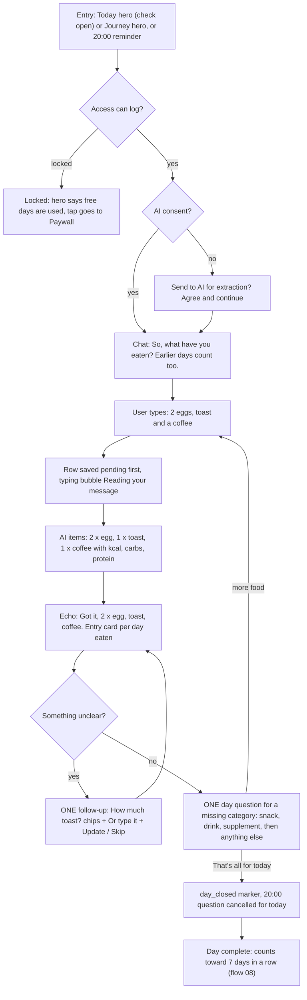
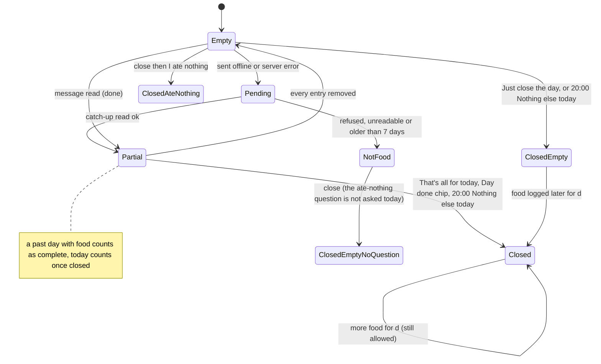
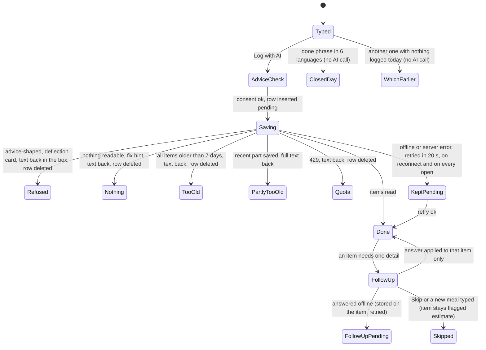
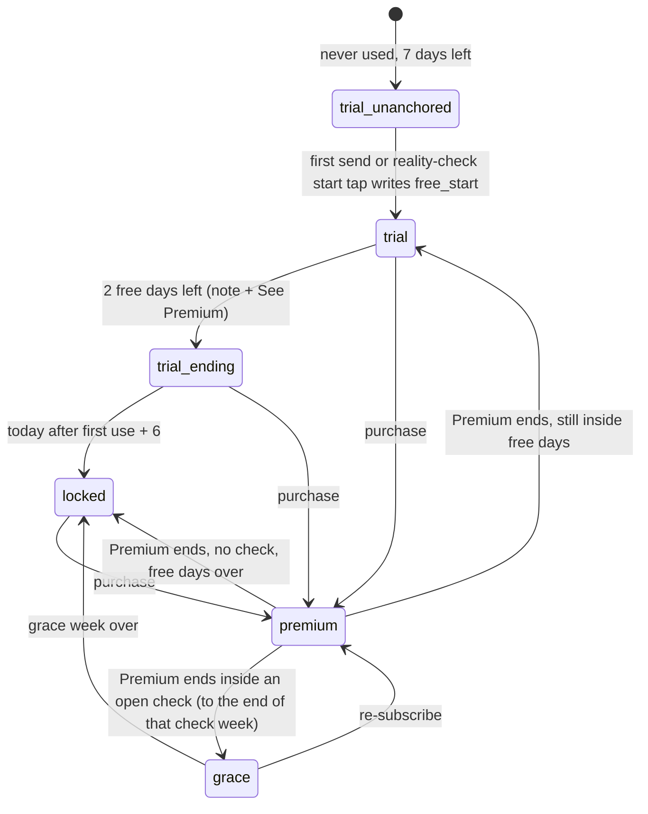
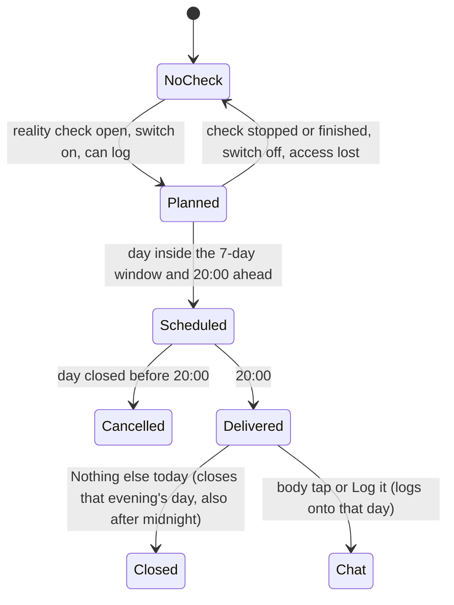

# 07 — A food-log day (AI food log)

> Draft for founder review, written 2026-10-12 from `docs/product/research/04-food-reality-progress.md` (§3.1, §4 R-F/R-A, §5.2–5.3, §6.3/6.7/6.8, §8, G-1/G-4/G-11/G-16), `03-reminders.md` (§3.9, §5.10), `07-onboarding-account-premium.md` (food access), `docs/decisions.md` (Journey/Progress/Reality check/food log; AI rules; Premium) and `docs/specs/food-log.md` (FL-1…FL-48). Code @ 4dade55.
> Shows the **intended** behaviour; **Divergence today** notes cite the dossier.

---

## 1. Goal

The food log is a **retention engine** (founder 2026-09-27): a friendly daily chat in which the user says what they ate in their own words, the AI only transcribes it into items with calories / carbs / protein, the app asks one kind question at a time until the day is complete, and a complete run of 7 days in a row feeds the reality check (flow 08), which feeds the daily plan. Never advice, never a comment on food, never a lost entry.

## 2. Actors

| Actor | Role |
|---|---|
| User | Types meals (today or up to 7 days back), answers follow-ups, closes the day. |
| FoodChat (`screens/FoodChatScreen.js`) | ONE chat for every entry point; thread rebuilt from stored rows only. |
| `parse-food` edge function (Claude Haiku) | Returns structured items only (food ≤ 60 chars, unit ≤ 16, options ≤ 40 × 4) or a refusal. |
| Food access (`foodLogAccess`) | Premium / 7 free days / grace / locked. |
| 20:00 notification "Anything else today?" | Only while a reality check is open; Log it / Nothing else today. |
| Today hero (only while a check is open), Journey hero (always), Progress reality-check card | Show the day and the 7-day run. |
| Settings / Progress switch "Food-log reminder" | `user_metadata.food_reminders`. |

## 3. Preconditions

- Signed in. AI consent v4 (asked before the first send). Network for the AI read (offline entries are saved and read later).
- Access: Premium, or within the 7 free days (counted from the first use: first send or the reality-check start tap), or in a lapsed payer's grace week.

## 4. What may already have happened before

| # | Prior state | What the flow must do |
|---|---|---|
| P1 | Never used the food log | `trial` with 7 days left and no anchor; the first send writes the `free_start` marker = today. |
| P2 | Ate something 3 days ago and forgot | "an ice cream 3 days ago" → logged on that day without asking when (FL-2). |
| P3 | Typed food from 9 days ago | Not logged; "I can log food from the last 7 days…" and the typed text comes back (FL-45). |
| P4 | Typed offline yesterday | Row saved `pending`; read on the next chat open / hero focus / reconnect, by this device only (FL-19). |
| P5 | Closed yesterday with nothing logged | Asked "Did you really eat nothing?" at that time; if "Just close the day", yesterday breaks the run (FL-47). |
| P6 | Tapped last night's 20:00 reminder this morning | The chat asks about yesterday, not "today" (FL-40). |
| P7 | Reached the 25 AI reads today | "You've reached today's logging limit — it resets tomorrow."; text kept (FL-20). |
| P8 | Free days ended | Hero locked → Paywall; chat shows the locked card; no 20:00 questions (FL-41). |
| P9 | Premium ended during a running check | Grace to the end of the current check week; note explains with the user's numbers. |
| P10 | A follow-up was left open yesterday | Resumed on reopen only while it still applies (FL-28 / R-F4). |
| P11 | Logged the same day on another phone | Rows sync; the thread shows both; re-parse only by the typing device. |
| P12 | Midnight passes while the chat is open | Day divider; a send that crosses midnight lands on the typed day. |

## 5. Happy path

## 6. States and transitions

### 6.1 One food day `d`

Run meaning (flow 08): complete = a `done` food row (past day) or closed with food, or closed + "I ate nothing" (0 kcal). Breaks the run: empty, closed-empty, a legacy "not recorded" marker, NotFood-only days.

### 6.2 One message

### 6.3 Food access

### 6.4 The 20:00 question (per day)

## 7. Alternative and exception paths

### 7.1 Catch-ups and dates
- Up to 7 days back, the item's own `days_ago` wins; one message eaten on several days = one bubble with one entry card per day (FL-38). Older than 7 days → refused kindly, text kept (FL-45).
- "Fix this entry": items, kcal / carbs / protein editable, day bar Today / Yesterday / Earlier day (2–7 days ago); category set by the AI, not editable ("Categoria não importa, as calorias sim").
- **Divergence today (04 G-16):** "Remove entry" in the fix sheet deletes without asking (every other delete asks first — decision 2026-10-03). Intended: ask first.

### 7.2 Questions and closing
- After each entry dated today: ONE question per missing category (meal → snack → drink → supplement → "anything else"), past tense from 19:00; none once the day is closed (FL-4/FL-5).
- Only explicit phrases close a day ("that's it", 6 languages; chip "That's all for today"); a bare "no" never does (FL-6/FL-29).
- Closing a day with no food → "Nothing logged for this day" / "Did you really eat nothing? Your reality check measures your real daily calories… Only a day you confirm as "nothing eaten" counts toward your 7 days in a row." → Cancel / **Just close the day** / **I ate nothing** (FL-47).
- The 20:00 "Nothing else today" closes without asking (accepted FL-47 deviation) → an empty day closed there breaks the run.
- **Divergence today (04 D-16):** closing a day whose only rows are refused / unreadable / too old / pending does not ask "I ate nothing" (the check counts any non-marker row) → the day silently breaks the run.
- **Divergence today (04 G-4):** "Not recorded" day marks: the rule says a manual mark breaks the run, but no UI writes it any more (legacy read only). Strings `nutri_mark_not_recorded`, `nutri_unlogged_*` are unused.

### 7.3 Offline
- Row saved `pending` before the call; "Saved — I'll estimate the calories when you're back online." only when NetInfo says offline (FL-46); otherwise "Saved — the AI couldn't be reached just now. I'll try again in a moment, and each time you open the log."; retried after 20 s, on reconnect, on each chat open and hero focus — by the typing device only (FL-19).
- **SUSPECTED (04 §8.5):** a quota hit on a retry keeps the row pending forever (retried every open).

### 7.4 App killed / chat closed
- Draft per user survives closing (`dosetrace_food_draft:<uid>`), also text put back after a failed send (FL-36). Auto-close after 30 s idle with the keyboard down or on background — never with text in the box, while sending, with a sheet open, or with a screen reader on; never when embedded on the Fold (FL-32, BK-17).
- Open follow-ups stored on the item → survive closing (FL-35).
- **Divergence today (07 D-17):** the chat draft survives an intended sign-out (keyed by user, not in the wipe), unlike BK-14 "a real sign-out clears drafts".

### 7.5 Second device
- Rows sync; markers idempotent per device per day (duplicates harmless). Re-parse only by the device that typed it. The 20:00 plan re-syncs on sync events.

### 7.6 Timezone / DST / midnight
- A food day runs local midnight to midnight (FL-24); stored `entry_date` is the local day at write time and never moves; thread dividers may shift after a zone change.
- The 25-read quota bucket is the `entry_date` sent (logging for yesterday counts against yesterday's 25); resets at local midnight (FL-22).
- **Divergence today (04 D-5, SUSPECTED):** the Today/Journey hero and Progress compute on focus only — after midnight "Today: N items" can show yesterday until refocus.

### 7.7 Notification tap
- 20:00 body → FoodChat with the evening question for that day; **Log it** → FoodChat logging onto that day ("Logging for {day}"); **Nothing else today** → no navigation, closes that day (headless on Android, opens the app on iOS).
- The evening bubble in the chat offers Log it / Nothing else today / I'll eat later.

### 7.8 Fold
- Journey food card → the chat on the right page with no Done and no auto-close (BK-17); Today's hero on the Fold opens the chat pushed (Today's right page is the Dose log / protocol). **Intended (A-116, waiting):** the 20:00 notification opens the chat on the right page.

### 7.9 Free vs Premium (FL-41)
- 7 free days from the first use; last 2 days: note "Your 7 free days end on {until} — food logged on {logged} days so far…" + See Premium; then locked: hero "Your free days are used — Premium keeps the log going." → Paywall; chat locked card "Log your day in a sentence" + Unlock Premium; no 20:00 questions.
- Lapsed payer: grace to the end of the current check week, never "free days" wording.
- **Divergence today (04 D-15, 07 D-2, G-1):** `parse-food` never checks access on the server (ledger: "the server stays authoritative for paid AI calls") — an old or modified client can log while locked.
- **Divergence today (04 D-9, presentation):** the status line, the "so far" footer and the grace note can show three different day counts on one screen.

### 7.10 AI hard line
- The AI never writes a sentence shown to the user (FL-16); advice-shaped requests ("what should I eat to lose weight?") → fixed card "I don't give diet advice" / "DoseTrace logs and totals what you eat — it doesn't recommend what to eat. For guidance, talk to a doctor or registered dietitian." (FL-15). Fat stored, not shown (FL-17). Raw text never logged on the server.

## 8. What every surface shows

| State | Today hero (check open only) | Journey hero | Chat | 20:00 notification | Progress reality-check card |
|---|---|---|---|---|---|
| No check, nothing today | hidden | "AI food log" · "Nothing logged yet today" · Log food | intro + composer | none | — |
| No check, food today | hidden | "Today: {n} items · ~{kcal} kcal" | thread of the last 7 typed days | none | — |
| Check running, day n | "AI food log" · "Reality check · day {n} of 21" · "{n} of 7 in a row" · today's line | today's line + "{n} of 7 days in a row" | as above | 20:00 daily unless closed | "{n} of 7 so far" |
| Today closed | "Today is closed · ~{kcal} kcal" | same | "All set for today — thanks. See you tomorrow." | cancelled for today | run +1 tomorrow |
| Offline entry | line counts done rows only | same | entry card "Saved — I'll estimate…" | — | not counted until read |
| Free days ending (2 left) | + note | + note "Your 7 free days end on {until}…" + See Premium | caveat line | — | — |
| Locked | "Your free days are used — Premium keeps the log going." → Paywall | same | locked card + Unlock Premium | none | locked explainer |
| Grace (lapsed payer) | "Your Premium has ended — Premium keeps the log going." + grace note | same | logging allowed to {until} | until {until} | — |

## 9. Data written at each step

| Step | Store | Write | Synced |
|---|---|---|---|
| First send / start tap | `food_logs` marker `source='free_start'` (today) | yes |
| Send | `food_logs` row `entry_date`, `raw_text`, `parse_status 'pending'`; AsyncStorage `dosetrace_food_local_pending` (typed here) | row yes |
| AI read ok | same row `parsed_items` (JSON: food, qty, unit, kcal, protein_g, carb_g, fat_g, confidence, category, days_ago, msg, ask…), totals, `parse_status 'done'`; extra rows per other day (same `msg`) | yes |
| Refused / nothing / too old / quota | row tombstoned; text back in the box | yes (tombstone) |
| Follow-up answer | the asked item + totals; `ask_done`; offline → `ask_pending` on the item | yes |
| Fix this entry | items / totals / `entry_date`; changed item `confidence 'user'` | yes |
| Remove entry | tombstone | yes |
| That's all for today / Nothing else today | `food_logs` marker `day_closed` (+ `ate_nothing` when confirmed) | yes |
| Draft | AsyncStorage `dosetrace_food_draft:<uid>` | no |
| Questions asked | AsyncStorage `dosetrace_food_asked` | no |
| Server | `ai_food_usage` (user, entry_date, kind parse / followup) | server only |
| Reminder switch | `user_metadata.food_reminders` | server |

## 10. Rules (with sources)

R-F1 thread rebuilt from stored rows only (FL-35). R-F2 one message = one bubble (FL-38). R-F3 catch-ups ≤ 7 days (FL-2/45). R-F4 one question per missing category (FL-4/5). R-F5 only explicit phrases close (FL-6/29). R-F6 empty closed day breaks unless "I ate nothing" (FL-47). R-F7 AI writes no sentences (FL-16). R-F8 refusal → fixed deflection (FL-15). R-F9 quotas 25 parses + 25 follow-ups per entry_date, 60 / 24 h ceiling, reserved before the call (FL-20/21/22). R-F10 offline-first, re-parse by the typing device only (FL-19). R-F11 fat stored, not shown (FL-17). R-F12 auto-close rules (FL-32/36). R-A1…A5 access (FL-41). R-R11 20:00 question (FL-18/42). (`04 §4`.)

## 11. Divergences today (summary)

| ID | Intended | Today | Source |
|---|---|---|---|
| D07-1 | Server enforces food access | Client only | `04 D-15`, `07 D-2` |
| D07-2 | Closing a not-food-only day asks "I ate nothing" | Not asked | `04 D-16` |
| D07-3 | Remove entry asks first | No confirm | `04 G-16` |
| D07-4 | Hero / Progress re-date at midnight | Focus only | `04 D-5` |
| D07-5 | One day count per screen | Three | `04 D-9` |
| D07-6 | Sign-out clears the chat draft | Survives | `07 D-17` |
| D07-7 | "Not recorded" mark exists in UI (FL-3) or rule dropped | No UI; strings dead | `04 G-4`, `G-11` |
| D07-8 | Quota hit on retry handled | Pending forever (SUSPECTED) | `04 §8.5` |
| D07-9 | 20:00 copy identical in server push | Dormant server copy differs | `04 G-12` |

## 12. Open founder questions

1. **"Not recorded" (FL-3):** drop the manual mark from the spec (no UI since the redesign) or bring it back? Recommendation: drop — "I ate nothing" + gaps already explain the run.
2. **Remove entry confirm (D07-3):** confirm the app-wide "every delete asks first" applies here (logic says yes).

## 13. Acceptance checks (agent-device QA script)

Account Test03 (AI consent may be accepted on this account for tests; delete test food afterwards). Light and dark; PT via Settings → Preferências → Idioma. Screenshot before every tap.

**F07-01 — Journey hero and chat open**
- Do: Journey ("Evolução") → food card "AI food log" / "Registro de comida com IA".
- Expect: chat with "So, what have you eaten? Earlier days count too." / "E aí, o que você comeu? Dias anteriores também contam."; placeholder "e.g. 3 eggs, 2 toasts and a coffee"; send button "Log with AI" / "Registrar com IA".

**F07-02 — Consent first**
- Setup: consent not given on this phone.
- Expect on first send: "Send to AI for extraction?" / "Enviar para a IA extrair?" → Agree & continue; Cancel keeps the text in the box.

**F07-03 — Log and echo**
- Do: "2 eggs, a toast and a black coffee".
- Expect: typing bubble "Reading your message" / "Lendo sua mensagem"; echo "Got it — 2 × egg, toast, black coffee." / "Anotado: …"; entry card with quantity and ~kcal, carbs and protein (no fat); category chip.

**F07-04 — One question at a time**
- Expect after the entry: one question for a missing category (e.g. "Any snacks along the way — a bar, some fruit, a little something?" / "Beliscou alguma coisa ao longo do dia…"); answering "no" dismisses it but does not close the day; after 19:00 wording is past tense ("Did you have a proper meal today — lunch, dinner, anything?").

**F07-05 — Follow-up updates the same entry**
- Do: "some rice".
- Expect: "How much rice?" / "Que quantidade de "rice"?" with chips + "Or type it" / "Ou digite" + Update / Skip; answer "200 g" → "Updated — …" and only that item's kcal changes; skipped item stays "estimate · tap to fix".

**F07-06 — Catch-up 3 days back**
- Do: "an ice cream 3 days ago".
- Expect: entry card dated 3 days ago; today's totals unchanged; no question about when.

**F07-07 — Too old**
- Do: "pizza 10 days ago".
- Expect: "I can log food from the last 7 days — anything older is too hard to remember exactly." / "Consigo registrar comida dos últimos 7 dias…"; the text is back in the box; nothing saved.

**F07-08 — Advice deflection**
- Do: "what should I eat to lose weight?" (and PT "o que devo comer para emagrecer?").
- Expect: card "I don't give diet advice" / "Não dou conselhos de dieta" + the fixed body; nothing saved; text back in the box.

**F07-09 — Close the day**
- Do: chip "That's all for today" / "Por hoje é só".
- Expect: "All set for today — thanks. See you tomorrow." / "Tudo certo por hoje — obrigado. Até amanhã."; no more questions today; Journey hero "Today is closed · ~{kcal} kcal" / "Hoje está fechado · ~{kcal} kcal"; the 20:00 alarm for today gone.

**F07-10 — Close an empty day**
- Do: new day, nothing logged, type "that's it".
- Expect: "Nothing logged for this day" / "Nada registrado neste dia" + the "Did you really eat nothing?" body; buttons Cancel / "Just close the day" / "Só fechar o dia" / "I ate nothing" / "Não comi nada". "I ate nothing" → the day counts as 0 kcal toward the run (flow 08).

**F07-11 — Offline entry**
- Do: airplane mode → "a banana".
- Expect: "Saved — I'll estimate the calories when you're back online." / "Salvo — vou estimar as calorias quando você estiver online de novo."; reconnect → read automatically within ~20 s; echo "Updated — banana."

**F07-12 — Fix this entry**
- Do: tap an entry card.
- Expect: "Fix this entry" / "Corrigir este registro" with item name, kcal, carbs, protein; day bar Today / Yesterday / Earlier day; no category picker; Save changes the card; "Remove entry" / "Remover registro" — intended asks first (record D07-3).

**F07-13 — 20:00 question (check running)**
- Setup: reality check open (flow 08); day not closed; clock 20:00.
- Expect: notification "Anything else today?" / "Mais alguma coisa hoje?" + "Anything you ate today that isn't logged yet — and will you eat again today?" with **Log it** / "Registrar" and **Nothing else today** / "Nada mais hoje". Nothing else today → day closed without opening the app (Android) and no "I ate nothing" question.
- Tap the body the next morning → the chat asks "Anything you ate yesterday that isn't logged yet?" / "Comeu algo ontem que ainda não registrou?".

**F07-14 — No 20:00 without a check**
- Setup: no open check.
- Expect: no `food-log-*` notification in the OS queue; Today shows no food hero.

**F07-15 — Daily limit**
- Setup: 25 AI reads today (test account).
- Expect: "You've reached today's logging limit — it resets tomorrow." / "Você atingiu o limite de registros de hoje — amanhã ele é renovado."; text kept; nothing half-saved.

**F07-16 — Free days ending and locked**
- Setup: free account, first use 5 days ago → 2 left.
- Expect: note "Your 7 free days end on {until}…" + "See Premium" / "Ver Premium". Clock +3 days → hero "Your free days are used — Premium keeps the log going." / "Seus dias grátis acabaram — o registro continua com o Premium."; tap → Paywall; chat shows the locked card "Log your day in a sentence" + "Unlock Premium".

**F07-17 — Kill keeps the draft**
- Do: type "chicken and rice" without sending → kill → reopen the chat.
- Expect: the text is still in the box.

**F07-18 — Fold embedded chat**
- Do (unfolded Fold): Journey → food card.
- Expect: chat on the right page, no Done, no auto-close after 30 s; Journey hero on the left updates after a send.

**F07-19 — Both themes**
- Bubbles (app and user), entry cards, chips, follow-up card, deflection card, locked card, close-empty sheet, fix sheet: readable in light and dark; send button ink.
