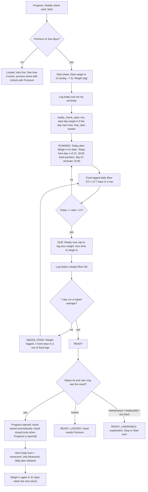
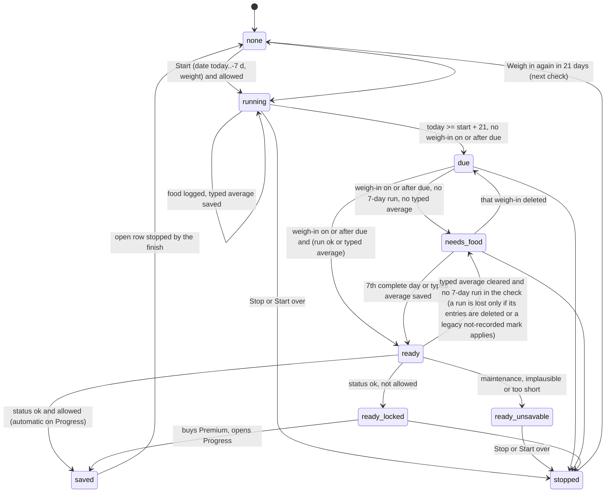
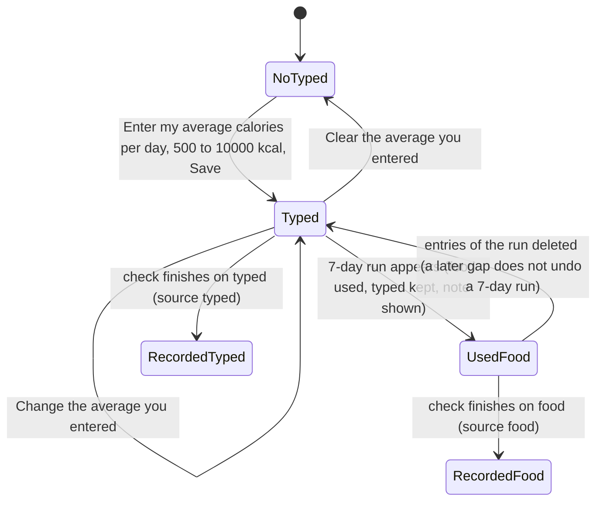
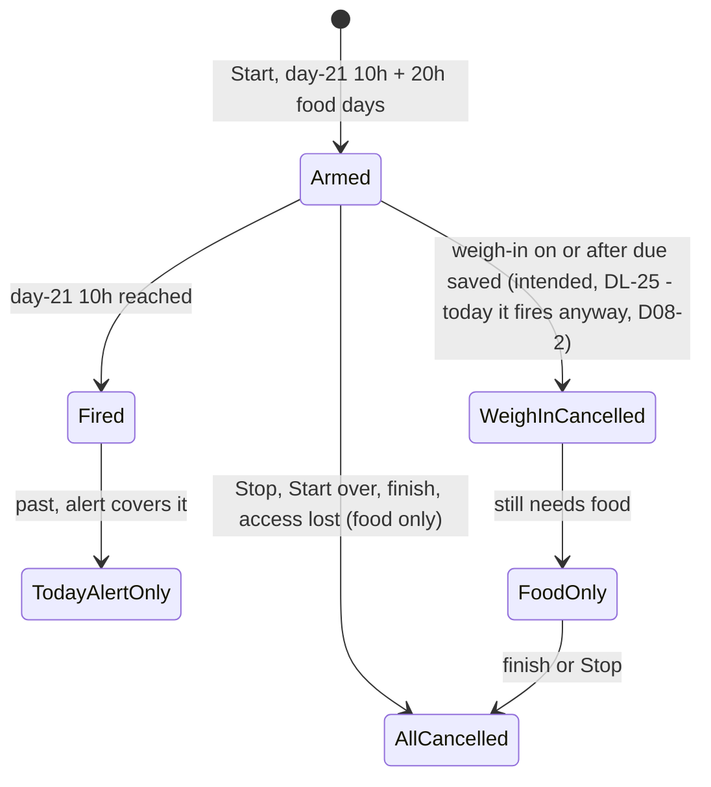

# 08 — Reality check ("Seus números reais"): start → running → due → weighed / needs food → ready → result → next check

> Draft for founder review, written 2026-10-12 from `docs/product/research/04-food-reality-progress.md` (main source: §3.2, §4 R-R1…R-R12, §5.1, §6.1–6.4, §6.7, §8, G-2/G-3/G-8/G-9/G-13), `02-doses-today.md` (§6.9 reality-check alert, A-118), `03-reminders.md` (§3.8–3.9), `docs/decisions.md` (Journey/Progress/Reality check/food log; FL-48 2026-10-08) and `docs/specs/food-log.md` (FL-3, FL-41…FL-48), `progress-one-card.md` (PO-24). Code @ 4dade55.
> Names: EN "Reality check"; PT "Seus números reais"; ES "Tus cifras reales"; FR "Vos vrais chiffres"; DE "Deine echten Zahlen"; IT "I tuoi numeri reali" (founder, decisions.md:87).
> Shows the **intended** behaviour; **Divergence today** notes cite the dossier.

---

## 1. Goal

Measure the user's **real** daily burn (maintenance) from what actually happened: a start weigh-in, a weigh-in on or after day 21, and 7 days in a row of complete food logs (or a typed average). The measured number becomes the hero "Daily burn · Measured" and rebases Lose / Maintain / Gain in "Your daily plan". It is a 3-week habit loop (food log → reality check → your plan), never advice and never linked to a compound.

**One rule for every surface:** Today's alert, the Today and Journey food heroes, Progress, and every reminder follow the check's **real state**, never the date alone. Source: the founder line A-118 (2026-10-09, `docs/review/features.md:258`; not yet in `docs/decisions.md`) covers the **Today alert and the food card line** only; extending it to the Progress status line and the day-21 reminder is product logic (DL-25), not the founder's line.

## 2. Actors

| Actor | Role |
|---|---|
| User | Starts, logs food (flow 07), weighs in (flow 09), types an average (optional), stops or starts over. |
| `checkOutcome` (`lib/realityCheckRules.js`) | The single owner of the state (running / due / needs_food / ready). |
| `readCheckNow` | Assembler used by Today alert + food hero. |
| Progress (`CalculatorSection`) | Start sheet, status, result, Stop / Start over, typed calories. |
| Reminders | Day-21 weigh-in 10:00; 20:00 food question while open (flow 07). |
| Access | Intended: start and see the result = Premium or the 7 free days, not the lapsed-payer grace week (AD-14); weigh-in always allowed. Today the code uses food access `canLog` (`rcFree`), which is also true in grace (D08-6). |
| Sync | `reality_check_open` (Stop wins), `reality_checks`, `calc_snapshots`, `calc_inputs`. |

## 3. Preconditions

- Signed in. To **start**: Premium, or inside the 7 free food-log days (FL-41). To **finish and see the result**: Premium (a free user's free days end around check day 7, so a free user needs Premium for the day-21 result — by design).
- A weight for the start day (typed in the start sheet or an existing weigh-in that day).

## 4. What may already have happened before

| # | Prior state | What the flow must do |
|---|---|---|
| P1 | Weighed in 5 days ago, wants to start from that weigh-in | Start date: today … 7 days back; the start weight prefills from that day's weigh-in (FL-44). |
| P2 | Weighed in on day 18 (too early) | Stored, ignored by the check; at day 21 the state is `due` (weigh in again). |
| P3 | Weighed twice on/after day 21 | The FIRST weigh-in on or after the due date counts. |
| P4 | Logged food only on weekdays | Run broken by the gaps; "n of 7 so far"; or type an average (FL-48). |
| P5 | Free days ended around day 7 | Weigh-in still allowed; result locked until Premium; reminders follow access. |
| P6 | Premium ended mid-check | Grace to the end of the current check week (logging); result needs Premium. |
| P7 | Started on phone A, stopped on phone B | Stop wins on both (server trigger + client rule). |
| P8 | Started offline on two phones | Two open rows; the newest start wins; older stopped on the next Stop. |
| P9 | Finished a check today and wants the next one | "Weigh in again in 21 days" starts the next check; the saved result must not hide it (see D08-4). |
| P10 | Result came out implausible / maintenance / too short | Not saved; Progress explains; Today must not say "ready — tap to see it" as if a number waited (DL-26). What happens next (save maintenance, close the check) is pending OPEN-09 (Portuguese question 14). |
| P11 | Typed an average and later completed 7 days | Food run used; typed value kept with a note. |
| P12 | Day 21 passed weeks ago without a weigh-in | Check stays open: "Time to weigh in"; 20:00 continues while the user can still log (FL-42) — a free user after the free days gets none. |

## 5. Happy path

## 6. States and transitions

### 6.1 Check state (owner `checkOutcome`)

| State | Exact condition |
|---|---|
| none | no open check |
| running | open, no weigh-in dated ≥ due, today < due (due = start + 21) |
| due | open, no weigh-in ≥ due, today ≥ due (stays open indefinitely) |
| needs_food | a weigh-in ≥ due exists, no 7-day run, no valid typed average for this start |
| ready | a weigh-in ≥ due exists and (7-day run or typed average); sub-status ok / maintenance / implausible / too_short |
| ready_locked | ready + ok, but the user may not see results: not Premium and outside the 7 free days (grace included — AD-14; today the grace week still sees the result, D08-6) |
| ready_unsavable | ready with status ≠ ok |
| saved | a `reality_checks` row written and the open row stopped (→ none, result shown) |
| stopped | open row has `stopped_at` (Stop: results deleted today — see G-8; Start over: results kept) |

### 6.2 Typed average (FL-48)

### 6.3 Reminders of a check

The day-21 weigh-in reminder has no switch of its own: "Check-in reminders" does not gate it (`syncRealityCheckReminder`, `lib/notifications.js:609-640`, reads no switch); only Silent mode or the end of the check stops it. The 20:00 food question has its one switch "Food-log reminder" (AD-73). (Flow 06 lacks this line — DV-218.)

## 7. Alternative and exception paths

### 7.1 Start
- Start sheet (title "Reality check" + the card's intro line `cal_rc_sub`): "Start weigh-in on" ‹ date › (today … 7 days back, never future; "Today, or a weigh-in from the last 7 days — not further back."), field "Weight (kg)" / "Peso (kg)" (lb in imperial; `cal_snap_weight` + unit — the key `cal_rc_start_weight` "Weight today" is unused), prefilled from that day's weigh-in, never over a typed value; button "Log today & set my reminder"; hint "We'll remind you in 21 days to weigh in again and finish your reality check."
- Writes: `free_start` marker (the real tap day — backdating never shortens the free days), a start-day weigh-in only if that day had none, `reality_check_open` (+ mirror `calc_reality_open`).
- **OPEN-07 (04 D-8, G-9; conflict #25):** the ledger Q-A says the check has no weight fields of its own (uses the latest weigh-in); the code has a start weight; if the user overrides a prefilled weigh-in the check and the weigh-ins table disagree (CONFIRMED by reading: `startRealityCheck` writes the weigh-in only when the day has none). Founder line needed (OPEN-07).
- Free explainer first for a free user (Q11 = A, decisions.md:234): the locked card shows the intro line, "See how it works" / "Ver como funciona" → preview sheet "What your body actually burns" with "Unlock with Premium" / "Desbloquear com Premium" (`CalculatorSection.js:1464-1476`, `:1870`).

### 7.2 Running
- Progress card: "In progress · weigh in {date}" + "{n} of 7 so far" / run working + typed-average link (Premium, see 7.6) + Stop / Start over.
- Today: alert "Reality-check weigh-in" · "Weigh in on {date}" (snoozable Tomorrow / In 3 days; no Remove); food hero "Reality check · day {n} of 21 · {n} of 7 days in a row" (PT "Seus números reais · dia {n} de 21 · {n} de 7 seguidos").

### 7.3 Due
- Today alert body "Ready now — tap to log your weight"; hero "Reality check · time to weigh in · {n} of 7 days in a row" (PT "Seus números reais · hora de se pesar · {n} de 7 seguidos"; with a run of 7 the tail is "intake ready ({d} days)" / "{d} dias completos" — the hero always appends the run, `FoodLogHero.js:72-73`); day-21 notification at 10:00 on start + 21 (the day the hero flips to "time to weigh in") "Time to log your weight and finish your reality check." (not scheduled when already past; no switch of its own, see §6.3).
- Progress: "Time to weigh in — log today's weight to finish your reality check."
- **Divergence today (04 D-6, minor):** the flip time differs by surface (rules 00:00, Today fallback 12:00, notification 10:00).

### 7.4 Weighed in, needs food
- Today alert "Weight logged — {n} more days in a row of food logs for your result" (singular "1 more day…"); hero "Reality check · weight logged · {n} of 7 days in a row" (PT "Seus números reais · peso registrado · {n} de 7 seguidos").
- **Intended (DL-25, logic; the founder may override — it extends A-118, the founder's bug report about the Today alert and the food card only, features.md:258):** Progress says the same ("Weight logged — {n} more days…") and the day-21 weigh-in reminder is cancelled once the weigh-in exists.
  - **Divergence today (04 D-1):** Progress's status line ignores the weigh-in: "In progress · weigh in {date}" — today's date on the due day, a past date from due + 1 (also in the locked branch).
  - **Divergence today (04 D-2):** the day-21 notification still fires at 10:00 after an earlier weigh-in that day ("Time to log your weight…").

### 7.5 Ready → result
- Finish is automatic **only when Progress is opened** (a `useEffect` in `CalculatorSection`, which only Progress mounts — Today and Journey can say "ready" for days and nothing is saved until then) and only for a user who may see results, when ready + ok + allowed + no result dated ≥ start. The self-finishing check itself is as built and not yet confirmed by the founder (OPEN-07). It writes `reality_checks` (entry_date = the weigh-in date, tdee, rate), the source (`rcResultSources[date] = food / typed`), stops the open row, cancels reminders.
- Result as built (`CalculatorSection.js:1517-1542`): "Your actual maintenance looks like about {kcal} kcal/day." (`cal_rc_result_prefix` + number), the source line ("From your food log" / "From the average calories you entered"), "Your checks over time" (one row per result: date, rate per week, kcal), "Weigh in again in 21 days", and the "Stop reality check" link; hero chip Measured; daily plan rebased via `goalsForTdee` (floor = max(BMR, 1200 F / 1500 M)).
  - **Divergence today (04 verification §5, N-7):** the per-week sentence ("That's about {x} lost / gained per week", `cal_rc_rate_*`) and the comparison with the generic estimate plus the "why" list (`cal_rc_why_*`) are not rendered by any screen (strings unused). No founder line approves them, so they are dead copy to delete (DV-181); the per-week rate does show on each row of "Your checks over time".
- Today alert while waiting: "Your reality check is ready — tap to see it".
- **Intended (DL-26, logic — Today never promises what Progress won't show):** locked → Today says the result needs Premium; unsavable → Today says the check needs attention on Progress. The new texts are new UI, picture first ×6 (**OPEN-24 item 7**, Portuguese question 2); what then happens to an unsavable check is **OPEN-09** (Portuguese question 14).
  - **Divergence today (04 D-3):** Today says "ready — tap to see it" for locked and unsavable results; the alert stays until Stop / Start over.
- Math: `tdee = avgKcal + (startKg − weighInKg) × 7700 / days`; maintenance (|Δ| < 0.2 kg, tested first), too_short (< 14 days or avg ≤ 0), implausible (outside 1000–5000), else ok. Only ok is saved. The "< 14 days" branch cannot happen: the result weigh-in is always on or after day 21, so only an average of 0 reaches too_short.
- **Divergence today (04 §8.11):** an all-"I ate nothing" run (avg 0) reports "too short" — misleading copy (with |Δ| < 0.2 kg it reports maintenance instead). The `cal_rc_too_short` copy ("Use weigh-ins at least 14 days apart…") names a cause that cannot occur (N-3).
- **Divergence today (N-2, DV-205):** `cal_rc_implausible` says "implausibly low … log intake more carefully" for every implausible result, including a burn above 5,000 kcal. A plain bug; the two messages (too low / too high) and the nothing-eaten message (DV-150) are wording to approve (Approvals still owed, item 2.11).

### 7.6 Typed calories (FL-48)
- Link "Enter my average calories per day" / "Informar minha média de calorias por dia" → sheet "Your average calories" · "Average calories per day" · hint "Your own average for the days of this check. When your food log has 7 days in a row, the food log is used and this number is kept." · Save; later "Change the average you entered" / "Clear the average you entered"; line "Your average: {kcal} kcal/day"; with both: "Using your food log. Your average of {kcal} kcal/day is kept."
- **Intended (AD-15, founder 2026-10-08 FL-48 "A", decisions.md:636):** the link is **Premium-only** (free users see it once they subscribe).
  - **Divergence today (04 D-14):** shown to Premium OR free days / grace (`rcAllowed`).

### 7.7 Stop and Start over
- **Start over** → "Start over?" / "This clears the start weight of this check and its reminders. Your weigh-ins and logged meals are kept." → open row stopped; saved results kept.
- **Stop** → "Stop reality check?" / "This clears your reality-check numbers and stops the daily food-log reminder. Your logged meals are kept." → open row stopped; **every saved `reality_checks` row tombstoned** (measured history gone; daily burn back to Estimated).
  - **OPEN-08 (04 G-8):** Stop is the one action that destroys measured history; the ledger only says Stop "clears the open check… keeps the logged food". Founder line needed (OPEN-08). Orphan `rcTypedKcal` / `rcResultSources` remain in the payload.
  - **Wider than "stop the current check" (04 verification DV-004, N-1):** the same "Stop reality check" / "Parar a medição" link is shown on the **finished-result screen with no check running** (`CalculatorSection.js:1541`) and in the locked branch when results exist (`:1475`); one confirm there also tombstones every saved result. The confirm copy was never recorded as founder-approved, and PT "Isso apaga seus números reais" reads as the feature name, not as "deletes every earlier result".
- Stop wins across devices (client rule + server trigger `reality_check_open_keep_stop`).

### 7.8 Next check
- After a result: "Weigh in again in 21 days" / "Pesar novamente em {n} dias" opens the start sheet.
- **Intended (a plain bug, DV-060 — no decision needed):** the new check is shown as running from its own start and finishes on its own weigh-in; an earlier saved result never hides it.
  - **Divergence today (04 D-7, G-3, read not run):** when the new start ≤ the last result's date (the normal case: result saved the same day), `checkSaved` is true for the new check → Progress shows the old result branch, the typed link is blocked, auto-finish never runs; meanwhile Today shows the alert and the hero, and 20:00 + day-21 reminders run. Only regex tests pin these lines; `__tests__/journeyProgress.test.js:190-196` pins the buggy `checkSaved` predicate, so the test-first fix turns it red — expected, and it must change in the same fix.

### 7.9 Offline / killed / second device
- All writes local first; the check's open row and results sync. Start offline on two phones → two open rows; newest start wins; the older is stopped at the next Stop.
- **Divergence today (04 D-4; the once-per-mount read is CONFIRMED, the impact on other devices SUSPECTED):** Progress loads `rcStart` once per mount and has no sync listener → a Stop / new check pulled from another device is not reflected while Progress stays mounted (e.g. on the Fold right page); Today re-reads and can disagree.
- **SUSPECTED (04 §7):** a cross-device `calc_inputs` race can overwrite `rcTypedKcal` / `rcResultSources` (last writer wins on the whole payload).
- Two completions on two devices may save two results (different weigh-in dates). SUSPECTED.
- **Divergence today (DV-182; when the fix ships = OPEN-16 (b), Portuguese question 1 (b)):** results cleared by Stop on phone A stay on phone B (the cloud delete is a hard delete the other phone never hears of); and a result edited on one phone never reaches the other while `reality_checks` has no `updated_at` trigger (DV-088; the migration = DL-64, production go in Approvals still owed, item 1).

### 7.10 Timezone / DST / midnight
- Start and due are calendar dates (noon-anchored → DST-safe). Food days are local (flow 07). **Divergence today (04 D-5):** Progress and heroes left open across midnight keep yesterday's state until refocus.

### 7.11 Notification tap
- Day-21 reminder → Progress `focus: 'reality'`, which only scrolls to the check (`CalculatorSection.js:1036-1041`); it does not open the weigh-in sheet (only `focus: 'weighin'` does). On a book page the focus is dropped (`ProgressScreen.js:65`). **Intended (A-116 — waits for these docs, then resumes for 1.3.0, AD-31):** on the unfolded Fold it opens Progress on the right page.
- 20:00 → FoodChat (flow 07).

### 7.12 Fold
- Journey right page = Progress by default (BK-5): the check card, sheets outside the page switch (kept across fold/unfold), drafts kept (BK-14: reality-check weigh-in and intake forms).

### 7.13 Free / grace / Premium
| Who | Start | Log food | Weigh in | Typed average | See / save result |
|---|---|---|---|---|---|
| Premium | yes | yes | yes | yes | yes |
| Free, inside 7 free days | yes | yes | yes | no (intended, AD-15; today yes — D08-5) | no after the free days (always the case at day 21) |
| Free, free days over | no (Go Premium) | no (locked) | yes (never paywalled) | no | no → ready_locked |
| Lapsed payer in grace week | **no new check (intended — AD-14, FL-41 "finish the current week")** | yes until the week ends | yes | no | intended no (AD-14); **today yes (04 D-13)** |
| Lapsed after grace | no | no | yes | no | no |

## 8. What every surface shows

| State | Today alert ("Reality-check weigh-in") | Today food hero | Journey food hero | Progress card | Notifications |
|---|---|---|---|---|---|
| none | — | hidden | today line only | "Reality check" + intro + Start (or, locked: tag "Premium", intro line, "See how it works" → preview sheet with "Unlock with Premium") | none |
| running | "Weigh in on {date}" | "Reality check · day {n} of 21 · {n} of 7 days in a row" | run "{n} of 7 days in a row" | "In progress · weigh in {date}"; run progress; typed link (Premium); Stop / Start over | 20:00 daily; day-21 10:00 armed |
| due | "Ready now — tap to log your weight" | "Reality check · time to weigh in · {n} of 7 days in a row" | run | "Time to weigh in — log today's weight…" (the "Log today's weight" button is the one in the card above, `CalculatorSection.js:1613`; only the locked branch has its own) | day-21 fired; 20:00 continues |
| needs_food | "Weight logged — {n} more days in a row of food logs for your result" | "Reality check · weight logged · {n} of 7 days in a row" | run | intended (DL-25, logic) "Weight logged — {n} more days…"; today "In progress · weigh in {due date}" — today's date on the due day, a past date after (D08-1) | 20:00 continues; day-21 should be cancelled (DL-25; today not, D08-2) |
| ready (ok, allowed) | "Your reality check is ready — tap to see it" | "Reality check · weight logged · intake ready ({d} days)" (or the typed-average case: "· {n} of 7 days in a row") | "intake ready ({d} days)" | result appears on open (auto-finish) | cancelled on finish |
| saved | gone | hidden (no open check) | today line | result: "Your actual maintenance looks like about…", source line, "Your checks over time", hero Measured, "Weigh in again in 21 days", "Stop reality check" link (wipes every result — N-1) | none |
| ready_locked | intended (DL-26; texts = OPEN-24 item 7): "result needs Premium"; today "ready — tap to see it" (D08-3) | "weight logged · …" (locked line if food is locked) | locked hero if food locked | tag "Premium", status lines ("In progress · weigh in {date}", start weight, run / typed line), "See how it works" → preview sheet with "Unlock with Premium", "Stop reality check" (`CalculatorSection.js:1464-1476`) | 20:00 none (access lost) |
| ready_unsavable | intended (DL-26 + OPEN-09): points to Progress; today "ready" (D08-3) | "weight logged · …" | — | "cal_rc_maintenance / implausible / too_short" message | continue until Stop |
| stopped | gone | hidden | today line | Start again | all cancelled |

## 9. Data written at each step

| Step | Table | Write | Synced |
|---|---|---|---|
| Start | `food_logs` | marker `free_start` (if none) | yes |
| Start | `calc_snapshots` | start-day row (only if that day had no weight) | yes |
| Start | `reality_check_open` | start_date, start_weight_kg (same start day → weight updated; a different day stops the old row first) | yes (Stop wins) |
| Start | `user_metadata` | `calc_reality_open` mirror | server |
| Typed average | `calc_inputs` | `payload.rcTypedKcal = {start, kcal}` (merge) | yes (whole-payload last writer) |
| Weigh-in | `calc_snapshots` | weigh-in row (flow 09) | yes |
| Finish | `reality_checks`; `calc_inputs`; `reality_check_open` | result row (entry_date = weigh-in date, tdee, rate_per_week_kg); `payload.rcResultSources[date]`; `stopped_at` | yes (no `updated_at` trigger on `reality_checks` in production — 08 Addendum, DV-088) |
| Start over | `reality_check_open` | `stopped_at` | yes |
| Stop | `reality_check_open`; `reality_checks` | `stopped_at`; every result row tombstoned | yes |
| Reminders | OS notification queue | `reality-check-weigh`, `food-log-{day}` | — |

## 10. Rules (with sources)

R-R1 start today … 7 days back (FL-44). R-R2 due = start + 21 calendar days. R-R3 first weigh-in on/after due. R-R4 intake = most recent ≥ 7-day complete run, else typed 500–10,000 (FL-3, FL-48). R-R5 math and statuses. R-R6 automatic finish on Progress. R-R7 one result per weigh-in date; latest = Measured; goals floored. R-R8 Stop wins across devices. R-R9 start / see result = Premium or free days; weigh-in always (FX-15). R-R10 typed link Premium-only (AD-15, decisions.md:636). R-R11 20:00 while open, no day-21 cut (FL-42). R-R12 day-21 reminder 10:00. A-118: the Today alert and the food card follow the real state (the founder's bug report, features.md:258); the other surfaces follow by logic (DL-25). (`04 §4`.)

## 11. Divergences today (summary)

| ID | Intended | Today | Source | DV |
|---|---|---|---|---|
| D08-1 | Progress status follows "weighed in" (DL-25) | Says "In progress · weigh in {due date}" (a past date from due + 1) | `04 D-1` | DV-056 |
| D08-2 | Day-21 reminder cancelled by the weigh-in (DL-25) | Fires anyway | `04 D-2` | DV-057 |
| D08-3 | Today never says "ready — see it" for locked / unsavable (DL-26; texts = OPEN-24 item 7) | Says it | `04 D-3` | DV-058 |
| D08-4 | Next check never hidden by the last result (plain bug) | Hidden, never finishes | `04 D-7, G-3` | DV-060 |
| D08-5 | Typed average Premium-only (AD-15) | Free days / grace too | `04 D-14`; decisions.md:636 | DV-102 |
| D08-6 | Grace week = finish logging only (AD-14) | Can start a new check and see results | `04 D-13` | DV-101 |
| D08-7 | One assembler; Progress refreshes on sync / midnight (DL-25) | Loads once, no listener | `04 D-4, D-5, G-6`; `08 D5` | DV-059, DV-148 |
| D08-8 | One start weight | Typed vs weigh-in can differ | `04 D-8, G-9` (OPEN-07) | DV-061 |
| D08-9 | Stop keeps or deletes results per founder | Deletes all — also from the result screen with no check running | `04 G-8` (OPEN-08), N-1 | DV-004 |
| D08-10 | All-"ate nothing" run explained correctly (wording = Approvals item 2.11) | "too short" | `04 §8.11` | DV-150 |
| D08-11 | `reality_checks` edits reach other devices (DL-64; production go = Approvals item 1) | No `updated_at` trigger in production | `08 Addendum` | DV-088 |
| D08-12 | One "21" constant | Duplicated in hero | `04 §6.2, G-11` | DV-147 |
| D08-13 | No dead result copy: the unused per-week sentence and comparison / "why" strings are deleted (no founder line approves them) | Strings `cal_rc_rate_*`, `cal_rc_why_*` unused | 04 verification §5, N-7 | DV-181 |
| D08-14 | Unsavable copy matches its cause (wording = Approvals item 2.11; what happens next = OPEN-09) | too_short names "14 days apart" (cannot occur); implausible always says "low" | N-2, N-3 | DV-150, DV-205 |
| D08-15 | Results cleared by Stop leave every device (timing = OPEN-16 (b)) | Stay on the other phone (cloud hard delete) | TRD §3.9 H-1 | DV-182 |

## 12. Founder questions (canonical IDs — `docs/product/OPEN-DECISIONS.md`)

Reconciled 2026-10-12: every question this flow raised has one canonical ID in `OPEN-DECISIONS.md` — **OPEN-xx** waits for the founder (asked in the one Portuguese round there), **AD-xx** is already decided by the ledger or a signed spec, **DL-xx** is decided by product logic (recorded in `docs/decisions.md`; the founder may override). DV-xxx is the defect row in `DIVERGENCES.md`.

Open — waiting for the founder:

- **OPEN-07** — "Seus números reais": confirm the self-finishing check and one start weight (Portuguese question 12; conflict #25). Note for the question: the finish runs only when Progress is opened, and only for users who may see results. The same answer settles A-24 — does saving a check **early** end the 20:00 question? (was DL-51): with options A or C there is no early save and A-24 closes; with B (day-14 result buttons) it reopens. D08-8 → DV-061; A-24 → DV-144.
- **OPEN-08** — Should Stop erase earlier results (Portuguese question 13). D08-9 → DV-004.
- **OPEN-09** — A check whose math gives no number (Portuguese question 14). D08-3, D08-10, D08-14 → DV-104, DV-058, DV-150, DV-205.
- **OPEN-24 item 7** — What the Today alert says for a locked or no-number result, picture first ×6 (Portuguese question 2; the principle is DL-26). D08-3 → DV-058.
- **OPEN-24 item 3** — Each "days" count on Progress labelled by what it counts (Portuguese question 2; DL-30). Flow 07 D07-5 → DV-146.
- **OPEN-18 (2)** — The "not recorded" mark that FL-3 (and R-R4) still counts as breaking the run (Portuguese question 23 (b)). Flow 07 D07-7 → DV-151.
- **OPEN-18 (9)** — The whole-check (and week) food totals (Portuguese question 23 (e)). Flow 07 D07-12 → DV-232.
- **OPEN-22 (a)** — Does the measured daily burn show on the Progress hero and the Journey tile when height, age or sex is missing (Portuguese question 15 (a)). Flow 09 D09-9 → DV-149.
- **OPEN-16 (b)** — When the sync hardening ships (Portuguese question 1 (b)). D08-15 → DV-182.

Decided — what this flow relies on (moved or added in round 2):

- **DL-25** (absorbs AD-12) — one assembler; every surface follows the check's real state (A-118 covers the Today alert and the food card; the rest is logic). D08-1, D08-2, D08-7.
- **DL-26** — Today says what Progress will show; the new texts = OPEN-24 item 7. D08-3.
- **AD-14** — no result in the grace week; the day-21 result needs Premium. D08-6, §6.1 ready_locked.
- **AD-15** — the typed-average link is Premium-only. D08-5.
- **AD-73** (new) — one off switch for the 8 PM question, no backoff (§6.3).
- **DL-64** — the `updated_at` trigger on `reality_checks`; production go = Approvals still owed, item 1. D08-11 → DV-088.
- Wording to approve: the nothing-eaten and high / low implausible messages (Approvals still owed, item 2.11; DV-150, DV-205).

## 13. Acceptance checks (agent-device QA script)

Account Test03; Premium via temporary RevenueCat promo where stated. Clock moves via simulator/emulator date. Light and dark; PT via Settings → Preferências → Idioma (card title then reads "Seus números reais").

**F08-01 — Start (Premium)**
- Do: Journey → Progress tile → Reality check card → Start.
- Expect sheet: "Start weigh-in on" / "Pesagem inicial em" with today, ‹ › limited to 7 days back; "Weight (kg)" / "Peso (kg)"; button "Log today & set my reminder" / "Registrar hoje e criar lembrete"; hint "We'll remind you in 21 days…".
- Save → card "In progress · weigh in {date+21}" / "Em andamento · pese-se em {date}"; Today alert "Reality-check weigh-in" / "Pesagem para seus números reais" + "Weigh in on {date}" / "Pese-se em {date}"; Today food hero "Reality check · day 1 of 21 · 0 of 7 days in a row" / "Seus números reais · dia 1 de 21 · 0 de 7 seguidos".
- OS queue: `reality-check-weigh` at 10:00 on start + 21 (the day after the hero's "day 21 of 21", `notifications.js:621-623`); `food-log-{day}` at 20:00 for the next 7 days.

**F08-02 — Start date limit**
- Expect the ‹ arrow stops at 7 days back; no future dates.

**F08-03 — Prefill from a weigh-in**
- Setup: weigh-in 3 days ago 86.0 kg.
- Do: move the start date to that day.
- Expect "Weight (kg)" / "Peso (kg)" prefilled 86 (86 in PT — no forced decimal, `CalculatorSection.js:876-877`); a weigh-in of 85.4 prefills "85.4" / "85,4".

**F08-04 — Free user start inside free days**
- Setup: free account, food log never used.
- Expect: Start allowed; first use writes free_start = today; the "Enter my average calories per day" link is hidden (intended). **Today: shown** — record D08-5.

**F08-05 — Run progress**
- Do: log food 3 days in a row, close each day (flow 07).
- Expect: Progress "The reality check needs 7 days in a row of full food logs — 3 of 7 so far."; Today hero "… · 3 of 7 days in a row" / "… · 3 de 7 seguidos".

**F08-06 — Due**
- Do: clock to start + 21.
- Expect: Today alert body "Ready now — tap to log your weight" / "Chegou a hora — toque para registrar seu peso"; hero "Reality check · time to weigh in · {n} of 7 days in a row" / "Seus números reais · hora de se pesar · {n} de 7 seguidos"; 10:00 notification "Reality-check weigh-in" + "Time to log your weight and finish your reality check."; Progress "Time to weigh in — log today's weight to finish your reality check."; tap the alert → Progress.

**F08-07 — Weighed in, needs food**
- Setup: run of 4 days.
- Do: Log today's weight.
- Expect: Today alert "Weight logged — 3 more days in a row of food logs for your result" / "Peso registrado — faltam 3 dias seguidos de comida para o resultado"; hero "Reality check · weight logged · 4 of 7 days in a row" / "Seus números reais · peso registrado · 4 de 7 seguidos".
- Intended (DL-25, logic; the founder may override): Progress shows the same state. **Today:** "In progress · weigh in {due date}" (on the due day that date is today; from due + 1 it is a past date) — record D08-1.
- Weigh in before 10:00 on day 21: intended no 10:00 notification. **Today: it fires** — record D08-2.

**F08-08 — Typed average finishes the check (Premium)**
- Do: link "Enter my average calories per day" → 2400 → Save.
- Setup: Premium, weighed in on or after the due date, no 7-day run (needs_food).
- Expect: saving makes the check ready and, with Progress open, the auto-finish runs at once — the "Your average: 2,400 kcal/day" line disappears with the open check. Expect the result "Your actual maintenance looks like about …" with "From the average calories you entered" / "Com base na média de calorias que você informou"; hero chip "Measured" / "Medido"; daily plan rebased; Today alert gone; reminders cancelled. (Before the weigh-in, the same save shows "Your average: 2,400 kcal/day", PT "2.400".)

**F08-09 — Food run wins over typed**
- Setup: typed 2400 and a complete 7-day run.
- Expect: "Using your food log. Your average of 2,400 kcal/day is kept."; result source "From your food log".

**F08-10 — Typed range**
- Do: type 300 → refused (500–10,000); 12000 → refused.

**F08-11 — Locked result**
- Setup: free account at day 21 with a run and a weigh-in.
- Expect Progress: header tag "Premium"; the status lines ("In progress · weigh in {date}" / "Em andamento · pese-se em {date}", start weight, run or typed line); "Log today's weight"; "See how it works" / "Ver como funciona" → preview sheet "What your body actually burns" / "O que o seu corpo realmente gasta" with "Unlock with Premium" / "Desbloquear com Premium"; "Stop reality check". (`cal_rc_locked_intro` "Generic calculators…" is rendered nowhere.) Intended Today (DL-26; the text = OPEN-24 item 7, not approved ×6; OPEN-09 for no-number results): says the result needs Premium. **Today:** "Your reality check is ready — tap to see it" — record D08-3.
- Buy Premium (promo) → open Progress → result saved.

**F08-12 — Unsavable result**
- Setup: weight change < 0.2 kg.
- Expect Progress: "Your weight barely changed — that's essentially maintenance, too small a change to compute a reliable burn."; check stays open; Stop / Start over available. Today: record what it says (D08-3).

**F08-13 — Start over**
- Expect sheet "Start over?" / "Começar de novo?" + "This clears the start weight of this check and its reminders. Your weigh-ins and logged meals are kept." → open check gone, saved results still listed, reminders cancelled.

**F08-14 — Stop**
- Expect sheet "Stop reality check?" / "Parar de medir seus números reais?" + "This clears your reality-check numbers and stops the daily food-log reminder. Your logged meals are kept." → Stop / "Parar". After: Today alert and hero gone; 20:00 and day-21 cancelled; hero chip back to "Estimated" (today all results deleted — D08-9 record).
- Also: with a saved result and no check running, the result screen still shows "Stop reality check" / "Parar a medição"; confirming deletes every saved result there too — record under D08-9 (N-1).

**F08-15 — Stop wins across devices**
- Do: phone A Stop; phone B (offline, still running) goes online.
- Expect B: no open check after the pull; Today alert gone after focus. Progress left open on B (Fold right page): record whether it updates (D08-7).

**F08-16 — Next check not hidden**
- Setup: the last saved result's weigh-in is dated today (or start the new check on or before that date — `checkSaved` hides the new check only when that weigh-in date ≥ the new start, `CalculatorSection.js:853`).
- Do: after a saved result, tap "Weigh in again in 21 days" / "Pesar novamente em 21 dias" and start today.
- Expect (intended): card "In progress · weigh in {today+21}". **Today:** the old result branch — record D08-4.

**F08-17 — Grace week**
- Setup: Premium ended 2 days ago inside an open check's week 2.
- Expect: logging allowed until the end of week 2 with the grace note; Start of a new check refused (intended, AD-14) — record D08-6.
- Note: in grace the open check keeps `rcFree` true (read once per Progress mount, `CalculatorSection.js:219`), but after Stop or Start over the food access drops grace (grace needs an open check, `foodThread.js:259`). A "new check in grace" therefore shows only through that stale value in the same Progress mount, or the D08-4 path; "see the result in grace" is real when Premium ends on or after the due date.

**F08-18 — Notification tap focus**
- Do: tap the day-21 notification.
- Expect: Progress opens and scrolls to the reality check; no weigh-in sheet opens (only the weekly check-in's `focus: 'weighin'` opens it). On the unfolded Fold: record (focus dropped on book page; A-116 waiting).

**F08-19 — Both themes**
- Start sheet, typed sheet, Stop / Start over sheets, result block, locked explainer, Today alert, hero lines: readable in light and dark; the balance-scale icon visible in both.
