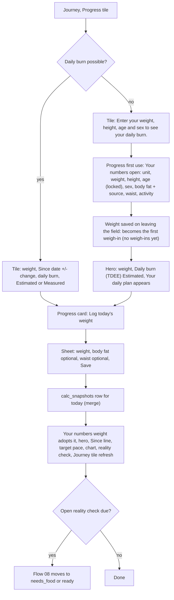
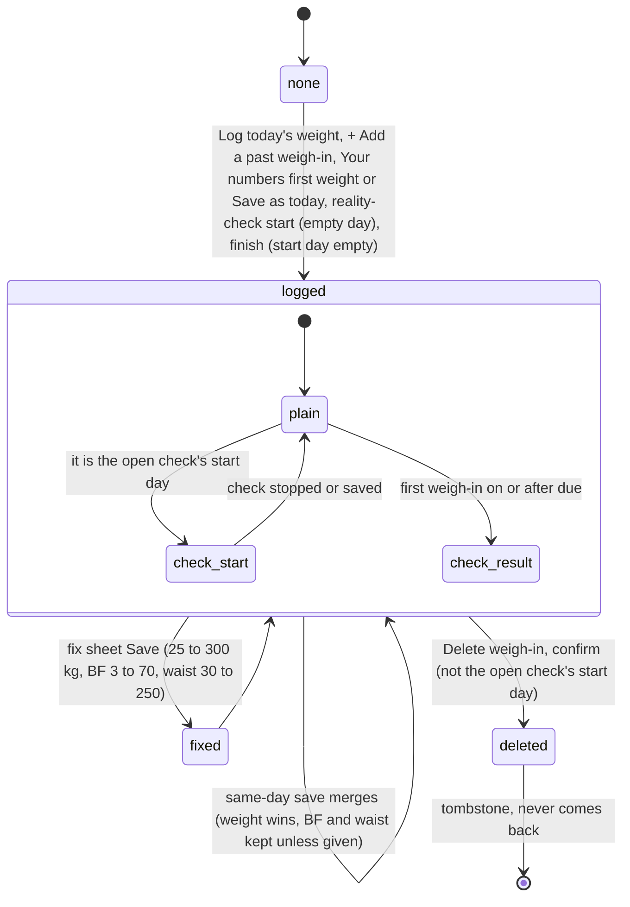
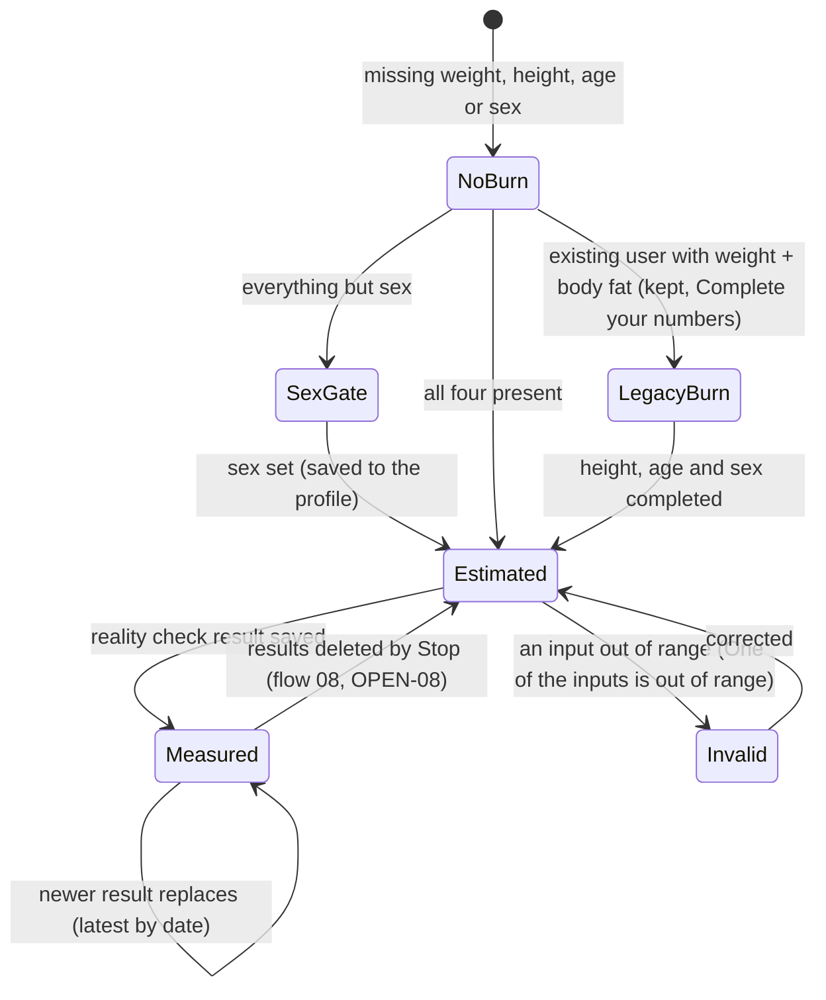
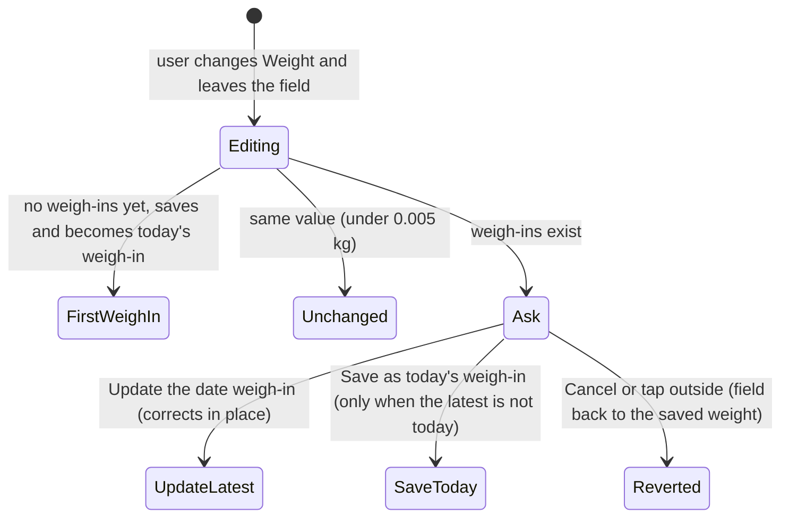

# 09 — Weigh-in and "Your numbers" (Progress one card, daily burn, target)

> Draft for founder review, written 2026-10-12 from `docs/product/research/04-food-reality-progress.md` (§3.3, §4 R-P1…R-P8, §5.4, §6.4–6.6, §8, G-5/G-7), `05-curve-journey.md` (§4.11 R53, D8), `08-platform.md` (§8.2 D1), `docs/decisions.md` (Journey/Progress — 2026-09-27…2026-10-02; A-53, A-54) and `docs/specs/progress-one-card.md` (PO-1…PO-26), `fixes-1.2.5.md` (FX-10, FX-15). Code @ 4dade55.
> Shows the **intended** behaviour; **Divergence today** notes cite the dossier.

---

## 1. Goal

"Enter once, used everywhere" (A-54): the user's latest weigh-in is their current weight on every surface; sex and age come from the profile; one activity scale. From weight + height + age + sex the app shows an estimated daily burn (option A, 2026-10-02) — measured once a reality check finishes (flow 08) — and a pure-math target ETA. Weigh-ins are never paywalled and never lost.

## 2. Actors

| Actor | Role |
|---|---|
| User | Logs today's weight, adds past weigh-ins, fixes or deletes one, edits Your numbers, sets a target. |
| Progress one card (`CalculatorSection`) | Hero (weight, daily burn + chip), Your target, Log today's weight, Weigh-ins fold, Your numbers fold; then Your daily plan; then the reality check. |
| `numbersWeight` | Owner of "the weight used in the math" (A-101e). |
| `energyCalc` | Owner of BMR / TDEE / goals (Katch-McArdle with body fat, else Mifflin). |
| Journey Progress tile (`progressTile`) | Weight, "Since …", daily burn (Estimated / Measured) or the prompt. |
| Profile (`user_metadata`) | sex (`gender`), birth year (age), activity (5-level). |
| Weekly check-in notification | Sunday 10:00 "Weekly check-in". |

## 3. Preconditions

- Signed in. Weigh-ins: always allowed (free and Premium, any check state).
- Daily burn: weight + height + age + sex (profile sex, never a default "male").

## 4. What may already have happened before

| # | Prior state | What the flow must do |
|---|---|---|
| P1 | First time on Progress (no numbers) | Same card: Weight "—", Daily burn "—", "Fill in your numbers below to see your daily burn.", Your numbers open (no fold), Your target "Set a target", Weigh-ins "None yet"; no daily plan (PO-9). |
| P2 | Existing user with weight + body fat but no height / age / sex | Keeps the old daily burn + "Complete your numbers" (PO-13, `legacyBurn`). |
| P3 | Already weighed today | A second save merges into today's row (weight wins; BF / waist kept unless given) — one row per day (A-53). |
| P4 | Typed a weight in Your numbers before ever weighing in | That weight becomes the first weigh-in on a user save (PO-17), never on open or migration. |
| P5 | Weighed on another phone this morning | After the pull, the newest weigh-in is the current weight (unless a weight was typed later — A-101e). |
| P6 | Started losing weight before installing | "+ Add a past weigh-in" (any past date the wheel offers — up to 10 years back) so the pace shows sooner. |
| P7 | Weigh-in is the start of an open reality check | Can be fixed, not deleted (PO-24); a fix moves the check's start weight. |
| P8 | Mistyped 860 instead of 86.0 | Fix sheet validates 25–300 kg; **other entry points must too** (04 G-7). |
| P9 | Profile has no sex | "Set your sex to continue" gate; no sex-dependent math runs (2026-09-09). |
| P10 | Age locked by the profile's birth year | Age field read-only (PO-11). |
| P11 | Activity set in onboarding (5 levels) or in Progress | The newest stamped side wins (`activity_set_at` vs `activitySetAt`). |
| P12 | A reality check finished | Hero daily burn = Measured; formula shown as an estimate sub-line. |

## 5. Happy path

## 6. States and transitions

### 6.1 A weigh-in day row (relative to the open check)

### 6.2 Daily burn availability

### 6.3 Weight change in Your numbers

## 7. Alternative and exception paths

### 7.1 Which weight is "current" (A-54 / A-101e)
- **Intended:** the latest weigh-in by date is the current weight everywhere (hero, Your numbers, daily burn, Journey tile, target), unless the user typed a weight in Your numbers on that day or later (then that typed weight, which also became a weigh-in through PO-14/PO-17).
- **Divergence today (04 D-10):** after a same-day **fix** or a **delete**, the hero follows the weigh-ins while Your numbers and the daily burn keep the old weight (e.g. fix today 85 → 84: hero 84, burn from 85; delete today's 85: hero falls back, numbers keep 85).
- **Divergence today (04 D-11; 08 D1):** the Journey tile shows the latest weigh-in but computes its daily burn from the saved Your-numbers weight. The two differ only when that saved weight is dated before the newest weigh-in (`weightAt` < newest; e.g. saved 86, newest weigh-in 80 → tile 2780 vs hero 2680); when the saved weight is dated on or after the newest weigh-in they agree.
- **Divergence today (DV-149):** the measured burn is shown only when the formula gate passes (weight + height + age + sex); without it the hero hides a measured number that exists. Not settled by the ledger: decisions.md:240 ("a measured maintenance becomes the hero number once it exists") and PO-12 (about the estimate) conflict here, so AD-45's "already decided" does not hold for the measured number.
- **Divergence today (04 D-12, low):** legacy snapshot rows without a weight: hero uses the typed weight, the tile the previous weigh-in; the "Since" line picks first/last of all rows vs weighed rows.
- **Divergence today (05 D8, SUSPECTED minor):** the tile ignores a check whose tdee is not a number; the hero uses it as is.

### 7.2 Validation
- **Intended (by logic, one rule — PO-21 range):** weight 25–300 kg (55–660 lb), body fat 3–70 %, waist 30–250 cm everywhere a weigh-in is written; comma decimals read per app language; imperial shows lb / in and stores kg / cm.
- **Divergence today (04 G-7, §8.12):** only the fix sheet validates; Log today's weight, + Add a past weigh-in and the reality-check start sheet accept any number (0.8 or 900 kg is saved as a weigh-in); the engine then marks the card invalid.
- Past weigh-in date: ≤ today (future clamped by `clampPast`); the date wheel's year column runs from 10 years back (`lib/wheelPick.js:16`), so today's floor is **10 years back**.

### 7.3 Fix and delete (PO-19…PO-25)
- Weigh-ins table: every row with a chevron + hint "Tap a weigh-in to fix or delete it." → sheet "Weigh-in" (date fixed text; weight, body fat, waist prefilled; note "Changes here update your progress, your target and your reality check."; Save; red "Delete weigh-in").
- Delete → "Delete this weigh-in?" / "{date} · {weight}. Your progress, your target and your reality check update without it. This can't be undone." → every row of that day tombstoned; never comes back by pull or another device's push.
- Open check's start day: no Delete; note "This weigh-in starts your reality check, so it can be fixed but not deleted." (also refused below the UI).
- A newer weigh-in typed on another phone is never dropped because the same day was deleted elsewhere — re-inserted (A-92).

### 7.4 Your numbers form (PO-11)
- Metric / Imperial; Weight; Height; Age (locked while the profile has a birth year); Sex (Male / Female bar, neither preselected; saved to the profile); Body fat (%) optional + source pills (DEXA scan / Gym scan / Calipers / Home scale / I don't know) with error hints; Waist optional with its hint; Activity level (5 levels). Prompt until a burn exists: "Weight, height, age and sex give your daily burn. Body fat and waist make it sharper."
- Summary line when folded: "84.6 kg · 181 cm · 38 yr · Male · 21% BF · Moderate" (only the parts that exist; age unit `cal_yr`: EN "yr", PT "anos").
- Saved through a 0.9 s debounced merge into `calc_inputs` (+ mirror), flushed on fold/unfold (BK-10).

### 7.5 Target
- "Set a target" / Edit → weight and/or body-fat target, optional date; Remove target asks first ("Remove target? This clears your goal. Your weigh-ins and history are kept.").
- ETA needs a weigh-in series spanning ≥ 14 days and a pace ≥ 0.1 / week: "~{weeks} weeks to go · around {when}, if this pace holds"; "Moving away from this target at your current pace — no timeline yet."; "Log two weigh-ins about two weeks apart…"; healthy-range fact line (WHO range wording per decision 2026-10-04).
- Measured ETA is Premium: "Unlock Premium to project a timeline from your measured pace." Setting the target and the bar are free.

### 7.6 Weekly check-in
- Sunday 10:00 "Weekly check-in" / "Log this week's weight and waist — every entry adds to your trend chart." → tap opens Progress "Log today's weight" (`focus: 'weighin'`). Switch "Check-in reminders".
- **Divergence today (03 G27):** a repeating trigger — inexact and dropped under Doze on Android (the file's own warning).
- **Note (decision 2026-08-21 says "the tap opens Body"):** superseded by Journey owning progress (2026-09-10); the code opens Progress. Ledger line stale.

### 7.7 Offline / killed / second device
- All weigh-in writes are local `calc_snapshots` rows (`pending`) — one row per local day by app upsert (no UNIQUE), deduped on read.
- Killed with Your numbers typed but not yet debounced: the in-memory draft is flushed on background (`debouncedSave` flush) — verify on device.
- **SUSPECTED (04 §7):** `calc_inputs` is one row per user, last writer wins on the whole payload → a pending payload on phone B can overwrite A's `rcTypedKcal`, `legacyBurn`, `weightAt`.
- **Divergence today (04 D-4, G-6):** Progress has no sync listener; a weigh-in arriving from another device appears on next focus only.

### 7.8 Timezone / DST / midnight
- Weigh-in rows are keyed by the local day at write time; the date never moves after a zone change. Progress left open across midnight writes a new weigh-in on the **new** day (`saveTodayWeighIn` calls `todayISO()` at save time, `CalculatorSection.js:575`). **Divergence today (04 D-5, DV-148):** only the displays are stale (no midnight tick on Progress) until refocus.

### 7.9 Fold
- Journey right page = Progress by default; a weigh-in on the right page updates the Journey tiles on the left at once (BK-19, `data_changed 'calc'`); sheets stay open across fold/unfold with typed values (BK-10/BK-14).

### 7.10 Free vs Premium
- Free: weigh-ins, chart, Your numbers, estimated daily burn, daily plan, target + bar. Premium: measured ETA, reality-check results (flow 08).

## 8. What every surface shows

| State | Progress card | Journey tile | Reality check (flow 08) | Notifications |
|---|---|---|---|---|
| First use | "—" weight and burn (ink3), "Fill in your numbers below to see your daily burn.", Your numbers open, "Set a target", "None yet" | "Enter your weight, height, age and sex to see your daily burn." | unaffected | check-in Sunday 10:00 |
| Weight only | weight shown, burn "—" | prompt | — | — |
| Burn estimated | hero weight + "Daily burn (TDEE)" + chip "Estimated"; formula line "Mifflin-St Jeor" or "Katch-McArdle · lean mass" + BMR; daily plan Lose / Maintain / Gain | weight · burn rounded to 10 · "Estimated" | — | — |
| Legacy burn | burn kept + "Complete your numbers" | same rule | — | — |
| Sex missing | "Set your sex to continue" gate + "Set sex at birth" | prompt | — | — |
| 2+ weigh-ins (on 2+ different days) | "Since {first date}: Weight ±Δ" (+ " · Waist ±Δ" when both ends have a waist); Weigh-ins "{n} · last {date} · {w}"; trend chart | "Since {date}: ±Δ" | — | — |
| Measured | chip "Measured"; "Measured from your reality check · estimate N" | "Measured" | saved | — |
| Input out of range | "One of the inputs is out of range — check the values below." | — | — | — |
| Target set | "Your target" block with ETA / reached / moving away / locked line | — | — | — |

## 9. Data written at each step

| Step | Table | Write | Synced |
|---|---|---|---|
| Log today's weight | `calc_snapshots` today: weight_kg, body_fat_pct, waist_cm merged (never null over a stored value) | yes |
| | `calc_inputs.payload` weight, `weightAt = today` (merge) + `user_metadata.calc_inputs` mirror | yes |
| + Add a past weigh-in | `calc_snapshots` that day (merge) | yes |
| Fix | `calc_snapshots` in place (`correctCalcSnapshot`); if open-check start day → `reality_check_open.start_weight_kg` | yes |
| Delete | every live row of that day → tombstone | yes |
| Your numbers (height, BF, BF source, waist, unit, goal) | `calc_inputs.payload` (debounced merge, `oneCard:1`, `legacyBurn`) | yes |
| Sex | `user_metadata.gender` | server |
| Activity | `calc_inputs.payload.activity`, `activitySetAt`; `user_metadata.activity_level`, `activity_scale 5`, `activity_set_at` | both |
| Target | `calc_targets` (one active; start_* captured once) | yes |
| Progress drafts | memory `draftStore` `progress:*` | no |

## 10. Rules (with sources)

R-P1 daily burn needs weight + height + age + profile sex; BF sharpens (option A, PO-12). R-P2 ranges age 10–120, height 100–250, weight 25–300, BF 3–70. R-P3 age and sex from the profile only (S-04). R-P4 newest stamped activity wins. R-P5 A-101e weight adoption. R-P6 weigh-ins never paywalled; one row per local day, merged (A-53, FX-15). R-P7 target ETA ≥ 14-day series and ≥ 0.1 / week; measured ETA Premium. R-P8 weekly check-in Sunday 10:00. PO-14…PO-17 weight change asks first / first weigh-in. PO-19…PO-26 fix / delete. (`04 §4`, progress-one-card.md.)

## 11. Divergences today (summary)

| ID | Intended | Today | Source | DV |
|---|---|---|---|---|
| D09-1 | Current weight = latest weigh-in everywhere after fix / delete | Hero vs numbers / burn differ | `04 D-10`, `G-5` | DV-062 |
| D09-2 | Journey tile burn from the adopted weight | From the saved weight (differs only when that weight is dated before the newest weigh-in) | `04 D-11`, `08 D1` | DV-063 |
| D09-3 | One validation for every weigh-in entry | Only the fix sheet | `04 G-7` | DV-065 |
| D09-4 | Progress refreshes on sync and midnight | Focus only | `04 D-4, D-5, G-6` | DV-059, DV-148 |
| D09-5 | Weekly check-in exact | Repeating trigger | `03 G27` | DV-055 |
| D09-6 | `calc_inputs` merges per field across devices | Whole payload last writer | `04 §7` (SUSPECTED) | DV-010 |
| D09-7 | Tile and hero agree on a non-numeric tdee | Differ | `05 D8` (SUSPECTED) | DV-063 |
| D09-8 | Past weigh-in has a sensible lower date bound | 10 years back (date wheel) — the "no bound" premise of DV-194 is wrong | `04 §3.3`; 04 verification DV-194 | DV-194 |

## 12. Founder questions (canonical IDs — `docs/product/OPEN-DECISIONS.md`)

Reconciled 2026-10-12: every question this flow raised has one canonical ID in `OPEN-DECISIONS.md` — **OPEN-xx** waits for the founder (asked in the one Portuguese round there), **AD-xx** is already decided by the ledger or a signed spec, **DL-xx** is decided by product logic (recorded in `docs/decisions.md`; the founder may override). DV-xxx is the defect row in `DIVERGENCES.md`.

- **DL-73 — Lower date bound for "+ Add a past weigh-in".** Under review — its premise is wrong: the wheel already stops 10 years back (`lib/wheelPick.js:16`), and decisions.md:241 only says past weigh-ins can be backfilled (it sets no limit either way). "Back to the birth year" would widen the range for nearly every adult, not close a hole. Re-decide or drop. → DV-194.
- No OPEN question remains in this flow.

## 13. Acceptance checks (agent-device QA script)

Account Test03. Light and dark; PT via Settings → Preferências → Idioma. Screenshot before each tap.

**F09-01 — First use**
- Setup: account with no numbers and no weigh-ins.
- Do: Journey → tile "Progress" / "Progresso".
- Expect tile: "Enter your weight, height, age and sex to see your daily burn." / "Insira seu peso, altura, idade e sexo para ver seu gasto diário." Progress card: "—" / "—", "Fill in your numbers below to see your daily burn." / "Preencha seus números abaixo para ver seu gasto diário.", Your numbers ("Seus números") open with "Weight, height, age and sex give your daily burn. Body fat and waist make it sharper."; "Set a target" / "Definir meta"; Weigh-ins "None yet" / "Nenhuma por enquanto"; no "Your daily plan".

**F09-02 — First weight becomes the first weigh-in**
- Do: type weight 86 and leave the field.
- Expect: Weigh-ins "1 · last {today} · 86.0 kg"; `calc_snapshots` has one row for today. Reopening Progress creates nothing new.

**F09-03 — Daily burn appears (option A)**
- Do: height 181, sex Male (age locked from profile).
- Expect: hero "Daily burn (TDEE)" / "Gasto diário (TDEE)" number + chip "Estimated" / "Estimado"; formula line; "Your daily plan" / "Seu plano diário" appears; Journey tile shows weight + burn + Estimated.

**F09-04 — Sex gate**
- Setup: profile without sex (test only).
- Expect: "Set your sex to continue" / "Defina seu sexo para continuar" + "Set sex at birth"; no burn.

**F09-05 — Log today's weight**
- Setup: the 86.0 weigh-in from F09-02 must be on an **earlier day** — move the clock forward one day after F09-02 (or add 86.0 for yesterday with "+ Add a past weigh-in"). Two saves on the same day merge into one row (`mergeWeighIn`), and the "Since" line needs weigh-ins on at least 2 days.
- Do: "Log today's weight" / "Registrar o peso de hoje" → 85.4 → Save.
- Expect: note "Saved as today's weigh-in. It updates your progress, your target and your reality check." / "Fica salvo como a pesagem de hoje e atualiza seu progresso, sua meta e seus números reais."; hero 85.4; "Since {first}: Weight −0.6 kg" (Journey tile "Since {first}: −0.6 kg"); Your numbers weight 85.4; burn recomputed; Journey tile 85.4 (on the Fold without switching tabs).

**F09-06 — Same day merges**
- Do: Log today's weight again with only waist 88.
- Expect: still one row today: weight 85.4 kept, waist 88.

**F09-07 — Weight change in Your numbers asks first**
- Setup: latest weigh-in yesterday.
- Do: change Your numbers weight to 85.0.
- Expect sheet "Update your weight" / "Atualizar seu peso" + "Changing your weight works like a weigh-in."; buttons "Update the {yesterday} weigh-in" / "Atualizar a pesagem de {date}", "Save as today's weigh-in" / "Salvar como pesagem de hoje", Cancel. Cancel → field back to the saved weight. With the latest = today only "Update" is offered.

**F09-08 — Fix a weigh-in (intended propagation)**
- Do: Weigh-ins → tap today's row → "Weigh-in" / "Pesagem" sheet → 84.0 → Save.
- Expect: row 84.0; hero 84.0. Intended: Your numbers and the burn use 84.0. **Today:** they keep 85.4 — record D09-1.

**F09-09 — Validation on the fix sheet**
- Do: weight 900 → Save.
- Expect: "Enter a weight between 25 and 300 kg (55–660 lb); body fat 3–70%." / "Digite um peso entre 25 e 300 kg…"; nothing saved.
- Do the same in "Log today's weight": intended same message. **Today: saved** — record D09-3 (then delete the bad row).

**F09-10 — Delete a weigh-in**
- Do: tap a past row → "Delete weigh-in" / "Excluir pesagem" → "Delete this weigh-in?" / "Excluir esta pesagem?" + "{date} · {weight}. Your progress, your target and your reality check update without it. This can't be undone." → Delete.
- Expect: row gone; chart and Since line updated; after a full re-import (sign out/in on a second device) it does not come back.

**F09-11 — Start-day weigh-in cannot be deleted**
- Setup: open reality check started today.
- Expect: today's sheet has no Delete and shows "This weigh-in starts your reality check, so it can be fixed but not deleted."; a fix moves the check's start weight.

**F09-12 — Past weigh-in**
- Do: Weigh-ins → "+ Add a past weigh-in" / "+ Adicionar pesagem anterior" → date 20 days ago → 88.0 → Save weigh-in.
- Expect: Since line from that date; target ETA appears once the series spans ≥ 14 days with a pace ≥ 0.1 / week ("~{weeks} weeks to go · around {when}, if this pace holds").

**F09-13 — Target**
- Do: Set a target 80 kg → Save; then Edit → Remove target → "Remove target?" / "Remover meta?" → Remove.
- Expect: target block inside the card after a separator; removal keeps weigh-ins.

**F09-14 — Measured ETA locked (free)**
- Expect free: "Unlock Premium to project a timeline from your measured pace." / "Assine o Premium para projetar um prazo pelo seu ritmo medido."

**F09-15 — Weekly check-in**
- Do: clock Sunday 10:00.
- Expect: "Weekly check-in" / "Check-in semanal" + "Log this week's weight and waist — every entry adds to your trend chart."; tap → Progress with the Log today's weight sheet.

**F09-16 — Comma decimals (PT)**
- Do: PT → Log today's weight "85,4".
- Expect: stored 85.4; shown "85,4 kg"; Your numbers line "85,4 kg · 181 cm · {age} anos · Homem …".

**F09-17 — Second device**
- Do: phone A logs 84.8 today; phone B opens Journey.
- Expect: B tile 84.8 after the pull; Progress on B after focus shows 84.8. Burn: record tile vs Progress hero. "Log today's weight" also saves the weight with `weightAt` = today, so tile = hero is expected once `calc_inputs` has synced; D09-2 shows only when the saved Your-numbers weight is dated before the newest weigh-in (04 verification S4).

**F09-18 — Both themes**
- Hero, chips, folds, table chevrons, sheets (Log today, Weigh-in fix, Delete, Update your weight, target), chart: readable in light and dark.
