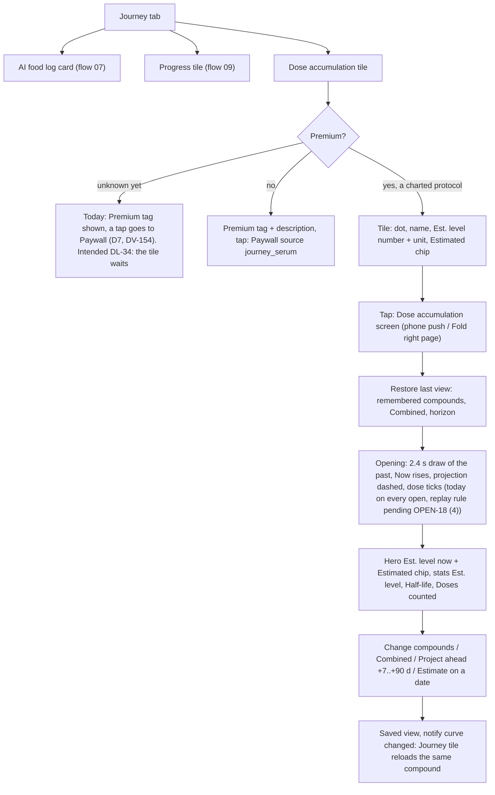
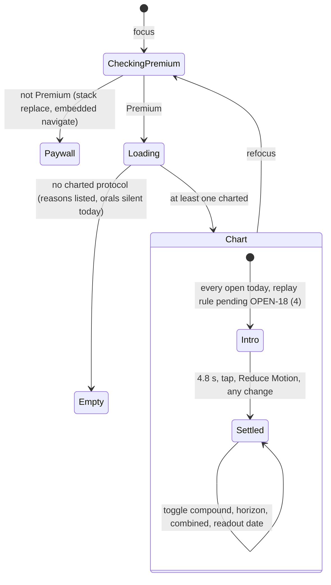
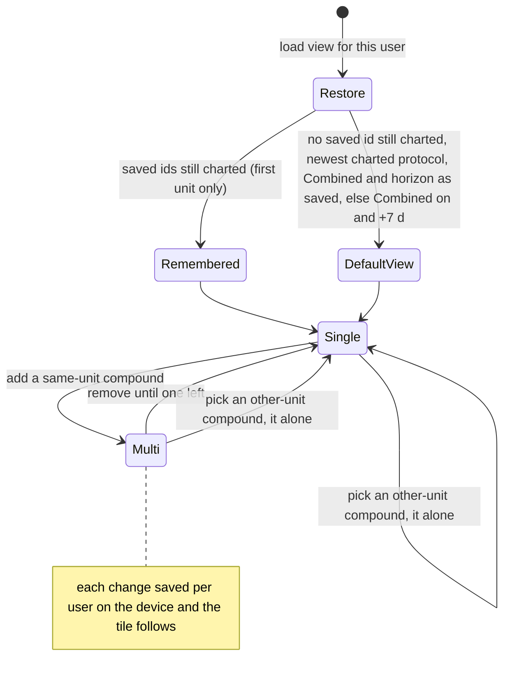
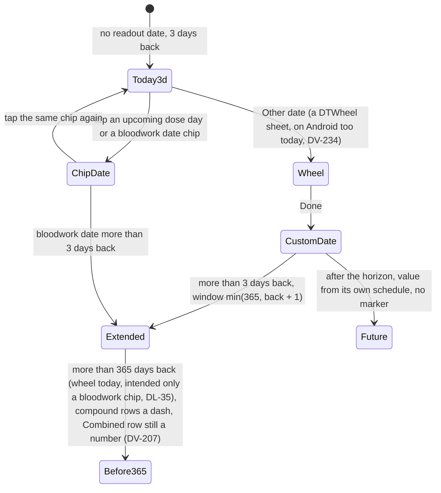
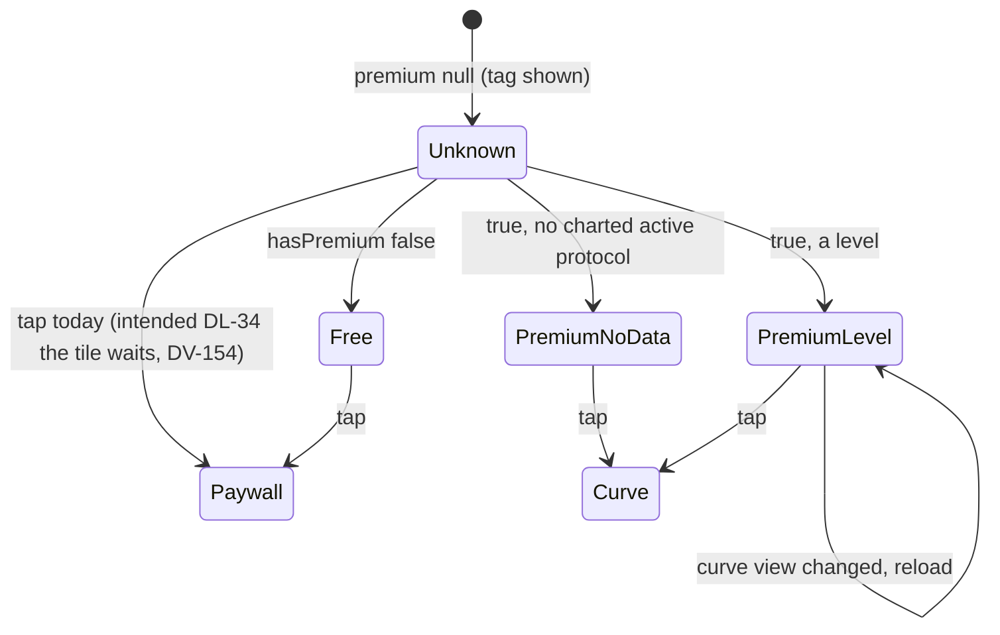

# 10 — Dose accumulation curve and the Journey dashboard

> Draft for founder review, written 2026-10-12 from `docs/product/research/05-curve-journey.md` (main source), `01-protocols.md` (§7.1 history, end/restart), `04-food-reality-progress.md` (food hero, Progress tile), `docs/decisions.md` (Journey dashboard 2026-09-29; Dose accumulation 2026-09-24…2026-10-02; PK model; A-41 last view) and `docs/specs/my-body.md` (MB-4, MB-6), `book-layout.md` (BK-5, BK-6). Code @ 4dade55; curve tests 75 pass (05 §0).
> Shows the **intended** behaviour; **Divergence today** notes cite the dossier.

---

## 1. Goal

**Dose accumulation** is an educational, pure-math estimate of how much of each compound may be present over time, drawn from the protocol's **planned schedule** and **published half-lives** — never a measurement, never advice ("never says 'your level will be'"). It is the flagship Premium feature. **Journey** is the dashboard answering "Is my body responding to what I'm doing, and what do I log today to keep measuring it?": the AI food log card, the Progress tile and the Dose accumulation tile, then "Understand the numbers" / "Sources". The tile, My Body's card and the curve show **the same compound and the same Est. level** (AD-18: decisions.md:209, :261; MB-4).

## 2. Actors

| Actor | Role |
|---|---|
| User (Premium) | Opens the curve, picks compounds, combined total, horizon, a readout date. |
| User (free) | Sees the Premium tag + description; tap → Paywall (Journey) or preview sheet → Paywall (My Body). |
| `serumModel` + `halfLives` + `curveSampling` | Owners of the math: schedule × half-life (Bateman with Tmax for 4 compounds). |
| `curveView` / `curveViewStore` | Remembered view per user, device-local (A-41). |
| `hasPremium` | One entitlement helper. |
| Journey tiles | Progress (`progressTile`) and Dose accumulation (`defaultCurveLevel`). |
| Food card (`FoodLogHero variant journey`) | Today line + 7-day run (flow 07). |

## 3. Preconditions

- Curve: Premium; at least one recon / rtu protocol with a half-life entry, a dose > 0, and a dose unit that converts (mg, mcg, g; IU only for IU-native compounds).
- Journey: signed in; nothing else.

## 4. What may already have happened before

| # | Prior state | What the curve must do |
|---|---|---|
| P1 | Started the compound weeks before installing | Curve estimates from the start date; dashed vertical marker + "Before {date}: estimated from your start date" when the creation day is in the window (A-30 option C, decisions.md:198; the dashed curve approved as built, decisions.md:516); with `history_from` nothing before that day. Look-back before creation: **intended (DL-78)** max(180 days, 5 × t½), no extra note, pharmacometrician check; today the model looks back max(16 days, shown window + 2, 6 × t½) capped at 600 days (`serumModel.js:97-99`), which already includes every dose DL-78 asks for (Testosterone Undecanoate: 540 days ≥ 450) — no divergence. |
| P2 | Ended a protocol last month | Offered "· ended" for 365 days after the end; decays after the end day. |
| P3 | Ended then restarted | Two runs; same-substance runs can form a Combined total; **tile and curve must show the same run** (D1). |
| P4 | Edited the dose mid-cycle | Today one current dose is applied to every past and future dose (history rewritten) — pending **OPEN-10** (Portuguese question 16), DV-005. |
| P5 | Skipped or missed doses | Today still counted (schedule-driven, disclaimer says "planned schedule", AD-19) — pending **OPEN-11** (Portuguese question 17; registry A-31, pharmacometrics review), DV-072. |
| P6 | Oral only | Empty state; orals never named (G6). |
| P7 | Insulin, IGF-1 LR3, Dihexa… (excluded) | Named as "Not charted: … There is no reliable half-life data…". |
| P8 | IU dose of a mass compound | "Not charted: {names}. Edit the dose to mg to chart it (IU for HGH, HCG, HMG and FSH)." |
| P9 | Last opened with only testosterone selected | Reopens exactly so (A-41, founder 2026-10-02); a protocol created later never joins. |
| P10 | Premium lapsed | Curve guard → Paywall; tile Premium tag. |
| P11 | DST change in the last 14 days | Tile and curve must agree (D2). |
| P12 | Signed out and in again on the same phone | Remembered view keyed by local ids → falls back to the newest protocol (05 D10, SUSPECTED; DV-159 — no change: the view is a device-local convenience, AD-33). |

## 5. Happy path

## 6. States and transitions

### 6.1 Curve screen

### 6.2 Selection and remembered view

### 6.3 Window and readout

### 6.4 Journey Dose accumulation tile

## 7. Alternative and exception paths

### 7.1 Math (published, honest)
- Charted only recon / rtu with a half-life entry and a convertible dose; blends split by their common ratio into "Blend · Component (est.)" lines (KLOW 50/10/10/10, GLOW 50/10/10, Wolverine 1/1).
- Doses from the planned schedule (`expectedDosesOn`; AD-19), calendar-day stepping (A-101b, the 25 h fall-back day counted once). **Intended (DL-31):** each dose at the user's own reminder time (fixed hours only for a protocol without times), pharmacometrician check. **Today:** fixed local hours (1/day at 12:00; 2/day 06 and 18; 3/day 06, 12, 18), snapped to a 6 h grid (D10-6).
- Level = Σ dose × f(Δt): exponential, or Bateman with Tmax for Semaglutide, Testosterone Cypionate, Testosterone Undecanoate, Sustanon 250. Look-back max(16 days, days in the shown window + 2, 6 × t½) capped 600 days (`serumModel.js:94-99`; an earlier readout date widens the shown window and so the look-back).
- Units: mg except IU-native (HGH, HCG, HMG, FSH; HGH mg→IU × 3); one unit per chart.
- Sex-neutral: no sex / weight / body-fat input (decisions.md:201, 2026-09-09; never a global sex fudge).
- **Divergence today (05 D6, G9):** doses sit at the fixed hours above, not at the user's reminder times, and nothing on screen says so; a 22:00 dose counts 10 h early in "Est. level · now" (decisive for t½ < 6 h compounds). Intended: DL-31 (doses at the user's own times; pharmacometrician check). → DV-069.
- **Divergence today (05 D5, G5; A-96):** "Doses counted" counts only the visible window while the level uses doses back to 6 half-lives. A-96 is in 1.3.0 (AD-11); its stats and labels are an approved picture still owed (Approvals still owed item 3). → DV-096.
- **Divergence today (05 G8; verification 05 O-2):** copy still says "log doses to see your curve" / "compound amounts you logged" although the model is schedule-driven. Two more live strings say the same in all 6 languages: `paywall_hero_sub` ("Dose-accumulation curves from your own log…", `PaywallScreen.js:278`) and `settings_premium_feat_1` ("Dose accumulation curve from your own log", PT "a partir do seu próprio registro", `SettingsScreen.js:642`) — contradicts AD-19 (planned schedule). The four rewordings ×6 are a wording approval (Approvals still owed item 2.1). → DV-071 (the two Paywall / Settings strings were DV-212, merged into it).
- **Divergence today (05 G6):** orals are dropped before the "not charted" reasons, so they are silently absent although the screen promises compounds are "named on screen, never dropped silently" (AD-20). → DV-155.
- **Divergence today (05 G7):** `substance_boldenone` missing in all 6 languages (a Boldenone Combined total would show the raw key). → DV-070.
- **Pending OPEN-18 (1) (Portuguese question 23 (a); was DL-32) — blend lines (05 G10):** the founder's line decisions.md:205 (2026-09-18 / 2026-09-24) says blend components are dashed "(est.)" lines; the code draws them like any compound (solid past, dashed future) and shows the "(est.)" label. Keep as built or change is his pick, from two pictures (as built | dashed). → DV-156.
- **Pending OPEN-18 (4) (Portuguese question 23 (d)) — the opening draw-in:** Motion "Version B" with the serum-curve draw-in was approved (decisions.md:74); whether it plays on every open or once per session is not decided (Conflict 40, decisions.md:441). Today it plays each time the screen opens (`SerumCurveScreen.js:548-551`, `introPlayedRef` per mount), 4.8 s, skipped by a tap, any change or Reduce Motion. → DV-132.
- **"Estimate on a date" wheel:** intended (DL-35) the wheel goes back 365 days (today 10 years, DV-158); the Combined row follows the same 365-day rule (DV-207). On Android the founder's line keeps the native date dialog for the curve date (decisions.md:48); today "Other date" opens the DTWheel sheet on Android too (`SerumCurveScreen.js:1079-1084`). → DV-234.

### 7.2 Tile = curve (MB-4)
- **Intended (AD-18: decisions.md:209, :261; MB-4):** tile, My Body card and the curve show the same compound and number.
  - **Divergence today (05 D1, script-verified):** the curve offers active + ended protocols, the tile/My Body only active → after End/Restart the curve can open on the ended run (68.53 mg) while the tile shows the new run (10.04 mg). → DV-067.
  - **Divergence today (05 D2, script-verified):** for up to 14 days after a DST change the tile (14-day grid) and the curve (3-day grid) snap doses 1 h apart → BPC-157 0.5 mg daily, New York 2026-11-06 12:30: tile 0.0625 mg vs curve 0.25 mg; 2027-03-19 tile 0.0 mg (at 250 mcg the same moment gives 0.031 vs 0.125). It also runs the other way: at 11:30 the tile shows a dose the curve does not have yet (250 mcg: tile 0.125 vs curve 0.0 mg). Equal again about 14 days after the change (verification 05, D2 table). → DV-068 (both directions; the reverse one was DV-208, merged into it).
  - **Divergence today (05 D3):** on the Fold, My Body's left card does not follow a curve change on its right page until refocus (no 'curve' listener). My Body also never reloads on a sync pull (no `addSyncListener`; verification 05 O-4). → DV-152.
  - **Divergence today (05 D4):** picker rows name blend components without the blend ("BPC-157" vs "Wolverine · BPC-157 (est.)"). Intended: DL-33 (the picker names them as the curve does). → DV-153.
  - **Fallback (05 G11):** the dashboard plan's second fallback "compound of the most recent Taken dose" was not built; decided by logic **DL-36**: the fallback stays the newest protocol (A-41, decisions.md:208, is later and defines the restore) and the design doc is amended (DV-157, a doc fix).

### 7.3 Premium gating
- Curve guard on every focus; tiles ask on focus. Journey `premium` starts unknown and reads as free.
  - **Divergence today (05 D7):** a Premium user who taps before the answer lands on the Paywall ("You already have Premium"). Intended (DL-34): the tile waits (no tag, no navigation) while Premium is unknown. → DV-154.
- Free: Journey tile → Paywall (`journey_serum`, no preview sheet); My Body card → preview sheet "See your compound build up" → Paywall (MB-6); Dose log "Curve" → Paywall (`log_serum`); direct → replace with Paywall (`serum_direct`).
- **Divergence today (05 G12; A-98):** a Journey tile tap fires no analytics event. Intended: DL-91 (an event with its source; A-98 is in 1.3.0 by AD-11). → DV-105.

### 7.4 Offline / killed / second device
- The curve is computed locally from SQLite; works offline; the premium check falls back to the cached entitlement (future expiry = Premium).
- The remembered view is device-local per user and not synced (AD-33: decisions.md:208, :380) → a second phone opens on its own last view.
- **SUSPECTED (05 D10):** after sign-out / sign-in on the same phone the view falls back (local ids change). DV-159 — no change (AD-33: a device-local convenience, not user data).

### 7.5 Timezone / DST / midnight
- All dose times are local wall-clock; travel shifts the whole series. DST: see D2. **Divergence today (05 E19):** a curve left open keeps "now" frozen until something changes; the tile recomputes on focus or curve change. → DV-148 (bug).

### 7.6 Notification tap
- No notification opens the curve.

### 7.7 Fold
- Journey book: left = dashboard; right = Progress by default; the food card opens the chat on the right; the Dose accumulation tile opens the curve on the right for Premium (Paywall full screen for free) (BK-5). Losing Premium while the curve is on the right clears the selection. Folding with the curve open pushes it; unfolding a pushed curve moves it to the right page. Embedded screens never goBack / replace (BK-22).

### 7.8 Free vs Premium (summary)
| Surface | Free | Premium |
|---|---|---|
| Journey tile | "Premium" tag + "See how your doses may add up over time…" | dot, name, "Est. level", number + unit, "Estimated" |
| My Body card | tag + lock, preview sheet | same as Journey (same compound and number) |
| Dose log "Curve" | Paywall | curve |
| Onboarding / Paywall | example curve labelled "Example" | — |

### 7.9 Journey dashboard
- Order (founder 2026-09-29, decisions.md:215, "I like this proposal. Keep this."): header "Journey" + "Track how your body is actually responding."; AI food log card full width; Progress and Dose accumulation tiles side by side (stack at ≥ 130 % text); "Understand the numbers" and "Sources & references" folds.
- Not on Journey: adherence (Today, Dose log, report) and labs (My Body).

## 8. What every surface shows

| State | Curve screen | Journey tile | My Body card | Dose log button |
|---|---|---|---|---|
| Free | Paywall | Premium tag + description | tag + lock, preview sheet | → Paywall |
| Premium, nothing charted | "No compatible protocols" / "Nenhum protocolo compatível" + reasons | chevron + description | description | → curve (empty) |
| Premium, one compound | hero "Est. level · now" 56 pt + "Estimated"; stats Est. level / Half-life / Doses counted; chart solid past, dashed shaded future, dose ticks; disclaimer | name + Est. level | same as tile (intended, AD-18) | → curve |
| Several compounds | hero row per series; legend with tier, level, t½; Combined toggle if same substance | first remembered compound | same | — |
| Ended protocol selected | label "· ended"; decays | not shown (intended AD-18: the same run as the curve; DV-067) | — | — |
| Declared history in window | dashed marker "Before {date}: estimated from your start date" | — | — | — |
| Readout date chosen | dashed marker + date + dots; "Estimate on a date" card with values side by side (never compared to a lab value) | — | — | — |
| Future start | level 0; projection only if inside the horizon; nothing drawn if beyond | 0 | — | — |

## 9. Data written at each step

| Step | Store | Write |
|---|---|---|
| Change compounds / Combined / horizon | AsyncStorage `dosetrace_curve_view_{userId}` `{selectedIds, showCombined, futureDays}` (read → merge → write, never on open) | not synced (AD-33) |
| Readout date | none (never remembered) | — |
| Change | event `notifyDataChanged('curve')` | Journey reloads |
| Analytics | Body / Log `viewed('serum_curve')`; Journey none (G12) | anonymous |
| Nothing else | the curve reads `protocols`, `biomarkers.report_date` (chips); never `dose_logs` | — |

## 10. Rules (with sources)

R1–R6 which protocols are charted (recon/rtu, blends, exclusions, ended ≤ 365 d). R7–R9 units. R10–R16 schedule-driven doses, fixed slots (today; intended the user's own times, DL-31), calendar stepping, look-back (DL-78 before creation), history_from. R17–R25 math, ticks, labels. R26–R30 window (3 days default) and horizon (7 default; 7/14/30/60/90). R31–R36 styling (solid past, dashed projection, ink Combined, estimated marker, readout marker, opening motion with Reduce Motion — its replay rule pending OPEN-18 (4)). R37–R40 remembered view. R41–R43 Premium. R44–R47 disclaimers and honesty. R48–R51 PK hard lines (no interpretation, sex-neutral, insulins excluded, never "your level will be"). R52–R54 Journey tiles. (`05 §4`.)

## 11. Divergences today (summary)

| ID | Intended | Today | Source | DV |
|---|---|---|---|---|
| D10-1 | Tile / My Body / curve same compound after end/restart (AD-18) | Curve may open the ended run | `05 D1, G1` | DV-067 |
| D10-2 | Same number across DST, in both directions (AD-18) | 14 d vs 3 d grid differ (tile behind, or ahead, of the curve) | `05 D2, G2`; verification 05 D2 | DV-068 |
| D10-3 | My Body card follows a curve change on the Fold and a sync pull (AD-18) | Stale until refocus; no sync listener | `05 D3, G3`; verification 05 O-4 | DV-152 |
| D10-4 | Picker names blend components with the blend (DL-33) | Component only | `05 D4, G4` | DV-153 |
| D10-5 | Doses counted = doses in the estimate (A-96, AD-11; picture owed, Approvals item 3) | Window only | `05 D5` (A-96) | DV-096 |
| D10-6 | Doses at the user's reminder times, fixed hours only for a protocol without times; pharmacometrician check (DL-31) | Fixed hours (12:00; 06 / 18 …), not disclosed | `05 D6, G9` | DV-069 |
| D10-7 | Orals named as not charted (AD-20) | Silent | `05 G6` | DV-155 |
| D10-8 | Boldenone substance name ×6 | Missing key | `05 G7` | DV-070 |
| D10-9 | Copy says "planned schedule" everywhere (AD-19; wording ×6 = Approvals item 2.1) | "log doses", "you logged"; Paywall hero and Settings Premium line "from your own log" | `05 G8`; verification 05 O-2 | DV-071 |
| D10-10 | Journey tile tap counted (DL-91) | No event | `05 G12` (A-98) | DV-105 |
| D10-11 | Wheel stops at 365 days back; a date or bloodwork chip beyond shows the same "—" on every row, Combined included (DL-35) | Wheel 10 years back; dash with no reason; the Combined row still prints a computed number | `05 G16`; verification 05 O-3 (`SerumCurveScreen.js:1021` vs `:1031`) | DV-158, DV-207 |
| D10-12 | Journey tile waits while Premium is unknown (DL-34) | Premium tag; a tap goes to the Paywall | `05 D7` | DV-154 |
| D10-13 | "Now" moves with the clock on an open curve | Frozen until something changes | `05 E19` | DV-148 |
| D10-14 | Android curve date uses the native date dialog (decisions.md:48) | DTWheel sheet on Android | verification round 2 R2-03 #24 | DV-234 |
| D10-15 | Pending OPEN-18 (1) (question 23 (a)): blend lines as built or dashed (decisions.md:205) | Drawn like any compound, "(est.)" label | `05 G10` | DV-156 |
| D10-16 | Pending OPEN-18 (4) (question 23 (d)): curve draw-in on every open or once per session | Every open | decisions.md:74, :441 (Conflict 40) | DV-132 |
| D10-17 | Pending OPEN-10 (question 16): a dose edit does not rewrite the past | Current dose applied to every past dose | `05 E4, G13` (F2) | DV-005 |
| D10-18 | Pending OPEN-11 (question 17): skipped / missed doses and the curve | Schedule-driven, they still count | `05 E5, G13` (A-31) | DV-072 |

## 12. Founder questions (canonical IDs — `docs/product/OPEN-DECISIONS.md`)

Reconciled 2026-10-12 (round 2): every question this flow raised has one canonical ID in `OPEN-DECISIONS.md` — **OPEN-xx** waits for the founder (asked in the one Portuguese round there; its question number is given), **AD-xx** is already decided by the ledger or a signed spec, **DL-xx** is decided by product logic (recorded in `docs/decisions.md`; the founder may override). DV-xxx is the defect row in `DIVERGENCES.md`.

Open — waiting for the founder:
- **OPEN-10** — Should a dose change rewrite the past curve? (Portuguese question 16.) D10-17, P4 → DV-005.
- **OPEN-11** — Should skipped and missed doses lower the curve? (Portuguese question 17.) D10-18, P5 → DV-072.
- **OPEN-18 (1)** — Blend component lines: keep as built or dashed "(est.)" (decisions.md:205), from two pictures. (Portuguese question 23 (a); was DL-32.) D10-15 → DV-156.
- **OPEN-18 (4)** — Ring and curve intro animation: the curve draw-in on every open or once per session. (Portuguese question 23 (d); was AD-44.) D10-16 → DV-132.

Decided — what this flow relies on (round-2 final ids):
- **AD-18** — tile, My Body card and curve show the same compound and number (D10-1, D10-2, D10-3).
- **AD-19** — the curve follows the planned schedule and never says "logged" (D10-9); the four strings reworded ×6 are **Approvals still owed item 2.1** (DV-071, which absorbed DV-212).
- **AD-20** — not-charted compounds are named (D10-7).
- **AD-11** — A-96 and A-98 are in 1.3.0; the A-96 curve stats and labels are an approved picture still owed (**Approvals still owed item 3**, D10-5); A-98 → **DL-91** (D10-10).
- **AD-33** — the remembered view is device-local, not synced (P12, DV-159: no change).
- **DL-31** — doses at the user's own reminder times, fixed hours only without times; pharmacometrician check (D10-6).
- **DL-33** — picker names blend components as the curve does (D10-4).
- **DL-34** — the Journey tile waits while Premium is unknown (D10-12).
- **DL-35** — the curve's date wheel goes back 365 days; the Combined row follows the same rule (D10-11; DV-158 and DV-207).
- **DL-36** — the fallback stays the newest protocol; the design doc is amended (DV-157).
- **DL-78** — the estimated curve before creation (A-30 option C) looks back max(180 days, 5 × t½); today's look-back already covers it (P1).
- The Android curve date dialog is the founder's line decisions.md:48 (D10-14, DV-234, a bug).

## 13. Acceptance checks (agent-device QA script)

Account Test03 with a temporary Premium promo; protocols **Testosterone Cypionate** (rtu 100 mg weekly), **BPC-157** (recon daily 250 mcg), **Zinc** (oral). Light and dark; PT via Settings → Preferências → Idioma. Screenshot before every tap.

**F10-01 — Journey order**
- Expect: "Journey" / "Evolução" + "Track how your body is actually responding." / "Acompanhe como seu corpo está realmente respondendo."; AI food log card; tiles "Progress" / "Progresso" and "Dose accumulation" / "Acúmulo de doses" side by side; "Understand the numbers" / "Entenda os números"; "Sources & references" / "Fontes e referências".

**F10-02 — Free tile**
- Setup: no Premium.
- Expect: tile "Premium" tag + "See how your doses may add up over time, from your planned schedule and published half-lives. A math estimate — never a measurement."; tap → Paywall.

**F10-03 — Premium tile = curve number**
- Expect: tile dot + "Testosterone Cypionate" + "Est. level" / "Nível est." + number + "mg" + "Estimated" / "Estimado". Tap → the curve hero "Est. level · now" / "Nível est. · agora" shows the same number (same decimals).

**F10-04 — Opening and honesty**
- Expect: past draws in (today on every open; the replay rule is pending OPEN-18 (4) — record what you see), "Now" / "Agora" line, dashed shaded projection, dose ticks under the axis; axis "−3d · Now · +7d" (PT "−3d · Agora · +7d"); source card with tier "Clinical data" / "Dados clínicos" and the Tmax note; disclaimer at the bottom mentions "your planned schedule". With Reduce Motion: final frame at once.

**F10-05 — Remembered view**
- Do: picker "Choose compounds" / "Escolher compostos" → keep only BPC-157 → Done; horizon +30; leave; reopen.
- Expect: BPC-157 only, +30; Journey tile now shows BPC-157's Est. level.

**F10-06 — Unit rule**
- Setup: an HGH protocol in IU.
- Do: add HGH while Testosterone (mg) is selected.
- Expect: the selection becomes HGH alone (one unit per chart).

**F10-07 — Not charted lines**
- Setup: an IU dose on a mass compound; an Insulin protocol.
- Expect: "Not charted: {names}. Edit the dose to mg to chart it (IU for HGH, HCG, HMG and FSH)." and "Not charted: Insulin… There is no reliable half-life data for these compounds."; Zinc (oral): intended named (AD-20); today silent — record D10-7.

**F10-08 — Combined total**
- Setup: two testosterone esters.
- Expect: toggle "Show combined total" / "Mostrar total combinado"; an ink line "Combined total" / "Total combinado"; hint says it is a rough sum, not active-hormone mass.

**F10-09 — Estimate on a date**
- Do: "Estimate on a date" / "Estimativa em uma data" → a bloodwork chip "{date} · bloodwork" (requires a lab in My Body) → marker on the chart and values side by side; tap again → cleared. "Other date" / "Outra data" → wheel → a date 400 days back → every compound row "—" (today the wheel reaches it; intended DL-35: the wheel stops at today − 365 — record D10-11). On Android the wheel is a DTWheel sheet today; intended the native date dialog (decisions.md:48) — record D10-14.
- Also (Combined, verification 05 O-3): with two testosterone esters and "Show combined total" on, pick a date 400 days back. Expect (intended, DL-35): the Combined row also shows "—". Today it prints a computed number (`SerumCurveScreen.js:1031`) — record (D10-11).

**F10-10 — Declared history marker**
- Setup: Testosterone Cypionate created today with start 42 days ago and "Yes, same dose" (flow 02).
- Do: Estimate on a date → a date 2 days before today (still inside the default 3-day window; the marker already shows without it).
- Expect: dashed marker + "Before {date}: estimated from your start date" ({date} = the creation day, today) / "Antes de {date}: estimado a partir da data de início".

**F10-11 — End and restart (D1 check)**
- Do: End Testosterone (flow 05), Restart (New vial), open the curve.
- Expect (intended, AD-18): curve and tile on the same run. Record today's values for both.

**F10-12 — DST (D2 check)**
- Setup: device zone America/New_York; date 2026-11-06 12:30; BPC-157 daily 250 mcg (the account fixture above).
- Expect (intended, AD-18): tile = curve. Today: tile 0.031 vs curve 0.125 mg (labels "0.0" / "0.1") — record. (With a 0.5 mg fixture: 0.0625 vs 0.25.)
- Also (reverse gap): same zone and date at 11:30. Expect (intended, AD-18): tile = curve. Today: tile 0.125 vs curve 0.0 mg (the tile counts a dose the curve does not have yet) — record.
- Also (end of the gap): 2026-11-15 12:30. Expect: tile = curve = 0.125 mg.

**F10-13 — Premium lost**
- Do: end the promo; open Journey; tap the tile.
- Expect: Paywall; reopening the curve directly replaces it with the Paywall.

**F10-14 — Fold**
- Do (unfolded Fold): Journey → Dose accumulation tile.
- Expect: the curve on the right page, no back row; change selection → the left tile updates at once. My Body → card → curve right; change → intended (AD-18) left card updates (record D10-3). Fold → curve pushed with back; unfold → back on the right page.

**F10-15 — Both themes**
- Chart lines (protocol colours ≥ 3:1), data blue single line, well-coloured future zone, ticks, chips, picker sheet, date wheel, Paywall entry: readable in light and dark.
