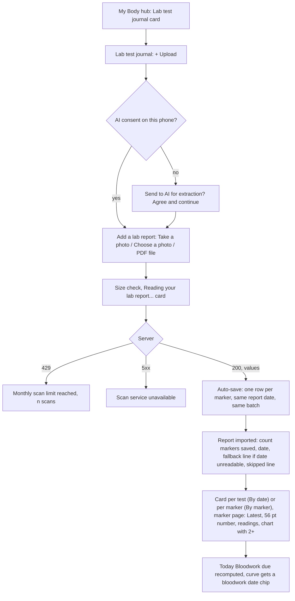
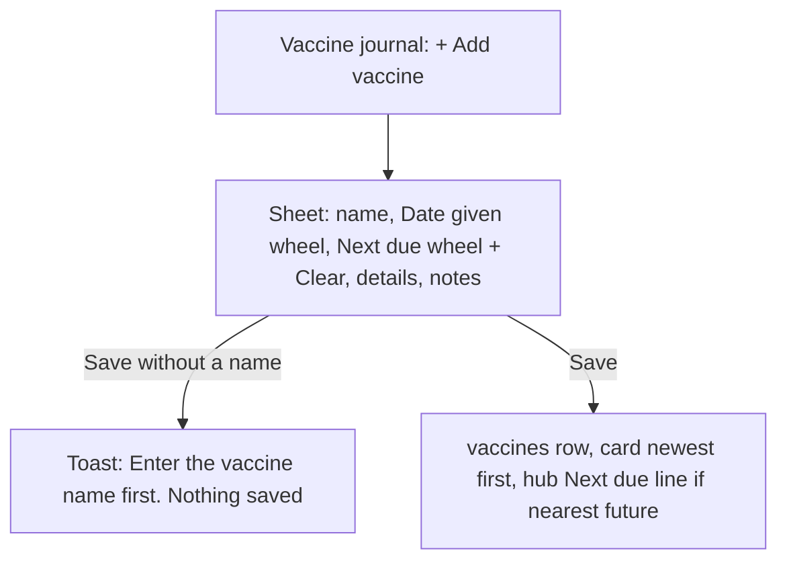
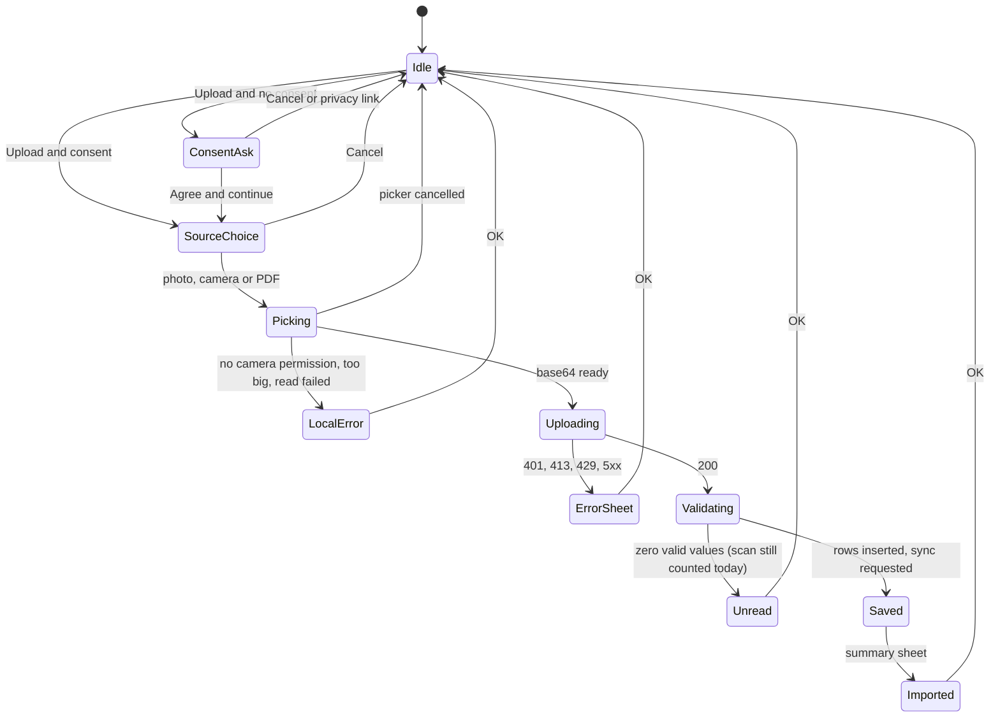
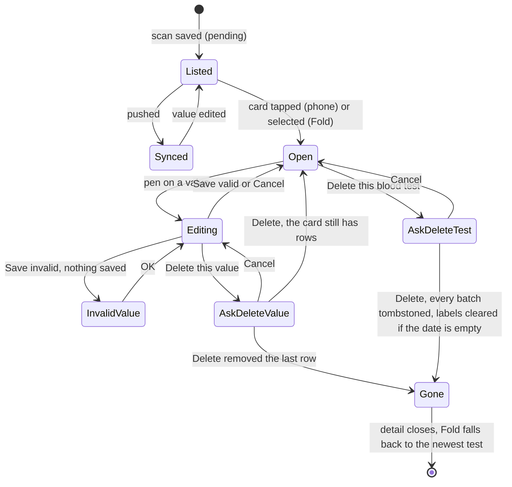
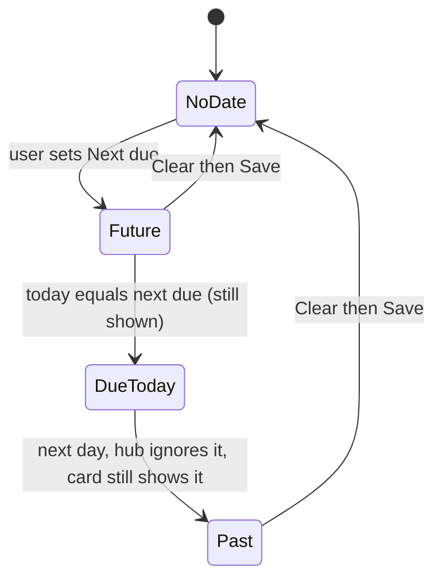
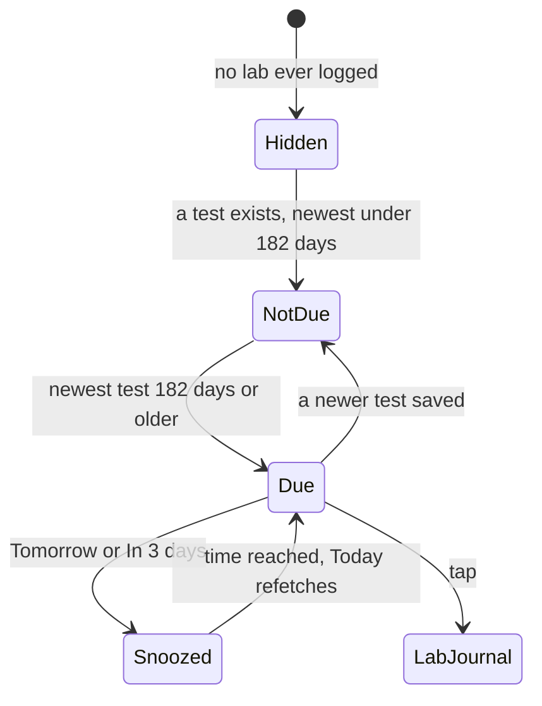

# 11 — Labs and vaccines (My Body)

> Draft for founder review, written 2026-10-12 from `docs/product/research/06-my-body.md` (main source), `07-onboarding-account-premium.md` (AI consent, Premium), `02-doses-today.md` (Bloodwork due alert), `05-curve-journey.md` (bloodwork chips), `docs/decisions.md` (My Body 2026-09-29…2026-10-03; Premium/pricing — decision A; AI rules) and `docs/specs/my-body.md` (MB-1…MB-31, signed 2026-10-03), `book-layout.md` (BK-6, BK-18). Code @ 4dade55; live cloud column lists read once (06 §7.2).
> Shows the **intended** behaviour; **Divergence today** notes cite the dossier.

---

## 1. Goal

My Body is the user's own health-record journal: lab values and vaccine records, plus a shortcut to Dose accumulation. The AI only **transcribes** a document (numbers, units, dates) — never ranges, flags, verdicts or advice. Records are the user's: every delete asks first and leaves a synced tombstone. Scans share one monthly pool (3 free / 20 Premium, decisions.md:275-276); Premium strings carry no scan number — the 20 appears only in the FAQ and the limit-reached message (AD-69).

## 2. Actors

| Actor | Role |
|---|---|
| User | Uploads a lab report (photo or PDF), adds / scans vaccines, edits / deletes values, stars markers, labels tests, exports. |
| `extract-bloodwork` edge function | kinds `bloodwork` / `vaccines` / `vial`; JWT, budget reserved before the AI call (released on failure), fails open on counter errors. |
| RevenueCat (server REST) | Premium for the 20 cap (asked only at ≥ 3 scans; unreachable → Premium cap). |
| Today | "Bloodwork due" alert (≥ 182 days since the newest test). |
| Curve | Bloodwork date chips in "Estimate on a date" (flow 10). |
| Export | CSV free, PDF Premium. |

## 3. Preconditions

- Signed in. Scans: AI consent v4 on this phone; network; budget left this UTC month.
- Typing values by hand: **intended free** (AD-24 / AD-68: decisions.md:268 "The lab journal typed by hand is free"; ships in 1.3.0, picture first — Approvals still owed item 3); not built today — see §7.1, D11-1.

## 4. What may already have happened before

| # | Prior state | What the flow must do |
|---|---|---|
| P1 | Has years of paper / PDF reports | Each upload = one dated card from the document's own date. |
| P2 | Scanned two pages of one report separately | One journal card; the hub count must match (MB-2 — D-3). |
| P3 | Scanned the same report twice | Duplicate card (deletable alone); vaccines duplicated (no dedupe). |
| P4 | Report date unreadable | Today's LOCAL date used and flagged ("The report date couldn't be read, so today's date was used…"). |
| P5 | AI read DD/MM the wrong way | Saved silently; the user must fix each value's date (no "change the test date" action — G-8; whether to add one is pending OPEN-14 (c), Portuguese question 20 (b)). |
| P6 | Used 3 free scans this month | "Monthly scan limit reached" with the server's number; typing by hand intended (AD-68; not built today, D11-1). |
| P7 | Premium lapsed with 10 scans used | Next scan → free cap 3 → refused ("your 3 scans"). |
| P8 | New phone / reinstall | Records re-imported; hub count may inflate (biomarker `created_at` not synced — D-3.2); AI consent asked again. |
| P9 | Last panel 7 months ago | Today "Bloodwork due · It's been 7 months since your last panel". |
| P10 | Vaccine with a next-due date in the past | Drops off the hub line; still on the card. |
| P11 | Second account on the same phone | Inherits AI consent today (07 D-18). Intended (DL-55): consent per account, with version and date, cleared on sign-out (D11-11). |

## 5. Happy path (lab scan)

### 5.1 Vaccine by hand

## 6. States and transitions

### 6.1 Scan flow (labs; vaccines identical with kind vaccines)

### 6.2 Report card lifecycle

### 6.3 Vaccine due (hub line only — no alert, no notification)

### 6.4 Bloodwork due (Today)

## 7. Alternative and exception paths

### 7.1 Manual lab entry
- **Intended (AD-68; decisions.md:268 "The lab journal typed by hand is free"; registry "Labs: manual entry"; the approved explainer "Type in values from any lab report…"; the quota message "You can still enter everything by hand"):** a user can add a lab value by hand (marker, value, unit, test date). It ships in 1.3.0 ("approved → next build"; OPEN-12 closed in round 2), picture first: "Add values by hand" is an approved picture still owed (Approvals still owed item 3).
  - **Divergence today (06 G-1):** no UI inserts a lab value by hand — the only insert is the scan. → DV-107.

### 7.2 Charts and Premium
- **AD-24 (decisions.md:268, 2026-09-30; MB-10 copy):** lab charts are Premium; the free card even says "Premium charts every one over time".
  - **Divergence today (06 D-8, G-2):** the marker chart renders for every user with 2+ readings. Gating it takes away a feature free users see today, so the locked marker screen is an approved picture still owed (Approvals still owed item 3; 07 X-11); the signed MB-16 is amended with the founder's signature in the same change. → DV-108.
- **The chart itself (06 §8 E-7, E-8):** decided by logic DL-43 — one line per unit, points spaced by date; the new chart is OPEN-24 item 4 (Portuguese question 2), picture first. → DV-080.
- Scans: decision A (founder, decisions.md:276, 2026-10-03) — 3 free scans a month for every kind; no client gate; every scan asks the server; refused scan shows the server's limit (A-60, decisions.md:105). The free card says the 3 free scans until there are markers, then "You've scanned {n} markers. Premium charts every one over time…" (decisions.md:276; MB-10). Premium strings carry no scan number (AD-69, decisions.md:104). PDF export Premium (checked at the action with a fresh `hasPremium()`), CSV free.
- **Today (06 G-9; corrected in round 2, R2-05):** free users see the limit (3 a month) only until their first lab scan that yields values — on the empty journal (`blood_empty_sub`, only while there are no rows, `BodyScreen.js:1115-1120`) and on the free card (`blood_first_free`, only while there are no markers, `:1104-1107`); after that the lab journal shows no limit and never the used / left count, and the limit appears only on the paywall and in the FAQ. The user learns the month is used up only when a scan is refused. Whether to show the scans used this month is pending **OPEN-14 (b)** (Portuguese question 20 (a)). → DV-110.
- **Divergence today (DV-237):** a Premium user with an empty lab journal sees the free plan's line "…You get 3 free scans a month (labs, vaccine cards and vials combined)." (`BodyScreen.js:1115-1120`, no Premium check) — against AD-69 (the free number is never shown to Premium). The Premium line without a number is a wording approval (Approvals still owed item 2.17).
- **Divergence today (06 G-10):** a 200 with zero usable values is counted although "failed extractions are not counted" (AD-23, decisions.md:275). → DV-078.

### 7.3 Grouping and counts
- One test = one card: rows grouped by report date then upload batch; same-date batches join one card unless a batch repeats a marker (A-101d).
- **Intended (AD-21: decisions.md:259; MB-2):** "The hub counts uploads the same way the journal lists them."
  - **Divergence today (06 D-3.1):** two scans on the same date with no shared marker = one card but "2 tests" on the hub.
  - **Divergence today (06 D-3.2):** biomarker `created_at` is not synced → on every other device each row has its own server time → hub shows one "test" per marker (e.g. 12 instead of 4); suspected root cause of A-101d.
- Marker series merge naming variants (lower-case, punctuation → spaces, words sorted).
- **Divergence today (06 D-4, SUSPECTED):** two rows on the same latest date: the hub star row picks the newest batch, the marker page and export the SQL order. → DV-074.

### 7.4 Favourites and labels
- Star a marker; label a test.
- **Intended (AD-02: never lose user-entered data, durable synced storage, writes merge; DL-39: labels belong to a test card).**
- **Divergence today (06 D-5, D-6, G-4, G-5; registry A-14):** stored in `user_metadata` (no history, no tombstones; whole-array writes from a cached copy; failures swallowed); a star stored under an older marker name cannot be cleared; labels keyed by date (two cards on one date share labels; moving a value leaves them behind). → DV-006, DV-075.

### 7.5 Values and dates
- Edit value: marker, value + unit, test date (≤ today, 30 years back); value read with `parseMeasure` (comma = decimal for lab values in every language).
- **Divergence today (06 D-11, CONFIRMED by verification 05 in node):** a scan string "1,025" is read as 1025 (`validateExtraction`, English grouping rule) while the edit sheet reads 1.025 (`parseMeasure`). Intended: DL-40 (`parseMeasure` on every path). → DV-076.
- **Divergence today (06 §8 E-6, D-1 note; CONFIRMED by verification 05: report_date 2099-01-01 passes `validateExtraction` with no fallback flag):** a future report date from the document is accepted and hides the Bloodwork due alert. Intended: AD-22 (test dates cannot be in the future). → DV-077.
- **Not built (06 G-8):** no "change this test's date" — fixing a wrong DD/MM means editing every value (`BodyScreen.js:673`). Whether to add it is pending **OPEN-14 (c)** (Portuguese question 20 (b)). → DV-110.
- **Divergence today (06 §8 E-7, E-8):** mixed units for one marker plotted on one axis; the chart's x-axis is by index, not time (neutral, no bands, by the hard line). Intended: DL-43; the chart = OPEN-24 item 4 (§7.2). → DV-080.
- **Divergence today (DV-235):** the summary's skipped line uses "(s)": "value(s) couldn't be read as numbers and were skipped." / PT "valor(es) não puderam ser lidos como números e foram ignorados." (`blood_dropped_sub`); plurals instead of "(s)" are a wording approval (Approvals still owed item 2.15).

### 7.6 Vaccines
- Add / edit sheet: name required (toast "Enter the vaccine name first."), Date given (80 years back … today, never future), Next due (10 back … 15 ahead, Clear), details (manufacturer, lot, dose #, provider, where given), notes; Delete asks first ("Delete vaccine?" / "This removes {name} from your vaccine journal. It cannot be undone.").
- Scan: same consent / pool; records without a valid date dropped and counted ("{count} entries without a readable date were skipped.").
- **Divergence today (06 D-12, G-6):** scans never fill the detail fields (the prompt puts lot / manufacturer into Notes). Intended: DL-41 (transcription only). → DV-109.
- **Divergence today (06 G-7):** export omits the vaccine detail fields. Intended: DL-42. → DV-079.
- **Divergence today (06 §8 E-15, with E-13, E-14, E-16, E-22):** opening the Next due wheel and closing it untouched sets today; a vaccine PDF is read in full before the size check; next due may precede date given; the lab photo-size error says "PDF" for a photo (wording ×6 = Approvals still owed item 2.12). → DV-160 (the shared "PDF" text also DV-201).
- No vaccine due alert or notification (out of scope — never advice; G-11).

### 7.7 Bloodwork due
- Shown when the newest report date is ≥ 182 days old: "Bloodwork due" / "It's been {months} months since your last panel" (months = max(6, round(days / 30))); tap → Lab test journal; snooze Tomorrow / In 3 days. None when no lab was ever logged.
- **Pending OPEN-13 (Portuguese question 19; 06 G-13):** a fixed 6-month interval chosen by the app — not interpretation, but a schedule the user did not set; regulatory-reviewer look recommended. Keeping it as is keeps an app-chosen timing recommendation the user never set (regulatory risk) — not a neutral option (07 Q-04). → DV-111.

### 7.8 Offline / killed / second device
- Scans need the network; values edited offline save locally and sync. Killed during a scan: nothing saved (server may have counted it).
- Second device: see D-3.2 and D-5.

### 7.9 Timezone
- Test dates and Date given are local calendar days (field and wheel the same day — MB-27). Scan quota month is UTC (a 21:00 Oct 31 scan in New York counts toward November).

### 7.10 Notification tap
- None (the Bloodwork due item is an in-app alert).

### 7.11 Fold
- Left page: hub title, Lab journal, Vaccine journal, Dose accumulation card; right page: tapped test / marker / vaccine read page (with Edit) / curve; default = newest test (BK-6, BK-18). A deleted selection falls back to the newest test; a deleted vaccine clears. The vaccine sheet stays open across fold/unfold.
- Device evidence still open (06 G-16; BK-6/BK-18 partial).

### 7.12 Free vs Premium
| Feature | Free | Premium |
|---|---|---|
| Scans (labs + vaccines + vials) | 3 / month | 20 / month |
| Manual lab entry | free (AD-68, 1.3.0, picture first; not built today, DV-107) | yes |
| Marker chart | locked (AD-24; picture owed, Approvals item 3); today free (DV-108) | yes |
| CSV export | yes | yes |
| PDF export | "PDF export is Premium" | yes |
| Vaccines by hand | yes | yes |
| Dose accumulation card | tag + lock → preview | number |

## 8. What every surface shows

| State | Hub | Lab journal | Vaccine journal | Today |
|---|---|---|---|---|
| Empty | three cards; "Nothing logged yet" | "No bloodwork yet" + "Upload a PDF lab report… You get 3 free scans a month (labs, vaccine cards and vials combined)." + upload; free users also see the free card "3 free scans a month (labs, vaccine cards and vials combined) · More with Premium". Premium users see the same "3 free scans" line today (DV-237; intended no number, AD-69) | "No vaccines logged" + Add | — |
| Reading | — | one card "Reading your lab report..." | "Reading your record…" | — |
| Imported | count (56/300) + starred rows "Starred markers · latest test {date}" | cards by date / by marker; Export + "+ Upload" | — | Bloodwork due hidden for 182 days |
| Free with markers | — | "You've scanned {n} markers. Premium charts every one over time…" | — | — |
| Limit | — | "Monthly scan limit reached" sheet | same | — |
| Service down | — | "Scan service unavailable · …please try again in a little while." | same | — |
| Vaccine with future due | "Next due: {name} · {date}" | — | card shows Next due | — |
| Newest test ≥ 182 days | — | — | — | "Bloodwork due · It's been {months} months since your last panel" |

## 9. Data written at each step

| Step | Store | Write | Synced |
|---|---|---|---|
| Consent | AsyncStorage `dosetrace_ai_extraction_consent_v4` | 'granted' (per device — 07 D-18) | no |
| Lab scan | `biomarkers` | one row per marker (report_date, marker, value, unit, same `created_at` per batch) | yes (`created_at` not pushed — D-3.2) |
| Scan count | `ai_scan_usage` (server) | one row per scan (kind bloodwork / vaccines / vial), reserved before the AI call | server only |
| Edit value | `biomarkers` | update (pending) | yes |
| Delete value / test | `biomarkers` | tombstones | yes |
| Star / label | Supabase `user_metadata` | `favorite_markers` / `report_tags`, whole-object writes | server only (not the synced tables) |
| Vaccine add / edit / delete | `vaccines` | row (+ details) / tombstone | yes |
| Export | file in documentDirectory | CSV / PDF → share sheet | no |
| Bloodwork alert snooze | AsyncStorage `dosetrace_alert_snooze` | the alert's snooze-until time (09:00 of the chosen day) | no |

## 10. Rules (with sources)

R1 AI transcribes only (hard line; `decisions.md:317`). R2 consent first, one shared key. R3 one monthly pool 3 / 20, UTC month, server decides Premium. R5 budget reserved before the call; failures release. R7 the limit message shows the server's limit (A-60). R8 no client gate (decision A). R11 date order from the document, language only as a tiebreak. R12 lab auto-save (no review gate). R13 unreadable date → local today, flagged (MB-27). R14 vaccine auto-save needs a name and a valid date. R15 a service failure is never blamed on the file. R16 one test = one card (A-101d). R20 chart needs 2+ readings, neutral. R22 every delete asks first + tombstone. R23 vaccine date ranges. R24 hub next due = nearest ≥ today. R26 PDF Premium at the action point. R27 Bloodwork due ≥ 182 days. (`06 §4`.)

## 11. Divergences today (summary)

| ID | Intended | Today | Source | DV |
|---|---|---|---|---|
| D11-1 | Manual lab entry, free, in 1.3.0, picture first (AD-68; Approvals item 3) | Not built | `06 G-1` | DV-107 |
| D11-2 | Lab charts Premium, locked chart shown as a picture first (AD-24; Approvals item 3) | Free | `06 D-8, G-2` | DV-108 |
| D11-3 | Hub count = journal cards on every device (AD-21) | Per batch; per row after a pull | `06 D-3, G-3` | DV-073 |
| D11-4 | Favourites / labels durable, merged, labels per test (AD-02, DL-39) | `user_metadata`, stale whole writes, unclearable star | `06 D-5, D-6, G-4, G-5` (registry A-14) | DV-006, DV-075 |
| D11-5 | Vaccine scan fills details; export includes them (DL-41, DL-42) | Notes only; export omits | `06 D-12, G-6, G-7` | DV-109, DV-079 |
| D11-6 | Pending OPEN-14 (b) (question 20 (a)): show the scans used this month | Free users see the limit (3 a month) only until their first lab scan with values; the used / left count never | `06 G-9`; R2-05 (11:156) | DV-110 |
| D11-7 | Unusable 200 not counted (AD-23) | Counted | `06 G-10` | DV-078 |
| D11-8 | One number parse for lab values (DL-40) | Scan vs edit differ | `06 D-11` | DV-076 |
| D11-9 | Future report dates refused or flagged (AD-22) | Accepted | `06 D-1 note, E-6` | DV-077 |
| D11-10 | Pending OPEN-14 (c) (question 20 (b)): "Change this test's date" | Missing | `06 G-8` | DV-110 |
| D11-11 | AI consent per account, version and date, cleared on sign-out, withdrawable (DL-55; the Settings row = OPEN-24 item 1) | Per device, no withdraw | `07 D-18` | DV-007 |
| D11-12 | Lab chart: one line per unit, x by date (DL-43; the chart = OPEN-24 item 4) | Mixed units on one axis; x by index | `06 E-7, E-8` | DV-080 |
| D11-13 | No scan number shown to Premium (AD-69; wording = Approvals item 2.17) | Premium empty journal shows "3 free scans a month" | R2-05 (13:213); R2-03 #9 | DV-237 |
| D11-14 | Plurals instead of "(s)" (wording = Approvals item 2.15) | "value(s) couldn't be read…" | R2-03 #52 | DV-235 |
| D11-15 | Untouched wheel writes nothing; size check before reading; a photo error never says "PDF" (wording = Approvals item 2.12) | Next due set to today; PDF read first; "PDF" for photos | `06 E-13…E-16, E-22` | DV-160, DV-201 |
| D11-16 | One "latest" rule for hub, marker page and export | Hub newest batch; marker page / export SQL order (SUSPECTED) | `06 D-4` | DV-074 |
| D11-17 | Pending OPEN-13 (question 19): the "Bloodwork due" alert | Fixed 6 months chosen by the app, "due" | `06 G-13` | DV-111 |

## 12. Founder questions (canonical IDs — `docs/product/OPEN-DECISIONS.md`)

Reconciled 2026-10-12 (round 2): every question this flow raised has one canonical ID in `OPEN-DECISIONS.md` — **OPEN-xx** waits for the founder (asked in the one Portuguese round there; its question number is given), **AD-xx** is already decided by the ledger or a signed spec, **DL-xx** is decided by product logic (recorded in `docs/decisions.md`; the founder may override). DV-xxx is the defect row in `DIVERGENCES.md`.

Open — waiting for the founder:
- **OPEN-13** — the "Bloodwork due" alert after 6 months (keep / factual words / user-set interval / remove). (Portuguese question 19.) "Keep as is" keeps an app-chosen recommendation (regulatory risk). D11-17 → DV-111.
- **OPEN-14 (b)** — show how many AI scans were used this month. (Portuguese question 20 (a).) Premise corrected in round 2: free users see the limit (3 a month) only until their first lab scan with values, then neither the limit nor the count; they learn the month is used up when a scan is refused. D11-6 → DV-110.
- **OPEN-14 (c)** — add "Change the date of this test". (Portuguese question 20 (b).) D11-10 → DV-110.
- **OPEN-24 item 1** — the Settings › Data & privacy row to withdraw AI consent (DL-55). (Portuguese question 2.) D11-11 → DV-007.
- **OPEN-24 item 4** — the lab chart with one line per unit and points spaced by date (DL-43). (Portuguese question 2.) D11-12 → DV-080.

Decided — what this flow relies on (round-2 final ids):
- **AD-68** — typing lab values by hand ships in 1.3.0 (was OPEN-12, closed in round 2); the "Add values by hand" picture is owed (**Approvals still owed item 3**). D11-1 → DV-107.
- **AD-24** — lab charts are Premium; the hand-typed journal is free; the locked chart for free users is a picture still owed (**Approvals still owed item 3**) because it takes a feature away from today's free users. D11-2 → DV-108.
- **AD-69** — Premium strings carry no scan number, no Premium scan line is added, the free number is never shown to Premium (was OPEN-14 (a), closed in round 2); the Premium empty-journal line is **Approvals still owed item 2.17**. D11-13 → DV-237.
- **AD-21, AD-22, AD-23, AD-02** — hub count, no future test dates, failed extractions not counted, never lose user data (D11-3, D11-9, D11-7, D11-4).
- **DL-39, DL-40, DL-41, DL-42, DL-43, DL-55** — labels per test, one number parse, vaccine scan details, complete exports, the lab chart's units and dates, AI consent per account (D11-4, D11-8, D11-5, D11-12, D11-11).
- Wording approvals: **Approvals still owed items 2.12** (photo-size message without "PDF", D11-15) and **2.15** (plurals, D11-14).

## 13. Acceptance checks (agent-device QA script)

Account Test03 (free; Premium via promo where stated). Use a sample lab PDF with 4 markers and a known date. Light and dark; PT via Settings → Preferências → Idioma.

**F11-01 — Hub**
- Expect: "My Body" / "Meu corpo" + "Your records, all in one place." / "Todos os seus registros em um só lugar."; cards "Lab test journal" / "Diário de exames", "Vaccine journal" / "Diário de vacinas", "Dose accumulation" / "Acúmulo de doses"; empty "Nothing logged yet" / "Nada registrado ainda"; footnote "Not a medical service…".

**F11-02 — Consent then source sheet**
- Do: Lab test journal → "+ Upload" / "+ Enviar".
- Expect (no consent): "Send to AI for extraction?" → Agree & continue → "Add a lab report" / "Adicionar um exame" with "Take a photo" / "Tirar uma foto", "Choose a photo" / "Escolher uma foto", "PDF file" / "Arquivo PDF".

**F11-03 — Import**
- Do: PDF file → sample.
- Expect: "Reading your lab report..." / "Lendo seu exame..."; then "Report imported" / "Exame importado" + "4 markers saved · {date}" / "4 marcadores salvos · {date}" + "Tap any marker to edit it anytime."; one card dated from the document; hub count 1. Free account: the free card now reads "You've scanned 4 markers. Premium charts every one over time…" / "Você escaneou 4 marcadores. O Premium mostra cada um em gráfico…" with no scan number (decision A, decisions.md:276) — the limit is no longer shown on My Body (D11-6). Premium account with an empty journal before the import: record whether the "3 free scans a month" line shows (D11-13).

**F11-04 — Unreadable date**
- Do: upload a report without a date.
- Expect: summary line "The report date couldn't be read, so today's date was used — open the report to set the correct date."; card dated today (local).

**F11-05 — By marker and chart**
- Do: By marker / "Por marcador" → a marker with 2 readings.
- Expect: "Latest · {date}" / "Último valor · {date}", 56 pt number + unit, "2 readings", neutral chart (no bands, no colours). Free account: intended locked chart (AD-24; picture owed, Approvals still owed item 3) — record D11-2. Marker with 1 reading: "Add another test with this marker to see how it changes over time."

**F11-06 — Edit and delete a value**
- Do: pen → "Edit value" / "Editar valor" → value "1,5" (any language) → Save → reads 1.5 (PT "1,5"). "Delete this value" / "Excluir este valor" → "Delete this value?" + "{marker} from {date} is removed from your lab test journal. It cannot be undone." → Delete.

**F11-07 — Delete a test**
- Do: card → "Delete this blood test" / "Excluir este exame" → Delete.
- Expect: card gone; hub count −1; labels for that date cleared if no row is left; Today Bloodwork due recomputed.

**F11-08 — Two pages same date (D-3.1 check)**
- Do: scan page 1 then page 2 of one report (no shared marker).
- Expect: one journal card; intended (AD-21) hub "1 test". Record today's hub number.

**F11-09 — Second device count (D-3.2 check)**
- Do: sign in on a second device; open My Body.
- Expect (intended, AD-21): same hub count. Record.

**F11-10 — Scan limit**
- Setup: 3 scans this UTC month (free).
- Expect: "Monthly scan limit reached" / "Limite mensal de leituras atingido" + "You've used your 3 scans for this month (labs, vaccine cards, and vials combined)…".

**F11-11 — Service unavailable**
- Setup: server returns 502 (test environment only).
- Expect: "Scan service unavailable" / "Serviço de leitura indisponível" + "…Your file is fine — please try again in a little while." (no "enter manually").

**F11-12 — Vaccine by hand**
- Do: Vaccine journal → "+ Add vaccine" → Save empty.
- Expect toast "Enter the vaccine name first." / "Primeiro, digite o nome da vacina."; nothing saved. Then name "Tetanus", Date given (cannot pick a future date), Next due +5 years → Save → card; hub "Next due: Tetanus · {date}" / "Próxima: Tetanus · {date}".
- Clear Next due → Save → hub line gone.

**F11-13 — Delete vaccine**
- Expect "Delete vaccine?" / "Excluir vacina?" + "This removes Tetanus from your vaccine journal. It cannot be undone." → Delete.

**F11-14 — Vaccine scan**
- Do: "Scan / upload" / "Escanear / enviar" → a vaccine card photo.
- Expect: "Vaccines imported" / "Vacinas importadas" + "{count} vaccines saved" (+ "{count} entries without a readable date were skipped."); records dated from the card; details in Notes (D11-5 record).

**F11-15 — Export**
- Do: Export → "Choose what to export" / "Escolha o que exportar" → CSV → share sheet. PDF on free → "PDF export is Premium" / "A exportação em PDF é Premium" with Cancel first, "Go Premium" second.

**F11-16 — Bloodwork due**
- Setup: newest test 190 days ago.
- Expect: Today "Bloodwork due" / "Exame de sangue pendente" + "It's been 6 months since your last panel" / "Já se passaram 6 meses desde seu último exame"; tap → Lab test journal; snooze Tomorrow / In 3 days.

**F11-17 — Fold**
- Do (unfolded Fold): My Body.
- Expect: left page labs + vaccines + Dose accumulation card; right page = newest test by default; tap a marker → marker page right; tap a vaccine → read page with Edit; Edit opens the sheet; fold keeps it open with typed values.

**F11-18 — Both themes**
- Hub cards, journal cards, marker number, chart, sheets (consent, source, imported, delete, edit, vaccine), toast, export sheet: readable in light and dark; no colour on any value (no good/bad).
