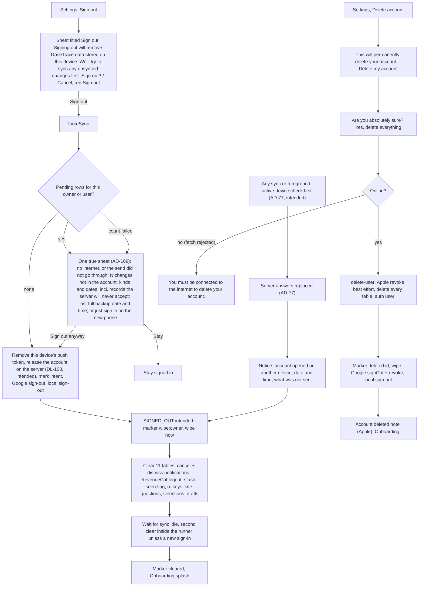
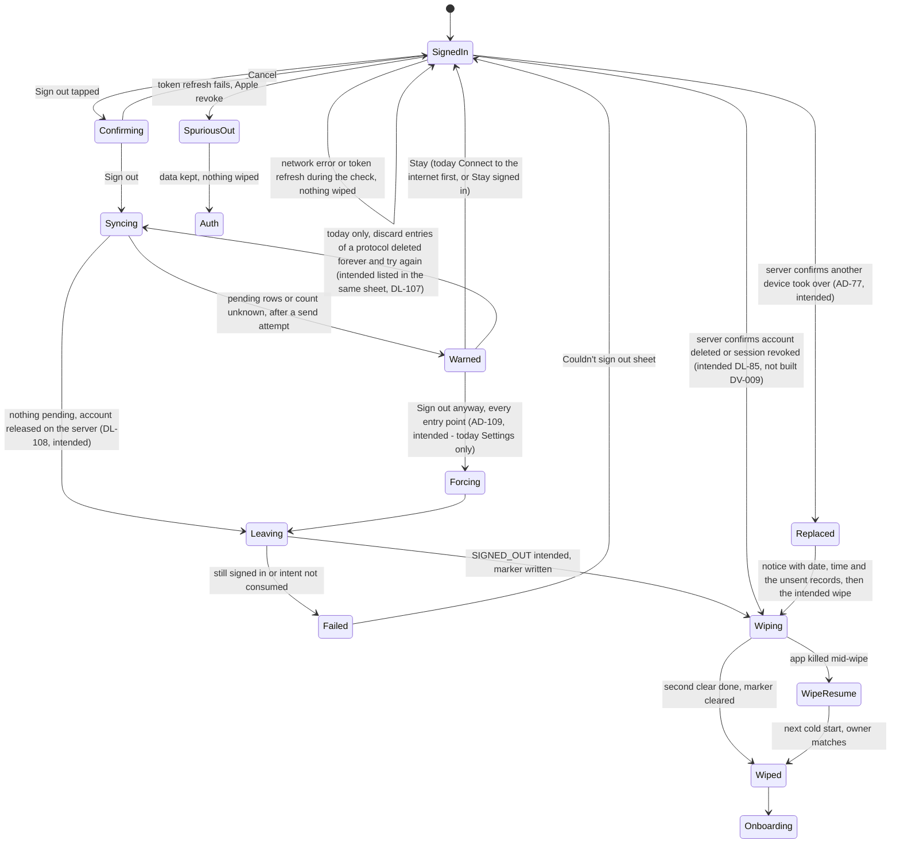
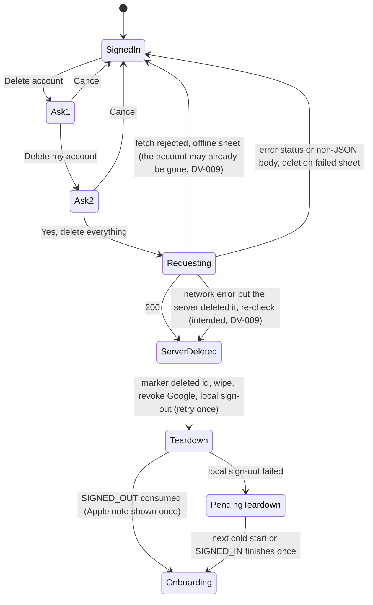
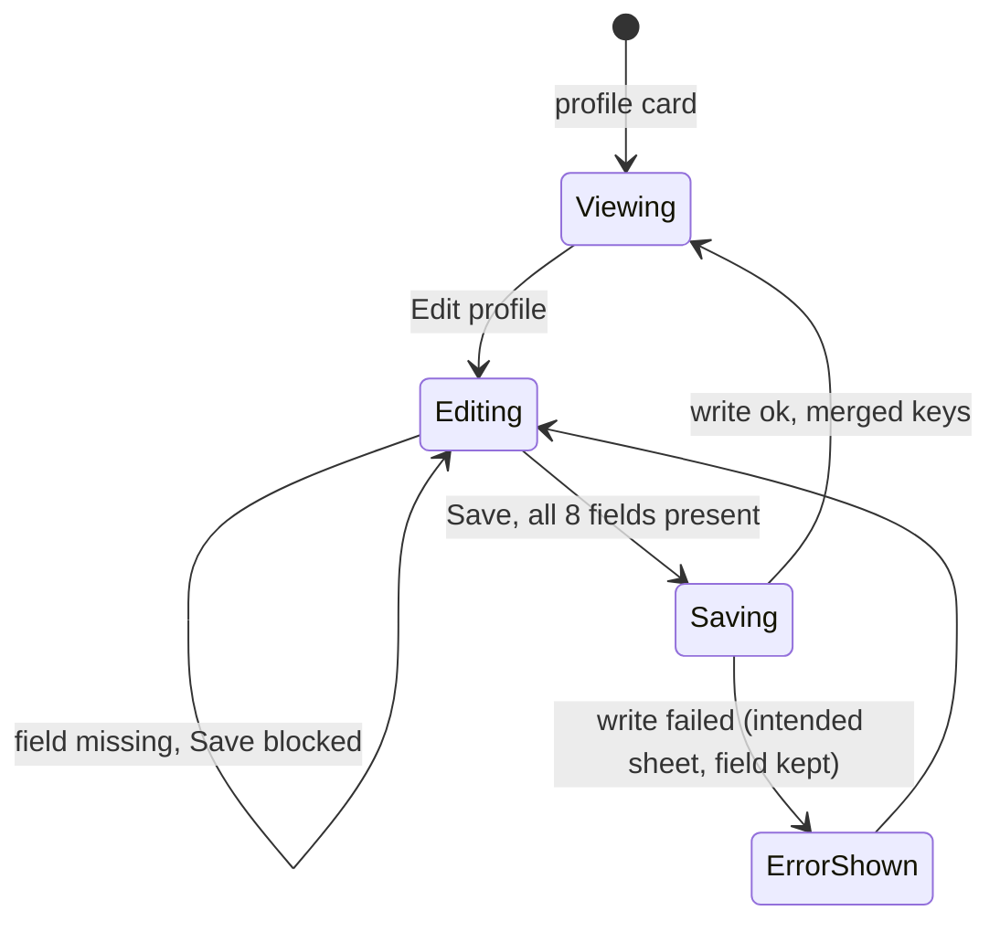

# 12 — Account: profile, sign-out, delete account, export

> Draft for founder review, written 2026-10-12 from `docs/product/research/07-onboarding-account-premium.md` (main source: §3.5–3.8, R23–R39, §5.1, §6.4–6.10, §7, §8), `08-platform.md` (§4.10, §5), `03-reminders.md` (R-39…R-42), `docs/decisions.md` (Data & privacy; Onboarding & auth; Cross-account guard 2026-10-03; dt-council 2026-10-04; one active device per account 2026-10-15; signing out is never blocked 2026-10-15) and `docs/specs/premium-and-auth.md`, `docs/specs/one-active-device.md` (A-119, OD-1…OD-18), ship-check Gate B. Code @ 4dade55.
> Shows the **intended** behaviour; **Divergence today** notes cite the dossier. Everything about one active device per account (AD-77) is **not built → A-119** (target 1.3.0).

---

## 1. Goal

Let the user leave the phone or the service safely: a **sign-out** never loses data they typed without telling them (it backs up first; if anything is still unsent, one true sheet says what, why and since when, and the person chooses — AD-109), and it only wipes the phone on a real, intended sign-out — never on a token refresh or a session hiccup; **delete account** erases every synced table and the auth user on the server, then the phone; **Download my data** gives them everything. Profile edits merge, never clobber. **One active device per account (AD-77):** signing in on another phone always works and takes the account over; the replaced phone, on the server's confirmed answer only, says so (with date, time and what was not sent) and wipes itself like an intended sign-out.

## 2. Actors

| Actor | Role |
|---|---|
| User | Edits profile, exports, signs out, deletes the account. |
| Settings | Profile card → Edit profile; Data & privacy (Download my data, Adherence report, Usage analytics, legal); Sign out / Delete account card. |
| `signOutIntended` (`lib/signOutCore.js`) | Force sync → count pending → warn (the true sheet, AD-109) or proceed → remove push token → mark intent → local sign-out → verify. |
| `onSignedOutNow` / `afterSignedOut` (`lib/signedOut.js`) | Intended → wipe (marker `wipe:<owner>`); spurious → keep everything. |
| `delete-user` edge function | Apple revoke (best effort) → delete 20 tables + referrals → auth user. |
| Cross-account guard | A different account signing in discards the previous account's local data, unsynced rows included (built on a coordinator line, decisions.md:508-509). Intended (AD-102): it warns first and offers "Sign in as {previous account} first, to save" / "Discard and continue" (DV-242). |
| Gates (Finish setup, 18+) | Offer sign-out with the same rule as Settings: with unsent changes, the one true sheet with "Sign out anyway" and "Stay" (AD-109; AD-79 item 10; DL-92 offline; records the server will never accept listed in the same sheet, DL-107). Today: no "Sign out anyway" there (DV-114). |
| Active-device record + write guard (server, PROPOSED — A-119) | The server records the account's one active device and each device's last complete send (OD-3); it refuses every read and write to every synced table from a device that is not the active one, with a distinct error (DL-105, OD-7); a normal sign-out releases the account (DL-108). Not built. |

## 3. Preconditions

- Signed in. Delete needs network. Sign-out works offline (local) and is never blocked (AD-109): when unsynced rows exist, the true sheet says so and offers "Sign out anyway" / "Stay" at every entry point. Today Settings can force ("Sign out anyway") while the gates block (DV-114).

## 4. What may already have happened before

| # | Prior state | What the flow must do |
|---|---|---|
| P1 | Logged doses offline a minute ago | Sign-out pushes first; still unsynced → **intended (AD-109):** one true sheet — "no internet" (offline) or "the send did not go through" (online; never an invented cause), how many changes and which (kinds and dates) are not in the account and are removed by signing out, when this phone last backed up everything (date and time), and that the person can simply sign in on the new phone instead (this one signs out by itself when back online; what was not sent will not be there); buttons **Sign out anyway** (red) / **Stay**. **Today:** "Some changes on this phone aren't backed up yet…" with **Connect to the internet first** / **Sign out anyway** (Settings only). |
| P2 | A protocol was deleted forever on another device; its unsynced dose stays pending | **Intended (DL-107, AD-109):** records the server will never accept are named in the same sheet with the rest (kinds and dates) — never a trap, no separate discard screen. **Today:** orphans block the count; Settings offers discard of orphans / Sign out anyway. |
| P3 | Token refresh failed in the background (spurious SIGNED_OUT) | Nothing wiped; user lands on Auth; signing back in finds everything. (When the server confirms the account was deleted or the session revoked, the intended path is DL-85 instead — see P6 and §7.8.) |
| P4 | Apple credential revoked in iOS Settings | Local sign-out, not intended → data kept. |
| P5 | Killed mid-wipe | Marker `wipe:<owner>` finishes the wipe on the next cold start (owner match only). |
| P6 | Server deleted the account, response lost | **Confirmed in code (07 §8; DV-009):** `requestAccountDeletion` returns `{offline}` only on a fetch rejection (`accountActions.js:55-57`), so a rejection after the server acted shows "You must be connected to the internet to delete your account." while the account is gone; a non-JSON body makes `res.json()` throw (`:58`), which Settings shows as "Account deletion failed. Please try again." (`SettingsScreen.js:566-568`). Either way the account may be gone; next refresh fails → spurious sign-out → local data kept, no wipe. Intended: the app re-checks the account on a network error and finishes the teardown (DV-009, No (bug)); a server-confirmed deletion then cancels reminders and wipes (DL-85). |
| P7 | Active App Store / Play subscription | Deleting the account does not cancel billing; **no warning today** (07 Gap 4). Intended (DL-60): Premium users are told, with a link; the line and link ×6 go ahead, approved in their picture first (AD-79 item 6). |
| P8 | Another person will use the phone next | Intended sign-out wipes data, drafts, stash, site questions; **AI consent and entitlement cache stay today** (07 D-7, D-18; DL-55, DL-53). |
| P9 | Offline at the profile gate with unsynced rows | **Intended (DL-92, was AD-29 / OPEN-21 (5); AD-79 item 10; AD-109):** the gates can be answered offline, and their sign-out follows the Settings rule — the same true sheet with "Sign out anyway" / "Stay", records the server will never accept listed in it (DL-107). Today blocked with no force (A-94; the gates offer only to discard entries of a protocol deleted forever on another device) — DV-114. |
| P11 | Account created with Apple on Android (real since Android Apple sign-in went live on 2026-10-03) | Delete: the Android web flow never calls `apple-link` (only the native iOS path does, `lib/supabase.js:348`), so unless the same account also signed in with Apple on an iPhone there is no stored Apple token to revoke; `delete-user` returns `appleManualRevokeNeeded` and the Android note tells the user to remove access at account.apple.com. This is live behaviour, not a hypothesis. |
| P10 | Reset link for another account | "Reset the password of another account?" → sign out then reset (flow 01); intended the sign-out follows the same rule (the true sheet with "Sign out anyway" / "Stay" when anything is unsent, AD-109); today no force. |
| P12 | The account was opened on another phone while this one was offline or in the background | **Intended (AD-77; OD-4…OD-6; not built → A-119):** on its next contact — the active-device check is the first server call of every sync and every foreground — the server answers "replaced": the phone never pulls, shows that the account was opened on another device (date and time), says what and how many unsent records are discarded (kinds + date range, no values — DL-106; the founder's explicit exception to "never lose user-entered data"), then signs out and wipes like an intended sign-out. The verdict and the count are stored outside the wiped stores, so a kill still shows the notice at the next open. Only on the server's confirmed answer — never on a network error, timeout, token refresh, session hiccup or same-user re-auth (OD-5). |
| P13 | This phone tries to read or write after it was replaced | **Intended (DL-105, OD-7; A-119):** the server refuses with a distinct error (never a silent empty result); the app does not retry in a loop, shows no generic error, and takes P12. An older app version that receives the refusal keeps its rows pending and deletes nothing. |
| P14 | A notification action ("Taken") on a replaced phone | **Intended (OD-6, OD-16; A-119):** the action is counted in the discard total of P12's notice; no server push (wake-up or reminder) reaches a replaced phone (the takeover removes the account's other push tokens). |

## 5. Happy path

Today's sheet E reads "Some changes aren't backed up yet…" with "Connect to the internet first" / "Sign out anyway" in Settings only (the gates block, DV-114); the release on the server and the replaced path (S0 → S → T) are not built (A-119).

## 6. States and transitions

### 6.1 Sign-out

### 6.2 Delete account

### 6.3 Profile edit (Settings)

## 7. Alternative and exception paths

### 7.1 Never destroy on a maybe
- The wipe fires ONLY on an intended sign-out (flag set by `signOutIntended`), never on a token refresh, a session hiccup during an update, or a re-auth of the same user (CLAUDE.md "Never destroy on a maybe", founder directive 2026-09-12). The replaced-phone wipe (AD-77) follows the same rule: only on the server's confirmed "replaced" answer (OD-5).
- A spurious SIGNED_OUT keeps local data and reminders; only the stash freshness ends and a queued notification tap is dropped. The exception is a server-confirmed deletion or revoked session: intended (DL-85) cancels the reminders and wipes the phone; a network failure never cancels anything. Not built → DV-009.
- Cross-account: when a DIFFERENT account signs in (cold start or SIGNED_IN) the previous account's local data is discarded today, unsynced rows included, without a warning (`App.js:621-633`); its reminders are cancelled before import. The only source was a coordinator line (decisions.md:508-509, "final Gate B"). **Intended (AD-102, was OPEN-21 (11); founder 2026-10-15):** before another account's unsent data on the phone is discarded, the app warns and offers "Sign in as {previous account} first, to save" / "Discard and continue"; texts ×6 approved in their picture first. → DV-242.
- **Divergence today (08 Gap 7):** `getLocalDataUserId` skips `vials` (edge case). → DV-169.

### 7.2 Offline
- Sign-out with nothing pending offline: local sign-out (`_removeSession` under the auth lock) → wipe.
- Sign-out with pending rows: **intended (AD-109, a consequence of AD-77; amends the words of decisions.md:309, which stays):** never blocked. The app first tries to send; if anything is still unsent, one true sheet says what really happened (offline: no internet; online: the send did not go through over the internet — never an invented cause such as "backup refused"), how many changes and which (kinds and dates, incl. records the server will never accept, DL-107) are not in the account and are removed by signing out, when this phone last backed up everything (date and time), and that the person can simply sign in on the new phone instead (this one signs out by itself when it is back online; what was not sent will not be there). Buttons: **Sign out anyway** (destructive) and **Stay**. The same sheet at every entry point: Settings, the 18+ sheet, the profile gate and the reset-link account switch. The texts ×6 come with the A-119 picture (Approvals still owed, items 2 and 3; A-46 look list, item 8). AD-108 ("OK" only) was superseded the same day by AD-109.
  - **Divergence today (D12-16):** Settings offers "Connect to the internet first" / "Sign out anyway" (or "Stay signed in" / "Sign out anyway" after a failed push) with no list, no last-backup time and no hint about the new phone. No DV row (A-119 in the registry).
- **Intended (DL-92, was AD-29 / OPEN-21 (5); decisions.md:542 is a coordinator line):** Finish setup and the 18+ sheet can be answered offline; their sign-out is the same as Settings (AD-79 item 10, AD-109).
  - **Divergence today (07 Gap 6; A-94):** no force there (only the discard of entries of a protocol deleted forever on another device). → DV-114.
- Delete offline: "You must be connected to the internet to delete your account." Nothing changes — unless the fetch was rejected after the server acted (P6, DV-009).
- **Divergence today (07 D-16, confirmed in code):** offline cold start with an expired token routes to Auth while the session is stored (`App.js:609-617` ignores the `getSession` error). Intended (DL-54): offline with a stored session = signed in. → DV-083.

### 7.3 Killed / interrupted
- Mid intended wipe → completed on next cold start only for the data's own owner.
- After server delete, before local sign-out → marker `deleted:<id>` completes wipe + sign-out once.
- **Confirmed in code (07 §8; DV-009):** delete response lost → reported as offline although the account is gone (a fetch rejection returns `{offline}`); no wipe follows (spurious sign-out). Intended (a plain bug, DV-009 "No (bug)" for this half): the app re-checks the account on a network error and finishes the teardown; a server-confirmed deletion cancels reminders and wipes (DL-85).
- Replaced phone killed before the notice is seen (AD-77, intended): the verdict and the count live outside the wiped stores, so the next open shows the notice once and finishes the wipe (OD-4).

### 7.4 What the wipe removes / keeps
| Removed on intended sign-out | Kept (device-level) |
|---|---|
| 11 SQLite tables, scheduled + delivered notifications, snooze records, RevenueCat identity, stash `dt_onboarding_data`, `dt_seen_onboarding`, `dosetrace_rc_start`, rc migration flags, site questions, Fold selections, in-memory drafts, this device's push token | language, time format, theme, install id, reminder-setup-seen, deep-sleep-checked, settings folds, sort, handled ids, missed-scan watermark + zone history, alert snoozes, `dosetrace_vial_low_sent`, **AI consent**, **entitlement cache**, curve view / explainers / food draft keyed by uid; intended also the device id (never cleared by sign-out or a wipe, OD-18) and the replaced verdict until its notice is seen (OD-4) |
- **Divergence today (07 D-7, D-17, D-18; 03 G28; 02 D16):** two different problems.
  - **Inherited by the next account (device-global keys):** AI consent (`lib/aiConsent.js`, not in `runWipeSteps`), `dosetrace_entitlement_last_uid` (never cleared; the SIGNED_IN window before `initPurchases`, DV-082), `dosetrace_vial_low_sent`, alert snoozes, and the missed-scan watermark + zone history (`dosetrace_missed_since` / `_tz` / zone history, `lib/doseActions.js:123-127`).
  - **Residue only, never inherited:** the curve view (`dosetrace_curve_view_{userId}`), the food chat draft (`dosetrace_food_draft:<uid>`) and the explainer flags are per-user keys; they stay on the phone but another account never reads them.
  - AI consent per account → DL-55 (the Settings withdraw row goes ahead, approved in its picture first — AD-79 item 1; server proof of consent = counsel, DL-83; target build per AD-78); the other keys → AD-05, DL-52, DL-53. The cross-account guard itself warns first (AD-102, DV-242).

### 7.5 Delete account details
- Server deletes by user id: dose_logs, vials, protocols, biomarkers, vaccines, food_logs, reality_checks, calc_snapshots, calc_targets, reality_check_open, calc_inputs, ai_food_usage, ai_scan_usage, reminders, notification_preferences, analytics_events (none linked to the account — the install id is pseudonymous, DL-84), referral_codes, apple_tokens, push_tokens, notification_sends + referrals (`delete-user/index.ts:112-139`); `ai_assistant_usage` and `profiles` go by cascade; then the auth user. Apple refresh token revoked best effort (delete always wins). Intended (A-119): the new device rows go too (DL-93 list, OD-7); the server guard exempts the service role.
- **Intended (DL-93, was AD-46 / OPEN-21 (7)):** `delete-user` names `ai_assistant_usage` and `profiles` and drops the two tables that do not exist in production (`notification_preferences`, `notification_sends`). Not built → DV-011; the function deploy needs the founder's go (Approvals still owed item 1).
- Apple note after delete (shown when `delete-user` reports `appleManualRevokeNeeded`): iOS "…You can also remove DoseTrace's Sign in with Apple access anytime in the Settings app, under your Apple ID."; Android "…at account.apple.com, under Sign-In and Security." Android Apple sign-in is live (since 2026-10-03), so the Android note is a live path: an account that only ever signed in with Apple on Android has no stored Apple token (the web flow does not call `apple-link`) and always gets the note.
- **RevenueCat customer left after delete (verification 05 O-6; DV-219):** `delete-user` makes no RevenueCat call, so the RevenueCat customer (app user id = the Supabase user id, with its purchase history) stays after the account is deleted. Whether it must be deleted too is a counsel item (DL-83, with the decisions.md:388 list; Approvals still owed item 9).
- **Divergence today (07 Gap 4):** nothing warns that an App Store / Play subscription keeps billing. Intended (DL-60, store account-deletion guidance): the delete sheet tells Premium users, with a link to manage subscriptions; the line and link ×6 go ahead, approved in their picture first (**AD-79 item 6**). → DV-087.
- **Divergence today (08 Gap 9; DV-011):** the list relies on cascades for `ai_assistant_usage` and `profiles` (verified live 2026-10-12 for `profiles`: `profiles.id → auth.users ON DELETE CASCADE`, so the rows do go); see DL-93 above.

### 7.6 Export (Download my data)
- Settings → Data & privacy → "Download my data" → JSON of every synced table + email → share sheet. Adherence report: preview "This is exactly what your provider will receive." then Share.
- **Divergence today (07 D-23):** Settings export does not import first when the local DB is empty (the 18+ sheet does).
- **Divergence today (07 D-24):** `user_metadata` (profile, preferences, favourites, labels, mirrors) not exported.
- Intended for both (DL-42): "Download my data" imports first on an empty phone and includes the profile and preferences. → DV-086.

### 7.6a Legal texts and analytics (Data & privacy)
- **Divergence today (DV-085, DV-231):** Settings opens the in-app privacy text (`settings_privacy_body`, `SettingsScreen.js:1210`), while onboarding, Auth and the paywall open the web policy; the in-app text says only "a lab report or vaccine card" goes to Anthropic and omits the AI food log, the protocol assistant and the vial-label scan. Intended: one text (DL-81, was AD-28) that names Anthropic and covers every AI feature (AD-72, decisions.md:330); wording ×6 = Approvals still owed item 2.7.
- **Divergence today (DV-190):** the "Usage analytics" row (`settings_analytics_sub`) and the in-app policy still say "anonymous". Intended (DL-84, was AD-57): "not linked to your account" (the install id is pseudonymous); wording ×6 = Approvals item 2.6; the Apple / Play privacy labels = Approvals item 6.

### 7.7 Profile edit
- Edit profile requires all 8 fields; writes a merge of display_name, gender, birth month/year, country, primary goal, activity (5-level + stamp), provider. Intended (A-119, OD-7): the active-device check also runs on the phone before any profile / `user_metadata` write.
- **Divergence today (07 D-22):** `saveProfile` and the analytics toggle ignore the write error → offline save looks saved and silently reverts. Intended (DL-56): DoseTrace sheet + keep the field (like notification switches). → DV-008.
- **Divergence today (07 D-10):** Settings has no "What you track" editor although the gate requires it. Intended (DL-58): Edit profile can edit every field the gate requires; the editor goes ahead, approved in its picture first (**AD-79 item 2**). → DV-113.

### 7.8 Second device
- **Intended (AD-77, founder 2026-10-15; DL-102…DL-108; OD-4…OD-7, OD-14…OD-16; not built → A-119):** one active device per account. Only a sign-in the person makes on a phone with no session takes the account over (DL-102; a restored session, token refresh, re-auth or Android background start never does); an updated or backup-restored phone asks "Your account is in use on {device}. Use it on this phone?" (DL-103); the taking-over phone rebuilds its local copy from the server (DL-104) and shows once, after the 18+ / profile steps, the other device's name and the server time it last sent everything (in this phone's time zone), saying later offline changes there may be missing — no notice when that device signed out normally (DL-108). The replaced phone: the active-device check is the first server call of every sync and foreground; on the confirmed "replaced" answer only it never pulls, shows the notice with date, time and what and how many unsent records are discarded (kinds + date range, no values, DL-106 — the founder's explicit exception), then wipes like an intended sign-out; its reads and writes are refused with a distinct error (DL-105); it gets no server push (OD-16). This replaces the multi-device hardening (per-table tombstones, counters as events, overlap / per-table pull cursors) as the fix for DV-182, DV-183, DV-209 and DV-222.
- Signing out on phone A does not sign out phone B. Deleting the account: phone B's next token refresh fails → spurious sign-out → data kept on B.
- **Intended (DL-85, decided by logic — was AD-04 / OPEN-21 (1); from the founder's reminder principle, decisions.md:597-601, and "never destroy on a maybe"):** when the server confirms the account was deleted or the session revoked, B cancels its scheduled reminders and wipes its local data; a network failure never cancels anything. With AD-77, B's next contact after a deletion from A takes this deletion path with its own message, not "opened on another device" (OD-10). **Divergence today (03 G2):** not built → DV-009.
- The residual local data left on phone B after an Apple-account delete (the "F6" item of decisions.md:417, the PRD's former local question) is covered by the same DL-85: B wipes once the server confirms the deletion.

### 7.9 Timezone / DST
- Not applicable, except the takeover notice: the other device's "last sent" time is the server's, shown in this phone's time zone (DL-108).

### 7.10 Notification tap
- A queued tap is dropped on sign-out. Taps after the account is gone open Auth. A notification action on a replaced phone is counted in its discard total (OD-6).

### 7.11 Fold
- Settings book: left = profile card + groups + Sign out / Delete card; right = chosen group (Preferences default) (BK-7). Sheets are one centred column. The folded and unfolded Fold are one device (OD-18).

### 7.12 Free vs Premium
- Same flow for both; Premium status is per RevenueCat customer (logged out on sign-out; not cancelled on delete, and the customer record itself is not deleted — DV-219, a counsel item under DL-83). **Decided (AD-101, was OPEN-15):** Settings gets "Manage subscription" (store page), "Restore purchases" and the subscription state (trial until…, renews on…) when the store reports it (flow 13).

## 8. What every surface shows

| State | Settings | Root screen | Notifications | Data on phone |
|---|---|---|---|---|
| Confirm sign-out | sheet titled "Sign out" / "Sair" (`SettingsScreen.js:514`), body "Signing out will remove DoseTrace data stored on this device. We'll try to sync any unsynced changes first. Sign out?"; Cancel / red Sign out | Main | unchanged | unchanged |
| Warned (unsynced, offline) | intended (AD-109): one sheet — "no internet"; N changes not in the account, kinds and dates (incl. records the server will never accept, DL-107), removed by signing out; "last full backup {date} {time}"; "you can just sign in on the new phone — this one signs out by itself when back online"; red "Sign out anyway" / "Stay"; same at the gates and the reset-link switch. Today Settings: "Some changes on this phone aren't backed up yet…" + Connect to the internet first / Sign out anyway; gates: OK only or the discard offer (DV-114) | Main | unchanged | unchanged |
| Warned (online, the send did not go through) | intended (AD-109): the same sheet, saying the send did not go through over the internet (never an invented cause). Today "Some changes could not be backed up. Signing out now removes them from this phone." + Stay signed in / Sign out anyway | Main | unchanged | unchanged |
| Failed | "Couldn't sign out" / "You're still signed in. Connect to the internet and try again." | Main | unchanged | unchanged |
| Signed out (intended) | — | Onboarding splash | all cancelled + dismissed | wiped; account released on the server (DL-108, intended) |
| Spurious sign-out | — | Auth (Sign in) | still scheduled | kept |
| This phone was replaced (AD-77, intended) | notice: the account was opened on another device, date and time; with unsent records, what and how many are discarded (kinds + date range, no values, DL-106); OK | Onboarding after the wipe | all cancelled; no server push (OD-16) | wiped (not built → A-119) |
| Another device was active (this phone took over) | once, after the 18+ / profile steps: the other device's name and the server time it last sent everything (this phone's time zone); later offline changes there may be missing; no notice when that device signed out normally (DL-108); not built → A-119 | Main | this phone's own | rebuilt from the server (DL-104) |
| Delete confirm 1 / 2 | "Delete account" → "This will permanently delete your account…" → "Are you absolutely sure?" → "Yes, delete everything" | Main | — | — |
| Delete offline | "You must be connected to the internet to delete your account." | Main | — | — |
| Deleted | Apple note (if Apple) | Onboarding | all cancelled | wiped |

## 9. Data written at each step

| Step | Store | Write |
|---|---|---|
| Sign-out start | sync | forced push |
| Before local sign-out | Supabase `push_tokens` | this device's row deleted |
| Sign-out with nothing unsent (intended, DL-108) | server active-device record | account released (the next phone shows no notice) |
| Intent | memory | intent flag |
| SIGNED_OUT intended | AsyncStorage `dosetrace_wipe_pending = wipe:<owner>` | then the wipe steps; cleared at the end |
| Takeover (intended, AD-77) | server active-device record; `push_tokens` | this device active, each device's last complete send kept; the account's other push tokens removed (OD-3, OD-16) |
| Replaced teardown (intended, AD-77) | device storage outside the wiped stores | the "replaced" verdict + the discard count (kinds, date range) until the notice is seen (OD-4); then the intended wipe steps |
| Delete | server | rows of 20 tables + auth user (intended also the device rows, A-119) |
| Delete teardown | AsyncStorage `dosetrace_wipe_pending = deleted:<id>` | cleared after local sign-out |
| Profile save | `user_metadata` | merged keys |
| Analytics toggle | `user_metadata.analytics_opt_in` | no error handling today |

## 10. Rules (with sources)

R27 intended sign-out sequence (`lib/signOutCore.js:59-92`). R28 sign-out is never blocked: with anything unsent, every entry point (Settings, 18+ sheet, profile gate, reset-link switch) shows the one true sheet with "Sign out anyway" / "Stay" (AD-109, amending the words of decisions.md:309; gates DL-92 + AD-79 item 10); records the server will never accept are listed in the same sheet, never a trap (DL-107). R29/R30 inline / deferred SIGNED_OUT handling; spurious keeps all. R31 cold-start pending wipe only for the data's owner. R32 cross-account guard warns first and offers "Sign in as {previous account} first, to save" / "Discard and continue" (AD-102; today silent, DV-242). R33 Apple revoke = local sign-out without wipe. R34 two confirmations; offline sheet. R35 server deletion list ⊇ syncCore TABLES (test `deleteUserCoverage`). R36 teardown runs exactly once. R37 one active device per account (AD-77): a sign-in on a phone with no session takes over (DL-102); the server refuses a non-active device's reads and writes with a distinct error (DL-105); the replaced phone shows its notice and wipes only on the confirmed answer (OD-5), discarding its unsent records with what and how many shown (DL-106); a normal sign-out releases the account (DL-108). DL-85 a server-confirmed delete / revoke cancels reminders and wipes; a network failure never does. CLAUDE.md "NEVER lose user-entered data", "Writes merge, never clobber", `onAuthStateChange` synchronous. (`07 §4`.)

## 11. Divergences today (summary)

| ID | Intended | Today | Source | DV |
|---|---|---|---|---|
| D12-1 | Gates work offline (DL-92) and their sign-out follows Settings: the true sheet with "Sign out anyway" / "Stay" (AD-79 item 10, AD-109) | No force there | `07 Gap 6` (A-94) | DV-114 |
| D12-2 | Account-scoped device keys cleared on sign-out (AD-05, DL-52, DL-53, DL-55) | Inherited by the next account: AI consent, entitlement last-uid, vial-low map, snoozes, missed-scan watermark + zone history. Residue only (per-user keys, never inherited): curve view, food draft, explainer flags | `07 D-7, D-17, D-18`; `03 G28`; `02 D16`; verification 05 DV-081 / 07 K-06 | DV-081, DV-082, DV-007 |
| D12-3 | Delete warns Premium users about store billing, with a link (DL-60; line + link approved in their picture, AD-79 item 6) | Silent | `07 Gap 4` | DV-087 |
| D12-4 | Lost delete response finishes the teardown (bug fix) | Shows offline, no wipe | `07 §8` (confirmed in code) | DV-009 |
| D12-5 | Profile save errors shown (DL-56) | Swallowed | `07 D-22` | DV-008 |
| D12-6 | Export includes profile / preferences and imports first (DL-42) | Neither | `07 D-23, D-24` | DV-086 |
| D12-7 | Other devices cancel reminders and wipe after a server-confirmed deletion or revoke (DL-85, incl. phone B's residual data) | Not built | `03 G2` | DV-009 |
| D12-8 | Offline cold start keeps a stored session (DL-54) | Routes to Auth | `07 D-16` (confirmed in code) | DV-083 |
| D12-9 | "What you track" editable in Settings (DL-58; editor approved in its picture, AD-79 item 2) | Not | `07 D-10` | DV-113 |
| D12-10 | One privacy text, in-app = web (DL-81) | In-app vs website differ | `07 D-21` (A-117) | DV-085 |
| D12-11 | The in-app policy names Anthropic and covers every AI feature (AD-72; wording = Approvals item 2.7) | Mentions only lab reports and vaccine cards | verification round 2 R2-03 #1 | DV-231 |
| D12-12 | Analytics copy says "not linked to your account" (DL-84; wording = Approvals item 2.6) | "anonymous" in `settings_analytics_sub` and the in-app policy | PRD G-136 | DV-190 |
| D12-13 | `delete-user` names `ai_assistant_usage` and `profiles`, drops the two absent tables (DL-93; deploy = Approvals item 1) | Relies on cascades; lists two tables absent in production | `08 Gap 9` | DV-011 |
| D12-14 | Whether the RevenueCat customer is deleted with the account — counsel (DL-83) | Left in RevenueCat | verification 05 O-6 | DV-219 |
| D12-15 | The cross-account guard finds the owner of a vials-only database | `getLocalDataUserId` skips `vials` | `08 Gap 7` | DV-169 |
| D12-16 | Sign-out with unsent changes: one true sheet — what happened (no internet / the send did not go through), how many and which (kinds and dates, incl. records the server will never accept), last full backup time, "just sign in on the new phone" — with "Sign out anyway" and "Stay" (AD-109, DL-107) | Settings: "Some changes aren't backed up yet…" / "Connect to the internet first" / "Sign out anyway" (or "could not be backed up" / "Stay signed in"), no list, no backup time, no new-phone hint | AD-109 (amends the words of decisions.md:309) | — (A-119, registry; no DV row) |
| D12-17 | Replaced phone: notice + wipe on the confirmed answer only; the server refuses its reads and writes (AD-77; OD-4…OD-7, OD-14…OD-16) | Not built | spec `one-active-device.md` | DV-182, DV-183, DV-209, DV-222 (A-119) |
| D12-18 | The cross-account guard warns before discarding another account's unsent data: "Sign in as {previous account} first, to save" / "Discard and continue" (AD-102) | Discards without a warning (`App.js:621-633`) | decisions.md:508-509; AD-102 | DV-242 |

## 12. Founder questions (canonical IDs — `docs/product/OPEN-DECISIONS.md`)

Reconciled 2026-10-12 and closed 2026-10-15: every question this flow raised has one canonical ID in `OPEN-DECISIONS.md` — **AD-xx** is decided by the founder, the ledger or a signed spec, **DL-xx** is decided by product logic (recorded in `docs/decisions.md`; the founder may override). DV-xxx is the defect row in `DIVERGENCES.md`.

**Decided by the founder on 2026-10-15 (all questions answered):**
- **AD-77** (was OPEN-16 (b), Q 1 (b)) — one active device per account (A-119, `docs/specs/one-active-device.md`): signing in elsewhere always works and takes over; the replaced phone shows a notice and wipes on the server's confirmed answer only, discarding its unsent records with what and how many shown (the founder's explicit exception); the server refuses a replaced device's reads and writes. §1, §2, §4 P12–P14, §5, §6.1, §7.8, §8, §9, R37, D12-17 → DV-182, DV-183, DV-209, DV-222. Its item 6 (blocked sign-out) is removed by AD-109.
- **AD-109** (founder clarification the same day, a consequence of AD-77) — sign-out is never blocked: with anything unsent, one true sheet (what happened, how many and which, last full backup time, "just sign in on the new phone") with "Sign out anyway" and "Stay", at every entry point; it amends the words of decisions.md:309. §3, §4 P1, P2, P9, P10, §5, §6.1, §7.2, §8, R28, D12-1, D12-16.
- **AD-108** (A-119 screen 3, "OK" only) — superseded the same day by AD-109.
- **AD-102** (was OPEN-21 (11), Q 22) — before another account's unsent data is discarded, the app warns and offers "Sign in as {previous account} first, to save" / "Discard and continue"; supersedes the coordinator line decisions.md:508-509 for this case. §2, §7.1, R32, D12-18, F12-06 → DV-242.
- **AD-79** (was OPEN-24, Q 2) — the new screens go ahead, each approved in its picture (light + dark, ×6) before code: item 1 (Settings row to withdraw AI consent, DL-55 → DV-007), item 2 (the "what you track" editor, DL-58 → D12-9, DV-113), item 6 (the delete sheet's billing line + store link, DL-60 → D12-3, DV-087), item 10 (the gates' sign-out = the Settings one, read through AD-109 → D12-1, DV-114).
- **AD-101** (was OPEN-15, Q 21) — Settings: "Manage subscription", "Restore purchases" and the subscription state when the store reports it. §7.12, DV-112, DV-087 (flow 13).
- **AD-78** (was OPEN-16 (a), Q 1 (a)) — every DL / DV row of this flow has a written target (1.3.0 or 1.3.1) in `docs/review/features.md`.

**Decided by logic for A-119 (2026-10-15 journey review; the founder may override):**
- **DL-102** — only a sign-in the person makes on a phone with no session takes over (OD-14). §7.8.
- **DL-103** — an updated / backup-restored phone asks "Your account is in use on {device}. Use it on this phone?" (OD-10). §7.8.
- **DL-104** — the taking-over phone rebuilds its local copy from the server (OD-15). §7.8, §8.
- **DL-105** — the server refuses reads and writes from a replaced device with a distinct error; old clients keep rows pending; minimum-app-version check (OD-7, OD-17). §4 P13.
- **DL-106** — the discard notice says what was lost: kinds and date range, no values (OD-6). §4 P12, §8.
- **DL-107** — records the server will never accept never trap sign-out; read through AD-109 they are listed in the same sheet (no separate discard screen). §4 P2, §6.1, R28.
- **DL-108** — a normal sign-out releases the account, so the next phone shows no notice; "last sent" is the server's time in the new phone's time zone. §5, §8, §9.

**Decided — moved or added in round 2 (final ids):**
- **DL-85** (was AD-04 / OPEN-21 (1)) — a server-confirmed delete or revoke cancels reminders and wipes the phone, including phone B's residual data after an Apple-account delete; a network failure never cancels anything. → D12-7, DV-009.
- **DL-92** (was AD-29 / OPEN-21 (5)) — the gates can be answered offline; the button is AD-79 item 10 (read through AD-109). → D12-1, DV-114.
- **DL-93** (was AD-46 / OPEN-21 (7)) — `delete-user` names `ai_assistant_usage` and `profiles`. Deploy = **Approvals still owed item 1**. → D12-13, DV-011.
- **DL-83** (from AD-51) — the RevenueCat customer on delete is a counsel item (**Approvals item 9**). → D12-14, DV-219.
- **DL-81** (was AD-28) and **AD-72** — one privacy text covering every AI feature; wording **Approvals item 2.7**. → D12-10, D12-11, DV-085, DV-231.
- **DL-84** (was AD-57) — analytics "not linked to your account"; wording **Approvals item 2.6**, store labels **Approvals item 6**. → D12-12, DV-190.
- **DL-52** — reason rewritten round 2 (no longer cites the cross-account guard). → D12-2, DV-081.
- **Approvals still owed item 8** — the sign-out-with-unsynced-data and offline texts ×6 (A-46) on the test build; the new sheet's texts come with the A-119 picture (AD-109).

**Decided — unchanged, applied here:**
- **DL-60 — Subscription warning on delete** (D12-3). Decided by logic: Premium users are told the store subscription keeps billing, with a link (store account-deletion guidance); the line and link are AD-79 item 6. → DV-087.
- **DL-42 — Export scope** (D12-6). Decided by logic: "Download my data" includes the profile and preferences and imports first on an empty phone. → DV-086.
- **DL-54** (offline with a stored session = signed in, → D12-8, DV-083), **DL-56** (profile / analytics write errors shown, → D12-5, DV-008), **DL-58** (what you track editable, → D12-9, DV-113), **AD-05 / DL-53 / DL-55** (account keys, → D12-2).

## 13. Acceptance checks (agent-device QA script)

Account: a `+qa` throwaway account created for these checks (never Test03's real data for delete). Light and dark; PT via Settings → Preferências → Idioma. Run Gate B on device before any upload (CLAUDE.md). Checks F12-14…F12-16 need two devices with the same `+qa` account (one device per account otherwise, OD-11).

**F12-01 — Sign out, all synced**
- Do: Settings ("Ajustes") → "Sign out" / "Sair".
- Expect confirm: sheet titled "Sign out" / "Sair" with "Signing out will remove DoseTrace data stored on this device. We'll try to sync any unsynced changes first. Sign out?" / PT "Ao sair, os dados do DoseTrace salvos neste dispositivo serão removidos. Antes disso, vamos tentar sincronizar as alterações pendentes. Sair?" → Sign out → Onboarding splash. SQLite empty; no DoseTrace alarm in the OS queue; `push_tokens` row for this device gone. Intended (DL-108): the account is released on the server — a sign-in on another phone then shows no "may be missing" notice.
- Sign back in → every protocol, dose and weigh-in returns.

**F12-02 — Sign out with unsynced rows (the true sheet)**
- Do: airplane mode → log a dose → Sign out.
- Expect (intended, AD-109): one sheet saying there is no internet; "1 change" not in the account, named by kind and date (the dose, {date}), removed by signing out; the time this phone last backed up everything ({date} {time}); that the person can simply sign in on the new phone instead (this one signs out by itself when back online); buttons red "Sign out anyway" / "Sair mesmo assim" and "Stay" (×6 as approved in the A-119 picture). Stay → still signed in, dose kept. Repeat online with the send forced to fail (test environment): the sheet says the send did not go through over the internet — never "no internet", never an invented cause.
- **Today:** "Some changes on this phone aren't backed up yet. Connect to the internet first so they're saved — signing out now removes them from this phone." / PT; buttons "Connect to the internet first" / "Conectar à internet primeiro" and "Sign out anyway" / "Sair mesmo assim"; no list, no backup time — record D12-16.

**F12-03 — Sign out anyway**
- Do: as F12-02 → Sign out anyway (confirm).
- Expect: signed out; the unsynced dose is gone from this phone (by the user's explicit choice, after the sheet told what and when, AD-109). Same result from every entry point once D12-1 is fixed (F12-12).

**F12-04 — Spurious sign-out keeps data**
- Setup: revoke the refresh token server-side (test account) while the app is backgrounded.
- Expect today: next foreground → Auth screen; sign in → data intact without re-import gaps; reminders were still scheduled meanwhile.
- Intended (DL-85): a session the server confirms as revoked cancels the reminders and wipes the phone, while a plain network failure keeps everything. Once DV-009 is fixed, "keeps data" is checked with a network failure during the refresh (airplane mode), and the server-side revoke expects the wipe — record which happened.

**F12-05 — Kill mid-wipe**
- Do: Sign out and kill the app within 1 s.
- Expect next launch: wipe completed (no data of the old account), Onboarding.

**F12-06 — Cross-account guard**
- Do: with account A's data on the phone (spurious sign-out state) and one unsynced A dose, sign in as B.
- Expect (intended, AD-102): before anything is discarded, a warning offers "Sign in as {A} first, to save" and "Discard and continue" (×6 as approved in the picture). "Sign in as {A} first" → back to sign-in with A's data kept; "Discard and continue" → A's local data and reminders gone before B's import; B sees only B's data. **Today:** A's data is discarded without a warning, the unsynced dose included — record D12-18 (DV-242).

**F12-07 — Delete account offline**
- Do: airplane mode → Settings → "Delete account" / "Excluir conta" → "Delete my account" → "Yes, delete everything".
- Expect: "You must be connected to the internet to delete your account." / "Você precisa estar conectado à internet para excluir sua conta."; nothing changed.

**F12-08 — Delete account**
- Do: online → Delete account → "This will permanently delete your account. All your data will be lost and this cannot be undone." → "Delete my account" / "Excluir minha conta" → "Are you absolutely sure?" / "Você tem certeza absoluta?" → "Yes, delete everything" / "Sim, excluir tudo".
- Expect: (Apple account) "Account deleted" / "Conta excluída" note — on iPhone the Settings-app wording, on Android the account.apple.com wording (run it once with an account that only ever signed in with Apple on Android: the note must appear, since no Apple token is stored for it); Onboarding; the auth user no longer exists; rows of every table gone (read-only check); signing in with the old credentials fails.
- Intended (DL-60; line + link approved in their picture, AD-79 item 6): subscription warning present for a Premium user (D12-3) — record its absence today.

**F12-09 — Edit profile merge**
- Do: Settings → profile card → "Edit profile" / "Editar perfil" → change country → Save.
- Expect: only `country` changes in `user_metadata`; other keys (notification switches, favourites) intact.
- Offline: intended error sheet (DL-56); today it closes silently and reverts — record D12-5.

**F12-10 — Download my data**
- Do: Data & privacy → "Download my data" / "Baixar meus dados".
- Expect: share sheet with `dosetrace_export.json` containing every synced table; intended (DL-42) the profile and preferences are included; today they are not — record D12-6.

**F12-11 — Adherence report preview**
- Do: Data & privacy → "Adherence report" / "Relatório de adesão".
- Expect: preview with "This is exactly what your provider will receive." / "É exatamente isto que o seu profissional de saúde vai receber." and **Share**; streak line (record D03-7 rule).

**F12-12 — Finish setup sign-out**
- Setup: profile gate shown, offline with an unsynced row.
- Expect (intended, DL-92 + AD-79 item 10 + AD-109): the same true sheet as F12-02 with "Sign out anyway" / "Stay"; "Sign out anyway" signs out and wipes. Repeat from the 18+ sheet and the reset-link account switch. **Today:** blocked (sheet with OK only, or the discard offer when the pending rows belong to a protocol deleted forever) — record D12-1.

**F12-13 — Both themes**
- Every sign-out / delete / export sheet, the true sign-out sheet, the replaced-phone notice, the takeover notice, the cross-account warning, the profile edit sheet and the Apple note: readable in light and dark; red delete / "Sign out anyway" buttons from the risk token.

**F12-14 — Replaced phone (AD-77)**
- Setup: phone A signed in with one unsynced dose (airplane mode) and a Taken tapped from a notification action; phone B signs in to the same account (no session before, DL-102).
- Expect on B (intended): after the 18+ / profile steps, once, "account was active on {A's device name}", the server time A last sent everything (B's time zone), later offline changes there may be missing; B's data rebuilt from the server (DL-104).
- Then A goes online and foregrounds. Expect on A (intended): no pull; the notice that the account was opened on another device ({date} {time}) and that 2 unsent records are discarded ("2 doses from {date}", kinds + date range, no values, DL-106; the notification-action dose counted, OD-6); then Onboarding with the phone wiped, all reminders cancelled. Kill A before the notice → next open shows it once and finishes the wipe (OD-4). **Today:** not built (A-119) — record D12-17.

**F12-15 — No wipe on a maybe (OD-5)**
- Do (phone A, still the active device): foreground with the network dropping mid-request; then with a timeout forced (test environment); then let the token refresh during the check; then sign out and back in as the same user on the same phone.
- Expect: nothing wiped, no "opened on another device" notice, data and reminders intact in every case; a cold start of a replaced phone never takes the account back (OD-14).

**F12-16 — A replaced phone's read or write is refused quietly (OD-7)**
- Setup: phone A replaced by B (F12-14), A still holds its old session; block A's active-device check once so its next call is a plain sync.
- Expect (intended, DL-105): the server refuses the read and the write with its distinct error — never an empty result, no rows deleted on A by the refusal, no retry loop, no generic error message — and A then takes the F12-14 notice and wipe. An older app version receiving the same refusal keeps its rows pending and deletes nothing. **Today:** not built — record D12-17.

**F12-17 — Records the server will never accept do not trap sign-out (DL-107)**
- Setup: on phone A a dose logged offline for a protocol that is then deleted forever (via another session in the test environment); A online, sync finished.
- Expect (intended, AD-109 + DL-107): Sign out → the true sheet lists that dose with the rest (kind and date) as never accepted by the account — no separate discard screen; "Sign out anyway" signs out; "Stay" keeps it. The same from the profile gate and the 18+ sheet. An unreadable count still lets the person sign out. **Today:** Settings offers to discard entries of a protocol deleted forever, the gates block — record D12-16 and D12-1.
