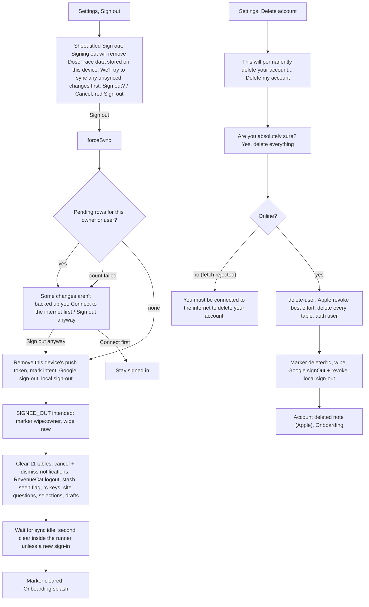
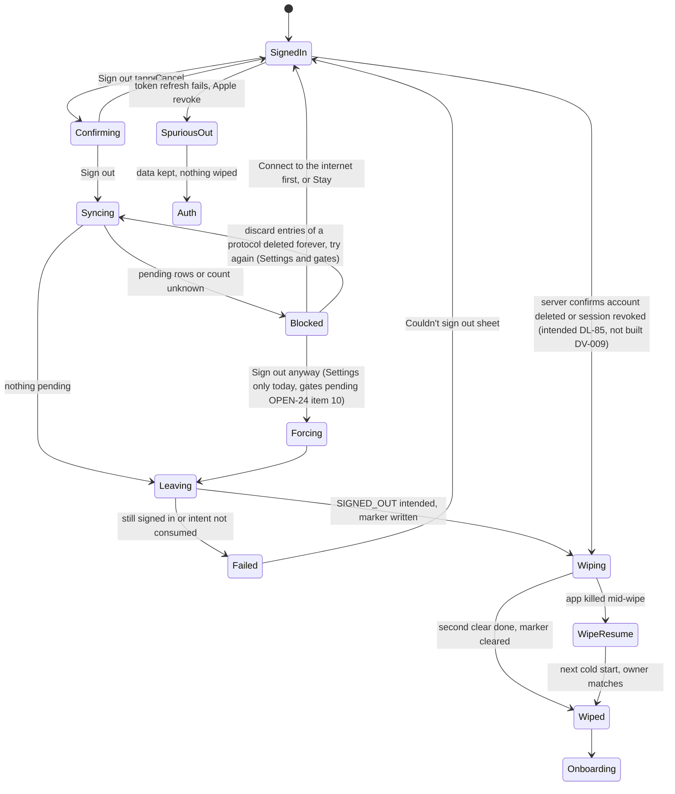
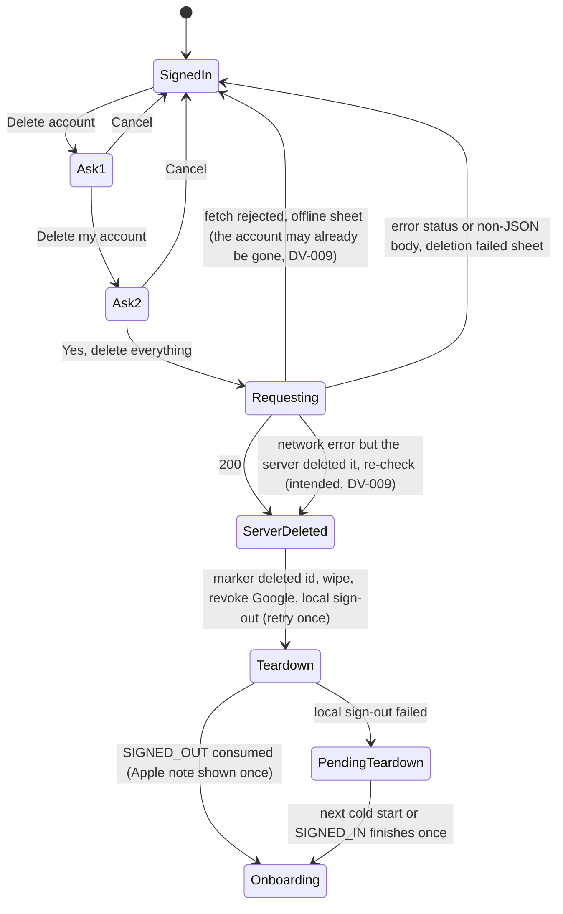
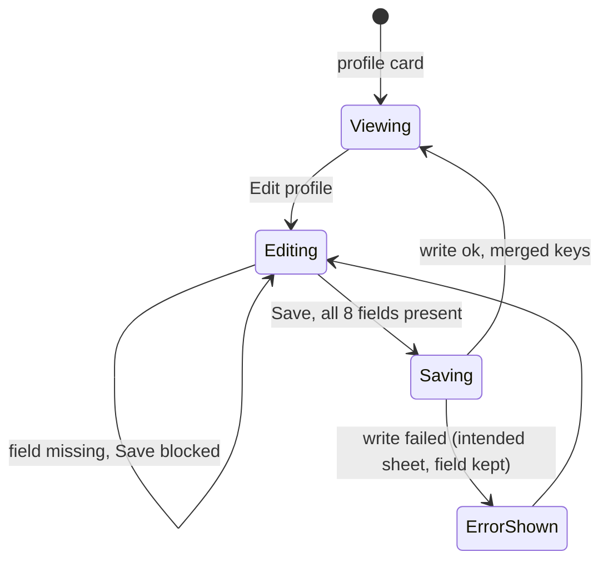

# 12 — Account: profile, sign-out, delete account, export

> Draft for founder review, written 2026-10-12 from `docs/product/research/07-onboarding-account-premium.md` (main source: §3.5–3.8, R23–R39, §5.1, §6.4–6.10, §7, §8), `08-platform.md` (§4.10, §5), `03-reminders.md` (R-39…R-42), `docs/decisions.md` (Data & privacy; Onboarding & auth; Cross-account guard 2026-10-03; dt-council 2026-10-04) and `docs/specs/premium-and-auth.md`, ship-check Gate B. Code @ 4dade55.
> Shows the **intended** behaviour; **Divergence today** notes cite the dossier.

---

## 1. Goal

Let the user leave the phone or the service safely: a **sign-out** never loses data they typed (it backs up first, and only wipes the phone on a real, intended sign-out — never on a token refresh or a session hiccup); **delete account** erases every synced table and the auth user on the server, then the phone; **Download my data** gives them everything. Profile edits merge, never clobber.

## 2. Actors

| Actor | Role |
|---|---|
| User | Edits profile, exports, signs out, deletes the account. |
| Settings | Profile card → Edit profile; Data & privacy (Download my data, Adherence report, Usage analytics, legal); Sign out / Delete account card. |
| `signOutIntended` (`lib/signOutCore.js`) | Force sync → count pending → block or proceed → remove push token → mark intent → local sign-out → verify. |
| `onSignedOutNow` / `afterSignedOut` (`lib/signedOut.js`) | Intended → wipe (marker `wipe:<owner>`); spurious → keep everything. |
| `delete-user` edge function | Apple revoke (best effort) → delete 20 tables + referrals → auth user. |
| Cross-account guard | A different account signing in discards the previous account's local data, unsynced rows included (built; coordinator line decisions.md:508-509 — pending OPEN-21 (11), Portuguese question 22). |
| Gates (Finish setup, 18+) | Offer sign-out too (no "Sign out anyway" today; DL-92 + OPEN-24 item 10). |

## 3. Preconditions

- Signed in. Delete needs network. Sign-out works offline (local) but blocks when unsynced rows exist unless forced from Settings.

## 4. What may already have happened before

| # | Prior state | What the flow must do |
|---|---|---|
| P1 | Logged doses offline a minute ago | Sign-out pushes first; still unsynced → "Some changes on this phone aren't backed up yet…" with **Connect to the internet first** / **Sign out anyway** (Settings only). |
| P2 | A protocol was deleted forever on another device; its unsynced dose stays pending | Orphans block the count; Settings offers discard of orphans / Sign out anyway. |
| P3 | Token refresh failed in the background (spurious SIGNED_OUT) | Nothing wiped; user lands on Auth; signing back in finds everything. (When the server confirms the account was deleted or the session revoked, the intended path is DL-85 instead — see P6 and §7.8.) |
| P4 | Apple credential revoked in iOS Settings | Local sign-out, not intended → data kept. |
| P5 | Killed mid-wipe | Marker `wipe:<owner>` finishes the wipe on the next cold start (owner match only). |
| P6 | Server deleted the account, response lost | **Confirmed in code (07 §8; DV-009):** `requestAccountDeletion` returns `{offline}` only on a fetch rejection (`accountActions.js:55-57`), so a rejection after the server acted shows "You must be connected to the internet to delete your account." while the account is gone; a non-JSON body makes `res.json()` throw (`:58`), which Settings shows as "Account deletion failed. Please try again." (`SettingsScreen.js:566-568`). Either way the account may be gone; next refresh fails → spurious sign-out → local data kept, no wipe. Intended: the app re-checks the account on a network error and finishes the teardown (DV-009, No (bug)); a server-confirmed deletion then cancels reminders and wipes (DL-85). |
| P7 | Active App Store / Play subscription | Deleting the account does not cancel billing; **no warning today** (07 Gap 4). Intended (DL-60): Premium users are told, with a link; the line and link ×6 = pending OPEN-24 item 6 (Portuguese question 2). |
| P8 | Another person will use the phone next | Intended sign-out wipes data, drafts, stash, site questions; **AI consent and entitlement cache stay today** (07 D-7, D-18; DL-55, DL-53). |
| P9 | Offline at the profile gate with unsynced rows | **Intended (DL-92, was AD-29 / OPEN-21 (5)):** the gates can be answered offline; their "Sign out anyway" is new UI, pending OPEN-24 item 10 (Portuguese question 2). Today blocked with no force (A-94; the gates offer only to discard entries of a protocol deleted forever on another device). |
| P11 | Account created with Apple on Android (real since Android Apple sign-in went live on 2026-10-03) | Delete: the Android web flow never calls `apple-link` (only the native iOS path does, `lib/supabase.js:348`), so unless the same account also signed in with Apple on an iPhone there is no stored Apple token to revoke; `delete-user` returns `appleManualRevokeNeeded` and the Android note tells the user to remove access at account.apple.com. This is live behaviour, not a hypothesis. |
| P10 | Reset link for another account | "Reset the password of another account?" → sign out (no force) then reset (flow 01). |

## 5. Happy path

## 6. States and transitions

### 6.1 Sign-out

### 6.2 Delete account

### 6.3 Profile edit (Settings)

## 7. Alternative and exception paths

### 7.1 Never destroy on a maybe
- The wipe fires ONLY on an intended sign-out (flag set by `signOutIntended`), never on a token refresh, a session hiccup during an update, or a re-auth of the same user (CLAUDE.md "Never destroy on a maybe", founder directive 2026-09-12).
- A spurious SIGNED_OUT keeps local data and reminders; only the stash freshness ends and a queued notification tap is dropped. The exception is a server-confirmed deletion or revoked session: intended (DL-85) cancels the reminders and wipes the phone; a network failure never cancels anything. Not built → DV-009.
- Cross-account: when a DIFFERENT account signs in (cold start or SIGNED_IN) the previous account's local data is discarded today, unsynced rows included, without a warning (`App.js:621-633`); its reminders are cancelled before import. The only source is a coordinator line (decisions.md:508-509, "final Gate B"), and it collides with CLAUDE.md "NEVER lose user-entered data": **pending OPEN-21 (11) (Portuguese question 22)** — keep as built, warn and offer "Sign in as {previous} first" / "Discard and continue" (recommended), or keep the rows hidden until that account returns.
- **Divergence today (08 Gap 7):** `getLocalDataUserId` skips `vials` (edge case). → DV-169.

### 7.2 Offline
- Sign-out with nothing pending offline: local sign-out (`_removeSession` under the auth lock) → wipe.
- Sign-out with pending rows offline: blocked; Settings offers "Sign out anyway" (with its confirmation). The words of these sheets ×6 are on the test-build look list (A-46, Approvals still owed item 8).
- **Intended (DL-92, was AD-29 / OPEN-21 (5); decisions.md:542 is a coordinator line):** Finish setup and the 18+ sheet can be answered offline. The same "Sign out anyway" on them is new UI: **pending OPEN-24 item 10 (Portuguese question 2)**.
  - **Divergence today (07 Gap 6; A-94):** no force there (only the discard of entries of a protocol deleted forever on another device). → DV-114.
- Delete offline: "You must be connected to the internet to delete your account." Nothing changes — unless the fetch was rejected after the server acted (P6, DV-009).
- **Divergence today (07 D-16, confirmed in code):** offline cold start with an expired token routes to Auth while the session is stored (`App.js:609-617` ignores the `getSession` error). Intended (DL-54): offline with a stored session = signed in. → DV-083.

### 7.3 Killed / interrupted
- Mid intended wipe → completed on next cold start only for the data's own owner.
- After server delete, before local sign-out → marker `deleted:<id>` completes wipe + sign-out once.
- **Confirmed in code (07 §8; DV-009):** delete response lost → reported as offline although the account is gone (a fetch rejection returns `{offline}`); no wipe follows (spurious sign-out). Intended (a plain bug, DV-009 "No (bug)" for this half): the app re-checks the account on a network error and finishes the teardown; a server-confirmed deletion cancels reminders and wipes (DL-85).

### 7.4 What the wipe removes / keeps
| Removed on intended sign-out | Kept (device-level) |
|---|---|
| 11 SQLite tables, scheduled + delivered notifications, snooze records, RevenueCat identity, stash `dt_onboarding_data`, `dt_seen_onboarding`, `dosetrace_rc_start`, rc migration flags, site questions, Fold selections, in-memory drafts, this device's push token | language, time format, theme, install id, reminder-setup-seen, deep-sleep-checked, settings folds, sort, handled ids, missed-scan watermark + zone history, alert snoozes, `dosetrace_vial_low_sent`, **AI consent**, **entitlement cache**, curve view / explainers / food draft keyed by uid |
- **Divergence today (07 D-7, D-17, D-18; 03 G28; 02 D16):** two different problems.
  - **Inherited by the next account (device-global keys):** AI consent (`lib/aiConsent.js`, not in `runWipeSteps`), `dosetrace_entitlement_last_uid` (never cleared; the SIGNED_IN window before `initPurchases`, DV-082), `dosetrace_vial_low_sent`, alert snoozes, and the missed-scan watermark + zone history (`dosetrace_missed_since` / `_tz` / zone history, `lib/doseActions.js:123-127`).
  - **Residue only, never inherited:** the curve view (`dosetrace_curve_view_{userId}`), the food chat draft (`dosetrace_food_draft:<uid>`) and the explainer flags are per-user keys; they stay on the phone but another account never reads them.
  - AI consent per account → DL-55 (the Settings withdraw row = pending OPEN-24 item 1; server proof of consent = counsel, DL-83; target build = OPEN-16 (a)); the other keys → AD-05, DL-52, DL-53. What the cross-account guard itself should do is pending OPEN-21 (11).

### 7.5 Delete account details
- Server deletes by user id: dose_logs, vials, protocols, biomarkers, vaccines, food_logs, reality_checks, calc_snapshots, calc_targets, reality_check_open, calc_inputs, ai_food_usage, ai_scan_usage, reminders, notification_preferences, analytics_events (none linked to the account — the install id is pseudonymous, DL-84), referral_codes, apple_tokens, push_tokens, notification_sends + referrals (`delete-user/index.ts:112-139`); `ai_assistant_usage` and `profiles` go by cascade; then the auth user. Apple refresh token revoked best effort (delete always wins).
- **Intended (DL-93, was AD-46 / OPEN-21 (7)):** `delete-user` names `ai_assistant_usage` and `profiles` and drops the two tables that do not exist in production (`notification_preferences`, `notification_sends`). Not built → DV-011; the function deploy needs the founder's go (Approvals still owed item 1).
- Apple note after delete (shown when `delete-user` reports `appleManualRevokeNeeded`): iOS "…You can also remove DoseTrace's Sign in with Apple access anytime in the Settings app, under your Apple ID."; Android "…at account.apple.com, under Sign-In and Security." Android Apple sign-in is live (since 2026-10-03), so the Android note is a live path: an account that only ever signed in with Apple on Android has no stored Apple token (the web flow does not call `apple-link`) and always gets the note.
- **RevenueCat customer left after delete (verification 05 O-6; DV-219):** `delete-user` makes no RevenueCat call, so the RevenueCat customer (app user id = the Supabase user id, with its purchase history) stays after the account is deleted. Whether it must be deleted too is a counsel item (DL-83, with the decisions.md:388 list; Approvals still owed item 9).
- **Divergence today (07 Gap 4):** nothing warns that an App Store / Play subscription keeps billing. Intended (DL-60, store account-deletion guidance): the delete sheet tells Premium users, with a link to manage subscriptions; the line and link ×6 are new UI, **pending OPEN-24 item 6 (Portuguese question 2)**. → DV-087.
- **Divergence today (08 Gap 9; DV-011):** the list relies on cascades for `ai_assistant_usage` and `profiles` (verified live 2026-10-12 for `profiles`: `profiles.id → auth.users ON DELETE CASCADE`, so the rows do go); see DL-93 above.

### 7.6 Export (Download my data)
- Settings → Data & privacy → "Download my data" → JSON of every synced table + email → share sheet. Adherence report: preview "This is exactly what your provider will receive." then Share.
- **Divergence today (07 D-23):** Settings export does not import first when the local DB is empty (the 18+ sheet does).
- **Divergence today (07 D-24):** `user_metadata` (profile, preferences, favourites, labels, mirrors) not exported.
- Intended for both (DL-42): "Download my data" imports first on an empty phone and includes the profile and preferences. → DV-086.

### 7.6a Legal texts and analytics (Data & privacy)
- **Divergence today (DV-085, DV-231):** Settings opens the in-app privacy text (`settings_privacy_body`, `SettingsScreen.js:1210`), while onboarding, Auth and the paywall open the web policy; the in-app text says only "a lab report or vaccine card" goes to Anthropic and omits the AI food log, the protocol assistant and the vial-label scan. Intended: one text (DL-81, was AD-28) that names Anthropic and covers every AI feature (AD-72, decisions.md:330); wording ×6 = Approvals still owed item 2.7.
- **Divergence today (DV-190):** the "Usage analytics" row (`settings_analytics_sub`) and the in-app policy still say "anonymous". Intended (DL-84, was AD-57): "not linked to your account" (the install id is pseudonymous); wording ×6 = Approvals item 2.6; the Apple / Play privacy labels = Approvals item 6.

### 7.7 Profile edit
- Edit profile requires all 8 fields; writes a merge of display_name, gender, birth month/year, country, primary goal, activity (5-level + stamp), provider.
- **Divergence today (07 D-22):** `saveProfile` and the analytics toggle ignore the write error → offline save looks saved and silently reverts. Intended (DL-56): DoseTrace sheet + keep the field (like notification switches). → DV-008.
- **Divergence today (07 D-10):** Settings has no "What you track" editor although the gate requires it. Intended (DL-58): Edit profile can edit every field the gate requires; the editor is new UI, **pending OPEN-24 item 2 (Portuguese question 2)**. → DV-113.

### 7.8 Second device
- Signing out on phone A does not sign out phone B. Deleting the account: phone B's next token refresh fails → spurious sign-out → data kept on B.
- **Intended (DL-85, decided by logic — was AD-04 / OPEN-21 (1); from the founder's reminder principle, decisions.md:597-601, and "never destroy on a maybe"):** when the server confirms the account was deleted or the session revoked, B cancels its scheduled reminders and wipes its local data; a network failure never cancels anything. **Divergence today (03 G2):** not built → DV-009.
- The residual local data left on phone B after an Apple-account delete (the "F6" item of decisions.md:417, the PRD's former local question) is covered by the same DL-85: B wipes once the server confirms the deletion.

### 7.9 Timezone / DST
- Not applicable.

### 7.10 Notification tap
- A queued tap is dropped on sign-out. Taps after the account is gone open Auth.

### 7.11 Fold
- Settings book: left = profile card + groups + Sign out / Delete card; right = chosen group (Preferences default) (BK-7). Sheets are one centred column.

### 7.12 Free vs Premium
- Same flow for both; Premium status is per RevenueCat customer (logged out on sign-out; not cancelled on delete, and the customer record itself is not deleted — DV-219, a counsel item under DL-83). Managing or cancelling the subscription inside the app is **pending OPEN-15 (Portuguese question 21)** (flow 13).

## 8. What every surface shows

| State | Settings | Root screen | Notifications | Data on phone |
|---|---|---|---|---|
| Confirm sign-out | sheet titled "Sign out" / "Sair" (`SettingsScreen.js:514`), body "Signing out will remove DoseTrace data stored on this device. We'll try to sync any unsynced changes first. Sign out?"; Cancel / red Sign out | Main | unchanged | unchanged |
| Blocked (unsynced) | sheet "Some changes on this phone aren't backed up yet…" + Connect to the internet first / Sign out anyway | Main | unchanged | unchanged |
| Blocked (not backed up after force sync failure) | "Some changes could not be backed up. Signing out now removes them from this phone." + Stay signed in / Sign out anyway | Main | unchanged | unchanged |
| Failed | "Couldn't sign out" / "You're still signed in. Connect to the internet and try again." | Main | unchanged | unchanged |
| Signed out (intended) | — | Onboarding splash | all cancelled + dismissed | wiped |
| Spurious sign-out | — | Auth (Sign in) | still scheduled | kept |
| Delete confirm 1 / 2 | "Delete account" → "This will permanently delete your account…" → "Are you absolutely sure?" → "Yes, delete everything" | Main | — | — |
| Delete offline | "You must be connected to the internet to delete your account." | Main | — | — |
| Deleted | Apple note (if Apple) | Onboarding | all cancelled | wiped |

## 9. Data written at each step

| Step | Store | Write |
|---|---|---|
| Sign-out start | sync | forced push |
| Before local sign-out | Supabase `push_tokens` | this device's row deleted |
| Intent | memory | intent flag |
| SIGNED_OUT intended | AsyncStorage `dosetrace_wipe_pending = wipe:<owner>` | then the wipe steps; cleared at the end |
| Delete | server | rows of 20 tables + auth user |
| Delete teardown | AsyncStorage `dosetrace_wipe_pending = deleted:<id>` | cleared after local sign-out |
| Profile save | `user_metadata` | merged keys |
| Analytics toggle | `user_metadata.analytics_opt_in` | no error handling today |

## 10. Rules (with sources)

R27 intended sign-out sequence (`lib/signOutCore.js:59-92`). R28 only Settings forces (gates: DL-92, the button = pending OPEN-24 item 10). R29/R30 inline / deferred SIGNED_OUT handling; spurious keeps all. R31 cold-start pending wipe only for the data's owner. R32 cross-account guard (as built; pending OPEN-21 (11)). R33 Apple revoke = local sign-out without wipe. R34 two confirmations; offline sheet. R35 server deletion list ⊇ syncCore TABLES (test `deleteUserCoverage`). R36 teardown runs exactly once. DL-85 a server-confirmed delete / revoke cancels reminders and wipes; a network failure never does. CLAUDE.md "NEVER lose user-entered data", "Writes merge, never clobber", `onAuthStateChange` synchronous. (`07 §4`.)

## 11. Divergences today (summary)

| ID | Intended | Today | Source | DV |
|---|---|---|---|---|
| D12-1 | Gates work offline (DL-92) and offer "Sign out anyway" (pending OPEN-24 item 10) | No | `07 Gap 6` (A-94) | DV-114 |
| D12-2 | Account-scoped device keys cleared on sign-out (AD-05, DL-52, DL-53, DL-55) | Inherited by the next account: AI consent, entitlement last-uid, vial-low map, snoozes, missed-scan watermark + zone history. Residue only (per-user keys, never inherited): curve view, food draft, explainer flags | `07 D-7, D-17, D-18`; `03 G28`; `02 D16`; verification 05 DV-081 / 07 K-06 | DV-081, DV-082, DV-007 |
| D12-3 | Delete warns Premium users about store billing, with a link (DL-60; line + link = pending OPEN-24 item 6) | Silent | `07 Gap 4` | DV-087 |
| D12-4 | Lost delete response finishes the teardown (bug fix) | Shows offline, no wipe | `07 §8` (confirmed in code) | DV-009 |
| D12-5 | Profile save errors shown (DL-56) | Swallowed | `07 D-22` | DV-008 |
| D12-6 | Export includes profile / preferences and imports first (DL-42) | Neither | `07 D-23, D-24` | DV-086 |
| D12-7 | Other devices cancel reminders and wipe after a server-confirmed deletion or revoke (DL-85, incl. phone B's residual data) | Not built | `03 G2` | DV-009 |
| D12-8 | Offline cold start keeps a stored session (DL-54) | Routes to Auth | `07 D-16` (confirmed in code) | DV-083 |
| D12-9 | "What you track" editable in Settings (DL-58; editor = pending OPEN-24 item 2) | Not | `07 D-10` | DV-113 |
| D12-10 | One privacy text, in-app = web (DL-81) | In-app vs website differ | `07 D-21` (A-117) | DV-085 |
| D12-11 | The in-app policy names Anthropic and covers every AI feature (AD-72; wording = Approvals item 2.7) | Mentions only lab reports and vaccine cards | verification round 2 R2-03 #1 | DV-231 |
| D12-12 | Analytics copy says "not linked to your account" (DL-84; wording = Approvals item 2.6) | "anonymous" in `settings_analytics_sub` and the in-app policy | PRD G-136 | DV-190 |
| D12-13 | `delete-user` names `ai_assistant_usage` and `profiles`, drops the two absent tables (DL-93; deploy = Approvals item 1) | Relies on cascades; lists two tables absent in production | `08 Gap 9` | DV-011 |
| D12-14 | Whether the RevenueCat customer is deleted with the account — counsel (DL-83) | Left in RevenueCat | verification 05 O-6 | DV-219 |
| D12-15 | The cross-account guard finds the owner of a vials-only database | `getLocalDataUserId` skips `vials` | `08 Gap 7` | DV-169 |

## 12. Founder questions (canonical IDs — `docs/product/OPEN-DECISIONS.md`)

Reconciled 2026-10-12: every question this flow raised has one canonical ID in `OPEN-DECISIONS.md` — **OPEN-xx** waits for the founder (asked in the one Portuguese round there), **AD-xx** is already decided by the ledger or a signed spec, **DL-xx** is decided by product logic (recorded in `docs/decisions.md`; the founder may override). DV-xxx is the defect row in `DIVERGENCES.md`.

**Open — waiting for the founder:**
- **OPEN-21 (11) — The cross-account guard** (Portuguese question 22). When a different account signs in, should the previous account's unsynced rows still be discarded without a warning? Built as "discard" on a coordinator line only (decisions.md:508-509). Recommendation B: warn and offer "Sign in as {previous} first" / "Discard and continue". → §7.1, F12-06, DV-081, DV-169.
- **OPEN-15 — Managing the subscription in Settings** (Portuguese question 21). → §7.12, DV-112, DV-087 (flow 13).
- **OPEN-24 — New UI from logic decisions** (Portuguese question 2): item 1 (Settings row to withdraw AI consent, DL-55, DV-007), item 2 (the "what you track" editor, DL-58 → D12-9, DV-113), item 6 (the delete sheet's billing line + store link, DL-60 → D12-3, DV-087), item 10 (the gates' "Sign out anyway", DL-92 → D12-1, DV-114). Pictures first.
- **OPEN-16 (a) — Scope of 1.3.0** (Portuguese question 1): none of this flow's DL / DV rows has a target build yet.

**Decided — moved or added in round 2 (final ids):**
- **DL-85** (was AD-04 / OPEN-21 (1)) — a server-confirmed delete or revoke cancels reminders and wipes the phone, including phone B's residual data after an Apple-account delete; a network failure never cancels anything. → D12-7, DV-009.
- **DL-92** (was AD-29 / OPEN-21 (5)) — the gates can be answered offline; the button is OPEN-24 item 10. → D12-1, DV-114.
- **DL-93** (was AD-46 / OPEN-21 (7)) — `delete-user` names `ai_assistant_usage` and `profiles`. Deploy = **Approvals still owed item 1**. → D12-13, DV-011.
- **DL-83** (from AD-51) — the RevenueCat customer on delete is a counsel item (**Approvals item 9**). → D12-14, DV-219.
- **DL-81** (was AD-28) and **AD-72** — one privacy text covering every AI feature; wording **Approvals item 2.7**. → D12-10, D12-11, DV-085, DV-231.
- **DL-84** (was AD-57) — analytics "not linked to your account"; wording **Approvals item 2.6**, store labels **Approvals item 6**. → D12-12, DV-190.
- **DL-52** — reason rewritten round 2 (no longer cites the cross-account guard). → D12-2, DV-081.
- **Approvals still owed item 8** — the sign-out-with-unsynced-data and offline texts ×6 (A-46) on the test build.

**Decided — unchanged, applied here:**
- **DL-60 — Subscription warning on delete** (D12-3). Decided by logic: Premium users are told the store subscription keeps billing, with a link (store account-deletion guidance); the line and link are OPEN-24 item 6. → DV-087.
- **DL-42 — Export scope** (D12-6). Decided by logic: "Download my data" includes the profile and preferences and imports first on an empty phone. → DV-086.
- **DL-54** (offline with a stored session = signed in, → D12-8, DV-083), **DL-56** (profile / analytics write errors shown, → D12-5, DV-008), **DL-58** (what you track editable, → D12-9, DV-113), **AD-05 / DL-53 / DL-55** (account keys, → D12-2).

## 13. Acceptance checks (agent-device QA script)

Account: a `+qa` throwaway account created for these checks (never Test03's real data for delete). Light and dark; PT via Settings → Preferências → Idioma. Run Gate B on device before any upload (CLAUDE.md).

**F12-01 — Sign out, all synced**
- Do: Settings ("Ajustes") → "Sign out" / "Sair".
- Expect confirm: sheet titled "Sign out" / "Sair" with "Signing out will remove DoseTrace data stored on this device. We'll try to sync any unsynced changes first. Sign out?" / PT "Ao sair, os dados do DoseTrace salvos neste dispositivo serão removidos. Antes disso, vamos tentar sincronizar as alterações pendentes. Sair?" → Sign out → Onboarding splash. SQLite empty; no DoseTrace alarm in the OS queue; `push_tokens` row for this device gone.
- Sign back in → every protocol, dose and weigh-in returns.

**F12-02 — Sign out blocked by unsynced rows**
- Do: airplane mode → log a dose → Sign out.
- Expect: "Some changes on this phone aren't backed up yet. Connect to the internet first so they're saved — signing out now removes them from this phone." / PT; buttons "Connect to the internet first" / "Conectar à internet primeiro" and "Sign out anyway" / "Sair mesmo assim". Connect first → still signed in, dose kept.

**F12-03 — Sign out anyway**
- Do: as F12-02 → Sign out anyway (confirm).
- Expect: signed out; the unsynced dose is gone from this phone (by the user's explicit choice).

**F12-04 — Spurious sign-out keeps data**
- Setup: revoke the refresh token server-side (test account) while the app is backgrounded.
- Expect today: next foreground → Auth screen; sign in → data intact without re-import gaps; reminders were still scheduled meanwhile.
- Intended (DL-85): a session the server confirms as revoked cancels the reminders and wipes the phone, while a plain network failure keeps everything. Once DV-009 is fixed, "keeps data" is checked with a network failure during the refresh (airplane mode), and the server-side revoke expects the wipe — record which happened.

**F12-05 — Kill mid-wipe**
- Do: Sign out and kill the app within 1 s.
- Expect next launch: wipe completed (no data of the old account), Onboarding.

**F12-06 — Cross-account guard**
- Do: with account A's data on the phone (spurious sign-out state), sign in as B.
- Expect (as built): A's local data and reminders gone before B's import; B sees only B's data. If A had unsynced rows they are lost without a warning — what should happen is pending OPEN-21 (11) (Portuguese question 22); record whether A had unsynced rows.

**F12-07 — Delete account offline**
- Do: airplane mode → Settings → "Delete account" / "Excluir conta" → "Delete my account" → "Yes, delete everything".
- Expect: "You must be connected to the internet to delete your account." / "Você precisa estar conectado à internet para excluir sua conta."; nothing changed.

**F12-08 — Delete account**
- Do: online → Delete account → "This will permanently delete your account. All your data will be lost and this cannot be undone." → "Delete my account" / "Excluir minha conta" → "Are you absolutely sure?" / "Você tem certeza absoluta?" → "Yes, delete everything" / "Sim, excluir tudo".
- Expect: (Apple account) "Account deleted" / "Conta excluída" note — on iPhone the Settings-app wording, on Android the account.apple.com wording (run it once with an account that only ever signed in with Apple on Android: the note must appear, since no Apple token is stored for it); Onboarding; the auth user no longer exists; rows of every table gone (read-only check); signing in with the old credentials fails.
- Intended (DL-60; line + link pending OPEN-24 item 6): subscription warning present for a Premium user (D12-3) — record its absence today.

**F12-09 — Edit profile merge**
- Do: Settings → profile card → "Edit profile" / "Editar perfil" → change country → Save.
- Expect: only `country` changes in `user_metadata`; other keys (notification switches, favourites) intact.
- Offline: intended error sheet (DL-56); today it closes silently and reverts — record D12-5.

**F12-10 — Download my data**
- Do: Data & privacy → "Download my data" / "Baixar meus dados".
- Expect: share sheet with `dosetrace_export.json` containing every synced table; record whether the profile is included (D12-6).

**F12-11 — Adherence report preview**
- Do: Data & privacy → "Adherence report" / "Relatório de adesão".
- Expect: preview with "This is exactly what your provider will receive." / "É exatamente isto que o seu profissional de saúde vai receber." and **Share**; streak line (record D03-7 rule).

**F12-12 — Finish setup sign-out**
- Setup: profile gate shown, offline with an unsynced row.
- Expect (intended, DL-92 + pending OPEN-24 item 10): "Sign out anyway" offered. Today: blocked (sheet with OK only, or the discard offer when the pending rows belong to a protocol deleted forever) — record D12-1.

**F12-13 — Both themes**
- Every sign-out / delete / export sheet, the profile edit sheet and the Apple note: readable in light and dark; red delete buttons from the risk token.
