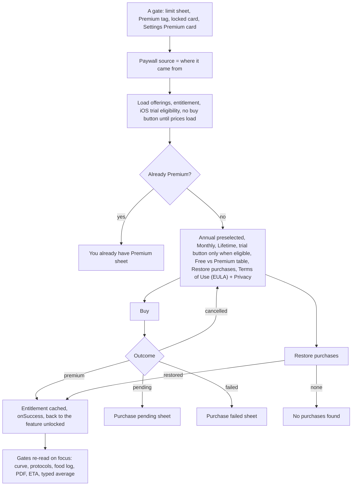
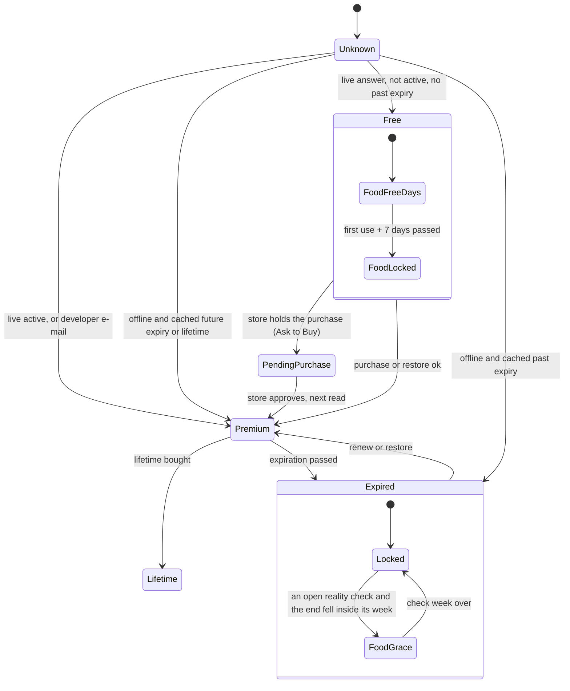
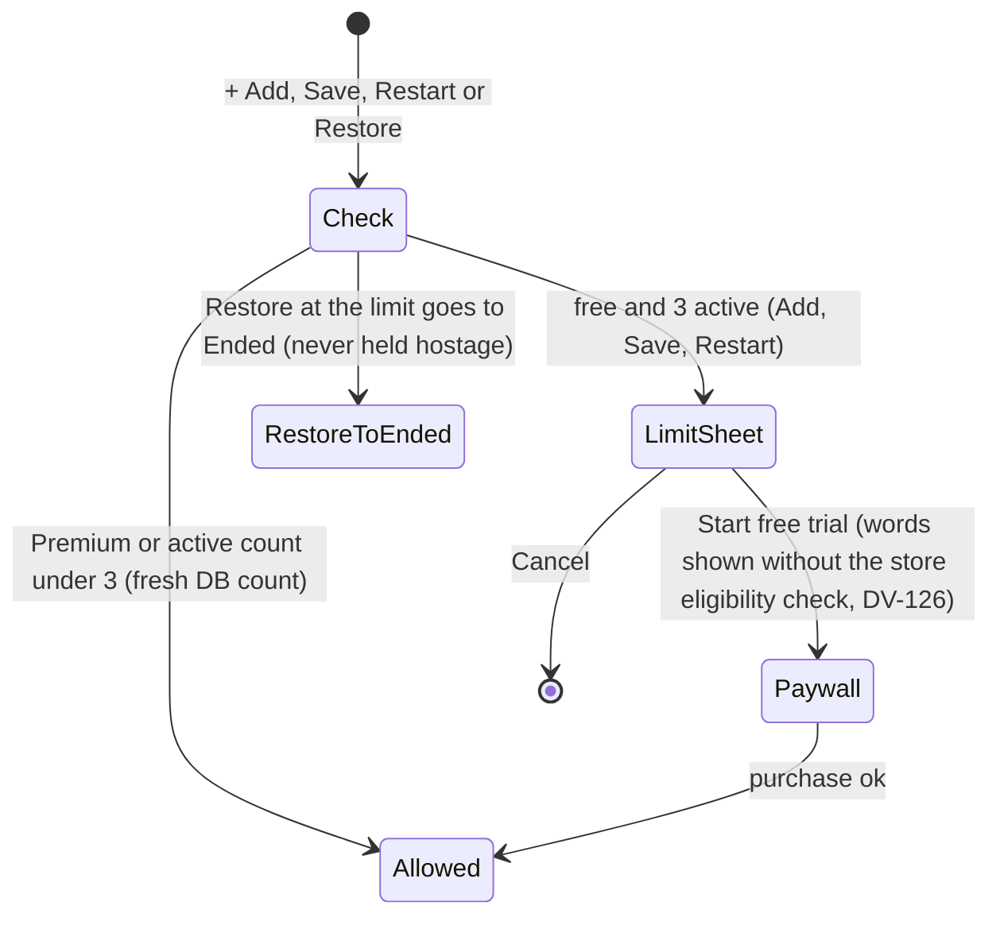
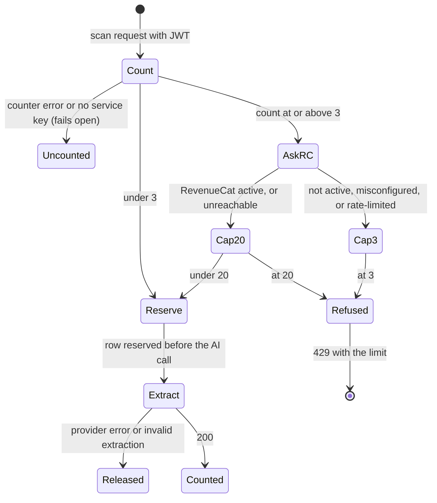

# 13 — Premium and free limits

> Draft for founder review, written 2026-10-12 from `docs/product/research/07-onboarding-account-premium.md` (main source: §3.7, R40–R45, §5.2, §6.1), `04-food-reality-progress.md` (food access, grace), `01-protocols.md` (free limit), `05-curve-journey.md` (curve gating), `06-my-body.md` (scan pool), `docs/decisions.md` (Premium/pricing/free limits; 2026-10-03 founder answers; Resolved 2026-10-03) and `docs/specs/premium-and-auth.md` (PA-1…PA-127), `fixes-1.2.5.md` (FX-4, FX-16). Code @ 4dade55.
> Shows the **intended** behaviour; **Divergence today** notes cite the dossier.

---

## 1. Goal

One honest plan, **Premium** (Monthly, Annual "Best value", Lifetime), real store prices only, no "coming soon". Free stays genuinely useful (journal, calculator, reminders, supply, weigh-ins, cloud backup and sync). Premium unlocks the flagship Dose accumulation curve, unlimited protocols, more AI scans, the AI food log after 7 free days, reality-check results, measured target ETA and PDF export. A paying user is never locked out offline; one helper decides every gate on the phone; the server is authoritative for paid AI calls.

## 2. Actors

| Actor | Role |
|---|---|
| User | Hits a limit, opens the Paywall, buys / restores, lapses. |
| Paywall (`PaywallScreen`) | Offerings + entitlement + trial eligibility before any buy button; four buy outcomes. |
| RevenueCat (`react-native-purchases`) | Entitlement "DoseTrace Pro"; products monthly / yearly / lifetime; app user id = Supabase user id. |
| `lib/entitlement.js` `hasPremium` / `getEntitlement` | The one client helper; per-uid cache with expiry. |
| `foodLogAccess` | Free days / grace / locked for the food log and reality check. |
| Server: `extract-bloodwork` quota, `protocol-assistant` budget, `parse-food` quota | Server-side limits. |
| Store (App Store / Play) | Prices, 7-day trial on Monthly + Annual (verified 2026-10-03), Ask to Buy, billing. |

## 3. Limits and gates (the contract)

| Feature | Free | Premium | Enforced where |
|---|---|---|---|
| Active protocols | 3 (founder "3 mantém", decisions.md:465) | unlimited | client (+ Add, Save, Restart, Restore) — **01 D-22 / 07 D-3: client only**; a server rule and the after-lapse rule are pending OPEN-05 (Portuguese question 7) |
| Dose accumulation curve, Journey / My Body Est. level | — (tag, preview) | yes | client |
| AI scans (labs + vaccines + vials, one pool) | 3 / UTC month | 20 / UTC month | server (RevenueCat REST; unreachable → Premium cap) |
| Vial-label scan | free, in the pool | in the pool | server |
| AI protocol assistant | 10 conversations / rolling 7 days (signed AP-18). Today the server also caps 40 answers per conversation, a 24-hour conversation life and 200 answers per rolling 24 h (`protocol-assistant/budget.ts:10-12`) — builder caps AP-18 does not have: keep or change is pending OPEN-18 (3) (Portuguese question 23 (c)), DV-240 | same | server |
| AI food log | 7 days from first use (decisions.md:274) | every day | client — **intended also server (AD-16; 04 D-15, DV-103)** |
| AI food parses | 25 / local day; answering a follow-up never uses one (decisions.md:251, signed FL-21). Today the server also caps 25 follow-ups / local day and 60 / rolling 24 h (`parse-food/index.ts:28-30`) — builder caps the ledger does not have: keep or change is pending OPEN-18 (3) (Portuguese question 23 (c)), DV-213 | same | server |
| Reality check start | inside free days | yes | client |
| Reality check result (measured burn) | no (free days end before day 21; AD-14) | yes | client |
| Typed average calories | no (AD-15, founder FL-48 "A", decisions.md:636) | yes | client — **today shown to free days (04 D-14, DV-102)** |
| Weigh-ins, chart, + past weigh-in | yes, never paywalled | yes | — |
| Target + bar | yes | yes | — |
| Measured target ETA | — | yes | client |
| Lab journal by hand | free (AD-24, decisions.md:268); ships in 1.3.0, picture first (AD-68, Approvals still owed item 3); **not built today (06 G-1, DV-107)** | yes | — |
| Lab marker charts | Premium (AD-24); **today free (06 D-8, DV-108)**; the locked chart picture is owed (Approvals item 3) | yes | — |
| CSV export | yes | yes | — |
| PDF export | — ("PDF export is Premium") | yes | client, at the action |
| Cloud backup / sync, reminders, calculator, supply | yes | yes | — |

## 4. What may already have happened before

| # | Prior state | What the flow must do |
|---|---|---|
| P1 | Bought on another phone / platform, or reinstalled (same account) | RevenueCat identifies by user id (`appUserID` = Supabase uid, `lib/purchases.js:68`) → Premium after sign-in and `initPurchases`, with no Restore needed; Restore stays reachable for anyone the app shows as free (Settings Premium card → Paywall). |
| P2 | Bought, then signed in with a different account | Entitlement belongs to the RevenueCat customer (restore/transfer = RevenueCat project setting, kept as is — a coordinator line, decisions.md:475; it changes nothing in the app). |
| P3 | Premium lapsed during an open reality check | Food-log grace to the end of that check week (logging only); results need Premium (AD-14, decisions.md:274, FL-41). |
| P4 | Offline for days with an active subscription | Cache with future expiry = Premium (never locked out offline; decisions.md:288, FX-16). |
| P5 | Ask to Buy / payment pending | "Purchase pending" — never "failed"; Premium when the store confirms. |
| P6 | Bought Lifetime while a subscription renews | Sheet: cancel the subscription in the store (the app cannot). (PA-74, built — a coordinator line, decisions.md:474; the premium-and-auth checklist awaits the founder's signature, Approvals still owed item 7.) |
| P7 | Already Premium and opens the Paywall | "You already have Premium" — no buy button. |
| P8 | Developer / review account | Premium by the e-mail allow-list (client and server lists identical). |
| P9 | Premium lapsed with 4+ active protocols | Today: they all stay active; + Add shows the limit. Whether a lapsed payer keeps every active protocol or a downgrade rule applies is a money call: **pending OPEN-05 (Portuguese question 7)** (DL-24 withdrawn; recommendation A — keep them). |
| P10 | RevenueCat unreachable | Client uses its cache; server gives the Premium scan cap (AD-36, decisions.md:275; 07 D-1). |

## 5. Happy path

## 6. States and transitions

### 6.1 Entitlement (client)

Note: the client cannot tell a store free trial or a billing-grace period from a paid period (all `premium:true`) — 07 D-8.

### 6.2 Protocol limit gate

### 6.3 Scan pool (server)

## 7. Alternative and exception paths

### 7.1 Paywall details (PA-5…PA-16 — design approved from pictures 2026-10-03, checklist signature owed, Approvals still owed item 7; founder lines decisions.md:283, :287)
- Prices only from the store at runtime; "Save {pct}%" only from real store prices; billed amount biggest; length next to every price; Annual preselected ("Best value"); trial button only when the store says eligible and the length is known ("Start {days}-day free trial", 7 days on both stores today — AD-49, decisions.md:287, signed MB-11; eligibility = DL-82 — + Apple billing text); Restore purchases; Terms of Use (EULA) (iOS) / in-app Terms (Android) + Privacy under Restore; Free vs Premium table (dashes on the free side); animated example previews with an "Example" tag.
- **Divergence today (DV-126):** the 3-protocol limit sheet's button says "Start free trial" / "Começar teste grátis" without asking the store whether the person is eligible (`ProtocolsScreen.js:2035-2044`). Intended (DL-82): trial words only when eligible, else neutral words ("See Premium").
- **Divergence today (DV-186):** the paywall's Premium column and preview list carry "Reality check & progress tracking" / "Seus números reais e seu progresso" (`pw_prem_reality`, `paywallPlans.js:175, :182`), while weigh-ins, their chart and Progress are free. Intended (AD-64): "Reality-check results"; wording ×6 = Approvals still owed item 2.5.
- **Divergence today (DV-233):** the paywall's failure sheets ("Restore failed", "Purchase failed", "unavailable") are titled the generic "Error" with the circle glyph (`paywallPlans.js:149-154`), against decisions.md:64 (warning triangle) and :121 (titles say what happened).
- **Divergence today (DV-235):** `paywall_start_trial_months` uses "(s)"-style plurals in ES / PT / DE / IT ("mes(es)", "mês(es)", "Monat(e)", "mese/i"; the register row names ES / DE / IT, PT checked here in `translations.js:4670`); plural keys intended, wording ×6 = Approvals item 2.15.
- Back blocked while the store is busy.
- BR prices: R$19,90 / month, R$199,90 / year on both stores (founder 2026-10-03). US: $2.99 / $28.99 / Lifetime $69.99 (read from ASC 2026-10-03).
- **Divergence today (07 D-9, Gap 4):** there is no in-app way to manage or cancel the subscription, and no trial / billing-issue state is shown ("Premium" or "Free" only). → **pending OPEN-15 (Portuguese question 21)**, DV-112. Restore itself is not lost: anyone the app shows as free reaches it through the Settings Premium card → Paywall → "Restore purchases", and a payer who reinstalls gets Premium back on sign-in with no Restore at all (RevenueCat `appUserID` = Supabase uid, `lib/purchases.js:68`). A user the app already sees as Premium is sent away from the Paywall ("You already have Premium"), but has nothing to restore.
- **Divergence today (verification 05 O-2):** two live strings say the curve comes from the user's log, which contradicts AD-19 / FX-13 (the curve follows the PLANNED schedule): the Paywall hero "Dose-accumulation curves from your own log, unlimited protocols, more scans, and PDF export." (`paywall_hero_sub`, `PaywallScreen.js:278`) and the Settings Premium card line "Dose accumulation curve from your own log" (`settings_premium_feat_1`, `SettingsScreen.js:642`), in all 6 languages. → DV-071 (DV-212 merged into it); wording ×6 = Approvals still owed item 2.1.
- **Divergence today (07 D-6, Gap 12):** "trial" means two things (store intro trial vs the 7 free food-log days). Intended (DL-61): the 7 food-log days are "free days", never "trial"; wording ×6 = Approvals item 2.14. → DV-164.

### 7.2 Gates by surface (where the Paywall opens from)
| Source | Surface |
|---|---|
| `settings` | Settings Premium card "Upgrade to Premium" → "See plans" (free only) |
| `protocol_limit` | Limit sheet "Start free trial" (no eligibility check, DV-126) |
| `journey_serum` | Journey Dose accumulation tile (free) |
| `serum_preview_sheet` | My Body preview sheet "See your compound build up" → Unlock |
| `log_serum` | Dose log "Curve" (free) |
| `serum_direct` | Curve opened directly (replace) |
| `bloodwork_upload` | Lab journal upgrade sheet "Start 7-day free trial" |
| `export_pdf` | "PDF export is Premium" → Go Premium |
| `reality_check` | Progress locked explainer / result |
| `food_grace`, `food_hero`, (none from FoodChat) | food-log notes, hero, locked card |
- **Divergence today (07 §2.2):** `CalculatorSection.js:1148` and FoodChat open the Paywall with no source (analytics only).

### 7.3 Offline
- Paying user offline: cached future expiry → Premium; lifetime → Premium; expired cache → not Premium with `endedOn`; never known → free.
- Paywall offline: "Plans are currently unavailable. Please check your connection and try again later." + Try again.

### 7.4 Account switch
- `logOutPurchases` on intended sign-out; RevenueCat logs in with the new user id at SIGNED_IN.
- **Divergence today (07 D-7, confirmed in code):** entitlement cache keys survive sign-out; `cacheUid` uses `dosetrace_entitlement_last_uid` until `initPurchases` runs, so a screen reading the entitlement in that short window can use the previous account's cache.

### 7.5 Server vs client
- **Intended (AD-16 — decisions.md:288; FX-16: "the server stays authoritative for paid AI calls"):** paid AI paths check access on the server.
  - **Divergence today (04 D-15; 07 D-2):** `parse-food` has no entitlement / free-days check. → DV-103; the function deploy needs the founder's go (Approvals still owed item 1).
  - **Not decided — the 3-protocol limit (07 D-3; 01 D-22):** it is checked only on this phone, at add / restart / restore (plus the save safety net), and has no server rule; another device or an old build can exceed it. A row that arrives by pull, was created while Premium, or is revived by sync is never checked when it arrives; it only counts against this phone's next add / restart / restore. Whether the server refuses a 4th active protocol is **pending OPEN-05 (Portuguese question 7)** (recommendation A: phone-only, as today). → DV-095.
  - **Divergence today (07 D-4):** the dormant `send-reminders` would send the 20:00 food question to locked users (inactive while server push is off).
  - **Deliberate (AD-36, decisions.md:275; 07 D-1):** RevenueCat unreachable → server gives 20 scans to everyone past 3, while the client shows the cache.

### 7.6 Lapse
- Food log: grace to the end of the current check week (only if the end day ≥ check start), else remaining free days, else locked; never "free days" wording for a lapsed payer.
- Reality check: grace allows logging only; starting a new check and seeing results need Premium (intended, AD-14 — decisions.md:274, FL-41; **04 D-13: today grace can see results, and start a new check in a stale window**, DV-101).
- Curve: Paywall on next focus; Journey tile tag; right page cleared on the Fold.
- Protocols: today existing active ones are kept; + Add limited. Keep them all vs a downgrade rule for lapsed Premium is **pending OPEN-05 (Portuguese question 7)** (DL-24 withdrawn).
- Scans: next scan at ≥ 3 asks RevenueCat → free cap 3 ("You've used your {n} scans for this month (labs, vaccine cards, and vials combined). You can still enter everything by hand.").

### 7.7 Delete account while subscribed
- **Divergence today (07 Gap 4):** no warning that billing continues (flow 12). Intended (DL-60): the delete sheet tells Premium users, with a link; the line and link ×6 are **pending OPEN-24 item 6 (Portuguese question 2)**. → DV-087. The RevenueCat customer stays after the delete (DV-219, counsel item under DL-83).

### 7.8 Second device / platform
- Same RevenueCat customer → Premium on both after `initPurchases`. iOS ↔ Android purchases depend on the RevenueCat project's restore/transfer setting (kept as is — a coordinator line, decisions.md:475, not a founder answer; it changes nothing in the app).

### 7.9 Timezone
- Scan month = UTC calendar month; food parse quota = the client's local `entry_date`; assistant = rolling 7 days.

### 7.10 Notification tap
- None open the Paywall.

### 7.11 Fold
- Paywall, previews and sheets stay one centred column (BK-11); a free user tapping the curve tile on the unfolded Fold gets the full-screen Paywall.

## 8. What every surface shows

| State | Settings | Journey tile | My Protocols + Add | My Body | Food log | Progress |
|---|---|---|---|---|---|---|
| Free | profile "Free plan" / "Plano gratuito" + Premium card (5 feature lines, See plans) | Premium tag + description | limit sheet at 3 | "3 free scans a month…" / "3 leituras grátis por mês…" only until the first lab scan with values (free card + empty journal), then "You've scanned {n} markers. Premium charts every one over time…" with no number (`BodyScreen.js:1104-1107`, `:1115-1120`); how many scans are used is never shown — pending OPEN-14 (b) (Portuguese question 20 (a)), DV-110; PDF → Premium sheet; curve card tag + lock | 7 free days then locked | start inside free days; result locked; ETA locked |
| Free, food days ending | — | — | — | — | note with dates + See Premium | — |
| Premium | badge "Premium", no card | Est. level | unlimited | 20 scans; no Premium scan line and no scan number in Premium strings (AD-69 — founder decisions.md:104, :257, signed MB-10; the 20 appears only in the FAQ and the limit message; was AD-56 / OPEN-14 (a), closed). **Divergence today (DV-237):** with an empty lab journal a Premium user sees the free text "…You get 3 free scans a month (labs, vaccine cards and vials combined)." (`blood_empty_sub`, `BodyScreen.js:1115-1120`, no Premium check); the Premium variant's wording = Approvals still owed item 2.17 | every day | result, measured ETA, typed average |
| Premium offline | same (cache) | same | same | scans need network anyway | logging offline-first | same |
| Lapsed (grace) | Free | tag | limit for new adds | 3 scans | grace note "Your Premium has ended. You can keep logging until {until}…" | result locked |
| Pending purchase | — | — | — | — | — | — (Paywall "Purchase pending") |

## 9. Data written at each step

| Step | Store | Write |
|---|---|---|
| Paywall open | analytics `paywall_viewed {source}`; AsyncStorage `dosetrace_paywall_views` +1 | anonymous |
| Purchase / restore | store + RevenueCat customer | — |
| After purchase | AsyncStorage `dosetrace_entitlement_v1:<uid>` (premium, expiresAt / lifetime), `dosetrace_entitlement_last_uid` | not synced; survives sign-out (07 D-7) |
| Scan | server `ai_scan_usage` reserved → kept on 200 / released on failure | server |
| Assistant | server `ai_assistant_usage` at the first AI answer | server |
| Food parse | server `ai_food_usage` (kind parse / followup) | server |
| Food free days | `food_logs` marker `free_start` | synced |

## 10. Rules (with sources)

R40 entitlement id / products / app user id (`lib/purchases.js`). R41 developer e-mails identical client/server. R42 cache semantics (FX-4, FX-16). R43 free limits as built (3 protocols, 3 scans, 7 food days, 25 parses, 10 assistant). R44 Premium-only surfaces; weigh-ins never paywalled (FX-15). R45 Paywall rules (PA-5…16). Decisions: honest paywall, no "coming soon" (2026-07-21); cloud sync free (2026-07-21/09-30); curve stays Premium (2026-09-08); "Unlimited protocols" true line; PDF Premium / CSV free; measured ETA Premium; upgrade sheet copy and 7-day trial true on both stores (2026-10-03). (`07 §4`.)

## 11. Divergences today (summary)

| ID | Intended | Today | Source | DV |
|---|---|---|---|---|
| D13-1 | Server authoritative for paid AI (food) (AD-16; deploy = Approvals item 1) | Client only | `04 D-15`, `07 D-2` | DV-103 |
| D13-2 | *Pending OPEN-05 (Portuguese question 7).* Protocol limit on the server and after a lapse (recommendation A: phone-only, keep them) | Client only | `07 D-3`, `01 D-22` | DV-095 |
| D13-3 | *Pending OPEN-15 (Portuguese question 21).* Manage / cancel subscription reachable in the app (recommendation A) | Not anywhere (Restore is reachable for anyone shown as free; a reinstall restores Premium on sign-in) | `07 D-9` | DV-112 |
| D13-4 | Typed average Premium-only (AD-15) | Free days see it | `04 D-14` | DV-102 |
| D13-5 | Grace = logging only (AD-14) | Result allowed; a new start in a stale window | `04 D-13` | DV-101 |
| D13-6 | Lab charts Premium (AD-24; locked-chart picture = Approvals item 3) | Free | `06 D-8` | DV-108 |
| D13-7 | One meaning of "trial": the food-log days are "free days" (DL-61; wording = Approvals item 2.14) | Two | `07 D-6` | DV-164 |
| D13-8 | Entitlement cache bound to the session user at sign-in and cleared on sign-out (DL-53) | Survives (confirmed in code: `cacheUid` uses the last uid until `initPurchases`) | `07 D-7` | DV-082 |
| D13-9 | Every Paywall entry carries its source | Two without | `07 §2.2` | DV-195 |
| D13-10 | *Pending OPEN-15 (Portuguese question 21).* Trial / billing state visible | Not read | `07 D-8` | DV-112 |
| D13-11 | Premium copy says the curve follows the planned schedule (AD-19; wording = Approvals item 2.1) | `paywall_hero_sub` and `settings_premium_feat_1` say "from your own log" (×6 languages) | verification 05 O-2 | DV-071 |
| D13-12 | Trial words only when the store says the person is eligible (AD-49 + DL-82) | The protocol-limit sheet says "Start free trial" without checking | `01 G-11` | DV-126 |
| D13-13 | The paywall sells "Reality-check results", never "progress tracking" (AD-64; wording = Approvals item 2.5) | "Reality check & progress tracking" (`pw_prem_reality`) | PRD G-43 | DV-186 |
| D13-14 | No free-plan scan number shown to Premium (AD-69; wording = Approvals item 2.17) | Empty lab journal tells Premium users "3 free scans a month" | verification round 2 R2-05 (13:213) | DV-237 |
| D13-15 | *Pending OPEN-18 (3) (Portuguese question 23 (c)).* Only the approved AI limits, or keep the builder ceilings with a true message each | Food: 25 follow-ups / day + 60 calls / rolling 24 h; assistant: 40 answers / conversation, 24-h life, 200 answers / rolling 24 h | verification 07 X-09; R2-03 #13 | DV-213, DV-240 |
| D13-16 | Error sheets: warning triangle and a title that says what happened (decisions.md:64, :121) | Paywall failure sheets titled "Error", circle glyph | verification round 2 R2-03 #6 | DV-233 |
| D13-17 | Plurals, never "(s)" (wording = Approvals item 2.15) | `paywall_start_trial_months` "mes(es)" / "mês(es)" / "Monat(e)" / "mese/i" | verification round 2 R2-03 #52 | DV-235 |

## 12. Founder questions (canonical IDs — `docs/product/OPEN-DECISIONS.md`)

Reconciled 2026-10-12: every question this flow raised has one canonical ID in `OPEN-DECISIONS.md` — **OPEN-xx** waits for the founder (asked in the one Portuguese round there), **AD-xx** is already decided by the ledger or a signed spec, **DL-xx** is decided by product logic (recorded in `docs/decisions.md`; the founder may override). DV-xxx is the defect row in `DIVERGENCES.md`.

**Open — waiting for the founder:**
- **OPEN-15 — Settings subscription row** (Portuguese question 21; D13-3, D13-10). The real gap is managing / cancelling the subscription and seeing the trial or billing state; a reinstall does not lose Premium (RevenueCat `appUserID` = uid) and Restore is reachable for anyone shown as free. → DV-112.
- **OPEN-05 — The 3-protocol limit on the server and after Premium ends** (Portuguese question 7; D13-2). Whether the server refuses a 4th active protocol, and whether a lapsed payer keeps every active protocol (today's behaviour) or a downgrade rule applies, is a money call (DL-24 withdrawn; recommendation A — phone-only, keep them). → DV-095.
- **OPEN-14 (b) — Show the scans used this month** (Portuguese question 20 (a); §8 My Body). Free users see the limit only before their first scan with values; nobody sees used / left. → DV-110.
- **OPEN-18 (3) — The AI caps the builder added** (Portuguese question 23 (c); §3, D13-15): food 25 follow-ups / day and 60 calls / rolling 24 h; assistant 40 answers / conversation, 24-h life, 200 / rolling 24 h. → DV-213, DV-240.
- **OPEN-24 item 6 — the delete sheet's billing line + store link** (Portuguese question 2; §7.7, DL-60). → DV-087 (flow 12).

**Decided — moved or added in round 2 (final ids):**
- **AD-69** (was AD-56 / OPEN-14 (a), closed) — no scan number in Premium strings, no Premium scan line, the free number never shown to Premium (decisions.md:104, :257; MB-10). → D13-14, DV-237; the Premium empty-state wording = **Approvals still owed item 2.17**.
- **DL-82** (the eligibility clause of AD-49) — trial words only when the store says eligible; **AD-49** re-cited to decisions.md:287 + signed MB-11. → D13-12, DV-126.
- **AD-68** (was OPEN-12) — the hand-typed lab journal ships in 1.3.0, picture first (**Approvals item 3**). → §3, DV-107 (flow 11).
- **DL-83** (from AD-51) — deleting the RevenueCat customer with the account is a counsel item (**Approvals item 9**). → DV-219 (flow 12).
- **DV-071** absorbs DV-212 (the two "from your own log" Premium strings); wording **Approvals item 2.1**. → D13-11.
- **Approvals still owed item 7** — the premium-and-auth checklist (PA-1…PA-127, incl. the paywall rules and PA-74) is unsigned; the build gate does not catch it (DV-229). **Approvals item 1** — the `parse-food` deploy (AD-16, DV-103).

**Decided — unchanged, applied here:**
- **AD-24 — Lab charts** (D13-6). Already decided: Premium; the locked chart is a picture owed (Approvals item 3). → DV-108.
- **AD-14** (grace = logging only, → D13-5, DV-101), **AD-15** (typed average Premium-only, → D13-4, DV-102), **AD-16** (server authoritative for paid AI, → D13-1, DV-103), **AD-19** (curve follows the plan, → D13-11), **AD-64** (honest paywall line, → D13-13, DV-186; wording Approvals item 2.5), **DL-53** (entitlement cache per session user, → D13-8, DV-082), **DL-61** ("free days", → D13-7, DV-164; wording Approvals item 2.14).

## 13. Acceptance checks (agent-device QA script)

Account Test03 (free); Premium only via a temporary RevenueCat promo the founder grants; purchases only in the store sandbox. Light and dark; PT via Settings → Preferências → Idioma.

**F13-01 — Settings Premium card (free)**
- Expect: "Upgrade to Premium" / "Assine o Premium" + "Unlock all features and get the most out of DoseTrace." + five lines (incl. "AI food log, every day" / "Registro de comida com IA, todos os dias") + **See plans** / "Ver planos" → Paywall.
- Record D13-11: the first line today reads "Dose accumulation curve from your own log" / "Curva de acúmulo de dose a partir do seu próprio registro" (contradicts AD-19).

**F13-02 — Paywall contents**
- Expect: no buy button until prices load; Annual ("Anual") preselected with "Best value" / "Mais vantajoso"; Monthly; Lifetime; prices from the store in the store currency; trial button only when eligible ("Start {days}-day free trial" / "Começar teste grátis de {days} dias", {days} = 7 today); "Restore purchases" / "Restaurar compras"; "Terms of Use (EULA)" (iOS) and Privacy policy under Restore; Free vs Premium table with dashes on the free side. Record D13-13: the Premium column reads "Reality check & progress tracking" / "Seus números reais e seu progresso" today (intended "Reality-check results", AD-64).

**F13-03 — Offline Paywall**
- Expect: "Plans are currently unavailable. Please check your connection and try again later." + Try again.

**F13-04 — Purchase (sandbox)**
- Do: buy Monthly.
- Expect: back to the source screen with the feature unlocked (e.g. curve opens); Settings shows Premium; the Premium card is gone.

**F13-05 — Already Premium**
- Do: open the Paywall again (e.g. via a deep link or the limit sheet path).
- Expect: "You already have Premium" / "Você já tem o Premium" + "Every Premium feature is already on for this account."

**F13-06 — Pending (Ask to Buy)**
- Expect: "Purchase pending" / "Compra pendente" — never "Purchase failed".

**F13-07 — Restore**
- Do: with Premium active (sandbox or promo), reinstall and sign in.
- Expect: Premium returns on sign-in with no Restore (RevenueCat `appUserID` = uid); opening the Paywall shows "You already have Premium".
- Then, on an account the app shows as free: Settings Premium card → Paywall → "Restore purchases" / "Restaurar compras".
- Expect: "Purchases restored" / "Compras restauradas" or "No purchases found" / "Nenhuma compra encontrada".

**F13-08 — Offline Premium**
- Setup: Premium active; airplane mode; relaunch.
- Expect: curve opens; no Paywall.

**F13-09 — Protocol limit**
- Covered by F02-01; also Restart (F05-06) and Restore at the limit → Ended (F05-09).

**F13-10 — Scan pool**
- Covered by F11-10 / F02-23; additionally with Premium promo after 3 scans the 4th succeeds.

**F13-11 — Food free days and lock**
- Covered by F07-16.

**F13-12 — PDF export gate**
- Covered by F11-15.

**F13-13 — Lapse**
- Setup: end the promo during an open check.
- Expect: grace note on the food log until the end of the check week; Journey tile Premium tag; curve → Paywall; reality-check result locked; new check start refused (intended, AD-14 — record D13-5).

**F13-14 — Fold**
- Do (unfolded Fold, free): Journey → Dose accumulation tile.
- Expect: full-screen Paywall in one centred column.

**F13-15 — Both themes**
- Paywall (plan cards, selected state, table, legal text, preview animations' "Example" tag), limit sheet, PDF sheet, locked cards, "You already have Premium" sheet: readable in light and dark.
