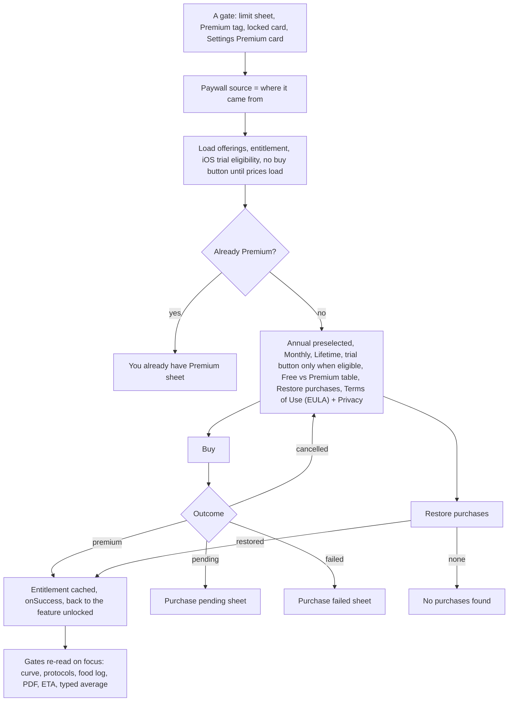
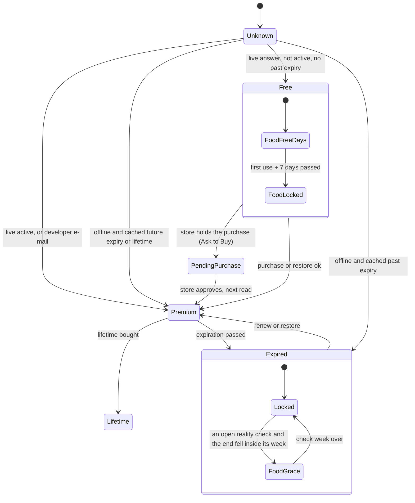
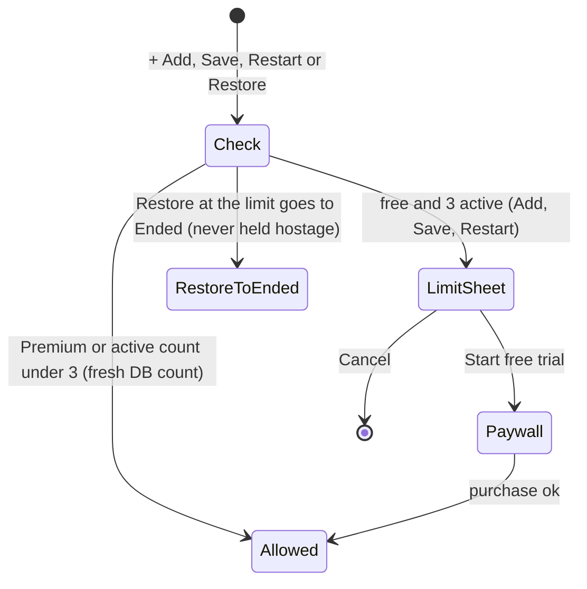
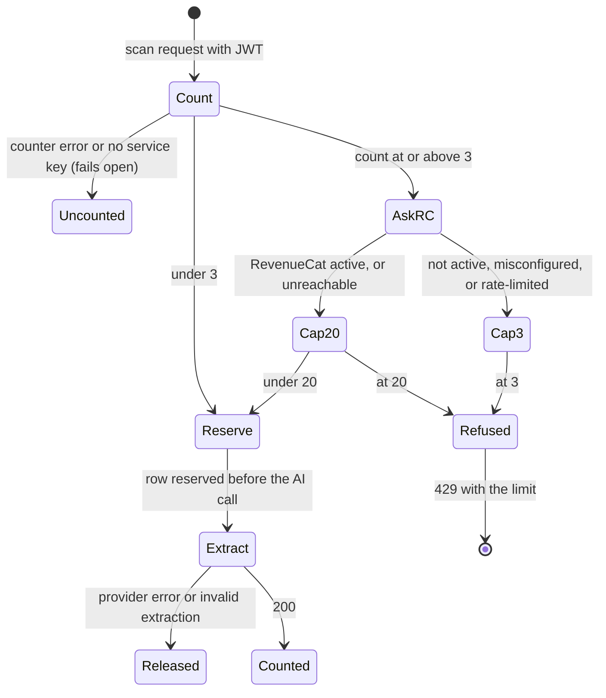

# 13 — Premium and free limits

> Draft for founder review, written 2026-10-12 from `docs/product/research/07-onboarding-account-premium.md` (main source: §3.7, R40–R45, §5.2, §6.1), `04-food-reality-progress.md` (food access, grace), `01-protocols.md` (free limit), `05-curve-journey.md` (curve gating), `06-my-body.md` (scan pool), `docs/decisions.md` (Premium/pricing/free limits; 2026-10-03 founder answers; Resolved 2026-10-03) and `docs/specs/premium-and-auth.md` (PA-1…PA-127), `fixes-1.2.5.md` (FX-4, FX-16). Code @ 4dade55.
> Shows the **intended** behaviour; **Divergence today** notes cite the dossier.

---

## 1. Goal

One honest plan, **Premium** (Monthly, Annual "Best value", Lifetime), real store prices only, no "coming soon". Free stays genuinely useful (journal, calculator, reminders, supply, weigh-ins, cloud backup and sync). Premium unlocks the flagship Dose accumulation curve, unlimited protocols, more AI scans, the AI food log after 7 free days, reality-check results, measured target ETA and PDF export. A paying user is never locked out offline; one helper decides every gate on the phone; the server is authoritative for paid AI calls.

## 2. Actors

| Actor | Role |
|---|---|
| User | Hits a limit, opens the Paywall, buys / restores, lapses. |
| Paywall (`PaywallScreen`) | Offerings + entitlement + trial eligibility before any buy button; four buy outcomes. |
| RevenueCat (`react-native-purchases`) | Entitlement "DoseTrace Pro"; products monthly / yearly / lifetime; app user id = Supabase user id. |
| `lib/entitlement.js` `hasPremium` / `getEntitlement` | The one client helper; per-uid cache with expiry. |
| `foodLogAccess` | Free days / grace / locked for the food log and reality check. |
| Server: `extract-bloodwork` quota, `protocol-assistant` budget, `parse-food` quota | Server-side limits. |
| Store (App Store / Play) | Prices, 7-day trial on Monthly + Annual (verified 2026-10-03), Ask to Buy, billing. |

## 3. Limits and gates (the contract)

| Feature | Free | Premium | Enforced where |
|---|---|---|---|
| Active protocols | 3 (decision "3 mantém") | unlimited | client (+ Add, Save, Restart, Restore) — **01 D-22 / 07 D-3: client only** |
| Dose accumulation curve, Journey / My Body Est. level | — (tag, preview) | yes | client |
| AI scans (labs + vaccines + vials, one pool) | 3 / UTC month | 20 / UTC month | server (RevenueCat REST; unreachable → Premium cap) |
| Vial-label scan | free, in the pool | in the pool | server |
| AI protocol assistant | 10 conversations / rolling 7 days | same | server |
| AI food log | 7 days from first use | every day | client — **intended also server (04 D-15)** |
| AI food parses | 25 / local day + 25 follow-ups, 60 / 24 h | same | server |
| Reality check start | inside free days | yes | client |
| Reality check result (measured burn) | no (free days end before day 21) | yes | client |
| Typed average calories | no (decision 2026-10-08 "A") | yes | client — **today shown to free days (04 D-14)** |
| Weigh-ins, chart, + past weigh-in | yes, never paywalled | yes | — |
| Target + bar | yes | yes | — |
| Measured target ETA | — | yes | client |
| Lab journal by hand | intended free (not built — 06 G-1) | yes | — |
| Lab marker charts | decision: Premium; **today free (06 D-8)** | yes | — |
| CSV export | yes | yes | — |
| PDF export | — ("PDF export is Premium") | yes | client, at the action |
| Cloud backup / sync, reminders, calculator, supply | yes | yes | — |

## 4. What may already have happened before

| # | Prior state | What the flow must do |
|---|---|---|
| P1 | Bought on another phone / platform (same account) | RevenueCat identifies by user id → Premium after `initPurchases`; Restore available on the Paywall. |
| P2 | Bought, then signed in with a different account | Entitlement belongs to the RevenueCat customer (restore/transfer = RevenueCat project setting). |
| P3 | Premium lapsed during an open reality check | Food-log grace to the end of that check week (logging only); results need Premium. |
| P4 | Offline for days with an active subscription | Cache with future expiry = Premium (never locked out offline). |
| P5 | Ask to Buy / payment pending | "Purchase pending" — never "failed"; Premium when the store confirms. |
| P6 | Bought Lifetime while a subscription renews | Sheet: cancel the subscription in the store (the app cannot). |
| P7 | Already Premium and opens the Paywall | "You already have Premium" — no buy button. |
| P8 | Developer / review account | Premium by the e-mail allow-list (client and server lists identical). |
| P9 | Premium lapsed with 4+ active protocols | Keeps them active (no downgrade rule decided — flow 02 §12 Q4); + Add shows the limit. |
| P10 | RevenueCat unreachable | Client uses its cache; server gives the Premium scan cap (07 D-1, deliberate). |

## 5. Happy path

## 6. States and transitions

### 6.1 Entitlement (client)

Note: the client cannot tell a store free trial or a billing-grace period from a paid period (all `premium:true`) — 07 D-8.

### 6.2 Protocol limit gate

### 6.3 Scan pool (server)

## 7. Alternative and exception paths

### 7.1 Paywall details (PA-5…PA-16; decisions 2026-09-30, 2026-10-03)
- Prices only from the store at runtime; "Save N%" only from real store prices; billed amount biggest; length next to every price; Annual preselected ("Best value"); trial button only when the store says eligible and the length is known ("Start 7-day free trial" + Apple billing text); Restore purchases; Terms of Use (EULA) (iOS) / in-app Terms (Android) + Privacy under Restore; Free vs Premium table (dashes on the free side); animated example previews with an "Example" tag.
- Back blocked while the store is busy.
- BR prices: R$19,90 / month, R$199,90 / year on both stores (founder 2026-10-03). US: $2.99 / $28.99 / Lifetime $69.99 (read from ASC 2026-10-03).
- **Divergence today (07 D-9, Gap 4):** no Restore or Manage subscription in Settings; a Premium user is sent away from the Paywall, so Restore is unreachable for them; no trial / billing-issue state shown ("Premium" or "Free" only). OPEN (§12).
- **Divergence today (07 D-6, Gap 12):** "trial" means two things (store intro trial vs the 7 free food-log days) — one vocabulary needed in the PRD.

### 7.2 Gates by surface (where the Paywall opens from)
| Source | Surface |
|---|---|
| `settings` | Settings Premium card "Upgrade to Premium" → "See plans" (free only) |
| `protocol_limit` | Limit sheet "Start free trial" |
| `journey_serum` | Journey Dose accumulation tile (free) |
| `serum_preview_sheet` | My Body preview sheet "See your compound build up" → Unlock |
| `log_serum` | Dose log "Curve" (free) |
| `serum_direct` | Curve opened directly (replace) |
| `bloodwork_upload` | Lab journal upgrade sheet "Start 7-day free trial" |
| `export_pdf` | "PDF export is Premium" → Go Premium |
| `reality_check` | Progress locked explainer / result |
| `food_grace`, `food_hero`, (none from FoodChat) | food-log notes, hero, locked card |
- **Divergence today (07 §2.2):** `CalculatorSection.js:1148` and FoodChat open the Paywall with no source (analytics only).

### 7.3 Offline
- Paying user offline: cached future expiry → Premium; lifetime → Premium; expired cache → not Premium with `endedOn`; never known → free.
- Paywall offline: "Plans are currently unavailable. Please check your connection and try again later." + Try again.

### 7.4 Account switch
- `logOutPurchases` on intended sign-out; RevenueCat logs in with the new user id at SIGNED_IN.
- **Divergence today (07 D-7, SUSPECTED):** entitlement cache keys survive sign-out; a screen reading the entitlement in the short window before `initPurchases` can use the previous account's cache.

### 7.5 Server vs client
- **Intended (decision 2026-10-01 FX-16: "the server stays authoritative for paid AI calls"):** paid AI paths check access on the server.
  - **Divergence today (04 D-15; 07 D-2):** `parse-food` has no entitlement / free-days check.
  - **Divergence today (07 D-3; 01 D-22):** the 3-protocol limit has no server rule; another device or an old build can exceed it.
  - **Divergence today (07 D-4):** the dormant `send-reminders` would send the 20:00 food question to locked users (inactive while server push is off).
  - **Deliberate (07 D-1):** RevenueCat unreachable → server gives 20 scans to everyone past 3, while the client shows the cache.

### 7.6 Lapse
- Food log: grace to the end of the current check week (only if the end day ≥ check start), else remaining free days, else locked; never "free days" wording for a lapsed payer.
- Reality check: grace allows logging only; starting a new check and seeing results need Premium (intended — **04 D-13: today grace can start and see results**).
- Curve: Paywall on next focus; Journey tile tag; right page cleared on the Fold.
- Protocols: existing active ones kept; + Add limited.
- Scans: next scan at ≥ 3 asks RevenueCat → free cap 3 ("your 3 scans").

### 7.7 Delete account while subscribed
- **Divergence today (07 Gap 4):** no warning that billing continues (flow 12).

### 7.8 Second device / platform
- Same RevenueCat customer → Premium on both after `initPurchases`. iOS ↔ Android purchases depend on the RevenueCat project's restore/transfer setting (kept as is, decision 2026-10-03).

### 7.9 Timezone
- Scan month = UTC calendar month; food parse quota = the client's local `entry_date`; assistant = rolling 7 days.

### 7.10 Notification tap
- None open the Paywall.

### 7.11 Fold
- Paywall, previews and sheets stay one centred column (BK-11); a free user tapping the curve tile on the unfolded Fold gets the full-screen Paywall.

## 8. What every surface shows

| State | Settings | Journey tile | My Protocols + Add | My Body | Food log | Progress |
|---|---|---|---|---|---|---|
| Free | profile "Free plan" / "Plano gratuito" + Premium card (5 feature lines, See plans) | Premium tag + description | limit sheet at 3 | "3 free scans a month…"; PDF → Premium sheet; curve card tag + lock | 7 free days then locked | start inside free days; result locked; ETA locked |
| Free, food days ending | — | — | — | — | note with dates + See Premium | — |
| Premium | badge "Premium", no card | Est. level | unlimited | 20 scans (number only in the limit message / FAQ) | every day | result, measured ETA, typed average |
| Premium offline | same (cache) | same | same | scans need network anyway | logging offline-first | same |
| Lapsed (grace) | Free | tag | limit for new adds | 3 scans | grace note "Your Premium has ended. You can keep logging until {until}…" | result locked |
| Pending purchase | — | — | — | — | — | — (Paywall "Purchase pending") |

## 9. Data written at each step

| Step | Store | Write |
|---|---|---|
| Paywall open | analytics `paywall_viewed {source}`; AsyncStorage `dosetrace_paywall_views` +1 | anonymous |
| Purchase / restore | store + RevenueCat customer | — |
| After purchase | AsyncStorage `dosetrace_entitlement_v1:<uid>` (premium, expiresAt / lifetime), `dosetrace_entitlement_last_uid` | not synced; survives sign-out (07 D-7) |
| Scan | server `ai_scan_usage` reserved → kept on 200 / released on failure | server |
| Assistant | server `ai_assistant_usage` at the first AI answer | server |
| Food parse | server `ai_food_usage` (kind parse / followup) | server |
| Food free days | `food_logs` marker `free_start` | synced |

## 10. Rules (with sources)

R40 entitlement id / products / app user id (`lib/purchases.js`). R41 developer e-mails identical client/server. R42 cache semantics (FX-4, FX-16). R43 free limits as built (3 protocols, 3 scans, 7 food days, 25 parses, 10 assistant). R44 Premium-only surfaces; weigh-ins never paywalled (FX-15). R45 Paywall rules (PA-5…16). Decisions: honest paywall, no "coming soon" (2026-07-21); cloud sync free (2026-07-21/09-30); curve stays Premium (2026-09-08); "Unlimited protocols" true line; PDF Premium / CSV free; measured ETA Premium; upgrade sheet copy and 7-day trial true on both stores (2026-10-03). (`07 §4`.)

## 11. Divergences today (summary)

| ID | Intended | Today | Source |
|---|---|---|---|
| D13-1 | Server authoritative for paid AI (food) | Client only | `04 D-15`, `07 D-2` |
| D13-2 | Protocol limit consistent across devices | Client only | `07 D-3`, `01 D-22` |
| D13-3 | Restore / Manage reachable for Premium users | Only on the Paywall | `07 D-9` (OPEN) |
| D13-4 | Typed average Premium-only | Free days see it | `04 D-14` |
| D13-5 | Grace = logging only | Start + result allowed | `04 D-13` |
| D13-6 | Lab charts Premium | Free | `06 D-8` (OPEN) |
| D13-7 | One meaning of "trial" | Two | `07 D-6` |
| D13-8 | Entitlement cache per account cleared on sign-out | Survives | `07 D-7` |
| D13-9 | Every Paywall entry carries its source | Two without | `07 §2.2` |
| D13-10 | Trial / billing state visible | Not read | `07 D-8` |

## 12. Open founder questions

1. **Settings subscription row (D13-3):** add "Manage subscription" (store link) and "Restore purchases" for everyone? Recommendation: yes.
2. **Downgrade rule** (flow 02 Q4): keep extra active protocols after a lapse (recommended).
3. **Lab charts (D13-6):** Premium (decision) or free (code)?

## 13. Acceptance checks (agent-device QA script)

Account Test03 (free); Premium only via a temporary RevenueCat promo the founder grants; purchases only in the store sandbox. Light and dark; PT via Settings → Preferências → Idioma.

**F13-01 — Settings Premium card (free)**
- Expect: "Upgrade to Premium" / "Assine o Premium" + "Unlock all features and get the most out of DoseTrace." + five lines (incl. "AI food log, every day" / "Registro de comida com IA, todos os dias") + **See plans** / "Ver planos" → Paywall.

**F13-02 — Paywall contents**
- Expect: no buy button until prices load; Annual ("Anual") preselected with "Best value" / "Mais vantajoso"; Monthly; Lifetime; prices from the store in the store currency; trial button only when eligible ("Start 7-day free trial" / "Começar teste grátis de 7 dias"); "Restore purchases" / "Restaurar compras"; "Terms of Use (EULA)" (iOS) and Privacy policy under Restore; Free vs Premium table with dashes on the free side.

**F13-03 — Offline Paywall**
- Expect: "Plans are currently unavailable. Please check your connection and try again later." + Try again.

**F13-04 — Purchase (sandbox)**
- Do: buy Monthly.
- Expect: back to the source screen with the feature unlocked (e.g. curve opens); Settings shows Premium; the Premium card is gone.

**F13-05 — Already Premium**
- Do: open the Paywall again (e.g. via a deep link or the limit sheet path).
- Expect: "You already have Premium" / "Você já tem o Premium" + "Every Premium feature is already on for this account."

**F13-06 — Pending (Ask to Buy)**
- Expect: "Purchase pending" / "Compra pendente" — never "Purchase failed".

**F13-07 — Restore**
- Do: reinstall, sign in, Paywall → Restore purchases.
- Expect: "Purchases restored" / "Compras restauradas" or "No purchases found" / "Nenhuma compra encontrada".

**F13-08 — Offline Premium**
- Setup: Premium active; airplane mode; relaunch.
- Expect: curve opens; no Paywall.

**F13-09 — Protocol limit**
- Covered by F02-01; also Restart (F05-06) and Restore at the limit → Ended (F05-09).

**F13-10 — Scan pool**
- Covered by F11-10 / F02-23; additionally with Premium promo after 3 scans the 4th succeeds.

**F13-11 — Food free days and lock**
- Covered by F07-16.

**F13-12 — PDF export gate**
- Covered by F11-15.

**F13-13 — Lapse**
- Setup: end the promo during an open check.
- Expect: grace note on the food log until the end of the check week; Journey tile Premium tag; curve → Paywall; reality-check result locked; new check start refused (intended — record D13-5).

**F13-14 — Fold**
- Do (unfolded Fold, free): Journey → Dose accumulation tile.
- Expect: full-screen Paywall in one centred column.

**F13-15 — Both themes**
- Paywall (plan cards, selected state, table, legal text, preview animations' "Example" tag), limit sheet, PDF sheet, locked cards, "You already have Premium" sheet: readable in light and dark.
