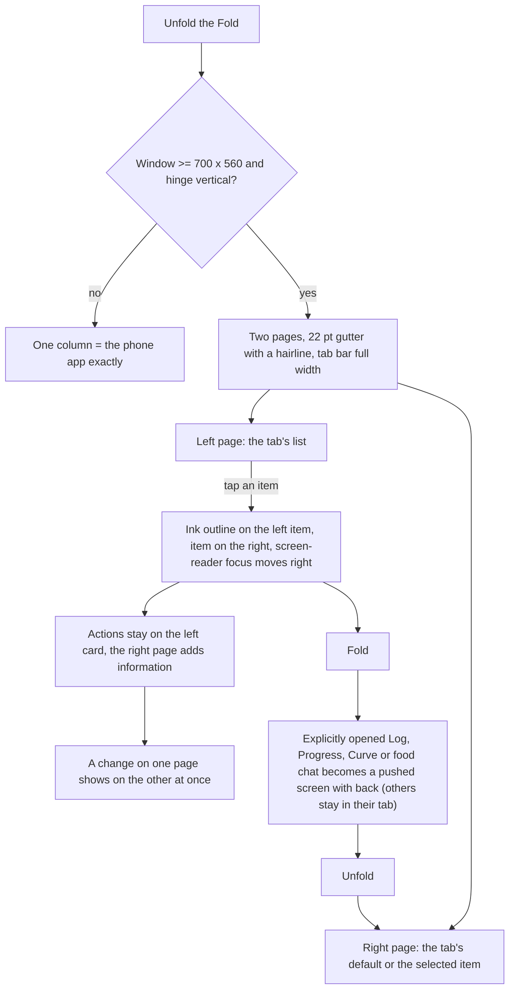
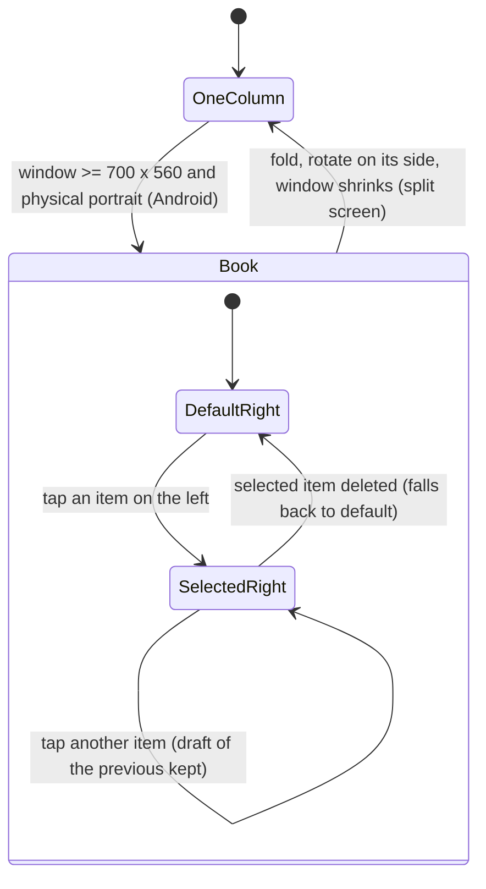
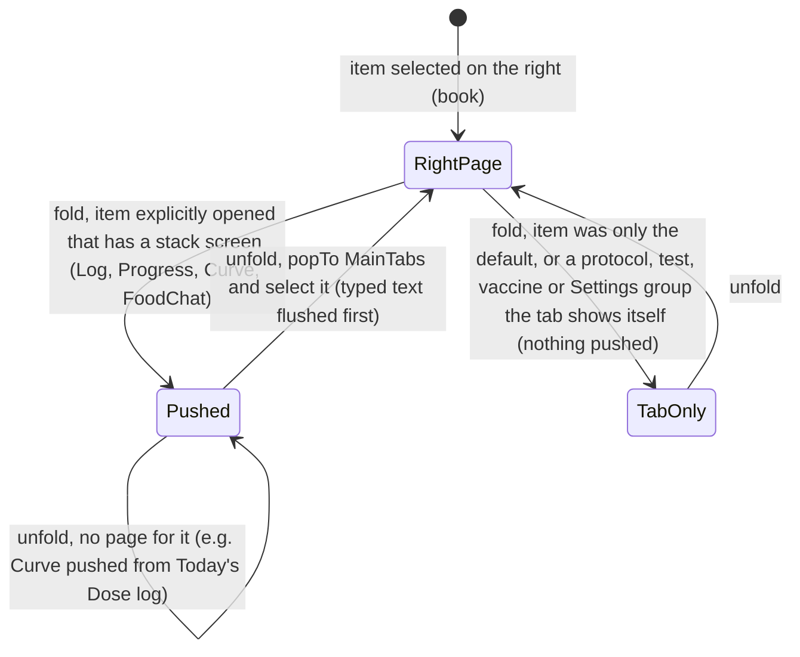

# 14 — Fold book layout (two pages on an unfolded foldable)

> Draft for founder review, written 2026-10-12 from `docs/specs/book-layout.md` (BK-1…BK-22, signed 2026-10-01), `docs/specs/fold-right-page.md` (A-115 FR-1…FR-6), `docs/product/research/08-platform.md` (§2.2 Fold transitions, §9 spec-audit), `01-protocols.md` (§2.1 book), `02-doses-today.md` (§2.3, G14, G15), `05-curve-journey.md` (§2.3), `06-my-body.md` (S9, R28–R29), `docs/decisions.md` (book layout 2026-10-01; 2026-10-07 night item 5 and 6; 2026-10-12 "A-116 / A-117 wait"). Code @ 4dade55.
> Shows the **intended** behaviour; **Divergence today** notes cite the dossier / spec row.

---

## 1. Goal

On an unfolded foldable the app opens like a book: the list on the left page, the tapped item on the right page — and **the right page always adds to the left, never repeats it** (founder 2026-10-07). On a phone, or folded, nothing changes. Folding and unfolding never loses the user's place or anything typed.

## 2. Actors

| Actor | Role |
|---|---|
| `WindowSizeRoot` / `lib/windowSize.js` | Measured root size. |
| `lib/bookLayout.js` | Pure rules: two pages, defaults, fold/unfold plans. |
| `components/BookPanes.js` | Renders the two pages, the 22 pt gutter (a hairline, no text or control), selection, screen-reader focus, `useFoldPush`, `useUnfoldToPage`. |
| `lib/bookSelection.js` | In-memory selection per tab (kept while the app is open). |
| `lib/draftStore.js` | Unsaved text per item (BK-14). |
| Each tab | Today, Protocols, Journey, My Body, Settings define their left / right pages. |
| Android config plugin `withFoldConfigChanges` | No activity recreation on fold (screenSize, smallestScreenSize, screenLayout, orientation). |

## 3. Preconditions

- Window ≥ 700 pt wide AND ≥ 560 pt tall (BK-1); on Android the physical screen at least as tall as wide — Fold held normally, hinge vertical (BK-13). Z Fold open ≈ 830 × 750 pt.
- iPhone Duo: decided with the first build made with the iOS 27.1 SDK (until then letterboxed at phone size).

## 4. What may already have happened before

| # | Prior state | What the layout must do |
|---|---|---|
| P1 | Was reading a protocol on the folded phone (pushed) | Unfold → it moves to the right page (BK-10). |
| P2 | Had a sheet open with typed values | The values are always kept (draft, BK-14) and the sheet is open again after unfold (BK-10, BK-11). While folded the sheet shows only if its page is on screen: with Progress only the unchosen default on Journey's right page, folding pushes nothing and the folded Journey shows only the dashboard, so the Progress sheet is not visible until unfold or until Progress is opened (`bookLayout.js:53-54`, `JourneyScreen.js:243-247`, `CalculatorSection.js:185-186`, `:435`; read in code, Fold device check owed). |
| P3 | Typed a protocol note on the right page and switched item | Draft kept per item until Save or app close (BK-14); a real sign-out clears it. |
| P4 | Never chose a right-page item | Default shown (Today: Dose log; Protocols: first in list or the one opened from Today; Journey: Progress; My Body: newest test; Settings: Preferences); a default is never pushed on fold (BK-15). |
| P5 | Fold turned on its side | One column (BK-13). |
| P6 | Premium lost while the curve is on the right | Selection cleared (Journey). |
| P7 | Opened from a notification | **Intended (A-116):** the item opens on the right page; waiting by founder instruction (AD-31, decisions.md:639). |
| P8 | Text size ≥ 130 % | Journey tiles stack; pages still two. |

## 5. Happy path

## 6. States and transitions

### 6.1 Layout mode

### 6.2 Fold / unfold of a selected item

### 6.3 Per-tab pages

| Tab | Left page | Right page default | Right page on tap | Actions stay on |
|---|---|---|---|---|
| Today | alerts, pending, tracker, food hero, doses, upcoming | Dose log (embedded) | the tapped dose's **protocol page** (A-115): name, dose, tags, standard syringe with the draw, vial block, oral serving block, Schedule & reminders, Dose details, Notes; no vial → "No mixed vial right now" + "+ Add vial" | left card (Mark complete / Skip / Undo); no Delete on the right; Edit, refill, zoom open My Protocols |
| My Protocols | header, sort, list, Ended, Recently deleted | the protocol opened from Today, else the first in list order | protocol page with Edit | right page Edit; + Add / New vial as today |
| Journey | dashboard (food card, tiles, folds) | Progress | food card → chat (no Done, no auto-close, BK-17); curve tile → curve (Premium) or full-screen Paywall | — |
| My Body | hub title, Lab journal, Vaccine journal, Dose accumulation card | newest test | test detail / marker page / vaccine read page with Edit (BK-18) / curve (Premium) | — |
| Settings | profile card, groups, Sign out / Delete card | Preferences | chosen group body | — |

## 7. Alternative and exception paths

### 7.1 Full-screen flows stay one column (BK-11)
- Paywall, sign-in, onboarding, reset password, add/edit protocol wizard, every sheet and popup (centred column, 640 pt max). Sheets live outside the page switch so fold/unfold never closes them.

### 7.2 One popup at a time across both pages (BK-20)
- A site question, vial prompt or site editor on one page waits while another is open (popupGate).

### 7.3 Pages update each other (BK-19)
- A dose taken / skipped / undone on the left shows in the embedded Dose log on the right at once; a weigh-in on Progress updates the Journey tiles; a curve change updates the Journey tile (BK-19).
- **Intended (DL-98):** the left page follows every write made on the right page, the food log included — a meal sent from the chat on Journey's right page updates the AI food log card on the left at once.
  - **Divergence today:** the left card keeps the old line until Journey is refocused (`FoodLogHero.js:36` reloads only on focus; the Journey tab never loses focus in the book; `JourneyScreen.js:123-125` listens only for `data_changed 'calc'`). → DV-238.
- **Divergence today (05 D3):** My Body's left card does not follow a curve change on its right page (no 'curve' listener). Wider than that: `BodyScreen` has no `addSyncListener` at all, so My Body never reloads on a sync pull while it is open, on either page (verification 05 O-4). Intended: AD-18. → DV-152.
- **Divergence today (04 D-4):** Progress on the right page loads the open reality check once; a Stop pulled from another device is not reflected until remount. Intended: DL-25 (Progress listens to sync). → DV-059.

### 7.4 Accessibility (BK-21)
- After a selection, screen-reader focus moves to the right page; the selected item reports itself selected; reading order left then right. Not tried on a device.

### 7.5 Embedded screens never navigate back (BK-22)
- An embedded Log, Progress, Curve or food chat never calls goBack / replace (guards); a Paywall from a right page is a full-screen push.

### 7.6 Android back (BK-15)
- Same as the phone (leaves the screen, tab or app); the right page has no back of its own.

### 7.7 Notifications on the Fold
- **Intended (A-116, founder 2026-10-07: "every tap and every notification opens its item on the right page with the most information the app already has"; waiting by the founder's instruction, AD-31: decisions.md:639, :634):** dose → its protocol page on Today's right page; vial low / expiry → the protocol on Protocols' right page; weigh-in / reality → Progress on Journey's right page; food 20:00 → the chat on Journey's right page; test reminder → the setup screen.
- **Divergence today (02 G15, 01 G-16, 04 §2):** dose taps land on the left page (`focusDose`); vial taps open Protocols with `openProtocolId` (right page shows it by default — partial); Progress `focus` is dropped on a book page; the food tap pushes the chat. → DV-117.

### 7.8 Rebuild = replace leftovers (A-115)
- **Divergence today (02 G14):** after the dose page was replaced by the protocol page, `planDosePage`, `undoRecordsRef`, the Skip `keepUndo`, the 60 s page tick and an old comment remain; book-layout.md BK-3 / BK-16 rows still describe Mark taken / Skip / Undo on the right page without a "superseded" status (fold-right-page.md declares it). → DV-181 (dead code), DV-179 (spec rows; BK-16 wording per AD-39).

### 7.9 Offline / killed / second device
- Selection and drafts are in memory: an app kill loses the selection (defaults return) and unsaved drafts (by decision BK-14 "until saved or the app closes"); the food chat draft is durable (FL-36).

### 7.10 Timezone / DST
- Not applicable beyond each tab's own rules.

### 7.11 Free vs Premium
- Curve on the right only for Premium (Journey, My Body); free → full-screen Paywall / preview sheet.
- Lab marker charts are Premium by decision (AD-24) but not gated anywhere today, including the My Body right page (`BodyScreen.js:142-144`, no gate in `openMarker`): a free user sees them on the Fold too (DV-108, 07 K-04). The locked chart is an approved picture still owed (Approvals still owed item 3), on the phone and on the right page.

### 7.12 Device evidence
- **Divergence today (08 §9; spec-audit 2026-10-12 FAIL):** BK-1…BK-22 are `partial` (two-page look and real fold/unfold not yet seen on the founder's Z Fold 7 in light + dark); FR-6 `missing`. A build cannot pass Gate S until this walk is recorded (AD-42). → DV-118.
- **Not signed:** `docs/specs/fold-right-page.md` has an empty `checklist-signed:` line, so the A-115 checklist (FR-1…FR-6) still needs the founder's signature — **Approvals still owed item 7** (a signature, not a question; was OPEN-18 (8), closed in round 2). It is a separate item from the AD-52 deviation list (07 A-04 / Q-08). The gate does not catch it today: spec-audit reads the empty line as signed (its regex crosses the line break) and only warns on unsigned checklists. → DV-229.

## 8. What every surface shows (unfolded)

| Situation | Left page | Right page | Tab bar |
|---|---|---|---|
| Today, nothing tapped | full Today | Dose log (embedded, no back) | full width |
| Today, tapped BPC-157 | card outlined, Mark complete / Skip on the card | BPC-157 protocol page (no actions, no Delete) | full width |
| Today, tapped recon with no vial | card "+ Add vial" | "No mixed vial right now" + why + "+ Add vial" | — |
| Protocols, first open | list | first protocol (or the one from Today) | — |
| Protocols, Recently deleted Select mode | checkboxes | selected protocol page | replaced by "Restore ({n})" / "Delete forever ({n})" bar (PT "Restaurar ({n})" / "Excluir para sempre ({n})") |
| Journey, nothing tapped | dashboard | Progress | — |
| Journey, food card | dashboard | food chat (no Done) | — |
| Journey, curve tile (free) | — | — (full-screen Paywall) | — |
| My Body | labs + vaccines + curve card | newest test / tapped item / vaccine read page | — |
| Settings | menu | Preferences / chosen group | — |
| Any sheet | dimmed | dimmed | sheet centred over both |

## 9. Data written

| Store | What |
|---|---|
| memory `bookSelection` | selected item per tab (kept while the app is open; reset on sign-out) |
| memory `draftStore` | unsaved text per item (protocol note, Progress forms and whether their sheet is open, food chat answer field) |
| AsyncStorage `dosetrace_food_draft:<uid>` | the food chat draft (durable) |
| nothing else | the layout writes no user data |

## 10. Rules (with sources)

BK-1 thresholds; BK-2 one column = today's app; BK-3 (superseded by A-115 FR-1/FR-2); BK-4…BK-7 per-tab pages; BK-8 outline, full-width tab bar, per-tab item kept; BK-9 22 pt gutter (a hairline), no text or control on the fold; BK-10 fold/unfold keeps place and text; BK-11 full-screen flows one column; BK-12 tokens, no emoji, no new strings without 6-language approval; BK-13 Android hinge vertical; BK-14 drafts per item; BK-15 back; BK-16 (amended by A-78, superseded on the right page by A-115); BK-17 food chat; BK-18 vaccine read page; BK-19 pages update each other (food included, DL-98); BK-20 one popup; BK-21 accessibility; BK-22 no goBack / replace from embedded. FR-1…FR-6 (A-115). A-116 notifications on the right page (waiting).

## 11. Divergences today (summary)

| ID | Intended | Today | Source | DV |
|---|---|---|---|---|
| D14-1 | Notifications open on the right page (A-116; waits by AD-31) | Left page / pushed | A-116 (waiting), `02 G15` | DV-117 |
| D14-2 | Every BK row device-proven light + dark (AD-42); FR checklist signed (Approvals still owed item 7) and an unsigned checklist fails the gate | Partial; FR-6 missing; fold-right-page checklist unsigned, read as signed by spec-audit | spec-audit, `08 §9`; 07 A-04 / Q-08; R2-01 | DV-118, DV-229 |
| D14-3 | My Body follows the curve and sync pulls (AD-18) | Stale (no sync listener at all) | `05 D3`; verification 05 O-4 | DV-152 |
| D14-4 | Progress on the right follows sync (DL-25) | Loads once | `04 D-4` | DV-059 |
| D14-5 | Rebuild = replace complete | Dead dose-page code; BK-3/BK-16 text not marked superseded | `02 G14` | DV-181, DV-179 |
| D14-6 | The left page follows a food write on the right (DL-98) | Journey's AI food log card keeps the old line until refocus | R2-05 (F07-18) | DV-238 |
| D14-7 | Lab charts locked for free users on the right page too (AD-24; picture owed, Approvals item 3) | Free users see them | `07 K-04` | DV-108 |

## 12. Founder questions (canonical IDs — `docs/product/OPEN-DECISIONS.md`)

Reconciled 2026-10-12: every question this flow raised has one canonical ID in `OPEN-DECISIONS.md` — **OPEN-xx** waits for the founder (asked in the one Portuguese round there), **AD-xx** is already decided by the ledger or a signed spec, **DL-xx** is decided by product logic (recorded in `docs/decisions.md`; the founder may override). DV-xxx is the defect row in `DIVERGENCES.md`.

Open — waiting for the founder: no open OPEN item is specific to the book layout. (OPEN-18 (8), "sign fold-right-page", was closed in round 2 and is now an approval, below.)

Decided or owed — what this flow relies on (round-2 final ids):
- **Approvals still owed item 7** — the founder signs `docs/specs/fold-right-page.md` (FR-1…FR-6; its `checklist-signed:` line is empty). A signature, not a question. D14-2 → DV-118, DV-229 (spec-audit reads the empty line as signed).
- **AD-31** — A-116 (every tap and notification on the right page) waits by the founder's instruction and resumes after the PRD / TRD / flows, for 1.3.0 (decisions.md:639, :634). D14-1 → DV-117.
- **AD-42** — done = the signed checklist with evidence; the Fold walk in light + dark before the next build. D14-2 → DV-118.
- **DL-98** — the left page follows every write on the right page, the food log included (round 2). D14-6 → DV-238.
- **AD-18** — My Body's card follows the curve on its right page (D14-3, DV-152); **DL-25** — Progress follows sync (D14-4, DV-059).
- **AD-24** — lab charts are Premium, the locked chart is an approved picture still owed (**Approvals still owed item 3**). D14-7 → DV-108.

## 13. Acceptance checks (agent-device QA script)

Device: the founder's Z Fold 7 (internal Android build), light and dark, EN and PT; record the One UI version. Account Test03. Screenshot before every tap.

**F14-01 — Two pages only when unfolded and upright**
- Expect: unfolded upright → two pages with a 22 pt gutter (a hairline, no text or control) and a full-width tab bar; rotate on its side → one column; folded → one column identical to a phone.

**F14-02 — Today right page default**
- Expect: right page = Dose log ("Dose log" / "Registro de doses") without a back row.

**F14-03 — Tapped dose opens its protocol (A-115)**
- Do: tap the BPC-157 card body.
- Expect: ink outline on the left card; right page = BPC-157 page (standard syringe numbered every 10, "Draw to" units, vial block, Schedule & reminders, Dose details, Notes, Edit); no Mark complete / Skip / Undo / Delete on the right.

**F14-04 — No vial page (FR-3)**
- Expect for a recon protocol without a vial: "No mixed vial right now" / "Nenhum frasco reconstituído agora" + "Without a vial the app doesn't know the concentration, so it can't show the syringe or what's left. Add the vial you're going to use." + "+ Add vial" → Today's vial prompt.

**F14-05 — Note draft survives**
- Do: type a note on the right page → tap another dose → tap back → fold → unfold.
- Expect: the note text still there until Save / Cancel; Save writes it (visible in My Protocols).

**F14-06 — Pages update each other (BK-19)**
- Do: Mark complete on the left.
- Expect: the right page's vial count −1 and (default page) the Dose log row appears without switching tabs.

**F14-07 — One popup across pages (BK-20)**
- Do: start a site question on the left while the right page's Dose log editor is open.
- Expect: the second waits until the first closes.

**F14-08 — My Protocols**
- Expect: right page = first protocol; tapping another selects it; Recently deleted Select mode bar spans the full width; Edit opens the wizard in one centred column.

**F14-09 — Journey**
- Expect: right page Progress; food card → chat on the right with no Done and no 30 s auto-close; curve tile → curve on the right (Premium) / full-screen Paywall (free); a weigh-in on the right updates the left Progress tile at once. Send a meal in the chat on the right → intended (DL-98) the left AI food log card shows it at once; today it keeps the old line until Journey is refocused — record D14-6.

**F14-10 — My Body**
- Expect: right page newest test; marker → marker page; vaccine → read page (name, date given, next due, dose number, batch/lot, provider, manufacturer, where given, notes, disclaimer, Edit); deleting the selected test falls back to the newest.

**F14-11 — Settings**
- Expect: right page Preferences; tapping Notifications shows its rows on the right.

**F14-12 — Fold with an explicitly opened item**
- Do: open the curve on Journey's right page → fold.
- Expect: the curve as a pushed screen with "‹ back"; unfold → back on the right page. With only the default (Progress) on the right → fold pushes nothing.

**F14-13 — Sheets survive fold/unfold**
- Do: open "Log today's weight", type 85,4 (PT) → fold → unfold.
- Expect: the sheet still open with 85,4 after unfold. While folded: if Progress was only the default right page, the folded Journey shows the dashboard and the sheet is not visible (it comes back on unfold, values kept); if Progress was explicitly opened, it is pushed with the sheet — record which case was tested.

**F14-14 — Notification on the unfolded Fold (A-116 check)**
- Do: tap a dose reminder body.
- Expect (intended A-116, waiting by AD-31): its protocol on Today's right page. Record today's behaviour (left page focus).

**F14-15 — Screen reader**
- Do: TalkBack on → select an item.
- Expect: focus moves to the right page title; the left item announces "selected"; order left then right.

**F14-16 — Both themes across every page pair**
- All five tabs in light and dark, including the gutter, outline, embedded screens and the Select bar: readable; no hard-coded colours; no emoji.
