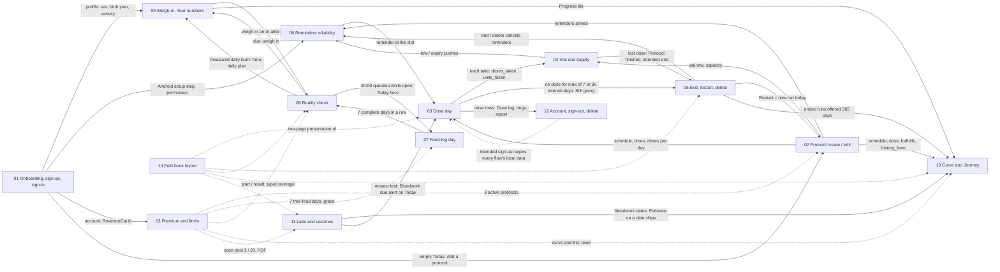

# DoseTrace core flows — index

Written 2026-10-12 as step 3 of the product-definition effort (`docs/product/README.md`: dossiers → PRD + TRD → **flows** → founder review → code sweep → test build). Founder 2026-10-12: "sem cortar caminhos… sem nada curto".

Each flow is a state-based document with the same 13 sections:

1. Goal · 2. Actors · 3. Preconditions · 4. **What may already have happened before** (the arrival states — the journey-review question) · 5. Happy path (mermaid flowchart) · 6. States and transitions (mermaid `stateDiagram-v2`, every state, transition and trigger) · 7. Alternative and exception paths (offline, app killed, second device, timezone / DST / midnight, notification tap, Fold open / closed, free vs Premium, plus the flow's own) · 8. **What every surface shows** (state × surface table) · 9. Data written at each step · 10. Rules with sources · 11. Divergences today (summary) · 12. Open founder questions · 13. **Acceptance checks** — numbered, testable, written as an agent-device QA script (taps + expected screen text in English and Portuguese).

## The flows

| # | File | Covers | Main dossier |
|---|---|---|---|
| 01 | [01-onboarding-signup-signin.md](01-onboarding-signup-signin.md) | 8-step onboarding, Android reminder setup step, Create account / Sign in (email, Apple, Google), email confirmation, reset password, profile gate, 18+, shared-device stash | research/07 |
| 02 | [02-protocol-create-edit.md](02-protocol-create-edit.md) | Wizard (name, colour, dose, schedule, vial), past start + "Same dose for the last N weeks?", AI protocol assistant, vial-label scan, Edit, free limit | research/01 |
| 03 | [03-dose-day.md](03-dose-day.md) | Reminder → Mark complete / Skip / Snooze / Undo, site question (S-25), pending from yesterday, Missed, Dose log edits, rings / streaks / header, vial effect | research/02 |
| 04 | [04-vial-and-supply.md](04-vial-and-supply.md) | Mix, use, low (1–3), expiry (7 d / day), All doses logged, + Add vial, New vial, New bottle, empty containers | research/01 §3.12 |
| 05 | [05-protocol-end-restart-delete.md](05-protocol-end-restart-delete.md) | Still going? end, deliberate end (approved), Restart (new / same container), Delete, Recently deleted, Restore, Delete forever, cross-device status | research/01 §3.8–3.11 |
| 06 | [06-reminders-reliability.md](06-reminders-reliability.md) | Window and budget, setup screen, Android permissions, background refresh, update / reboot, server wake, Silent mode, switches, iPhone window | research/03 |
| 07 | [07-food-log-day.md](07-food-log-day.md) | AI food log chat, catch-ups, questions, closing a day, offline, 20:00 question, free days / grace / locked | research/04 |
| 08 | [08-reality-check.md](08-reality-check.md) | Start → running → due → weighed / needs food → ready → result → next check; typed calories; Stop / Start over; free / grace / Premium | research/04 |
| 09 | [09-weigh-in-and-your-numbers.md](09-weigh-in-and-your-numbers.md) | Progress one card, Log today's weight, fix / delete weigh-in, Your numbers, daily burn, target, weekly check-in | research/04 |
| 10 | [10-curve-and-journey.md](10-curve-and-journey.md) | Dose accumulation (math, window, remembered view, honesty), Journey dashboard and tiles | research/05 |
| 11 | [11-labs-and-vaccines.md](11-labs-and-vaccines.md) | My Body hub, lab scan, cards / markers, edit / delete, vaccines (hand + scan), export, Bloodwork due | research/06 |
| 12 | [12-account-signout-delete.md](12-account-signout-delete.md) | Profile edit, intended vs spurious sign-out, the wipe, delete account, export, cross-account guard | research/07 |
| 13 | [13-premium-and-limits.md](13-premium-and-limits.md) | The limits contract, Paywall, purchase / restore / pending, entitlement cache, lapse and grace, server vs client enforcement | research/07 |
| 14 | [14-fold-book-layout.md](14-fold-book-layout.md) | Two pages on the unfolded Fold, per-tab page pairs, fold / unfold, A-115 right page adds, A-116 (waiting) | specs/book-layout + fold-right-page |

## How the flows feed each other

Solid arrows = data or state that one flow produces and the next consumes. Dotted = gates and presentation layers that wrap several flows.

### Shared states and their single owner (what every flow must read, never recompute)

| Shared state | Owner (lib) | Used by flows | Known split owners today |
|---|---|---|---|
| Doses expected on a day / slots | `lib/schedule.js` | 03, 05, 06, 10 | reminders use `dueDateKeys` (honours `schedule_total`, 08:00 default) — 02 D1–D4, 01 D-08 |
| Mark complete / undo | `lib/markTaken.js` via `recordDoseTaken` | 03, 04 | Today card, markTaken, deleteDose re-implement capacity — 01 D-03 |
| Supply low / capacity | `lib/supplyLow.js` | 03, 04, 06 | report uses its own formula — 01 D-02 |
| Ended / deleted / purged | `lib/protocolEnd.js` | 03, 05, 10 | consistent (01 D-01) |
| Rings / streaks | `lib/adherenceRings.js`, `lib/doseStreak.js` | 03, 12 | tracker streak and report streak computed inline — 02 D17, 08 D2 |
| Reality-check state | `lib/realityCheckRules.js checkOutcome` | 07, 08, 09 | Progress has its own assembler; day-21 reminder date-only — 04 D-1, D-2, 08 D5 |
| Current weight | `lib/numbersWeight.js` | 08, 09, 10 | hero / tile / numbers differ after fix / delete — 04 D-10, D-11 |
| Food access | `lib/foodThread.js foodLogAccess` | 07, 08, 13 | server does not check — 04 D-15 |
| Premium | `lib/entitlement.js hasPremium` | 02, 10, 11, 13 | server only for scans — 07 D-1…D-4 |
| Curve level | `lib/serumModel.js` | 10, 11 | tile vs screen list / grid — 05 D1, D2 |
| Reminder health | `lib/reminderHealth.js` | 06, 03 | Today's Blocked card still shows under Silent mode (03 D-2; DL-45); Settings follows the signed SP-1 / RC-1 (AD-71) |

## Conventions

- **Intended behaviour is the default text.** Where the code differs today, the flow says **Divergence today** and cites the dossier finding: `01 D-13` = `docs/product/research/01-protocols.md` §6 divergence D-13; `01 G-5` = §9 gap G-5; `07 Gap 6` = `research/07` §9 item 6; `08 D5` = `research/08` §8.2 row D5. Every divergence also appears in the flow's §11 table with an ID `Dnn-k` (flow number, item) and its row `DV-xxx` in `docs/product/DIVERGENCES.md` (the one register of defects; each DV row lists the flow IDs in its Sources).
- **Intended** comes from a founder line in `docs/decisions.md` or a founder-signed row in `docs/specs/` (cited as **AD-xx** when OPEN-DECISIONS.md applies it), from the binding prototype, or — marked "by logic, founder may override" — from how the features connect (**DL-xx**, CLAUDE.md "decide what is already decided"). Lines the coordinator wrote in the ledger ("by logic", "coordinator", "resolved by the ledger", council syntheses) are never cited as founder decisions; they are cited through the AD / DL id OPEN-DECISIONS.md gives them. Anything that is a real preference went to the founder as an OPEN-xx in `docs/product/OPEN-DECISIONS.md`, never assumed; he answered every one on 2026-10-15 ("siga as recomendações", plus AD-77 the same day), so the flows cite the AD id ("was OPEN-xx") and describe today's code as the divergence. Where a logic decision needs a new screen element or text, the principle is the DL and the visible part is an item of **AD-79** (was OPEN-24; all twelve go ahead, each picture first, ×6). Founder actions that are not questions (wording approvals ×6, pictures of approved work, signatures, production go-aheads) are cited as **Approvals still owed, item N** of OPEN-DECISIONS.md. Each flow's §12 lists the founder decisions of 2026-10-15 that touch it ("Decided by the founder on 2026-10-15").
- Strings are quoted from `i18n/translations.js` (EN and PT). `{name}`-style placeholders are filled by the app. New copy that does not exist yet is marked as such (needs 6-language approval).
- **OPEN-xx (was <id>)** marked a behaviour the flows used to call "intended" (by logic or "already decided") that the two 2026-10-12 verification rounds (`docs/product/verification/01…07` and `verification/round2/`) found is NOT decided — it reverses a founder line or a signed row, or it is a taste / money / scope / risk call. Today's behaviour is still described; the founder answered every such choice on 2026-10-15 (below). The one table of every id that moved is `docs/product/verification/round2/id-map.md`; the flows use only the final ids:
  - **Closed 2026-10-15 (founder answers):** DL-03 tracker unit → OPEN-17 → AD-85; DL-08 Undo bar → OPEN-19 (d) → AD-86; DL-24 → OPEN-05 → AD-84 (as built); DL-32 → OPEN-18 (1) → AD-103 (as built); DL-51 → OPEN-07 → AD-90; DL-66 → OPEN-18 (2) → AD-104; AD-44 → OPEN-18 (4) → AD-106; DL-72 / DL-74 → OPEN-16 (b) → AD-77 (one active device per account, A-119; DL-102…DL-108; the sign-out rule amended the same day by AD-109: sign-out is never blocked, one true sheet with "Sign out anyway"; AD-108 superseded by AD-109); DL-68 → OPEN-22 (b) → AD-94 (as built); AD-45 (and the withdrawn DL-75) → OPEN-22 (a) → AD-93; DL-71 → OPEN-23 → AD-97; AD-27 → OPEN-20 (b) → AD-88; DL-22's recon "New vial" and new-box date → OPEN-01 → AD-80; the cross-account guard (a coordinator line) → OPEN-21 (11) → AD-102; course end OPEN-03 → AD-82. The rest of the round: OPEN-16 (a) → AD-78 (1.3.0 scope), OPEN-24 → AD-79, OPEN-02 → AD-81, OPEN-04 → AD-83, OPEN-06 → AD-87, OPEN-20 (c) → AD-89 (as built), OPEN-08 → AD-91, OPEN-09 → AD-92, OPEN-10 → AD-95, OPEN-11 → AD-96, OPEN-13 → AD-98, OPEN-14 (b) / (c) → AD-99 / AD-100 (1.3.1), OPEN-15 → AD-101, OPEN-18 (3) → AD-105, OPEN-18 (9) → AD-107.
  - **Closed in round 2 (decided, cited with the final id):** OPEN-19 (a) → AD-70 (late dose on its own day), (b) / DL-67 → DL-76 (daily cap), (c) / DL-06 default → DL-77 (08:00); OPEN-20 (a) / DL-45 Settings half → AD-71 (Settings red as signed); OPEN-14 (a) / AD-56 → AD-69 (no Premium scan number); OPEN-12 → AD-68 (manual lab entry in 1.3.0); OPEN-18 (5) → AD-60 (push at 3), (6) → AD-74 (Apple artwork on Android), (7) / (8) → Approvals still owed items 8 / 7; OPEN-21 (1)…(10) → DL-85 (was AD-04), Approvals item 2 + AD-75 (AD-09 copy; "supplier" stays), DL-86 (was AD-10), DL-87…DL-91 + Approvals item 3 (AD-11 rules: A-86, A-87, A-89, A-92, A-98; A-85 / A-96 pictures), DL-92 (was AD-29), DL-97 (was AD-35), DL-93 (was AD-46), DL-94 (was AD-50), DL-95 (was AD-54), DL-96 (AD-61 gym part). AD-12 → DL-25; AD-28 → DL-81; AD-57 → DL-84; DL-01 → AD-76; DL-16 → AD-65 (Today card, the founder's Q9 = B; My Protocols colouring = DL-80); interval presets → AD-66 (no presets, binding prototype).
  - **Rewritten / withdrawn:** DL-10 rewritten to the founder's tap-time rule (decisions.md:153); DL-28 rewritten (the 25 reads count by the request's local day); DL-50 withdrawn (moot); DL-73 withdrawn (false premise; DV-194 closed); DL-75 withdrawn (→ OPEN-22 (a), now AD-93).
  - **Round 3 (final consistency pass):** DL-99 (a deliberate end is dated at the tap; was the coordinator lines decisions.md:504 / :535), DL-100 (the onboarding stash rules PA-71…PA-73), DL-101 (the real birth year at the 18+ confirmation, PA-106…PA-108); Restart checks the free limit first (DV-217, a bug; flow 05 D05-17).
- Names: UI "Complete" = stored outcome `Taken`. "Reality check" = PT "Seus números reais".

## Using the acceptance checks as the agent-device QA script

- Account: the test account Test03 (free tier); Premium only through a temporary RevenueCat promo the founder grants; destructive checks (delete account) on a throwaway `+qa` account. Never the founder's main account; no passwords typed by the agent (`docs/decisions.md` "Run test steps yourself").
- Screenshot before every tap, tab bar included (sim tap discipline).
- Every check runs in **light and dark** (Settings → Preferences → Appearance) — CLAUDE.md hard-line gate; and in **Portuguese** (Settings → Preferências → Idioma → PT) for the PT expectations.
- iPhone checks on the simulator; Android checks (permissions, background refresh, update / reboot, Fold) on the founder's Z Fold 7 with `adb` (`dumpsys alarm`, appops).
- A check whose result matches a **Divergence today** is recorded as the divergence (with the screenshot), not as a pass.
- Check IDs are stable (`F03-12`) so a build report can list pass / fail / divergence per row (CLAUDE.md evolution rule 4: walk every link before every build).
- Count: 269 acceptance checks across the 14 flows (01: 28, 02: 25, 03: 25, 04: 19, 05: 16, 06: 19, 07: 19, 08: 19, 09: 18, 10: 15, 11: 18, 12: 17, 13: 15, 14: 16), counted from the `**Fnn-mm**` headers in §13 of each flow (2026-10-15: +2 in flow 01 for AD-77, +4 in flow 12 for AD-77 / AD-109).

## Founder questions — reconciled into OPEN-DECISIONS.md

The 36 questions this round collected from the flows were reconciled on 2026-10-12 with the PRD and the TRD into the single list `docs/product/OPEN-DECISIONS.md`, under the CLAUDE.md rule "decide what is already decided", and verified twice the same day (round 2 final ids: `docs/product/verification/round2/id-map.md`). Each now has one canonical ID: **OPEN-xx** went to the founder (bold below; asked in the one Portuguese round at the end of OPEN-DECISIONS.md) and was answered on 2026-10-15 — the decision id follows the arrow, **AD-xx** is already decided by a founder line or a signed spec, **DL-xx** is decided by product logic (recorded in `docs/decisions.md`, 2026-10-12 section; the founder may override). This table is a copy of the "Flows" crosswalk in OPEN-DECISIONS.md ("Where every earlier question went").

Of the 36, **23 rows reach an OPEN item, wholly or in part** (#1, 2, 4, 7, 8, 11, 12, 13, 15, 16, 17, 18, 21, 22, 23, 24, 25, 28, 29, 32, 33, 34, 36; three of them — #1, #15, #34 — only through the new-UI item OPEN-24, now AD-79), touching 19 OPEN ids (OPEN-01, 02, 03, 04, 05, 06, 07, 08, 09, 10, 11, 13, 14, 15, 17, 18, 19, 20, 24) — all answered on 2026-10-15; the AD id follows each arrow in the table. The other **13** are answered by a founder line or signed row (AD-11, AD-24, AD-38, AD-43, AD-68, AD-71) or by logic (DL-12, DL-15, DL-31, DL-42, DL-48, DL-97), and #26 needs no change (DL-73 withdrawn).

| Was # | Question | Flow | Canonical |
|---|---|---|---|
| 1 | AI consent per device (today) or per account (asked for each person, proof on the server)? | 01, 11, 12 | DL-55 · **OPEN-24** item 1 → AD-79 item 1 (the Settings withdraw row) (server proof: DL-83) |
| 2 | OS notification prompt after "Not now": at first sign-in (today) or when the first timed protocol is saved? | 01, 06 | **OPEN-20 (b)** → AD-88 (AD-27 had moved here) |
| 3 | Year-only 18+ test — keep or ask the month (counsel)? | 01 | AD-43 |
| 4 | "Doses already taken from this vial" on create / new vial (A-08 / F7)? | 02, 04 | **OPEN-01** → AD-80 |
| 5 | Keep a half-filled new protocol after an app kill? | 02 | DL-97 (was AD-35) |
| 6 | Recon dose changed mid-vial: recompute remaining doses? | 02, 04 | DL-15 |
| 7 | Lapsed Premium with more than 3 active protocols: keep them active? | 02, 13 | **OPEN-05** → AD-84 (DL-24 withdrawn) |
| 8 | Skip cancels that slot's reminders and gets an Undo bar? | 03 | DL-08 (cancel) · **OPEN-19 (d)** → AD-86 (Undo bar) |
| 9 | "All caught up" when every due dose is complete-or-skipped? | 03 | DL-12 |
| 10 | Keep the grey "reminder" tag before Due (conflict #22)? | 03 | AD-38 |
| 11 | Tracker streak: remove the 31-day cap? Report streak: same "doses in a row" rule? | 03, 12 | DL-03 (look-back), DL-02 · **OPEN-17** → AD-85 (unit and words) |
| 12 | Manual "New vial" for recon at any time; rtu New vial as a new row with a new box date (A-08)? | 04 | DL-22 (rtu) · **OPEN-01** → AD-80 (recon, box date) |
| 13 | Oral bottles: same 1–3 low rule and interval-aware days left? | 04 | **OPEN-02** → AD-81 (days left: DV-020 bug) |
| 14 | Pictures needed: "End protocol" placement; vial prompt "Protocol finished" with "Later" | 04, 05 | AD-11 (pictures owed, Approvals item 3) |
| 15 | Days-left colour above 7 days: green (Today) or plain (Protocols)? | 04 | AD-65 (Today) · DL-80 (My Protocols; **OPEN-24** item 11 → AD-79 item 11) |
| 16 | Course total reached: ask "end it?", end automatically, or only stop reminders? | 05 | **OPEN-03** → AD-82 |
| 17 | Resume the 7-day purge only for protocols deleted by 1.3.0+ (A-84)? | 05 | **OPEN-04** → AD-83 (never purges) |
| 18 | iPhone users who never open the app: warning line, iPhone server push, or accept? | 06 | **OPEN-06** → AD-87 |
| 19 | Settings "blocked" row neutral when reminders are off / no timed protocol? | 06 | AD-71 |
| 20 | Persistent reminders: fix the copy (two repeats) or repeat until acknowledged? | 06 | DL-48 |
| 21 | Drop the manual "not recorded" day mark from FL-3? | 07 | **OPEN-18 (2)** → AD-104 |
| 22 | Stop reality check: keep saved measured results or delete them (today)? | 08 | **OPEN-08** → AD-91 |
| 23 | One start weight (the start-day weigh-in) instead of the start sheet's own field? | 08 | **OPEN-07** → AD-90 |
| 24 | Confirm the self-finishing reality check (no "See my actual maintenance" button)? | 08 | **OPEN-07** → AD-90 |
| 25 | New Today lines for a locked / unsavable reality-check result (×6, picture first) | 08 | DL-26 · **OPEN-09** → AD-92 · **OPEN-24** item 7 → AD-79 item 7 (the texts) |
| 26 | Lower date bound for "+ Add a past weigh-in"? | 09 | No change (DL-73 withdrawn: the wheel already stops 10 years back) |
| 27 | Curve: place doses at the user's reminder times, or disclose the fixed 12:00 grid? | 10 | DL-31 |
| 28 | Curve: dose edits apply forward only (history kept)? Count only logged doses (A-31)? | 10 | **OPEN-10** → AD-95 · **OPEN-11** → AD-96 |
| 29 | Blend component lines: confirm solid past supersedes the 2026-09-18 dashed lines | 10 | **OPEN-18 (1)** → AD-103 (as built) |
| 30 | Manual lab entry (approved 2026-09-30, never built): build next or defer explicitly? | 11 | AD-68 |
| 31 | Lab marker charts: Premium (decision) or free (code)? | 11, 13 | AD-24 |
| 32 | Bloodwork due: fixed 6 months, user-set, or removed (regulatory look)? | 11 | **OPEN-13** → AD-98 |
| 33 | Show "x of 3 scans used this month"? | 11 | **OPEN-14 (b)** → AD-99 (1.3.1) · AD-69 |
| 34 | Delete account: warn that the store subscription keeps billing? | 12 | DL-60 · **OPEN-24** item 6 → AD-79 item 6 |
| 35 | Export: include profile and preferences? | 12 | DL-42 |
| 36 | Settings: "Manage subscription" + "Restore purchases" for everyone? | 13 | **OPEN-15** → AD-101 |

Flow 07 also asked whether "Remove entry" must ask first → AD-01 (every delete asks first). Flow 14 asked no question (A-116 waits by the founder's own instruction, AD-31).

### Founder decisions of 2026-10-15 that touch each flow

The 36 above are only the questions the flows themselves raised. The single founder round of 23 questions was answered on 2026-10-15 ("siga as recomendações"; question 1 (b) the same day as AD-77, and the sign-out clarification AD-109 later that day); this table lists, per flow, every decision that touches it (the flow's §12 cites each). `Q` = the question number of that round.

| Flow | Founder decisions that touch it (AD id, was, question) |
|---|---|
| 01 | AD-77 (was OPEN-16 (b), Q1 (b)) · AD-109 (sign-out never blocked; AD-108 superseded) · AD-88 (was OPEN-20 (b), Q11 (a)) · AD-102 (was OPEN-21 (11), Q22) · AD-79 items 1, 10 (was OPEN-24, Q2) |
| 02 | AD-80 (was OPEN-01, Q3) · AD-84 (was OPEN-05, Q7) · AD-95 (was OPEN-10, Q16) · AD-105 (was OPEN-18 (3), Q23 (c)) · AD-77 (Q1 (b)) |
| 03 | AD-82 (was OPEN-03, Q5) · AD-85 (was OPEN-17, Q8) · AD-86 (was OPEN-19 (d), Q9) · AD-96 (was OPEN-11, Q17) · AD-97 (was OPEN-23, Q18) · AD-106 (was OPEN-18 (4), Q23 (d)) · AD-79 items 9, 12 (Q2) · AD-77 (Q1 (b)) |
| 04 | AD-80 (was OPEN-01, Q3) · AD-81 (was OPEN-02, Q4) · AD-89 (was OPEN-20 (c), Q11 (b)) · AD-79 item 11 (Q2) · AD-77 (Q1 (b)) |
| 05 | AD-82 (was OPEN-03, Q5) · AD-83 (was OPEN-04, Q6) · AD-84 (was OPEN-05, Q7) |
| 06 | AD-87 (was OPEN-06, Q10) · AD-88 (was OPEN-20 (b), Q11 (a)) · AD-89 (was OPEN-20 (c), Q11 (b)) · AD-102 (was OPEN-21 (11), Q22) · AD-79 item 5 (Q2) · AD-77 (Q1 (b)) |
| 07 | AD-90 (was OPEN-07, Q12) · AD-104 (was OPEN-18 (2), Q23 (b)) · AD-105 (was OPEN-18 (3), Q23 (c)) · AD-107 (was OPEN-18 (9), Q23 (e)) · AD-79 items 3, 8 (Q2) · AD-77 (Q1 (b)) |
| 08 | AD-90 (was OPEN-07, Q12) · AD-91 (was OPEN-08, Q13) · AD-92 (was OPEN-09, Q14) · AD-93 (was OPEN-22 (a), Q15 (a)) · AD-104 (was OPEN-18 (2), Q23 (b)) · AD-107 (was OPEN-18 (9), Q23 (e)) · AD-79 items 3, 7 (Q2) |
| 09 | AD-91 (was OPEN-08, Q13) · AD-93 (was OPEN-22 (a), Q15 (a)) · AD-94 (was OPEN-22 (b), Q15 (b)) |
| 10 | AD-95 (was OPEN-10, Q16) · AD-96 (was OPEN-11, Q17) · AD-103 (was OPEN-18 (1), Q23 (a)) · AD-106 (was OPEN-18 (4), Q23 (d)) |
| 11 | AD-98 (was OPEN-13, Q19) · AD-99 (was OPEN-14 (b), Q20 (a)) · AD-100 (was OPEN-14 (c), Q20 (b)) · AD-79 items 1, 4 (Q2) |
| 12 | AD-101 (was OPEN-15, Q21) · AD-102 (was OPEN-21 (11), Q22) · AD-79 items 1, 2, 6, 10 (Q2) · AD-77 (Q1 (b); the replaced phone, §7.8) · AD-109 (sign-out never blocked) |
| 13 | AD-84 (was OPEN-05, Q7) · AD-99 (was OPEN-14 (b), Q20 (a)) · AD-101 (was OPEN-15, Q21) · AD-105 (was OPEN-18 (3), Q23 (c)) · AD-79 item 6 (Q2) |
| 14 | none specific to the book layout (fold-right-page signature: Approvals still owed item 7) |

AD-78 (was OPEN-16 (a), Q1 (a)) is the scope rule and touches every flow: every flow item now has a target, 1.3.0 or 1.3.1, in DIVERGENCES.md and the registry (docs/review/features.md); nothing is dropped. AD-77 (was OPEN-16 (b), Q1 (b)) closes the sync part: one active device per account (A-119, 1.3.0) fixes DV-182, DV-183, DV-209 and DV-222 instead of the multi-device sync hardening; DV-210 (offset paging) stays a bug of its own.

Status: draft for the founder's review and signature. After sign-off, every divergence becomes a registry item fixed test-first (`docs/product/README.md` step 4), and §13 of each flow becomes the pre-build QA walk.
