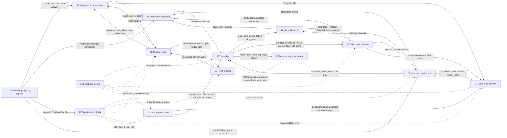

# DoseTrace core flows — index

Written 2026-10-12 as step 3 of the product-definition effort (`docs/product/README.md`: dossiers → PRD + TRD → **flows** → founder review → code sweep → test build). Founder 2026-10-12: "sem cortar caminhos… sem nada curto".

Each flow is a state-based document with the same 13 sections:

1. Goal · 2. Actors · 3. Preconditions · 4. **What may already have happened before** (the arrival states — the journey-review question) · 5. Happy path (mermaid flowchart) · 6. States and transitions (mermaid `stateDiagram-v2`, every state, transition and trigger) · 7. Alternative and exception paths (offline, app killed, second device, timezone / DST / midnight, notification tap, Fold open / closed, free vs Premium, plus the flow's own) · 8. **What every surface shows** (state × surface table) · 9. Data written at each step · 10. Rules with sources · 11. Divergences today (summary) · 12. Open founder questions · 13. **Acceptance checks** — numbered, testable, written as an agent-device QA script (taps + expected screen text in English and Portuguese).

## The flows

| # | File | Covers | Main dossier |
|---|---|---|---|
| 01 | [01-onboarding-signup-signin.md](01-onboarding-signup-signin.md) | 8-step onboarding, Android reminder setup step, Create account / Sign in (email, Apple, Google), email confirmation, reset password, profile gate, 18+, shared-device stash | research/07 |
| 02 | [02-protocol-create-edit.md](02-protocol-create-edit.md) | Wizard (name, colour, dose, schedule, vial), past start + "Same dose for the last N weeks?", AI protocol assistant, vial-label scan, Edit, free limit | research/01 |
| 03 | [03-dose-day.md](03-dose-day.md) | Reminder → Mark complete / Skip / Snooze / Undo, site question (S-25), pending from yesterday, Missed, Dose log edits, rings / streaks / header, vial effect | research/02 |
| 04 | [04-vial-and-supply.md](04-vial-and-supply.md) | Mix, use, low (1–3), expiry (7 d / day), All doses logged, + Add vial, New vial, New bottle, empty containers | research/01 §3.12 |
| 05 | [05-protocol-end-restart-delete.md](05-protocol-end-restart-delete.md) | Still going? end, deliberate end (approved), Restart (new / same container), Delete, Recently deleted, Restore, Delete forever, cross-device status | research/01 §3.8–3.11 |
| 06 | [06-reminders-reliability.md](06-reminders-reliability.md) | Window and budget, setup screen, Android permissions, background refresh, update / reboot, server wake, Silent mode, switches, iPhone window | research/03 |
| 07 | [07-food-log-day.md](07-food-log-day.md) | AI food log chat, catch-ups, questions, closing a day, offline, 20:00 question, free days / grace / locked | research/04 |
| 08 | [08-reality-check.md](08-reality-check.md) | Start → running → due → weighed / needs food → ready → result → next check; typed calories; Stop / Start over; free / grace / Premium | research/04 |
| 09 | [09-weigh-in-and-your-numbers.md](09-weigh-in-and-your-numbers.md) | Progress one card, Log today's weight, fix / delete weigh-in, Your numbers, daily burn, target, weekly check-in | research/04 |
| 10 | [10-curve-and-journey.md](10-curve-and-journey.md) | Dose accumulation (math, window, remembered view, honesty), Journey dashboard and tiles | research/05 |
| 11 | [11-labs-and-vaccines.md](11-labs-and-vaccines.md) | My Body hub, lab scan, cards / markers, edit / delete, vaccines (hand + scan), export, Bloodwork due | research/06 |
| 12 | [12-account-signout-delete.md](12-account-signout-delete.md) | Profile edit, intended vs spurious sign-out, the wipe, delete account, export, cross-account guard | research/07 |
| 13 | [13-premium-and-limits.md](13-premium-and-limits.md) | The limits contract, Paywall, purchase / restore / pending, entitlement cache, lapse and grace, server vs client enforcement | research/07 |
| 14 | [14-fold-book-layout.md](14-fold-book-layout.md) | Two pages on the unfolded Fold, per-tab page pairs, fold / unfold, A-115 right page adds, A-116 (waiting) | specs/book-layout + fold-right-page |

## How the flows feed each other

Solid arrows = data or state that one flow produces and the next consumes. Dotted = gates and presentation layers that wrap several flows.

### Shared states and their single owner (what every flow must read, never recompute)

| Shared state | Owner (lib) | Used by flows | Known split owners today |
|---|---|---|---|
| Doses expected on a day / slots | `lib/schedule.js` | 03, 05, 06, 10 | reminders use `dueDateKeys` (honours `schedule_total`, 08:00 default) — 02 D1–D4, 01 D-08 |
| Mark complete / undo | `lib/markTaken.js` via `recordDoseTaken` | 03, 04 | Today card, markTaken, deleteDose re-implement capacity — 01 D-03 |
| Supply low / capacity | `lib/supplyLow.js` | 03, 04, 06 | report uses its own formula — 01 D-02 |
| Ended / deleted / purged | `lib/protocolEnd.js` | 03, 05, 10 | consistent (01 D-01) |
| Rings / streaks | `lib/adherenceRings.js`, `lib/doseStreak.js` | 03, 12 | tracker streak and report streak computed inline — 02 D17, 08 D2 |
| Reality-check state | `lib/realityCheckRules.js checkOutcome` | 07, 08, 09 | Progress has its own assembler; day-21 reminder date-only — 04 D-1, D-2, 08 D5 |
| Current weight | `lib/numbersWeight.js` | 08, 09, 10 | hero / tile / numbers differ after fix / delete — 04 D-10, D-11 |
| Food access | `lib/foodThread.js foodLogAccess` | 07, 08, 13 | server does not check — 04 D-15 |
| Premium | `lib/entitlement.js hasPremium` | 02, 10, 11, 13 | server only for scans — 07 D-1…D-4 |
| Curve level | `lib/serumModel.js` | 10, 11 | tile vs screen list / grid — 05 D1, D2 |
| Reminder health | `lib/reminderHealth.js` | 06, 03 | Settings vs Today "blocked" — 03 D-1, D-2 |

## Conventions

- **Intended behaviour is the default text.** Where the code differs today, the flow says **Divergence today** and cites the dossier finding: `01 D-13` = `docs/product/research/01-protocols.md` §6 divergence D-13; `01 G-5` = §9 gap G-5; `07 Gap 6` = `research/07` §9 item 6; `08 D5` = `research/08` §8.2 row D5. Every divergence also appears in the flow's §11 table with an ID `Dnn-k` (flow number, item).
- **Intended** comes from `docs/decisions.md`, the signed specs in `docs/specs/`, or — marked "by logic, founder may override" — from how the features connect (CLAUDE.md "decide what is already decided"). Anything that is a real preference is in §12, never assumed.
- Strings are quoted from `i18n/translations.js` (EN and PT). `{name}`-style placeholders are filled by the app. New copy that does not exist yet is marked as such (needs 6-language approval).
- Names: UI "Complete" = stored outcome `Taken`. "Reality check" = PT "Seus números reais".

## Using the acceptance checks as the agent-device QA script

- Account: the test account Test03 (free tier); Premium only through a temporary RevenueCat promo the founder grants; destructive checks (delete account) on a throwaway `+qa` account. Never the founder's main account; no passwords typed by the agent (`docs/decisions.md` "Run test steps yourself").
- Screenshot before every tap, tab bar included (sim tap discipline).
- Every check runs in **light and dark** (Settings → Preferences → Appearance) — CLAUDE.md hard-line gate; and in **Portuguese** (Settings → Preferências → Idioma → PT) for the PT expectations.
- iPhone checks on the simulator; Android checks (permissions, background refresh, update / reboot, Fold) on the founder's Z Fold 7 with `adb` (`dumpsys alarm`, appops).
- A check whose result matches a **Divergence today** is recorded as the divergence (with the screenshot), not as a pass.
- Check IDs are stable (`F03-12`) so a build report can list pass / fail / divergence per row (CLAUDE.md evolution rule 4: walk every link before every build).

## Open founder questions — one round (deduplicated across flows)

Filtered against `docs/decisions.md` and the signed specs; only real preferences remain. Each has a recommendation in its flow.

| # | Question | Flow |
|---|---|---|
| 1 | AI consent per device (today) or per account (asked for each person, proof on the server)? | 01, 11, 12 |
| 2 | OS notification prompt after "Not now": at first sign-in (today) or when the first timed protocol is saved? | 01, 06 |
| 3 | Year-only 18+ test — keep or ask the month (counsel)? | 01 |
| 4 | "Doses already taken from this vial" on create / new vial (A-08 / F7)? | 02, 04 |
| 5 | Keep a half-filled new protocol after an app kill? | 02 |
| 6 | Recon dose changed mid-vial: recompute remaining doses? | 02, 04 |
| 7 | Lapsed Premium with more than 3 active protocols: keep them active? | 02, 13 |
| 8 | Skip cancels that slot's reminders and gets an Undo bar? | 03 |
| 9 | "All caught up" when every due dose is complete-or-skipped? | 03 |
| 10 | Keep the grey "reminder" tag before Due (conflict #22)? | 03 |
| 11 | Tracker streak: remove the 31-day cap? Report streak: same "doses in a row" rule? | 03, 12 |
| 12 | Manual "New vial" for recon at any time; rtu New vial as a new row with a new box date (A-08)? | 04 |
| 13 | Oral bottles: same 1–3 low rule and interval-aware days left? | 04 |
| 14 | Pictures needed: "End protocol" placement; vial prompt "Protocol finished" with "Later" | 04, 05 |
| 15 | Days-left colour above 7 days: green (Today) or plain (Protocols)? | 04 |
| 16 | Course total reached: ask "end it?", end automatically, or only stop reminders? | 05 |
| 17 | Resume the 7-day purge only for protocols deleted by 1.3.0+ (A-84)? | 05 |
| 18 | iPhone users who never open the app: warning line, iPhone server push, or accept? | 06 |
| 19 | Settings "blocked" row neutral when reminders are off / no timed protocol? | 06 |
| 20 | Persistent reminders: fix the copy (two repeats) or repeat until acknowledged? | 06 |
| 21 | Drop the manual "not recorded" day mark from FL-3? | 07 |
| 22 | Stop reality check: keep saved measured results (recommended) or delete them (today)? | 08 |
| 23 | One start weight (the start-day weigh-in) instead of the start sheet's own field? | 08 |
| 24 | Confirm the self-finishing reality check (no "See my actual maintenance" button)? | 08 |
| 25 | New Today lines for a locked / unsavable reality-check result (×6, picture first) | 08 |
| 26 | Lower date bound for "+ Add a past weigh-in"? | 09 |
| 27 | Curve: place doses at the user's reminder times, or disclose the fixed 12:00 grid? | 10 |
| 28 | Curve: dose edits apply forward only (history kept)? Count only logged doses (A-31)? | 10 |
| 29 | Blend component lines: confirm solid past supersedes the 2026-09-18 dashed lines | 10 |
| 30 | Manual lab entry (approved 2026-09-30, never built): build next or defer explicitly? | 11 |
| 31 | Lab marker charts: Premium (decision) or free (code)? | 11, 13 |
| 32 | Bloodwork due: fixed 6 months, user-set, or removed (regulatory look)? | 11 |
| 33 | Show "x of 3 scans used this month"? | 11 |
| 34 | Delete account: warn that the store subscription keeps billing? | 12 |
| 35 | Export: include profile and preferences? | 12 |
| 36 | Settings: "Manage subscription" + "Restore purchases" for everyone? | 13 |

Status: draft for the founder's review and signature. After sign-off, every divergence becomes a registry item fixed test-first (`docs/product/README.md` step 4), and §13 of each flow becomes the pre-build QA walk.
