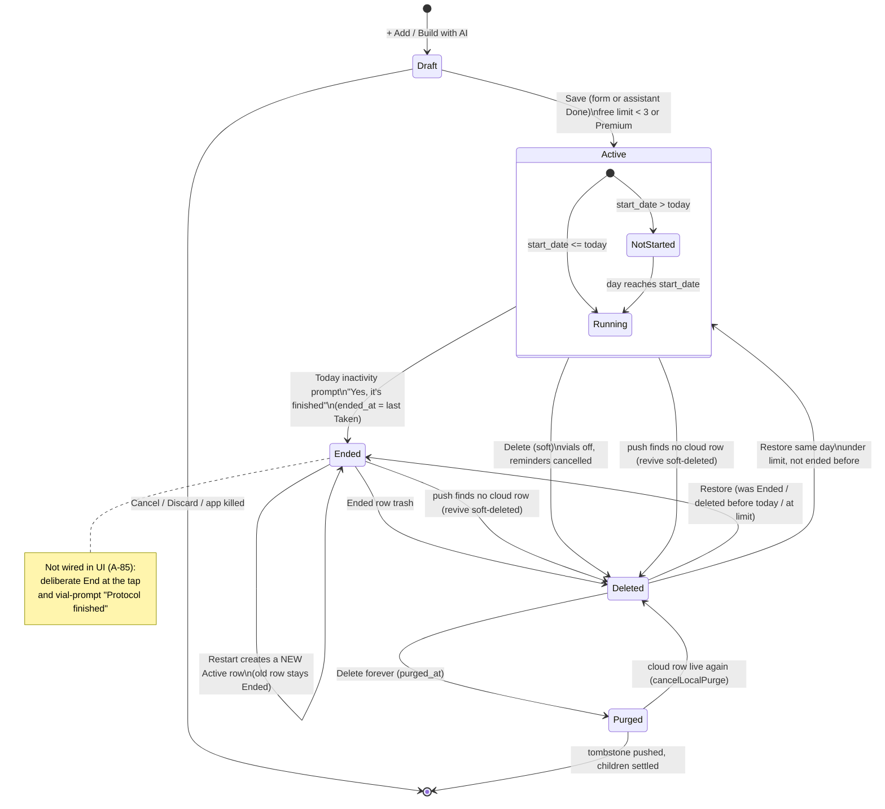
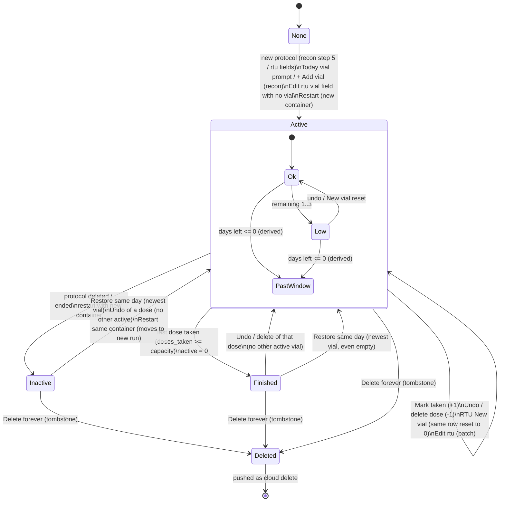
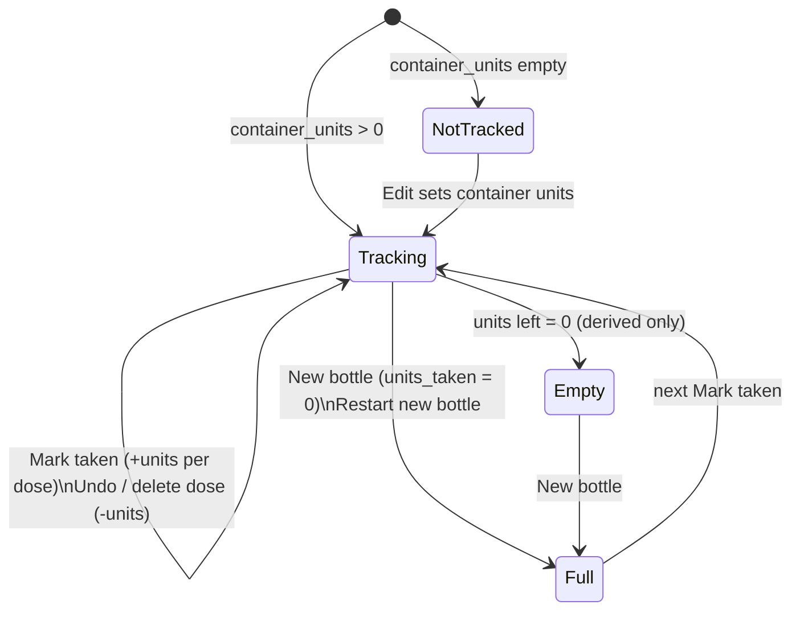
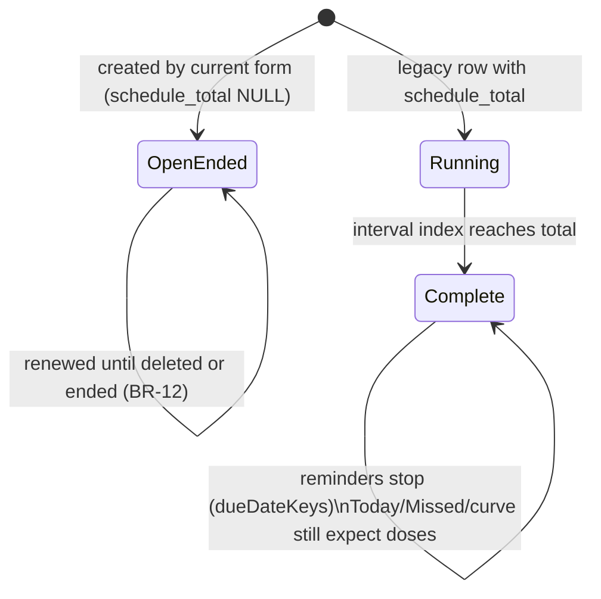

# 01 — Protocols & supply: product + technical dossier

> **Verified 2026-10-12 — corrections applied from docs/product/verification/01; where this dossier and the verification disagree, the verification wins.**
>
> Corrections applied in this file (each marked "[Corrected 2026-10-12]" where it sits):
> 1. **D-20 / G-27 are stale.** Protocols send `created_at` since commit `e85519c` (`lib/syncMappers.js:101-103`). Two residuals remain: a pull never rewrites an existing local `created_at` (`lib/syncCore.js:405-415`), and vials (like 7 other tables) still do not send it (TRD H-4).
> 2. **Interval presets (R-08, ledger row :200).** The wizard does not show presets 1–7, 10, 14: step 4 has only Every day / Custom plus a typed field (digits only, 1–999). `PRESET_INTERVALS` only decides whether a stored value opens Custom (`screens/ProtocolsScreen.js:3062-3088`, `lib/protocolForm.js:16`). The code differs from decisions.md:200 and no later ledger line replaces it.
> 3. **Restart order (§ Restart, R-51/R-52).** The free limit is not checked first from the user's point of view: `askRestart` shows the duplicate warning, then the container question, and only then `restartProtocol` checks the limit — the user picks a container before seeing "Protocol limit reached" (`screens/ProtocolsScreen.js:1253-1285`, `:1288-1290`).
> 4. **Purge blanking (R-55, Delete forever).** The server trigger also keeps `type`, colour and `deleted_at`, and leaves `interval_days`, `doses_per_day`, `concentration_unit` and `divisible` unblanked — narrower than ledger :540 promises (`supabase/migrations/20261004010000_protocol_delete_guard.sql:8-9, 31-41`).
> 5. **D-01 equivalence.** `notifications.js:424, 925` skip the `sync_status` test (harmless: soft delete sets `active = 0`); `adherenceRings.js:70-71` is a different "active **or ended**" predicate, not a copy of "is active".
> 6. **G-9 (recon vial edit).** The capacity recompute on a dose edit is decided by logic (DL-15, decisions.md:660); only the manual mix-date / window / doses-used edit waits for the founder (OPEN-01).
> 7. **Offline assistant (§13 item 13).** Offline, the assistant stays open with a notice; it does not hand back to the form with the compound filled (`screens/components/ProtocolAssistant.js:111-120`). The handback after a conversation goes to step 1, 3 or 4 through `stepForHandback` (`lib/protocolAssistant.js:949-956`), not always step 1.
> 8. **Report supply line.** The Settings report computes `total_doses − doses_taken` inline (`SettingsScreen.js:415`), a fourth copy next to D-03's three.
> 9. **New defects found by the verification (not in this dossier):** an oral protocol dosed in IU is blocked at step 3 / Save by a unit mismatch (`ProtocolsScreen.js:1793-1795, 1804, 1810`); after a ready-to-use "New vial" (same row id reset) that vial's "running low" push never fires again (`notificationPlan.js:243-255`); a ready-to-use vial shows "Past window" from 00:00 on the last day of its box month (`Math.ceil` of a negative fraction gives -0, `ProtocolsScreen.js:194`); the oversized vial-photo notice reuses "Please choose a PDF under 10 MB."; Today's vial prompt has a dead "doses already used" state (`TodayScreen.js:257`); the vial prompt has two buttons, no "Not now" (`TodayScreen.js:2380-2393`).

- Scope: create (wizard, compound search, blends, recon / rtu / oral, schedule, start date incl. past start and the A-30 history question, total doses / course), AI protocol assistant, vial-label scan, edit, end, restart, delete + Recently deleted, vials (mix date, expiry, doses left, new vial, refill bottle, supply low), the My Protocols page (heroes, list, sort, detail), the free plan limit, protocol colours.
- Code state read: branch `redesign/graduated`, HEAD `4dade55` (2026-10-12). Read-only research, no code changed.
- Citation format: `path:line`. "CONFIRMED" = both sides read and they differ. "SUSPECTED" = reasoning from code, not reproduced. "unverified" = could not be checked from the repo (device, cloud, or founder intent).
- Legend of code names: recon = lyophilized powder mixed with a diluent; rtu = ready to use (pre-mixed vial); oral = supplement (capsule, tablet, softgel, gummy, powder, liquid).

---

## 1. Purpose and who uses it

**What the domain is for.** The Protocols domain is where the user records *what* they take, *how much*, *how often* and *from which container*. Every other module reads it: Today's dose cards and ring, the reminders, the Missed scan, the Dose log, the serum curve, the adherence report and the supply alerts (docs/review/app-map.md L-01…L-13, L-46).

**Product posture (standing rules).**
- DoseTrace is an "honest journal plus a pure-math calculator", never a drug-interaction checker — standing since 2026-04-29 (docs/decisions.md:169; CLAUDE.md "Product guardrails").
- No numeric presets: no pre-filled dose values and no auto-selected goals; "the only preset is picking a compound name" — 2026-07-03 (docs/decisions.md:170). The code keeps this: `newProtocolForm` starts with `dose: ''`, `amount: ''`, `goals: []` (lib/protocolForm.js:46-57).
- AI HARD LINE: any AI feature may only transcribe or surface the user's own data; never recommend a treatment, dose or protocol change — founder directive 2026-09-10 (CLAUDE.md; docs/decisions.md:316). Applies to the vial-label scan and the protocol assistant (docs/decisions.md:322, :324-326).
- A protocol is a durable health record: "never lose user-entered data" (CLAUDE.md, 2026-09-12) and "never destroy on a maybe" (docs/decisions.md:506, 2026-10-03).

**Who uses it** (from the founder's decisions and the spec's purpose statements):
- People self-managing peptides, TRT / AAS esters, GLP-1s, HGH and supplements (compound lists in screens/ProtocolsScreen.js:97-105; registry F-029 note on the "peptides/TRT/GLP-1" audience, docs/review/features.md:55).
- Lay users who get stuck filling the calculator: "A real customer typed her weekly total (240 mg) as the dose per injection and got a 'doesn't fit the syringe' error she could not understand" (docs/specs/ai-protocol-assistant.md:4, signed 2026-10-02). This is why the assistant and the "Dose per injection" label exist (AP-13, docs/decisions.md:183).
- Users who started a compound before installing the app ("started my compound weeks ago" — CLAUDE.md journey-review rule; A-30, docs/review/features.md:170).
- Users on long-interval esters (custom interval, e.g. testosterone undecanoate every ~12 weeks — screens/ProtocolsScreen.js:941-944; decision 2026-09-04, docs/decisions.md:200).
- Free users capped at 3 active protocols (docs/decisions.md:280, :465 "3 mantém").
- Foldable users (Z Fold) — book layout, S-26 / A-115 (docs/specs/book-layout.md; docs/specs/fold-right-page.md).

**Key dated decisions that shape the domain** (all from docs/decisions.md):
| Date | Decision | Line |
|---|---|---|
| 2026-09-04 | Start date any past/future date (default today); custom interval presets 1–7, 10, 14 + custom days. [Corrected 2026-10-12: the wizard does not show these presets — only Every day / Custom + a typed 1–999 field; see note 2] | :200 |
| 2026-09-18 / 09-24 | Blends: picker shows common composition + "varies by source"; curve splits blends by common ratio; per-vial composition label is journaling only | :205 |
| 2026-09-27 | A new vial never rewrites start_date (S-01) | :181 |
| 2026-09-27 (option C) | A-30 history before registration = declared, never logged; "Same dose for the last N weeks?" | :198 |
| 2026-09-29 | My Protocols opens on two heroes; Recently deleted at the bottom of the list; protocol screen order calculator → vial → schedule → dose details → notes; Edit top right, Delete at the bottom | :173-175 |
| 2026-10-01 | One low-supply rule: 1–3 doses left (FX-11) | :148 |
| 2026-10-02 | New protocol first dose = Today; Edit writes only what changed; compound name required; palette B; "Dose per injection"; 2/3/5 ml syringes for rtu only; never a water amount | :178-188, :43 |
| 2026-10-03 | Ended state (A-83); end = moment tapped; purge paused; Recently deleted multi-select | :503-506, :501, :515 |
| 2026-10-04 | Delete forever = positive tombstone (purged_at); End/Delete wins across devices (A-87); inactivity end dated at last Taken dose (A-86); Restore before today → Ended (A-89); copy must be true (A-90) | :520-544 |
| 2026-10-06 | Restart starts today with zero doses, full new vial (A-99) | :577-578 |
| 2026-10-07 | Restart asks new vs same vial/bottle + duplicate warning (council 3 #1); BR-12 course ends reminders; reminders renewed until the user deletes/ends | :614, :620, :594, :601 |

---

## 2. Screens and entry points

### 2.1 Screens / views owned by this domain
All live in `screens/ProtocolsScreen.js` (tab `Protocols`, App.js:183). The tab has three views decided by state (screens/ProtocolsScreen.js:2125-2126): `heroes` (showList false), `list` (showList true, no openId), `detail` (showList true + openId of an active protocol).

| View | What it shows | Code |
|---|---|---|
| Heroes (tab landing) | "Protocols" hero: count of active, each name with colour dot, low-supply line; "Dose log" hero: Taken / Skipped / Missed counts (logged only) + "Last: name · when" | screens/ProtocolsScreen.js:2419-2475 |
| Empty state | Vial icon, title, sub, "Add a protocol" → `openAdd` | :2171-2180, shown :2484 |
| List | Header "‹ Protocols", title + "+ Add", sort pills, cards (flat or by type), Ended section, Recently deleted section | :2405-2493 |
| Protocol card | dot, name (t(compound_id) or name), size · dose · frequency, vial cells + "N of M doses left" · days left, tags (Low, Past window, type, goals), optional "Mark complete" | `ProtocolListCard` :600-685 |
| Protocol detail | dot + size · dose, name, tags; syringe hero (recon/rtu) or serving hero (oral); vial block; Schedule rows + "+ Reminder"; Dose details rows; inline Note; Delete | `ProtocolDetail` :698-822 |
| Syringe zoom sheet | the drawn syringe enlarged on a 1640-wide ruler centred on the dose | `SyringeZoomSheet` :392-439 |
| Add / Edit wizard (pageSheet Modal) | steps 1 Name & type, 2 Colour, 3 Dose, 4 Schedule, 5 Vial (recon, new only); AI doors; scan button | :2513-3312 |
| AI assistant window (inside the wizard Modal) | conversation UI | screens/components/ProtocolAssistant.js (rendered :2530-2542) |
| "Why it doesn't fit" explainer | 4-step animated explainer + split buttons | screens/components/FitExplainer.js (mounted :3267-3274) |
| Syringe picker sheet (rtu) | grouped insulin (units) / ml syringes | screens/components/SyringePicker.js (:3275-3283) |
| DoseTrace sheets | delete / limit / history question / restart / purge / refill (`screenSheet`, :2505), wizard notices (`wizSheet`, :3287), photo source (`scanChoice`, :3288), iOS wheels (:3289-3310) | |
| Ended section | dot, name, "Ended {date}", Restart pill, risk trash | :2184-2212 |
| Recently deleted section | dot, name, "Deleted Nd ago", Restore pill, risk trash; Select mode with checkboxes; bottom bar Restore (N) / Delete forever (N) | :2222-2301 |
| Book layout (≥700×560 pt) | left page = header + list + Ended + Recently deleted; right page = Edit + `ProtocolDetail` of the selected protocol | :2359-2391 |

Today also renders the protocol page on the Fold right page (A-115): `ProtocolDetail` is exported (screens/ProtocolsScreen.js:698) and used by `renderRightPage` (screens/TodayScreen.js:1769-1800) with `deleteProtocol={null}` and every action routed back to My Protocols.

### 2.2 Every way the user reaches these screens
| Entry | Lands on | Code |
|---|---|---|
| Tab bar "Protocols" | Heroes (or the last view while the tab stays mounted) | App.js:183; ProtocolsScreen state :895 |
| Today dose card tap (phone) | Protocol detail via `openProtocolId` | screens/TodayScreen.js:1857 |
| Today "Next 5 days" / upcoming row tap (phone) | Protocol detail | screens/TodayScreen.js:2014 |
| Today dose card tap (Fold, book) | Today's own right page with `ProtocolDetail` (not the Protocols tab) | screens/TodayScreen.js:1857 (`openDoseOnPage`), :1769-1800 |
| Today Fold right page "Edit", refill, zoom | Protocols tab with `openProtocolId` | screens/TodayScreen.js:1779, :1796 |
| Today alert "Supply low" | Protocols tab, NO protocol param → heroes | screens/TodayScreen.js:1544 |
| Today alert "Vial expiring" | Protocols tab, NO protocol param → heroes | screens/TodayScreen.js:1576 |
| Today empty state "Add a protocol" | Protocols tab (heroes/empty state; wizard NOT opened) | screens/TodayScreen.js:2181 |
| Today inactivity prompt body text | points the user to "Ended in My Protocols" (text only, no button) | i18n/translations.js:322 |
| Notification `vial_low` / `vial_expiry` tap | Protocols with `openProtocolId` (or `openVialId` for older alerts → resolved via `getVialById`) | lib/notificationPlan.js:179-181; screens/ProtocolsScreen.js:1148-1155 |
| Notification `dose_reminder` tap | Today (`focusDose`), not Protocols | lib/notificationPlan.js:175-178 |
| Protocols card "Mark complete" | Today with `focusDose{…, take:true}` (Today runs the take) | screens/ProtocolsScreen.js:2119 |
| Protocols hero "Dose log" | Log screen | :2454 |
| Limit sheet "Start free trial" | Paywall `{source:'protocol_limit'}` | :2041 |
| Book layout default | right page = `openProtocolId` param, else first card of the list order (BK-4) | lib/bookLayout.js:35; screens/ProtocolsScreen.js:1081-1085, :838-842 |
| Fold / unfold | BK-10: a chosen right-page protocol becomes the pushed detail on fold; an open detail moves to the right page on unfold | :1111-1124, :846-855 |

Back navigation: detail "‹ Protocols" → list (`closeProtocol`, :1095-1098); list "‹ Protocols" → heroes (:2406). Android back in the wizard steps back, or cancels from step 1 (:2518-2527); with the assistant open it closes the assistant (:2521).

---

## 3. User actions

Common write side effects (apply to every action below unless stated):
- Local SQLite write first with `sync_status='pending'` (lib/database.js:126-166, :209-249); then `requestSync()` (lib/sync) and `notifyDataChanged('protocol')` refreshes mounted screens (e.g. Today) without waiting for the network (screens/ProtocolsScreen.js:1941-1944).
- `updateProtocol` strips `id/sync_status/updated_at/remote_id`, stamps `updated_at`, and sets `status_at` when `active / deleted_at / ended_at` are written (lib/database.js:150-166) — this is the A-87 "status only from the device that changed it" marker.

### 3.1 Open the Protocols tab / browse
- Preconditions: signed-in user (`getCachedUser`), else nothing loads (screens/ProtocolsScreen.js:1192-1193).
- Reads on focus (`useFocusEffect`, :1126): active protocols (`getActiveProtocols` → `SQL_ACTIVE`, lib/protocolEnd.js:24); all logs (`getAllLogs` → `SQL_ALL_LOGS`, lib/protocolEnd.js:31) for the hero counts (`outcomeCounts`, logged-only, lib/declared.js:28-35), today's logs (local midnight), yesterday's pending slots (`pendingFromYesterday` with the A-51 zone history), last complete log; active vials keyed newest-first per protocol (:1210-1213); deleted + ended lists (:1219-1224).
- Sort: pills Due next / A–Z / Vial age / Recently added / Type (screens/ProtocolsScreen.js:88-94); saved per device in AsyncStorage `dosetrace_protocols_sort` (:95, :1180-1189). Rules in §4 (R-60…R-64).
- Free-feature explainer gate (Part 18) offers recon calculator / vial tracker / reminders until used (:860-868, :2508).
- Leaving the tab cancels the Recently deleted selection (:1126).

### 3.2 Create a protocol (manual wizard)
- Preconditions: signed in; `isOverFreeLimit()` false — fresh DB count of active protocols `< 3` or Premium (screens/ProtocolsScreen.js:2046-2056). Otherwise the limit sheet (:2035-2044).
- Steps (`totalSteps = editing ? 4 : recon ? 5 : 4`, :2058):
  1. **Name & type** (:2566-2687). Type tiles Lyophilized / Ready to use / Oral; changing type resets name, compoundId, search and clamps the syringe (`allowedSyringe`) (:2591-2599). Compound search: suggestions only after ≥2 typed characters (:2638), max 8 shown + "+N more" (:2644-2666), alias-aware matching (`matchesQuery`, lib/compounds.js:94-100), blends show "commonly contains … · varies by source" (lib/compounds.js:116-120; :2645-2656). "Add '{name}'" creates a custom (compound_id null) name (:1463-1470, :2667-2676). Blend note and insulin "no curve" note (:2613-2618). Next on step 1: `nameOnNext` — chosen name advances; exactly-matching typed text selects the listed compound; other text becomes a custom label; empty → "Missing name" (lib/protocolForm.js:199-206; :1969-1974).
  2. **Colour** (:2689-2738): 20-swatch palette B; swatches used by other ACTIVE protocols marked; warning when the chosen colour is in use; tip line.
  3. **Dose** (:2740-3021). Scan-label button for recon/rtu (§3.4). Per type:
     - recon: compound amount + unit (mg/mcg/IU); diluent pills (none preselected); water stepper ±0.5 ml, min 0.5 (:1517-1522, :2837-2860); "Dose per injection" + unit with hint; IU→mass converter fold (mg/mcg vials only; "Use" fills dose in mcg when <1 mg else mg) (:2872-2908); syringe size bar from insulin sizes 0.3/0.5/1 ml (:2909-2915).
     - rtu: dose + unit; concentration (optional) + unit/ml; syringe picker row (insulin + 2/3/5 ml); vial size ml; box expiry month pills + year pills (this year … +5) (:2919-2953).
     - oral: dose + unit (mg/mcg/IU/g); form pills; "divisible?" for discrete forms (optional, deselectable); serving strength + unit; units per serving; units per container (:2768-2817).
     - Live result under the fields: draw to N units (or ml on ml syringes), syringe drawn to scale, ml line, small-draw fact (<10 units), red warning when over capacity with "Why" + "Ask AI for help" (:2955-2987); oral serving result (:2988-3018); disclaimer (:3019).
     - Guard: Next is blocked on a unit mismatch or a recon draw over the syringe (`doseStepBlocked`, :1804-1812; :1975-1978). rtu over syringe is shown but NOT blocked (AP-21, :1808-1810).
  4. **Schedule** (:3023-3169): First dose Today / Tomorrow bar + start date picker (any date; iOS wheel in a DoseTrace sheet :3289-3297, Android native :3049-3060); "Every day" / "Custom" + "Every N days" (digits only, maxLength 3) (:3064-3096); doses per day 1/2/3 only when interval ≤ 2 (:3099-3110, :1033-1042); one time picker per dose (:3113-3138); wellness goals (injectable vs oral lists, :107-109, :3141-3147); blend composition label (blends only, :3151-3155); note (:3158-3167).
  5. **Vial** (recon, new protocol only, :3171-3239): mixed month pills + day (1–31), validity days (default 30, digits ≤3), BAC info box, "I haven't mixed this vial yet — skip"; summary rows (compound, amount, water, dose, draw, frequency).
- Cancel: a new protocol with typed content asks "Discard this protocol?" (Cancel / Discard in risk) (lib/protocolForm.js:190-194; :1991-2004). Edit closes without asking.
- Save (`saveProtocol`, :1828-1951):
  1. no name → "Missing name"; `doseStepBlocked` → back to step 3 + "Check values" (:1829-1838).
  2. `safeStart` = valid `YYYY-MM-DD` or today (:1842).
  3. Free-limit re-check against the live DB count (:1879-1885).
  4. `insertProtocol({ user_id, ...protocolPayload(form), start_date: safeStart })` (:1888; lib/protocolForm.js:126-154; lib/database.js:126-148). Writes **protocols**: name, compound_id, type, color, amount (rtu: concentration × vial ml), unit (rtu: concentration_unit), water, diluent (token or own text, recon only), dose, dose_unit, syringe_size, concentration, concentration_unit, frequency (label words in the current language), reminder_time ("HH:MM,HH:MM"), interval_days, doses_per_day, start_date, schedule_total = NULL, vial_valid_days, goal (csv keys), notes (oral form), note, composition (blends only), oral serving fields, units_taken = 0, divisible, active = 1, created_at = now.
  5. recon and not skipped → `insertVial({ mixed_on: toPastSupabaseDate(month, day), water_ml, total_doses: dosesPerVial(...), doses_taken: 0 })` (:1890-1899). rtu with ml, concentration and dose → `insertVial(rtuVialFields)` (water_ml = bottle ml, total_doses, expires_on = last day of the chosen month) (:1903-1904; lib/protocolForm.js:167-178). oral → no vial (supply lives on the protocol row).
  6. `scheduleDoseReminder(newRow)` (:1906-1907); analytics `protocolCreated` (anonymous since 1.3.0, docs/decisions.md:557).
  7. A-30 history question when `historyQuestion` returns one (start before today, compound has a half-life ≥ 24 h): "Same dose for the last N weeks/days?" — Yes writes nothing; No writes `history_from = today` (:1910-1939; lib/declared.js:41-58). Shown only after the sheet is gone (`screenSheet` waits for `wizardPresented`, :1157-1165, :2505).
- What changes elsewhere: Today (dose cards, ring, Due), the serum curve (schedule-driven; pre-creation part drawn as estimated unless `history_from`, lib/serumModel.js:100-110, :222-240), reminders (local dated notifications), Missed scan (never before created_at − 1 h, lib/missedDoses.js:11), morning summary on next sync.
- Undo / recovery: no undo; the protocol can be edited, ended, or deleted (Recently deleted).
- Not persisted: the wizard form lives in screen state only; a killed app loses a half-filled new protocol (see §9 G-18).

### 3.3 Create with the AI protocol assistant
- Four doors, one window (AP-1): "Build it with AI" on an empty step 1, "Finish with AI" once something is typed and on steps 2/4/5, the dose door on step 3, "Ask AI for help" on the doesn't-fit warning and in the explainer (screens/ProtocolsScreen.js:2318-2329, :2570, :2697, :2742, :3025, :3173, :2980, :3273). In Edit only the fit door exists (step doors are `!editingId`).
- Preconditions: shared AI consent (DoseTrace sheet; declining leaves the form) (:1718-1734); server limit 10 conversations per rolling 7 days, counted at the first answer sent to the model or when the label-photo path starts (docs/decisions.md:289, :487; lib/assistantClient.js:1-23; supabase/functions/protocol-assistant).
- Engine (pure, lib/protocolAssistant.js): asks one thing at a time in order compound → form → vial amount → mix / water → mixed date → (rtu) strength + vial ml → (oral) strength → dose → spread (per injection/day/week/month) → count → spacing → first dose → confirm (`nextStep`, :136-166). Only app-written i18n keys are shown (AP-14). Advice-shaped questions ("is that ok?", 6 languages) get the fixed deflection and nothing is taken (:685-697, :758-772). Plain numbers are read on the phone and never sent (`localUnderstand`, :914-941).
- Numbers: a total per period is divided by the user's own count, 4 significant digits (`fmt4`, :41; `applyCount`, :616-635); week counts that divide 7 become an exact interval; others offer only storable "every k days" spacings stated honestly (`spacingOptions`, :342-359). Day count max 3 (:32, :619, :643). Interval accepted 1–365 (:651-656).
- Doesn't fit: explains with the user's numbers, asks per-injection vs period, then facts only (larger syringe for rtu; "the water in the NEXT vial decides"; who to ask) — never a water amount (:374-412; docs/decisions.md:186).
- Result: `formFromConversation` writes only the user's answers into the form; fields the user filled stay unless changed in the chat (AP-10) (:864-912). Outcomes: `save` (Done) → the form's own `saveProtocol` (same checks, vial, reminders, history question) (screens/ProtocolsScreen.js:1779, :1786-1790); `fill` → form on its last step; `handback` → form on the first missing step (`stepForHandback`, lib/protocolAssistant.js:949-956).
- Label photo inside the chat (AP-7): same extraction path as §3.4; values read back and used only after "Yes" (lib/protocolAssistant.js:813-854).
- Recovery: the conversation is in memory only; a killed app loses it (AP-33, accepted).

### 3.4 Scan a vial label (AI transcription only)
- Where: step 3 of the wizard for recon/rtu (screens/ProtocolsScreen.js:2749-2766) and inside the assistant.
- Preconditions: AI consent (:1620-1639); native ImagePicker present; camera permission for the camera path; image ≤ ~10 MB base64 (:1529, :1666-1681).
- Call: `supabase.functions.invoke('extract-bloodwork', { kind: 'vial', lang, image_base64, media_type })` (:1685-1687). Shared monthly scan pool (3 free / 20 Premium, server-enforced) (docs/decisions.md:275-277); quota error shows the server's limit (`fillQuotaMessage`, :1694-1696).
- Apply (`applyVialScan`, :1571-1605): form `solution` → rtu, `powder` → recon (only when unambiguous); compound resolved **deterministically** by the app (exact label/id-suffix, then alias, preferred list first; ambiguous → null) and only when the user has not chosen one; else the printed name (≤60 chars) is seeded (:1535-1554, :1583-1587). rtu concentration is filled only for a clean per-ml unit (`mapConcUnit`, :1560-1568); `volume_ml` → vial ml; recon `amount` + unit. A "review these values" warning shows (:2748). Nothing is saved until the user taps Save (review-before-save, docs/decisions.md:322).
- Failures: cancelled → nothing; service down / unreadable / nothing found → DoseTrace notice (:1689-1711).

### 3.5 Open a protocol / read the detail page
- Card tap → `openProtocolById` (selects in book + pushes detail) (:1089-1093).
- Syringe hero (recon/rtu): `computeDraw` on the stored row (no language: stored-value parse rule), "Draw to" in units or ml (ml syringes), drawn syringe, over-capacity warning, small-draw fact, volume / dose (+ mcg↔mg equivalence) / syringe size, disclaimer; tap → zoom sheet (:302-387, :392-439).
- Vial block (recon/rtu): §3.12.
- Serving hero (oral): units to take (½ steps for divisible), "contains" warning when not achievable, nearest brackets, units left, days left, "New bottle" (:444-527).
- Schedule rows: frequency (from interval_days in the current language), reminder times (12/24 h), total doses (only legacy rows with schedule_total), goals; "+ Reminder" opens Edit on step 4 (:727-732, :784-787).
- Dose details rows per type (:733-760).

### 3.6 Edit a protocol
- Entry: detail "Edit" (phone :2401; book :2381); the syringe hero's "Dose details" link opens step 3 (:780); "+ Reminder" opens step 4 (:786).
- Form: `formFromProtocol(row, activeVial, now, language)` — stored numbers shown in the app language; rtu vial ml from the active vial or amount ÷ concentration; expiry month/year from the vial; legacy start_date kept as-is (empty if none) (lib/protocolForm.js:63-115). `setSkipVial(true)`; 4 steps (no vial step) (screens/ProtocolsScreen.js:1479-1489, :2058).
- Save (:1847-1873): `editPatch(before, after)` writes only columns whose payload value changed (lib/protocolForm.js:159-164). rtu: `rtuVialPatch` updates the active vial's changed fields, or inserts a vial if none exists and the change describes one (:1856-1863; lib/protocolForm.js:181-187). Always reschedules reminders from the saved row; clears delivered banners only when `reminder_time / doses_per_day / interval_days / start_date` changed (:1853, :1868-1873).
- Not editable after creation (no UI): recon mixed date, recon validity window (`vial_valid_days`), recon vial capacity (step 5 is new-only, :3171). Changing the dose of a recon protocol does NOT recompute the active vial's `total_doses`; for rtu it does (see §6 D-13).
- No re-ask of the A-30 history question when the start date moves earlier (see §9 G-5).

### 3.7 Inline note
- Typed on the detail page (and the Fold right page). Draft kept per protocol in memory (`lib/draftStore`, key `protocolNote:<id>`) across fold/unfold, other protocols and tab changes, until Save/Cancel or app close (screens/ProtocolsScreen.js:690-722, :1071-1076; lib/draftStore.js:1-20). Save writes `protocols.note` (trimmed, empty → NULL) (:2064-2070).

### 3.8 End a protocol
There is ONE end path in the UI today:
- **Inactivity prompt on Today** ("Still going?" → "Yes, it's finished"): shown when an active protocol that has started has had no Taken log for `max(7, 3 × interval_days)` days (reference = last Taken log in 90 days, else created_at, else start_date), not snoozed within that window, and no other modal is open (screens/TodayScreen.js:501-537). Tap → `endProtocolAtLastDose` (ended_at = MAX Taken logged_at, else created_at; deletes unsynced app-written Missed rows after the end and tombstones synced ones; rows the user answered are kept) (lib/protocolEnd.js:57-69), `deactivateVialsByProtocol`, `cancelDoseReminder`, clears the snooze (screens/TodayScreen.js:539-555). "Keep" snoozes per protocol in AsyncStorage `dosetrace_tx_check_<id>` (:557-564).
- **Not available** (approved, not built): a deliberate "End protocol" action on the protocol page, and "Protocol finished" on the empty-vial prompt ending the protocol (A-85; the vial prompt end was built then reverted pending a picture with "Later") — docs/decisions.md:535, :558; docs/review/features.md:224. `endProtocol` (end at the tap) exists in lib/protocolEnd.js:45-50 and is imported by TodayScreen (screens/TodayScreen.js:29) but has no caller.
- Effects: leaves Today, reminders, active list and free-limit count; history stays in Dose log, report, rings/streak up to the end, curve past (lib/protocolEnd.js:2-7; lib/schedule.js:11-21; lib/adherenceRings.js:70-71; lib/serumModel.js:241-244; lib/protocolEnd.js:173-181). Never auto-purged (lib/protocolEnd.js:201-215).
- Ended list: "Ended {date}" from `ended_at || updated_at`, newest end first (`SQL_ENDED`, lib/protocolEnd.js:25; screens/ProtocolsScreen.js:2184-2212).

### 3.9 Restart an ended protocol (A-99 + council 3)
- Entry: Ended row "Restart" pill (screens/ProtocolsScreen.js:2195-2197).
- Duplicate warning first: if an ACTIVE protocol has the same compound_id or the same name (trim, lower-case) → "{name} is already active … duplicate reminders" (Resume anyway / Cancel) (:1271-1281).
- Container question: `getVialsForProtocol(id)` non-deleted vials → "vial"; else `container_units > 0` → "bottle"; else plain confirm (:1255-1270). Buttons: New vial/bottle (primary), Keep using the same vial/bottle, Cancel.
- `restartProtocol` (:1286-1303): one at a time (`restartingRef`); free limit first inside this function (`isOverFreeLimit` → limit sheet) — [Corrected 2026-10-12: but it runs only after `askRestart` has shown the duplicate warning and the container question (:1253-1285), so the user picks a container before seeing the limit]; `restartEndedProtocol(id, { sameContainer })` (lib/database.js:109-113 → lib/protocolEnd.js:141-169), in one SQL transaction:
  - New protocol row copying every column except `id, remote_id, active, deleted_at, ended_at, purged_at, optional_pending, restored_at, status_at, created_at, updated_at, sync_status, start_date, units_taken`; `start_date = today (local)`, `active = 1`, `created_at = now`, `units_taken = sameContainer ? old : 0` (lib/protocolEnd.js:138-151). Note: `history_from`, `schedule_total`, `reminder_time`, colour, note, goals are copied.
  - Newest non-deleted vial: same container → moved to the new run unchanged (`protocol_id = new`, `protocol_remote_id = NULL`, active 1). New container → old run's active vials set inactive; a new vial row: `mixed_on = today` (only if the old one had a mix date), same `water_ml` and `total_doses`, `doses_taken 0`, `expires_on NULL` (user must enter the new box date) (:153-162).
  - The ended row stays as history of the first run.
- After: schedule reminders for the new row; refresh; sync (:1297-1301). Failure → "Couldn't save" sheet, nothing written (:1293-1296).

### 3.10 Delete a protocol (soft delete → Recently deleted)
- From the detail page bottom (`deleteProtocol`, :2006-2029) or the Ended row trash (`deleteEndedProtocol`, :1231-1249). Same sheet: "Delete protocol" + body `protocols_delete_confirm_settings` ("recoverable for 7 days…", i18n/translations.js:1562).
- Writes `softDeleteRow`: `ended_at = COALESCE(ended_at, updated_at if it was Ended)`, `active 0`, `deleted_at now`, `restored_at NULL`, `status_at now` (lib/protocolEnd.js:93-98). Active delete also `deactivateVialsByProtocol` (lib/database.js:242-249), `cancelDoseReminder`, `dismissDeliveredDoseReminders`, analytics, back to the list (:2016-2024). The Ended delete cancels reminders only.
- Effects: the protocol and its dose logs leave Today, the Dose log (`SQL_ALL_LOGS` hides logs of a deleted protocol, lib/protocolEnd.js:29-31), hero counts, the report and the curve.
- Recovery: Restore (§3.11).

### 3.11 Recently deleted: Restore, Delete forever, multi-select
- List: while the purge is paused (`AUTO_PURGE_PAUSED = true`, lib/protocolEnd.js:188) EVERY soft-deleted, non-purged protocol is listed, newest delete first (lib/protocolEnd.js:193-199); "Deleted {days}d ago" with `Math.ceil` (screens/ProtocolsScreen.js:2218).
- **Restore** (`restoreProtocol`, :1305-1324 → lib/protocolEnd.js:107-121): only a row still deleted and not purged. Result `ended` when it was Ended before deletion, OR it was deleted on an earlier local day, OR the free limit is reached; else `active` (same-day undo). Ended → `ended_at` kept or set to `deleted_at`. Active → newest vial of the protocol set `active 1` (`getNewestVialForProtocol` + `updateVial`, :1317-1318), reminders scheduled, Today refreshed. `restored_at` marks the restore until pushed (revive keeps it restored).
- **Delete forever** (single trash or bar): confirm sheet "Delete this protocol forever? / Delete N protocols forever?" (lib/trashSelection.js:14-18) → per id `permanentlyDeleteProtocol` (`purgeProtocol`: only a row that is still deleted; sets `purged_at`, pending; its dose_logs and vials → `sync_status 'deleted'`) (lib/protocolEnd.js:79-88), cancel reminders and delivered banners (:1334-1359).
- **Multi-select** (founder 2026-10-03): "Select" beside the title (only with items); rows become checkboxes; Select all / Deselect all, Cancel; the bottom bar replaces the tab bar with "Restore (N)" and "Delete forever (N)", disabled at 0 (lib/trashSelection.js; screens/ProtocolsScreen.js:2222-2301, :1127-1134). Restore N runs the single restore one by one so the free limit counts each (:1362-1365). Rows that leave the list leave the selection (`prune`).

### 3.12 Vials: view, start new, refill, expiry
- **Doses left** (recon and rtu): `supplyState(vial, protocol)` → capacity = stored `total_doses`, else `floor(amount ÷ dose)`; remaining = capacity − doses_taken; low = 1…3 (lib/supplyLow.js:7-23). Vial cells + "N of M doses left" or "M doses per vial" without a vial (screens/ProtocolsScreen.js:531-594, :600-685).
- **Days left**: recon = `mixed_on + (vial_valid_days || 30)` vs local midnight (lib/vialExpiry.js:18-27); rtu = `ceil((expires_on 00:00 − now) / day)` (screens/ProtocolsScreen.js:191-195). Tone: ≤3 risk, ≤7 attention, else ink2; ≤0 → "Past window" tag.
- **Doses decrement**: Mark taken (Today, notification, Protocols card → Today) `+1 doses_taken`; reaching capacity sets the vial `active 0` (lib/markTaken.js:116-127). Undo / Delete dose give one back (lib/markTaken.js:228-234; lib/deleteDose.js:83-110).
- **Recon new vial**: only via Today's vial prompt — after the last dose of a recon vial (`res.vialFinished && type==='recon'`, screens/TodayScreen.js:705, :895) or "+ Add vial" when a recon protocol has no active vial (dose card :1966, Fold right page :1786-1795). Prompt asks mix month + day; `createNewVial` → `newVialRecords` (capacity derived, water parsed with comma decimals; protocol never changed — S-01) (lib/newVial.js:5-24; screens/TodayScreen.js:1243-1265). "Protocol finished" only closes the prompt (screens/TodayScreen.js:2381-2386, :1219-1226). No recon "New vial" on the Protocols page (registry A-08 open).
- **RTU "New vial"**: only while the active rtu vial has `doses_taken > 0` (screens/ProtocolsScreen.js:585-590); confirm "Start counting from a full vial?" → `updateVial(sameVialId, { doses_taken: 0, active: 1 })` — the SAME row is reset; expiry and size kept (:2074-2083, :2103-2109).
- **Oral "New bottle"**: when units taken > 0 and a container size exists; confirm → `units_taken = 0` on the protocol (:518-523, :2084-2100).
- **Expiry push** (A-45, behind the "Vial alerts" switch): next of {7 days before, expiry day} at 09:00 local per active vial (lib/notificationPlan.js:255-283; lib/notifications.js:525-546).
- **Supply-low push**: once per vial, immediately, app in foreground only (lib/notifications.js:476-523; docs/specs/background-refresh.md BR-7).

### 3.13 Mark complete from a protocol card (A-42)
- Shown only when Today would offer it: today's open slot (`cardPlan`) or yesterday's pending slot (lib/protocolTake.js:9-18). Tap navigates to Today with `focusDose{take:true}`; Today runs its own take (site question first for injectables) (screens/ProtocolsScreen.js:2111-2122).

### 3.14 Free plan limit
- 3 active protocols (`FREE_PROTOCOL_LIMIT`, screens/ProtocolsScreen.js:113), checked at + Add (:2052-2053), at save (:1879-1885), at restart (:1290), at restore (:1309, A-89). Premium = `hasPremium()` (lib/entitlement.js:73). Limit sheet → Paywall. Client-only (no server rule found).

### 3.15 Protocol colour
- 20-colour palette B, one hex per colour for both themes, ≥3:1 on light and dark cards (docs/decisions.md:42-43; lib/protocolColors.js:15-36). New protocol = Ocean (#387BC4) (:38-39). Stored legacy hexes are never rewritten in bulk; every draw goes through `displayColor` (legacy → new) (:52-58; docs/decisions.md:382). Shown only as a dot / swatch / curve line (docs/decisions.md:55).

---

## 4. Business rules

Numbering R-xx. Source = decision date (docs/decisions.md line), spec row id, or code path:line.

### Creation and form
1. R-01 The compound name is required to leave step 1; typed text that equals a listed compound selects it, other text is saved as the user's own label; never "Your compound" — 2026-10-02 (docs/decisions.md:177); lib/protocolForm.js:199-206.
2. R-02 Suggestions appear only after 2 typed characters ("the app never surfaces a compound unprompted") — screens/ProtocolsScreen.js:2636-2638.
3. R-03 The compound list depends on the type (recon list incl. blends, rtu list, oral list) — screens/ProtocolsScreen.js:1426-1431, :97-105.
4. R-04 compound_id is the i18n key; display names come from `t(compound_id)`; custom names are stored as typed — lib/compounds.js:3-7; screens/ProtocolsScreen.js:1367-1370.
5. R-05 Blends (Glow, KLOW, Wolverine) show the common composition with "varies by source"; the "what's in the vial" label is journaling only, never parsed, never feeds the curve — 2026-09-18/24 (docs/decisions.md:205); lib/protocolForm.js:146-147.
6. R-06 A NEW protocol's first dose is Today; the default time is now rounded to 5 min — 2026-10-02 (docs/decisions.md:178); lib/protocolForm.js:33-56.
7. R-07 Start date may be any past or future date; stored as local `YYYY-MM-DD`; an invalid value falls back to today — 2026-09-04 (docs/decisions.md:200); lib/protocolForm.js:19-24, :142; screens/ProtocolsScreen.js:1842.
8. R-08 Interval presets 1–7, 10, 14 + custom days [Corrected 2026-10-12: the wizard shows only Every day / Custom; `PRESET_INTERVALS` only decides whether a stored value opens Custom]; the form accepts 1–999 (3 digits); doses per day 1–3 only when interval ≤ 2, otherwise forced to 1 with one time — lib/protocolForm.js:16; screens/ProtocolsScreen.js:1033-1042, :3083-3091, :3099.
9. R-09 Reminder times array length always equals doses per day (defaults now, 14:00, 21:00, then 12:00); a stale index can never add a phantom dose — screens/ProtocolsScreen.js:1006-1019, :1045-1056; lib/protocolForm.js:102-105.
10. R-10 No numeric presets (no prefilled doses, no auto goals) — 2026-07-03 (docs/decisions.md:170).
11. R-11 Diluent: Bacteriostatic / Sterile / NaCl 0.9 % / Other (own text), nothing selected by default; stored as a token or the trimmed text; recon only — 2026-07-03 (docs/decisions.md:171); lib/protocolForm.js:118-121.
12. R-12 Water stepper ±0.5 ml, never below 0.5 ml; typed water keeps only digits, `.` and `,` — screens/ProtocolsScreen.js:1517-1522, :2846-2847.
13. R-13 The dose field is "Dose per injection" with the "not your weekly total" hint — AP-13, 2026-10-02 (docs/decisions.md:183).
14. R-14 A recon draw over the chosen syringe or a unit mismatch blocks Next on step 3 and Save; an rtu draw over the syringe is shown in red but does not block — AP-21 (docs/decisions.md:185, :488); screens/ProtocolsScreen.js:1804-1812, :1833-1838.
15. R-15 Syringes: insulin 0.3 / 0.5 / 1 ml (30/50/100 u) for all injectables; 2 / 3 / 5 ml only for rtu (powders adjust the water); ml syringes show the draw in ml — 2026-10-02 (docs/decisions.md:185); lib/syringes.js:14-35.
16. R-16 Never give a water amount when a dose does not fit; "Plan my mix" dropped — 2026-10-02 (docs/decisions.md:186-187).
17. R-17 Small-draw fact under 10 units, never suggesting a change — AP-23 (docs/decisions.md:188).
18. R-18 Edit writes only what the user changed; a Save with no changes alters nothing; no vial is created on an untouched edit — 2026-10-02 (docs/decisions.md:179); lib/protocolForm.js:1-9, :159-187.
19. R-19 Cancel on a NEW protocol with any typed content asks "Discard this protocol?"; Edit cancels silently — 2026-09-29/10-02 (docs/decisions.md:180); lib/protocolForm.js:189-194.
20. R-20 The vial (step 5) exists only for a new recon protocol and can be skipped ("log your vial mix anytime from Today (+ Add vial)") — screens/ProtocolsScreen.js:3171, :3213-3223; i18n/translations.js:2000-2001.
21. R-21 rtu vial: `amount` stores the total in the vial = concentration × ml; `total_doses = floor(conc × ml ÷ dose)`; box expiry month/year → last day of that month — lib/protocolForm.js:128-133, :167-178.
22. R-22 Colours used by other ACTIVE protocols are marked and a duplicate warns but is allowed — screens/ProtocolsScreen.js:2690-2694, :2734.

### Numbers, units, rounding
23. R-23 `parseDecimal`: in English / no language, a lone comma is a decimal except a grouped thousand ("5,000" = 5000 when 1–3 non-zero-led digits + exactly 3 digits); both separators → the last is the decimal — lib/doseMath.js:26-49; CLAUDE.md "Numbers".
24. R-24 In pt/es/fr/de/it typed text: comma = decimal ("5,000" = 5); a dot with exact 3-digit groups and a non-zero lead = thousands ("1.250" = 1250); any other dot = decimal; spaces between 3-digit groups = thousands; two commas → NaN — lib/doseMath.js:25, :84-101; docs/decisions.md:93.
25. R-25 Typed form values are parsed with the APP language; stored values with no language; prefilled fields use `inputNumber` (never grouped) — lib/protocolForm.js:60-66, :125-126; CLAUDE.md.
26. R-26 Units: IU only with IU; mg↔mcg convert ×/÷1000; oral also g; IU never mass-converted — lib/doseMath.js:104-117; lib/oralMath.js:10-26.
27. R-27 Draw: ml = dose ÷ (amount ÷ water) (recon) or dose ÷ concentration (rtu); units = ml × 100 (U-100), shown with 1 decimal ("50.0"); valid when 0 < ml ≤ max(3, syringe ml); ml display: <0.01 → 4 dp, <0.1 → 3 dp, else 2 dp, trailing zeros dropped on display — lib/doseMath.js:120-187; docs/decisions.md:182.
28. R-28 Doses per vial = floor(vial amount ÷ dose), null if incompatible / ≤0 — lib/doseMath.js:193-202.
29. R-29 IU→mass converter: mass mg = (units ÷ 100) × (amount mg ÷ water ml); "Use" fills mcg when < 1 mg — lib/doseMath.js:210-216; screens/ProtocolsScreen.js:2872-2900.
30. R-30 Oral: units needed = target ÷ (strength ÷ units per serving), rounded 2 dp; step 0.5 for splittable discrete forms (tablet by default, or the user's "divisible" answer), 1 for others, continuous for powder/liquid; nearest brackets when not achievable — lib/oralMath.js:52-114.
31. R-31 Oral days left = floor((units left ÷ units per dose) ÷ doses per day) — lib/oralMath.js:119-125 (does not use interval_days; §6 D-14).
32. R-32 Assistant splits keep 4 significant digits — lib/protocolAssistant.js:41.

### Schedule, start, history
33. R-33 A dose is expected on a day when `round((day − start) / 1 day) % interval == 0` and day ≥ start; on the creation day only slots from created_at − 1 h count (floor 1 for the count); after an end nothing, on the end day only slots ≤ end — lib/schedule.js:13-108.
34. R-34 A-30 option C: history before the protocol existed is DECLARED, never logged: a dose row before created_at − 1 h is declared; adherence, streaks and Log counts use logged rows only; the rows stay in the Dose log and export — 2026-09-27 (docs/decisions.md:198); lib/declared.js:2-35.
35. R-35 "Same dose for the last N weeks?" appears after creating a protocol whose start date is before today and whose compound has a half-life ≥ 24 h; N = min(5 × t½, days since start); ≥14 days → weeks (rounded), else days (≥1); Yes = nothing written; No = `history_from = today` and the curve starts that day; no dose_logs, vial or oral counts move — lib/declared.js:37-58; screens/ProtocolsScreen.js:1910-1939.
36. R-36 The curve's pre-creation part is drawn as estimated unless `history_from` is set — lib/serumModel.js:222-240; approved 2026-10-03 (docs/decisions.md:516).
37. R-37 Missed rows are never written for slots before created_at − 1 h (A-32) — lib/missedDoses.js:11-13.

### Supply and vials
38. R-38 ONE supply-low rule: low = 1, 2 or 3 doses left (0 is not "low"); capacity = stored total, else derived — 2026-10-01 (docs/decisions.md:148); FX-11; lib/supplyLow.js:7-23.
39. R-39 Supply-low push once per vial, only with the app running — m10, BR-7 (lib/notifications.js:497-521).
40. R-40 Low stock stays amber; days coloured by deadline (Q9 = B) — docs/decisions.md:147.
41. R-41 Recon validity default 30 days, the user's own tracking window — lib/vialExpiry.js:1-6; i18n/translations.js:1487.
42. R-42 Expiry push: 7 days before and on the expiry day, at 09:00, only the next one per vial, inside the iPhone 64 budget — A-45 / RC-7 (lib/notificationPlan.js:255-283, :297-306).
43. R-43 A new vial never rewrites start_date — S-01, 2026-09-27 (docs/decisions.md:181); lib/newVial.js:20-23.
44. R-44 New vial / New bottle ask first; logged doses stay — 2026-09-29/10-02 (docs/decisions.md:180).
45. R-45 Mix date resolves to the most recent past occurrence (a month/day after today means last year) — screens/ProtocolsScreen.js:1506-1515; lib/schedule.js:136-153.
46. R-46 Marking the last dose of a vial deactivates it; undo reopens it unless another vial is active — lib/markTaken.js:116-127, :228-234.

### End, restart, delete, purge
47. R-47 Ended = `active 0 AND deleted_at IS NULL` (and not purged); ended protocols are never auto-purged — A-83 (docs/decisions.md:503-505); lib/protocolEnd.js:12-14, :201.
48. R-48 Inactivity end is dated at the last Taken dose; app-written Missed rows after it are removed; user rows kept — A-86, 2026-10-04 (docs/decisions.md:536); lib/protocolEnd.js:52-69.
49. R-49 A deliberate end = moment tapped — 2026-10-03 (docs/decisions.md:504); lib/protocolEnd.js:45-50 (no UI caller).
50. R-50 Restart = a NEW run: same settings, start today, created now; ended row stays — journey F1/F3 2026-10-03; lib/protocolEnd.js:130-137.
51. R-51 Restart asks New vs Same container; New = full vial mixed today, 0 taken, expiry blank; Same = old vial moves unchanged (oral keeps units); duplicate active compound/name warned first — 2026-10-06/07 (docs/decisions.md:578, :614). [Corrected 2026-10-12: order in code = duplicate warning → container question → free-limit check.]
52. R-52 Restart and Restore respect the free limit — A-89 (docs/decisions.md:538); screens/ProtocolsScreen.js:1290, :1309.
53. R-53 Restore: an Ended-before-delete row returns to Ended; a row deleted before today returns to Ended dated at the delete; same-day restore is an undo (active under the limit, else Ended); only a still-deleted, unpurged row is restored — A-89 + Gate B (docs/decisions.md:505, :538); lib/protocolEnd.js:100-121.
54. R-54 Automatic 7-day purge of soft-deleted protocols PAUSED in 1.3.0; Recently deleted lists all soft-deleted while paused — 2026-10-03 (docs/decisions.md:506); lib/protocolEnd.js:183-215; registry A-84 (next build after 1.3.0).
55. R-55 Delete forever = positive tombstone: local purged_at + children tombstoned; cloud purge writes purged_at, server triggers delete children and blank the row's content [Corrected 2026-10-12: they keep type, colour, deleted_at and leave interval_days, doses_per_day, concentration_unit, divisible unblanked]; a dose log/vial on a purged protocol is refused — 2026-10-04 (docs/decisions.md:521-531, :540, :556).
56. R-56 No device removes data because a row is absent from the cloud; a protocol push that finds 0 rows re-inserts it SOFT-DELETED — 2026-10-04 (docs/decisions.md:520, :524); lib/syncCore.js:140-158.
57. R-57 End / Delete wins across devices: status fields (active, deleted_at, ended_at) are pushed only by the device that changed them (`status_at`) — A-87 (docs/decisions.md:537); lib/syncMappers.js:53-92; lib/syncCore.js:617-636, :676-686.
58. R-58 Reminders keep being renewed until the user deletes or ends the protocol (no stop point), except protocols with a total number of doses end their reminders when the course ends — 2026-10-07 (docs/decisions.md:594, :601, :620; BR-12).
59. R-59 Free plan: 3 active protocols (founder "3 mantém") — docs/decisions.md:280, :465; screens/ProtocolsScreen.js:113.

### Page and list
60. R-60 Default sort "Due next" = full next-dose moment (date + time) with Today's own `nextDoseAt` and Taken-only counts — m12; lib/protocolSort.js:1-27.
61. R-61 A–Z by the localized display name — screens/ProtocolsScreen.js:1374.
62. R-62 Vial age: oldest `mixed_on` first, no mix date last — screens/ProtocolsScreen.js:1378-1384.
63. R-63 Recently added: `created_at` desc — :1375.
64. R-64 By type: three sections Lyophilized / Ready to use / Oral — :2155-2167, :831-834.
65. R-65 Protocol screen order: calculator, vial, schedule, dose details, notes; Edit top right; Delete bottom — 2026-09-29 (docs/decisions.md:175).
66. R-66 Mark complete on a card only when Today would offer it — A-42 (docs/review/features.md:182).
67. R-67 Colour = dot or curve line only, never a fill; palette B, legacy hex mapped on display — docs/decisions.md:43, :55, :382.
68. R-68 No emoji in the UI; theme tokens only (protocol palette is a fixed surface) — CLAUDE.md; docs/decisions.md:41.

### AI
69. R-69 Vial scan: review before save; the model never writes compound_id (deterministic, fail closed); shared monthly pool 3 free / 20 Premium; free for everyone — docs/decisions.md:275-277, :322.
70. R-70 Assistant: optional; manual form is the default and free; 10 conversations / 7 days on every plan, counted at the first AI answer; never suggests or questions values; app-written sentences only; every number from the user, every calculation by the app — AP-0…AP-35; docs/decisions.md:289, :324-326, :487.

---

## 5. States and transitions

### 5.1 Protocol
States and the exact code condition:
| State | Condition | Source |
|---|---|---|
| Draft | Wizard form in screen state; nothing in SQLite | screens/ProtocolsScreen.js:913-1066 |
| Active | `active = 1 AND purged_at IS NULL AND sync_status != 'deleted'` | lib/protocolEnd.js:24 |
| Active · not started | Active and `start_date` > today (expects 0) | lib/schedule.js:40-44; screens/TodayScreen.js:519 |
| Ended | `active = 0 AND deleted_at IS NULL AND purged_at IS NULL AND sync_status != 'deleted'` (`isEnded`: active 0 && !deleted_at) | lib/protocolEnd.js:12-14, :25 |
| Deleted (Recently deleted) | `active = 0 AND deleted_at IS NOT NULL AND purged_at IS NULL AND sync_status != 'deleted'` | lib/protocolEnd.js:195 |
| Purged (tombstone) | `purged_at IS NOT NULL` (hidden everywhere; row kept until its tombstone is pushed and children settle) | lib/protocolEnd.js:23, :79-88; lib/syncCore.js:204-209 |
| Legacy hard-deleted | `sync_status = 'deleted'` (old 7-day purge, paused) → pushed as cloud delete then removed locally | lib/protocolEnd.js:202-215; lib/syncCore.js:647-654 |

Transitions:
| From → To | Trigger | Code |
|---|---|---|
| Draft → Active | Save (manual or assistant Done) | screens/ProtocolsScreen.js:1888 |
| Draft → (gone) | Cancel / Discard / app killed | :1984-2004 |
| Active → Ended | Inactivity prompt "Yes, it's finished" (end at last Taken) | screens/TodayScreen.js:539-555 |
| Active → Ended | (not wired) deliberate End / vial prompt "Protocol finished" | lib/protocolEnd.js:45-50; A-85 |
| Active → Deleted | Detail "Delete" | screens/ProtocolsScreen.js:2006-2029 |
| Ended → Deleted | Ended row trash | :1231-1249 |
| Ended → (new Active row) | Restart (old row stays Ended) | lib/protocolEnd.js:141-169 |
| Deleted → Active | Restore same local day, under the limit, was not Ended | lib/protocolEnd.js:107-121 |
| Deleted → Ended | Restore when it was Ended, deleted before today, or at the limit | same |
| Deleted → Purged | Delete forever (single or multi) | lib/protocolEnd.js:79-88 |
| Purged → Deleted | `cancelLocalPurge`: the cloud row is live again (someone brought it back) | lib/syncCore.js:271-275 |
| Any (local pending) → Deleted | push finds 0 cloud rows without purged_at → `reviveProtocol` re-inserts soft-deleted (restored rows stay restored) | lib/syncCore.js:140-158, :689-693 |
| Active/Ended → Ended/Deleted | pull of another device's status change (local row had no `status_at`) | lib/syncCore.js:628-635, :683-686 |
| Any → Purged | pull brings `purged_at` | lib/syncCore.js:423, :625-626 |
| Deleted → Legacy hard-deleted | 7-day auto purge (PAUSED) | lib/protocolEnd.js:202-215 |

### 5.2 Vial (recon / rtu)
| State | Condition | Source |
|---|---|---|
| None | no `vials` row with `active = 1` for the protocol | lib/database.js:195-201 |
| Active (mixed / opened) | `active = 1 AND sync_status != 'deleted'` (screens take the NEWEST per protocol) | lib/database.js:195-201; screens/ProtocolsScreen.js:1210-1213; screens/TodayScreen.js:639-643 |
| Low (derived) | Active and `1 ≤ remaining ≤ 3` | lib/supplyLow.js:18-23 |
| Expiring (derived) | Active and days left ≤ 7 (Today alert) | screens/TodayScreen.js:154, :1561 |
| Past window / expired (derived) | Active and days left ≤ 0 | screens/ProtocolsScreen.js:547, :617 |
| Empty / finished | `active = 0` set by Mark taken when doses_taken ≥ capacity | lib/markTaken.js:124-126 |
| Inactive (put away) | `active = 0` from protocol delete, end, restart (new container) | lib/database.js:242-249; screens/TodayScreen.js:546; lib/protocolEnd.js:157 |
| Deleted (tombstone) | `sync_status = 'deleted'` (Delete forever / legacy purge) | lib/protocolEnd.js:86, :212 |

Note: "Expired" and "Low" are never stored; an expired vial stays `active = 1` and keeps counting doses.

### 5.3 Oral bottle (no row; lives on the protocol)
| State | Condition | Source |
|---|---|---|
| Not tracked | `container_units` empty/0 | screens/ProtocolsScreen.js:480-483; lib/markTaken.js:132 |
| Tracking | `container_units > 0`; units left = max(0, container − units_taken) | :480-483 |
| Empty (derived) | units left = 0 (no flag, no prompt, no alert) | — |

### 5.4 Course (schedule_total)
| State | Condition | Source |
|---|---|---|
| Open-ended | `schedule_total` NULL/0 — every protocol created since commit 024c616 | lib/protocolForm.js:143 |
| Running (legacy) | `schedule_total > 0`, dose index ≤ total | screens/TodayScreen.js:1674-1684 |
| Complete (legacy) | index ≥ total: reminders stop (`dueDateKeys`) but Today, the Missed scan and the curve keep expecting doses | lib/notificationPlan.js:35-52 vs lib/schedule.js:31-64 |

### 5.5 Dose-day state of a protocol (as Today and the card see it)
Derived from `expectedDosesOn`, `cardPlan`, `pendingFromYesterday` (lib/schedule.js; lib/dosePageState.js; lib/pendingYesterday.js): Not due today → Due (≤5 min ahead or past, earliest open slot) → Taken / Skipped → (next day) Pending from yesterday until slot + 12 h → Missed row written by the scan. The Protocols card mirrors only "Due today" and "Pending from yesterday" (lib/protocolTake.js:9-18).

### 5.6 Recently deleted selection (UI state)
`trashSel = null` (not selecting) ↔ `[]` → `[ids…]`; bar enabled when N > 0; any id that leaves the list is pruned; empty list ends selection; leaving the tab ends selection (lib/trashSelection.js; screens/ProtocolsScreen.js:1126-1134).

---

## 6. State ownership audit

For each derived value: every place that computes or decides it, and how. Divergences are numbered D-xx.

### 6.1 "Is active" / "is ended" / "is deleted" / "is purged"
| Where | How |
|---|---|
| lib/protocolEnd.js:24 `SQL_ACTIVE` | `active = 1 AND purged_at IS NULL AND sync_status != 'deleted'` — used by getActiveProtocols (Today, Protocols, notifications, Missed scan, curve via history) |
| lib/protocolEnd.js:12-14 `isEnded` | `active 0/false && !deleted_at` (no purged/sync check; callers pass pre-filtered lists) |
| lib/protocolEnd.js:25 `SQL_ENDED`, :27 `SQL_HISTORY`, :28/:195 Recently deleted, :31 `SQL_ALL_LOGS` | SQL forms with purged_at / sync_status filters |
| lib/doseActions.js:15, :30, :56, :112 | inactive = `!p || active === 0 || deleted_at || sync_status === 'deleted'` |
| lib/markTaken.js:257 `takeRefusal` | same + `active === false` |
| lib/pendingYesterday.js:44, :96 | same as doseActions |
| lib/notifications.js:424, :925 | `!p || active === 0 || deleted_at` |
| lib/adherenceRings.js:70-71 | `!deleted_at && sync_status != 'deleted' && (active != 0 || endedAtMs != null)` |
| lib/serumModel.js:241-244 | excludes deleted; live = !isEnded; ended within the curve window kept |
| screens/SettingsScreen.js:373, :432 | `reportProtocols` (active + ended with records in window) and `!isEnded` count |
| lib/syncCore.js mergeCloudRow :628-635 | cloud status wins when local has no `status_at` |

- D-01 (no divergence in effect, CONFIRMED equivalent): the JS checks omit `purged_at`, but a purge only applies to rows with `active = 0` (lib/protocolEnd.js:81), so every purged row is already "inactive" for them. [Corrected 2026-10-12: `notifications.js:424, 925` also skip the `sync_status` test (harmless); `adherenceRings.js:70-71` is a separate "active or ended" predicate.]

### 6.2 "Doses left in the vial" / "vial capacity"
| Where | How |
|---|---|
| lib/supplyLow.js:11-23 `vialCapacity` / `supplyState` | stored `total_doses > 0`, else `dosesPerVial(protocol amount/unit/dose)`; remaining = max(0, cap − doses_taken) |
| screens/ProtocolsScreen.js:535-539, :608-615, :724-726, :2420 | `supplyState` (+ fallback `dosesPerVial` when no vial) |
| screens/TodayScreen.js:1531 | `supplyState` (Today alert) |
| screens/TodayScreen.js:1941-1945 | inline copy of the same rule (dose card, recon only) |
| lib/markTaken.js:121-126 | inline copy (decides "finished") |
| lib/deleteDose.js:60-66 `finishedByDoses` | inline copy |
| lib/notifications.js:502 | `supplyState` per active vial |
| screens/SettingsScreen.js:415 | `(total_doses || 0) − (doses_taken || 0)` |
| lib/protocolAssistant.js:441-448 `planFacts` | `dosesPerVial` from the draft (vial lasts N doses / days) |
| screens/TodayScreen.js:2368-2377 | vial prompt "new vial holds N doses" = `dosesPerVial` from the protocol |

- D-02 CONFIRMED: the adherence report's `vialRemaining` (screens/SettingsScreen.js:415) ignores the derived capacity and can be NEGATIVE for an older vial with no stored `total_doses` (0 − taken), while every screen uses `supplyState` (lib/supplyLow.js:11-16). Same value, older rule.
- D-03 CONFIRMED (duplication, same rule today): Today's dose card (screens/TodayScreen.js:1942-1945), markTaken (lib/markTaken.js:122-124) and deleteDose (lib/deleteDose.js:62-64) re-implement `vialCapacity` instead of calling it; any future change to lib/supplyLow.js will not reach them.
- D-13 CONFIRMED: after an Edit that changes the dose or vial amount, an rtu vial's `total_doses` is recomputed (`rtuVialPatch` includes `total_doses`, lib/protocolForm.js:176-186; screens/ProtocolsScreen.js:1858-1862), but a recon vial keeps its stored `total_doses` computed at mix time (edit never touches recon vials; step 5 is new-only, :3171). Because the stored count wins over the derived one (lib/supplyLow.js:13), a recon protocol whose dose changes shows a stale "N of M doses left" and finishes the vial at the old count.

### 6.3 "Supply low"
| Where | How |
|---|---|
| lib/supplyLow.js:22 | `remaining > 0 && remaining <= 3` |
| Today alert screens/TodayScreen.js:1526-1547 | per ACTIVE protocol, newest active vial (`vials[p.id]`) |
| Protocols card / detail / hero screens/ProtocolsScreen.js:573-576, :662-666, :2420 | newest active vial per protocol |
| Push lib/notifications.js:487-521 | EVERY active vial of the user (`getActiveVials`), once per vial id |
| Oral | no rule anywhere |

- D-04 CONFIRMED (code), impact SUSPECTED: the push evaluates every active vial while all screens evaluate only the newest active vial per protocol. If two active vials exist for one protocol (possible after two devices each start a vial offline, or a restore path), the push can announce a vial the screens never show. No guard in insertVial against a second active vial (lib/database.js:209-224).
- D-05 CONFIRMED: names differ by surface. The supply push uses `protocol.name` (stored at creation in the creation language) (lib/notifications.js:497, :513); the expiry push uses `t(compound_id)` (lib/notifications.js:531); Today and Protocols use `t(compound_id)` (screens/TodayScreen.js:1532; screens/ProtocolsScreen.js:633). Dose reminder titles (lib/notifications.js:254), the morning summary (lib/notificationPlan.js:76) and the report (screens/SettingsScreen.js:407) also use `p.name`. After a language change the same compound is named in two languages.
- D-15 CONFIRMED gap: oral protocols have no "supply low" at all (no alert, no push, no hero line, no card tag); `supplyState` is vial-only (lib/supplyLow.js) and the card shows no oral supply line (`showCap` requires injectable, screens/ProtocolsScreen.js:618).

### 6.4 "Expiry days" / "past window"
| Where | How |
|---|---|
| lib/vialExpiry.js:18-27 | recon: `round((mixed + validDays − local midnight) / day)` |
| screens/ProtocolsScreen.js:191-195 `vialDaysLeftFor` | recon → daysUntilExpiry; rtu → `ceil((expires_on 00:00 − now) / day)` |
| screens/TodayScreen.js:1553-1560 (alert) | same two formulas |
| screens/TodayScreen.js:1946 (dose card) | recon only |
| lib/notificationPlan.js:261-283 (push) | expiry DATE only (mixed + days or expires_on); fires 7 d before / on the day at 09:00 |
| lib/vialExpiry.js:30-35 `expiryColor` | hard-coded hexes; imported by Today (screens/TodayScreen.js:55) but never called |

- D-06 CONFIRMED (presentation): the same days-left number is coloured differently. Today's dose card: ≤3 risk, ≤7 attention, else **ok green**, weight 600 (screens/TodayScreen.js:1957-1960). Protocols card/detail: ≤3 risk, ≤7 attention, else **ink2** plain, weight 400 above 7 (screens/ProtocolsScreen.js:197-200, :565, :654). Decision Q9 = B ("low stock amber, days coloured by deadline", docs/decisions.md:147) does not say which.
- D-06b CONFIRMED (method): recon uses whole local days via midnight + `round`; rtu uses `ceil` from the current instant. Both screens agree with each other; an rtu box reads "Past window" from 00:00 of its printed expiry day, while the expiry push for that day fires at 09:00 (lib/notificationPlan.js:276-278). Consistent in effect ("day 0 = past"), but two formulas.
- D-07 CONFIRMED: the "Vial age" sort uses `mixed_on` only (screens/ProtocolsScreen.js:1378-1384): it ignores each protocol's `vial_valid_days` (a 14-day window sorts like a 30-day one) and puts every rtu vial (no `mixed_on`) last even when its box date is tomorrow. The comment says "closest to the 30-day mark".

### 6.5 "Next dose" / "is due" / "expected doses"
| Where | How |
|---|---|
| lib/schedule.js:31-64 `expectedDosesOn`, :71-108 `expectedSlotTimesOn` | start_date + interval (round day diff), creation-day rule, end rule; IGNORES schedule_total |
| lib/schedule.js:111-123 `nextDueDate`, :163-183 `nextDoseAt` | built on expectedDosesOn; horizon max(60, interval+2) days |
| lib/protocolSort.js:12-26 | nextDoseAt with Taken-only counts of today |
| screens/TodayScreen.js:1451-1462, :2005 | nextDoseAt with Taken-only counts (same) |
| lib/dosePageState.js:43-80 `cardPlan` / `daySlots` | expectedDosesOn + slot assignment; skipped slot counts as filled |
| lib/protocolTake.js:9-18 | cardPlan + pending prompt (same as Today) |
| lib/notificationPlan.js:35-52 `dueDateKeys` | steps from start_date by interval; HONORS schedule_total; anchors on TODAY when start_date is missing; no creation-day or end rule |
| lib/notifications.js:240 (reminders), lib/notificationPlan.js:75 (morning summary), lib/reminderHealth.js:23 (health) | dueDateKeys |
| lib/missedDoses.js (via expectedSlotTimesOn) | Missed scan |
| supabase/functions/send-reminders/plan.ts:60-62 | server port of dueDateKeys (server push OFF) |

- D-08 CONFIRMED: two schedule implementations (also flagged in docs/review/app-map.md L-03). (a) `schedule_total`: reminders stop when a course ends (`dueDateKeys`, lib/notificationPlan.js:37, :46), but Today keeps showing the dose as due, the ring keeps counting it, the Missed scan writes Missed rows and the curve keeps scheduling it (`expectedDosesOn` has no total). (b) A legacy row WITHOUT `start_date`: `expectedDosesOn` checks the interval only inside `if (p.start_date)` → due EVERY day (lib/schedule.js:40-45), while `dueDateKeys` anchors on today and steps by the interval → reminders every N days from whichever day the sync ran (lib/notificationPlan.js:38). Rows without start_date are preserved by Edit by design (lib/protocolForm.js:97-101).
- D-09 CONFIRMED: no reminder_time. `reminderTimes('')` returns one 08:00 slot (lib/notificationPlan.js:56-58) while `expectedSlotTimesOn` returns no slot times (lib/schedule.js:84) but `expectedDosesOn` still counts `doses_per_day`. The form always writes a time, so this hits legacy/imported rows only.
- D-10 CONFIRMED consistent (no divergence): "Due next" sort and Today's order both use `nextDoseAt` with Taken-only counts; Mark complete on cards uses Today's `cardPlan` + `pendingPromptFor`.

### 6.6 "Course complete" / "Day X of Y"
| Where | How |
|---|---|
| screens/TodayScreen.js:1674-1684 `getProgress` | dose index from calendar days since start ÷ interval, capped to total (not from taken doses) |
| lib/notificationPlan.js:35-52 | stops reminders after `total` due days |
| screens/ProtocolsScreen.js:730 | shows "Total doses in this protocol" |
| Nowhere | no "course complete" state, prompt or end |

- D-11 CONFIRMED: the course concept exists only on legacy rows (form always writes `schedule_total: null`, lib/protocolForm.js:143; the total-doses question was removed in commit 024c616). For those rows Today says "Day Y of Y" forever, reminders stop, and Missed rows accumulate until the inactivity prompt fires. BR-12 (docs/specs/background-refresh.md:25, docs/decisions.md:620) relies on a field no user can set.

### 6.7 "Vial needed" / "Add vial"
| Where | How |
|---|---|
| screens/TodayScreen.js:1964-1968 | recon with no active vial → "+ Add vial" row on the dose card |
| screens/TodayScreen.js:1786-1795 | Fold right page: recon, no vial → "No mixed vial right now" + "+ Add vial" (FR-3) |
| screens/TodayScreen.js:705, :895 | recon vial finished by the last dose → vial prompt |
| screens/ProtocolsScreen.js:541, :613-615 | Protocols shows "M doses per vial" capacity with no vial; no Add action |
| rtu | no "vial needed" anywhere; once empty, its New vial button disappears (below) |

- D-12 CONFIRMED (code; device unverified): an rtu vial that runs out is set `active = 0` by Mark taken (lib/markTaken.js:124-126, any vial type), Today shows the empty-vial prompt for recon only (screens/TodayScreen.js:705), and the Protocols "New vial" button requires an ACTIVE vial with `doses_taken > 0` (screens/ProtocolsScreen.js:585) while `refillVial` reads `vialsByProtocol` built from active vials only (:2104, :1210-1213). Result: an empty rtu vial cannot be replaced from the UI; the only path is Edit → change a vial field (vial size or box date) so `rtuVialPatch` inserts a new vial (:1858-1862).
- D-12b CONFIRMED: recon users cannot start a new vial from My Protocols at all, and Today offers it only when the current vial is finished or absent. A recon vial past its window but not empty has no "start a new vial" path (registry A-08 "Not found for recon", docs/review/features.md:148).

### 6.8 "Mix date" resolution
| Where | How |
|---|---|
| screens/ProtocolsScreen.js:1506-1515 `toPastSupabaseDate` | clamps an impossible day (Feb 31 → last day of the month), moves a future month/day to last year |
| screens/TodayScreen.js:1247-1248 via lib/schedule.js:139-153 `toPastDateString` | returns null for an impossible day → "Invalid date" error sheet |
| lib/protocolAssistant.js:589-601, :720-724 | refuses future dates and dates older than 365 days |

- D-14b CONFIRMED: the same "mixed on Feb 31" input is silently clamped in the wizard and refused on Today; the assistant also refuses anything older than a year, the wizard does not.

### 6.9 "Oral days left"
- D-14 CONFIRMED: `supplyDaysLeft(unitsLeft, unitsPerDose, dosesPerDay)` (lib/oralMath.js:119-125; called at screens/ProtocolsScreen.js:483) divides by doses per day only. For an oral protocol every 2+ days it understates the days of supply by a factor of `interval_days` (e.g. 30 capsules, 1 a dose, every 2 days → shows 30 days, real 60).

### 6.10 Custom interval bound
- D-16 CONFIRMED: the form accepts any 1–999 (3 digits, screens/ProtocolsScreen.js:3083-3091); the assistant accepts 1–365 (lib/protocolAssistant.js:653). The free-limit and reminder budgets have no interval bound; `nextDueDate` scans `max(60, interval+2)` days (lib/schedule.js:117).

### 6.11 Vial reactivation
| Where | How |
|---|---|
| lib/markTaken.js:229-234 (Today Undo, Log) | reopen when `vialNow.active === 0 && !otherActiveVial`, whatever made it inactive |
| lib/deleteDose.js:104-108 (delete a dose) | reopen only if the vial was finished BY DOSES (`finishedByDoses`) |
| screens/ProtocolsScreen.js:1317-1318 (Restore → active) | newest vial set active unconditionally |
| lib/database.js:251-257 `getNewestVialForProtocol` | no `sync_status != 'deleted'` filter |
| screens/ProtocolsScreen.js:2106 (rtu New vial) | same row reset, active 1 |

- D-17 CONFIRMED: Undo can reopen a vial that the END or DELETE of its protocol deactivated (registry A-87b part 2, "Not started", docs/review/features.md:228), while deleting the same dose from the Dose log would not (lib/deleteDose.js:104-108). Two rules for "give one dose back".
- D-18 CONFIRMED: a same-day Restore re-activates the newest vial even when it was finished by doses (it then shows "0 of N doses left", not low, since low needs remaining > 0). SUSPECTED: `getNewestVialForProtocol` could pick a `sync_status='deleted'` vial and `updateVial` would set it back to `pending` (resurrect) — only reachable if a vial of a non-purged protocol was tombstoned, which no current path does.

### 6.12 "Deleted N days ago" / Recently deleted window
- D-19 CONFIRMED: `Math.ceil((now − deleted_at) / day)` (screens/ProtocolsScreen.js:2218) shows "Deleted 1d ago" one minute after the delete; elsewhere the app counts whole local days (lib/protocolEnd.js:123-128 `localDay` for the same-day restore rule). The sheet says "recoverable for 7 days" (i18n/translations.js:1562) while the list keeps everything (purge paused, lib/protocolEnd.js:193-196).

### 6.13 "History before registration" (declared)
| Where | How |
|---|---|
| lib/declared.js:13-18 | declared = `logged_at < created_at − 1 h` |
| lib/missedDoses.js:11-13, :104 | no Missed before created_at − 1 h |
| lib/schedule.js:57-62, :95-106 | creation-day slots from created_at − 1 h |
| lib/serumModel.js:225-240 | estimated before created_at (unless history_from) |
| lib/syncMappers.js:101-103 | [Corrected 2026-10-12] `created_at` IS in the protocols cloud payload since `e85519c` (it was not when this table was first written) |
| lib/syncCore.js:491-499 (import) | local created_at taken from the cloud row (server time of the first push) |

- D-20 **STALE** [Corrected 2026-10-12: protocols send `created_at` since `e85519c`, `lib/syncMappers.js:101-103`; residuals: a pull never rewrites an existing local `created_at` (`lib/syncCore.js:405-415`), and vials do not send it]. Original text: CONFIRMED (code; impact noted in docs/review/features.md:341): `created_at` is not synced, so on a second device or after reinstall a protocol created offline and pushed later gets a later `created_at`. Every rule above then shifts: real doses logged before the first push become "declared" (dropped from adherence/streaks), Missed protection and the estimated curve boundary move.
- D-21 SUSPECTED (legacy rows only): `checkTreatmentStillActive` and `endAtLastDose` use the newest Taken row including declared rows (screens/TodayScreen.js:508-523; lib/protocolEnd.js:60). For a protocol whose only Taken rows are old backfill (pre-A-30 builds), the inactivity prompt can fire within 7 days of creation and the end is dated before the protocol existed.

### 6.14 Free plan count
| Where | How |
|---|---|
| screens/ProtocolsScreen.js:2046-2050 `isOverFreeLimit` | fresh local `getActiveProtocols` count ≥ 3 and not Premium |
| screens/ProtocolsScreen.js:1879-1885 | same at insert |
| lib/protocolEnd.js:113-118 + screens/ProtocolsScreen.js:1309 | restore → Ended at the limit |
| server | none found |

- D-22 CONFIRMED: the limit is enforced only on this phone at the moment of add/restart/restore. Protocols pulled from another device, created while Premium, or restored by a sync revive are never counted against it; a lapsed Premium user keeps all active protocols (no downgrade rule decided — unverified intent).

### 6.15 Alerts that name one protocol
- D-23 CONFIRMED: decision 2026-09-29 "An alert that names one protocol opens that protocol" (docs/decisions.md:146). The supply-low and vial-expiry PUSH taps do (lib/notificationPlan.js:179-181), but the Today ALERTS with one named protocol navigate to the Protocols tab with no param and land on the heroes (screens/TodayScreen.js:1544, :1576).

### 6.16 Reminder state after end / delete
| Where | How |
|---|---|
| screens/TodayScreen.js:547; screens/ProtocolsScreen.js:2018, :1241, :1348 | `cancelDoseReminder` on end, delete, ended-delete, purge |
| lib/notifications.js:446-454 | every resync cancels dose reminders of protocols not active here (`orphanDoseIds`) |
| lib/notifications.js:487-546 | vial alerts rebuilt from active vials; inactive vials' alerts cancelled |

- No divergence found (CONFIRMED consistent). Restore → active schedules reminders (:1320); Restore → ended schedules none (:1312-1316).

### 6.17 Dose log visibility of a protocol
- `SQL_ALL_LOGS` (lib/protocolEnd.js:31): active and ended visible; deleted hidden; unknown protocol visible. Report: active + ended with records in the window (lib/protocolEnd.js:173-181). Curve: active + ended within window (lib/serumModel.js:241-244). Rings: active + ended (lib/adherenceRings.js:70-71). Per-protocol streaks: ACTIVE only (screens/TodayScreen.js:613). Consistent with A-83.

---

## 7. Data

### 7.1 Tables and columns (local SQLite = lib/schema.js; cloud mapping = lib/syncMappers.js)
**protocols** (lib/schema.js:8-55): id, remote_id, user_id, name, compound_id, type ('recon'|'rtu'|'oral'), color (schema default legacy '#185FA5'; insert default palette-B Ocean, lib/database.js:134), amount (TEXT; rtu = total in vial), unit, water, diluent, dose, dose_unit, syringe_size, concentration, concentration_unit, frequency (label words), reminder_time ("HH:MM,…"), interval_days, doses_per_day, start_date, schedule_total, vial_valid_days, goal (csv), notes (oral form), note, composition, serving_strength, serving_strength_unit, serving_units, container_units, units_taken, divisible, active, deleted_at, ended_at, history_from, optional_pending, purged_at, restored_at, status_at, created_at, updated_at, sync_status.
- Synced (CLOUD_FIELDS, lib/syncMappers.js:12-19): all content columns + `active`, `deleted_at` (status fields only when `status_at` is set, the row is new, or a re-insert/tombstone — lib/syncMappers.js:53-92).
- Optional synced (sent only when set; retried after a missing-column error): `ended_at`, `history_from`, `purged_at` (only the purge writes it) (lib/syncMappers.js:35-41).
- Local only: `optional_pending`, `restored_at`, `status_at` (lib/database.js:80-88). NOT synced: `created_at` (D-20) [Corrected 2026-10-12: synced since `e85519c`; see note 1].
- Migrations on start: ALTER TABLE for every added column; `addStatusAtColumn` backfills status_at for rows left pending by older builds; adding `composition` rewinds the pull watermark once (lib/database.js:40-89; lib/protocolEnd.js:37-43).

**vials** (lib/schema.js:56-73): id, remote_id, user_id, protocol_id (local int), protocol_remote_id, mixed_on, water_ml, total_doses, doses_taken, expires_on, active, created_at, updated_at, sync_status. All content columns + active synced (lib/syncMappers.js:20). No status_at concept for vials (A-87b open).

**dose_logs** (read by this domain): protocol_id, outcome, injection_site, logged_at (lib/schema.js:74-87).

**Indexes:** protocols(active, user_id), vials(protocol_id, active), dose_logs(logged_at, protocol_id), pending protocols, remote_id indexes (lib/schema.js:119-141).

### 7.2 Device-only state (AsyncStorage / memory)
| Key / store | What | Survives sign-out? |
|---|---|---|
| `dosetrace_protocols_sort` | list sort | AsyncStorage wiped on intended sign-out (CLAUDE.md) |
| `dosetrace_tx_check_<id>` | inactivity prompt snooze | same |
| `dosetrace_vial_low_sent` | vial-low push sent once per vial | same |
| Today alert snoozes | supply / expiry alert snooze | same (unverified exact key) |
| lib/draftStore (memory) | unsaved protocol note | lost on app close; cleared on sign-out (lib/draftStore.js:7-8) |
| Wizard form, assistant conversation | screen state | lost on app kill (AP-33) |
| `restartingRef`, `trashSel` | UI guards | memory |

### 7.3 Sync behaviour summary
- Push order: tables in `TABLES` order; children (vials, dose logs) wait for the protocol's remote id; a child of a purged protocol stays pending (lib/syncCore.js:661-664).
- Soft delete / end / restore are ordinary pending edits carrying status (status_at). A pull never overwrites a local status change (lib/syncCore.js:628-635).
- Delete forever: local purged_at + children `sync_status='deleted'`; push writes the cloud tombstone (`purged_at`, active false) after hard-deleting children in the cloud; the server trigger blanks content (not all of it — see note 4) and refuses new children (docs/decisions.md:521-531, :556; lib/syncCore.js:185-310).
- Vanished cloud row (no purged_at) → local row re-inserted soft-deleted; children re-inserted (lib/syncCore.js:140-176).
- Self-heal: live cloud protocols the device lacks are re-imported (docs/decisions.md:523).
- Old 1.2.x clients cannot DELETE protocols in the cloud (migration 20261004010000, docs/decisions.md:556).

### 7.4 What survives what
| Event | Protocols / vials | Notes |
|---|---|---|
| App update | kept; ALTER TABLE migrations; reminders rebuilt (A-111) | lib/database.js:40-89 |
| Intended sign-out | local tables deleted (`clearLocalDatabase`, lib/database.js:730-742); cloud copy kept; unsynced rows → "Sign out anyway" warning | CLAUDE.md never-lose rule |
| Token refresh / session hiccup | kept (no wipe) | docs/decisions.md:370 |
| Reinstall / new device | full import from the cloud; purged never imported; `created_at` becomes the cloud's first-push time [Corrected 2026-10-12: for protocols it is now the device's own time, sent since `e85519c`; other tables still get the cloud's time]; local-only status markers reset | lib/syncCore.js:484-521 |
| Other account signs in | previous account's local data discarded (privacy) | docs/decisions.md (Cross-account guard 2026-10-03) |
| Delete forever | gone on every device (tombstone); cannot be undone | R-55 |

---

## 8. Edge cases and real-world journeys

"What already happened before the user opened this?"
1. **Started weeks ago.** Start date in the past is allowed; the curve estimates the pre-install part (dashed, "estimated") and the history question asks "Same dose for the last N weeks?" (R-35, R-36). Nothing is logged; adherence starts at creation. Not covered: a compound with no half-life entry (custom name, insulin, <24 h t½) gets no question; dismissing the sheet = "Yes" by default (screens/ProtocolsScreen.js:1923-1938 has no onClose write). Editing the start date earlier later does NOT ask again (decision 2026-10-04 not built, §9 G-5).
2. **Vial already half used.** New protocol always writes `doses_taken = 0` (screens/ProtocolsScreen.js:1897, :1904); there is no "doses already used" field (A-08/F7 open; AP-28 accepted "mirrors the form"). Only fix: take doses or let the count be wrong.
3. **Vial mixed days ago.** Wizard step 5 asks month + day (past resolution); assistant asks "When did you mix it?" (≤365 days). The validity window then counts from that date.
4. **Mixed before but no vial logged ("skip").** Today shows "+ Add vial" for recon (screens/TodayScreen.js:1964-1968); Protocols shows only capacity.
5. **Dose changed mid-vial (recon).** Edit changes the dose; vial capacity stays the old stored count (D-13) → wrong doses left and early/late "vial finished".
6. **Long-interval esters.** Custom interval up to 999 days in the form, 365 in the assistant (D-16); reminders scheduled only within the 10-day (iPhone) / 21-day (Android) window, renewed by the daily refresh (lib/notificationPlan.js:297-306; A-107).
7. **Twice/three-times daily.** Allowed only when interval ≤ 2 (R-08); the Today day prompt and slots handle multi-dose (lib/dosePageState.js).
8. **Stopped for a while, came back.** Inactivity prompt after max(7, 3×interval) days → End at last dose (Missed rows after it removed on THIS phone only — A-86b). Restart creates a fresh run today; choose new or same vial/bottle.
9. **Restart while the same compound is active** (e.g. two devices or a manual duplicate): warning, then allowed (duplicate reminders).
10. **Deleted by mistake.** Same day: Restore → active (if under the limit). Next day: Restore → Ended (then Restart). Deleted protocols' doses disappear from the Dose log while deleted (copy does not say so — A-90).
11. **Free user at 3 active, restores a 4th.** Goes to Ended, never active (A-89). Restart from Ended then shows the paywall.
12. **Two devices.** End/Delete wins (A-87). Vial status has no such rule (A-87b): phone B's offline dose can push `active=1` on a vial A's end deactivated. Missed rows removed at an end stay on B (A-86b). Restart on both phones creates two runs (duplicate check is local). Free limit counts only local state (D-22). Concurrent multi-device use is "not a real use case" (A-48 parked, docs/decisions.md:199).
13. **Offline.** Every write is local; the vial scan and the assistant need the network (assistant hands back to the form, AP-16 [Corrected 2026-10-12: offline the assistant stays open with a notice and does not hand back, `screens/components/ProtocolAssistant.js:111-120`]); `created_at` drift when the first push is late (D-20, stale for protocols since `e85519c`).
14. **Timezone / DST.** Start date and mix date are local calendar days (isoDay at local noon, lib/protocolForm.js:20-24); day differences use `Math.round` (DST-safe); Missed scan rebuilds slots in the zone of their day (A-51). rtu days-left uses `ceil` from now (D-06b). The vial-expiry push fires at 09:00 local on its date.
15. **App update from 1.2.x.** New columns added; old "finished" soft-deletes are indistinguishable from deliberate deletes, hence the purge pause (R-54); rows left pending get `status_at` so their status change is still sent (lib/protocolEnd.js:33-43).
16. **Language change.** Display names follow `t(compound_id)`, but stored `name` / `frequency` keep the creation language in notifications and the report (D-05); the frequency row on screen is re-derived from interval_days (lib/schedule.js:228-235).
17. **Legacy rows** (no start_date, no reminder_time, schedule_total set, comma text "0,5" / "5,000"): handled by the stored-value parse rule (R-23) and by Edit not rewriting them, but the schedule divergences D-08/D-09/D-11 apply.
18. **Foldable.** Book layout keeps one centred wizard column; sheets live outside the page switch so fold/unfold never closes them (BK-10/BK-11); note drafts survive fold/unfold (BK-14).
19. **rtu vial ran out.** No prompt and no New vial button (D-12); the card falls back to "M doses per vial".
20. **Expired but not empty recon vial.** Red "Past window"; no way to start a new vial until it is empty (D-12b).
21. **Oral every other day.** Days of supply understated (D-14); no low-supply warning (D-15).
22. **Wizard interrupted** (call, app killed, iOS memory). Everything typed is lost; the discard question only appears on Cancel (§9 G-18).

---

## 9. Gaps — spec / decisions vs code, approved but missing

| ID | Gap | Decision / spec side | Code side | Status |
|---|---|---|---|---|
| G-1 | No deliberate "End protocol" on the protocol page; "Protocol finished" on the empty-vial prompt only closes the prompt | docs/decisions.md:535 (2026-10-04), :558 (correction: needs a picture with "Later"); registry A-85 target 1.3.0 (docs/review/features.md:224) | `endProtocol` unused (screens/TodayScreen.js:29; lib/protocolEnd.js:45-50); prompt button = `closeVialPrompt` (screens/TodayScreen.js:2381-2386); `ProtocolDetail` has no End (screens/ProtocolsScreen.js:698-822) | CONFIRMED missing (picture first) |
| G-2 | Missed rows removed at an end reach only this phone | A-86b target 1.3.0 (docs/review/features.md:226) | no Missed cleanup in lib/syncCore.js (grep: none) | CONFIRMED not built |
| G-3 | Vial status can be revived by another phone; Undo after an end reopens the vial | A-87b target 1.3.0 (docs/review/features.md:228) | vials have no status_at (lib/syncMappers.js:20); lib/markTaken.js:231 | CONFIRMED not built |
| G-4 | Delete sheet still promises "recoverable for 7 days" and does not say the doses leave the Dose log | docs/decisions.md:544 (2026-10-04 "copy must be true"); A-90 | i18n/translations.js:1562 | CONFIRMED not built |
| G-5 | History question does not name the compound; not re-asked when an edit moves the start date earlier ("Yes" would clear history_from) | docs/decisions.md:543-544 | i18n/translations.js:1922-1923 (only `{n}`); edit path never calls `historyQuestion` (screens/ProtocolsScreen.js:1847-1873) | CONFIRMED not built |
| G-6 | Course (total doses): no UI to set it; Today / Missed / curve ignore it while reminders honor it | BR-12 approved 2026-10-07 (docs/decisions.md:620; docs/specs/background-refresh.md:25) | lib/protocolForm.js:143; lib/schedule.js:31-64 vs lib/notificationPlan.js:35-52 | CONFIRMED divergence (D-08, D-11) |
| G-7 | Manual new vial for recon; new expiry for rtu New vial; "doses already used" | A-08 "needs a founder decision" (docs/review/features.md:148); journey F5–F7 | screens/ProtocolsScreen.js:585-590, :2103-2109 (same row reset, old expiry kept) | Open, undecided |
| G-8 | Empty rtu vial cannot be replaced from the UI | (no decision; follows from F-035 "RTU New vial") | D-12 | CONFIRMED by code, device unverified |
| G-9 | Recon mix date, validity window and vial capacity not editable after creation | none found; CLAUDE.md "enter once, used everywhere" spirit (A-54) | step 5 new-only (screens/ProtocolsScreen.js:3171) | CONFIRMED missing [Corrected 2026-10-12: capacity recompute on dose edit decided by DL-15; the manual recon edit is OPEN-01] |
| G-10 | Today supply / expiry alerts naming one protocol do not open it | docs/decisions.md:146 (2026-09-29) | screens/TodayScreen.js:1544, :1576 | CONFIRMED (D-23) |
| G-11 | Limit sheet claims a 7-day free trial | Open conflict #14 "confirm the iOS trial exists before shipping the claim" (docs/decisions.md:412) | i18n/translations.js:1931-1932 | Open founder item |
| G-12 | Free limit 5 → 3 has no recorded founder statement for the change itself (later "3 mantém") ; stale code comment says "up to 5" | docs/decisions.md:410, :465 | screens/ProtocolsScreen.js:2032 comment vs :113 | Doc divergence |
| G-13 | AP-27 evidence text still describes the old "log the past doses" backfill offer | docs/specs/ai-protocol-assistant.md:38 | backfill removed by A-30 C (lib/declared.js; screens/ProtocolsScreen.js:1910-1939) | Spec text stale |
| G-14 | APP-HANDOFF describes past-dose backfill, RLS delete on every table, deletes as cloud deletes | docs/APP-HANDOFF.md:107-109, :176-178, :194-195 | A-30 C; A-88 removed client DELETE on protocols; purged_at tombstone | Doc stale |
| G-15 | Registry rows A-86, A-87, A-89 say "Not started" but are built | docs/review/features.md:225, :227, :230 | commits 3ff3cd6, 6094fc9, 7ebd106, 53e5681; lib/protocolEnd.js:57-121 | Registry stale |
| G-16 | Fold: every notification opens its item on the right page | A-116 "Not started" (docs/review/features.md:256) | vial notifications open Protocols with openProtocolId (book right page shows it by default) — dose taps go to Today | Partial, unverified on device |
| G-17 | Presentation items: Ended trash icon style; Restart confirm | A-96 "Not started" (docs/review/features.md:237) | Restart confirm built by council 3 (screens/ProtocolsScreen.js:1254-1282); trash icon unchanged | Partial |
| G-18 | A half-filled new protocol is lost if the app is killed | CLAUDE.md "never lose user-entered data" | form in screen state only (screens/ProtocolsScreen.js:913-1066); AP-33 accepted this for the assistant conversation only | SUSPECTED conflict, no decision |
| G-19 | Oral: no supply-low anywhere; days left ignores interval | FX-11 "one supply-low rule" covers vials only | D-14, D-15 | CONFIRMED gap (no decision) |
| G-20 | Restart copy says "zero doses taken" even when "Keep using the same vial/bottle" keeps the count | docs/decisions.md:614 (same = moves unchanged) | i18n/translations.js:339 vs lib/protocolEnd.js:147, :154-155 | CONFIRMED wording mismatch |
| G-21 | Restore re-activates an empty vial | none | D-18 | CONFIRMED by code |
| G-22 | "Deleted 1d ago" right after a delete | none | D-19 | CONFIRMED by code |
| G-23 | Automatic purge paused; revisit | A-84 target: next build after 1.3.0 (docs/review/features.md:223) | lib/protocolEnd.js:188 | Open by founder-approved deferral (logic, 2026-10-03) |
| G-24 | Today empty state "Add a protocol" opens the tab, not the wizard | none | screens/TodayScreen.js:2181 | Observation |
| G-25 | Dead code in the domain | — | `totalDoses` state (screens/ProtocolsScreen.js:1060); `endProtocol` import (screens/TodayScreen.js:29); `expiryColor` import with hard-coded hexes (screens/TodayScreen.js:55; lib/vialExpiry.js:30-35); registry F-033 names `ProtocolSyringeGuide`/`SyringeTick` which no longer exist | Cleanup |
| G-26 | Free limit not enforced across devices / after Premium lapse | docs/decisions.md:280 (3 active) | D-22 | Open (no decision on downgrade) |
| G-27 | created_at not synced → declared / Missed / estimated-curve boundaries move between devices | registry A-30 note, recommendation "add created_at to the protocols sync payload" (docs/review/features.md:341-344) | lib/syncMappers.js:101-103 | **STALE** for protocols [Corrected 2026-10-12: sent since `e85519c`; residual pull/vials gap only] |

Things that match their decision (checked, no gap): first dose Today (R-06), Edit writes only changes (R-18), name required (R-01), one supply rule for screens and push threshold 3 (R-38), Restart new run with new or same container + duplicate warning (R-50, R-51), Restore rules A-89 (R-53), Delete forever tombstone (R-55), Recently deleted multi-select (§3.11), palette B with legacy mapping (R-67), vial scan rails (R-69), assistant rules (R-70), Mark complete on cards (R-66), book layout entry points (BK-4/BK-10).

Unverified (could not be checked from the repo): device behaviour of every flow on the current build (light + dark), the cloud trigger behaviour beyond the decisions ledger, the exact Today alert-snooze storage key, whether any production user has rows with `schedule_total`, legacy comma-text values, or missing `start_date`.
