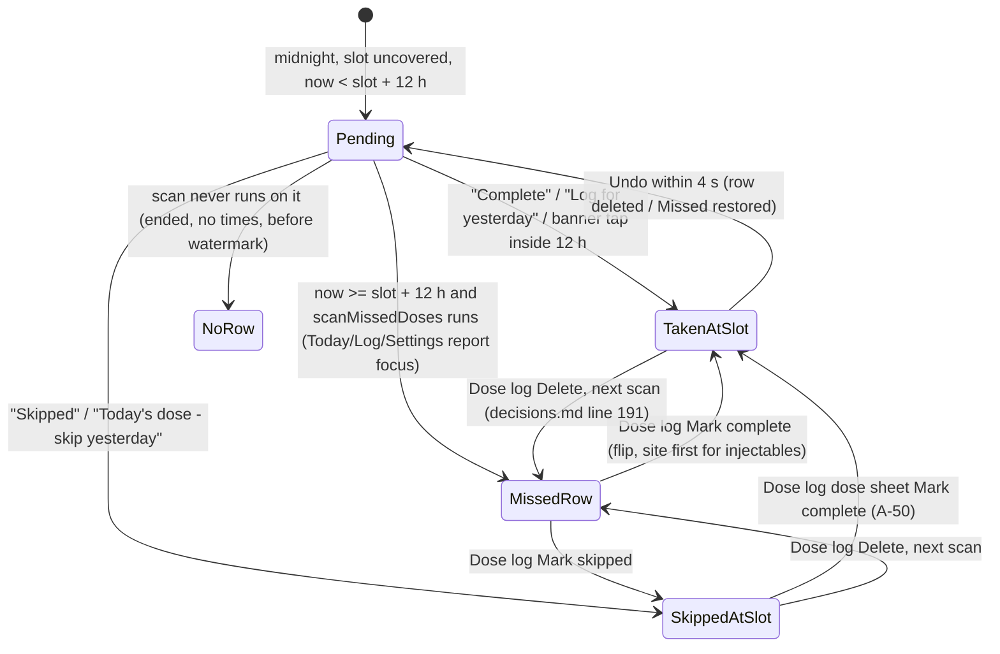
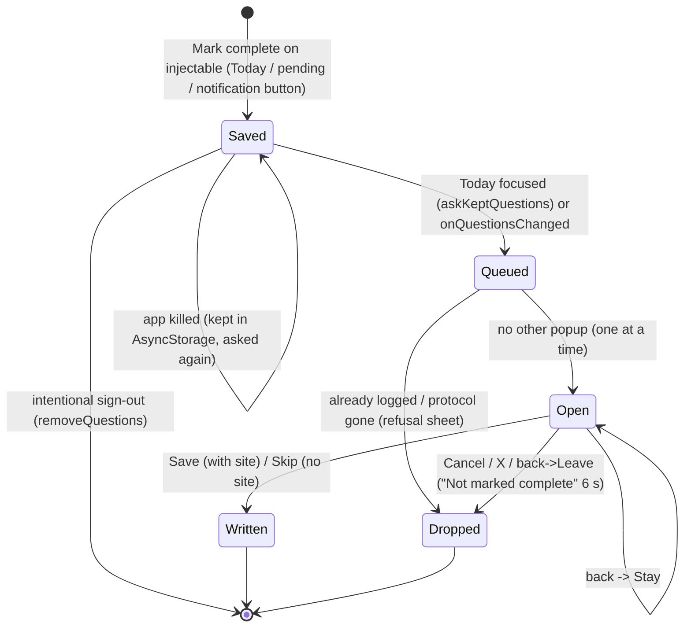
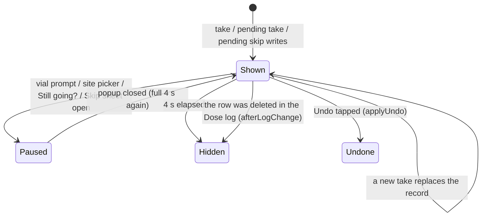
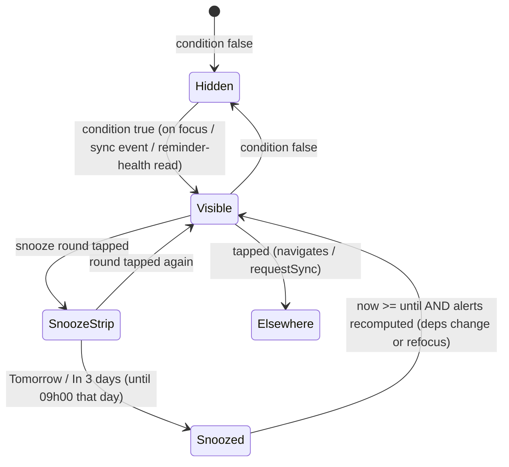
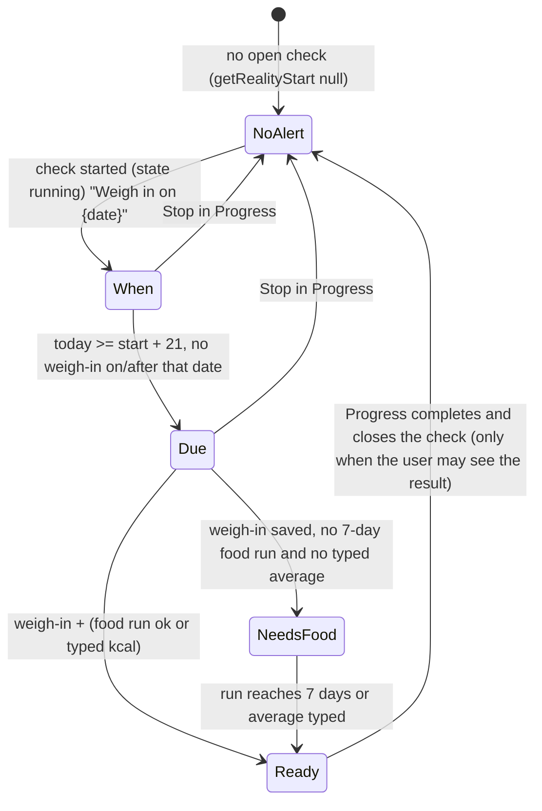

# 02 — Doses and the Today screen: product + technical dossier

> **Verified 2026-10-12 — corrections applied from docs/product/verification/02; where this dossier and the verification disagree, the verification wins.** **Round 2 applied (2026-10-12):** the ids this dossier cites now carry their final status from `docs/product/verification/round2/id-map.md` (round-2 report `R2-04-trd-dossiers.md` Part C; `R2-07-consistency.md` T-10, T-38): notes 1, 4 and 5; the §8 DST row gets its missing third cell (R2-26).
>
> Corrections applied in this file (each marked "[Corrected 2026-10-12]" where it sits):
> 1. **D6 / G2 (late dose in the rings).** The example dose is 13 h late, which is outside decisions.md:144's "± half the interval" (12 h), so it cannot "match its own slot" under :144 — the code applies :144 literally (nearest slot within ± half; the defect is the unbounded matching pool, `adherenceRings.js:45-66`). The real conflict is with the Missed scan's same-day rule (`lib/missedDoses.js:149-155`): rings and the Missed scan assign the same row to different days. [Round 2: decided — a dose logged on the slot's own local day belongs to that slot, however late (AD-70, fix F1 of the approved Today v2.1, decisions.md:140; it closed OPEN-19 (a)); rings and the Missed scan share it (DL-04).]
> 2. **Last-site recall (§ "Last: {site}").** CONFIRMED by code, not suspected: the UI never says "0d ago"; a dose logged 23:00 yesterday reads "Last: {site} · today" the next morning (`TodayScreen.js:588-590, 1930`; test `todayCopy.test.js`). Also new: Today passes only the last 30 days of logs to the site picker, so its "Longest unused in your log" calls a site used 40 days ago "not in your log yet" (`TodayScreen.js:1000-1003`, `lib/bodySites.js:155-170`).
> 3. **D16 (watermark survives an account switch)** is code-confirmed: the watermark key is not uid-scoped and is in no wipe list (`doseActions.js:123-212`).
> 4. **D20 (ring animation).** Whether the ring loads from zero is not settled: the ledger keeps it as open Conflict 40 (`decisions.md:441`), `STATE.md:68` quotes the founder "ring loads from zero"; AD-44 cannot be cited as decided [Round 2: AD-44 moved to OPEN-18 (4), which now also holds the curve intro — it waits for the founder].
> 5. **Tracker streak (R22, G11).** The code counts days; the unit change to "doses in a row" (once part of DL-03, moved out in round 1) waits for the founder — **OPEN-17** (verification/07). Only the 365-day look-back is logic (DL-03, narrowed to that).
> 6. **Notification "Mark complete" for today's slot writes the tap time**, not the slot time (`markTaken.js:101-104`; `notificationActions.js:91-93` passes no slot); only a previous day's slot inside slot + 12 h is written at the slot. On iOS an oral dose from the notification is written directly with no site question (`notificationActions.js:83-93`).
> 7. **New defects found by the verification:** the "Still going?" prompt checks only the site picker, queue and Log editor (`TodayScreen.js:530`), so it can open together with the orphan sheet, vial prompt, Skip sheet or Today sheet; the streak and week circles update at once while the card and rings wait for the drop landing (`TodayScreen.js:885` vs `:1395-1400`); the disclaimer renders only when at least one protocol exists (`TodayScreen.js:2241`); "Draw to {n} units" shows only for a powder (recon) dose with a mixed vial (`TodayScreen.js:1810-1817`), never for rtu; the Dose log falls back to a plain `writeOutcome` flip (no cap, no supply) for a paused/deleted protocol (`LogScreen.js:145`).
> 8. **Unsynced count owner** already exists: `lib/recoveryFlow.js:89-95 unsyncedCount`, called by Today (`TodayScreen.js:389`); sign-out sums it over owner + session user (`pendingForSignOut`).

- Scope: marking doses (Taken / Skipped / Missed), multi-dose days and slots, Undo, the injection-site question (S-25), yesterday's pending block (A-40), the Missed scan, the Dose log (LogScreen) and its edits, the tracker (rings, week, streak), "all caught up", Tomorrow / Next 5 days, every Today alert, the food-log card on Today, notification taps that land on Today (A-44 `focusDose`), the Fold book layout of Today (A-115), time zone / midnight / creation-day behaviour.
- Read on branch `redesign/graduated`, HEAD `3100161` (2026-10-12). Nothing in the code was changed.
- Evidence types: `path:line` = read in the code. "Script-verified" = I ran the real `lib/` function under Node with the stated input (scripts kept in the session scratchpad, not in the repo). "Unverified" = I could not prove it from code or a run.
- Words: the app's labels say "Complete" for a Taken dose in English (`i18n/translations.js:432` `today_doses_taken: "{x} of {y} complete"`), but the database outcome is `'Taken'`. This document uses **Taken** for the stored state and quotes the UI words where they matter.

---

## 1. Purpose (founder decisions, with dates)

Today is the daily home: what is due now, what happened, what needs attention. It is an honest journal, never advice (CLAUDE.md "Product guardrails"; "AI HARD LINE", founder 2026-09-10).

| Date | Decision | Source |
|---|---|---|
| 2026-07-23 | Today counts doses, not protocols | docs/decisions.md:144 (STATE.md cited) |
| 2026-09-24 | Snooze everywhere, plus a working "Mark complete" notification action | decisions.md:162 |
| 2026-09-24 | Keep the "all caught up" card; no duplicate text after the day-complete pulse | decisions.md:164 |
| 2026-09-27 | The Today food-log hero shows only while a reality check runs (FL-33, FL-43) | decisions.md:160; docs/specs/food-log.md:46,56 |
| 2026-09-28 / 10-01 | "Pending from yesterday" (A-40 option 1, S-17): yesterday's unlogged slot stays until slot + 12 h; marking it logs at the slot time; a notification tap after midnight inside slot + 12 h logs to yesterday's slot; "Didn't take" writes Skipped at yesterday's slot; with a pending slot, Mark complete asks "yesterday or today" | decisions.md:155 |
| 2026-09-28 / 09-30 | False-Missed fixes: early same-day dose covers its slot (A-43/S-18); after a time-zone NAME change the days before are never scanned (S-19/A-49); full fix A-51 later | decisions.md:197 |
| 2026-09-28 | A-44 notification tap lands on its reason; A-46 offline "pending" alert; A-42 Mark complete on Protocols when Today would show it | decisions.md:165 |
| 2026-09-28 | Concurrent multi-device use is not a real DoseTrace use case (A-48 parked) | decisions.md:199 |
| 2026-09-29 | Today layout freeze lifted; keep ALL features | decisions.md:139 |
| 2026-09-29 | Today v2.1 approved; order: header → Alerts → Pending from yesterday → tracker → AI food log hero → Doses → Tomorrow / Next 5 days → disclaimer | decisions.md:140–141 |
| 2026-09-29 | Tracker: Today / 7 days / 30 days as % + "{n} of {m}", week circles (done / partial / missed / rest), flame + streak, "View history ›" | decisions.md:143 |
| 2026-09-29 | Ring rule: doses not days (taken ÷ due); nothing due = "Nothing due", never 0 %; rolling 7/30; a late dose matches its own slot within ± half the interval; a skip is not taken; as-needed excluded; never above 100 % | decisions.md:144 |
| 2026-09-29 | Dose card: whole card opens the protocol; Skip and Mark complete on the card; outline "Due" tag; "Draw to {n} units" with the syringe | decisions.md:145 |
| 2026-09-29 | Alerts on top, one box, each with its own snooze; an alert that names one protocol opens that protocol | decisions.md:146 |
| 2026-10-01 | One low-supply rule (1–3 doses left) for the Today alert, the vial push and the Protocols badge (S-05/FX-11) | decisions.md:148 |
| 2026-10-01 | Site BEFORE the write for injectables (S-25); dose time = TAP time; notification Taken for an injectable writes nothing in the background | decisions.md:152–153 |
| 2026-10-01 | A-78 slot identity: Skipped stamped at its slot; a skipped slot can still be marked complete (same row turns Taken) | decisions.md:157 |
| 2026-10-01 | Skipped shown neutral, Missed red | decisions.md:151 |
| 2026-10-01 | Mark-complete animation lands in 360 ms; tracker count on two lines (A-79, A-80) | decisions.md:161 |
| 2026-10-02 | Today proposal (18 parts) approved as shown; "Skip dose?" is a DoseTrace sheet; "Site saved · {site}" toast, 17 pt, 4 s | decisions.md:142,149–150 |
| 2026-10-02 | Alert snooze offers "Tomorrow" / "In 3 days" only | decisions.md:163 |
| 2026-10-02 | Delete a dose from the Dose log (sheet → Delete → confirm; supply goes back; skip moves nothing; a deleted past-day dose shows Missed at the next scan) | decisions.md:191 |
| 2026-10-03 | Ended protocols keep history; inactivity-prompt end dated at the last Taken dose (A-86) | decisions.md:503–537 |
| 2026-10-05 / 10-07 | Reminder alerts on Today: blocked (RC-6), late (A-106), stop / stale (A-110), silent (council 3 #2), combined card for ≥ 2 (council 3 #3), battery (A-112 SP-6) | decisions.md:561, 590–630 |
| 2026-10-07 | A-115: on the unfolded Fold the right page adds, never repeats; a tapped dose opens its protocol page; Skip / Mark taken stay on the left card | decisions.md:633; docs/specs/fold-right-page.md |
| 2026-10-09 | A-118: Today's reality-check alert and food card line follow the check's real state, never the date alone | docs/review/features.md:258; `lib/realityCheckRules.js:120–123` |
| 2026-10-12 | PRD, TRD and drawn flows before more code | decisions.md:638–639 |

---

## 2. Screens and entry points

### 2.1 Today (`screens/TodayScreen.js`, one file, 2 728 lines)

Render order (one column, `leftPage`, `TodayScreen.js:2060–2263`):

1. Header: localized long date + title "Today" (`:2064–2067`). The greeting is computed but not rendered (`:1274–1275`, `greeting` unused in JSX).
2. **"From your reminder"** block with the focused dose card highlighted (A-44) — only when `focusCard` resolves (`:2069–2075`, rule `:1697–1702`).
3. **Alerts** box with count; each row: icon, title, attention dot if `due`, body, snooze round → "Tomorrow" / "In 3 days" (`:2077–2122`).
4. **Pending from yesterday** rows with Skipped / Complete buttons (`:2124–2167`).
5. **Tracker** (`TodayTracker`) — only when `protocols.length > 0` (`:2169–2171`).
6. **AI food log** card (`FoodLogHero variant="today"`) — renders nothing unless a reality check is open (`:2174`; `screens/components/FoodLogHero.js:63`).
7. Empty state (no active protocol): icon, title, sub, "Add protocol" → Protocols (`:2176–2185`).
8. **Doses** block: title, "{x} of {y} complete" (`dosesTakenLabel`), the dose cards of `todayCards` (minus the focused card), the "all caught up" card, and the **Taken** fold line / list (`:2187–2238`).
9. **Tomorrow / Next 5 days** folds, "N more scheduled later" (`:2240–2257`).
10. Disclaimer (`:2259`).

Outside the scroll: the Undo bar (`:2271–2280`), the "Not marked complete" notice (`:2283–2287`), `BodyMapModal` (site question, `:2291–2304`), the vial-finished modal (`:2307–2398`), the "Still going?" modal (`:2401–2421`), the "Skip dose?" sheet (`:2424`), Today's sheet for errors / the yesterday-or-today question / orphans (`:2426`), the flying drop (`:2429–2433`).

### 2.2 Entry points into Today

| Entry | Mechanism | Code |
|---|---|---|
| Tab bar "Today" | tab focus → `useFocusEffect` refresh | `TodayScreen.js:315–354` |
| Dose reminder / follow-up body tap | `notifTapTarget` → `MainTabs › Today` with `focusDose {protocolId, dayKey, ti, slotMs, nonce}` | `lib/notificationPlan.js:174–178`; `App.js:414–431, 535–551` |
| Notification "Mark complete" button | handled by `lib/notificationActions.js` (orals logged in background; injectables keep a site question); the tap also routes to Today with no focus | `notificationPlan.js:173`; `notificationActions.js:62–114` |
| Morning summary tap | Today, no focus | `notificationPlan.js:186–187` |
| My Protocols "Mark complete" (A-42) | `navigate('Today', { focusDose: {...focus, take: true, nonce} })`; Today runs its own take once | `screens/ProtocolsScreen.js:2114–2119`; `lib/protocolTake.js:9–18`; `TodayScreen.js:1705–1720` |
| Return to foreground / local midnight | re-date (`refreshIfNewDay`) | `TodayScreen.js:356–381` |
| Sync events (`import_complete`, `sync_complete`, `data_changed`) | re-fetch | `TodayScreen.js:407–420` |

### 2.3 Exits from Today

| Tap | Destination | Code |
|---|---|---|
| Dose card top (one column) | Protocols with `openProtocolId` | `:1857` |
| Dose card top (book) | right page = that protocol's page (A-115) | `:1857, 1731–1735, 1771–1810` |
| Tomorrow / Next 5 row (one column / book) | Protocols `openProtocolId` / right page | `:2014` |
| Pending row (book only) | right page = protocol page | `:2138–2148` |
| Tracker "View history" | `Log` pushed (one column) / right page `log` (book) | `:2170` |
| Alert: reality check | `Progress { focus: 'reality' }` | `:1498` |
| Alert: offline | `requestSync()` (no navigation) | `:1508` |
| Alert: bloodwork | `Body { initialSection: 'labs' }` | `:1520` |
| Alert: supply low / vial expiry | `Protocols` (no protocol id) | `:1544, 1576` |
| Alert: silent / combined / blocked | `ReminderCheck` | `:1587, 1599, 1610` |
| Alert: late / battery / stop / stale | `ReminderCheck { focus: 'alarms' / 'battery' / 'hibernation' / 'refresh' }` | `:1621, 1632, 1643, 1653` |
| Food card | `FoodChat` (or `Paywall` when locked) | `FoodLogHero.js:85` |
| Empty state button | `Protocols` | `:2181` |
| Automatic (Android, once per phone) | `ReminderCheck` via `maybeOpenSetupForExisting`, 600 ms after focus, only if Today is still focused | `:186–191`; `lib/reminderSetup.js:14–22` |

### 2.4 Dose log (`screens/LogScreen.js`)

- Reached from the tracker "View history" (pushed `Log`, with "‹ back") or embedded as Today's right page on the unfolded Fold (`embedded`, `refreshKey`, `onChanged`, `popupGate`; `LogScreen.js:43–62`).
- Header: title, the streak explainer text, three counts (Taken / Skipped / Missed — logged rows only, A-30), the filter bar (All / Taken / Skipped / Missed) (`:482–505`). Curve button (Premium → `SerumCurve`, else `Paywall`) (`:520–528`).
- Day sections (local calendar day, newest first) with rows: type icon, protocol name (raw `name`), site summary, notes, tags, time, status dot + word (`:531–617`).
- Row tap: Missed → "Update this dose" sheet (Mark complete / Mark skipped / Cancel) (`:112–122, 568`); Taken or Skipped → the dose sheet (Status / When / Site, Change site for injectables, "Mark complete" for Skipped, "Delete this dose") (`:245–284, 623–674`).

---

## 3. User actions

Conventions: "writes" lists SQLite rows (all synced tables carry `sync_status = 'pending'` after a write; `lib/database.js:302–343`). "Sync" = `requestSync()` from `lib/sync.js`.

### 3.1 Mark complete — oral (Today card)

- Preconditions: the card has `cardPlan.next` (an open slot today: no row, or an auto-Missed row) (`TodayScreen.js:1970`; `lib/dosePageState.js:160–173`). Protocol active, not deleted (`lib/doseActions.js:56`).
- Steps (`handleTake`, `TodayScreen.js:1353–1417`):
  1. Tap time captured (`tapMs`) (`:1354`).
  2. If another write is in flight, retry every 250 ms up to 12 times, then "save failed" sheet (`:1358–1365`).
  3. If this protocol has a pending slot from yesterday and the tap is not on a skipped line: the **yesterday-or-today** sheet (Log for yesterday / Today's dose — skip yesterday / Cancel) (`:1369–1387`; `lib/pendingYesterday.js:133–138`).
  4. Oral → written now: `markTaken(p, { write: { tapMs, slotMs, flipRowId }, extraDeleteIds, cancelUpTo: ti + 1, deferUi })` (`:1394–1403`).
  5. `recordDoseTaken` reads the day's rows of this protocol, plans with `planMarkTaken`, writes (`lib/doseActions.js:54–105`; `lib/markTaken.js:43–149`).
- Writes:
  - `dose_logs`: INSERT `{outcome:'Taken', logged_at: tap time}` — or UPDATE of the slot's Missed / named Skipped row to `Taken` (a Skipped row logged today also takes the tap time; a Missed row keeps its slot time) (`markTaken.js:79–113`).
  - `vials.doses_taken + 1`; `active = 0` when this dose reaches capacity (`markTaken.js:115–127`). Best-effort, separate statement (`doseActions.js:80–88`).
  - Oral bottle: `protocols.units_taken += unitsNeeded` (`markTaken.js:129–144`; `doseActions.js:89–97`).
- Side effects: count bump + card re-sort after the drop lands (360 ms, A-80) (`TodayScreen.js:873–886, 1398–1416`); streaks re-read (`:887–888`); analytics `doseLogged` (`:889`); `cancelTodaysDoseReminders(protocolId, max(takenAfter, cancelUpTo))` (also dismisses delivered banners and prunes snoozed copies) (`:891`; `lib/notifications.js:356–375`); vial-finished prompt for `recon` only (`:895`); `syncVialAlerts` (`:898`); sync (`:899`); Undo bar record (`:903–923`); right page / embedded log refresh (`:923`).
- Refusal: `recordDoseTaken` returns `null` (inactive) or `{alreadyLogged}` → button reset + "Nothing new logged" sheet with the reason (A-38 b) (`:858–866, 838–847`; `markTaken.js:256–261`).
- Undo: §3.6.

### 3.2 Mark complete — injectable (`recon` / `rtu`) (S-25)

- Steps: tap → (yesterday-or-today sheet first if pending) → `askSite(newQuestion({protocolId, tapMs, skipYesterday, source:'today', slotMs, flipRowId, ti}))` (`TodayScreen.js:1389–1392`). The question is saved to AsyncStorage `dosetrace_site_questions` BEFORE it is shown (`lib/siteQuestion.js:90–95`), queued, and opened one at a time (`TodayScreen.js:944–959, 987–1014`).
- Before opening: if the dose is already logged (other device, banner) or the protocol is gone → drop the question, reset the button, "Nothing new logged" sheet (`:994–1003`).
- The picker (`BodyMapModal`, mode `ask`) shows the protocol name and the time the dose is written at (tap time; for pending, the slot) (`:2036–2040`).
- Exits (one plan, `lib/sitePickerActions.js:17–28`):
  - Save → commit WITH the site; Skip → commit with no site (`TodayScreen.js:1050–1073, 1019–1045`).
  - Cancel / X → nothing written, question dropped, button reset, notice "Not marked complete. Mark it again to log it." for 6 s (`:1062–1071`).
  - Android back → "stay / leave" sheet inside the picker; Leave = Cancel (`:1078–1091`).
- Commit (`commitQuestion`, `:1019–1045`): re-checks "already logged"; writes yesterday's Skipped row first when "Today's dose — skip yesterday" was chosen (`:1034–1038`); then `writePending` (pending source or a different day) or `markTaken` with `cancelUpTo = reminderCancelCount(q, 0)` and toast text "Site saved · {site}" (Q22 = A) (`:1040–1041`); drops the question after the write (`:1043`).
- Writes: as §3.1, plus `dose_logs.injection_site` in the same INSERT/UPDATE (`markTaken.js:96, 111`).
- Vial-finished prompt opens after the picker fades (450 ms) (`:1029, 1229–1241`).
- App killed with the question open: the question is asked again on the next Today focus, written at the original tap time (`:339, 949–952`; FX-25, `docs/specs/fixes-1.2.5.md:38`).

### 3.3 Skip (Today card)

- Preconditions: `cardPlan.next` exists (`:1970–1973`).
- Steps: "Skip dose?" DoseTrace sheet (Cancel / Skip) (`:1163–1184, 2042–2046`). On Skip: `recordSkipToday(protocolId, { slotMs })` (`lib/doseActions.js:28–38`; `lib/markTaken.js:181–197`).
- Writes: `dose_logs` INSERT `{outcome:'Skipped', logged_at: slot time}` (tap time only when the protocol has no reminder time). Nothing when that slot already has a row. Never moves supply.
- Side effects: skipped count bump, today rows re-read (card moves to the next open slot and shows "Skipped — you can still log it"), analytics, sync (`:1172–1177`). A hidden undo record is kept for the (now superseded) dose page (`:1172`).
- **Not done:** no Undo bar (comment `:1170–1171`), **no reminder cancel** (no `cancelTodaysDoseReminders` call in `skipDose`, `:1163–1184`), no streak refresh.
- Reversal: the "Mark complete" on the skipped line (§3.4) or the Dose log (§3.9).

### 3.4 Mark complete on a skipped slot ("Skipped — you can still log it", A-78)

- Shown per Skipped row of today when `canTake` (the day's Taken count < number of slots) (`TodayScreen.js:1885–1907`; `dosePageState.js:169–171`).
- Tap → `handleTake(p, null, 0, { slot: sk })` with `flipRowId` → no yesterday prompt (`:1369`), site question first for injectables.
- Writes: UPDATE of that Skipped row → `Taken`, `logged_at` = tap time (today), site if given (`markTaken.js:56–61, 92–97`); supply as §3.1. Undo restores Skipped at its original time and site (`markTaken.js:241–245`; `TodayScreen.js:1120`).

### 3.5 Pending from yesterday (A-40 / S-17)

- Shown when `pendingFromYesterday(...)` returns slots (`TodayScreen.js:650–667`; `lib/pendingYesterday.js:35–128`).
- "Complete" → `takePending` → site question (injectable, `source:'pending'`) or `writePending` → `recordDoseTaken(protocolId, { dayKey, slotMs })` (`TodayScreen.js:681–708`). Logged AT yesterday's slot time (`markTaken.js:102–104`), flips a Missed row at that slot.
- "Skipped" → `recordSkipPending` → Skipped row at yesterday's slot (`TodayScreen.js:711–720`; `markTaken.js:156–173`).
- Side effects: `afterPendingWrite` (pending list, protocols, streaks, vial alerts, sync) (`:669–676`); Undo bar (todayCount `none`); vial-finished prompt for recon (`:705`). No reminder cancel (the slot is yesterday's).
- From a today card while pending: "Log for yesterday" = `takePending`; "Today's dose — skip yesterday" = the today write + a Skipped row for yesterday in the same step; Undo removes both (`:1377–1381, 1394, 1419–1423`; `markTaken.js:221`).

### 3.6 Undo (the Undo bar)

- Shown after Mark complete (Today card, skipped line, pending Complete) and pending Skipped; text "Dose logged" or "Site saved · {site}" (`:2271–2280`).
- Timer: 4 s (`TOAST_MS`, `:157`), runs only while no popup covers it: vial prompt, site picker, Still going?, Skip sheet (`:305–313`; `lib/undoBar.js:6–8`). A new take replaces the bar.
- `applyUndo` (`:1098–1156`) via `planUndoTake` (`markTaken.js:218–252`):
  - a flipped row goes back to `Missed` / `Skipped` with its old `logged_at` and site; otherwise the row is tombstoned (`deleteDoseLog` → `sync_status='deleted'`, `database.js:336–343`); `extraDeleteIds` (yesterday's Skipped of "skip yesterday") deleted too;
  - vial: `doses_taken` − 1 from the CURRENT count; reopened if this dose closed it and no other vial is active; oral: units back;
  - today's count: decrement / reset / none (pending rows never changed today's count);
  - closes the vial-finished prompt of that dose.
- Never twice for one log (`undoneIdsRef`), never after the row was deleted in the Dose log (`wasDeleted`, `lib/deleteDose.js:137–139`).
- **Not done on Undo:** reminders cancelled by the take are NOT re-armed (no `scheduleDoseReminder` call in `applyUndo`); they come back only if a later resync still wants them — and `scheduleDoseReminder` never re-arms a slot whose time has passed (`notifications.js:265–268`). Unverified on device.

### 3.7 Vial finished prompt ("All doses logged")

- Opens after a `recon` take that reached capacity (`res.vialFinished`) (`TodayScreen.js:895, 705`). Also opened by "+ Add vial" on a card without a vial (`:1965–1969`) and the right page's no-vial block (`:1792`).
- "Protocol finished" only closes the prompt (does NOT end the protocol — decisions.md:558 correction 2026-10-04) (`:2381–2386, 1219–1226`).
- "Log new vial": mix date (Yesterday / Today pills, month + day) → `insertVial(newVialRecords(...))`, protocol never rewritten (S-01), reminders rescheduled (`:1243–1266`; `lib/newVial.js:21–23`).

### 3.8 "Still going?" (inactivity prompt)

- On focus, for the first active protocol with no Taken dose for `max(7, 3 × interval_days)` days (since its last Taken, or `created_at` / `start_date`), not started-in-the-future, not snoozed within that window (`TodayScreen.js:501–537`). Never over a site question or the embedded log's editor.
- "Keep" → snooze key `dosetrace_tx_check_{id}` (AsyncStorage) (`:557–564`).
- "End" → `endProtocolAtLastDose` (A-86: ended at the last Taken dose; app-written Missed rows after it removed), vials deactivated, reminders cancelled (`:539–555`).

### 3.9 Dose log edits (`LogScreen.js`)

| Action | Steps | Writes | Side effects |
|---|---|---|---|
| Missed → Complete (oral) | row tap → "Update this dose" → Mark complete | `recordDoseTaken(protocolId, { dayKey: row day, slotMs: row logged_at, flipRowId: row id })` → the same row becomes Taken at its slot time; vial / oral move once (`:126–151`) | vial alerts, sync, list, Today (embedded `onChanged`) |
| Missed → Complete (injectable) | site question (`mode:'ask'`) first; Cancel = stays Missed (`:127–129, 183–223`) | as above + site | same |
| Missed → Skipped | `writeOutcome(id, {outcome:'Skipped'})` (`:132, 158–165`) | UPDATE outcome only (time stays at the slot) | sync |
| Skipped → Complete (A-50) | dose sheet "Mark complete" → site first for injectables (`:281–284`) | `recordDoseTaken` with `flipRowId` | same |
| Change site | dose sheet → site editor (`mode:'edit'`) → Save writes the site; empty save never erases (A-55) (`:277–279, 212–223`) | `dose_logs.injection_site` | sync |
| Delete a dose (Taken / Skipped) | dose sheet → "Delete this dose?" (body says what happens to supply) → Delete (`:288–338`) | tombstone; vial `doses_taken − 1` (only when `vialForDose` can attribute it) and reopen if finished by doses; oral units back (`lib/deleteDose.js:85–116`) | `rememberDeleted` (Today's Undo of that row disabled), vial alerts, sync |
| Missed rows | cannot be deleted (only edited) (`deleteDose.js:15–16, 87`) | — | — |
| On focus | `scanMissedDoses()` then list (`LogScreen.js:98–107`) | Missed rows | sync if any |

Not done in the Dose log path: no Undo bar, **no vial-finished prompt** when `markRowTaken` closes a vial (`LogScreen.js:138–151` ignores `res.vialFinished`), no reminder cancel / re-arm.

### 3.10 Alerts: snooze and tap

- Snooze round → strip "Tomorrow" / "In 3 days" → `{[snoozeId]: until 09:00 that day}` in AsyncStorage `dosetrace_alert_snooze` (`TodayScreen.js:487–495, 2097–2117`; `lib/todayFormat.js:34–39`). There is no Remove / X (decisions.md:163).
- Tap → see §2.3.

### 3.11 Notification actions (app open, background or killed)

- Mark complete (oral): target slot via `notificationTakeTarget` (slot while now < slot + 12 h; a snoozed copy after that logs now) → `recordDoseTaken` → cancels today's slots up to `ti` → `notifyDataChanged('dose_logs')` (Today re-fetches) → sync only in the foreground (`lib/notificationActions.js:62–114`; `markTaken.js:204–208`).
- Mark complete (injectable): saves a site question (tap time) and returns; Android keeps the banner when the app is not active; Today asks the question when it opens or immediately via `onQuestionsChanged` (`notificationActions.js:83–90, 175`; `TodayScreen.js:400`).
- Snooze 1 h / Tomorrow: a snoozed copy (`snz-` id) (`notifications.js:951–985`).
- Each response handled once (persisted key `dosetrace_notif_handled`) (`notificationActions.js:51–60`).

---

## 4. Business rules (numbered)

R1. **One mark-taken path.** Today, the skipped line, the pending block, the notification action, the Dose log and My Protocols all write through `recordDoseTaken` → `planMarkTaken`. Source: S-02/FX-2/FX-7 (`docs/specs/fixes-1.2.5.md:15,20`); `lib/doseActions.js:40–105`.

R2. **Never more Taken rows than doses per day.** A day with `doses_per_day` Taken rows refuses another (`alreadyTaken`). `lib/markTaken.js:52–53`. Note: the cap is `doses_per_day`, not the creation-day expected count.

R3. **A Missed row is flipped, never duplicated.** With a slot: only the Missed row within 60 s of that slot; without a slot: the day's earliest Missed row. `markTaken.js:63–81`.

R4. **A Skipped row flips only when named (`flipRowId`), when the slot matches, or when every slot of the day is filled.** A-78 council 2026-10-01. `markTaken.js:56–75`.

R5. **Time written:** today's Taken = tap time (S-25 FX-24); a flipped Missed row and any past-day write keep the slot time (or noon of that day without a slot); a flipped Skipped row of today takes the tap time. `markTaken.js:89–104`.

R6. **Skip is stamped at the slot** it skips (tap time only for a protocol without reminder times). `markTaken.js:181–197` (A-78).

R7. **Skip never moves supply**; a Taken moves the active vial once and the oral bottle once. `markTaken.js:115–144, 155`.

R8. **Site before the write for injectables** (`recon`, `rtu`); orals written at once. `lib/siteQuestion.js:15–17`; decisions.md:152.

R9. **Site is optional**: Skip in the picker writes the dose without a site. `sitePickerActions.js:21`.

R10. **A site question is kept on the device until answered or found logged; never dropped for its age** (code and test `__tests__/siteBeforeTaken.test.js:109`). Contradicts decisions.md:459 and FX-25 evidence text — see §9 G1.

R11. **Pending from yesterday:** slots before today's start (zone-aware) not covered by any row (Missed-scan matching), inside slot + 12 h, protocol existed (created − 1 h), day not already at `doses_per_day` Taken. `lib/pendingYesterday.js:35–128`.

R12. **Missed rows:** a slot is Missed when it is ≥ 12 h past (`LATE_MS`), not covered by any log in `[min(slot − 3 h, slot's local midnight), slot + 12 h]` nor by a later log on the same local day, at or after the scan watermark, and after `created_at − 1 h`. Today's slots are never scanned. Lookback 14 days. `lib/missedDoses.js:36–159`; `lib/doseActions.js:123–212`.

R13. **Missed watermark:** first run ever = now (old history never rewritten); a time-zone NAME change moves it to now when no zone history is usable (S-19); with zone history (A-51) slots are rebuilt in the zone of their own day. `doseActions.js:139–160`; `missedDoses.js:186–208`.

R14. **Creation-day rule:** on the day a protocol is created, only slots from `created_at − 1 h` count, with a floor of 1 expected dose so the just-taken dose stays loggable. `lib/schedule.js:47–62, 95–106`.

R15. **Ended protocols** expect nothing after their end; on the end day only slots up to the end. `schedule.js:11–21, 36–38, 85–93`.

R16. **Due tag:** the card's next open slot is ≤ 5 min away or past. `dosePageState.js:33, 168`. A grey "reminder" tag shows before due when a reminder time exists (`TodayScreen.js:1878–1882`) — see §9 G9.

R17. **Card slots:** rows at a slot's exact time (± 60 s) belong to that slot; other rows fill remaining slots in written order, earliest slot first; Skipped counts as filled; Missed counts as open. `dosePageState.js:10–16, 64–87, 160–173`.

R18. **Today list membership:** a protocol is on Today when its next dose moment (`nextDoseAt`, Taken-only count) is today or overdue; Tomorrow = 1 day; Next 5 days = 2–6 days; "N more scheduled later" = > 6. `TodayScreen.js:1450–1470`; `schedule.js:163–183`.

R19. **All caught up:** no protocol left in `todayCards` AND at least one protocol was due today. `TodayScreen.js:1471–1473`.

R20. **Header count:** "{x} of {y} complete" = Σ min(Taken today, expected) ÷ Σ expected over active protocols due today. `TodayScreen.js:1280–1286, 2191`.

R21. **Rings (doses, not days):** today = all slots of today; 7 / 30 days = slots whose time has passed, rolling; a Taken matches the nearest unmatched slot within ± half the interval; declared history (before `created_at − 1 h`) excluded; a protocol without times gets its doses at 12:00; active + ended (not deleted) protocols; capped 100 %; nothing due → `null` ("Nothing due"). `lib/adherenceRings.js:1–85`; decisions.md:144.

R22. **Tracker streak (days):** consecutive days on which every protocol due that day had all its expected Taken doses; rest days neither add nor break; today counts only once complete; looks back 30 days (max 31). "On fire!" at ≥ 7. `TodayScreen.js:753–805`; `TodayTracker.js:136–138`.

R23. **Week circles:** last 7 days; rest (nothing due) / complete / partial (some due protocol had a Taken) / missed. `TodayScreen.js:821–830`.

R24. **Protocol streak (doses):** doses taken in a row, never days; a fully-taken due day adds its doses; rest days skipped; stops at the first not-fully-taken due day or before creation; looks back 365 days; logged rows only (A-30). `lib/doseStreak.js:1–30`; `TodayScreen.js:606–629` (founder 2026-10-05).

R25. **Supply low** = 1–3 doses left (stored capacity, else derived from vial size ÷ dose). `lib/supplyLow.js:7–23` (S-05).

R26. **Vial expiry** flagged within 7 days (recon: mixed_on + `vial_valid_days` (default 30); RTU: `expires_on`); ≤ 0 = "expired". `TodayScreen.js:154, 1549–1580`; `lib/vialExpiry.js:18–27`.

R27. **Bloodwork due** ≥ 182 days since the latest `report_date`; "{months}" = max(6, round(days / 30)). `TodayScreen.js:153, 1512–1524`. No alert when no lab was ever logged.

R28. **Offline alert** only when connectivity is known offline (`false`, not `null`) AND at least one row is unsynced. `lib/offlineAlert.js:4–6`; `TodayScreen.js:386–397`.

R29. **Reminder alerts:** blocked = reminders on + a protocol "with a time" + a readable block (permission, Android dose channel off, or nothing scheduled while something is due in the window); late = Android exact alarms off; battery = Android battery optimized; stop = Android not exempt from hibernation; stale = Android refresh > 2 days late and no foreground resync in 2 days; silent = Silent mode on + a protocol "with a time". Two or more of blocked / late / battery / stop / stale → one combined card. `lib/reminderHealth.js:52–169`; `TodayScreen.js:177–197, 1581–1657`.

R30. **One popup at a time** on Today (site question, vial prompt, Still going?, Skip sheet, Today sheet, embedded log editor); queued items open 450 ms after the previous closes. `TodayScreen.js:225–234, 983–990, 1186–1215`.

R31. **Re-date on a new local day** (foreground or midnight timer). `TodayScreen.js:356–381`; `lib/dayChange.js:5–14`.

R32. **Notification target:** inside slot + 12 h the dose goes to the reminder's slot (also a snoozed copy tapped after midnight); later, a snoozed copy logs now; a non-snoozed banner keeps its day. `markTaken.js:199–208`.

R33. **Delete a dose** gives one dose back only to the vial that can be shown to have held it; a Skipped delete moves nothing; Missed rows cannot be deleted. `lib/deleteDose.js:30–116`; decisions.md:191.

R34. **Declared history** (rows before `created_at − 1 h`) stays in the Dose log but never counts (counts, rings, streaks, report). `lib/declared.js:13–35`.

R35. **Inactivity prompt** threshold `max(7, 3 × interval)` days; end dated at the last Taken dose. `TodayScreen.js:497–555`; decisions.md:536 (A-86).

R36. **Reality-check alert** shows while a check is open and not snoozed; body: `when` (before day 21) / `due` / `needs_food` (n days of the 7-day run missing) / `ready`; date-only fallback when the state cannot be read. `TodayScreen.js:1481–1501`; `realityCheckRules.js:120–127` (A-118, founder 2026-10-09).

R37. **Food card on Today** shows only while a check is open (`todayFoodHeroPolicy.show`), with "day {n} of 21" or, after day 21, "time to weigh in" / "weight logged". `lib/foodThread.js:297–304`; `FoodLogHero.js:62–74`.

---

## 5. States and transitions

### 5.1 One dose slot of TODAY (as the card sees it)

Defining code: `dosePageState.js:160–173` (`cardPlan`), `:33` (5-min due), `TodayScreen.js:1830–1988`.

| State | Exact condition |
|---|---|
| upcoming | slot has no row (or a Missed row) AND it is the card's `next` AND `slotMs − now > 5 min` (shows "reminder" tag if `reminder_time` set) |
| due | slot is `next` AND (`slotMs − now ≤ 5 min`) — "Due" tag. A slot without a time (`slotMs == null`) is `next` but never "due" (`dosePageState.js:168`) |
| waiting (not shown) | an open slot later than `next` — the card offers only the earliest open slot |
| taken | slot holds a `Taken` row |
| skipped | slot holds a `Skipped` row → own line "Skipped — you can still log it" (+ Mark complete while day Taken < slots) |
| missed | only possible for past days (scan never writes today) |

```mermaid
stateDiagram-v2
    [*] --> Upcoming: slot exists today (expectedDosesOn / daySlots)
    Upcoming --> Due: now >= slot - 5 min (re-render needed)
    Upcoming --> Taken: Mark complete (early allowed; covers slot by count)
    Upcoming --> Skipped: Skip sheet -> Skip (row at slot time)
    Due --> Taken: Mark complete (oral now / injectable after site Save|Skip)
    Due --> Due: site question Cancel / X / back-Leave (nothing written)
    Due --> Skipped: Skip sheet -> Skip
    Skipped --> Taken: "you can still log it" -> Mark complete (same row, tap time)
    Taken --> Due: Undo within 4 s (row deleted)
    Taken --> Skipped: Undo of a flipped Skipped row (restored at old time/site)
    Taken --> Due: Dose log Delete (tombstone)
    Skipped --> Due: Dose log Delete
    Due --> PendingYesterday: local midnight passes, slot unlogged
    Upcoming --> PendingYesterday: local midnight passes, slot unlogged
```

### 5.2 One dose slot of YESTERDAY / earlier

Defining code: `pendingYesterday.js:35–128`, `missedDoses.js:83–159`.

| State | Condition |
|---|---|
| pending | uncovered, `now − slot < 12 h`, slot ≥ created − 1 h, (no zone history: slot ≥ tzSinceMs), day Taken < doses_per_day |
| missed (row written) | uncovered, `now − slot ≥ 12 h`, slot ≥ watermark, slot ≥ created − 1 h, within 14-day lookback, protocol ACTIVE at scan time |
| unrecorded gap | uncovered but outside the scan (before watermark, > 14 days, ended protocol, protocol without reminder times) — no row ever |

### 5.3 `dose_logs` row (storage)

```mermaid
stateDiagram-v2
    [*] --> Taken_pending: insert Taken
    [*] --> Skipped_pending: insert Skipped
    [*] --> Missed_pending: scan insert Missed
    Missed_pending --> Taken_pending: flip (update)
    Skipped_pending --> Taken_pending: flip (update)
    Taken_pending --> Missed_pending: Undo of a flip
    Taken_pending --> Skipped_pending: Undo of a flip (A-78)
    Taken_pending --> Synced: push ok
    Skipped_pending --> Synced: push ok
    Missed_pending --> Synced: push ok
    Synced --> Taken_pending: any local update (sync_status pending)
    Taken_pending --> Deleted: Undo / Delete (sync_status 'deleted' tombstone)
    Skipped_pending --> Deleted: Undo / Delete
    Synced --> Deleted: Delete
    Deleted --> [*]: tombstone pushed; updateDoseLog never touches it (database.js:329-332)
```

### 5.4 Site question (S-25)

### 5.5 Undo bar

### 5.6 A Today alert (generic)

Reality-check alert body (A-118):

---

## 6. STATE OWNERSHIP AUDIT

For every derived value: every place that computes or decides it, how, and whether places disagree. CONFIRMED = proven by code reading and (where noted) a script run; SUSPECTED = plausible from code, not proven.

### 6.1 "How many doses are expected on day D" / which slots exist

| # | Where | How |
|---|---|---|
| a | `lib/schedule.js:31–64` `expectedDosesOn` | start_date + interval + end; creation day = max(1, slots ≥ created − 1 h); else `doses_per_day`. Ignores `schedule_total`. |
| b | `lib/schedule.js:71–108` `expectedSlotTimesOn` | same filters, returns the times (only as many times as exist, sliced to dpd); no floor of 1 |
| c | `lib/dosePageState.js:44–62` `daySlots` | count from (a), times from `sortedDoseTimes`; missing times → `slotMs: null` |
| d | `lib/adherenceRings.js:22–40` `slotsBetween` | (b); if empty, `expectedDosesOn` slots at 12:00; then drops slots before created − 1 h |
| e | `lib/missedDoses.js:54–66, 103–126` | (b) only (no noon fallback) |
| f | `lib/pendingYesterday.js:19–26, 92–99` | (b) only |
| g | `lib/notificationPlan.js:35–53` `dueDateKeys` + `reminderTimes` (`:57–63`) | start + interval + **`schedule_total`**; no creation-day rule, no end rule (callers pass active protocols); no time → **08:00** |
| h | `lib/reminderHealth.js:17–34` `dueInWindow` | (g) |
| i | `supabase/functions/send-reminders/index.ts:225–240` | (g)-style `dueDateKeys` + `reminderSlots`; server push is OFF (`lib/notifications.js:1079` `SERVER_PUSH_ACTIVE = false`) — dormant |
| j | `lib/serumModel.js:123` | `expectedDosesOn` per day (curve; out of this domain) |

Divergences:
- **D1 CONFIRMED (script-verified): protocol without reminder times.** (a) expects `doses_per_day`; (b)/(e)/(f) give no slot → never a Missed row, never a pending row; (d) counts them at 12:00 → the rings show them due/missed; (g) schedules a reminder at 08:00. Run: `noTime expectedDosesOn 1 slots []`, rings week due 7, `missed noTime 0`.
- **D2 CONFIRMED (script-verified): `doses_per_day` larger than the number of reminder times** (e.g. 2 per day, one time 08:00). (a) = 2 (header "0 of 2"), (d) = 1 per day (ring due 1), (e) writes Missed only for 08:00, the card's second slot has `slotMs: null` (never "Due"). Whether the wizard can save such a protocol is unverified.
- **D3 CONFIRMED (script-verified): creation day after the slot.** Protocol created 21:00 with an 08:00 time: (a) = 1 (floor), (c) gives the 08:00 slot → card "Due", header "0 of 1"; (d) drops it (before created − 1 h) → tracker "Nothing due" today, and still "Nothing due" after taking it; week/30 rings "—". Tracker streak (`TodayScreen.js:780–788`) counts the day. Three surfaces disagree on the same day.
- **D4 CONFIRMED (code + script): `schedule_total` (finite course).** Only (g) honours it (decisions.md:620 BR-12: reminders end when the course ends). Today, the rings, the streak and the Missed scan keep expecting doses after the course ends (script: course of 3 from 10-01 → still 1 expected on 10-12; scan would write Missed rows). The wizard now saves `schedule_total: null` (`lib/protocolForm.js:143`), so this affects protocols that already carry a total (legacy / synced data). Unverified how many exist.
- **D5 (by design, noted):** (g) has no creation-day rule; harmless for scheduling because past slots are never armed (`notifications.js:265–268`).

### 6.2 "Taken count today" per protocol

| # | Where | How |
|---|---|---|
| a | `TodayScreen.js:722–740` `fetchTodayLogs` → `takenCounts` | Taken rows with `logged_at ≥ local midnight` (`database.js:271–279`), all rows incl. declared |
| b | `TodayScreen.js:880` | overwritten by `res.takenAfter` from the write (`markTaken.js:148`) |
| c | `dosePageState.js:143–148` `takenOn` | Taken rows inside the local day, ≥ Taken slots |
| d | `markTaken.js:52` | Taken rows inside the day being written (cap R2) |
| e | `lib/notifications.js:244–248` `scheduleDoseReminder` | Taken rows today → skip the first N slots |
| f | `lib/notifications.js:1165–1167` `readReminderHealth` | same as (e) for `dueInWindow` |
| g | `lib/notifications.js:922–932` `doseSlotResolved` | Taken rows of that day > ti |
| h | `adherenceRings.js:42–65` | Taken rows matched to today's slots within ± half interval, from ANY day (pool not windowed) |
| i | `TodayScreen.js:770–776` | Taken by `toDateString()` day (streak / week) |
| j | send-reminders (dormant) | ANY Taken today suppresses ALL slots |

Divergences:
- **D6 CONFIRMED (script-verified): a late dose is counted for the next day's ring.** Daily 08:00 dose taken yesterday at 21:00, now 07:00: `today: {taken:1, due:1}` (ring 100 %), `week: {taken:0, due:6}`. The card still offers "Mark complete" and the header says "0 of 1". The pool in (h) includes yesterday's log and today's slot is 11 h away (< 12 h half-interval) while yesterday's own slot is 13 h away. Contradicts decisions.md:144 ("a late dose matches its own slot"). [Corrected 2026-10-12: 13 h late is outside :144's ± half window, so :144 does not give "its own slot" here; the conflict is with the Missed scan's same-day rule, `missedDoses.js:149-155` — see note 1.]
- **D7 CONFIRMED (script-verified): twice-daily 08:00 / 20:00, yesterday's 20:00 dose counts for today's 08:00** in the today ring at 07:00 (`today: {taken:1, due:2}`) — gap exactly 12 h ≤ half.
- **D8 CONFIRMED (code):** header count (a) vs today ring (h) differ by: active-only vs active + ended; declared included vs excluded; Taken counted by calendar day vs matched by proximity; protocols without times / with fewer times than dpd (D1, D2).
- **D9 CONFIRMED (code): reminders ignore Skipped.** (e)/(g) count only Taken. `skipDose` (`TodayScreen.js:1163–1184`) never cancels reminders. A slot skipped BEFORE its time (e.g. 20:00 skipped at 12:00 after 08:00 was taken) keeps its 20:00 reminder and follow-ups; a snoozed copy of a skipped slot is not resolved. No founder decision found either way (searched decisions.md for skip + reminder).

### 6.3 "Which slot is next / due" for a protocol today

| # | Where | How |
|---|---|---|
| a | `dosePageState.js:160–173` `cardPlan` | earliest slot with no row or a Missed row; due ≤ 5 min |
| b | `schedule.js:163–183` `nextDoseAt` | slot index `(dpd − need) + takenToday` (Taken count only; Skipped ignored) |
| c | `dosePageState.js:177–183` `cardSlot` | earliest slot with no row (Missed counts as filled!) else last slot — book layout right page |
| d | `lib/protocolTake.js:9–18` | (a) → My Protocols "Mark complete" |
| e | notification `data.ti / slotMs` | the reminder's own slot (`notifications.js:276`) |

Divergences:
- **D10 CONFIRMED (code): list placement uses Taken only, the card uses Taken + Skipped.** With today's only slot Skipped, (b) still returns today's slot → the protocol stays in `todayCards` (shows the skipped line, no main buttons) and "all caught up" never shows that day; it is not listed under Tomorrow. Probably intended (the skipped line must stay reachable) but not written down.
- **D11 CONFIRMED (code): (c) treats a Missed row as filled, (a) treats it as open.** Today has no Missed rows (scan excludes today), so no visible effect today; diverging definitions of "open". `cardSlot` is only used to pick which slot to open on the right page.
- **D12 CONFIRMED (code): a reminder for the 20:00 slot tapped (body) while 08:00 is still open logs the 08:00 slot** (focus card uses `cardPlan.next`, `TodayScreen.js:1697–1719`), and `cancelUpTo = ti + 1 = 1` cancels only the 08:00 reminders; the tapped 20:00 slot's follow-ups keep firing. The notification BUTTON for the same reminder cancels both (`notificationActions.js:99–103`). By design per A-43 ("early logs count by number"), but the two entry points cancel different reminders.

### 6.4 Missed

| # | Where | How |
|---|---|---|
| a | `missedDoses.js:83–159` + `doseActions.js:174–212` | the scan (writes rows) — triggered by Today focus (`TodayScreen.js:327`), new day (`:365`), Dose log focus (`LogScreen.js:102`), adherence report (`SettingsScreen.js:369`) |
| b | `TodayScreen.js:821–830` week circle "missed" | a due day with no Taken for any due protocol (no relation to Missed rows) |
| c | `dosePageState.js:114, 138` | a past slot with a Missed row or not pending (dose page; unused since A-115) |
| d | `adherenceReport.js:24–47` | counts Missed ROWS (after created − 1 h) |
| e | `LogScreen.js:440–443` / `declared.js:28–35` | counts Missed rows (logged only) |
| f | `adherenceRings.js` | "missed" = slot not matched (no row needed) |

Divergences:
- **D13 CONFIRMED (code):** the scan runs on ACTIVE protocols only (`doseActions.js:186`) while the rings, streak and week circles include ENDED protocols (`TodayScreen.js:747, 762`). An unlogged slot before an end never becomes a Missed row, so the report (d) and the Dose log never show it, while rings show it as not taken.
- **D14 CONFIRMED (code):** "missed" in the week circles (b) means "no dose at all that day", while a day where some but not all due doses were taken is "partial"; the report (d) counts per-slot Missed rows. Two meanings of "missed" on Today vs the report.
- **D15 SUSPECTED: two devices can each write a Missed row for the same slot** before either syncs (per-device watermark in AsyncStorage, no unique constraint on `dose_logs` in `supabase/migrations`, no dedupe in `lib/syncCore.js`). A duplicate Missed row would be counted twice in the report and, on a twice-daily day, `assignRows` would hand the duplicate to the next slot (`dosePageState.js:79–85`). Founder parked concurrent multi-device use (A-48, decisions.md:199).
- **D16 CONFIRMED by code [Corrected 2026-10-12; was SUSPECTED]: watermark survives an account switch.** `dosetrace_missed_since` / zone keys are not in the sign-out wipe list (`lib/signedOut.js:101–103` lists `removeQuestions`, drafts, onboarding, rc start…). A second account on the same phone is scanned from the first account's watermark (still bounded by 14 days and created − 1 h).

### 6.5 Pending from yesterday

| # | Where | How |
|---|---|---|
| a | `TodayScreen.js:650–667` | `pendingFromYesterday` with logs since (today − 2 days − 3 h) + watermark zone data |
| b | `ProtocolsScreen.js:1199–1206` | same function and inputs (A-42 "Mark complete" visibility) |
| c | `dosePageState.js:133–137` | fallback computed without zone data (dead since A-115) |

No divergence between (a) and (b) found; both use `getMissedWatermark`. (c) is dead code (§9 G14).

### 6.6 Adherence % / rings / streaks

| Value | Where | Definition |
|---|---|---|
| Today ring | `adherenceRings.js:67–77`; shown `TodayTracker.js:84–115` | doses matched ÷ slots today |
| 7-day / 30-day ring | same | doses matched ÷ passed slots, rolling |
| "Monthly consistency" (days) | `TodayScreen.js:807–819` `setMonthAdherence` | complete days ÷ due days — **computed, never rendered** (`monthConsistency` unused) |
| Tracker streak (days) | `TodayScreen.js:796–805` | all-protocol complete days, max 31 |
| Protocol streak (doses) | `lib/doseStreak.js` via `TodayScreen.js:606–629` | doses in a row, 365 days |
| Report adherence | `lib/adherenceReport.js:24–47` via `SettingsScreen.js:359–376` | Taken ÷ (Taken + Skipped + Missed) rows, 30 days |
| Report streak | `SettingsScreen.js:390–401` | consecutive calendar days with ANY Taken row of that protocol, from today back, ≤ 31 |
| Header count | `TodayScreen.js:1280–1286` | Σ min(Taken, expected) ÷ Σ expected |
| Animated ring + pulse | `TodayScreen.js:1287–1348, 1425–1447` | shared values for an old ring — **not rendered anywhere** (no JSX uses `ringArcProps`, `ringPulseProps`, `pctFmt`, `subFmt`) |

Divergences:
- **D17 CONFIRMED (code): three different "streaks".** Today tracker = days where ALL due protocols were complete (30-day cap); card = doses in a row per protocol (365 days); adherence report = calendar days with any Taken, no schedule awareness (a weekly protocol's report streak is 0 or 1 most of the week; a partial day counts). The report goes to health providers (`adherenceReport.js:2`).
- **D18 CONFIRMED (code): three different "adherence" numbers.** Rings (slot matching, includes unlogged slots with no row), report (rows only, a slot with no Missed row is invisible — e.g. D1, D13), and the unused day-based monthly figure.
- **D19 CONFIRMED (code): tracker streak cap.** The loop stops at 30 days back (`TodayScreen.js:798`), logs fetched from 30 days ago (`:757–759`), so "{n} days" can never exceed 31.
- **D20 CONFIRMED (code): the ring never animates any more.** `playRingIntro` / the sweep effect drive invisible shared values; `TodayTracker` draws a static `Gauge` (`TodayTracker.js:20–44`). The founder quote "the ring loads from zero every visit" (`TodayScreen.js:1318`) and the day-complete pulse (decisions.md:164) have no visible effect [Corrected 2026-10-12: whether it should animate is open Conflict 40, decisions.md:441 — not decided; AD-44 moved to OPEN-18 (4), which waits for the founder]; the flying drop still targets the tracker (`ringRef`, `TodayTracker.js:101`).

### 6.7 "All caught up"

Only `TodayScreen.js:1473` (`todayCards.length === 0 && totalCount > 0`), rendered `:2194–2200`. Depends on `nextDoseAt` (Taken only, D10) and `expectedDosesOn` (D3, D4). A day with any skipped slot never reaches "all caught up". No other surface computes it.

### 6.8 Next dose / Tomorrow / Next 5 days

| # | Where | How |
|---|---|---|
| a | `TodayScreen.js:1453–1470, 2004–2007` | `nextDoseAt` buckets; row time = first reminder time of that day |
| b | `notificationPlan.js:72–99` morning summary | `dueDateKeys` (honours `schedule_total`) |
| c | `notifications.js:1150–1158` `readReminderHealth.next` | earliest scheduled `dose_reminder` |

D21 CONFIRMED (code): Tomorrow / Next 5 days show only the protocol's FIRST time of that day (`schedule.js:177–181`): a twice-daily protocol is one row "1 dose" at 08:00, not 2 doses; the fold count is protocols, labelled as doses (`doseCountLabel(items.length)`, `TodayScreen.js:2001`; `lib/todayFormat.js:10–12`). A finite course past its total still shows in (a) but not in (b) (D4).

### 6.9 Each alert: show/hide condition and text

| Alert (id) | Show when | Text (EN) | Computed / decided elsewhere? |
|---|---|---|---|
| reality_check | `rcStart` (open check from `readCheckNow`) AND not snoozed. Body from `checkAlert(outcome, run)`; date-only fallback if `rcNow` null (`TodayScreen.js:1481–1501`) | title "Reality-check weigh-in"; "Weigh in on {date}" / "Ready now — tap to log your weight" / "Weight logged — {n} more day(s) of food logs in a row for your result" / "Your reality check is ready — tap to see it" | Progress computes the same `checkOutcome` from its own reads (`CalculatorSection.js:817–841`): food rows since today − 366 days vs Today's since the start date; snapshots via `snapRowToUI` vs a direct map (`realityCheckNow.js:23`). Same function → **no divergence found** after A-118 (the old date-only bug is fixed, `__tests__/rcWeighInAlert.test.js`). Residual: (1) the "when" date is recomputed by Today (`:1483–1484`, start + 21 at 12:00) instead of `outcome.dueISO`; same value. (2) `FoodLogHero` has its own `CHECK_DAYS = 21` (`FoodLogHero.js:27`) and its own "weigh-in due" test (`day > 21`, `foodThread.js:303`) next to `REALITY_CHECK_DAYS` (`notifications.js:604`) — consistent today, two constants. (3) "ready" stays until Progress completes the check, which happens only for a user allowed to see the result (`CalculatorSection.js:853–857`); a free user after the free days keeps "ready — tap to see it" (leads to the locked result). |
| offline_pending | `isOnlineNow() === false` AND `unsyncedCount > 0` (`:386–397, 1503–1511`) | "Waiting to back up" / "You're offline. Your changes are saved on this phone and back up when you're online again." | — (not snoozable in practice: it has a `snoozeId` but the condition check ignores `alertSnooze.offline_pending`, `:1503`) |
| bloodwork_due | latest lab ≥ 182 days AND not snoozed (`:1512–1524`) | "Bloodwork due" / "It's been {months} months since your last panel" | Only Today |
| supply_low | any active protocol's newest active vial with 1–3 doses left (`supplyState`), not snoozed (`:1525–1548`) | "Supply low" / "{name} — {n} dose(s) left" / "{names} running low" / "{count} protocols running low" | Same rule as the push and Protocols badge (`lib/supplyLow.js`, S-05). Oral bottles are NOT checked here (vials only). |
| vial_expiry | recon: mixed_on + valid days; RTU: `expires_on`; ≤ 7 days, not snoozed (`:1549–1580`) | "Vial expiring soon" / "{name} — {n} days left" / "{name} — expired" / "{count} vials expiring soon" | Notification plan uses the same 7-day lead (`notificationPlan.js:261–283`) but its own date math; the card's colour thresholds (≤ 3 risk, ≤ 7 attention) are a third copy (`TodayScreen.js:1957`) and `vialExpiry.expiryColor` (`vialExpiry.js:30–35`, raw hex) is a fourth, unused here. RTU uses `Math.ceil` of ms (`:1559`) vs recon whole-day rounding (`vialExpiry.js:26`). |
| reminders_silent | Silent mode on AND `activeWithTime > 0` (`reminderHealth.js:165`) | "Silent mode is on" / "No dose reminder will arrive. Tap to see." | Shown alongside the combined card (not counted in it). |
| reminders_combined | ≥ 2 of blocked / late / battery / stop / stale (`reminderHealth.js:167–169`) | "{n} fixes for your reminders" / "Tap to make sure they arrive." | Settings row uses `setupRowState` (`reminderHealth.js:150–156`) on the same inputs. |
| reminders_blocked | `shouldWarnToday` (`reminderHealth.js:105–108`) and < 2 warnings | "Your reminders are blocked" / "Dose reminders can't reach you. Tap to see why." | RC-6. |
| reminders_late | Android, exact alarms `false` | "Reminders may be late" / "Turn on "Alarms & reminders" so they arrive on time." | A-106 |
| reminders_battery | Android, battery optimized | "Battery may delay reminders" / "Set DoseTrace's battery to Unrestricted…" | A-112 SP-6 |
| reminders_stop | Android, not exempt from hibernation | "Your reminders may stop" / "Android can pause DoseTrace if you don't open the app…" | A-110 |
| reminders_stale | Android, refresh > 2 days late, no foreground resync in 2 days | "Reminders not refreshed for {n} days" / "Android is holding DoseTrace…" | Same rule in the Reminder check row (`reminderHealth.js:73–78`) — consistent by construction (council 4 note). |

- **D22 CONFIRMED (code): `activeWithTime` counts every active protocol.** `readReminderHealth` sets `activeWithTime = active.filter(p => reminderTimes(p.reminder_time).length > 0)` (`notifications.js:1163`), but `reminderTimes` returns `[08:00]` when no time is set (`notificationPlan.js:57–58`), so the filter is always true. Silent / blocked / late / battery / stop / stale therefore warn for users whose protocols have no reminder time, contrary to the stated rule "a protocol that has a reminder time" (decisions.md:615; RC-6 `docs/specs/reminder-check.md:21`). The app also schedules 08:00 reminders for such protocols (`notifications.js:231, 253–256`) — consistent with the plan's comment but not with the Today card, which shows no time and never "Due" for them.
- **D23 CONFIRMED (code): an alert that names one protocol does not open that protocol.** Supply low (one name) and vial expiry (one name) navigate to `Protocols` without `openProtocolId` (`TodayScreen.js:1544, 1576`); decisions.md:146 says it must open that protocol. The vial notifications DO open it (`notificationPlan.js:179–181`).
- **D24 SUSPECTED (code): alert snooze expiry.** `alerts` is a `useMemo` reading `Date.now()` but recomputed only when a dependency changes (`TodayScreen.js:1659`); a snooze that ends at 09:00 while Today stays mounted and focused reappears only after the next fetch (focus, sync event, new day). The 09:00 boundary itself is not a timer.

### 6.10 Food card on Today

Only `FoodLogHero` (`screens/components/FoodLogHero.js:36–103`) with `todayFoodHeroPolicy` (`lib/foodThread.js:297–304`) and `readCheckNow` for the weighed-in line (A-118). Journey uses the same component (`variant='journey'`). The Today line text: "Reality check · day {n} of 21" / "· time to weigh in" / "· weight logged", plus the 7-day run. No divergence found with Progress beyond the duplicated 21 constant (§6.9).

### 6.11 Focused dose (`focusDose`, A-44 / A-42)

| # | Where | How |
|---|---|---|
| a | `notificationPlan.js:174–178` | builds `{protocolId, dayKey, ti, slotMs, nonce}` |
| b | `protocolTake.js:9–18` + `ProtocolsScreen.js:2119` | builds focus from `cardPlan.next` or the earliest pending slot, `take: true` |
| c | `TodayScreen.js:169–176, 1697–1720` | shows the card when the focused protocol is in `todayCards` and `cardPlan.next` exists; highlights a pending row when `dayKey` ≠ today; `take` runs once per nonce |

D25 CONFIRMED (code): the focus `slotMs` / `ti` is ignored for today (the card acts on `cardPlan.next`, see D12). A focus for a dose already logged shows nothing (no message) (`:1701`).

### 6.12 Last site recall

`TodayScreen.js:569–594`: newest row with a site in the last 30 days per protocol, "Last: {site} · {n}d ago" (`today_last_site`), `daysAgo` = floor of elapsed ms / 24 h (not calendar days). The site picker's own "longest unused" uses `recentLogs` (30 days) inside `BodyMapModal` (out of scope). A dose logged at 23:00 yesterday shows "0d ago" → "Last: … today"-style key (`today_last_site_today`) the next morning before 23:00 — [Corrected 2026-10-12: CONFIRMED by code; the visible text is "Last: {site} · today", never "0d ago" (`TodayScreen.js:588-590, 1930`). The 30-day window also makes "Longest unused in your log" wrong for older sites.]

### 6.13 Names shown for a protocol

The card, rows, alerts and pending rows use `compound_id ? t(compound_id) : name` (`TodayScreen.js:1844, 2130`). The Skip sheet (`:1183` `protocol.name`), the site picker title (`:2298`), the vial-finished prompt (`:2312`) and the Dose log rows (`LogScreen.js:578`, `protocol_name`) use the raw stored `name`. D26 CONFIRMED (code): the same protocol can be named differently in one flow (e.g. a translated compound on the card, the stored name in "Skip today's dose of {name}?").

---

## 7. Data

### 7.1 Tables and columns

`dose_logs` (`lib/schema.js:74–87`): `id` (local PK), `remote_id`, `user_id`, `protocol_id` (local id), `protocol_remote_id`, `outcome` (`'Taken' | 'Skipped' | 'Missed'`, default `'Taken'`), `injection_site` (TEXT: JSON `{type, sites[]}` or typed text, `lib/injectionSites.js`), `logged_at` (ISO UTC; the dose time), `updated_at`, `sync_status` (`pending | synced | deleted`). Indexes `idx_dose_logs_date (logged_at, protocol_id)`, `idx_dose_logs_remote` (`schema.js:241, 252`).
- There is no `notes` or `pre_tags` column locally, yet the Dose log renders `log.notes` and `log.pre_tags` (`LogScreen.js:560, 586–600`) — always empty from local rows (dead UI; the code comment `:52–53` says per-dose notes are not in the app).
- No time zone column (A-51 chose device zone history instead, `features.md:191`).
- No vial link on a row (`deleteDose.js:8–13`).

Other rows touched by dose actions: `vials.doses_taken`, `vials.active`; `protocols.units_taken` (oral); `protocols.ended_at/active` (Still going? end); `protocols.note` (right-page note, A-115).

Reads: `getTodayLogs` (since local midnight), `getLogsSince`, `getTakenLogsSince`, `getAllLogs` (joined with protocol name/color/type/created_at; rows of active + ended protocols and of unknown protocols; deleted protocols hidden) (`database.js:271–300`; `lib/protocolEnd.js:31`). All exclude `sync_status = 'deleted'`.

### 7.2 Device-only state (AsyncStorage / memory)

| Key / ref | Content | On sign-out | On reinstall |
|---|---|---|---|
| `dosetrace_site_questions` | unanswered site questions (a "I took it" tap) | removed (`removeQuestions`, `signedOut.js:103`) | lost |
| `dosetrace_missed_since`, `_tz`, `_tz_since`, `dosetrace_zone_history` | scan watermark + zone history | kept (D16) | reset → scan starts from now; no Missed rows for the gap |
| `dosetrace_alert_snooze` | alert snoozes | kept | reset |
| `dosetrace_tx_check_{id}` | Still-going snooze | kept | reset |
| `dosetrace_notif_handled`, `dosetrace_nav_handled` | handled notification keys | kept | reset |
| orphan prompt key | last orphan count asked | per owner | reset |
| `undoData`, `undoneIdsRef`, `_deleted` set | Undo state | memory | memory |

### 7.3 Sync and survival

- Every dose write is local first (`sync_status='pending'`) and pushed by `requestSync()`; deletes are tombstones (`database.js:336–343`); `updateDoseLog` never touches a tombstone (`:329–332`).
- Notification writes made while the app is not active sync on the next foreground (`notificationActions.js:107–113`).
- Intentional sign-out wipes the local DB (after a forced sync attempt) and the questions; a spurious SIGNED_OUT keeps everything (`signedOut.js:14–60`). Unsynced rows at an intentional sign-out are lost unless the user cancels (A-46 extension; orphan sheet on Today `TodayScreen.js:961–980`).
- Reinstall: dose rows come back from the cloud (`syncCore` full import); device-only state of §7.2 is lost.
- A protocol deleted forever on another device drops its synced dose rows here; unsynced ones stay pending (decisions.md:519–531).
- No transaction wraps the dose row and the vial / bottle update (`doseActions.js:71–97`): an app kill between them leaves a dose without its supply change (SUSPECTED; the comment calls the supply part best-effort).

---

## 8. Edge cases / real-world journeys

| Journey | What the code does | Evidence / status |
|---|---|---|
| Dose taken just after midnight for last night's 20:00 slot | Today card with a pending slot asks "yesterday or today"; "Log for yesterday" writes at 20:00 yesterday. Without the prompt (e.g. after slot + 12 h) the tap counts for today | R11, `TodayScreen.js:1369–1387`; A-40 |
| Late dose after midnight via the notification button | inside slot + 12 h → written to the slot | `markTaken.js:204–208` |
| Late dose counted by the rings | yesterday 21:00 dose for an 08:00 slot fills TODAY's ring slot | D6 (script-verified) |
| Injectable tapped 23:58, answered 00:03 | written at 23:58 the previous day | FX-24, `siteQuestion.js:2–6` |
| App killed with the site question open | asked again on next Today focus, tap time kept, never dropped for age | `siteQuestion.js:47–51`; G1 |
| App killed between dose insert and vial update | dose saved, supply unchanged | SUSPECTED, §7.3 |
| Notification "Mark complete" with the app killed (Android, oral) | headless task writes; sync on next foreground | `notificationActions.js:197–211, 107–110` |
| Same, iOS | button opens the app (`opensAppToForeground`), then the handler writes | `notifications.js:122` |
| Same, injectable (both) | app opens; question kept; Android banner kept if not active | `notificationActions.js:83–90, 175` |
| Cold-start tap on "Mark complete" (iOS) | `App.js` routes the launch response to Today; `notificationActions` drains and then CLEARS the last response (`notificationActions.js:164`). If the clear wins the race, App.js finds no launch response; the site question still opens because Today is the first tab | SUSPECTED race, unverified |
| Two devices | each device scans Missed with its own watermark; duplicate Missed rows possible before sync (D15); a dose logged on device A shows on B after sync; Today's "already logged" refusal covers the race on a take | A-48 parked |
| Offline | all writes local; offline alert when known offline and something unsynced; reconnect sync clears it | R28 |
| DST (spring forward / fall back) | day keys and midnights use date methods (`dayChange.js:10–14`, `missedDoses.js:40–48`); the curve's 25 h day fix (A-101 b) is outside Today. A 02:30 slot on the spring-forward day resolves to whatever `setHours(2,30)` yields (JS moves it to 03:30) | unverified (no device run) |
| Time-zone change (travel) | with zone history: past slots rebuilt in their own zone (A-51); without: the scan and pending ignore slots before the change (S-19). Today's slots use the new device zone; today's earlier rows still fill slots by order | R13 |
| Midnight while Today is open | timer at next local midnight + 1 s re-dates (if Today focused) | R31 |
| Midnight while another tab is open | Today re-fetches on focus (`useFocusEffect`) | `TodayScreen.js:315–354` |
| A slot becomes due while Today is open | the "Due" tag is computed at render; no timer re-renders one column (the 60 s tick only runs for the book dose page, which A-115 replaced, `:436–441`) | SUSPECTED stale tag until any re-render |
| Protocol created at 21:00 with an 08:00 time | card shows the 08:00 slot as Due; tracker "Nothing due" | D3 (script-verified) |
| Protocol without a reminder time | no Due tag, no pending, never Missed; rings expect it at noon; reminders at 08:00; reminder warnings apply | D1, D22 |
| Finite course finished | reminders stop (BR-12); Today still expects doses; scan writes Missed | D4 |
| Skip before the slot time | Skipped written at the slot; reminder still fires | D9 |
| Undo after the reminder was cancelled | reminder not re-armed | §3.6 |
| Dose log: Missed → Complete finishes the vial | vial deactivated, no prompt to start a new one | §3.9 |
| Delete today's Taken dose in the Dose log | Today's card re-opens the slot; that slot's reminders stay cancelled | `LogScreen.js:313–338` (no reminder call) |
| "Still going?" for a protocol with past start but no logs | threshold from `created_at`/`start_date` | `TodayScreen.js:521` |
| Many protocols due | one popup at a time; vial prompts and questions queue | R30 |

---

## 9. Gaps (spec vs decisions vs code)

G1. **Site-question age limit — three sources disagree.** decisions.md:459 (resolved 2026-10-03): "Site questions older than 7 days are let go (FX-25 as built)". `docs/specs/fixes-1.2.5.md:38` FX-25 evidence cites a test "a question older than 7 days is let go". Code: `lib/siteQuestion.js:47–51` "Never dropped for its age"; test `__tests__/siteBeforeTaken.test.js:109` asserts the opposite of the ledger. Founder must pick one; then fix the ledger, the spec row and code/test to match.

G2. **Ring "late dose matches its own slot".** decisions.md:144 vs `adherenceRings.js:49–62` (pool not limited to the slot's window): a dose late by more than half the interval is credited to the NEXT slot (D6, D7; script-verified). [Corrected 2026-10-12: such a dose is outside :144's window, so the code follows :144's wording; the defect is the unbounded pool and the clash with the Missed scan's same-day rule.] Also contradicts "an extra log never adds" in spirit (today shows 100 % with nothing taken today).

G3. **"An alert that names one protocol opens that protocol"** (decisions.md:146) — supply-low and vial-expiry alerts open the Protocols list only (`TodayScreen.js:1544, 1576`) (D23).

G4. **"As-needed doses are excluded"** (decisions.md:144) — no as-needed concept exists in the code (grep for `as_needed|asNeeded|prn` finds nothing). Either not built or not applicable; unverified which.

G5. **Course total (BR-12, decisions.md:620)** — honoured by reminders only; Today, rings, streaks, Missed scan and Tomorrow ignore `schedule_total` (D4). `docs/review/app-map.md:71` (L-03) already flags this second schedule implementation.

G6. **Reminder-health "protocol with a reminder time"** (decisions.md:615, RC-6) vs `activeWithTime` counting every active protocol (D22).

G7. **Ring count-from-zero / day-complete pulse** — founder quote in code (`TodayScreen.js:1318`), decisions.md:164 (pulse) and conflict #40 (decisions.md:441) vs the shipped tracker: the animation code drives nothing visible (D20). Conflict #23 (decisions.md:424) asks to confirm the tracker visual; the counting rule is unchanged.

G8. **Skip has no Undo bar and does not cancel reminders.** Oral takes have Undo (decisions.md:152 "Oral doses are written at once, with Undo"); nothing in the ledger covers Undo or reminders for a Skip. A skip confirmed by the sheet cannot be undone on the card except by logging it; its reminder still fires (D9). Needs a founder decision (logic suggests: a skipped slot's reminders are cancelled).

G9. **"reminder" tag before Due** — built (`TodayScreen.js:1878–1882`) but conflicts with DESIGN Today v2 "only Due" (decisions.md:423 conflict #22, unresolved).

G10. **Three streak definitions and three adherence definitions** (D17, D18). The report (to health providers) uses a schedule-blind calendar-day streak (`SettingsScreen.js:390–401`) while Today's card uses doses in a row (founder 2026-10-05, `doseStreak.js:2`). No decision says the report's streak should differ.

G11. **Tracker streak cap 31 days** (D19) — [Corrected 2026-10-12: DL-03 sets 365 days by logic; the unit (days vs doses) waits for the founder — **OPEN-17**] no decision sets a cap; the protocol streak looks back a year "so a weekly protocol keeps counting past 30 days" (founder 2026-10-05, `TodayScreen.js:610`), but the all-protocol streak was not given the same treatment.

G12. **Dose log Missed → Complete misses the vial-finished prompt** (§3.9). Today's takes open it (FX-22); the Dose log path silently deactivates the vial.

G13. **app-map.md is stale against the code** (it is marked "draft"): L-12 says the push uses ≤ 2 doses (now unified at 3, S-05); L-13 says the new-vial prompt overwrites `start_date` (fixed, `newVial.js:21–23`); L-20 says Today can cancel the check (no Remove since 2026-10-02); L-42 says morning-summary and vial-low taps have no route (now routed, `notificationPlan.js:179–187`). `docs/review/features.md:225` A-86 says "Not started" while `endProtocolAtLastDose` is wired (`TodayScreen.js:545`) and the ledger records it (decisions.md:536). features.md:275 S-05 row says "open" while FX-11 is "built".

G14. **Rebuild = replace (CLAUDE.md) not finished for A-115.** `docs/specs/fold-right-page.md` says DosePage.js is deleted (it is), but `lib/dosePageState.js planDosePage` (`:103–139`) is now unused, `undoRecordsRef` is written and never read (`TodayScreen.js:296, 460`), `keepUndo` of a Skip exists only for that page (`:1172`), the 60 s page tick still runs for `dose:` selections (`:436–441`), and the code comment at `:1686–1691` still describes the old dose page. book-layout.md BK-3 / BK-16 rows still describe Mark taken / Skip / Undo on the right page without a "superseded" status (fold-right-page.md declares the supersession; book-layout.md does not).

G15. **A-116 (every tap and every notification opens its item on the right page)** — "Not started" (features.md:256), committed to 1.3.0; Today's `focusDose` still lands on the left page only. Waiting by founder instruction (decisions.md:639 "A-116 / A-117 wait").

G16. **FL-33 placement wording** — food-log.md:46 says the hero sits "under the alerts"; the later approved order (decisions.md:141, 2026-09-29) puts it after the tracker, which is what the code does (`TodayScreen.js:2169–2174`). Spec row text is stale.

G17. **BK-16 wording "Taken" vs "Complete"** — conflict #32 (decisions.md:433) still open; the UI says "Complete" (`today_pending_take`, `today_doses_taken`), the stored outcome is `Taken`.

G18. **Device-only "I took it" taps vs the never-lose-data rule.** CLAUDE.md requires user-entered data in synced storage; an unanswered injectable "Mark complete" lives only in AsyncStorage and is removed on sign-out / lost on reinstall (§7.2). The founder chose device-only for the question (S-25); whether this is acceptable under the 2026-09-12 rule is not recorded.

G19. **Dead Dose-log fields** — `notes` / `pre_tags` rendered but never stored locally (§7.1).

G20. **Name used in sheets** (D26) — translated compound name on the card vs the stored name in the Skip sheet, site picker, vial prompt and Dose log. CLAUDE.md "translate naturally / one term per concept" suggests one name per protocol everywhere; no decision found.

G21. **Unverified on device (from the specs' own status columns):** FR-6 (fold-right-page.md:19, "missing"), BK-1…BK-22 device checks (book-layout.md), FX-26/FX-27 notification and pending-block taps (fixes-1.2.5.md:39–40), RC-6 rendered alert (reminder-check.md:21), FL-33/42/43 on-screen checks (food-log.md:46,55,56), A-118 device check (features.md:258). CLAUDE.md "done = the approved checklist, with evidence" means none of these may be called done yet.

---

Method note: every line above was read in the files named; the script-verified rows (D1, D2, D3, D4, D6, D7) were run against the real `lib/schedule.js`, `lib/adherenceRings.js`, `lib/missedDoses.js` and `lib/dosePageState.js` with Node 24 on 2026-10-12. Nothing in the app's code was changed.
