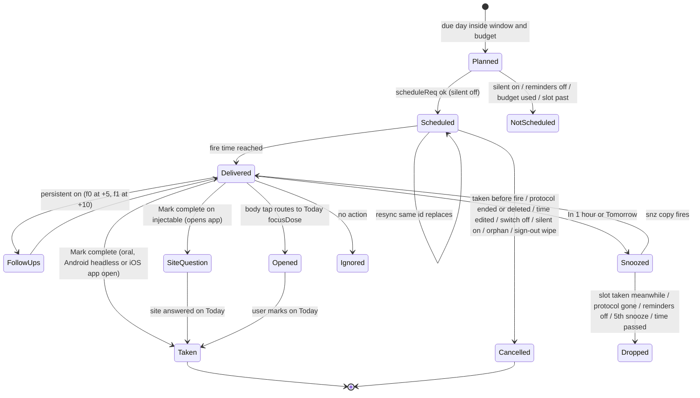
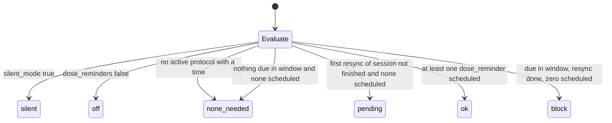
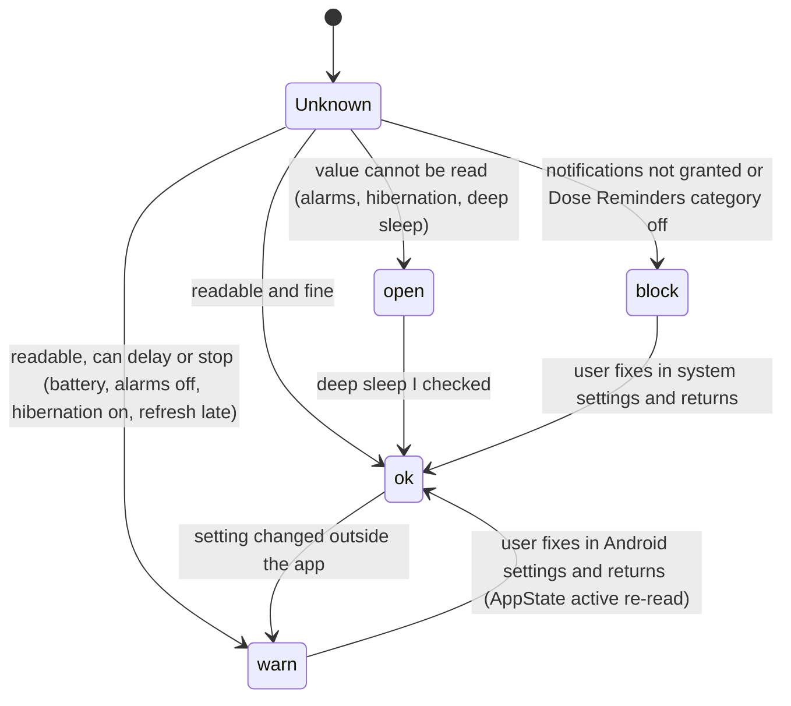
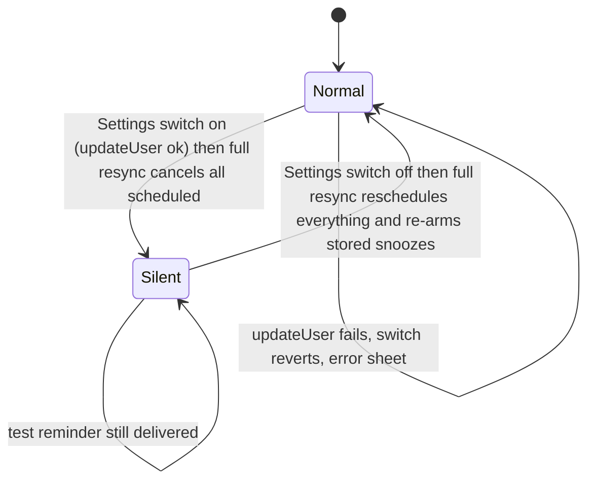
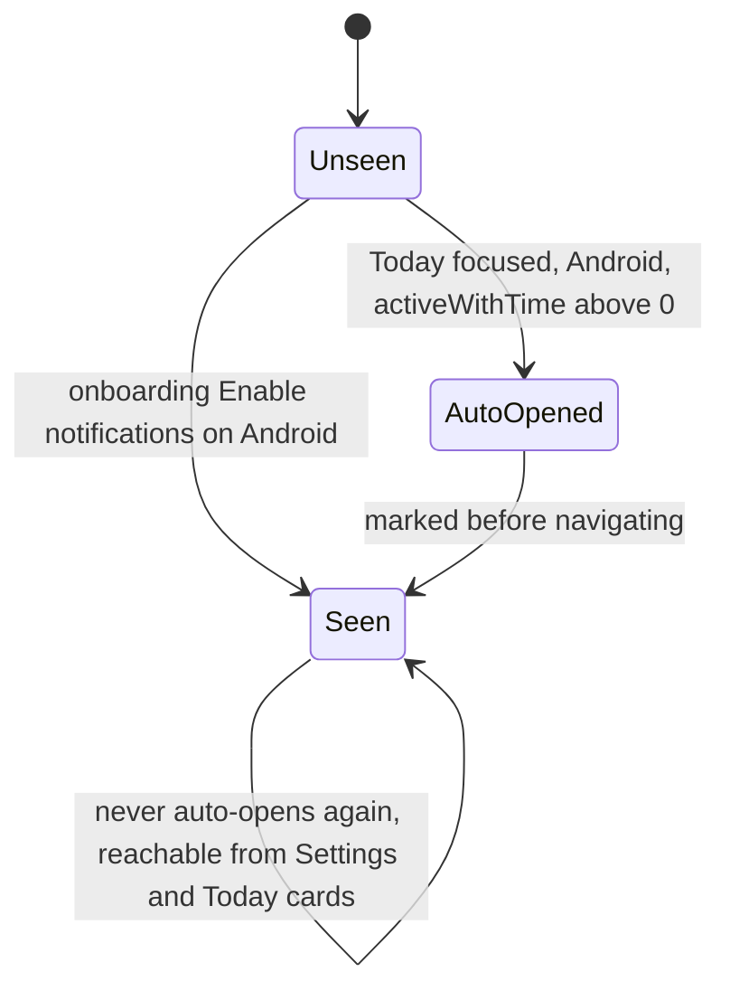
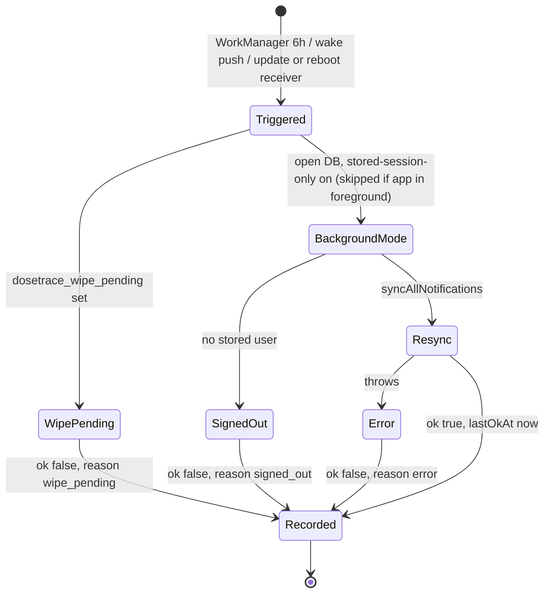
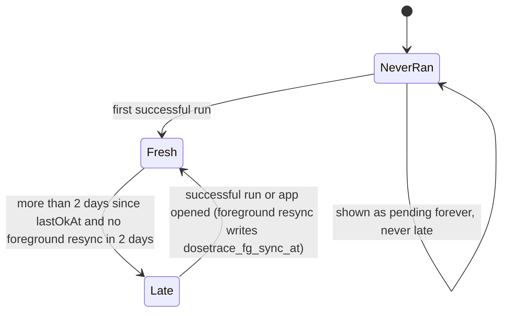
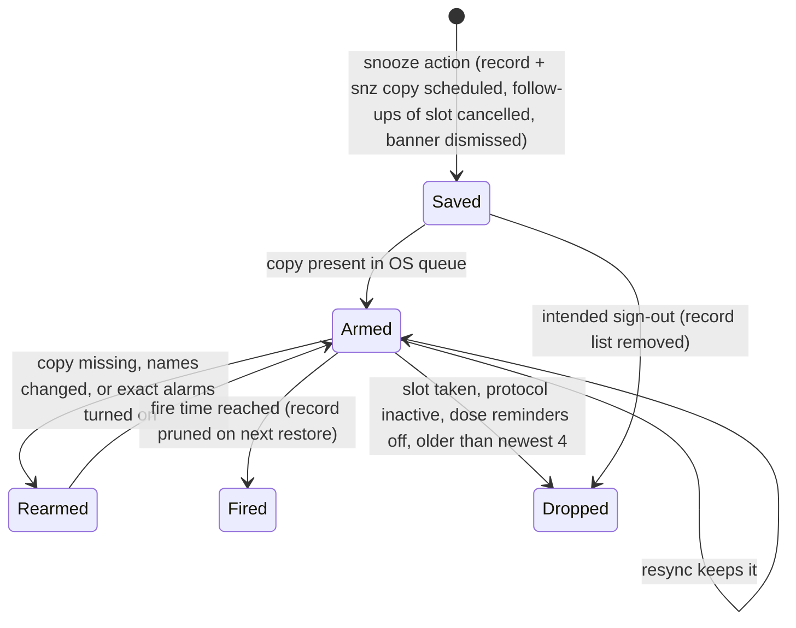
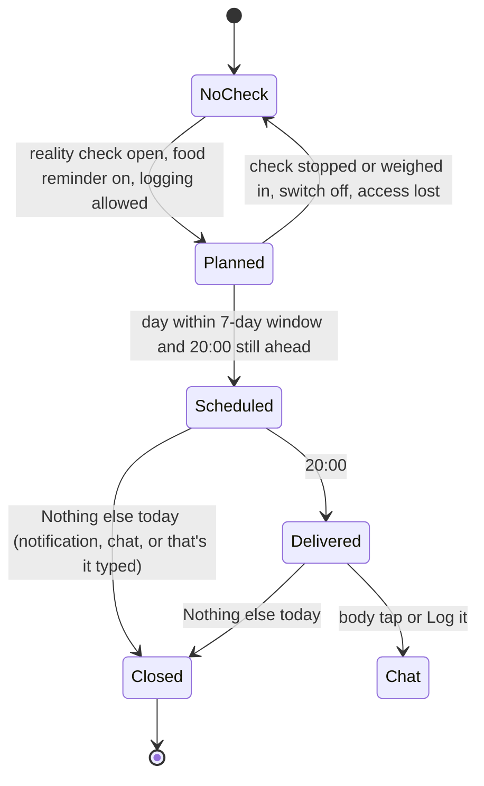

# 03 — Reminders & notifications

Research dossier for the PRD / TRD / state-flow diagrams. Branch `redesign/graduated`, read 2026-10-12.
Every claim cites `path:line`. Nothing was changed in code. Where the code cannot prove a point it says
**unverified**. Library behaviour quoted from `node_modules` is the installed version (expo-notifications
~0.32.16, expo-background-task ~1.0.10, `package.json:27,41`). Nothing was run on a device for this dossier.

Divergence tags: **CONFIRMED** = provable from the code as read; **SUSPECTED** = follows from the code but
depends on runtime/OS behaviour not observed here.

---

## 1. Purpose

**Founder principle (2026-10-07):** "o app avisa até a pessoa entrar no aplicativo e deletar esse protocolo… Não
posso deixar o Android definir se vai continuar avisando" (`docs/decisions.md:601`). A user still taking something
keeps getting its reminders for as long as it lasts, whether or not they open the app (a 180-capsule vitamin =
at least 180 days), and Android must not silently stop them (`docs/decisions.md:598`). A user who stopped
everything does not need reminders (same line). A reminder the user switched off is "the opposite failure"
(A-108 / A-109, `docs/decisions.md:599`). Protocols with a finite number of doses end their reminders when that
course ends (BR-12 deviation, `docs/decisions.md:620`; `docs/specs/background-refresh.md:25`).

Other framing decisions:
- Reminders are scheduled **locally on the phone**; server push stays OFF (A-107 = option B,
  `docs/decisions.md:589`; `lib/notifications.js:1079`).
- Every notification tap lands on its reason (A-44, `docs/decisions.md:165`; `lib/notificationPlan.js:156-193`).
- "Snooze everywhere, plus a working Mark complete notification action" (`docs/decisions.md:162`); the button label
  is "Mark complete" (`docs/decisions.md:97`; `i18n` key `notif_action_complete`).
- Show names in notifications: default ON; off = the lock screen never shows a compound's name
  (`docs/decisions.md:311`).
- Injectables: the notification Taken button writes nothing in the background; it opens the app on the site
  question (S-25, `docs/decisions.md:153`; `lib/notifications.js:134-139`).
- No advice, no interpretation in any notification text (CLAUDE.md AI hard line; the copy is factual,
  `lib/notifications.js:768-770`).
- A reminder that never arrives is invisible, so the app reads what the phone allows, shows it with a fix, proves
  delivery with a test, and warns on Today (`docs/specs/reminder-check.md:4`).

Specs: `docs/specs/reminder-check.md` (RC-1…RC-8), `docs/specs/exact-alarms.md` (EA-1…EA-7),
`docs/specs/background-refresh.md` (BR-1…BR-12), `docs/specs/reminders-guaranteed.md` (RG-1…RG-8),
`docs/specs/reminder-setup-placement.md` (SP-1…SP-10). Registry: F-015, F-016, F-043, F-064, F-067, F-068, F-081,
F-083, A-04, A-24, A-36, A-44, A-45, A-62, A-66, A-106…A-113, A-116 (`docs/review/features.md`).

---

## 2. Entry points and screens

| # | Surface | File | How the user gets there |
|---|---|---|---|
| E1 | OS notification (banner / lock screen / Notification Center) with action buttons | scheduled by `lib/notifications.js` | Fires by itself |
| E2 | "Make sure your reminders arrive" (Android) / "Check reminders" (iPhone) screen, route `ReminderCheck` | `screens/ReminderCheckScreen.js:31-112`, route `App.js:232` | Settings row (Android first row `screens/SettingsScreen.js:678-692`; iPhone last row `:787-800`); every Today reminder card (`screens/TodayScreen.js:1587,1599,1610,1621,1632,1643,1653`); tap on the test reminder (`lib/notificationPlan.js:188-189`); automatic once-per-phone opening from Today (Android, `lib/reminderSetup.js:14-22`, called `screens/TodayScreen.js:188-191`) |
| E3 | Shared rows component | `components/ReminderSetupList.js:29-122` | Inside E2 (`ReminderCheckScreen.js:75`, with refresh row) and inside onboarding (E5) |
| E4 | Today reminder alert cards | `screens/TodayScreen.js:1581-1658` | Today tab, Alerts box |
| E5 | Onboarding "Never miss a dose" step + Android sub-step "Make sure your reminders arrive" | `screens/OnboardingFlowScreen.js:306-310, 565-627` | Last onboarding step (`lib/onboardingSteps.js:12`) |
| E6 | Settings → Notifications group (7 switches + the check row) | `screens/SettingsScreen.js:672-803` | Settings tab |
| E7 | Targets of notification taps | Today (`focusDose`), Protocols (`openProtocolId`/`openVialId`), Progress (`focus: weighin/reality`), FoodChat (`eveningDay`/`logIt`), ReminderCheck | `lib/notificationPlan.js:161-193`, routed by `App.js:415-432` |
| E8 | Food log off-switch duplicated in Progress | `screens/components/NutritionLogger.js:107` (re-plans) ; shared switch per `docs/decisions.md:249` | Progress / Journey |
| E9 | Headless (no UI): Android notification-action task, Android background refresh task, update/reboot receiver, server wake push | `lib/notificationActions.js:197-210`, `lib/backgroundTasks.js:56-81`, `modules/dt-exact-alarm/android/.../RefreshOnUpdateReceiver.kt:18-33`, `supabase/functions/wake-refresh/index.ts` | OS-started |

Boot order: `index.js:4` imports `lib/notificationActions` at module scope (registers the action task, the response
listener, a drain of the last response, and an AppState listener) **before** the app mounts; `index.js:7-8`
defines the Android refresh task. `App.js:526` `initNotifications()` (handler + Android channels) runs after mount.

---

## 3. Every notification type

Common machinery:
- Every schedule goes through `scheduleReq` (`lib/notifications.js:68-71`): returns `null` (schedules nothing) when
  Silent mode is on, except `data.type === 'reminder_test'`; then `androidChannelRequest` moves `content.channelId`
  into the trigger because expo-notifications 0.32 reads the Android channel only from the trigger
  (`lib/notificationPlan.js:314-321`; an immediate notification gets a channel-only trigger `:319`).
- Language: read from AsyncStorage `dosetrace_language` at schedule time (`lib/notifications.js:18-24`).
- Foreground presentation: every notification shows alert + sound, no badge (`lib/notifications.js:81-87`).
  `shouldShowAlert` is the pre-SDK-53 key; whether 0.32 maps it to banner+list is **unverified**.
- Android channels created at app mount only (`lib/notifications.js:88-103`): `dose-reminders` "Dose Reminders"
  importance MAX, vibration, light `#185FA5`; `vial-alerts` "Vial Alerts" HIGH; `checkin-reminders`
  "Check-in Reminders" DEFAULT. Channel names are English-only literals.
- Action categories re-registered on every full resync so titles follow the language (`lib/notifications.js:114-150`).

### 3.1 Dose reminder (main slot)

| Field | Value |
|---|---|
| Scheduler | `scheduleDoseReminder(protocol, maxNotifs, windowDays)` `lib/notifications.js:217-322`; all protocols via `syncAllDoseReminders` `:435-470` |
| Trigger | One-shot `{type:'date'}` at local `dayKey` + reminder time (`:265-266, :283`) |
| Id | `dose-{protocol.id}-{YYYY-MM-DD}-t{ti}` (`:271-273`); `protocol.id` = local SQLite id |
| Days | `dueDateKeys(protocol, todayKey, windowDays)` — from `start_date`, every `interval_days`, stop after `schedule_total` doses (`lib/notificationPlan.js:35-53`) |
| Times | `reminderTimes(reminder_time)` comma list "HH:MM"; **null/empty → 08:00** (`lib/notificationPlan.js:57-63`) |
| Window / budget | iPhone: 10 days, total 40 − min(active vials, 8), per protocol min(24, max(2, ⌊total/n⌋)); Android: 21 days, total 400, per protocol min(60, max(2, ⌊400/n⌋)) (`lib/notificationPlan.js:301-309`). Mains + follow-ups both count (`lib/notifications.js:251, 260, 291`) |
| Skipped | Past slots (`:269-270`); today's first `takenToday` slots, counted by Taken rows today (`:244-248, :262`) |
| Content | Title = `protocol.name`, or `notif_dose_title_private` "Dose reminder" when names off (`:252-253`); body `notif_dose_body` "Time for your {dose} {unit} dose" with the locale decimal (`:235-236`) |
| Data | `{type:'dose_reminder', protocolId, dayKey, ti, slotMs, inj}` (`:279`) |
| Category | `dose-reminder` (interval 1) or `dose-reminder-long` (interval > 1), `-inj` suffix for injectables (`:254-255`) |
| Actions | `dose-reminder`: Mark complete + In 1 hour; `-long`: + Tomorrow (`:131-132`). Mark complete opens the app on iOS (all) and for injectables on both platforms; runs headless for Android orals (`:122, :136-138`). Snoozes open the app on iOS only (`:125-127`) |
| Channel | `dose-reminders` (`:281`) |
| Tap | Today with `focusDose {protocolId, dayKey, ti, slotMs, nonce}` (`lib/notificationPlan.js:175-178`); Today highlights it if still open today, or the pending-from-yesterday item (`screens/TodayScreen.js:1697-1704`) |
| Cancelled when | logged Taken (Today `screens/TodayScreen.js:891`; notification `lib/notificationActions.js:99-103`; both → `cancelTodaysDoseReminders` `lib/notifications.js:356-374`, which also dismisses delivered banners and prunes snoozes); protocol ended (`screens/TodayScreen.js:547`), deleted (`screens/ProtocolsScreen.js:1241, 2018`), deleted forever (`:1348`) → `cancelDoseReminder` `lib/notifications.js:412-433`; schedule edited (re-plan + dismiss delivered, `screens/ProtocolsScreen.js:1869-1873`); Dose reminders switch off (`lib/notifications.js:445`); Silent mode (`:863-866`); orphan (protocol no longer active here, `:450-456`, `lib/notificationPlan.js:287-294`); window moved/time changed (cancel-unwanted `lib/notifications.js:313-318`); server-push mode (dormant, `:440`); intended sign-out / cross-account (`lib/signedOut.js:160`, `App.js:629, 711`) |

### 3.2 Follow-ups (+5 / +10 min, "Persistent reminders")

- Only when `user_metadata.persistent_reminders === true` (`lib/notifications.js:195-200`); delays `[5, 10]` minutes
  (`:185`). Id `dose-{pid}-{day}-t{ti}-f{0|1}` (`:294-296`); data type `dose_followup`, body `notif_followup_body`
  "Reminder: your {dose} {unit} dose is still pending" (`:237, :298-300`); same title, category, channel.
- Kept after the main slot fired while the follow-up is still in the future (A-107 AC3 / BR-3, `:267-269, :293`).
- Cancelled with the slot (same prefix) and when that slot is snoozed (`:969-973`).
- Settings copy says "Repeat reminders every 5 min until acknowledged" (`settings_persistent_sub`) — code sends
  exactly two repeats. See gap G3.

### 3.3 Snoozed copy ("In 1 hour" / "Tomorrow")

- Created by `snoozeNotification` (`lib/notifications.js:951-981`), serialized by a promise lock (`:907-912`).
- Id `snz-{origId}` (re-snoozing keeps the id, `lib/notificationPlan.js:216-219`); record saved in AsyncStorage
  `dosetrace_snoozes` (`lib/notifications.js:902, 974-976`).
- Fire time: hour = now + 60 min; tomorrow = now + 24 h when 07:00–20:59, else 09:00 (next day if ≥ 21:00, same day
  if before 07:00) (`lib/notificationPlan.js:205-212`).
- Content copies title/body/data, adds `snoozed:true, origId` (`lib/notifications.js:935`); dose copies get category
  `dose-snoozed(-inj)` = Mark complete only (no second snooze, `:133, :139, :944`); non-dose copies get no category.
- Channel via `CHANNEL_FOR` (`:903`): dose/followup → dose-reminders, vial_low → vial-alerts, everything else →
  checkin-reminders (so a snoozed **vial expiry** moves to checkin-reminders; gap G19).
- Kept only while future and wanted; newest **4** kept (`MAX_SNOOZES`, `lib/notificationPlan.js:230-236`); a dose
  snooze is dropped when Dose reminders are off or its slot is resolved (`taken > ti` that day, or protocol
  inactive/deleted, `lib/notifications.js:922-932, 996-998`). With names off, dose copies are re-titled private and
  vial-low copies re-bodied (`:999-1010`). Re-armed if missing on every full resync (`:874`), on take, on pause/
  delete (`:372, :424`), and fully re-armed when exact alarms turn on (`:831, :1016`).
- Cancelled with all others by `cancelAllNotifications`, which also removes the record list (`:877-886`).

### 3.4 Morning summary (07:00)

- `syncMorningSummary` `lib/notifications.js:750-810`; plan `morningSummaryPlan` (`lib/notificationPlan.js:72-99`)
  over 7 days (`SUMMARY_WINDOW_DAYS`, `lib/notifications.js:179`) with a 45-day look-ahead (`:180`).
- Per day: `due` → "Today: {list}." (names, max 3 + "+N", `:188-192, :785-786`) or, names off,
  "{n} scheduled today." (plural key, `:787`); `next1` → "Nothing today. Next dose tomorrow."; `next` → "Nothing today.
  Next dose in {days} days."; `none` → nothing scheduled (`:776-792`). Title `notif_morning_title` "Good morning".
- Id `summary-{YYYY-MM-DD}` (`:794-796`); legacy single id `morning-summary` cleaned (`:764`). No category (no
  buttons). Channel `dose-reminders` (`:801`). Data `{type:'morning_summary'}`; tap → Today (`lib/notificationPlan.js:186-187`).
- Gated by `dose_reminders` (no own switch, `:756`). Not re-planned when a protocol is created/edited/deleted from
  Protocols (only on the next full resync) — gap G7.

### 3.5 Vial running low (immediate)

- In `syncVialAlerts` (`lib/notifications.js:476-564`). Low = the one supply rule `supplyState` (`lib/supplyLow`,
  `:500-502`; decision: low = 1–3 doses left, `docs/decisions.md:148`).
- Sent **once per vial** (`vialLowToSend`, `lib/notificationPlan.js:243-254`; map in AsyncStorage
  `dosetrace_vial_low_sent`, `lib/notifications.js:474, 507-511`); a new vial row = new id = can be announced again.
- Never from the background run (`:503-505`, BR-7); skipped while a snoozed copy is pending (`:491, :516`).
- Id `vial-low-{vialId}`; trigger `null` (immediate); title `notif_vial_title` "Vial running low"; body "{name} has
  {n} dose(s) left" with protocol name or "Your vial" (`:517-521`); data `{type:'vial_low', vialId, protocolId,
  remaining}`; category `general-reminder` (In 1 hour, Tomorrow, `:140`); channel `vial-alerts`.
- Tap → Protocols, opening that protocol (`lib/notificationPlan.js:179-181`).
- Switch `vial_alerts` (labelled "Vial expiry alerts") cancels all `vial-` ids (`lib/notifications.js:482`).

### 3.6 Vial expiry (09:00, 7 days before and on the day)

- `vialExpiryPlan` (`lib/notificationPlan.js:261-283`): recon = `mixed_on + vial_valid_days` (default 30); ready-to-use
  = `vials.expires_on`; only the NEXT future one per vial (lead 7, then 0).
- Id `vial-exp-{vialId}-{7|0}`; title `today_alert_vial_title`; body = Today's own strings (expired / expiring in
  {n}) with `t(compound_id)` or protocol name (`lib/notifications.js:541-558`); data `{type:'vial_expiry', vialId,
  protocolId, daysLeft}`; category `general-reminder`; channel `vial-alerts`. Tap → Protocols (same as 3.5).
- Not re-planned when a vial is created from Protocols (`screens/ProtocolsScreen.js:1902-1907` only schedules dose
  reminders); Today and Log call `syncVialAlerts` after takes/new vials (`screens/TodayScreen.js:674, 898, 1153, 1261`;
  `screens/LogScreen.js:147, 330`).

### 3.7 Weekly check-in (Sunday 10:00)

- `syncCheckinReminder` `lib/notifications.js:567-597`: id `checkin-weekly`, **repeating** `{type:'weekly', weekday:1,
  hour:10, minute:0}` (`:586-591`), title/body `notif_checkin_*` ("Weekly check-in" / "Log this week's weight and
  waist…"), category `general-reminder`, channel `checkin-reminders`, data `{type:'checkin_reminder'}`.
- Switch `checkin_reminders` (`:573`). Tap → Progress `focus:'weighin'` (`lib/notificationPlan.js:182-183`).
- Note the file's own warning that repeating triggers are inexact on Android and dropped under Doze (`:651-656`)
  — the check-in still uses one (gap G31).

### 3.8 Reality-check weigh-in (day 21, 10:00)

- `syncRealityCheckReminder` `lib/notifications.js:609-642`: reads the open check from the synced table via
  `getRealityStart({strict:true})` (`:618`; `lib/realityCheck.js:86-104` — a failed read throws so nothing is
  cancelled). Fires `start.date + 21 days` at 10:00 (`:604, :621-623`); not scheduled if in the past (Today's alert
  covers it, `:624-625`).
- Id `reality-check-weigh`; title/body `notif_rc_*` ("Reality-check weigh-in" / "Time to log your weight and finish your
  reality check."); category `general-reminder`; channel `checkin-reminders`; data `{type:'reality_check'}`.
  Tap → Progress `focus:'reality'` (`lib/notificationPlan.js:184-185`).
- No own switch. Cancelled when no open check (`:615, :619`) — Stop calls both re-plans (`lib/realityCheck.js:150-154`;
  `screens/components/CalculatorSection.js:909-978`).
- The comment `lib/notifications.js:602-603` still says it reads AsyncStorage — stale (gap G13).

### 3.9 Food log 20:00 "Anything else today?"

- `syncFoodLogReminder` `lib/notifications.js:664-728`. Conditions: user known (else keep, `:681`);
  `food_reminders !== false` (`:682`); open reality check (`:686-687`); days from `foodNudgeDays` = next 7 calendar
  days from max(today, start), minus closed days (`lib/notificationPlan.js:109-120`; `FOOD_WINDOW_DAYS = 7`
  `lib/notifications.js:663`); then `remindersForAccess` — none when the user cannot log, none after `access.until`
  unless Premium (`lib/notificationPlan.js:124-128`; access via `loadFoodAccess`, `lib/notifications.js:700-704`;
  unknown access keeps the plan).
- Closed day = a synced `food_logs` marker with `source='day_closed'` (`lib/nutrition.js:63`; written by
  `closeFoodDay` `lib/notifications.js:733-745` via `insertFoodDayMarker` `lib/database.js:513-525`).
  Logging food does NOT cancel the evening question; no backoff; no day-21 cutoff (`lib/notificationPlan.js:103-107`;
  `docs/decisions.md:249`).
- Id `food-log-{YYYY-MM-DD}` (legacy `food-log-daily` cleaned, `:671`); title/body `notif_food_*`; category
  `food-evening` = Log it (opens app) + Nothing else today (headless on Android, opens app on iOS)
  (`:146-148`); channel `checkin-reminders`; data `{type:'food_log', dayKey}`.
- Tap → `FoodChat` with `{eveningDay, nonce}`; "Log it" → `{logIt}`; "Nothing else today" → no navigation, closes
  that reminder's day (`lib/notificationPlan.js:145-155, 169-172`; `lib/notificationActions.js:119-130`).
- Re-planned also by: food chat (`screens/FoodChatScreen.js:119, 322`), NutritionLogger (`:107`), access change
  (`lib/foodLogActions.js:201-205`), every sync/import completion (30 s throttle, `App.js:586-596`).

### 3.10 Test reminder

- `sendTestReminder` `lib/notifications.js:1175-1192`: id `reminder-test`, now + 10 s, title literal "DoseTrace",
  body `rc_test_body`, data `{type:'reminder_test'}`, channel `dose-reminders`, no category. Goes through even in
  Silent mode (`:69`). Tap → ReminderCheck (`lib/notificationPlan.js:188-189`). Never a dose (RC-5).

### 3.11 "Nothing new logged" (Android info)

- After a headless Mark complete that logged nothing (dose already complete, protocol paused/deleted):
  `notifyNothingLogged` `lib/notificationActions.js:134-145`, Android only, immediate, `data.type:'info'`, **no channel,
  no `scheduleReq`** (bypasses Silent mode; gap G21). No tap target (`notifTapTarget` default `null`).

### 3.12 Server silent wake-up (data-only push, Android)

- `supabase/functions/wake-refresh/index.ts:15-54`: pg_cron daily 08:00 UTC (`supabase/migrations/20261007000000_wake_refresh_schedule.sql:36-44`)
  posts to the function; `claim_wake_refresh()` allows one run per 20 h (`:12-28`); sends one
  `{to, data:{type:'refresh_wake'}, priority:'high', _contentAvailable:true}` per distinct Android token
  (`supabase/functions/wake-refresh/plan.js:10-19`), batches of 100, prunes `DeviceNotRegistered` tokens (`:21-29`;
  `index.ts:47`). No title/body: nothing is shown.
- Phone: the Android notification task recognizes it (`lib/reminderRefresh.js:45-58`) and runs `refreshNow()`
  (`lib/notificationActions.js:203-206`). iOS is never sent one.

### 3.13 Server-sent dose / morning / food pushes (dormant)

- `supabase/functions/send-reminders/index.ts:1-20` (header: "NOT ACTIVE YET"), gated client-side by
  `SERVER_PUSH_ACTIVE = false` (`lib/notifications.js:1079, 1087-1089`). The ledger: "send-reminders is NOT deployed
  on the server at all" (`docs/decisions.md:564`) and stays OFF under A-107 option B (`:589`). It honours
  `dose_reminders`, `food_reminders`, `purged_at` (`index.ts:122, 146, 148`) but not Silent mode, Show names,
  persistent repeats or action buttons (grep of `index.ts` for `silent_mode|notif_show_names|persistent|categoryId`
  finds none). Its food rule now matches the client (`supabase/functions/send-reminders/plan.ts:93-114`).

### 3.14 In-app Today reminder cards (not OS notifications)

| Card id (snooze id) | Condition | Text keys | Tap |
|---|---|---|---|
| `reminders_silent` | `shouldWarnSilent` (`lib/reminderHealth.js:165`) | `today_alert_silent_*` | ReminderCheck (`screens/TodayScreen.js:1582-1590`) |
| `reminders_combined` | ≥ 2 of blocked/late/battery/stop/stale (`lib/reminderHealth.js:167-169`) | `today_alert_combined_*` "{n} fixes for your reminders" | ReminderCheck (`:1593-1602`) |
| `reminders_blocked` | `shouldWarnToday` (`lib/reminderHealth.js:105-108`) and < 2 warnings | `today_alert_reminders_*` | ReminderCheck (`:1605-1613`) |
| `reminders_late` | `shouldWarnLate` (`:112-114`) | `today_alert_late_*` | ReminderCheck focus `alarms` (`:1616-1624`) |
| `reminders_battery` | `shouldWarnBattery` (`:159-161`) | `today_alert_battery_*` | focus `battery` (`:1627-1635`) |
| `reminders_stop` | `shouldWarnStop` (`:117-119`) | `today_alert_stop_*` | focus `hibernation` (`:1638-1646`) |
| `reminders_stale` | `staleRefreshDays > 0` (`:121-127`) | `today_alert_stale_*` "{n} days" | focus `refresh` (`:1648-1656`) |

Snooze: "Tomorrow" / "In 3 days", both until 09:00 that day (`lib/todayFormat.js:35-39`), stored in AsyncStorage
`dosetrace_alert_snooze` (`screens/TodayScreen.js:155, 489-495`). Related non-reminder cards (reality-check weigh-in,
supply low, vial expiry) live in the same list (`:1482-1579`).

---

## 4. Business rules

| # | Rule | Source |
|---|---|---|
| R-1 | Reminders are local one-shot dated notifications per due slot; the rolling window is topped up on app open, foreground, Settings change, and (Android) by a background task. | `lib/notifications.js:172-175`; `App.js:556-576, 650-653, 730-733`; `lib/backgroundTasks.js:1-4` |
| R-2 | Window/budget: iPhone 10 days, 40 total minus up to 8 for vial-expiry alerts; Android 21 days, 400 total; per protocol at least 2. | `lib/notificationPlan.js:301-309`; RC-7 `docs/specs/reminder-check.md:22` |
| R-3 | A standalone schedule (create / edit / restore / restart) shares the budget with the other active protocols. | `lib/notifications.js:218-224` |
| R-4 | A protocol with no reminder time is reminded at 08:00. | `lib/notificationPlan.js:58` |
| R-5 | A slot already past is never re-armed; its future +5/+10 repeats stay. | `lib/notifications.js:267-270, 293` (BR-3) |
| R-6 | Today's first N slots, N = Taken logs today, get no reminder. | `lib/notifications.js:242-248, 262` |
| R-7 | Non-destructive scheduling: schedule wanted ids first (fixed id replaces), then cancel only ids of that kind no longer wanted; an unknown state (DB not ready, failed read, no user) cancels nothing. | `lib/notifications.js:228-231, 311-318, 390-399, 488, 613-619, 668-687, 761-764`; BR-1/BR-2 |
| R-8 | One full resync at a time; calls made meanwhile share ONE follow-up run. | `lib/notifications.js:837-857` (BR-6) |
| R-9 | Full resync order: categories → Silent check → doses → vials → check-in → weigh-in → food → morning summary → snoozes. | `lib/notifications.js:859-875` |
| R-10 | Silent mode on: cancel every scheduled notification, schedule nothing; only the user's test reminder goes through; shown as its own state, never "blocked". | `lib/notifications.js:51-71, 861-867`; `lib/reminderHealth.js:91`; BR-4; A-108 |
| R-11 | A kind switched off cancels what is already scheduled of that kind (dose reminders also cancel morning summaries). | `lib/notifications.js:445, 482, 573, 682, 756` (A-109) |
| R-12 | Names: on by default; off → dose title "Dose reminder", vial name "Your vial", morning list replaced by a count. Snoozed dose/vial-low copies follow the switch. | `lib/notifications.js:204-209, 253, 517, 543, 785-787, 999-1010` |
| R-13 | Mark complete from a notification logs the slot's own day/slot if tapped within slot + 12 h (even after midnight); a snoozed copy tapped later is logged at the tap time. | `lib/notificationActions.js:62-76`; `lib/markTaken.js:203-208`; `docs/decisions.md:155` |
| R-14 | Injectable Mark complete writes nothing in the background: it saves a site question (tap time = dose time) that Today asks. | `lib/notificationActions.js:77-90`; `screens/TodayScreen.js:940-958`; S-25 |
| R-15 | Each action response is handled at most once (in-flight set + persisted list of 60 keys `id|action|date`). | `lib/notificationActions.js:51-60, 147-167` |
| R-16 | A headless action never runs a cloud sync or the full resync (deferred to foreground); it cancels only today's slots up to the tapped one. | `lib/notificationActions.js:99-113` |
| R-17 | Android dismisses a handled banner after a button press, except an injectable question raised while the app is not active. | `lib/notificationActions.js:173-182` |
| R-18 | Daily doses get In 1 hour only; less-than-daily doses also get Tomorrow; a snoozed dose copy can be marked complete but not snoozed again. | `lib/notifications.js:128-133` |
| R-19 | At most 4 snoozed copies, newest kept. | `lib/notificationPlan.js:228-236` |
| R-20 | Vial low is announced once per vial, only with the app running. | `lib/notificationPlan.js:238-254`; `lib/notifications.js:503-511` (m10, BR-7) |
| R-21 | Vial expiry: 09:00, 7 days before and on the day, the next one only per vial. | `lib/notificationPlan.js:256-283` (A-45) |
| R-22 | 20:00 food question: only while a reality check is open, once a day, skipped for closed days, only while food logging is allowed, 7-day rolling window, no day-21 cutoff. | `lib/notificationPlan.js:101-128`; `lib/notifications.js:644-728`; FL-18/41/42 |
| R-23 | "Nothing else today" closes the reminder's own day (a tap after midnight still closes that evening). | `lib/notificationActions.js:116-130` |
| R-24 | Day-21 weigh-in reminder at 10:00 of start + 21 days; none if past. | `lib/notifications.js:599-642` |
| R-25 | Every tap lands on its reason; Snooze / Nothing else today never navigate; Mark complete → Today. | `lib/notificationPlan.js:156-193` (A-44) |
| R-26 | A tap that launched the app is routed once (in-memory + persisted 30 keys) and ignored when older than 12 h; navigation waits until `Main` exists; a sign-out drops a queued tap. | `App.js:403-432, 549-551`; `lib/signedOut.js:18-19` |
| R-27 | The background refresh (Android): every 6 h at most (WorkManager decides), stored session only (no network auth refresh), no immediate notifications, no pushed writes; skipped when a wipe is pending or nobody is stored. | `lib/backgroundTasks.js:19-44`; `lib/reminderRefresh.js:14-40`; `lib/supabase.js:40-58` (BR-1, 7, 8, 9) |
| R-28 | After an app update or reboot (Android), the same refresh runs once headless. | `modules/dt-exact-alarm/android/src/main/AndroidManifest.xml:6-14`; `RefreshOnUpdateReceiver.kt:18-33` (A-111) |
| R-29 | Daily silent server wake-up (Android) only triggers the local refresh; at most once per 20 h; no content. | `supabase/functions/wake-refresh/*`; migration `:12-44` (RG-6) |
| R-30 | Turning "Alarms & reminders" on (seen on return to foreground) reschedules everything and re-arms snoozes. | `lib/notifications.js:819-834` (EA-4) |
| R-31 | Reminder check: only what the app can read can block; Today warns about a block only when dose reminders are on and a protocol has a time. Exact alarms off, battery optimized, hibernation on, stale refresh = warnings, never blocks. | `lib/reminderHealth.js:1-6, 55-84, 103-108`; RC-6, EA-2, EA-5 |
| R-32 | An empty queue right after start is "pending", not blocked, until the first resync of the session finished. | `lib/reminderHealth.js:86-97`; `lib/notifications.js:816, 851, 1132-1133` |
| R-33 | Refresh is "late" after more than 2 days since the last SUCCESSFUL run, unless the app itself resynced in the foreground within 2 days; never-ran = pending/OK. | `lib/reminderHealth.js:36-50, 73-78, 121-127` |
| R-34 | Two or more reminder warnings at once = one Today card; Silent has its own card. | `lib/reminderHealth.js:163-169`; `screens/TodayScreen.js:1581-1603` (council 3 decisions 2, 3) |
| R-35 | Setup step counts Notifications (with the Dose Reminders category), Alarms, Battery, Hibernation and, on Samsung, Deep sleep (OK only after "I checked"); unreadable rows are not counted; the refresh row is shown on the screen, never counted. | `lib/reminderHealth.js:128-144` (SP-2, SP-10) |
| R-36 | Settings (Android) row: block (risk) / "N of M ready" or "not refreshed" (attention) / "All set [· next reminder]". | `lib/reminderHealth.js:146-156`; `screens/SettingsScreen.js:242-251` (SP-1) |
| R-37 | The setup screen opens by itself once per phone (Android) from Today for a user with a reminder-time protocol who has not seen it; onboarding marks it seen. | `lib/reminderSetup.js:1-22`; `lib/reminderSetupRule.js:4-6`; `screens/OnboardingFlowScreen.js:308` (SP-4, SP-5) |
| R-38 | Onboarding (Android): after "Enable notifications", the setup items only (no schedule/test); "Not now" skips it; never on iPhone. | `screens/OnboardingFlowScreen.js:306-310, 565-616` (SP-4) |
| R-39 | Intended sign-out / account deletion: cancel all scheduled, dismiss all delivered, drop snooze records, remove this device's push token. | `lib/signedOut.js:157-166`; `lib/notifications.js:877-894`; `lib/signOutCore.js:67`; `lib/accountActions.js:130` |
| R-40 | A spurious SIGNED_OUT keeps everything (data and scheduled reminders). | `lib/signedOut.js:20-25, 36-38` |
| R-41 | Cross-account sign-in on the same phone cancels the previous account's reminders before import. | `App.js:622-635, 704-717` |
| R-42 | Push token (Expo) upserted with platform + IANA timezone on cold start and sign-in, after permission is granted; removed on intended sign-out. | `lib/notifications.js:1029-1072`; `App.js:650-653, 730-733` |

---

## 5. States and transitions

### 5.1 One dose slot (OS queue view)

Conditions: scheduled when `slot > now`, within window/budget, not already covered by today's Taken count, Silent off,
Dose reminders on (`lib/notifications.js:257-286`). Follow-ups only with persistent on.

### 5.2 Schedule state (`scheduleState`, `lib/reminderHealth.js:90-97`)

Evaluated in this order: `silent` (silent_mode true) → `off` (dose_reminders false) → `none_needed` (activeWithTime 0,
or dueInWindow 0 and nothing scheduled) → `pending` (syncedOnce false and nothing scheduled) → `ok` (scheduledCount > 0)
→ `block`.

### 5.3 Per-check row state (`reminderChecks`, `lib/reminderHealth.js:55-84`)

| Row | Platform | ok | warn | block | open |
|---|---|---|---|---|---|
| notifications | both | permission `granted` | — | anything else (incl. `undetermined`, null) | — |
| channel | Android, only when importance readable | importance ≠ 0 | — | importance 0 | (row absent) |
| battery | Android, only when readable | not optimized | optimized | — | (row absent) |
| alarms | Android | `canScheduleExactAlarms` true (Android < 12 = true) | false | — | null (module missing) |
| hibernation | Android | exempt (Android < 11 = true) | not exempt | — | null |
| refresh | Android | never ran (`pending`), fresh, or fg-fresh, or reminders don't matter | > 2 days since last OK, not fg-fresh, reminders matter | — | — |
| deep_sleep | Samsung only | "I checked" saved | — | — | not confirmed |

Note: the `notifications` row blocks for `undetermined` too (`permission === 'granted' ? 'ok' : 'block'`, `:57`).

### 5.4 Silent mode

Source: `screens/SettingsScreen.js:282-296`; `lib/notifications.js:60-71, 859-867`. Snooze records survive Silent
(only the OS copies are cancelled), so they come back when Silent ends (`:989-1022`).

### 5.5 Setup seen (per phone, AsyncStorage `dosetrace_reminder_setup_seen`)

Sources: `lib/reminderSetup.js:10-22`; `screens/OnboardingFlowScreen.js:308`; `screens/TodayScreen.js:187-191`
(600 ms delay, only if Today still focused). The key is not in the sign-out wipe list (`lib/signedOut.js:159-162`),
so it is per phone across accounts (matches SP-5 "once per phone").

### 5.6 Background refresh run (`runReminderRefresh`, `lib/reminderRefresh.js:14-40`)

`setBackgroundRun(false)` runs in `finally` on every exit (`:33-35`). `saveLastRun` keeps the previous `lastOkAt`
across failed runs (`lib/backgroundTasks.js:48-53`).

### 5.7 Refresh freshness (what the row / Today / Settings see)

### 5.8 Settings row (Android, `setupRowState` `lib/reminderHealth.js:150-156`)

`block` if `blockingCount(reminderChecks, scheduleState) > 0` → else `ok` if (all counted rows OK or none counted)
and no stale days → else `warn`. Text: block → "Something is blocking your reminders"; warn with all counted OK and
stale → "Reminders not refreshed for N days"; warn → "N of M ready"; ok → "All set" / "All set · next reminder <day,
time>" (`screens/SettingsScreen.js:242-251`).

### 5.9 Snooze record

### 5.10 Food day (20:00)

---

## 6. STATE OWNERSHIP AUDIT

The reader of the phone is one function, `readReminderHealth` (`lib/notifications.js:1124-1171`); the rules are pure
in `lib/reminderHealth.js`. Each consumer re-derives from that snapshot. Below: every place that computes or decides
each derived state, and every divergence found.

### 6.1 "Blocked"

| Where | What it decides | Gate |
|---|---|---|
| `lib/reminderHealth.js:57, 60` | `notifications` / `channel` row = `block` | none |
| `lib/reminderHealth.js:90-97` | `scheduleState = 'block'` | silent/off/none_needed/pending first |
| `lib/reminderHealth.js:99-101` | `blockingCount` = block rows + schedule block | none |
| `lib/reminderHealth.js:105-108` | `shouldWarnToday` (Today card) | `remindersOn && activeWithTime` |
| `lib/reminderHealth.js:150-156` | `setupRowState.kind = 'block'` (Android Settings) | none |
| `screens/SettingsScreen.js:237, 793-796` | iPhone row "Something is blocking your reminders" via `blockingCount` | none |
| `screens/ReminderCheckScreen.js:52, 106` | test hint "A red item above stops reminders" = any **row** block (schedule block excluded on purpose) | none |
| `screens/ReminderCheckScreen.js:85-89` | "None scheduled" card | via `scheduleState` |
| `screens/TodayScreen.js:186, 1605-1613` | Today "Your reminders are blocked" | via `shouldWarnToday` |
| `components/ReminderSetupList.js:51-55, 104` | risk colour + warning icon | row state |

- **D-1 CONFIRMED** — Settings (both platforms) and Today disagree on the same concept: Settings shows red
  "Something is blocking your reminders" whenever a row blocks (`SettingsScreen.js:237`, `reminderHealth.js:153`),
  even with Dose reminders off or no protocol; Today warns only when dose reminders are on and a protocol has a time
  (`reminderHealth.js:106`). Each matches its own spec row (RC-1/SP-1 vs RC-6), so this is a spec-level inconsistency.
- **D-2 CONFIRMED** — `shouldWarnToday` ignores Silent mode while every other Today warning excludes it
  (`remindersMatter`, `reminderHealth.js:53`; `shouldWarnLate` `:113`). With Silent on and notifications denied, Today
  shows both the Silent card and the Blocked card (`TodayScreen.js:1582, 1605`).
- **D-3 CONFIRMED (by design)** — The screen's test hint counts row blocks only; "None scheduled" does not stop the
  test (comment `ReminderCheckScreen.js:50-51`).
- **D-4 CONFIRMED** — `scheduleState` is `ok` as soon as ONE dose reminder is scheduled (`reminderHealth.js:96`): a
  phone where only one of several protocols got reminders reads OK everywhere. Morning summary, food and weigh-in
  reminders are never checked.

### 6.2 "Late" (exact alarms off)

| Where | What |
|---|---|
| `modules/dt-exact-alarm/.../DtExactAlarmModule.kt:15-20` | native read: Android < 12 → true; no context → true; else `AlarmManager.canScheduleExactAlarms()` |
| `modules/dt-exact-alarm/index.js:14-17` | JS wrapper; null when module missing (iPhone, Expo Go) |
| `lib/notifications.js:1139` | `readReminderHealth.exactAlarms` |
| `lib/notifications.js:822-834` | `watchExactAlarms`: its own read on every foreground; false→true triggers resync + snooze re-arm |
| `lib/reminderHealth.js:67` | row `alarms` ok/warn/open |
| `lib/reminderHealth.js:112-114` | `shouldWarnLate` (inline copy of `remindersMatter`) |
| `lib/reminderHealth.js:136, 140` | counted in setup when readable |
| `screens/TodayScreen.js:186, 1616-1624` | Today card → ReminderCheck focus `alarms` |

- **D-5 SUSPECTED (drift risk)** — `shouldWarnLate` re-implements `remindersMatter` inline instead of calling it
  (`reminderHealth.js:113` vs `:53`); equal today.
- **D-6 CONFIRMED (doc)** — EA-3 says the Today card "opens Android's Alarms & reminders screen directly"
  (`docs/specs/exact-alarms.md:16`); code opens ReminderCheck at the row (`TodayScreen.js:1621`) per the later SP-6
  (`docs/specs/reminder-setup-placement.md:20`). EA-3 was not amended.
- The row warns regardless of whether reminders matter; Today only when they matter — by design.

### 6.3 "Battery"

| Where | What |
|---|---|
| `lib/notifications.js:1138` | `expo-battery.isBatteryOptimizationEnabledAsync()` |
| `lib/reminderHealth.js:62-64` | row `battery` warn/ok (absent if unreadable) |
| `lib/reminderHealth.js:159-161` | `shouldWarnBattery` (uses `remindersMatter`) |
| `screens/TodayScreen.js:186, 1627-1635` | Today card |
| `lib/notifications.js:1215-1217, 1098-1110` | fix opens the app's system page (`APPLICATION_DETAILS_SETTINGS`), not the battery list (RG-2 deviation accepted, `docs/decisions.md:619`) |

No divergence found beyond the accepted deviation.

### 6.4 "Stop" (hibernation / "Pause app activity if unused")

| Where | What |
|---|---|
| `DtExactAlarmModule.kt:24-28` | Android < 11 → true; else `packageManager.isAutoRevokeWhitelisted()` |
| `lib/notifications.js:1140` | `hibernationExempt` |
| `lib/reminderHealth.js:70` | row ok/warn/open |
| `lib/reminderHealth.js:117-119` | `shouldWarnStop` |
| `lib/reminderHealth.js:174-177` | Samsung title "Manage app if unused" |
| `screens/TodayScreen.js:1638-1646` | Today card |

- **D-7 SUSPECTED** — whether `isAutoRevokeWhitelisted()` equals the hibernation switch on every OEM build is
  **unverified** (RG-3 device proof in RG-8 missing, `docs/specs/reminders-guaranteed.md:21`).

### 6.5 "Stale" (background refresh late)

| Where | What |
|---|---|
| `lib/backgroundTasks.js:48-53` | writes `dosetrace_refresh_last` `{at, ok, reason, lastOkAt}` |
| `lib/notifications.js:849` | writes `dosetrace_fg_sync_at` after a non-background resync with a known user |
| `lib/notifications.js:1141-1142` | reads both (Android only) |
| `lib/reminderHealth.js:41-50` | `lastOkAt`, `refreshAgeDays` |
| `lib/reminderHealth.js:73-78` | row `refresh` (`activeWithTime == null ? 1` default) |
| `lib/reminderHealth.js:121-127` | `staleRefreshDays` (Today + Settings) |
| `lib/reminderHealth.js:152, 155` | Settings `warn` when stale |
| `screens/SettingsScreen.js:245` | "Reminders not refreshed for N days" text |
| `screens/TodayScreen.js:1648-1656` | Today card |
| `components/ReminderSetupList.js:40-46` | row text: pending / warn N days / "Last run … · reminders scheduled until …" |

- **D-8 CONFIRMED** — A refresh that has **never** succeeded is "pending" forever (row text "Runs within the next few
  hours", `ReminderSetupList.js:41`), never late (`reminderHealth.js:47-48, 77, 126`). A phone where WorkManager never
  runs the task never warns on this signal.
- **D-9 CONFIRMED (logic)** — Any foreground resync within 2 days counts as fresh (`reminderHealth.js:76, 124`), and
  opening the app triggers that resync (`App.js:574, 650`). Today re-reads after the resync (`TodayScreen.js:197`).
  So the stale card can only appear before that resync records `dosetrace_fg_sync_at`; for a user who opens the app it
  disappears. Whether a brief flash occurs is **SUSPECTED** (`readReminderHealth` waits for an in-flight resync,
  `notifications.js:1132`, but the timestamp is written in a separate `.then` after `getCachedUser`, `:849`).
- **D-10 CONFIRMED** — `ok:true` is recorded whenever `syncAllNotifications` does not throw (`reminderRefresh.js:30-39`),
  but every `sync*` swallows its own errors (e.g. `notifications.js:319-321, 561-563`). A run that rescheduled nothing
  (DB not opened, `backgroundTasks.js:25-29`) still reads "Last run: …" OK.
- **D-11 CONFIRMED** — The run counts all scheduled notifications (`backgroundTasks.js:41`) but `saveLastRun` drops
  `scheduled` (`:52`), while `readLastRefresh`'s comment promises it (`:83`). BR-10's "result" is only ok/reason.

### 6.6 "Silent"

| Where | What |
|---|---|
| `screens/SettingsScreen.js:264, 768` | switch from `user_metadata.silent_mode === true`; write `:282-296` |
| `lib/notifications.js:60-67` | module cache `_silent` (read once per full resync, `resetSilent` `:862`) |
| `lib/notifications.js:68-71` | `scheduleReq` gate (all scheduling, test exempt) |
| `lib/notifications.js:863-867` | full resync cancels all |
| `lib/notifications.js:1161` | `readReminderHealth.silent` (fresh read, not the cache) |
| `lib/reminderHealth.js:53, 91, 113, 165` | remindersMatter, scheduleState, shouldWarnLate, shouldWarnSilent |
| `screens/TodayScreen.js:1582-1590` | Silent card |
| `screens/ReminderCheckScreen.js:81-82` | "Silent mode is on in Settings: no notifications are sent" |

- **D-12 SUSPECTED** — Standalone schedulers (protocol create/edit, snooze) use the cached `_silent` (`:62-66`); a
  Silent change made on another device is only picked up at the next full resync.
- **D-13 CONFIRMED** — `notifyNothingLogged` schedules directly, bypassing Silent (`notificationActions.js:140`).
- D-2 above (Today Blocked ignores Silent).
- The dormant server sender ignores Silent (`docs/review/features.md:248`).

### 6.7 Setup ready count / "All set"

| Where | What |
|---|---|
| `lib/reminderHealth.js:137-144` | `setupSteps`: rows, `ready`, `total`, `done` |
| `components/ReminderSetupList.js:34-36, 59-64` | "N of M ready" bar on the screen and in onboarding |
| `screens/OnboardingFlowScreen.js:611` | "Done" vs "Continue" label from `setupSteps(...).done` |
| `lib/reminderHealth.js:150-156` | Settings kind from `setupSteps` + blocks + stale |
| `screens/SettingsScreen.js:247-249` | "All set" / "All set · next reminder" (only place "All set" appears) |

- **D-14 CONFIRMED** — The bar ignores `scheduleState`: the screen can show "4 of 4 ready" above a red "None
  scheduled" card, while Settings shows the red block state for the same snapshot (`setupSteps` vs `setupRowState`
  `:153`).
- **D-15 CONFIRMED (doc)** — SP-1 and the ledger say Samsung deep sleep "never blocks / is not counted"
  (`docs/specs/reminder-setup-placement.md:5`; `docs/decisions.md:623`); SP-10 later makes it count (5 items, "All
  set" only after "I checked", `:24`); code follows SP-10 (`reminderHealth.js:136, 140`). The older lines were not
  amended. RG-2 still describes "N of 4" and "Continue later / Done" buttons on the screen
  (`docs/specs/reminders-guaranteed.md:15`), which no longer exist there (SP-2 replaced them).
- Onboarding reads health with no user: `remindersOn` defaults true, `activeWithTime` 0, refresh row not shown
  (`notifications.js:1129-1130`; `OnboardingFlowScreen.js:573`).

### 6.8 Scheduled count

| Where | Definition |
|---|---|
| `lib/notifications.js:1145-1147` | OS queue entries with `data.type === 'dose_reminder'` (mains; also **snoozed copies of mains**, which keep that type, `:935`; follow-ups excluded) |
| `screens/ReminderCheckScreen.js:95, 99` | "N dose reminders scheduled" |
| `lib/reminderHealth.js:94-96` | schedule ok/block |
| `lib/backgroundTasks.js:41` | ALL types (discarded, D-11) |
| `lib/reminderHealth.js:17-34` | `dueInWindow` = expected future slots, ignores the per-protocol budget; used only as zero/non-zero |

- **D-16 CONFIRMED** — Two different "scheduled" counts exist (dose mains incl. snoozed copies vs everything), and
  the expected count ignores the budget. Not user-visible today except through D-4.

### 6.9 Next reminder

| Where | Definition |
|---|---|
| `lib/notifications.js:1148-1153` | earliest future `data.slotMs` among `dose_reminder` entries, title = notification title |
| `lib/notifications.js:1155` | `lastScheduledMs` = latest `slotMs` ("scheduled until") |
| `screens/ReminderCheckScreen.js:60-62, 90-97` | "Next reminder" |
| `screens/SettingsScreen.js:238, 247-249` | "All set · next reminder" |
| `components/ReminderSetupList.js:45` | "reminders scheduled until {date}" |
| Today dose cards | from `protocol.reminder_time` via `lib/schedule.js:24` (not from the OS queue) |

- **D-17 CONFIRMED** — A snoozed dose copy is keyed by its ORIGINAL `slotMs` (past), so a pending snooze is never
  "next"; follow-ups, morning summary and food reminders are not considered.
- **D-18 SUSPECTED** — For a protocol whose `reminder_time` is null, the scheduler fires at 08:00
  (`notificationPlan.js:58`) and counts it in `activeWithTime` (`notifications.js:1163`), while Today shows no time
  (`lib/schedule.js:24` returns no times). The form always writes a time (`lib/protocolForm.js:102`), so only legacy or
  imported rows are affected.

### 6.10 Reminders on / active with time / taken today

- `dose_reminders !== false`: `notifications.js:445, 756, 996, 1160`; `SettingsScreen.js:259`. Consistent.
- `activeWithTime` (`notifications.js:1163`) is effectively "active protocols", because `reminderTimes` never returns
  an empty list for null (see D-18). Consumers: Today warnings, `scheduleState`, `shouldOpenSetup`.
- "Taken today" is computed three ways: scheduler by count of Taken rows today (`notifications.js:244-248`),
  `dueInWindow` by the same map (`:1165-1167`), snooze resolution by Taken rows on the slot's day `> ti`
  (`:922-931`), and the notification action cancels by tapped index `ti + 1` (`notificationActions.js:101-102`). These
  agree for in-order taking; out-of-order taking (slot 2 before slot 1) is resolved by count, not by slot — **SUSPECTED**
  edge (no test seen for it).

### 6.11 Vial low / expiry (cross-domain)

- One low rule `supplyState` for the push and Today (`notifications.js:500-502`; `TodayScreen.js:1531`).
  `docs/review/features.md` F-024 / L-12 still say the push uses ≤ 2 — stale (`docs/decisions.md:148`).
- **D-19 CONFIRMED** — Vial-low names use `protocol.name` (`notifications.js:517`), vial-expiry uses
  `t(compound_id)` first (`:543`) — two naming rules for the same vial.

---

## 7. Data

### 7.1 Account (Supabase `auth.users.user_metadata`, written by Settings `updateUser`)

| Key | Default | Read by |
|---|---|---|
| `dose_reminders` | on (`!== false`) | doses, morning summary, snoozes, health |
| `vial_alerts` | on | vial low + expiry |
| `checkin_reminders` | on | weekly check-in |
| `food_reminders` | on | 20:00 food question (stays off across new checks, `settings_food_reminders_sub`) |
| `persistent_reminders` | off (`=== true`) | follow-ups |
| `notif_show_names` | on | titles/bodies |
| `silent_mode` | off | everything |
| `calc_reality_open` | — | legacy mirror for the open check (server sender) |

All read from the session user (`getCachedUser`, `lib/supabase.js:40-44`), or from the stored session in background
mode (`:48-58`).

### 7.2 Local (SQLite, read only by this domain unless noted)

`protocols` (active, `reminder_time`, `interval_days`, `start_date`, `schedule_total`, `dose`, `dose_unit`, `type`,
`compound_id`, `vial_valid_days`), `vials` (`total_doses`, `doses_taken`, `mixed_on`, `expires_on`), `dose_logs`
(Taken today; written by Mark complete via `recordDoseTaken`), `food_logs` (markers `day_closed` written by
`closeFoodDay`), `reality_check_open` (via `getRealityStart`).

### 7.3 Device (AsyncStorage)

| Key | Owner | Content | Cleared on intended sign-out? |
|---|---|---|---|
| `dosetrace_language` | LanguageContext | notification language | no |
| `dosetrace_snoozes` | `notifications.js:902` | snooze records | yes (`cancelAllNotifications` `:885`) |
| `dosetrace_vial_low_sent` | `:474` | `{vialId:true}` | **no** |
| `dosetrace_fg_sync_at` | `:57` | last foreground resync ms | no |
| `dosetrace_refresh_last` | `lib/reminderRefresh.js:12` | `{at, ok, reason, lastOkAt}` | no |
| `dosetrace_deep_sleep_checked` | `notifications.js:1119` | ms of "I checked" | no (per phone by spec) |
| `dosetrace_reminder_setup_seen` | `lib/reminderSetup.js:8` | `'1'` | no (per phone by spec) |
| `dosetrace_notif_handled` | `lib/notificationActions.js:28` | last 60 handled action keys | no |
| `dosetrace_nav_handled` | `App.js:424-426` | last 30 routed tap keys | no |
| `dosetrace_alert_snooze` | `screens/TodayScreen.js:155` | Today card snoozes | no (not in the wipe list `lib/signedOut.js:159-162`) |
| `dosetrace_site_questions` | `lib/siteQuestion.js:10` | injectable questions from Taken | yes (`removeQuestions`, `App.js:396`) |
| `dosetrace_rc_start` | `lib/notifications.js:608` | legacy open check | yes |
| `dosetrace_wipe_pending` | `lib/signedOut.js:172` | wipe marker (refresh skips) | — |

Session tokens: SecureStore (read raw by `readStoredUser`, `lib/supabase.js:52-58`).

### 7.4 OS state

- Scheduled queue (ids in §3), delivered/presented notifications, Android channels (3), iOS/Android categories (8:
  `dose-reminder`, `dose-reminder-long`, `dose-snoozed`, `-inj` ×3, `general-reminder`, `food-evening`).
- expo-task-manager tasks: `dosetrace-notification-actions` (`notificationActions.js:27`, Android only),
  `dosetrace-reminder-refresh` (`backgroundTasks.js:19`, Android only; excluded from iOS autolinking
  `package.json:67-71`; iOS `fetch` background mode removed `plugins/withoutIosBackgroundFetch.js`).
- WorkManager unique works: `EXPO_BACKGROUND_WORKER` (library: one-time chain with initial delay = interval, network
  **CONNECTED** constraint, re-enqueued after each run, deferred ≤ 60 min if the app is in front —
  `node_modules/expo-background-task/android/.../BackgroundTaskScheduler.kt:76-130, 191-235`) and
  `DOSETRACE_REFRESH_AFTER_UPDATE` (receiver, no constraint, `RefreshOnUpdateReceiver.kt:24-28`).
- Manifest: `SCHEDULE_EXACT_ALARM` (`app.json:45-47`), `RECEIVE_BOOT_COMPLETED` + receiver for
  `MY_PACKAGE_REPLACED`/`BOOT_COMPLETED` (module manifest `:2-14`). `USE_EXACT_ALARM` is not requested. R8 keep rules
  for expo-notifications serialization, task manager, headless loader and the background-task worker (`app.json:82`;
  root cause of the 2026-10-05 "no reminders on Android" incident, `docs/decisions.md:565`).

### 7.5 Server

| Object | Definition | Use |
|---|---|---|
| `public.push_tokens` | `id, user_id → auth.users ON DELETE CASCADE, expo_token, platform, timezone, updated_at`, unique `(user_id, expo_token)`, RLS own-rows (`supabase_push_tokens_table.sql:7-24`) | upsert on start/sign-in (`lib/notifications.js:1050-1053`); delete by token on intended sign-out (`:1070`); read by `wake-refresh` (Android only, paged 1000) and dormant `send-reminders` |
| `public.wake_refresh_runs` + `claim_wake_refresh()` | RLS on, no policy; security definer, advisory lock, 20 h gap, keeps 30 days; execute = service_role only (`migration :5-30`) | wake throttle |
| cron `dosetrace-wake-refresh` | `0 8 * * *` → `net.http_post` to the function, no auth header (`:36-44`) | daily wake |
| `notification_sends` | dedupe table of the dormant sender (`supabase_notification_sends_table.sql`) | not used while dormant |
| Edge functions | `wake-refresh` (deployed 2026-10-07, verify_jwt off, `docs/decisions.md:611`); `send-reminders` (not deployed, `:564`) | |

Push tokens are registered on iPhone too (`lib/notifications.js:1029-1055`) though nothing sends to iPhone.

---

## 8. Edge cases

| Case | Behaviour today | Sources |
|---|---|---|
| App installed, never opened after onboarding | Nothing is scheduled until the first signed-in start (`App.js:650-653`); Android background task registered only from App mount (`App.js:581`). | |
| App never opened again (iPhone) | No background mode: dose reminders end after ≤ 10 days (budget may cut sooner), morning summary 7 days, food 7 days; weekly check-in repeats forever. **Founder principle not met on iPhone** (G1). | `lib/notificationPlan.js:307-308`; `lib/notifications.js:179, 663`; `docs/specs/background-refresh.md:5` |
| App never opened again (Android) | 6-hourly WorkManager refresh + daily wake push re-plan everything from local data; needs network for the WorkManager run (library constraint); after ~3 months unused Android hibernation can stop the app unless exempt (warned only when the app is opened). | §7.4; `lib/reminderHealth.js:68-70` |
| Play update (Android) | Receiver runs the refresh once headless; expo's own restore also runs; non-destructive so both are harmless. Device proof pending (A-111, `docs/review/features.md:252`). | `RefreshOnUpdateReceiver.kt` |
| Reboot (Android) | Same receiver + expo restore; Fold check 2026-10-07: 238/248 restored without opening (`docs/review/features.md:252`; `docs/decisions.md:591`). Receivers do not fire for a force-stopped app (Android rule, **unverified** here). | |
| iPhone update / reboot | iOS keeps pending local notifications (OS behaviour, **unverified** in repo). | |
| Doze / battery saver | One-shot dated alarms; exact only with "Alarms & reminders" on (EA-7 adb: window=0 after allow). Repeating weekly check-in is inexact (G31). | `docs/specs/exact-alarms.md:20` |
| Samsung deep sleep | Cannot be read; row is Open + "I checked". | `lib/reminderHealth.js:79-81` |
| Two devices, same account | Each phone schedules its own reminders from its own local DB. A dose logged on phone A keeps reminding on phone B until B pulls in the foreground; the pull completion does not re-plan dose reminders (only food + weigh-in, `App.js:586-596`), and resume runs `requestSync()` and `syncAllNotifications()` concurrently (`App.js:574`), so B may need a second resync. Background runs never pull (BR-5 accepted deviation). Delivered banners on B are not dismissed. | G8 |
| Protocol ended/deleted on another device | Cancelled on this phone at the next resync after a pull (orphan sweep, `lib/notifications.js:448-456`). | |
| Intended sign-out | All scheduled cancelled, delivered dismissed, snooze records dropped, token removed; queued tap dropped. | R-39 |
| Spurious sign-out (token refresh failure) | Reminders stay scheduled with names; the background refresh records `signed_out` and stops renewing, so they run out at the window end. | `lib/signedOut.js:20-25`; `lib/reminderRefresh.js:28-29` |
| Session revoked / account deleted on another device | Treated as spurious; the decision "cancel when the server confirms deletion or revocation" (`docs/decisions.md:599`) has no code (grep for `revoked|session_not_found|user_not_found` in `lib/`, `App.js` finds nothing). G2. | |
| Different account signs in on the same phone | Previous account's reminders cancelled before import (R-41). `dosetrace_vial_low_sent` survives; if SQLite ids restart, a new account's vial may be suppressed as "already announced" (**SUSPECTED**, G32). | `App.js:622-635, 704-717` |
| Timezone change | Triggers are absolute timestamps: reminders fire at the old zone's wall time until the next resync (foreground or Android refresh) re-plans in the new zone; ids by local day; stale ids cancelled. Weekly check-in calendar trigger follows the device zone (**unverified** on Android). Push token timezone refreshes only on cold start/sign-in. | `lib/notifications.js:265-283, 1043-1051` |
| DST | Slots built from local day + wall time (`parseYmd` + `setHours`), so they stay at the wall time; a time inside the spring-forward gap is normalized by JS `Date` (**unverified** on device). The 25 h fall-back day bug was in the curve, not here (commit 4ee18f6). | `lib/notificationPlan.js:12-31` |
| Permission revoked in system settings | Scheduling still happens; the Notifications row turns red, Today Blocked (if reminders matter), Settings red; returning to the app re-reads. | `lib/reminderHealth.js:57` |
| "Not now" in onboarding | App still requests permission at the first signed-in start (`requestNotificationPermissions` is unconditional, `App.js:650, 730`; `lib/notifications.js:153-164`). G27. | |
| Permission denied in the Android onboarding dialog | The setup step still shows (result ignored). | `screens/OnboardingFlowScreen.js:306-308` |
| Mark complete with the app killed (Android oral) | Headless task logs the dose, cancels today's slots, defers sync to next foreground; full resync not run. | `lib/notificationActions.js:91-113, 197-210` |
| Mark complete on an already-complete or paused protocol | Android: "Nothing new logged" notification; iOS: the app opens, nothing logged. | `lib/notificationActions.js:94, 132-145` |
| Undo on Today after Mark complete | Today's reminder stays cancelled until the next full resync re-arms it (if the slot is still ahead). A-36 open (`docs/review/features.md:176`); `applyUndo` has no reminder call (`screens/TodayScreen.js:1095-1150`). | |
| Language change | Scheduled notifications keep the old language until the next full resync; no resync on language change (`i18n/LanguageContext.js:51`). G6. | |
| Many protocols on iPhone | Per-protocol floor 2 → more than 20 protocols exceed the 40 budget (e.g. 25 → 50 dose + up to 7 summary + 7 food + 1 check-in + 1 weigh-in + 4 snoozes + 1 test + vial expiry); more than 8 active vials with an expiry adds uncapped expiry alerts. iOS then keeps only the soonest 64 (Apple behaviour, **unverified** here). G20. | `lib/notificationPlan.js:301-309`; `lib/notifications.js:461-466, 541` |
| 5th snooze | Oldest snooze silently dropped. | `lib/notificationPlan.js:230-236` |
| Snooze in Silent mode | Record saved, copy not scheduled; it comes back when Silent ends if still in the future. | `lib/notifications.js:68-71, 1019` |
| Tap older than 12 h that launched the app | Ignored. | `App.js:421-422, 550` |
| Food "ate nothing" marker before 20:00 | Only `day_closed` closes a day, so the 20:00 question still fires (**SUSPECTED**, depends on where `ate_nothing` is written). | `lib/nutrition.js:63`; `lib/database.js:514` |

---

## 9. Gaps (spec vs decisions vs code)

| # | Gap | Kind | Evidence |
|---|---|---|---|
| G1 | iPhone does not meet the founder principle: no background refresh, reminders end after the 10/7-day window if the app is not opened; no warning on iPhone. BR-11 keeps iOS untouched by an earlier decision; the principle (2026-10-07) is not platform-scoped. Needs a founder decision. | decision vs code | `docs/decisions.md:598, 601`; `docs/specs/background-refresh.md:5, 24`; §8 |
| G2 | "When the server confirms the account was deleted or the session revoked, scheduled reminders are cancelled" — not implemented. | decision vs code | `docs/decisions.md:599`; grep in §8 |
| G3 | Persistent reminders copy "every 5 min until acknowledged" vs two follow-ups (+5, +10). | copy vs code | `i18n settings_persistent_sub`; `lib/notifications.js:185` |
| G4 | The "Vial expiry alerts" switch also silences "Vial running low". | copy vs code | `lib/notifications.js:482`; A-45 |
| G5 | D-1 / D-2: Settings vs Today on "blocked"; Today Blocked ignores Silent. | rule divergence | §6.1 |
| G6 | Language change does not re-plan notifications. | code | §8 |
| G7 | Creating, editing or deleting a protocol re-plans only its dose reminders: the morning summary (names baked in) and vial-expiry alerts wait for the next full resync. | code | `screens/ProtocolsScreen.js:1241, 1869, 1907, 2018`; `lib/notifications.js:794-805` |
| G8 | A pull bringing Taken logs or protocol changes re-plans only food + weigh-in, not dose reminders; resume runs pull and resync concurrently. | code | `App.js:574, 586-596` |
| G9 | Undo does not restore the cancelled reminder (A-36, no target set). | registry | `docs/review/features.md:176` |
| G10 | EA-3 text (opens Android screen) superseded by SP-6 but not amended. | doc | D-6 |
| G11 | SP-1 / decision 623 "deep sleep never counts" vs SP-10 (counts); RG-2 still lists buttons that SP-2 removed. | doc | D-15 |
| G12 | Weigh-in reminder documented as AsyncStorage-only (F-068, app-map L-21, code comment) but reads the synced table. | doc | `docs/review/features.md:101`; `docs/review/app-map.md:89`; `lib/notifications.js:602-603` vs `:618` |
| G13 | Registry A-04 says the server food rule still has backoff/day-21 cut; `plan.ts` now matches the client (S-12 parity test). Registry F-024/L-12 still say the vial push uses ≤ 2. | doc | `docs/review/features.md:144, 50`; `docs/review/app-map.md:80`; `plan.ts:93-114` |
| G14 | Refresh "ok" can mean nothing was rescheduled; the scheduled count is not stored (D-10, D-11). | code | §6.5 |
| G15 | A never-successful refresh is never flagged; the stale signal is masked by any foreground resync (D-8, D-9). | rule | §6.5 |
| G16 | Only the `dose-reminders` channel is checked. The 20:00 food question and the weigh-in use `checkin-reminders` (DEFAULT importance): turning that category off silently kills them; `vial-alerts` is not checked either. | code | `lib/notifications.js:635, 719, 1137` |
| G17 | Android channel names are English literals ("Dose Reminders", "Vial Alerts", "Check-in Reminders") although the app ships 6 languages (rc_channel text names the category). | i18n | `lib/notifications.js:89-102` |
| G18 | iPhone budget overflow above 20 protocols / 8 vials (§8). | code | `lib/notificationPlan.js:301-309` |
| G19 | A snoozed vial-expiry copy goes to `checkin-reminders` and keeps the compound name after names are turned off. | code | `lib/notifications.js:903, 1003-1009` |
| G20 | "Nothing new logged" has no channel and bypasses Silent. | code | `lib/notificationActions.js:134-145` |
| G21 | Server sender dormant and incomplete (no Silent, names, actions, repeats) — kept OFF by decision; push tokens registered on iPhone for nothing. | decision | §3.13 |
| G22 | Device proofs open: EA-7 (row/alert on Fold), BR-5/9/10, RG-6 phone side, RG-8 (missing), SP-9 (missing), A-111 update proof. | spec status | spec files cited in §1 |
| G23 | The 6-hourly refresh only runs with network (library CONNECTED constraint) — BR-1 proves the run is offline-safe, but WorkManager will not start it offline. The update/reboot run has no such constraint. | library vs spec | §7.4 |
| G24 | `RefreshOnUpdateReceiver` depends on expo-background-task's internal class name and input key (`expo.modules.backgroundtask.BackgroundTaskWork`, `appScopeKey`) — breaks silently on a library change (logged only). Whether the post-update run re-chains the periodic worker in a fresh process (`numberOfRegisteredTasksOfThisType`) is **unverified**. | fragility | `RefreshOnUpdateReceiver.kt:24-25`; `BackgroundTaskScheduler.kt:76-80` |
| G25 | Permission requested at every signed-in cold start regardless of "Not now". | code vs onboarding intent | `App.js:650, 730` |
| G26 | Android onboarding shows the setup step after a denied dialog. | code vs SP-4 wording ("answered") | `OnboardingFlowScreen.js:306-308` |
| G27 | Weekly check-in uses a repeating trigger, which the file itself says is inexact and dropped under Doze on Android. | code | `lib/notifications.js:586-591` vs `:651-656` |
| G28 | `dosetrace_vial_low_sent` and `dosetrace_alert_snooze` survive an intended sign-out (account-scoped content kept per phone). | code | §7.3 |
| G29 | A-24 (does saving a reality check early end the 8 PM reminder?) still an open founder decision. | decision | `docs/review/features.md:164` |
| G30 | A-116 (on the Fold every notification opens its item on the right page) not started. | registry | `docs/review/features.md:256` |
| G31 | Notification registry rows F-067/F-068/F-081 say "No test"; tests now exist (`__tests__/notificationSwitches.test.js`, `nonDestructiveSchedule.test.js`, `vialExpiryNotification.test.js`, `notificationTapTarget.test.js`). | doc | `docs/review/features.md:100-117` |
| G32 | Unused string `notif_morning_body` (no code reference). | i18n hygiene | grep of `lib/ screens/ components/ App.js` |
| G33 | `shouldShowAlert` is the legacy handler key; behaviour on expo-notifications 0.32 **unverified**. | library | `lib/notifications.js:82-86` |

Tests covering this domain (for the TRD ownership sweep): `__tests__/notificationPlan.test.js`, `doseBudget.test.js`,
`nonDestructiveSchedule.test.js`, `notificationSwitches.test.js`, `notificationTapTarget.test.js`,
`reminderHealth.test.js`, `reminderCheckScreen.test.js`, `exactAlarms.test.js`, `reminderRefresh.test.js`,
`remindersGuaranteed.test.js`, `reminderSetupPlacement.test.js`, `council3Reminders.test.js`, `council3Decisions.test.js`,
`samsungSettingNames.test.js`, `updateRestore.test.js`, `headlessAuthRefresh.test.js`, `vialLowOnce.test.js`,
`vialExpiryNotification.test.js`, `serverPlanParity.test.js`, `appMapLinks.test.js` (L-10, L-26, L-28, L-42, L-46).
