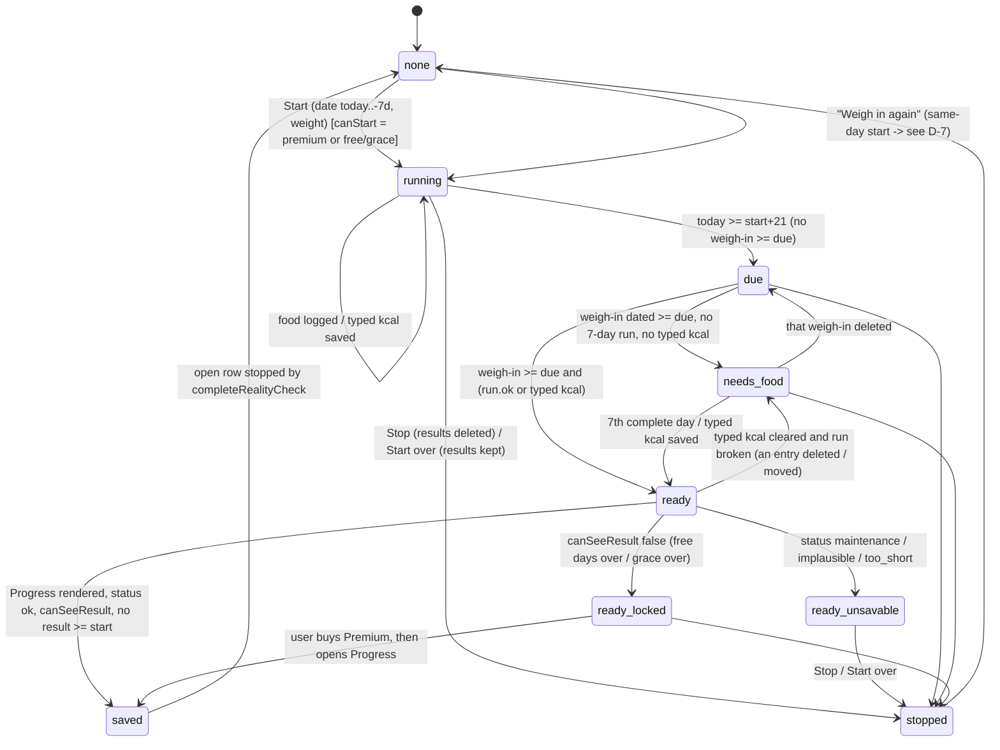
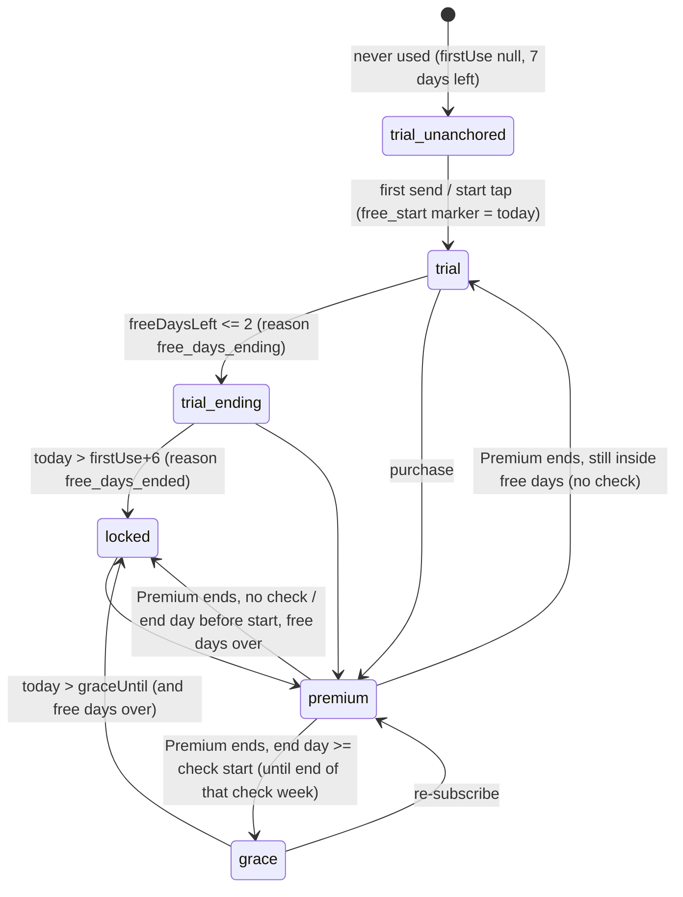
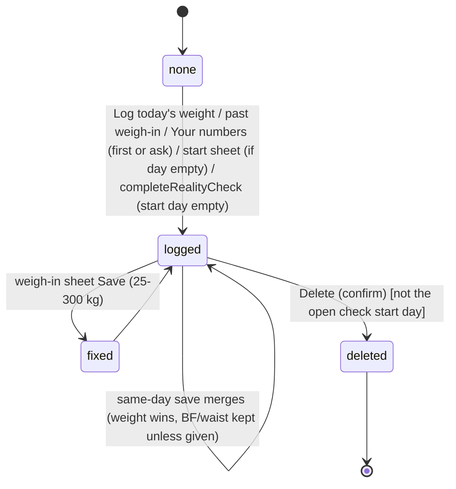

# Dossier 04: AI food log, reality check ("Seus números reais"), Progress / Your numbers, weigh-ins

> **Verified 2026-10-12 — corrections applied from docs/product/verification/04; where this dossier and the verification disagree, the verification wins.**
>
> Corrections applied in this file (each marked "[Corrected 2026-10-12]" where it sits):
> 1. **Stop is wider than described (G-8, Stop row).** The Stop link is also rendered **with no check open** — on the result view (`CalculatorSection.js:1531`) and in the locked branch when results exist (`:1475`) — and one tap there tombstones the whole measured history (`:946`). The PT copy "Isso apaga seus números reais" reads as ending the feature, not as deleting every earlier result.
> 2. **D-7 (`checkSaved`)**: any new start **on or before** the saved weigh-in date W hides the next check (reproduced: start on W / W−3 hidden, W+1 visible). The 20:00 question has no day-21 cut-off, so it runs until Stop. `__tests__/journeyProgress.test.js:190-196` pins the buggy predicate by regex; the fix must change that test in the same change.
> 3. **D-8 is CONFIRMED** (deterministic code, `startRealityCheck` `:899-924`), not suspected.
> 4. **D-11 is CONFIRMED with the right fixture:** the tile and the hero disagree when `weightAt` is **before** the newest weigh-in (tile 2780 vs hero 2680 kcal); with `weightAt` on/after it they agree (2780 / 2780).
> 5. **Quota on retry (§9 "Offline") is CONFIRMED and has no self-healing:** `parse-food` counts per `entry_date` (`index.ts:161-171`) and a pending row's date never changes, so "retry after local midnight" keeps hitting the full counter forever; a given date's counter never resets (only a new date starts at 0). Of the server caps, only "25 parses per day" is in the ledger (decisions.md:251; follow-ups don't count, FL-21) — the 25-follow-up cap and the 60 / 24 h ceiling are unapproved builder choices (verification/07 X-09).
> 6. **`too_short` (R-R5, §9 item 11):** "< 14 days" is unreachable — the result weigh-in is always ≥ day 21; only an average of 0 kcal (all "I ate nothing") reaches it, and `maintenance` is tested before avg ≤ 0. The `cal_rc_too_short` copy ("weigh-ins at least 14 days apart") is therefore wrong for its only cause; `cal_rc_implausible` says "implausibly low" even for a high value (tdee 5,600).
> 7. **Past weigh-in date:** not "no lower bound" — the wheel stops 10 years back (`wheelPick.js:16`).
> 8. **D-9 (three day counts):** `FoodGraceNote` never renders in `CalculatorSection`; on a phone Progress shows two counts (identical until a ≥ 7 run exists); all three appear together only in the Fold book layout.
> 9. **Automatic finish** runs only inside Progress (`CalculatorSection.js:855-859`): Today and Journey can say "ready" for days and nothing is saved until Progress is opened (verification/07 K-05). A lapsed payer in grace gets `canStart` and `canSeeResult` = true (reproduced S7), against AD-14 (DV-101).
> 10. **New findings:** saving "Fix this entry" with every item cleared deletes the entry without asking (`FoodEntryEditor.js:86`); the A-118 founder decision (2026-10-09) is only in `features.md:258`, not in `docs/decisions.md`; `nutri_run_rule` contradicts FL-47 and is unused, and `cal_rc_start_weight`, `cal_rc_rate_*`, `cal_rc_why_*` are unused strings; the day-21 tap (`focus:'reality'`) only scrolls, only `focus:'weighin'` opens the sheet; the weekly check-in tap opens Progress (A-44), while decisions.md:132 still says Body.

- Written 2026-10-12 from branch `redesign/graduated` (HEAD 4dade55, A-118). Code was read only, nothing was changed.
- Sources read in full: `lib/realityCheck.js`, `lib/realityCheckRules.js`, `lib/realityCheckNow.js`, `lib/realityCheckStore.js`, `lib/nutrition.js`, `lib/foodThread.js`, `lib/foodLogActions.js`, `lib/nutritionClient.js`, `lib/numbersWeight.js`, `lib/weighInAccess.js`, `lib/weighInEdit.js`, `lib/progressCard.js`, `lib/progressTile.js`, `lib/activityLevels.js`, `lib/bodyProfile.js`, `lib/energyCalc.js`, `lib/foodEntryDay.js`, `lib/localDate.js`, `supabase/functions/parse-food/index.ts`, `screens/FoodChatScreen.js`, `screens/ProgressScreen.js`, `screens/components/FoodLogHero.js`, `screens/components/FoodGraceNote.js`, `screens/components/FoodEntryEditor.js`, `docs/specs/food-log.md`, `docs/specs/progress-one-card.md`.
- Sources read in the relevant parts: `screens/components/CalculatorSection.js` (lines 1–1640, sheets skimmed), `screens/TodayScreen.js` (alerts, refresh, hero), `screens/JourneyScreen.js`, `lib/database.js` (food / calc / reality sections), `lib/schema.js`, `lib/notifications.js` (check-in, day-21, 8 PM, closeFoodDay), `lib/notificationPlan.js`, `lib/notificationActions.js`, `lib/sync.js`, `lib/syncCore.js`, `lib/syncMappers.js`, `lib/entitlement.js`, `supabase/functions/send-reminders/index.ts`, `supabase/migrations/20260928000000_reality_check_open_calc_inputs.sql`, `docs/decisions.md` (Journey/Progress/Reality check/food log, Premium, AI rules, Conflicts, the 2026-10-08 FL-48 lines), `docs/review/features.md` (domain rows), `docs/nutrition-logger-conversation-spec.md`, `docs/data-safety-tables-spec.md`, `__tests__/rcWeighInAlert.test.js` and the regex tests that pin `checkSaved`.
- Marking used below: **CONFIRMED** means the code path was read end to end and the behaviour follows from it. It was not run on a device unless that is said. **SUSPECTED** means it depends on a runtime condition (timing, sync order, a second device) that was not reproduced. **UNVERIFIED** means it was not checked.

---

## 1. Purpose

- The founder's chain (2026-09-27, `docs/decisions.md:213`, header of `docs/specs/food-log.md:4`): **food log → reality check → Your goal**.
  - The AI food log captures what the person really eats.
  - The reality check turns 21+ days of weight change plus 7 days in a row of real intake into a **measured maintenance** (daily burn).
  - That measured number becomes the hero "Daily burn" and rebases Lose / Maintain / Gain in "Your daily plan". The code calls this "Your goal" in the specs. The string `cal_overview_title: 'Your goal'` exists but no screen uses it (grep). On screen it is `hy_daily_plan` "Your daily plan" (`CalculatorSection.js:1261-1314`, `effectiveGoals` at `:1022-1026`).
- It is a **retention engine**: a daily habit that brings the user back, not a one-off calculator (`food-log.md:4`, memory `food-log-retention-engine`). The 8 PM question, the Today hero and the Today alert exist for that daily return.
- Regulatory frame: it never advises, never interprets, and never links food or weight to a compound (`parse-food/index.ts:7-13,50-51`, `CalculatorSection.js:22-27`, AI hard line in `decisions.md` "AI rules").
- Two other "goal" concepts exist and must not be confused with "Your goal":
  - Profile goals: `lib/profileGoals.js`, the onboarding / Settings multi-select (fitness, fat_loss…). They feed no math.
  - "Your target": `calc_targets`, a weight and/or body-fat target with an ETA.

---

## 2. Screens and entry points

| Surface | File | How the user gets there |
|---|---|---|
| **AI food log chat** (`FoodChat` modal route; embedded on the Journey right page in book layout) | `screens/FoodChatScreen.js` | Today's `FoodLogHero` (`TodayScreen.js:2174`, only while a check is open); Journey's `FoodLogHero` (`JourneyScreen.js:149-160`, always; in book layout the tap is re-routed to the right page, `:79-87`); the 8 PM notification body → `{eveningDay, nonce}`, its "Log it" button → `{logIt}`, its "Nothing else today" button → no navigation (`notificationPlan.js:145-154,160-172`); route registered at `App.js:238` |
| **Paywall** from the food log | `FoodLogHero.js:85` (locked), `FoodChatScreen.js:720` (locked card), `FoodGraceNote.js:45` | Tap while `access.canLog === false`, or the grace / free-days-ending note |
| **Progress** (one card + daily plan + reality check card) | `screens/ProgressScreen.js` → `screens/components/CalculatorSection.js` | Journey "Progress" tile (`JourneyScreen.js:163-199`); Today reality-check alert → `navigate('Progress', {focus:'reality'})` (`TodayScreen.js:1498`); day-21 notification `reality_check` → `{focus:'reality', nonce}`; weekly check-in notification `checkin_reminder` → `{focus:'weighin', nonce}` (`notificationPlan.js:182-185`). On a book page, `focus` is dropped (`ProgressScreen.js:65`). Whether a focus tap from a notification reaches the embedded page is UNVERIFIED (A-116 is not started). |
| **Today reality-check alert** | `TodayScreen.js:1478-1501` | Shown while an open check exists and is not snoozed. Snooze offers Tomorrow / In 3 days (`:489-495`). There is no Remove; `today_alert_rc_remove_*` strings are unused (dead). |
| **Today food hero** | `FoodLogHero variant="today"` | Only while a check is open (`todayFoodHeroPolicy`, `foodThread.js:297-304`; `FoodLogHero.js:63`) |
| **Journey food hero + Progress tile** | `JourneyScreen.js:142-199`, `lib/progressTile.js` | Journey tab |
| **Fix this entry** sheet | `screens/components/FoodEntryEditor.js` | Tap an entry card in the chat (`FoodChatScreen.js:565`) |
| Sheets inside Progress | `CalculatorSection.js` (sheets after `:1640`) | Start sheet (`openRcStart`), typed calories (`openTypedKcal`), Log today's weight (`openWeighIn`), past weigh-in (backfill), weigh-in fix/delete (`openWeighInEdit`), target, DTSheet confirms (Start over, Stop, Remove target, Update your weight, Delete weigh-in), "See how it works" (`rcExplain`) |
| Food-log reminder switch | `NutritionLogger.js:87-120` `FoodReminderRow` (inside the open check card, `CalculatorSection.js:1509`) and Settings | writes `user_metadata.food_reminders` |

---

## 3. User actions: writes and side effects

### 3.1 Food log

| Action | Code | Writes | Side effects |
|---|---|---|---|
| Open chat | `FoodChatScreen.js:125-152` | `loadFoodAccess` may insert a `free_start` marker from the earliest typed day (old users) (`foodLogActions.js:196-197`) | `catchUpFood` re-parses this device's pending rows and offline follow-up answers (`foodLogActions.js:130-160`); `syncFoodLogReminder` on every `refresh` (`FoodChatScreen.js:119`) |
| Send a message | `onSubmit` `:334-425` | `ensureFreeStart` (marker `free_start` today, if none, `:362`); `insertFoodLog` pending row with `entry_date = logDay || localISO()` and raw_text (`:363`); after the parse: `saveParsed` updates that row and inserts one more row per extra day eaten, all items sharing one `msg` id (`foodLogActions.js:48-64`) | AI consent sheet first (`:351-354`); AsyncStorage `LOCAL_PENDING_KEY` marks "typed here" (`:364`); the asked item gets `ask` + `asked:true`; `requestSync` |
| — refusal | `:376-380` | pending row **deleted** (tombstone), text put back in the box | deflection card |
| — nothing readable | `:381-385` | row deleted, text put back | "fix" hint |
| — all items > 7 days back | `:389-395` | row deleted, text put back | `too_old` notice |
| — some items > 7 days | `:408` | recent part saved; the **full** text put back | `too_old_some` |
| — quota 429 | `:415-418` | row deleted, text put back | `nutri_quota` |
| — offline / server error | `:419-424` | row kept `pending` | "saved offline" only when NetInfo says offline (FL-46), else "retry"; retry after 20 s or on reconnect (`:157-175`) |
| "That's it" typed (6 languages) | `isDoneText` (`nutrition.js:296-299`) → `closeDay` | `day_closed` marker (via `closeFoodDay`, `notifications.js:733-745`) | cancels that day's 8 PM alarm, re-plans; an open follow-up is marked `ask_skipped` |
| Close a day **with no food** | `closeDay` `:313-321` | the sheet offers Cancel / "Just close the day" / "I ate nothing" → `day_closed` (+ `ate_nothing` marker on the third choice, `foodLogActions.js:172-175`) | FL-47: only `ate_nothing` makes it a 0-kcal day that counts |
| Bare "no" | `isNoText` | skip the open follow-up, or move to the next question | the day stays open |
| "Another one" with nothing logged today | `mustAskWhichEarlier` (`nutrition.js:323`) | nothing | "which earlier?" notice (no AI call) |
| Answer a follow-up | `answerFollowup` `:428-452` → `applyAnswer` (`foodLogActions.js:96-111`) | replaces ONLY the asked item and the row totals; `ask_done` is recorded | offline → `ask_pending` saved on the item and retried; refused or dropped → `ask_skipped` |
| Skip follow-up | `:454-461` | `ask_skipped:true` | next day question |
| Fix an entry | `FoodEntryEditor.js:81-90` | `updateFoodLog` items / totals / `entry_date` (Today / Yesterday / 2–7 days ago) | a changed item becomes `confidence:'user'` and its open follow-up is dropped (`nutrition.js:491-507`) |
| Remove an entry | `FoodEntryEditor.js:91`, chat `confirmRemove` / `removeRow` | tombstone (`deleteFoodLog`) | **The editor's "Remove entry" has no confirm** (the chat's pending / unparsed remove does ask, `:463-469`) |
| 8 PM "Nothing else today" (notification button) | `notificationActions.js:119-130` | `day_closed` marker, without the ate-nothing question (accepted deviation FL-47) | `notifyDataChanged('food_logs')` |
| Evening bubble: Log it / Nothing else / I'll eat later | `FoodChatScreen.js:649-661` | Log it sets `logDay` (entries land on that day); the others close the day or dismiss | — |
| Food-reminder switch | `NutritionLogger.js:98-107` | `user_metadata.food_reminders` | `syncFoodLogReminder` |

### 3.2 Reality check

| Action | Code | Writes | Side effects |
|---|---|---|---|
| Start (sheet: date today … 7 days back, start weight) | `startRealityCheck` `CalculatorSection.js:885-911` | `ensureFreeStart` (the real tap day, FL-41 × FL-44); a calc_snapshots row on the start day **only if that day has no weight yet** (`:893-898`); `setRealityStart` → `reality_check_open` row (or the weight is updated if the same start day is already open; a different day stops the old row first) + mirror `user_metadata.calc_reality_open` (`realityCheck.js:110-123`) | arms the day-21 reminder and the 8 PM reminder |
| Type average calories (FL-48) | `saveTypedKcal` `:990-999` | `calc_inputs.payload.rcTypedKcal = {start, kcal}` merged (`realityCheckRules.js:110-112`, `realityCheck.js:187-202`) | — |
| Clear typed calories | same, `kcal=null` | `rcTypedKcal: null` | — |
| Automatic finish (no button) | effect `:855-859` → `completeRealityCheck` `:958-979` | start-day snapshot if missing; `upsertRealityCheck` (entry_date = the weigh-in date, `tdee`, `rate_per_week_kg`); `calc_inputs.rcResultSources[date] = 'food' / 'typed'`; `clearRealityStart` (stopped_at set) | both reminders re-planned (cancelled). [Corrected 2026-10-12: runs only while Progress is mounted — nothing is saved until Progress is opened.] |
| Start over (confirm) | `resetRealityCheck` `:915-921` | open row → stopped; mirror null | results kept; reminders cancelled |
| Stop (confirm) | `:937-953` | open row → stopped; **every `reality_checks` row tombstoned** (`clearRealityChecks`, `database.js:579-583`) | measured history gone, the daily burn goes back to Estimated; food logs and weigh-ins kept; `rcResultSources` and `rcTypedKcal` stay orphaned in the payload. [Corrected 2026-10-12: the Stop link is also shown with no check open (result view `:1531`, locked branch `:1475`) and wipes the history there too.] |
| "Weigh in again in 21 days" (after a result) | `:1538-1540` → `openRcStart` | as Start | see the §6 divergence D-7 |

### 3.3 Weigh-ins / Your numbers

| Action | Code | Writes | Notes |
|---|---|---|---|
| Log today's weight | `saveTodayWeighIn` `:569-592` | merge into today's `calc_snapshots` row (`mergeWeighIn`, `weighInAccess.js:17-28`); the weight / BF / waist become the Your numbers values with `weightAt = today` | only checks "is a number". **No 25–300 kg range** (the edit sheet has one) |
| + Add a past weigh-in | `saveBackfillWeighIn` `:653-669` | merge into that day's row | date clamped to ≤ today (`clampPast` `:671`), **no lower bound, no range check** [Corrected 2026-10-12: the wheel has a 10-year floor, `wheelPick.js:16`; the weight range check is still missing] |
| Fix a weigh-in | `saveWeighInEdit` `:689-701` | `correctCalcSnapshot` in place (`weighInEdit.js:60-71`); if it is the start day of the open check, `setRealityStart` moves the start weight (`checkStartPatch`) | validation 25–300 kg / 3–70 % / 30–250 cm (`weighInEdit.js:11,31-45`). **Does not update the Your numbers weight** (see D-10) |
| Delete a weigh-in | `deleteWeighInNow` `:702-710` | every live row of that day tombstoned (`weighInEdit.js:74-80`) | the open check's start day is refused (UI + `deleteWeighIn` throws) |
| Change the weight in Your numbers | `commitWeightField` `:487-522` + `weightEditAsk/Write` (`progressCard.js:107-137`) | no weigh-ins yet → it becomes the first weigh-in (PO-17); with weigh-ins → sheet "Update the <date> weigh-in" / "Save as today's weigh-in" / Cancel (only Update when the latest is today) | Cancel or a tap outside reverts the field |
| Other Your numbers fields (height, age, BF, BF source, waist, unit, goal) | debounced full-state save `:380-387` (0.9 s) | `calc_inputs` payload merged (`oneCard:1`, `legacyBurn`, `weightAt`…) + mirror `user_metadata.calc_inputs` | values stored canonical ("86.5") |
| Sex | `saveProfileSex` `:458-463` | `user_metadata.gender` | the profile is the only source for sex / age (`bodyProfile.js:6-15`) |
| Activity | `chooseActivity` `:403-412` | state + stamp `activitySetAt` (in the payload) + `user_metadata.activity_level / activity_scale:5 / activity_set_at` (+ `activity_level_legacy`) | the newest stamp wins (`activityLevels.js:63-76`) |
| Target set / edit / remove | `:610-648` | `calc_targets` | start_* captured once |

---

## 4. Business rules (numbered, with sources)

**Food log**
- **R-F1** The chat thread is rebuilt from stored `food_logs` rows only. The follow-up state lives on the items (`ask`, `ask_skipped`, `ask_pending`, `ask_done`) (FL-35, `foodThread.js:1-7,113-179`).
- **R-F2** One message = one bubble. A multi-day catch-up is split into one row per day eaten, sharing a `msg` id (FL-38, `foodLogActions.js:48-64`, `nutrition.js:183-194`). Legacy rows are grouped by the same text typed within 2 min (`foodThread.js:49-64`).
- **R-F3** Catch-ups up to 7 days. An item's `days_ago` wins over the message's. Anything > 7 days is not logged and the typed text comes back (FL-2/45, `nutrition.js:159-177`). Offline rows that turn out too old stay as `too_old`, removable (`foodLogActions.js:82-83`).
- **R-F4** After each entry dated today, ONE question per missing category, in the order meal → snack → drink → supplement → "more". Tense: past from 19:00 (`nutrition.js:202-238`). None once the day is closed. A question is resumed on reopen only while it still applies (`foodThread.js:190-195`). Asked ids are stored per device (`dosetrace_food_asked`).
- **R-F5** Only explicit phrases close a day. A bare "no" never does (FL-6/29, `nutrition.js:245-304`).
- **R-F6** A day closed with no food breaks the run unless "I ate nothing" is confirmed (FL-47, `FoodChatScreen.js:313-321`, `nutrition.js:92-94`).
- **R-F7** The AI never writes sentences. Only `food` ≤ 60 chars, `unit` ≤ 16, options ≤ 40 × 4 (FL-16, `parse-food/index.ts:89-115`, `nutritionClient.js:16-23`).
- **R-F8** Refusal (advice-shaped) → fixed deflection, text kept (FL-15).
- **R-F9** Quotas (server, `parse-food/index.ts:27-30,155-183`): 25 parses per user per `entry_date` (the client's local day); 25 follow-ups per `entry_date`; a 60 / rolling-24 h hard ceiling across both kinds. The slot is reserved BEFORE the model call (refusals and provider errors count). A counting error fails open. Model: `claude-haiku-4-5-20251001`, max_tokens 1024. raw_text is never logged.
- **R-F10** Offline-first: the row is saved `pending` before the call. Only rows typed on this device are re-parsed (a per-device key list), so there is no double AI read (FL-19, `nutrition.js:391-395`).
- **R-F11** Fat is stored, not shown (FL-17).
- **R-F12** Auto-close after 30 s idle with the keyboard down, or on background. Never with text in the box, while sending, with a sheet or alert open, or with a screen reader on. Never when embedded (FL-32/36, `foodThread.js:202-213`, `FoodChatScreen.js:207-222`).
- **R-F13** The thread shows typed days of the last 7 days (`THREAD_DAYS = 7`, `FoodChatScreen.js:56`). Rows loaded: last 366 days.

**Food access (FL-41)** (`foodThread.js:249-269`, `foodLogActions.js:187-208`)
- **R-A1** Premium → `mode:'premium'`, can log.
- **R-A2** Free: 7 days from `firstUse` = the earliest `free_start` marker. Without a marker, the earliest typed day is used and persisted (`freeStartDay`, `:275-280`). The marker is written on the first send or the start tap (`ensureFreeStart`), never on a backdated start date. A user who never used it is `trial` with 7 days left and `until=null`.
- **R-A3** The last 2 free days → `reason:'free_days_ending'` (the note + paywall CTA).
- **R-A4** Lapsed payer (`premiumEndedOn` from the entitlement cache): grace until the end of the check week (days 1–7 / 8–14 / 15–21…) that contains the end day, only if the end day is on or after the check start. Or the remaining free days if those run later. Never "free days" wording.
- **R-A5** Locked → the hero says locked and goes to the Paywall; the chat shows the locked card; no 8 PM alarms (`remindersForAccess`, `notificationPlan.js:124-128`).
- **R-A6** **Enforced only on the client.** `parse-food` checks auth and quota but has **no entitlement / free-days check** (`index.ts:117-183`). See gap G-1.

**Reality check**
- **R-R1** Start date: today … 7 days back, a real calendar day, never in the future (FL-44, `realityCheckRules.js:6-29`). The start sheet prefills the weight from that day's weigh-in, never over a typed value (`:41-47`).
- **R-R2** The weigh-in date is start + 21 calendar days (`REALITY_CHECK_DAYS = 21`, `notifications.js:604`).
- **R-R3** The result uses the FIRST weigh-in on or after the due date (never a later one) (`realityCheckRules.js:66-68`).
- **R-R4** Intake = the most recent run of ≥ 7 consecutive complete days. Days counted: start … yesterday, plus today once closed. Complete = a `done` food row, or closed + `ate_nothing`. A "not recorded" day breaks the run (FL-3, `nutrition.js:86-116`). Else the typed average (500–10,000 kcal, FL-48, `realityCheckRules.js:92-108`). Both present → the food run is used and the typed value is kept (`typedKept`).
- **R-R5** Math: `tdee = avgKcal + (startKg − weighInKg) × 7700 / days` (`energyCalc.js:261-268`). Status: `too_short` (< 14 days or avg ≤ 0 [Corrected 2026-10-12: < 14 days is unreachable, days ≥ 21; maintenance is tested first]), `maintenance` (|Δ| < 0.2 kg), `implausible` (outside 1000–5000), `ok`. Only `ok` is saved. Weekly rate = Δ / days × 7.
- **R-R6** Finishing is automatic on Progress when the state is `ready`, the status is `ok`, the user may see results (`premium || access.canLog`), and no result exists dated on or after the start (`CalculatorSection.js:852-859`).
- **R-R7** Results: one `reality_checks` row per weigh-in date. The latest one is the "Measured" daily burn. Goals are rebased through the floored engine (`goalsForTdee`, floor = max(BMR, 1200 F / 1500 M)) (`energyCalc.js:82-97`).
- **R-R8** Stop wins across devices (`stopped_at` never cleared: client `syncMappers.js:165`, `syncCore.js:470-474,623-624`; server trigger `reality_check_open_keep_stop`, migration `20260928…sql:74-83`).
- **R-R9** Access: starting and seeing the result = Premium or `access.canLog` (free days **or grace**). Logging the weigh-in of a running check is always allowed (`weighInAccess.js:9-12`, FX-15).
- **R-R10** The typed-calories link shows only when `rcAllowed` (Premium or free days / grace) (`CalculatorSection.js:1464-1483`). The ledger says "Premium-only" (`decisions.md`, 2026-10-08 FL-48 "A"). See D-14.
- **R-R11** The 8 PM question runs daily while a check is open, with no day-21 cut-off (FL-42), skips closed days, and is limited to the days the user can log (`notifications.js:664-728`, `notificationPlan.js:109-128`). It is a rolling set of 7 one-shot alarms at 20:00, topped up on every app open and every sync (`App.js:586-596`). Off switch: `food_reminders`.
- **R-R12** Day-21 reminder: one notification at 10:00 local on start + 21. None once that time has passed (the Today alert covers it) (`notifications.js:609-642`).

**Progress / Your numbers**
- **R-P1** The daily burn needs weight + height + age + sex (the profile sex, never the default). Body fat only sharpens it (Katch-McArdle when known, else Mifflin). Existing users keep a weight + BF burn (`legacyBurn`, PO-12/13, `progressCard.js:34-68`).
- **R-P2** Inputs in range: age 10–120, height 100–250 cm, weight 25–300 kg, BF 3–70 % (`energyCalc.js:174-189`). Out of range → "check inputs".
- **R-P3** Age and sex come from the profile only. The age field is locked while `birth_year` exists (`bodyProfile.js`).
- **R-P4** One activity answer: the newest stamped side wins (profile `activity_set_at` vs calc `activitySetAt`). Unstamped → the profile wins. Default 1.375 when none (`activityLevels.js:63-76`, `progressTile.js:50`).
- **R-P5** A-101e: the Your numbers weight adopts the newest weigh-in unless the weight was typed on that day or later (`numbersWeight.js:6-16`, effect `CalculatorSection.js:390-398`).
- **R-P6** Weigh-ins are never paywalled. One row per local day, merged per field, never null over a stored value (A-53, FX-15).
- **R-P7** The target ETA needs a weigh-in series spanning ≥ 14 days and a rate ≥ 0.1 / week. The measured ETA is Premium (`CalculatorSection.js:772-787,1138`).
- **R-P8** The weekly check-in notification: Sunday 10:00 (`weekday:1`), unless `checkin_reminders === false` (`notifications.js:567-597`). A tap opens "Log today's weight" (`CalculatorSection.js:1060-1064`).

---

## 5. States and transitions

### 5.1 Reality check

Owner of the shared state: `checkOutcome` (`realityCheckRules.js:62-84`) over `{start, snapshots, run, typedKcal, todayISO}`. The open check comes from `getRealityStart` → `displayOpenCheck` (`realityCheckStore.js:113-122`). Exact conditions:

| State | Condition (code) |
|---|---|
| `none` | no open check: `currentOpenCheck(rows)` is null, and (migrated and pulled once) or no legacy / mirror value |
| `running` | open, no snapshot with `weightKg` and `date >= dueISO`, and `todayISO < dueISO` |
| `due` | open, no such snapshot, `todayISO >= dueISO` (stays open indefinitely, FL-42) |
| `needs_food` | a snapshot ≥ due exists, `!run.ok`, and no valid typed kcal for this start date |
| `ready` | a snapshot ≥ due exists and (`run.ok` or typed kcal). Sub-status from `realityCheckTDEE`: `ok` / `maintenance` / `implausible` / `too_short` |
| `saved` (UI) | after `completeRealityCheck`: a `reality_checks` row is written and the open row is stopped → the check is `none` again, Progress shows the result branch (`scoreCheck`) |
| `stopped` | the open row has `stopped_at`. Via Stop (results deleted) or Start over (results kept) |
| `ready-locked` | `ready` + `ok`, but `canSeeResult` is false → never saved; the check stays open (FL-41) |
| `ready-unsavable` | `ready` with status ≠ `ok` → never saved; Progress shows `cal_rc_<status>`; it stays open until Stop or Start over |
| `hidden-by-checkSaved` | open, but a `reality_checks` row dated ≥ start exists → Progress shows the result branch and never finishes this check (see D-7) |

### 5.2 Food day (one local day `d`, as `intakeRun` sees it)

| State | Condition |
|---|---|
| `empty` | no non-marker row with `entry_date = d` and no markers |
| `pending` | only `pending` rows (offline / retry). Not complete (`intakeRun` counts `parse_status === 'done'` only, `nutrition.js:88`) |
| `partial` (open) | ≥ 1 `done` row, no `day_closed`. **Counts as complete for a past day** (`fed.has(d)`). Today counts only once closed (`:97-98`) |
| `closed` | `day_closed` marker + food → complete |
| `closed-empty` | `day_closed`, no done food, no `ate_nothing` → breaks the run |
| `closed-ate-nothing` | `day_closed` + `ate_nothing` → complete, 0 kcal |
| `not_recorded` | a `not_recorded` marker and no food → breaks the run. **No code path writes this marker any more** (grep: `insertFoodDayMarker` is only called with `day_closed` / `ate_nothing` / `free_start`); it is read for legacy rows only. See G-4 |
| `refused / unparsed / too_old` only | not food (`done` required) → incomplete. A close does **not** ask "ate nothing" because `hasFood` counts any non-marker row (`FoodChatScreen.js:313`). See D-16 |

```mermaid
stateDiagram-v2
    [*] --> empty
    empty --> pending: message sent offline / server error
    pending --> partial: catch-up parse ok
    pending --> refused_unparsed_too_old: parse refusal / nothing / >7d
    empty --> partial: message parsed (done)
    partial --> closed: "That's it" / Day done chip / 8 PM "Nothing else"
    empty --> closed_empty: Just close the day / 8 PM "Nothing else"
    empty --> closed_ate_nothing: close + "I ate nothing"
    closed_empty --> closed: food logged later for d (catch-up / Log it)
    closed --> closed: more food for d (still allowed)
    refused_unparsed_too_old --> closed_empty_like: close (no ate-nothing question asked)
    partial --> empty: every entry removed
    note right of partial: past day = complete; today complete only once closed
```

### 5.3 Food access

Exact code: `foodLogAccess` (`foodThread.js:249-269`). `mode ∈ premium | trial | grace | locked`, plus `canLog`, `until`, `graceUntil`, `reason`, `freeDaysLeft`, `freeFrom`. If the access read fails, the chat is **not gated** (`gated = !!access && !access.canLog`, `FoodChatScreen.js:502`), Progress gets `rcFree=false`, and the reminders keep their plan (lenient, `notifications.js:704`).

### 5.4 Weigh-in (a calc_snapshots day row) relative to the open check

| State | Condition |
|---|---|
| `none` | no row with a weight for day d |
| `start-weigh-in` | d = open check start → can be fixed, not deleted; a fix moves `start_weight_kg` |
| `pre-due` | start < d < due → stored, ignored by the check |
| `result-weigh-in` | the first d ≥ due → drives `needs_food` / `ready` / result |
| `later` | a later d ≥ due → ignored by the check (feeds the chart / target only) |
| `deleted` | tombstone; if it was the result weigh-in, the next one ≥ due becomes the result (before saving) |

The Your numbers weight-change sheet (`weightEditAsk`): no weigh-ins → `first`; same value (< 0.005 kg) → `none`; otherwise `ask` with `update` (+ `today` when the latest is not today).

---

## 6. STATE OWNERSHIP AUDIT

Every derived value, every place that computes or decides it, and the divergences. "Owner" means the pure function intended as the single source.

### 6.1 Reality-check state (running / due / weighed / ready)

| # | Place | Computation | Reads |
|---|---|---|---|
| 1 | `realityCheckRules.checkOutcome` (`:62-84`) | **owner** | start, snapshots, run, typed |
| 2 | `realityCheckNow.readCheckNow` (`:12-31`) | calls #1 (Today alert + food hero) | `getRealityStart`, `getCalcSnapshots`, `getFoodLogsSince(start)`, `getCalcInputs` |
| 3 | `CalculatorSection` `outcome` (`:839-842`) | calls #1 with its **own copies**: `rcStart` (loaded once, `:299-304`), `snapshots`, `foodRows` (last 366 days), `rcInputs` | screen state |
| 4 | `checkAlert` (`realityCheckRules.js:126-132`) → Today alert (`TodayScreen.js:1487-1492`) | from #2 | — |
| 5 | Today alert fallback (`TodayScreen.js:1483-1488`) | `now >= noon(start+21)` when `rcNow` is null | date only |
| 6 | `todayFoodHeroPolicy.weighInDue` (`foodThread.js:297-304`) used in `FoodLogHero.js:73` | `day > 21` (date only), then refined with `checkState` from #2 | date + #2 |
| 7 | Progress status line (`CalculatorSection.js:1439`) | `outcome.state === 'due' ? cal_rc_due : "In progress · weigh in {date}"` | #3 |
| 8 | `syncRealityCheckReminder` (`notifications.js:609-642`) | schedules start+21 at 10:00 whenever a check is open | open check only |
| 9 | `syncFoodLogReminder` | "open" = any open check | open check only |
| 10 | server `send-reminders` (`index.ts:153-161`) | open = `stopped_at is null` (inactive, `SERVER_PUSH_ACTIVE=false`) | server table |
| 11 | `checkSaved` (`CalculatorSection.js:852-853`) | `realityLog.some(c.date >= startISO)` | results |

**Divergences**
- **D-1 CONFIRMED: Progress's own status line ignores "weighed in" (the A-118 class, not fixed by A-118).** `CalculatorSection.js:1439` checks only `'due'`. In `needs_food` and `ready` (weigh-in done) it says "In progress · weigh in {date}", with a date that is already past. Meanwhile Today (#4) says "Weight logged — N more days…" and the hero says "weight logged". The A-118 commit (4dade55) did not touch CalculatorSection. The same lines show in the free / locked branch (`:1468`).
- **D-2 CONFIRMED: the day-21 notification fires after the weigh-in.** #8 schedules from the start date alone and is not re-planned on a weigh-in save (`saveTodayWeighIn` does not call it). Someone who weighs in on day 21 before 10:00 and still lacks the food run (`needs_food`, so the check stays open) gets "Time to log your weight and finish your reality check" at 10:00 (`notif_rc_body`).
- **D-3 CONFIRMED: Today says "ready — tap to see it" when Progress will not show a result.** `checkAlert` returns `ready` for every `ready` outcome. The result is not shown or saved when (a) the status is `maintenance` / `implausible` / `too_short` (Progress shows `cal_rc_<status>`, `:1444-1445`, and the check never closes), or (b) `canSeeResult` is false (free days over, grace over): Progress shows the locked explainer. The alert stays "ready" until Stop or Start over. The hero says "weight logged" in both cases.
- **D-4 SUSPECTED: Progress's `rcStart` is stale.** `getRealityStart` runs only on the first load (`loadedRef` return at `:299` precedes `:303`). A Stop or a new check pulled from another device, or a migration that completes after mount, is not reflected while CalculatorSection stays mounted (e.g. the book-layout right page). Today re-reads on every focus and sync (`TodayScreen.js:407-420`), so Today and Progress can disagree. CalculatorSection also has **no sync listener**: snapshots, results and food rows refresh on focus only.
- **D-5 SUSPECTED: midnight.** `outcome` / `foodRun` memos call `todayISO()` but depend only on data arrays. A Progress screen left open across midnight keeps `running` (or a stale run) until a refocus. `FoodLogHero` likewise computes on focus only, and Today's `refreshIfNewDay` (`TodayScreen.js:361-372`) does not re-run the hero's effect, so "Today: N items" can show yesterday's numbers after midnight.
- **D-6 CONFIRMED, minor: time-of-day flips differ.** Rules: due from local 00:00 of start+21. Today fallback: from 12:00 (`TodayScreen.js:1483-1485`, only when `readCheckNow` failed). Notification: 10:00. Hero: date at 00:00.
- **D-7 CONFIRMED by reading (not run): the next check can be hidden and never finish.** After a result saved on weigh-in date W, "Weigh in again in 21 days" opens the start sheet on today. If today = W (the normal case: the result is saved the moment the user logs the weigh-in on Progress) or the start is backdated to ≤ W, then `checkSaved = realityLog.some(c.date >= start)` is true for the NEW check. Effects: Progress shows the result branch instead of "in progress" (`:1477`); the typed-calories link is blocked (`openTypedKcal` returns, `:984`); the auto-finish never runs (`:856`). Meanwhile Today shows the alert and the hero, and the 8 PM and day-21 reminders run. Only regex tests pin these lines (`journeyProgress.test.js:190-196`). There is no behaviour test.
- **D-8 CONFIRMED [Corrected 2026-10-12; deterministic code]: an open check has two "start weights".** `reality_check_open.start_weight_kg` (typed in the start sheet) is written to that day's weigh-in only if the day had none (`:893-898`). If the user overrides a prefilled weigh-in, the check computes from the typed value while the Weigh-ins table and chart show the other. The ledger Q-A says the check uses the latest weigh-in for its start and final weight "with no weight fields of its own" (`decisions.md`, 2026-09-29). The code has its own field (part 9 start sheet). Which decision is current: UNVERIFIED.

### 6.2 Due date (weigh-in date)
Computed in 6 places: `checkOutcome` `shift(start,21)` (T12 local); `CalculatorSection.rcRemindOn` (`:826-831`, T12 + 21); `TodayScreen` `remind` (`:1483-1484`); `syncRealityCheckReminder` (T00 + 21, 10:00); `foodThread.weighInDay` (`:307`, FoodGraceNote); `todayFoodHeroPolicy` (`day > checkDays`). All give the same calendar date (noon anchoring avoids DST), with different flip times (D-6). The constant 21 is imported from `notifications.js:604` in Progress / Today / RC-now, but **hard-coded again** as `CHECK_DAYS = 21` in `FoodLogHero.js:27` and as the default `checkDays = 21` in `foodThread.js:297,307`.

### 6.3 Run days ("n of 7 in a row") and intake average
| Place | What |
|---|---|
| `nutrition.intakeRun` (`:86-116`) | **owner**: `ok`, `avgKcal` of the MOST RECENT ≥ 7 run, `current` = the trailing run |
| `checkSoFar` (`nutrition.js:465-484`) | re-derives the trailing run's days and its **own** average (`run.avgKcal` of the trailing `current` days) |
| `checkAlert.left` (`realityCheckRules.js:130`) | `7 − min(7, run.current)`, at least 1 |
| `FoodLogHero` `runShort` (`:68-69`) | `intakeRun` over rows since min(today, start, freeFrom) |
| Progress status (`:1446-1455`) | `foodRun.ok` → "≈ avg from d days", else "n of 7" |
| `FoodGraceNote` "food logged on {logged} days" (`:31`) | `periodTotals.loggedDays` = days with kcal > 0 (pending rows, 0-kcal "ate nothing" days and the completeness rule all ignored) |

- **D-9 SUSPECTED (presentation): three different "days" numbers.** [Corrected 2026-10-12: on a phone only two show — `FoodGraceNote` is not in Progress; all three only in the Fold book layout.] When the latest ≥ 7 run ended earlier and a shorter run follows, the status line says "≈ X/day from 9 days in a row", the "so far" footer says "2 days in a row ≈ Y kcal", and the grace note says "food logged on N days". All three are correct by their own definitions but show different counts on one screen.

### 6.4 Weighed-in
- `checkOutcome` (a weigh-in ≥ due) is the owner. Consumers: Today alert (#4), hero (`checkState`). **Not consumed** by the Progress status line (D-1) or the day-21 notification (D-2).
- `hasWeighIns` (`CalculatorSection.js:472`) means "any weigh-in ever" and drives PO-14. It is a different concept but a similar name.

### 6.5 Weight shown (current weight)
| Place | Rule |
|---|---|
| Progress hero `currentWeightKg` (`:750-755`) | the **latest snapshot by date** (even one without a weight); if its weight is null → the **typed** weight (not the previous weigh-in) |
| Your numbers line / field + TDEE input (`weight` state) | saved `calc_inputs.weight`, adopted from the newest weigh-in by `numbersWeight` unless `weightAt >= latest.date` |
| Journey tile `progressTile` (`:55-57`) | the latest snapshot **with** a weight, else saved weight |
| Target "current" | = hero `currentWeightKg` |
| Weigh-ins summary (`weighInsLine`) | the latest row by date; "—" if its weight is null |
| Start sheet prefill | the weigh-in on the chosen day (`weighInOn`) |

- **D-10 CONFIRMED by reading: the hero weight ≠ the TDEE weight after a same-day fix or a delete.** `saveWeighInEdit` (`:689-701`) and `deleteWeighInNow` (`:702-710`) refresh `snapshots` but not `weight`. `numbersWeight` then returns null whenever `weightAt >= latest.date`. Example: log today's 85 kg (`weightAt` = today), then fix today's weigh-in to 84 → the hero says 84 while Your numbers and the daily burn still use 85. Delete today's weigh-in → the hero falls back to the previous weigh-in while Your numbers keeps the deleted 85. This is the A-101e class, still open for these two paths.
- **D-11 CONFIRMED [Corrected 2026-10-12; reproduced: tile 2780 vs hero 2680 when `weightAt` is before the newest weigh-in]: the Journey tile's daily burn uses the saved weight, not the adopted weight.** `progressTile` passes `saved.weight` to `energyPlan` (`:43-52`) and does not apply `numbersWeight`. After a weigh-in synced from another phone, the tile shows the new weight with a daily burn computed from the old one, until Progress is opened and its debounced save writes the adopted weight back.
- **D-12 SUSPECTED, low: the hero vs the tile on a snapshot row without a weight** (legacy migrated rows can have `weight_kg` null): the hero uses the typed weight, the tile uses the previous weigh-in. The "Since" line: the card picks first / last of **all** snapshots (`:790-799`), the tile only weighed ones (`:58-60`).

### 6.6 TDEE / daily burn
| Place | Rule |
|---|---|
| `energyCalc.energyPlan` | **owner** of the formula |
| Progress `plan` (`:347-361`) | `energyPlan(weight state…)` gated by `dailyBurnGate`; hero = `scoreCheck.tdee` (the latest result) when one exists, else `plan.tdeeVal` (`:1192`) |
| Journey `progressTile` | same gate and same measured rule, from **saved** inputs (D-11) |
| `effectiveGoals` | `goalsForTdee(measured, {bmr, sex})` |
| `outcomeResult` (not saved) | `realityCheckTDEE` |

- Both the hero and the tile hide even a measured result when the formula gate fails (no plan → "—"). This is consistent between the two, but a user with a saved result who clears their height loses the visible measured number. Intent UNVERIFIED.

### 6.7 Food access
- Owner: `foodLogAccess` via `loadFoodAccess` (one helper). Consumers: `FoodChatScreen.js:128`, `FoodLogHero.js:43`, `CalculatorSection.js:220` (`rcFree = access.canLog`), `notifications.js:702` (`persist:false` in background).
- **D-13 CONFIRMED: the reality-check result right is broader than the spec.** `rcFree = canLog` is also true in `grace`, so a lapsed payer in the grace week can start a NEW check and see a result (`realityCheckAccess` canStart / canSeeResult). FL-41 grants the grace week only "to finish the current week" of logging.
- **D-14 SUSPECTED vs the ledger: the typed calories (FL-48).** The ledger (2026-10-08) says "the link stays Premium-only (free users see it once they subscribe)". The code shows it to `rcAllowed` = Premium **or** free days / grace (`:1464,1477-1483`). The FL-48 deviation text says "free users with a running check do not see the link", and Conflicts #25 calls "Premium and trial users only" a builder choice. Needs one founder line.
- **D-15 CONFIRMED: the server does not enforce access.** `parse-food` never checks entitlement or free days (`index.ts`), although the ledger says "the server stays authoritative for paid AI calls" (Premium section, FX-16). A locked client cannot reach the composer, but any authenticated call is served up to the quota.

### 6.8 Hero lines (FoodLogHero)
- `todayLine` = `todaySummary` (done rows dated today; "closed" if a `day_closed` marker exists) (`foodThread.js:310-314`).
- `checkLine` (Today) = (weighed ? "weight logged" : due ? "time to weigh in" : "day n of 21") · run. On Journey: the run only (redesign part 1).
- Locked → `nutri_hero_locked(_premium)`. Grace / free-ending note → `FoodGraceNote`.
- **D-16 CONFIRMED: closing a day whose only rows are refused / unparsed / too_old / pending does not ask "I ate nothing".** `hasFood` counts any non-marker row (`FoodChatScreen.js:313`), while `intakeRun` needs `done`. The day ends up `closed-empty`, the run breaks, and the user is never told.

### 6.9 Days left / free days
`foodLogAccess.freeDaysLeft` (one owner) → the chat caveat (`:764`), `until` → the grace note. `getFoodLogDayCount` (`database.js:425-437`, a "3-free-days" comment) is **dead code** (no caller).

---

## 7. Data

| Store | Keys / columns | Written by | Sync / survival |
|---|---|---|---|
| `food_logs` (SQLite + Supabase) | id, remote_id, user_id, entry_date (local day), raw_text, parsed_items (JSON text ↔ JSONB), kcal, protein_g, carb_g, fat_g, source (`ai` / `day_closed` / `not_recorded` / `free_start` / `ate_nothing`), parse_status (`pending` / `done` / `refused` / `unparsed` / `too_old`), created_at (ISO UTC), updated_at, sync_status (`schema.js:128-146`) | chat, editor, markers | synced; tombstones; markers idempotent per device per day (`database.js:513-525`); duplicates across devices are harmless (set semantics) |
| item JSON | food, qty, unit, kcal, protein_g, carb_g, fat_g, confidence (`low` / `med` / `high` / `user`), category, days_ago, msg, asked, ask {kind, options}, ask_skipped, ask_pending, ask_done {kind, answer, food} | parse, follow-up, editor | inside the row |
| `reality_check_open` | start_date, start_weight_kg, stopped_at, created_at | start / stop / start-weight fix | synced; Stop wins (client + DB trigger); full pull (`syncCore.js:30`) |
| `reality_checks` | entry_date (weigh-in date), tdee, rate_per_week_kg | completion; Stop deletes all | synced; dedupe newest per date on read |
| `calc_snapshots` | entry_date, weight_kg, waist_cm, body_fat_pct, lbm, bmr, tdee | weigh-in paths | synced; one row per day by app upsert (no UNIQUE); dedupe on read; delete tombstones all of that day |
| `calc_targets` | target_*, start_*, target_date | target sheet | synced |
| `calc_inputs` | payload JSON: unit, weight, weightAt, bfSource, bodyFat, sex, age, height, activity, activitySetAt, activityBefore, goal, waist, oneCard, legacyBurn, rcTypedKcal {start, kcal}, rcResultSources {date: food / typed} | debounced save + merge patches | synced, **one row per user, last writer wins on the whole payload** (`sync.js:133-137`; DB unique user_id) |
| `user_metadata` | gender, birth_year, activity_level, activity_scale, activity_set_at, activity_level_legacy, food_reminders, checkin_reminders; mirrors `calc_inputs`, `calc_reality_open`; flags `rc_store_migrated`, `calc_history_migrated_v55`; legacy arrays `calc_reality_checks`, `calc_snapshots` (kept as backup) | various | auth server; mirrors are write-only after migration |
| `ai_food_usage` (server) | user_id, entry_date, kind (`parse` / `followup`), created_at | parse-food | server only |
| AsyncStorage (per device) | `dosetrace_food_asked`, `dosetrace_food_draft:<uid>`, `dosetrace_food_local_pending`, `dosetrace_food_followups` (legacy), `dosetrace_rc_start` (legacy), `dosetrace_rc_pulled_<uid>`, `dosetrace_rc_store_migrated_<uid>`, `dosetrace_calc_history_migrated_v55`, `dosetrace_alert_snooze` | — | lost on reinstall / sign-out; conveniences only |
| draftStore (memory) | `progress:*` forms, `foodChat:answer:*`, `foodChat:editorOpen`, editor drafts | — | lost when the app closes |

Survival notes:
- An intentional sign-out runs `clearLocalDatabase` (`database.js:730-743`), so unpushed rows are lost (pre-existing, A-46).
- **SUSPECTED:** a cross-device `calc_inputs` race. Device B's pending payload, merged only onto B's local row, overwrites A's `rcTypedKcal` / `rcResultSources` / `legacyBurn` on push (no field-level merge across devices; `mergeCloudRow` keeps a pending local row, `syncCore.js:617-620`).
- Export: `getAllDataForExport` iterates `TABLES`, so it now includes these tables (S-07). An older registry row (F-072) says otherwise and is stale.

---

## 8. Edge cases

1. **Weighed in before day 21:** the row is stored and ignored by the check (`date >= dueISO` filter); the state stays `running`. At day 21 the state is `due` and the user must weigh in again. CONFIRMED.
2. **Weighed twice on/after day 21:** the FIRST date ≥ due is used. A second weigh-in on the **same day** merges into that row and changes the result weight (if not yet saved). Deleting the first makes the next one the result. Once saved, a result is never recomputed (`checkSaved`). CONFIRMED.
3. **Backfilled weigh-in dated ≥ due:** counts as the result weigh-in (backfill has no restriction other than ≤ today). CONFIRMED.
4. **Two devices:**
   - Stop on one device wins.
   - Two offline starts → two open rows; `currentOpenCheck` picks the newest start (same on both). The older row stays open until the next Stop (stops all).
   - Two completions → possibly two `reality_checks` rows (different weigh-in dates if one device lacked a weigh-in). SUSPECTED.
   - `calc_inputs` last-writer-wins race (§7).
   - Progress shows a stale `rcStart` (D-4).
   - The 8 PM plan re-syncs on sync events (`App.js:586-596`).
5. **Offline AI parse:**
   - The row is kept pending and re-parsed on chat open, hero focus or reconnect, by the typing device only.
   - If the user closes the day while only pending rows exist → see D-16.
   - A quota hit on retry → `reparseRow` returns null and keeps it pending forever (it is not removed). The client's retry path has no special 429 handling (`foodLogActions.js:77`). [Corrected 2026-10-12: CONFIRMED by reading; and it never clears — the server counts per `entry_date`, which never changes for that row.] Retried every open.
6. **Midnight:**
   - The chat re-dates every 5 s, inserts a divider, and fixes `day` before the await (a send that crosses midnight lands on the typed day).
   - "Log it" on last night's reminder logs to that day (FL-40).
   - The quota bucket is the `entry_date` sent; logging for yesterday through `logDay` counts against yesterday's 25.
   - Progress / hero staleness: D-5.
7. **Timezone change:**
   - All stored dates are local strings at write time and do not move.
   - `typedDay` (thread grouping) and `getFoodLogTypedDays` (`date(created_at,'localtime')`) recompute in the new zone, so thread dividers may shift.
   - The free-days anchor is safe once the marker exists.
   - The due date is a calendar date, unaffected.
   - Notification times are local wall-clock. UNVERIFIED on device.
8. **Premium ends mid-check:**
   - Grace runs to the end of the current check week (only if the end day ≥ start). Logging stays open, the note shows, and the 8 PM alarms continue until `until`.
   - In grace, the user can also start a new check and see results (D-13).
   - After grace: locked hero and chat, no 8 PM alarms. Weigh-ins are still allowed. A `ready` check is never saved and stays open; Today keeps "ready — tap to see it" (D-3). Stop is available.
9. **Free user timeline:** 7 free days (from the first use), but the earliest weigh-in is day 21 (more if backdated less). So a free user can never finish a check without Premium (by design FL-41). The free days expire around check day 7. The FoodGraceNote explains this with the user's numbers.
10. **Result implausible / maintenance:** never saved, the check never closes, the reminders continue, Today says ready (D-3).
11. **All-"ate nothing" run:** avg 0 → `realityCheckTDEE` returns `too_short`, whose message talks about a window "too short", which is misleading. CONFIRMED (`energyCalc.js:264`). [Corrected 2026-10-12: this is the **only** reachable cause of `too_short`.]
12. **Start weight not range-checked** (start sheet, Log today's weight, backfill: only `num != null`). A 0.8 or 900 kg value is saved as a weigh-in and as the start weight. The engine then marks the card invalid. CONFIRMED (`:572-573,656-657,886-887`).
13. **"Weigh in again" on the result day:** D-7.
14. **A food entry moved by the editor** to another day (Today / Yesterday / 2–7 days) can make or break a run retroactively. That is allowed; `followupStillValid` drops a pending answer.
15. **Sign-in on a new device:** until the first successful pull, the open check comes from the `user_metadata` mirror (display only, `realityCheckStore.js:120`).

---

## 9. Gaps (spec ↔ decisions ↔ code)

- **G-1** Server access enforcement for parse-food is missing (D-15). Paired with A-62 (the server reminder sender lacks access too).
- **G-2** The A-118 class remains in three places: the Progress status line (D-1), the day-21 notification (D-2), and Today "ready" for unsavable or locked results (D-3). There is no single "check view model" shared by Today, the hero, Progress and the schedulers. `readCheckNow` exists, but Progress and the notification schedulers do not use it.
- **G-3** The next-check `checkSaved` collision (D-7). It has no behaviour test, only regex tests.
- **G-4** The "not recorded" mark: FL-3 and the ledger say "a manual mark still breaks the run", but no UI writes the marker (`unloggedCheckDays` has no caller). FL-3's evidence cites a `NutritionLogger.js` check card that no longer exists. The registry rows F-058 / F-060 are stale.
- **G-5** The weight owner is still split (D-10, D-11, D-12). The A-54 rule "the latest weigh-in is the current weight everywhere" is not met after a fix or delete, nor on the Journey tile.
- **G-6** Progress has no sync / data-changed listener, and its `rcStart` loads once (D-4). Midnight staleness affects Progress and the hero (D-5).
- **G-7** Weigh-in validation is inconsistent: only the edit sheet enforces 25–300 kg (edge case 12).
- **G-8** Stop deletes all saved results (`clearRealityChecks`) [Corrected 2026-10-12: also from the result view and the locked branch, where no check is running]. The copy says so ("clears your reality-check numbers"), but it is the one user action in this domain that destroys measured history. It has a confirm. Founder intent on keeping history after a Stop: UNVERIFIED (the ledger records only "Stop clears the open check… keeps the logged food"). Orphan `rcTypedKcal` / `rcResultSources` stay in the payload.
- **G-9** Specs and the ledger are out of step with the code on the start weight: ledger Q-A says "no weight fields of its own" and Q-B says "result buttons from day 14", but the code has a start-weight field and an automatic finish (Conflicts #25 is still open: "self-finishing check needs the founder's explicit OK").
- **G-10** The conversation spec (2026-09-24 amendment, intake = the whole window ÷ elapsed days, `checkIntake`) is superseded by FL-3 (7 consecutive days) but not marked so in `docs/nutrition-logger-conversation-spec.md`.
- **G-11** Dead code and strings: `rollingAvgKcal`, `getFoodLogDayCount` (with its "3-free-days" comment), `unloggedCheckDays` (no caller), `today_alert_rc_remove_*`, `cal_overview_title`. Stale comments: `notifications.js:603-607` says the RC start "lives in AsyncStorage". The constant 21 is duplicated (§6.2).
- **G-12** Copy: the server push food strings ("What did you eat today?…", `send-reminders/index.ts:30-35`) differ from the app's signed FL-18 wording (`notif_food_title` / `notif_food_body`). It is dormant while `SERVER_PUSH_ACTIVE=false`.
- **G-13** FL-41 / FL-48 / Conflicts #1 and #25: the free-days count is resolved at 7 (2026-10-03). The typed-link audience (D-14) and the grace-week result right (D-13) still need one founder line each.
- **G-14** The spec status: `food-log.md` has 7 rows `built`, 39 `partial`, with device checks owed (pre-build pass). `progress-one-card.md` PO-1..26 is built and signed 2026-10-03. A-118 is "device check on the next test build".
- **G-15** The registry `docs/review/features.md` F-057 / F-059 / F-065 / F-068 / A-03 / A-13 describe pre-S-03 / pre-S-11 code (parse-food-next, AsyncStorage open check, Premium-only snapshots). They are stale and should not be used as a PRD source.
- **G-16** "Fix this entry" → Remove entry deletes without a confirm (`FoodEntryEditor.js:91,158`), unlike every other delete in the domain. Intent UNVERIFIED.
