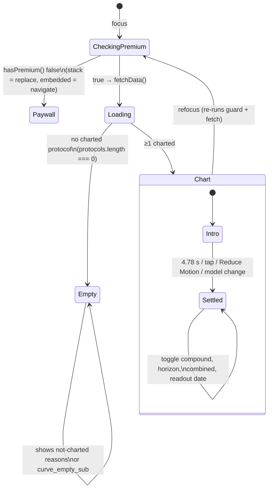
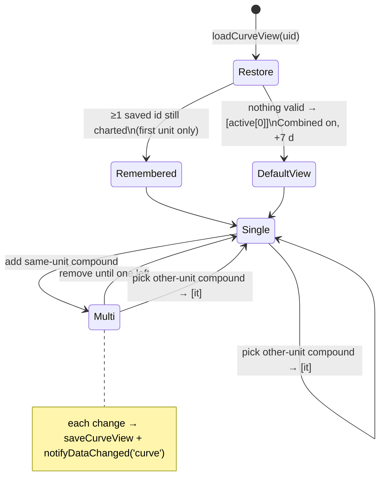
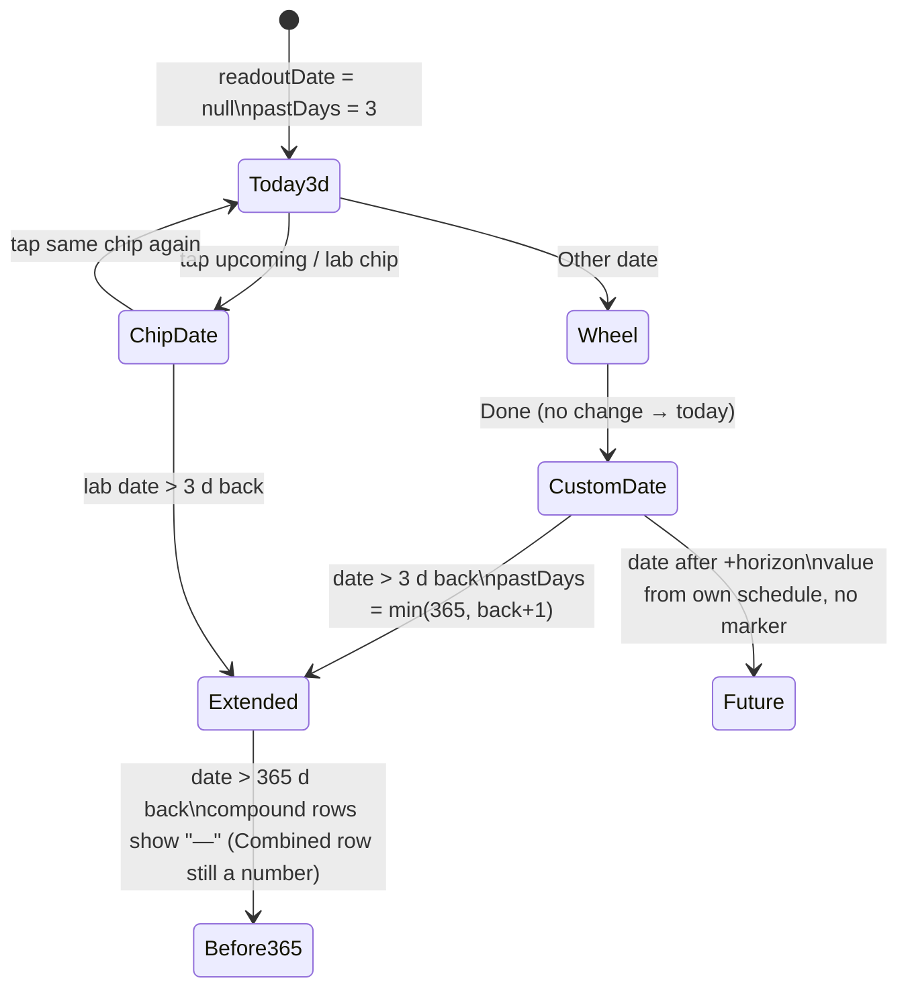
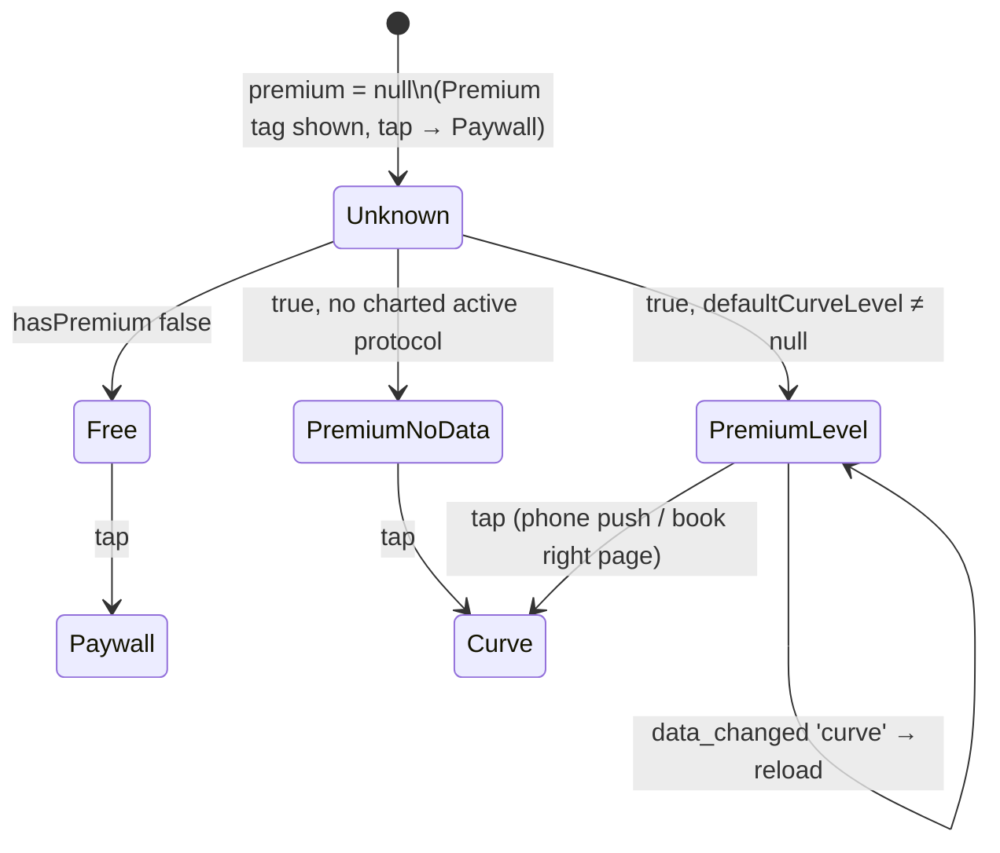

# 05 — Dose accumulation curve + Journey dashboard (research dossier)

> **Verified 2026-10-12 — corrections applied from docs/product/verification/05; where this dossier and the verification disagree, the verification wins.** (Section A, CURVE, of that report covers this dossier.)
>
> Corrections applied in this file (each marked "[Corrected 2026-10-12]" where it sits):
> 1. **Look-back (R15, E8).** The middle term is the days of the **shown window** + 2 (`shown = floor((now − gridStart)/day) + 2`), not days since the protocol start (`lib/curveSampling.js:8`).
> 2. **"Logged" copy (G8).** Two more live strings say the curve comes "from your own log" in all 6 languages: `paywall_hero_sub` (`PaywallScreen.js:278`) and `settings_premium_feat_1` (`SettingsScreen.js:642`). Both contradict AD-19 / FX-13 (the curve follows the planned schedule).
> 3. **Dates > 365 days back.** "—" is shown only on per-compound rows; the **Combined** row still prints a computed number (`SerumCurveScreen.js:1021` vs `:1031`).
> 4. **D1 numbers.** The mechanism reproduces (fixture 2026-10-12, New York: curve on ended id 10 at 154.63 mg, tile on restarted id 11 at 73.53 mg); the 68.53 / 10.04 mg figures came from another fixture — illustrative, not wrong.
> 5. **D2 also runs the other way:** at 11:30 the tile can show a dose the curve does not have yet (250 mcg: 0.125 vs 0.0 mg). The 0.0625 / 0.25 mg figures hold for 0.5 mg (for 250 mcg they are 0.031 / 0.125). Tile and curve agree again about 14 days after the change.
> 6. **Excluded half-life entries** stay in the table except GDF-8 / Dermorphin, which were deleted (`halfLives.js:141-145`).
> 7. **My Body** never reloads on a sync pull at all (no `addSyncListener`), not only on `data_changed:'curve'` (D3).

Branch `redesign/graduated` @ 4dade55, read 2026-10-12. Factual only: every claim cites `path:line`.
"CONFIRMED" = reproduced by code reading plus a script or test run; "SUSPECTED" = follows from the
code but not reproduced on a device. Nothing in the app was changed. Scratch scripts used for the
divergence checks live outside the repo (session scratchpad) and are described inline.

Test evidence at time of reading: `node --test` on serumModel, curveDstDoses, curveRemembers,
journeyCurve, curveSampling, halfLives, curveDayUnit, curveDisclaimer, a101Fixes, bookJourney →
75 pass, 0 fail.

---

## 1. Purpose

- **Dose accumulation (the "curve", route `SerumCurve`)**: an *educational math estimate* of how much
  of each compound may be present over time, drawn from the protocol's **planned schedule** and
  **published half-lives** — never a measurement, never advice (lib/serumModel.js:1-6;
  i18n/translations.js:787 `curve_disclaimer`; docs/decisions.md:111, :206). It is the flagship
  Premium feature (docs/decisions.md:279) and the App Store screenshot 01 (docs/decisions.md:349).
- **Journey tab**: a dashboard answering "Is my body responding to what I'm doing, and what do I log
  today to keep measuring it?" (docs/design/journey-dashboard.md:8-9). Approved layout: AI food log
  card on top, then the Progress and Dose accumulation tiles side by side, then the
  "Understand the numbers / Sources" folds (docs/decisions.md:215; screens/JourneyScreen.js:1-16).
- **Your progress page (`Progress`)**: the full calculator loop behind the Progress tile — one card
  (hero, target, log weight, weigh-ins, your numbers), daily plan, reality check
  (screens/ProgressScreen.js:1-9; lib/progressCard.js:22-29; docs/specs/progress-one-card.md PO-1).
- The tile and the curve must show **the same compound and the same "Est. level"** (lib/serumModel.js:3-6,
  :155-165; docs/specs/my-body.md MB-4; docs/decisions.md:209).

## 2. Screens and entry points

### 2.1 Routes / surfaces

| Surface | File | Notes |
|---|---|---|
| Dose accumulation (stack screen) | screens/SerumCurveScreen.js:248; App.js:229 `Stack.Screen name="SerumCurve"` | Pushed, back row names the previous tab/screen (SerumCurveScreen.js:231-243) |
| Dose accumulation (embedded right page) | `SerumCurveScreen embedded` — JourneyScreen.js:252, BodyScreen.js:1327 | No back row, chart sized to the right pane (SerumCurveScreen.js:245-263) |
| Journey dashboard | screens/JourneyScreen.js:56-261 | Food card, Progress tile, Dose accumulation tile, LearnBlock |
| Progress ("Your progress") | screens/ProgressScreen.js:34-71 → screens/components/CalculatorSection.js | Stack screen or Journey right page |
| Example curve (not user data) | components/AccumulationHero.js:175 | Paywall (PaywallScreen.js:276), Onboarding (OnboardingFlowScreen.js:363), preview sheet (components/FeaturePreviews.js:426) |

### 2.2 Entry points into the curve

| From | Code | Premium | Free |
|---|---|---|---|
| Journey › Dose accumulation tile (phone) | JourneyScreen.js:204-207 `navigation.navigate('SerumCurve')` | opens curve | `navigate('Paywall', { source: 'journey_serum' })` (:206) — no preview sheet |
| Journey tile (book layout) | JourneyScreen.js:207 `open('curve')` → right page :252 | curve on right page | Paywall full screen (BK-11) |
| My Body › Dose accumulation card (phone) | BodyScreen.js:845-857 `openDoseAccumulation` | `navigate('SerumCurve')` (:850) | preview sheet `serum` (:853-854, :1453) → Paywall (MB-6) |
| My Body card (book layout) | BodyScreen.js:849 `select('curve')`; right page :1327; `bodyRightPage` :141-142 | curve on right page | preview sheet |
| Dose log › "Curve" button | LogScreen.js:519-527 | `navigate('SerumCurve')` | `navigate('Paywall', { source: 'log_serum' })` |
| Today | **no direct link** (only a comment, TodayScreen.js:543). Today → tracker "history" → Dose log (TodayScreen.js:2170) → Curve button | | |
| Direct / back-stack / deep link | SerumCurveScreen.js:281-300 guard | | `replace('Paywall', { source: 'serum_direct' })`; embedded: `navigate` |

Analytics: Body and Log fire `Analytics.viewed('serum_curve')` (BodyScreen.js:846, LogScreen.js:522).
Journey imports no Analytics at all (JourneyScreen.js:18-44) → **a Journey tile tap is not counted**
(registered as A-98 "Journey-curve analytics event", docs/review/features.md:239, Not started).

### 2.3 Book layout (foldables, S-26)

- Two pages only when window ≥ 700 × 560 pt (BK-1). Journey: left = dashboard, right = Progress by
  default; food card → FoodChat on right; Dose accumulation tile → Curve on right for Premium
  (docs/specs/book-layout.md BK-5; lib/bookLayout.js:46). My Body: Curve reachable from the left page,
  shown on the right (BK-6; lib/bookLayout.js:47; BodyScreen.js:139-154).
- Right page shown on Journey: `page = sel === 'curve' && premium !== true ? (premium === null ? 'wait' : 'progress') : sel`
  (JourneyScreen.js:139). Premium lost while the curve is open → `clearSelection('Journey')` (:73).
- Folding with the curve open pushes `SerumCurve` (lib/bookLayout.js:51-56, BodyScreen.js:164);
  unfolding a pushed `SerumCurve` moves it to the Journey or Body right page (lib/bookLayout.js:61-71;
  components/BookPanes.js:70-81). Pushed from Today's Log there is no Today page for it → stays pushed.
- Embedded screens never `goBack`/`replace` (BK-22).

### 2.4 Journey dashboard order (as built)

1. Header: `tab_journey` + `journey_subtitle` (JourneyScreen.js:144-147).
2. AI food log card, full width (`FoodLogHero variant="journey"`, :149-160; screens/components/FoodLogHero.js).
3. Duo row (`fontScale >= 1.3` stacks vertically, :162, :272):
   a. **Progress tile** (`cal_snap_title`) → Progress (:163-199).
   b. **Dose accumulation tile** (`body_card_dosing_title`) → Curve / Paywall (:201-233).
4. `LearnBlock` — "Understand the numbers" + "Sources & references" folds (:237;
   screens/components/LearnBlock.js:1-8).

**Not on Journey** (the brief asked): there is no adherence tile and no labs tile. Adherence lives on
Today (screens/components/TodayTracker.js, TodayScreen.js:2170), Log and Settings report; labs live in
My Body. Old registry row F-050 ("card at the top of Journey") is stale (docs/review/features.md:83).

### 2.5 Your progress page order (Journey's Progress tile target)

`progressLayout` (lib/progressCard.js:22-29): card = filled ? `hero, target, [logWeight], weighIns, numbers`
: `hero, numbers, target, [logWeight], weighIns`; screen = hasPlan ? `card, plan, rc` : `card, rc`;
then `cal_disclaimer` and LearnBlock (CalculatorSection.js:1629-1638). Detailed calculator/reality-check
behaviour belongs to the Progress/food-log dossiers.

## 3. User actions

On the curve (SerumCurveScreen.js):

| # | Action | Code | Persisted? |
|---|---|---|---|
| A1 | Open the compound picker (pickrow) | :721-733 → modal :1088-1124 | no |
| A2 | Toggle a compound in the picker | `toggle` :366-370 → `nextSelection` :356-365 | yes, `selectedIds` (curveViewStore) |
| A3 | Show/hide combined total (only when a same-substance group exists) | :958-969 → `changeCombined` :371-374 | yes, `showCombined` |
| A4 | Change projection horizon +7/+14/+30/+60/+90 d | SegmentedBar :891-899 → `changeHorizon` :375-378; presets lib/curveView.js:9 | yes, `futureDays` |
| A5 | Pick an "Estimate on a date" chip (next 3 dose days) | :976-983, `pickDate` :515 (tap again = clear) | no (by design, lib/curveView.js:6-7) |
| A6 | Pick a bloodwork-date chip | :989-1011 (dates from `getBiomarkers` :332-334) | no |
| A7 | "Other date" → date wheel sheet | :984-986, :1080-1085 (years now−10…now+2, lib/wheelPick.js:16) | no |
| A8 | Expand/collapse a compound's "Source" | :1057-1065 | no |
| A9 | Touch the chart → skip the opening animation | :772 `onTouchStart={finishIntro}` | no |
| A10 | Back (stack only) | :689-699 | — |

On Journey: tap food card (FoodLogHero → FoodChat or Paywall if locked, FoodLogHero.js:85),
tap Progress tile (JourneyScreen.js:166), tap Dose accumulation tile (:204-208), open/close LearnBlock folds.

## 4. Rules (numbered, with sources)

### 4.1 Which protocols can be charted

- R1. Only `type` `recon` or `rtu` (lib/serumModel.js:52, :144). Orals are dropped **before** the
  "not charted" reasons are computed, so an oral protocol is never named on screen (see Gaps G6).
- R2. Blends (`lyo_glow`, `lyo_klow`, `lyo_wolverine`, lib/compounds.js:22) expand into one virtual
  protocol per component: `id = "${p.id}__${componentId}"`, component dose =
  `total × mg_i / Σmg` (lib/compounds.js:129-151; lib/serumModel.js:55-61). Ratios: KLOW 50/10/10/10
  (GHK-Cu/KPV/TB-500/BPC-157), GLOW 50/10/10, Wolverine 1/1. Colours from `BLEND_COLORS`
  (lavender, coral, teal, amber; :31). Label `"{Blend} · {Component} (est.)"` (:60).
- R3. Charted ("active") iff half-life entry exists AND dose > 0 AND dose converts to the curve unit
  (lib/serumModel.js:66-69). Not charted, named on screen, one line per reason (:72-77; SerumCurveScreen.js:338-344):
  `iu` (IU dose of a mass compound), `noData` (no entry or excluded), `noDose`.
- R4. Half-life lookup on the **English** compound name (`translations.en[compound_id]`, else `name`)
  (lib/serumModel.js:35-40). Resolution: exact → alias → longest key contained in the name →
  unambiguous ≥3-char partial → "HGH frag" → Fragment 176-191 → normalized longer-key upgrade
  (lib/halfLives.js:180-223).
- R5. `CURVE_EXCLUDED` (insulins ×4, IGF-1 LR3, Dihexa, PEG-MGF, Adipotide, Thymalin, RGD Peptide,
  FOXO4-DRI) return null even after resolution (lib/halfLives.js:173-176, :278-284). They stay in the
  table so a fuzzy match cannot borrow a neighbour's value (:171-172). Blends/vitamins/orals/unverified
  names are excluded by having no entry (comment :129-145).
- R6. Ended protocols (`active = 0`, no `deleted_at`) are offered on the curve when their end lies
  within the last 365 days, after the active ones, most recently ended first (lib/serumModel.js:240-247;
  lib/protocolEnd.js:11-21). Label suffix "· ended" (SerumCurveScreen.js:318-320, :1113). Deleted and
  purged protocols are never offered (lib/serumModel.js:241; SQL_HISTORY lib/protocolEnd.js:26).

### 4.2 Units

- R7. Curve unit = `IU` only for entries with `unit: 'IU'` (HGH, HCG, HMG, FSH), else `mg`
  (lib/halfLives.js:256-258; :33, :52-54).
- R8. Dose → curve unit (lib/halfLives.js:263-273): mg = d; mcg = d/1000; g = d×1000; for IU compounds:
  IU = d, mg→IU only with `iuPerMg` (HGH 3 IU/mg, :33); an IU dose of a mass compound → null (R3 `iu`).
- R9. One unit per chart: picking a compound of the other unit starts a new selection with only it
  (SerumCurveScreen.js:361-363); a remembered selection keeps only the first remembered unit
  (lib/curveView.js:23-29). Stored doses are parsed with `parseDecimal(p.dose)` without language
  (lib/serumModel.js:67,146-147; lib/doseMath.js:26-49).

### 4.3 Dose times (schedule-driven, never the dose log)

- R10. Dose events come from the protocol **schedule**, not from logged doses (lib/serumModel.js:90-94;
  SerumCurveScreen.js:417-419). Taken/Skipped/Missed rows never change the curve (open item A-31,
  docs/review/features.md:171).
- R11. Per calendar day, `cnt = expectedDosesOn(p, day)` (lib/schedule.js:31-64): 0 before
  `start_date`; 0 unless `(day − start) mod interval_days = 0`; after the end day 0; on the end day only
  reminder slots ≤ end moment; on the creation day `max(1, slots ≥ created_at − 1 h)`; else `doses_per_day`.
  Without `start_date` the interval is not applied (every day counts, :40-45).
- R12. Doses are placed at **fixed local hours**, not the user's reminder times:
  `DOSE_SLOTS = {1:[12], 2:[6,18], 3:[6,12,18], 4:[0,6,12,18]}`; >4/day reuse the 4-slot list
  (lib/serumModel.js:28, :120-128).
- R13. Calendar-day stepping (A-101b): `day_i = new Date(Y, M, D + i)` so a 25 h fall-back day is
  visited once (lib/serumModel.js:115-119; __tests__/curveDstDoses.test.js:15-24).
- R14. Snap to the 6 h sample grid: `snap(ts) = start + round((ts − start)/6h)·6h` (lib/serumModel.js:111-113).
- R15. Look-back: `lookbackDays = min(600, max(PAST_DAYS + 2 = 16, floor((now − start)/day) + 2, ceil(6·t½h/24)))` [Corrected 2026-10-12: `start` here is the grid start of the shown window, so the middle term is "days in the shown window + 2", not days since the protocol started];
  `scanStart = max(now − lookbackDays·day, start_date 00:00, history_from 00:00)` (lib/serumModel.js:98-110).
  Testosterone Undecanoate (t½ 2160 h) → 540 days.
- R16. `history_from` (A-30 "No, the dose was different") → nothing before that day (lib/serumModel.js:105-109).
  Written only on protocol create, answer "No" (screens/ProtocolsScreen.js:1915-1931). Synced optional
  column (lib/syncMappers.js:40, :100).

### 4.4 Level math (written out)

- R17. `kd = ln 2 / t½` (hours) (lib/halfLives.js:247).
- R18. Fraction of one dose remaining Δt hours after it (lib/halfLives.js:245-252):
  - no `tmaxHours`: `f(Δt) = e^(−kd·Δt)`
  - with `tmaxHours` (Semaglutide 48 h, Testosterone Cypionate 71.7 h, Testosterone Undecanoate 168 h,
    Sustanon 250 36 h; :7, :36, :39, :41): Bateman
    `f(Δt) = kr/(kr − kd) · (e^(−kd·Δt) − e^(−kr·Δt))`, where `kr` solves
    `Tmax = ln(kr/kd)/(kr − kd)` by 200-step bisection on `(1.000001·kd, 100)` (:227-236). Same area
    `1/kd` as instant absorption (:240-243). `f(Δt<0) = 0`.
- R19. Level at T: `L(T) = Σ_{dose d ≤ T} doseCU · f((T − d)/1 h)` (lib/serumModel.js:135-139). One
  `doseCU` (the protocol's **current** dose) for every past and future dose.
- R20. Est. level now (tile + screen): `estimatedLevelNow(p, now)` = `L(now)` over scheduled doses up to
  `now`, grid start `curveGridStart(now, 14)` (lib/serumModel.js:143-153). Screen: `nowLevel = levelAt(doses, doseMg, entry, now)`
  with its own grid (SerumCurveScreen.js:423).
- R21. Samples (A-93): `points[i]` = level at sample i including a dose exactly on it; `pre[i]` = excluding it
  (so a dose draws as a vertical jump). Doses older than `30·t½ + 3·tmax` hours are dropped
  (share < 1e-9) (lib/curveSampling.js:6-27).
- R22. Combined total per substance: groups by `entry.substance` (testosterone, nandrolone, trenbolone,
  drostanolone, boldenone, estradiol, progesterone); a group needs ≥ 2 selected members; points, pre and
  now-level are sums (SerumCurveScreen.js:443-461). Compounds without `substance` never join a total.
- R23. Shared y-scale: `max = max(all series points [+ combined points when shown])` over the whole
  window incl. projection (SerumCurveScreen.js:465-466). `curveTicks(max)`: `top = 1.12·max`;
  `half = max/2`; `step = half < 10 ? 0.1 : 1`; `mid = floor(half/step)·step` (rounded to 0.1);
  ticks `[0, mid, max]` (lib/serumModel.js:188-195).
- R24. Number formats: `levelLabel(v)` = "0" if ≤ 0; one decimal below 10 (app-language decimal); else
  `round(v)` never grouped (lib/serumModel.js:169-173). Axis: `axisLabel` same with "0.0" at zero (:197-200).
  UI-thread animated number uses the same rule with the language decimal (SerumCurveScreen.js:643).
- R25. Peak shown in the range label: `≈ levelLabel(model.max)` (SerumCurveScreen.js:763) — the max sample,
  including projection and combined.

### 4.5 Window and axis

- R26. Past window: `curveWindowDays(readoutISO, todayISO)`: default **3**; a readout date earlier than
  3 days back widens it to `min(365, back + 1)` where `back = round((today 12:00 − readout 12:00)/day)`;
  future or within-3 dates keep 3 (lib/serumModel.js:175-182; SerumCurveScreen.js:279). Constants:
  `CURVE_DEFAULT_PAST_DAYS = 3`, `CURVE_MAX_PAST_DAYS = 365`, model `PAST_DAYS = 14` (:21-23).
- R27. Grid start: `curveGridStart(now, pastDays)` = `now − pastDays·24h` floored to local 00/06/12/18
  (lib/serumModel.js:84-88). End = `now + futureDays·24h`; `nSteps = round((end − start)/6h)`
  (SerumCurveScreen.js:409-411).
- R28. Now: `nowIdx = min(nSteps, floor((now − start)/6h))` (last sample at or before now);
  `nowF = (now − start)/6h` exact (SerumCurveScreen.js:468-471). Now line and dots at `nowF`.
- R29. Axis labels "−{pastDays}{d}", "Now", "+{futureDays}{d}"; an end label that would come within
  4 px of "Now" is hidden; "Now" always shows (lib/curveAxis.js:6-13; SerumCurveScreen.js:868-881).
  Day unit per language d/d/d/j/T/gg (translations `unit_day_short`; A-104).
- R30. Future horizon presets 7, 14, 30, 60, 90; default 7 (lib/curveView.js:9-10).

### 4.6 Styling (estimate vs projection vs declared)

- R31. Each line: solid up to Now (`strokeDasharray "0"`, width 2.2), dashed after Now (`"5,4"`,
  width ×0.8) (SerumCurveScreen.js:117-133, :829-838). Combined: ink, width 3.2 (:840-848).
  Future zone = `colors.well` rect from Now (:775). DESIGN.md §7 "Projections are dashed"
  (docs/design/DESIGN.md:407-415).
- R32. One compound draws in `colors.data`; several keep protocol colours (`displayColor(p.color)`)
  (SerumCurveScreen.js:486-488, :429).
- R33. A-30 declared history: no separate line style. A dashed vertical `ink3` line at the moment the
  protocol was added + label "Before {date}: estimated from your start date", only when some selected
  protocol has `start_date` before its creation day, no `history_from`, and creation inside the window
  (lib/serumModel.js:226-238; SerumCurveScreen.js:765-769, :794-797). Founder: "approved as built"
  (docs/decisions.md:516).
- R34. Scheduled-dose ticks under the axis per dose in the window, line colour (SerumCurveScreen.js:786-792).
- R35. Readout marker: dashed `ink2` vertical line + short date + a dot per line (and per combined),
  only when the readout date is inside the window and not today (:803-826).
- R36. Opening moment: 2400 ms draw-in of the past, 280 ms Now rise, 800 ms projection, 1300 ms breath;
  dose drops when ≤ 24 drops, pulses when ≤ 60, nothing above; Reduce Motion → final frame; any model
  change or tap ends it (SerumCurveScreen.js:62-77, :525-589).

### 4.7 Remembered view (A-41, "curve opens last view")

- R37. Saved per user in AsyncStorage key `dosetrace_curve_view_{userId}`: `{ selectedIds, showCombined, futureDays }`
  (lib/curveView.js:12; lib/curveViewStore.js:8-23). Written only on a user change (read→merge→write),
  never on open (SerumCurveScreen.js:352-355). Not synced (docs/decisions.md:208, :380). The readout date
  is never remembered (lib/curveView.js:6-7).
- R38. Restore: remembered ids still in the charted list, deduped, in saved order, first unit only;
  none valid → `[active[0]]` (newest-created protocol, SQL `ORDER BY created_at DESC`); `showCombined`
  default true; `futureDays` default 7 if not a preset (lib/curveView.js:23-41). A protocol created later
  never joins (memory/curve-opens-last-view.md; __tests__/curveRemembers.test.js:32).
- R39. Never zero selected: deselecting the last one is ignored (SerumCurveScreen.js:357-360).
- R40. Tile compound = `restoreCurveView(...).selectedIds[0]` (lib/curveView.js:44-47;
  lib/serumModel.js:158-165). After a curve change the screen calls `notifyDataChanged('curve')`
  (SerumCurveScreen.js:354) and Journey reloads its level (JourneyScreen.js:127-129).

### 4.8 Premium gating

- R41. Single helper `hasPremium()` = `getEntitlement().premium` (lib/entitlement.js:73-75): live store
  answer cached per user with expiry; offline → cache (future expiry or lifetime = Premium); never known
  → free (:24-41). FX-16 / S-06.
- R42. Curve screen guard on every focus (SerumCurveScreen.js:285-295); tiles/cards ask on focus
  (JourneyScreen.js:111-121; BodyScreen.js:385-386). Journey `premium` starts `null` and **reads as free**
  (JourneyScreen.js:67-68, :206, :215); Body starts `false` (BodyScreen.js:206).
- R43. Free: tile shows `paywall_premium` tag + `body_card_dosing_desc`, no number (JourneyScreen.js:215,
  :230-232; docs/decisions.md:219). My Body: tag + lock, preview sheet (BodyScreen.js:943-950; MB-4/MB-6).

### 4.9 Disclaimers and honesty

- R44. Always-on disclaimer at the bottom (SerumCurveScreen.js:1075; EN translations.js:787): published
  half-lives + **planned schedule**, individual PK varies, educational, not a blood level, confirm with
  bloodwork, not medical advice, not a medical device. ×6 (FX-13 test __tests__/curveDisclaimer.test.js).
- R45. "Estimated" chip next to every Est. level (SerumCurveScreen.js:747, :758; JourneyScreen.js:227).
  Label "Est. level" / "Est. level · now" (`curve_current_level`, `curve_level_now`), never "blood level"
  (docs/design/journey-dashboard.md:40-43; docs/decisions.md:112).
- R46. Per-compound honesty card: evidence tier tag (clinical / studied / "Estimated — no human data" in
  `attention`), a model note, and the source one tap away (SerumCurveScreen.js:652-658, :1039-1073).
  Notes (:668-680): Tmax entries → `curve_absorption_note` with peak + published range (`tmaxLabels`
  :202-208); depot ester (`substance` and t½ ≥ 24 h) without Tmax → `curve_instant_note`; t½ < 6 h →
  `curve_fast_note`. Blends add `blend_curve_caveat` (:1069-1071).
- R47. Combined hint text (`curve_combined_hint`) states it is a rough total of compound amounts, not
  active-hormone mass, not an assay.

### 4.10 PK hard lines

- R48. Never interpret, diagnose or recommend (CLAUDE.md "AI HARD LINE"; memory ai-no-advice-hard-line;
  DESIGN.md:414-415 "No recommendation… no suggested dose change"). The curve only surfaces the user's
  schedule × published constants; the "Estimate on a date" card shows numbers side by side with
  bloodwork dates and never compares them to a lab value (SerumCurveScreen.js:971-1037).
- R49. **Sex-neutral**: no sex/gender/weight/body-fat input anywhere in lib/serumModel.js,
  lib/halfLives.js, lib/curveSampling.js, lib/curveView.js or SerumCurveScreen.js (grep, 2026-10-12: the
  only "female" hit is the source text of Estradiol Cypionate, lib/halfLives.js:102). Rule: no global sex
  fudge; any covariate only per compound with published data, via Vd/CL (docs/decisions.md:201-202;
  memory pk-model-sex-and-modifiers).
- R50. Insulins excluded from the curve because "an implied insulin level is the one place a misread is
  dangerous" (lib/halfLives.js:160-164). Dermorphin, GDF-8/Myostatin pulled (comment :140-145).
- R51. "Dose accumulation never says 'your level will be'" (docs/decisions.md:111).

### 4.11 Journey tiles

- R52. Dose accumulation tile (Premium + charted compound): dot (protocol colour), name (blend:
  "Blend · Component (est.)"), `curve_current_level`, `levelLabel(value)` in `colors.data`, unit, Estimated
  chip (JourneyScreen.js:130-134, :218-229). Premium without a charted compound: chevron + description (:230-232).
- R53. Progress tile: `progressTile({saved, meta, snapshots, checks})` (lib/progressTile.js:24-69):
  null until the daily-burn gate passes (weight + height + age + profile sex, or legacy weight + BF)
  → prompt `cal_need_inputs` (JourneyScreen.js:196-198); else weight (latest weigh-in, else typed),
  "Since {first weigh-in}: ±Δ" when ≥ 2 weigh-ins, TDEE rounded to 10 (measured from the latest reality
  check by `entry_date`, else the formula), chip Measured/Estimated (JourneyScreen.js:176-195).
  Refreshes on focus and on `sync_complete`, `import_complete`, `data_changed:'calc'` (:50-54, :123-125).
- R54. Food card (FoodLogHero journey variant): today's line (`nutri_hero_today` items · kcal, closed,
  or empty), and while a reality check runs only the 7-day run line; locked → Paywall
  (FoodLogHero.js:61-92). Catch-up parse of offline entries on focus (:51-56).

## 5. States

### 5.1 Curve screen

### 5.2 Selection and view

- Single: hero "Est. level · now" + 56 pt number + Estimated chip; 3 stats (Est. level, Half-life,
  Doses counted) (SerumCurveScreen.js:739-748, :902-926). Multi: one hero row per series + chip; legend
  list with tier, level, t½; combined rows when shown (:750-760, :929-955).
- Combined toggle row visible only if `model.combined.length > 0` (:958).

### 5.3 Window / readout

### 5.4 Journey tile

### 5.5 Empty / not-charted states

| Case | Screen | Tile |
|---|---|---|
| No recon/rtu protocol at all | Empty: `curve_empty_title` + `curve_empty_sub` (SerumCurveScreen.js:703-715) | description |
| Only IU-mass / no-data / no-dose | Empty with the reason lines (:709-711) | description |
| Some charted, some not | Reason lines under the picker and in the sheet (:734, :1121) | level of the charted one |
| Only orals | Empty with generic sub (orals not named) | description |
| Charted but `model.max ≤ 0` (e.g. start beyond horizon) | Lines/dots/notes hidden, hero 0 (:787, :829, :1044) | 0 |
| Only ended protocols | Curve opens on the ended one(s) | description (active only — see D1) |

## 6. STATE OWNERSHIP AUDIT

| Derived value | Computed at | Inputs differ? |
|---|---|---|
| **Charted protocol list** | Screen: `splitCurveProtocols(curveHistoryProtocols(getHistoryProtocols(uid)))` SerumCurveScreen.js:316. Journey tile: `defaultCurveLevel(getActiveProtocols(uid))` JourneyScreen.js:109 → serumModel.js:159. My Body: BodyScreen.js:402 (same as Journey). | Yes — history (active + ended ≤ 365 d) vs active only |
| **Default / opening compound** | `restoreCurveView` lib/curveView.js:33-41 (screen :327); `tileProtocol` lib/curveView.js:44-47 (tile/body via serumModel.js:161); `unitOf` duplicated SerumCurveScreen.js:326 & :347-350 and serumModel.js:160 | Same function, different lists (D1) |
| **Est. level now** | Tile/Body: `estimatedLevelNow` serumModel.js:143-153 (14-day grid). Screen hero + stats: `nowLevel = levelAt(model doses)` SerumCurveScreen.js:423 (pastDays grid). Readout "today": `levelAt(ser.doses, …, model.now)` :501, :504. Combined now: Σ members :459. Animated stat: settles on `singleNow` :628-633. | Grid start differs (D2) |
| **Dose times** | `scheduledDoses` serumModel.js:95-131 — screen (grid = pastDays) :419; tile (grid 14 d) :151; upcoming chips (grid 14 d) :207-213; readout past horizon (grid = model.start) SerumCurveScreen.js:506-507. Counts from `expectedDosesOn` lib/schedule.js:31; times from `DOSE_SLOTS` serumModel.js:28. Reminders/adherence/missed scan use `expectedSlotTimesOn` with real `reminder_time` lib/schedule.js:71-108. | Curve hour ≠ user's dose hour (D6); grid snap differs (D2) |
| **Window days** | `curveWindowDays` serumModel.js:177 (screen :279); `PAST_DAYS = 14` model look-back + tile grid :21; `CURVE_MAX_PAST_DAYS` :23 also bounds ended protocols :244; label `pastDays` :762, :871 | Screen 3 d vs tile grid 14 d |
| **Doses counted (stat)** | `dosesInWindow` = doses in [start, now] SerumCurveScreen.js:424; animated count :634-639 | Counts only the visible past window; the level uses doses back to the 6·t½ look-back (D5) |
| **Peak** | `model.max` :465-466 (includes projection + combined) | — |
| **Ticks/axis** | `curveTicks` serumModel.js:188; `axisLabels` curveAxis.js:7 | — |
| **Tile name** | Journey JourneyScreen.js:131-134; Body BodyScreen.js:833-836; screen series name SerumCurveScreen.js:428; picker row :1113 | Picker differs (D4) |
| **Tile colour dot** | `displayColor(level.protocol.color) || colors.data` JourneyScreen.js:221, BodyScreen.js:956; screen single line uses `colors.data` (:488) but pickrow/legend dots use the protocol colour (:728) | Single compound: tile dot = protocol colour, curve line = data blue (by design, :487) |
| **Premium** | `hasPremium` in SerumCurveScreen.js:289, JourneyScreen.js:113, BodyScreen.js:385, LogScreen.js:522 | Journey null = free (D7) |
| **Adherence shown on Journey** | None. Journey renders no adherence (JourneyScreen.js:142-241). | n/a |
| **Progress tile weight / TDEE** | Tile `progressTile` lib/progressTile.js:24-69; Progress hero `currentWeightKg` CalculatorSection.js:750-754 and `round10(scoreCheck ? scoreCheck.tdee : plan.tdeeVal)` :1010-1016, :1192 | Two implementations (D8) |

### Divergences

- **D1 CONFIRMED — tile/My Body vs curve open on different compounds when the remembered first compound is
  ended.** Screen list includes ended protocols (SerumCurveScreen.js:316); tile/Body pass active only
  (JourneyScreen.js:109, BodyScreen.js:402). Script (scratchpad `endeddiv.cjs`): saved `[10]` = an ended
  Testosterone Cypionate run, Restarted as id 11 → screen opens on id 10 at 68.53 mg, tile shows id 11 at
  10.04 mg [Corrected 2026-10-12: numbers depend on the fixture; the verification's run gives 154.63 vs 73.53 mg — same mechanism]. Same after any "Yes, it's finished" + Restart (restart creates a new row,
  lib/protocolEnd.js:141-174). Contradicts MB-4 / docs/decisions.md:209 "same compound and number".
  Mixed-unit corner: saved `[endedMg, hghIU]` → screen keeps the mg one, tile drops it and shows HGH.
  Not covered by __tests__/curveRemembers.test.js (no ended fixture).
- **D2 CONFIRMED — Est. level differs between tile and curve for up to 14 days after a clock change.** Both
  call `scheduledDoses` but with grid starts 14 d vs 3 d back (serumModel.js:149 vs SerumCurveScreen.js:409).
  The snap (R14) rounds local 12:00 onto a grid that is 1 h off whenever the grid start is on the other side
  of a DST change. Script (scratchpad `dstdiv.cjs`, TZ America/New_York):
  2026-11-06 12:30 BPC-157 0.5 mg daily → tile 0.0625 mg, curve 0.25 mg (tile's dose at 11:00, curve's at 12:00);
  Testosterone Cypionate 100 mg/7 d → 176.84 vs 177.21 mg; 2027-03-19 12:30 BPC-157 → tile **0.0 mg** (today's
  dose snapped to 13:00, after now) vs curve 0.25 mg. Same in Europe/Berlin (2026-11-06). The comment
  "the estimate at any moment never changes with the window" (serumModel.js:96-97) is false across DST; the
  screen's own number also moves when an earlier readout date widens the window across a transition. The
  3-day-window test (__tests__/journeyCurve.test.js:40-53) uses a date with no transition in range.
- **D3 CONFIRMED — My Body card does not follow a curve change on the book right page.** Journey listens for
  `data_changed:'curve'` (JourneyScreen.js:127-129); BodyScreen has no `addSyncListener` at all (grep) and
  reloads only on focus (BodyScreen.js:377-381). On a Fold, changing the selection in the Body right-page
  Curve leaves the left card on the old compound/number until the tab is refocused.
- **D4 CONFIRMED — picker names blend components without the blend.** Picker row:
  `p.compound_id ? t(p.compound_id) : p.name` (SerumCurveScreen.js:1113) → "BPC-157"; series/tile/Body name:
  "Wolverine · BPC-157 (est.)" (:428, JourneyScreen.js:133, BodyScreen.js:835). Two blends with BPC-157, or a
  blend plus a standalone BPC-157, give identical picker rows.
- **D5 CONFIRMED — "Doses counted" ≠ doses in the estimate.** `dosesInWindow` counts doses in the 3-day (or
  widened) window (SerumCurveScreen.js:424), while the level includes every dose back to 6 half-lives
  (serumModel.js:99). Registered A-96 "Doses counted mismatch", Not started (docs/review/features.md:237).
- **D6 CONFIRMED — curve dose hour ≠ the user's dose hour.** The curve places 1/day at 12:00 local
  (serumModel.js:28, :126), reminders and adherence use `reminder_time` (schedule.js:84-107). A 22:00 dose is
  counted from 12:00, so the tile/curve "now" includes it 10 h early; for t½ < 6 h compounds the number around
  midday is driven by a dose the user has not taken yet. Intentional for grid alignment (:80-83), but never
  disclosed in the notes or disclaimer.
- **D7 CONFIRMED (by design) — Journey tile while Premium is unknown.** `premium === null` shows the
  Premium tag and a tap navigates to the Paywall (JourneyScreen.js:206, :215). A Premium user who taps before
  `hasPremium()` resolves lands on the Paywall ("You already have Premium", PA-16).
- **D8 SUSPECTED (minor) — Progress tile vs Progress hero.** Same ordering (both newest `entry_date`,
  lib/progressTile.js:59-65; database.js:546-552), but the tile ignores a check whose `tdee` is not a number
  while the hero uses `realityLog[last].tdee` as-is (CalculatorSection.js:1010-1015). No test compares the tile
  to the hero end to end (PO-12/PO-13 test the gate).
- **D9 CONFIRMED — the window comment and the tests assume a non-DST zone**; see D2.
- **D10 SUSPECTED — remembered view lost after sign-out/sign-in on the same phone.** `selectedIds` are local
  SQLite ids (lib/curveView.js:24-25); protocols use `INTEGER PRIMARY KEY AUTOINCREMENT` (lib/schema.js:10) and
  `clearLocalDatabase` deletes rows (database.js:730-743), so re-imported protocols get new ids → the view
  falls back to `active[0]` (never a wrong compound). Not device-tested.

## 7. Data

| Data | Where | Used for |
|---|---|---|
| `protocols` (local SQLite ↔ Supabase): `id, type, name, compound_id, dose, dose_unit, interval_days, doses_per_day, reminder_time, start_date, created_at, active, ended_at, deleted_at, purged_at, history_from, color, sync_status, updated_at` | lib/schema.js:9-46; queries SQL_ACTIVE / SQL_HISTORY lib/protocolEnd.js:23-26 | Schedule, dose, unit, name, end, declared history, colour |
| `biomarkers.report_date` | lib/database.js:347-353 | Bloodwork chips (distinct, newest first; SerumCurveScreen.js:332-334) |
| `dose_logs` | — | **Not read** by the curve or the tile |
| View preference `dosetrace_curve_view_{uid}` = `{selectedIds, showCombined, futureDays}` | AsyncStorage, lib/curveViewStore.js | Remembered view (device-local, not synced, not health data :1-4) |
| Entitlement cache `dosetrace_entitlement_v1:{uid}` | lib/entitlement.js:43-71 | Premium offline |
| Static PK table `HALF_LIVES` {hours, tier, source, tmaxHours?, tmaxRange?, substance?, unit?, iuPerMg?}, `NAME_ALIASES`, `CURVE_EXCLUDED` | lib/halfLives.js:6-176 | Model constants |
| `BLEND_RATIOS`, `BLEND_IDS` | lib/compounds.js:22, :129-151 | Blend split |
| Progress tile: `calc_inputs` (getCalcInputs), `user_metadata`, `calc_snapshots`, `reality_checks` | JourneyScreen.js:92-99 | Weight, since, TDEE |
| Food card: `food_logs`, open reality check, food access | FoodLogHero.js:41-49 | Today line, 7-day run |
| Example curve constants `HALF 2.2, INTERVAL 3, DOSE 5, NDOSES 5` (labelled Example) | components/AccumulationHero.js:43 | Paywall / onboarding / preview only |

Events: `notifyDataChanged('curve')` after a view change (SerumCurveScreen.js:354); Journey listens
(JourneyScreen.js:127-129). No other listener for 'curve'.

## 8. Edge cases

| # | Case | Behaviour (source) |
|---|---|---|
| E1 | Protocol ended | Past only: `expectedDosesOn` 0 after the end day; on the end day only reminder slots ≤ end (schedule.js:13-21, :36-38, :85-93); decays after; offered for 365 d after the end with "· ended" (serumModel.js:240-247). An end-day dose is still drawn at the fixed slot (12:00), possibly after the end moment. With empty `reminder_time` the end day counts 0 doses. Tile never shows ended (D1). |
| E2 | Ended at last dose (inactivity prompt) | `ended_at` = last Taken `logged_at` (protocolEnd.js:57-70) → the curve stops at the user's last logged dose. |
| E3 | Restarted | New row, `start_date` today, `created_at` now (protocolEnd.js:141-174); old run stays as ended. Two lines; same-substance (testosterone) runs form a Combined total if both selected; the remembered selection stays on the old run (D1). |
| E4 | Dose edited mid-cycle (F2) | One current dose applied to every past and future dose (serumModel.js:147, :152; SerumCurveScreen.js:415). History is rewritten. Open founder decision (docs/review/features.md:84 F-051; decisions.md:417). Same for edited interval/start date/doses per day. |
| E5 | Skipped / missed doses | Still counted (schedule-driven). Open A-31 (features.md:171); "count only Taken" = pharmacometrics review (decisions.md:206). Disclaimer says "planned schedule". |
| E6 | `history_from` | Nothing before that day (serumModel.js:106-109); no "estimated before" marker for that protocol (:229). Answer cannot be corrected later — A-94 "Same dose? answer correctable" Not started (features.md:235; decisions.md:549). |
| E7 | Start date before creation (declared) | Estimated from the start date; dashed marker + label only when creation lies inside the visible window (serumModel.js:226-238) — with the 3-day default a protocol added > 3 days ago shows no marker. |
| E8 | Long esters | Look-back 6·t½ capped 600 d (Undecanoate 540 d) (serumModel.js:99); samples keep doses 30·t½ + 3·Tmax (curveSampling.js:8). Older doses ignored (≤ 1.6 % residual at 6 t½). Depot esters without Tmax draw instant (note `curve_instant_note`); Enanthate/Nandrolone Tmax still open (decisions.md:417). |
| E9 | Fast compounds (t½ < 6 h) | Spike per dose, ~0.0 between doses; tile can read 0.0 (Q-M kept, decisions.md:206; note `curve_fast_note`). A-96 "0.0 mg hero" Not started. |
| E10 | DST | A-101b fixed double-counting (calendar stepping). Remaining: grid-snap 1 h shift and tile/curve mismatch (D2). |
| E11 | Timezone travel | All dose times are local wall-clock: `start_date + 'T00:00:00'` local (serumModel.js:102; schedule.js:41), slots by local hour; moving zones shifts the whole series. `created_at` is an ISO instant compared by local `toDateString` (schedule.js:58-60). "Today" = local day (decisions.md:383; SerumCurveScreen.js:196-198). |
| E12 | Future start date | No doses before it; level 0 now; projection shows doses inside the horizon; if beyond the horizon `max = 0` → no lines/notes (SerumCurveScreen.js:787, :829, :1044). |
| E13 | Creation day | `max(1, slots from creation − 1 h)` doses that day (schedule.js:57-62) — the curve counts at least one dose on the day the protocol is added even when added after the dose time. |
| E14 | No `start_date` | Interval ignored; every day counts `doses_per_day` (schedule.js:40-45). |
| E15 | > 4 doses/day | Extra doses share slots (serumModel.js:124-127); total preserved. |
| E16 | Mixed units | IU and mg never on one chart (R9). |
| E17 | Readout > 365 days back | Window capped at 365 → row shows "—" (SerumCurveScreen.js:1021); the wheel allows 10 years back (wheelPick.js:16). |
| E18 | Readout beyond the horizon | Value computed from its own schedule up to that date; no marker (SerumCurveScreen.js:506-507, :519). |
| E19 | Screen left open across time | `now` is frozen inside the memoized model until a dependency changes (SerumCurveScreen.js:401-475); the tile is recomputed only on focus or 'curve' change (JourneyScreen.js:111-129). |
| E20 | Blend edited / vial composition field | The "What's in the vial" label never feeds the curve (features.md:72); common ratio only. |
| E21 | Protocol deleted / purged | Not offered; a remembered id is dropped (curveView.js:25). |

## 9. Gaps

- **G1 (D1)** Tile and My Body use active protocols, the curve uses active + ended → different compound and
  number after End/Restart. No test.
- **G2 (D2)** DST grid snap: tile ≠ curve for up to 14 days after each clock change (0.0 vs 0.25 mg reproduced);
  the serumModel comment and the 3-day test do not cover it.
- **G3 (D3)** My Body has no 'curve' listener (book layout).
- **G4 (D4)** Picker rows for blend components lack the blend name.
- **G5 (D5)** "Doses counted" mismatch (A-96, Not started).
- **G6** Orals are silently excluded (serumModel.js:52) although the screen promises compounds are "named on
  screen, never dropped silently" (SerumCurveScreen.js:310-312).
- **G7** `substance_boldenone` is missing in all 6 languages (checked against i18n/translations.js); a Combined
  total of two Boldenone protocols would render the raw key (t() falls back to the key,
  i18n/LanguageContext.js:59-61).
- **G8** Copy still says "logged": `curve_empty_sub` "…log doses to see your curve" and calls it "the serum
  curve"; `curve_combined_hint` "…compound amounts you logged" — the model is schedule-driven (A-07 intent). [Corrected 2026-10-12: also `paywall_hero_sub` and `settings_premium_feat_1` ("from your own log", ×6).]
- **G9 (D6)** The fixed 12:00/06-18 dose hours are not disclosed anywhere on screen.
- **G10** Blend lines: decisions.md:205 says "dashed (est.) component lines"; code draws them like any compound
  (solid past, dashed future, SerumCurveScreen.js:117-133). Possibly superseded by the 2026-09-29 Curve
  approval (decisions.md:209) — not recorded which wins.
- **G11** journey-dashboard.md §5 (:164-169) planned a second fallback "compound of the most recent Taken
  dose" before `active[0]`; built restore has no such tier (lib/curveView.js:37). No decision found that drops it.
- **G12** Journey tile tap fires no analytics (A-98 Not started).
- **G13** Open founder/PK items: F2 current dose for past dates; A-31 missed doses; "count only Taken"
  pharmacometrics review; Enanthate/Nandrolone Tmax; future PK engine (Vd/CL, covariates) and free/Premium
  split (decisions.md:202, :292, :409, :417).
- **G14** Stale docs: app-map L-02 says the curve loads `getActiveProtocols` (docs/review/app-map.md:70);
  L-13 still lists the start_date overwrite as live (:81) while FX-6 says fixed; L-34 names `lib/purchases`
  `isPremium` (:102) while the gate is `lib/entitlement` `hasPremium`; F-050/F-051 rows (features.md:83-84)
  describe the old Journey card and the old "logged doses" disclaimer; A-93 row says "Not started" but commits
  77cab13 / 11c7dd2 built it; decisions.md:546 says "~10 half-lives", code uses 30 (curveSampling.js:8);
  memory pk note still describes Sustanon 360 h and a pure exponential (code: 168 h, Bateman for 4 compounds).
- **G15** Remembered view is device-local and keyed by local row ids: lost after sign-out/sign-in or reinstall
  (D10, suspected); by decision not synced (decisions.md:380).
- **G16** Readout dates more than 365 days back are selectable but show "—" with no explanation.
- **G17** No device evidence in this dossier for both-theme rendering of the curve or tiles (static reading only).
