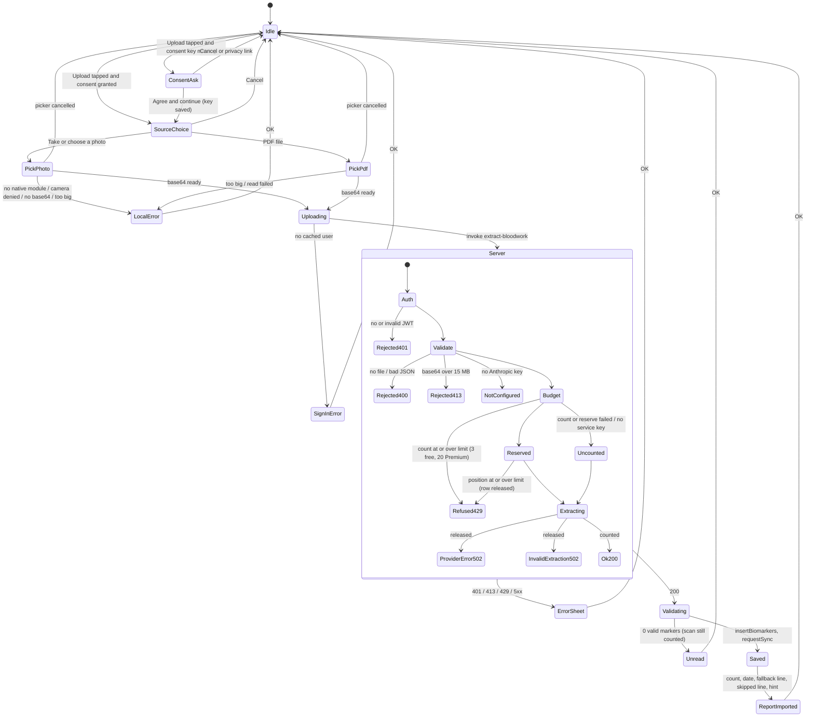
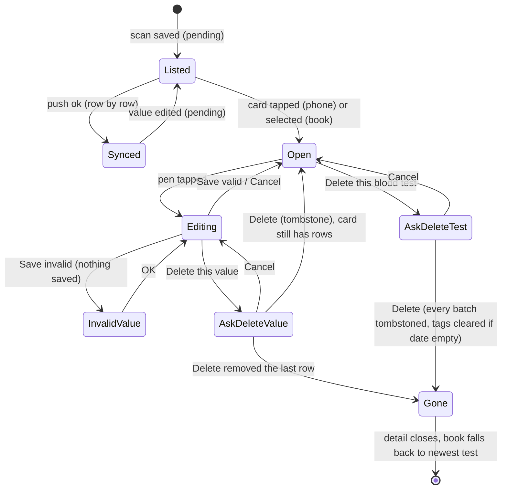
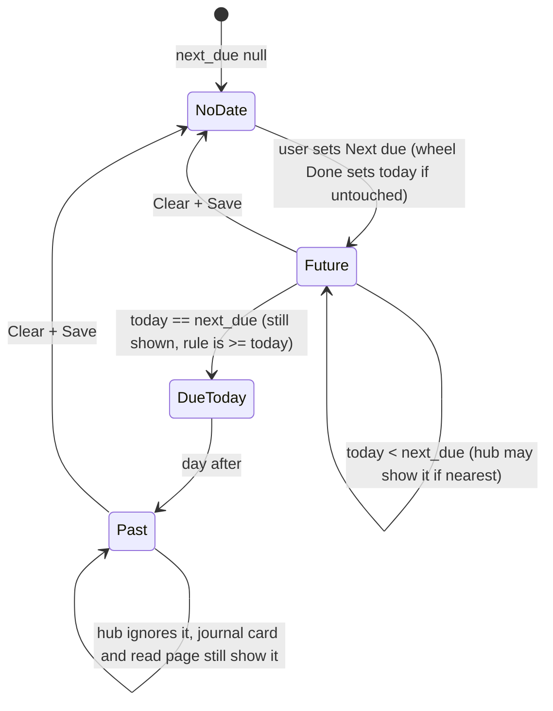

# 06 — My Body (lab tests, vaccines, hub, book layout)

> **Verified 2026-10-12 — corrections applied from docs/product/verification/05; where this dossier and the verification disagree, the verification wins.** (Section B, BODY, of that report covers this dossier.)
>
> Corrections applied in this file (each marked "[Corrected 2026-10-12]" where it sits):
> 1. **D-11 (lab value parsing) is CONFIRMED**, not suspected: in node `validateExtraction({markers:[{value:'1,025'}]})` gives **1025** while `parseMeasure('1,025','en')` gives **1.025**.
> 2. **Future-dated report is CONFIRMED:** `report_date '2099-01-01'` passes `validateExtraction` with `dateFallback: false` (§ latest-date note).
> 3. **G-9 / scan budget.** The **limit** is visible to free users — the empty state and the free card say "3 free scans a month … · More with Premium" (`BodyScreen.js:1100-1110`). What is never shown is how many scans were **used / are left**; users discover running out only on a refusal. My Body has no Premium scan line at all (the line renders only for free users, `{!premium && …}`), and the free card heading "Bloodwork scan — Premium feature" sits above "3 free scans a month" (`:1102`).
> 4. **D-8 (lab charts):** not gated on any path — `MarkerChart` renders with 2+ readings (`BodyScreen.js:1067-1068`), and neither `openMarker` (`:313`) nor the Fold right page (`:142-144`) checks Premium. Gating them would take a working feature away from current free users (picture first; verification/07 X-11).
> 5. **My Body never reloads on a sync pull** (no `addSyncListener` at all), not only on a curve change.
> 6. **G-1:** registry row F-070 (`docs/review/features.md:107`) "Labs: manual entry … Shipped" is false — no manual lab entry ever existed in the code or the git history of `BodyScreen.js`.
> 7. "Latest lab date" (S-70a): the three computations were seen, but their equivalence was not proven by the verification (UNVERIFIABLE).

Research dossier for the PRD / TRD / state-flow diagrams. Branch `redesign/graduated`, read 2026-10-12.
Every claim cites `path:line`. Nothing here was changed in code. Where the code could not prove a point it says
**unverified**. The cloud column list was read once, read-only, from the live Supabase project
(`information_schema.columns` for `biomarkers`, `vaccines`, `ai_scan_usage`). No user rows were read.

---

## 1. Purpose

My Body is the user's own health-record journal: lab values and vaccine records, plus a shortcut to Dose
accumulation (the serum curve). Two rules frame it:

- **Transcribe and organize, never interpret.** The AI may only read numbers, units and dates off a document. It
  must never add ranges, flags, verdicts or advice. Sources: the extraction prompt (`supabase/functions/extract-bloodwork/index.ts:18-57`),
  the vaccine prompt ("Never infer, schedule, or recommend a date", `index.ts:83-84`), the chart header
  (`screens/components/MarkerChart.js:6-12`), the ledger ("Labs and vaccines never show ranges, colours, arrows or
  verdicts", `docs/decisions.md:266`; "Lab interpretation or dose advice is a hard veto", `docs/decisions.md:317`),
  and the on-screen disclaimers (`blood_hub_disclaimer` and `vax_disclaimer`, `i18n/translations.js:1355`, `:1179`).
- **Records are the user's.** Every delete asks first and leaves a synced tombstone (`docs/specs/my-body.md:7`, MB-28 `:42`).

Spec: `docs/specs/my-body.md` (MB-1…MB-31, signed 2026-10-03, `:8`). Book layout: `docs/specs/book-layout.md`
(BK-6 `:23`, BK-18 `:35`). Registry: F-070…F-073 (`docs/review/features.md:107-110`).

---

## 2. Screens and entry points

| # | Screen / surface | Where it renders | How you get there |
|---|---|---|---|
| S1 | **Hub**: large title "My Body" + subtitle, then three hero cards (Lab test journal, Vaccine journal, Dose accumulation) and a footnote | `screens/BodyScreen.js:1348-1361` | The My Body tab (`App.js:185`). Shown when `section === null` |
| S2 | **Lab test journal**: nav row (back "‹ My Body", Export, "+ Upload"), large title, then the journal body | `BodyScreen.js:1367-1414`; body `:1090-1239` | Lab card tap → `openSection('labs')` (`:837-840`); Today alert "Bloodwork due" → `navigate('Body', { initialSection: 'labs' })` (`screens/TodayScreen.js:1520`, consumed at `BodyScreen.js:230-237`) |
| S3 | **One test (report card detail)**: date title, "N markers", Labels card, values with pen, "Delete this blood test", disclaimer | `BodyScreen.js:974-1029` | A By-date card tap → `openReport(key)` (`:312`, `:1184`) |
| S4 | **One marker**: title (+ star in the nav row), "Latest · {date}", 56 pt number + unit, N readings, chart (2+ readings) or a hint, the readings list with pen | `BodyScreen.js:1031-1086`; star `:1385-1395` | A By-marker row tap → `openMarker(key)` (`:313`, `:1210`) |
| S5 | **Edit value** bottom sheet (Marker, Value + Unit, Test date wheel, "Delete this value") | `BodyScreen.js:1551-1587` | Pen row on S3 or S4 → `openMarkerEdit` (`:653-661`) |
| S6 | **Vaccine journal**: title, disclaimer, "+ Add vaccine", "Scan / upload", the reading card, empty state, search, one card per vaccine | `screens/components/VaccinesSection.js:352-442` | Vaccine card tap → `openSection('vaccines')`; rendered at `BodyScreen.js:1399-1400` |
| S7 | **Add / Edit vaccine** bottom sheet (name, Date given wheel, Next due wheel + Clear, details, notes, Delete) | `VaccinesSection.js:445-584` | "+ Add vaccine" → `openAdd` (`:264-270`); vaccine card tap (phone) → `openEdit` (`:272-285`, `:421`) |
| S8 | **Vaccine read page** (book right page only): name, Edit, the filled rows, disclaimer | `screens/components/VaccinePage.js:41-80` | Book: a vaccine tap → `selectVaccine` (`BodyScreen.js:331`, `VaccinesSection.js:421`) |
| S9 | **Book layout** (unfolded foldable): left page = hub title, Lab journal, Vaccine journal, Dose accumulation card; right page = test / marker / vaccine / Curve | `BodyScreen.js:1276-1338`, `:1346-1347` | Automatic when the window qualifies (`docs/specs/book-layout.md:18`, BK-1) |
| S10 | **Dose accumulation**: phone pushes `SerumCurve`; book shows `SerumCurveScreen embedded`; free shows the preview sheet | `BodyScreen.js:845-855`, `:1327`, `:1452-1456` | Dose card tap |
| S11 | **Sheets and popups**: AI consent, "Add a lab report" action sheet, "Report imported", scan errors, "Delete this blood test", "Upload bloodwork" upsell, "Choose what to export", "PDF export is Premium", "Delete this value?", Test-date wheel; on the vaccine side the consent, "Scan a vaccine record", "Vaccines imported", errors, "Delete vaccine?", the date wheels, the "Enter the vaccine name first." toast | `BodyScreen.js:1421-1595`; `VaccinesSection.js:445-588` | See §3 |
| S12 | **Lab journal explainer** (first visit, until a lab value exists) | `BodyScreen.js:188-190`, `:1595` | Opening S2 |

**Body map / injection sites are NOT in My Body.** `BodyMapModal` is imported only by `screens/TodayScreen.js:44`
(rendered `:2291`) and `screens/LogScreen.js:27` (rendered `:679`). The registry flags the same thing
(`docs/review/features.md:51`, "APP-HANDOFF places the body map in My Body, but in code it appears only in Today and
Log"). The ledger still says "Body keeps labs, vaccines and the body map" (`docs/decisions.md:214`, 2026-09-10). See Gaps G-12.

---

## 3. User actions, writes and side effects

### 3.1 Lab tests

| Action | Code | Writes / side effects |
|---|---|---|
| Open the tab / focus | `useFocusEffect → fetchReports` (`BodyScreen.js:377-404`) | Reads `hasPremium()`, the cached user's `user_metadata.favorite_markers` / `report_tags`, `getBiomarkers`, `getVaccines`; Premium also reads the curve view → `defaultCurveLevel` (`:399-403`). Analytics `viewed('body')` |
| Upload (+ Upload, empty-state button, book left page) | `handleUploadPress → chooseSource` (`:456-480`) | No client quota gate (decision A, `:451-455`). Without consent → consent sheet (`:466-477`) |
| Agree & continue | `grantAIConsent()` (`lib/aiConsent.js:25-27`) | AsyncStorage key `dosetrace_ai_extraction_consent_v4` = 'granted' (`aiConsent.js:19`). Then the source action sheet |
| Pick Take a photo / Choose a photo | `pickImageAndExtract` (`BodyScreen.js:494-525`) | Native-module check (`:498`); camera permission (`:502-503`); base64 JPEG/PNG at quality 0.6 (`:505`); size check `base64.length > 10 MB × 1.4` (`:514`) |
| Pick PDF file | `pickAndExtract` (`:527-564`) | Size check before read: `file.size` or `FileSystem.getInfoAsync` (`:539-551`) |
| Extraction | `extractWithClaude` (`:566-625`) | `supabase.functions.invoke('extract-bloodwork', { image_base64, media_type, lang }` or `{ pdf_base64, lang })` (`:577-582`). Server: JWT check, budget reservation, AI call (§5.1) |
| Auto-save | `persistMarkers` (`:630-649`) | `insertBiomarkers(rows)` (`lib/database.js:355-365`): one row per marker, ALL with the same `created_at = now` (`database.js:357`, `:362`), `sync_status 'pending'`; Analytics `bloodworkUploaded`; `fetchReports()`; `requestSync()` |
| Toggle By date / By marker | `SegmentedBar` → `setViewMode` (`:1133-1137`) | Screen state only (not persisted) |
| Search | `setSearch` (`:1144-1152`) | Filters cards (by marker name inside a card, `:262-263`) or markers (`:291`). Not persisted |
| Newest / Oldest | `setNewestFirst` (`:1155-1157`) | Screen state only |
| Favorites pill | `setFavOnly` (`:1160-1168`) | Screen state only |
| Star a marker | `toggleFavorite(marker)` (`:411-419`) | Optimistic state + `supabase.auth.updateUser({ data: { favorite_markers: next } })`, failure swallowed (`:416`). **Not in SQLite, not in syncCore** |
| Add a label to a test | `addReportTag(date)` (`:427-435`) | `report_tags[date]` in `user_metadata` via `updateUser`, failure swallowed (`:423-426`). Case-insensitive dedupe (`:431`) |
| Remove a label | `removeReportTag` (`:436-441`) | Same store; an empty date key is deleted |
| Edit a value → Save | `saveMarkerEdit` (`:666-677`) | `parseMeasure(mValue, language)` (`:668`); invalid → error sheet, nothing saved (`:669-672`); else `updateBiomarker(id, { marker, value, unit, report_date })` → `sync_status 'pending'` (`database.js:368-381`); `requestSync`; refetch |
| Delete this value | `askDeleteValue → deleteValueNow` (`:681-699`) | Asks first (MB-18). `deleteBiomarker(id)` → `sync_status 'deleted'` (`database.js:385-389`) |
| Delete this blood test | `deleteReport(card)` (`:706-738`) | Asks first. For EVERY batch of the card: `deleteBiomarkerReport(userId, date, created_at)` (`:720`; `database.js:398-406`); clears `report_tags[date]` only if no row is left on that date (`:721-728`); `requestSync`; closes detail; book: `clearSelection('Body')` if it was selected (`:732`) |
| Export | `handleExport` (`:742-747`) → sheet (`:1459-1548`) → `doExport(kind)` (`:752-816`) | Preselects every marker key and every vaccine id. CSV free; PDF needs a fresh `hasPremium()` (`:757-767`). Writes `documentDirectory/dosetrace_records.csv` (`:789-790`) or `Print.printToFileAsync` (`:803-806`), then the share sheet. Data from `getAllDataForExport` (`database.js:834-841`) |
| Free "Upgrade" | `setShowUpgradeModal(true)` (`:1109`) → "Start 7-day free trial" → `Paywall { source: 'bloodwork_upload' }` (`:1437-1446`) | Navigation only |

### 3.2 Vaccines

| Action | Code | Writes / side effects |
|---|---|---|
| Focus | `useFocusEffect(fetchList)` (`VaccinesSection.js:94`, `:113-119`) | `getVaccines` → list; hands it to BodyScreen via `onListChange` (`:118`, `BodyScreen.js:337-340`) |
| + Add vaccine → Save | `openAdd` (`:264-270`) → `save` (`:297-323`) | Name required → toast, nothing saved (`:299`). `insertVaccine` (`database.js:681-696`); `requestSync`; close; refetch |
| Tap a vaccine (phone) → Save | `openEdit` → `save` → `updateVaccine` (`database.js:698-712`) | `sync_status 'pending'` |
| Clear Next due | `setNextDue('')` (`VaccinesSection.js:476`) | Saved as `null` on Save (`:307`) |
| Delete vaccine | `askDeleteVaccine → deleteVaccineNow` (`:327-345`) | Asks first (MB-22). `deleteVaccine(id)` → `sync_status 'deleted'` (`database.js:716-720`) |
| Search | `setSearch` (`:393-401`) | Name contains (`:349-350`) |
| Scan / upload | `handleScanPress` (`:129-151`) → consent → action sheet (`:152-163`) → `pickImageAndExtract` (`:165-189`) / `pickPdfAndExtract` (`:191-204`) → `extractVaccines` (`:206-240`) | `invoke('extract-bloodwork', { kind: 'vaccines', lang, ...source })` (`:208-210`); `validateVaccine` each (`:222`, `lib/bodyScan.js:37-52`); `persistVaccines` → one `insertVaccine` per record (`:244-257`); `requestSync`; "Vaccines imported" sheet with dropped count (`:231-235`) |
| Book: tap a vaccine | `onSelect(v)` → `select('vax:' + id)` (`BodyScreen.js:331`) | Book selection only; the right page shows S8 |
| Book: Edit on the read page | `editVaccine(v)` → `vaxControl.current.openEdit(v)` (`BodyScreen.js:342-343`, `VaccinesSection.js:107-111`) | Opens S7 in the left page's instance |

### 3.3 Hub and Today

| Action | Code | Effect |
|---|---|---|
| Dose accumulation (Premium, phone) | `navigation.navigate('SerumCurve')` (`BodyScreen.js:849`) | Push |
| Dose accumulation (Premium, book) | `select('curve')` (`:848`) | Right page = embedded Curve (`:1327`) |
| Dose accumulation (free) | `setShowSerumPreview(true)` (`:854`) → Unlock → `Paywall { source: 'serum_preview_sheet' }` (`:1455`) | Analytics `previewSheetViewed` |
| Today "Bloodwork due" card tap | `TodayScreen.js:1520` | Opens S2 |
| Snooze "Bloodwork due" | `snoozeAlert` (`TodayScreen.js:489-495`) | AsyncStorage `dosetrace_alert_snooze` `{ bloodwork_due: until }`; until 09:00 tomorrow or in 3 days (`lib/todayFormat.js:35-39`) |

---

## 4. Rules (numbered, with sources)

R1. **The AI only transcribes.** The lab prompt forbids ranges, flags, status, interpretation and patient identifiers (`extract-bloodwork/index.ts:52-55`). The vaccine prompt forbids inferring or scheduling a next-due date (`:83-84`). The vial prompt forbids guessing or dosing advice (`:115`). Source: CLAUDE.md "AI HARD LINE"; `docs/decisions.md:317`.

R2. **Consent first, once, shared.** Every AI scan asks in a DoseTrace sheet unless the shared key is set (`BodyScreen.js:466-477`, `VaccinesSection.js:137-149`). One key `dosetrace_ai_extraction_consent_v4` for every AI feature (`lib/aiConsent.js:17-19`). The policy link opens the page and leaves the flow cancelled (`BodyScreen.js:471`). Ledger: `docs/decisions.md:323`. MB-12 (`my-body.md:26`).

R3. **One monthly scan pool.** Labs, vaccine cards and vials share it: 3 free, 20 Premium (`extract-bloodwork/quota.ts:10-11`). It is a calendar month in UTC (`index.ts:159-160`). The server decides Premium through RevenueCat (`quota.ts:58-62`, `index.ts:352-361`), or through the email allow-list (`quota.ts:19-26`). Ledger: `docs/decisions.md:275-276`.

R4. **RevenueCat is asked only at or above 3 scans** (`quota.ts:48-51`). Unreachable → Premium cap (20). Misconfigured → free cap (3). Rate-limited (429) → not Premium (`quota.ts:53-62`, `:79-86`).

R5. **The budget is reserved before the AI call.** A failure releases it. Parallel requests are ranked by position (`quota.ts:94-164`, A-59). A 200 response counts as a delivered scan (`index.ts:364`).

R6. **The server fails open.** If the count or insert errors, or there is no service key, the scan runs uncounted (`quota.ts:136-143`, `index.ts:348`).

R7. **The limit message shows the server's limit** (`lib/scanQuotaMessage.js:2-14`, `lib/bodyScan.js:68`), falling back to 3 when the body has no `limit` (`scanQuotaMessage.js:5-10`). Source: A-60 (`docs/decisions.md:105`).

R8. **No client gate on scanning.** Decision A, 2026-10-03 (`BodyScreen.js:451-457`, `VaccinesSection.js:130-132`; MB-24 `my-body.md:38`).

R9. **File size.** The client refuses more than 10 MB of raw file (`BodyScreen.js:85`; `VaccinesSection.js:44`). Photos are checked as base64 length > 14 MB (`:514`, `:180`). The server cap is 15 MB of base64, else 413 (`index.ts:10-11`, `:203-206`).

R10. **Image types.** The server allows jpeg / png / webp / heic and defaults anything else to jpeg (`index.ts:208-210`).

R11. **Date order.** The document's own evidence comes first. The app language is only a tiebreak (en → MM/DD, others → DD/MM). Never fall back to today because the order is ambiguous (`index.ts:175-192`). The date note is added for labs and vaccines but not for vials (`index.ts:279-281`).

R12. **Lab auto-save, no review gate** (`BodyScreen.js:606-609`; `docs/decisions.md:267`). A marker needs a name and a numeric value. String values are coerced with `parseDecimal(value)` with no language, and failures are dropped and counted (`lib/bodyScan.js:14-32`).

R13. **Report date fallback.** A missing or invalid `report_date` becomes the user's LOCAL today, flagged (`bodyScan.js:26-31`), and the result sheet says so (`BodyScreen.js:617`; `blood_imported_date_fallback`, `i18n/translations.js:1991`). MB-27.

R14. **Vaccine auto-save.** A record needs a name and a valid ISO `date_given`, else it is dropped (never dated today). An invalid `next_due` is dropped (`bodyScan.js:37-52`; `VaccinesSection.js:226-229`).

R15. **A service failure is never blamed on the file.** `provider_error` / `not_configured` / `internal_error`, or a code-less 500/502/503, becomes "Scan service unavailable" (`bodyScan.js:55-61`; MB-13).

R16. **One test = one card (A-101d).** Rows are grouped by `report_date`, then by insert batch (`created_at`). Batches of the same date join one card unless the batch repeats a marker the card already has (a duplicate upload stays its own card). Card key = `date|firstBatchCreatedAt` (`BodyScreen.js:94-121`).

R17. **A test detail shows every value of the card**, built from ALL rows, not the search-filtered list (`BodyScreen.js:131-134`, `:297-302`).

R18. **Marker series merge naming variants** with `canonicalMarker`: lowercase, punctuation to spaces, words sorted (`lib/exportRecords.js:12-21`; `BodyScreen.js:273-288`).

R19. **By marker order:** favourites first, then A–Z by display name (`BodyScreen.js:293-294`; MB-8).

R20. **The chart needs 2+ readings.** Otherwise it shows "Add another test with this marker…" (`BodyScreen.js:1067-1071`). The chart is neutral: no bands, no colours, evenly spaced points (`MarkerChart.js:6-12`, `:44`).

R21. **Edit value:** the value is read with `parseMeasure(text, language)`. For lab values a comma is a decimal in every language (`lib/doseMath.js:63-73`; `BodyScreen.js:668`). The test date cannot be in the future (`TEST_DATE_RANGE { back: 30, ahead: 0 }` + `max: today`, `BodyScreen.js:87`, `:1580-1583`). MB-17.

R22. **Every delete asks first** (Cancel · red Delete) and writes a tombstone (MB-15/18/22; `docs/decisions.md:264`).

R23. **Vaccine dates.** Date given ranges 80 years back to today, never in the future. Next due ranges 10 years back to 15 ahead, with no max (`VaccinesSection.js:46-49`, `:570-581`). Field and wheel use one local ISO day (`lib/bodyDates.js:3-11`; MB-21).

R24. **Next due on the hub** is the nearest user-entered `next_due ≥ today (local)`, ties by name (`lib/bodyHub.js:33-39`; MB-3; `docs/decisions.md:260`).

R25. **Export is visible** on the labs screen with any test or vaccine, and on the vaccines screen with any vaccine (`bodyHub.js:41-47`; MB-9).

R26. **PDF export is Premium, checked at the action point** with a fresh `hasPremium()`. CSV is free (`BodyScreen.js:752-767`; MB-19).

R27. **Bloodwork due.** It shows when the newest `report_date` is ≥ 182 days old and not snoozed. The months figure is `max(6, round(days/30))`. A tap opens the Lab journal (`TodayScreen.js:153`, `:1512-1524`).

R28. **Book layout.** The right-page id is the card key, `marker:<canonical>`, `vax:<id>` or `curve`. A missing item falls back to the newest test. Curve is Premium only (`BodyScreen.js:89-154`; BK-6, BK-18).

R29. **Fold / unfold** keeps the open vaccine sheet (draftRef) and maps detail ↔ selection (`BodyScreen.js:156-176`, `:345-367`; `VaccinesSection.js:96-104`; BK-10).

R30. **No native alerts and no UTC dates in My Body** (MB-25, MB-27; `my-body.md:39`, `:41`).

R31. **Lab journal typed by hand is free; lab charts are Premium** (`docs/decisions.md:268`; `docs/design/DESIGN.md:44`). **Not implemented**, see §6 D-8 and Gaps G-1, G-2.

---

## 5. States

### 5.1 Lab scan flow

States: Idle → (ConsentAsk) → SourceChoice → Picking → (local error) | Uploading("Reading your lab report…" card, `uploading=true`, `BodyScreen.js:1093-1098`) → server [Unauthorized | Reserve | QuotaRefused | Extracting] → client [Error sheet | Unread | Saved("Report imported")].

Server branches (`extract-bloodwork/index.ts`):
- no Authorization header or invalid session → 401 `unauthorized` (`:133-148`) → client "signin" (`bodyScan.js:57`)
- bad JSON / no file → 400 `bad_request` (`:166-201`) → client `scanErrorKind` default → "unread"
- base64 over 15 MB → 413 `file_too_large` (`:204-206`) → "big"
- no Anthropic key → 500 `not_configured` (`:217-219`) → "service". This happens **before** the budget step, so it is not counted
- count says refused → 429 `quota_exceeded` + `limit` (`:367-369`) → "quota" with `{n}`
- provider non-2xx → 502 `provider_error` (`:289-302`) → "service"; the reservation is released (`quota.ts:162`)
- non-JSON or wrong shape → 502 `invalid_extraction` (`:310-318`) → `scanErrorKind` (code set, not in the service list) → "unread"; released
- 200 `{ report_date, markers }` (`:339-343`) → **counted**
- thrown error → 500 `internal_error` (`:371-374`) → "service"

Client branches after 200: zero valid markers → "unread" sheet (`BodyScreen.js:598-602`). Saved 0 → "unread" (`:610-613`). Saved n → "Report imported" (`:614-620`). The scan is counted on the server even when the client then shows "unread" (see Edge E-3).

### 5.2 Report card lifecycle

A card exists while at least one non-deleted row shares its date and batch group (R16). A card's key changes when its
first batch is removed (another batch then becomes first, `BodyScreen.js:113`). Editing a value's date moves that
row to another date group (its `created_at` is unchanged). The detail closes when the card disappears (`:308-311`).

### 5.3 Vaccine scan

Same shape as 5.1 with `kind: 'vaccines'`. Differences:
- No `getCachedUser` check before invoke. The server 401 covers it.
- The PDF size check happens AFTER the whole file is read into memory (`VaccinesSection.js:197-198`).
- A result with zero valid records shows the 'none' sheet (`:224`).
- Saved shows "Vaccines imported" with a dropped count (`:230-235`).
- The scan button is disabled while reading (`:367`).

### 5.4 Vaccine due (hub line, no alert)

There is no Today alert or notification for a vaccine due date (no `vaccin`/`next_due` in `screens/TodayScreen.js`;
`getVaccines` is used only in `BodyScreen.js` and `VaccinesSection.js`).

### 5.5 Bloodwork due (Today)

`latestLabDate == null` → Hidden. If ≥ 182 days → Shown. Snoozed → Hidden until 09:00 tomorrow or in 3 days. A new
scan (or an edit of the newest date) → recomputed on the next `fetchAlerts` (`TodayScreen.js:468-485`, `:1512-1524`).

---

## 6. STATE OWNERSHIP AUDIT

Each derived value, every place that computes it, and whether they agree.

### D-1 "Latest lab date"

| Where | Formula |
|---|---|
| `screens/TodayScreen.js:474-478` | `getBiomarkers(...)[0].report_date`, relying on SQL `ORDER BY report_date DESC` (`lib/database.js:350`) |
| `lib/bodyHub.js:24` (`labHubSummary.latestDate`) | max `report_date` across all rows (string compare) |
| `screens/SerumCurveScreen.js:332-334` | distinct `report_date`s sorted desc (the "Estimate on a date" list) |

Verdict: **consistent** (ISO strings sort the same as the SQL order). Note: none of them clamps a future `report_date`.
The AI date is never checked against today (`bodyScan.js:26-31` only checks the format), so a future-dated report hides
the Today alert (negative days) and becomes the hub's "latest test". **SUSPECTED** edge, not a divergence. [Corrected 2026-10-12: CONFIRMED — `report_date '2099-01-01'` passes `validateExtraction`.]

### D-2 "Labs due" (Bloodwork due)

Computed only in `TodayScreen.js:1512-1524` (constant `:153`). Single owner, no push notification counterpart found.
**No divergence.** Note: `BodyScreen.js:227-229` says the deep link is "from notifications (e.g. an upload reminder)",
but the only caller is the Today alert (`grep initialSection` → `TodayScreen.js:1520` only). The comment is stale.

### D-3 Report grouping / card keys / "number of tests"  — **DIVERGENCE CONFIRMED**

| Where | Formula |
|---|---|
| `BodyScreen.js:99-121` `reportCards` | date → batches by `created_at`, same-date batches **merged** unless a marker repeats (A-101d) |
| `BodyScreen.js:123-129` `newestReportKey` | over `reportCards` |
| `BodyScreen.js:321` `reportKeys` | over `reportCards` |
| `BodyScreen.js:824` `testCount` (hub big number, `:866-870`; Export visibility `:828-829`) | `new Set(report_date + '|' + created_at).size`, i.e. **one per batch, never merged** |
| `lib/bodyHub.js:8`, `:30` `uploadKey` / `labHubSummary.tests` | the same per-batch count (computed but **not used** by the screen; the screen keeps its own copy at `:824`) |
| `database.js:398-406` `deleteBiomarkerReport` | deletes per `(report_date, created_at)`; the screen loops every batch of the card (`BodyScreen.js:720`) |
| `__tests__/redesignSimFindings.test.js:102` | pins the per-batch `testCount` source line (A-74) |

Confirmed mismatches:
1. **Same device:** two scans on the same date with no shared marker (for example two pages of one report scanned
   separately) are ONE journal card but TWO on the hub count. That breaks MB-2 ("The count is the journal's",
   `my-body.md:16`) and the ledger "The hub counts uploads the same way the journal lists them" (`docs/decisions.md:259`).
2. **Pulled devices (second phone, reinstall, re-login).** `created_at` is NOT pushed for biomarkers. `CLOUD_FIELDS.biomarkers =
   ['report_date','marker','value','unit']` (`lib/syncMappers.js:22`, `:117-121`). Each row is inserted with its own
   request (`lib/syncCore.js:707`). The cloud stamps its own default, `timezone('utc', now())` (live schema, read
   2026-10-12). Pull copies the cloud `created_at` (`syncCore.js:527-532`). On every device except the one that
   scanned, **every row has a different `created_at`**:
   - the hub count shows one "test" per marker (e.g. 12 instead of 4);
   - `reportCards` still merges them, since each single-row batch joins the first same-date card that lacks its
     marker. But a duplicate upload is split differently than on the scanning device, because ordering is now by
     per-row server time.

   **SUSPECTED root cause of A-101d:** the registry describes it as "data entered one marker at a time"
   (`docs/review/features.md:242`), and the a101 test fixture models exactly per-row `created_at` values
   (`__tests__/a101Fixes.test.js:33-37`). But the app has **no manual lab entry** (G-1), so per-row `created_at`
   can only come from a pull. That is unverified on a device.
3. Book selection keys (`date|created_at`) differ between devices. This is harmless (selection is in memory) but
   noted for the TRD.

### D-4 Marker "latest value" and display name  — **DIVERGENCE SUSPECTED**

| Where | Tie-break when two rows share the latest `report_date` |
|---|---|
| `BodyScreen.js:281-284` (`allMarkerSeries`: marker list value, marker detail "Latest", display name) | stable sort by `report_date` only, so a tie keeps the SQL input order (`report_date DESC, marker ASC`, `database.js:350`). For identical names the order is undefined in SQL (**unverified**) |
| `lib/bodyHub.js:9`, `:22`, `:28` (hub starred rows) | `report_date`, then `created_at` (newest batch wins) |
| `lib/exportRecords.js:25-37` (export rows, export display name, export "N readings") | same as BodyScreen (date only, input order) |

A duplicate upload on the same date with a corrected value, or a variant name on the same date, can show one value on
the hub star row and another as "Latest" on the marker screen and in the export.

### D-5 Favourites  — **DIVERGENCE CONFIRMED (logic)**

- Stored as raw marker **labels** in `user_metadata.favorite_markers` (`BodyScreen.js:389-390`, `:411-418`).
- "Is favourite" is matched on ANY label of the canonical group (`BodyScreen.js:285-286`; `bodyHub.js:23`).
- The toggle uses the **display** label (`:1044`, `:1215`, `:1388`). If the stored favourite is an older variant
  ("Total Testosterone") and the display is now "Testosterone, Total", the star shows filled. Tapping it ADDS the
  display label (`prev.includes(display)` is false, `:413-415`), so **the star cannot be cleared**. Renaming a
  marker in Edit value leaves the old label in favourites.
- Write failures are swallowed (`:416`). The optimistic state then reverts on the next `fetchReports` (`:389-390`),
  which reads the session's cached metadata (`lib/supabase.js:40-44`).
- Multi-device: each write sends the whole array computed from this device's cached copy. A star added on phone A is
  overwritten by phone B's next toggle if B's session user is stale. **SUSPECTED**: the cache refresh timing is
  unverified. This conflicts with the CLAUDE.md "NEVER lose user-entered data" rule ("never write back an
  array/object computed from a stale … read"). Moving it to tables is registered as A-14 (deferred,
  `docs/review/features.md:154`).

### D-6 Report tags (labels)  — **DIVERGENCE CONFIRMED (keying)**

- Keyed by **date** (`report_tags[date]`, `BodyScreen.js:427-441`), but cards are keyed by `date|batch`. Two cards on
  the same date (a duplicate upload) show the same labels (`:986-995`, `:1191-1197`). Adding a label to one adds it
  to both.
- Deleting one of them keeps the labels (`:721-728`). Moving a value to another date via Edit leaves the labels behind.
- Same `user_metadata` risks as D-5 (stale whole-object write at `:425`).

### D-7 Quota left

- **Nowhere on the client.** The app never shows remaining scans. It only learns the limit on a refusal
  (`scanQuotaMessage.js:7-10`; `bodyScan.js:68`; `screens/ProtocolsScreen.js:1695`).
- The server is the single owner: the count of `ai_scan_usage` rows since the UTC month start (`index.ts:159-160`,
  `:222-231`). RLS has no policies, so the client cannot read it (`supabase_ai_scan_usage_table.sql:19-20`).
- Copy that states the number: `blood_first_free` / `blood_empty_sub` say "3 free scans a month" (`translations.js:1322`, `:1326`).
  This is static, not the remaining count. **No divergence**, but there is no "x of 3 used" anywhere (product gap, G-9).
- UTC month vs local month: a scan at 21:00 on Oct 31 in New York counts toward November. Unverified on device,
  follows from `index.ts:160`.

### D-8 "Lab charts are Premium"  — **DIVERGENCE CONFIRMED (decision vs code)**

The ledger says charts are Premium (`docs/decisions.md:268`; `DESIGN.md:44`). The marker chart renders for every user
with 2+ readings. There is no `premium` check around `MarkerChart` (`BodyScreen.js:1067-1068`) [Corrected 2026-10-12: nor in `openMarker` (`:313`) or the Fold right page (`:142-144`)]. The free card even
says "Premium charts every one over time" (MB-10, `my-body.md:24`), which implies charts are gated. Either the
decision or the code must change. This is a founder question, not decided here.

### D-9 Vaccine next due

| Where | Rule |
|---|---|
| `lib/bodyHub.js:34-39` → hub line (`BodyScreen.js:827`, `:912-919`) | nearest `next_due ≥ todayLocal()` |
| `VaccinesSection.js:429-434` journal card | any `next_due`, past included, no "past" styling |
| `VaccinePage.js:28` read page | any `next_due` |
| `exportRecords.js:71`, `:133` export | any `next_due` |

The difference is by design (MB-3 is "today or later"). There is **no divergence in the stored value** (one column).
It is a presentation difference to state in the PRD: a past due date silently drops off the hub but stays on the card.

### D-10 Vaccine count, lab "has data" and Export visibility

- Vaccine count: `vaccineList.length` (`BodyScreen.js:898`). The list is refreshed by `fetchReports` (`:395`) and by
  every VaccinesSection fetch (`:337-340`). **Consistent.**
- "Has lab data": the explainer `used` flag reads `getBiomarkers` (`:188-190`), and the journal reads `rows.length`
  (`:1115`, `:1129`). **Consistent.**
- Export markers: `exportMarkers = buildMarkerSeries(rows)` (`:407`) and the export file (`exportRecords.js:58`, `:110`)
  use the same function. **Consistent.** It differs from the journal's marker list only in ordering (A–Z vs favourites first).

### D-11 Number parsing of lab values  — **DIVERGENCE CONFIRMED** [Corrected 2026-10-12; was SUSPECTED — node: scan path 1025, edit path 1.025]

- Scan path: a string value from the model is read by `parseDecimal(value)` with no language
  (`bodyScan.js:22`). "1,025" counts as grouped thousands, so it becomes **1025** (`doseMath.js:38-47`).
- Edit path: `parseMeasure(text, language)`. A comma is the decimal for lab values in every language, so "1,025" becomes
  **1.025** (`doseMath.js:63-73`; `BodyScreen.js:668`). The doseMath comment says lab numbers "have always read a
  comma as the decimal".
- The prompt asks for a JSON number with a decimal point (`index.ts:42-43`), so this only bites if the model returns
  a string. Unverified how often that happens.
- `persistMarkers` calls `parseMeasure` again on the already-numeric value (`BodyScreen.js:638`). This is a no-op for
  numbers (`doseMath.js:69`).

### D-12 Vaccine detail fields from a scan  — **DIVERGENCE CONFIRMED**

`validateVaccine` keeps `manufacturer`, `batch_lot`, `dose_number`, `provider` and `location` "when the reader
provides them" (`bodyScan.js:37-52`), and `persistVaccines` saves them (`VaccinesSection.js:248-252`). The prompt's JSON
schema has only `name`, `date_given`, `next_due` and `notes`, and tells the model to put lot, manufacturer, dose number
and site INTO `notes` (`index.ts:68-72`, `:85-86`). Scanned vaccines therefore always have empty detail fields, with
everything in Notes. The read page shows the details as separate rows only when typed by hand (`VaccinePage.js:23-39`).

---

## 7. Data

### 7.1 Local SQLite (`lib/schema.js`)

- `biomarkers` (`schema.js:88-101`): id, remote_id, user_id, report_date TEXT, marker, value REAL, unit,
  created_at, updated_at, sync_status. Index on remote_id (`:253`).
- `vaccines` (`schema.js:102-120`): id, remote_id, user_id, name, date_given, next_due, notes, manufacturer,
  batch_lot, dose_number INTEGER, provider, location, created_at, updated_at, sync_status. Detail columns added by
  `ALTER TABLE` (`database.js:70-75`).
- Reads hide tombstones (`database.js:350`, `:676`). Order: biomarkers `report_date DESC, marker ASC`; vaccines
  `date_given DESC, name ASC`.

### 7.2 Cloud (Supabase, live schema read 2026-10-12)

- `biomarkers`: id uuid, user_id, **report_date date**, marker, value numeric, unit, **reference_min, reference_max,
  status** (unused by the app, never synced, `syncMappers.js:22`), created_at `timezone('utc', now())`, updated_at.
  RLS: one `for all using (auth.uid() = user_id)` policy (`supabase_core_tables_rls.sql:37-38`). **The repo has no
  CREATE TABLE for biomarkers.**
- `vaccines`: id uuid, user_id, name, date_given text, next_due text, notes, provider, location, manufacturer,
  batch_lot, dose_number int, created_at, updated_at. **The repo DDL `supabase_vaccines_table.sql:9-18` lacks the five
  detail columns** (drift; the live table has them). The UPDATE policy has WITH CHECK (`supabase_core_tables_rls.sql:43-47`).
- `ai_scan_usage`: id, user_id, kind ('bloodwork' | 'vaccines' | 'vial'), created_at. RLS on, no policies
  (`supabase_ai_scan_usage_table.sql:9-20`). Deleted with the account (`supabase/functions/delete-user/index.ts:124`).

### 7.3 Sync

- Push: `CLOUD_FIELDS` (`syncMappers.js:22-23`). Biomarker `created_at` is **not** sent (D-3). Vaccines send all nine fields.
- Pull: insert copies the cloud `created_at` (`syncCore.js:527-539`). Update leaves the local `created_at` alone (`:436-447`).
- Tombstones: `sync_status 'deleted'`, then pushed, then purged (`database.js:383-389`, `:714-720`).
- Sign-out wipe: `clearLocalDatabase` deletes both tables (`database.js:734-735`).
- Account delete: both tables plus `ai_scan_usage` (`delete-user/index.ts:116-117`, `:124`).

### 7.4 Non-table state

| Key / store | Content | Owner |
|---|---|---|
| `user_metadata.favorite_markers` | array of marker labels | `BodyScreen.js:389`, `:416` |
| `user_metadata.report_tags` | `{ 'YYYY-MM-DD': [label] }` | `BodyScreen.js:391`, `:425` |
| AsyncStorage `dosetrace_ai_extraction_consent_v4` | 'granted' | `lib/aiConsent.js:19` (per device, never synced) |
| AsyncStorage `dosetrace_alert_snooze` | `{ bloodwork_due: ms }` | `TodayScreen.js:155`, `:489-495` |
| In-memory book selection per tab | `sel`, `explicit` | `components/BookPanes.js:20-26`; default `lib/bookLayout.js:37` |
| draftRef (vaccine sheet across fold) | open sheet values | `VaccinesSection.js:96-104` |
| Screen state (not persisted) | viewMode, search, newestFirst, favOnly, detail, section | `BodyScreen.js:217-225` |

### 7.5 Export file contents

- CSV: Labs (Marker, Date, Value, Unit) then Vaccines (Vaccine, Given, Next due, Notes) (`exportRecords.js:52-74`).
  **Vaccine manufacturer, lot, dose number, provider and location are not exported** (CSV or PDF, `:70-71`, `:131-133`).
- PDF: the same, plus a neutral SVG line per marker with 2+ points (`exportRecords.js:84-101`). The fixed hex colours
  sit on the exported paper, a deliberately fixed surface.

---

## 8. Edge cases

- **E-1 Two pages of one report scanned separately (same date):** one journal card, hub "2 tests" (D-3.1).
- **E-2 Second device / reinstall:** hub count inflates to one per marker. Card split for duplicates differs (D-3.2).
- **E-3 A scan that returns 200 with no usable markers** (e.g. qualitative-only results, which the prompt says to skip,
  `index.ts:43-44`) shows "Could not read lab values" (`BodyScreen.js:598-602`), but the scan **is counted** (only a
  non-200 releases, `quota.ts:162`, `index.ts:364`). The same holds for vaccines whose records all lack a date
  (`VaccinesSection.js:224`).
- **E-4 Same report scanned twice:** all values duplicated as a second card (by design, deletable alone). Vaccines
  scanned twice are duplicated with no dedupe (`VaccinesSection.js:247-253`).
- **E-5 AI picks the wrong DD/MM order:** the date is saved silently with no fallback flag (the flag only covers
  invalid or missing dates). The user must notice and fix it per value. **There is no "change the date of the whole
  test" action:** Edit value changes one row (`BodyScreen.js:673`).
- **E-6 Future report date from the document:** it is accepted (`bodyScan.js:26-31`). Today's alert is suppressed. The edit
  wheel clamps to today the moment any column turns (`bodyDates.js:195-205`, `max: today`).
- **E-7 Mixed units for one canonical marker** (ng/dL and nmol/L): plotted on one axis (`MarkerChart.js:38-44`). The
  series `unit` is the latest row's (`BodyScreen.js:286`), so the hub, the marker number and the chart a11y label show
  the latest unit only. The readings list shows each row's own unit (`:1078`). No conversion (correct per the hard
  line), but the chart mixes scales.
- **E-8 Chart x-axis is by index, not time** (`MarkerChart.js:44`). Uneven test intervals look even.
- **E-9 Same-day different-name markers** that canonicalize alike ("Testosterone, Total" vs "Total Testosterone")
  merge. Different analytes that sort to the same words would also merge. Unverified whether any real pair exists.
- **E-10 Edit value to a new date** moves the row to another card. Labels stay on the old date (D-6).
- **E-11 Marker rename** in Edit leaves the favourite on the old label (D-5).
- **E-12 Offline star / label:** applied on screen, silently lost (`.catch(() => {})`, `BodyScreen.js:416`, `:425`),
  and reverts on the next focus.
- **E-13 Vaccine PDF over 10 MB** is read fully into memory before being refused (`VaccinesSection.js:197-198`). The lab
  PDF path checks before reading (`BodyScreen.js:538-551`).
- **E-14 Next due before Date given, or in the past:** allowed (no cross-field rule, `VaccinesSection.js:576-581`).
  A past date drops off the hub (D-9).
- **E-15 Next due wheel opened and closed untouched** sets it to today (`VaccinesSection.js:576`). The user may not
  expect a value to appear.
- **E-16 Vaccine scan, user object missing after a 200:** `persistVaccines` returns 0 and the sheet says
  "0 vaccines imported" (`VaccinesSection.js:245-246`, `:232`). The lab path shows the sign-in error instead (`BodyScreen.js:631-632`).
- **E-17 Consent is per device** (AsyncStorage). A new phone asks again. Sign-out does not clear it (**unverified**:
  no `removeItem` of this key found in the files read).
- **E-18 Month boundary in UTC** (D-7).
- **E-19 Premium lapses mid-month with 10 scans used:** the next scan does the RevenueCat lookup → free limit 3 → refused,
  and the message says "your 3 scans". Follows from `quota.ts:48-62`. Not tested on a device.
- **E-20 Book: the selected test is deleted** → `clearSelection` → newest test (`BodyScreen.js:732`). The selected vaccine
  deleted → `staleVaccineSel` → cleared (`:178-184`, `:337-340`).
- **E-21 Search filter + Delete test:** deletes the whole card (all batches, DB-scoped), not just the visible markers
  (`database.js:391-397`; `BodyScreen.js:720`).
- **E-22 Error copy says "PDF" for photos:** `blood_error_extract_sub` "Could not read lab values from this PDF"
  (`translations.js:1395`) is used for both sources (`bodyScan.js:78`).

---

## 9. Gaps (spec / decision vs code, and missing pieces)

- **G-1 No manual lab entry.** No UI inserts a lab value by hand. The only insert is the scan (`insertBiomarkers` is
  called once, at `BodyScreen.js:644`), and git history shows no manual-entry code in BodyScreen. Yet:
  - the registry says "Labs: manual entry" (`features.md:107`);
  - the ledger says "The lab journal typed by hand is free" (`decisions.md:268`);
  - the approved explainer says "Type in values from any lab report…" (`translations.js:1259-1260`, shown at `BodyScreen.js:1595`);
  - the quota message says "You can still enter everything by hand" (`translations.js:1201`), which is false for labs.

  This is approved behaviour with no build, so under the CLAUDE.md "approved → next build" rule it needs a
  founder-visible decision.
- **G-2 Lab charts not gated** (D-8).
- **G-3 Hub test count vs journal cards** (D-3), plus biomarker `created_at` not synced. A-74 is "fixed" only for the
  scanning device.
- **G-4 Favourites and labels live in `user_metadata`** (A-14 deferred, `features.md:154`). The stale whole-array writes
  and the unclearable-star bug (D-5) conflict with the never-lose-data rule.
- **G-5 Labels keyed by date, not by test** (D-6).
- **G-6 Vaccine scan never fills the detail fields** (D-12).
- **G-7 Export omits the vaccine detail fields** (§7.5).
- **G-8 No "change this test's date" action.** Fixing a wrong DD/MM read means editing every value.
- **G-9 No visible scan budget** (remaining scans). The user meets the limit only by being refused. [Corrected 2026-10-12: the limit "3 free scans a month" is visible to free users (`BodyScreen.js:1100-1110`); what is missing is the used / left count.]
- **G-10 A counted scan with nothing saved** (E-3). Decision text: "failed extractions are not counted"
  (`decisions.md:275`). A 200 with zero usable values is a failure to the user but counted by the server.
- **G-11 No vaccine due reminder or Today alert.** Not promised anywhere in the files read. The PRD should state
  it as out of scope, because the next-due date is user-entered only and never advice.
- **G-12 Body map** is documented as part of Body (`decisions.md:214`) but lives in Today / Log (`features.md:51`).
  The PRD should place it in the dose-logging domain.
- **G-13 "Bloodwork due" is a fixed 6-month interval chosen by the app** (`TodayScreen.js:153`). It is not
  interpretation, but it is a schedule the user did not set. Worth a regulatory-reviewer look against the AI hard line
  / "never advise when". Not decided anywhere in the ledger I read (registry F-024 just lists it, `features.md:50`).
- **G-14 Repo DDL drift:** no biomarkers CREATE TABLE in git. `supabase_vaccines_table.sql` lacks five live columns. The
  live biomarkers table has unused `reference_min`/`reference_max`/`status` columns, which must never be filled (hard line).
- **G-15 Stale comment** `BodyScreen.js:227-229` (notifications deep link) and `VaccinesSection.js:586` ("Premium" sheet
  no longer exists after decision A).
- **G-16 Device evidence still open** (from the spec itself):
  - not seen on a free account: parts 2, 5, 6, 7, 9, 20, the permission sheet, Report/Vaccines imported, the reading
    cards (`my-body.md:56`);
  - book layout My Body has not been seen on a Z Fold (BK-6, BK-18 "partial", `book-layout.md:23`, `:35`).
- **G-17 Consent lives per device in AsyncStorage**, not on the server. Counsel item "consent proof on the server"
  is open (A-95, `features.md:236`).

---

## Verification notes

- **Read in full:** `screens/BodyScreen.js`, `screens/components/VaccinesSection.js`, `screens/components/VaccinePage.js`,
  `lib/aiConsent.js`, `lib/scanQuotaMessage.js`, `lib/bodyHub.js`, `lib/bodyScan.js`, `lib/bodyDates.js`,
  `lib/exportRecords.js` (1-140), `supabase/functions/extract-bloodwork/index.ts`, `quota.ts`,
  `docs/specs/my-body.md`, `docs/specs/book-layout.md`.
- **Read in part:** `lib/database.js` (biomarkers, vaccines, clear, export), `lib/schema.js`, `lib/syncMappers.js`,
  `lib/syncCore.js` (push / pull / markSynced), `screens/TodayScreen.js` (alerts), `BodyMapModal.js` (header and logic only),
  `MarkerChart.js`, `docs/decisions.md` (My Body + pricing sections), `docs/review/features.md` (grep).
- **Live read:** Supabase `information_schema.columns` for three tables (project dosesync). Read-only, no user rows.
- **Not run:** tests, the simulator, a device. Everything marked SUSPECTED / unverified needs a failing test or a device check.
