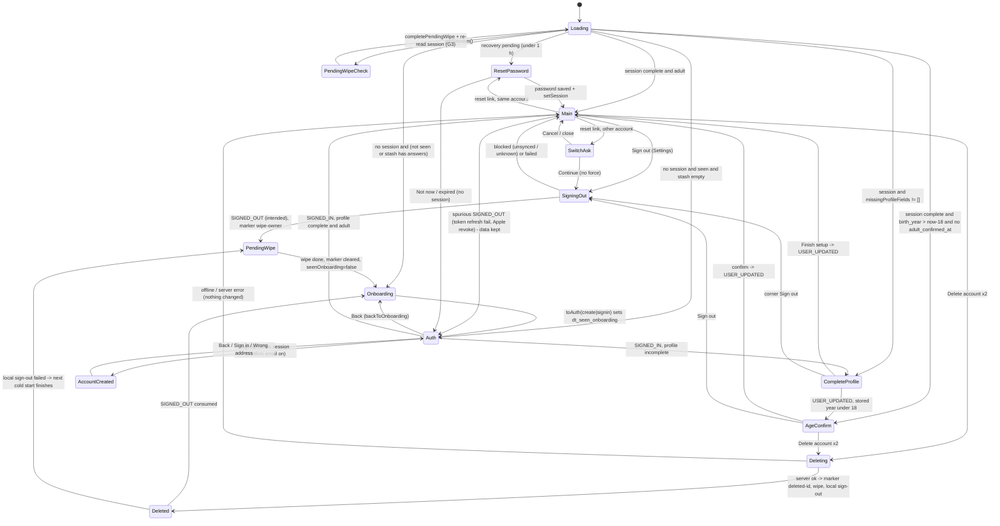
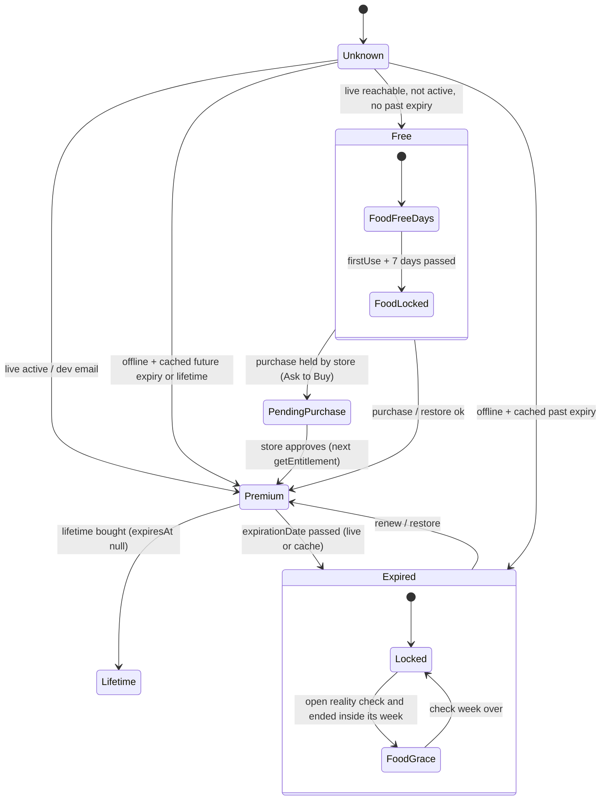
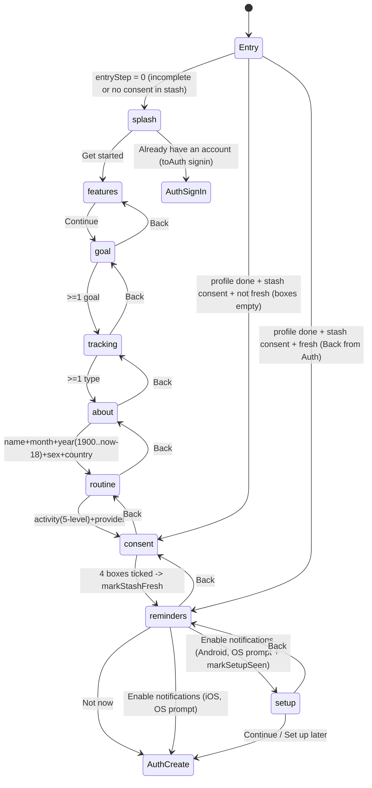

# 07 — Onboarding, account and Premium: product + technical dossier

> **Verified 2026-10-12 — corrections applied from docs/product/verification/05; where this dossier and the verification disagree, the verification wins.** (Section C, ACCT, of that report covers this dossier.)
>
> Corrections applied in this file (each marked "[Corrected 2026-10-12]" where it sits):
> 1. **"Continue with Apple" on Android IS live** (§8 row, §9 item 13 were wrong). `STATE.md:17` records the Apple and Supabase setup as done by the founder on 2026-10-03 with the redirect `dosetrace://auth-callback` added; a live probe on 2026-10-12 of `/auth/v1/authorize?provider=apple` returned 302 to `appleid.apple.com` with the Services ID, so `appleWebReady` is true and the button shows; the founder signed in with Apple on his Android Fold on 2026-10-07 (build 47). The stale source was `docs/specs/premium-and-auth.md` Manual setup step 7. Still true: the ship-check Gate B allow-list text lacks `dosetrace://auth-callback`.
> 2. **New risk:** the Apple web client secret expires **2027-04-04** (`STATE.md:17`; spec PA-123). When it lapses every Android Apple sign-in fails (the probe hides the button or the flow errors). Because Android Apple accounts are now real, the Android deletion path (manual-revoke note, no `apple-link`) and the never-saved Android Apple name (D-20) are live behaviour, not hypotheses.
> 3. **D-9 (subscription management) impact.** RevenueCat uses `appUserID` = the Supabase uid (`lib/purchases.js:68`), so after a reinstall + sign-in Premium comes back with no Restore; anyone the app shows as free reaches Restore through the Settings Premium card → paywall (`SettingsScreen.js:655`, `PaywallScreen.js:376`). The real gap: no in-app Manage / cancel, and no trial-end or billing-problem state.
> 4. **Account deletion leaves the RevenueCat customer** (app user id = Supabase uid, purchase history): `delete-user` makes no RevenueCat call — a privacy / deletion item for counsel, next to the "store subscription keeps billing" row.
> 5. **Cross-account keys (D-17, §6 table):** the curve view and the food draft are per-user keys — residue that the same user gets back, never inherited by another account; the real cross-account leaks are the device-global keys (`dosetrace_missed_since` / `_tz` / zone history, `dosetrace_vial_low_sent`, alert snoozes, `dosetrace_entitlement_last_uid`) and AI consent (D-18).

Branch `redesign/graduated`, read 2026-10-12 (HEAD 4dade55). Feeds the PRD, TRD and state-flow diagrams.
Every statement cites `path:line`. **CONFIRMED** = read in code. **SUSPECTED** = follows from code but needs a
device or runtime check. Nothing here was changed in code.

Sources read in full: `App.js`, `screens/OnboardingFlowScreen.js`, `screens/AuthScreen.js`,
`screens/ResetPasswordScreen.js`, `screens/AgeConfirmScreen.js` (logic part), `screens/PaywallScreen.js` (logic part),
`screens/SettingsScreen.js` (logic + row list), `lib/supabase.js`, `lib/accountActions.js`, `lib/signOutCore.js`,
`lib/signedOut.js`, `lib/settingsSignOut.js`, `lib/authIntent.js`, `lib/authDraft.js`, `lib/authFlow.js`,
`lib/onboardingStore.js`, `lib/onboardingSteps.js`, `lib/pendingProfile.js`, `lib/adultGate.js`, `lib/recoveryLink.js`,
`lib/recoveryFlow.js`, `lib/appleWeb.js`, `lib/appleWebCheck.js`, `lib/purchases.js`, `lib/entitlement.js`,
`lib/paywallPlans.js`, `lib/aiConsent.js`, `lib/analytics.js`, `lib/reminderSetup.js`,
`supabase/functions/delete-user/index.ts`, `supabase/functions/apple-link/index.ts`,
`supabase/functions/extract-bloodwork/quota.ts` (premium part), `supabase/functions/parse-food/index.ts` (limits part),
`docs/specs/premium-and-auth.md`, `docs/decisions.md` (relevant entries), `docs/review/features.md` (relevant rows),
`.claude/skills/ship-check` Gate B.

There is no file named `screens/Profile*.js`: the profile is edited in `SettingsScreen.js` (Edit profile sheet) and
completed in `OnboardingFlowScreen.js` (signed-in mode). `CompleteProfileScreen` and the legacy `OnboardingScreen` were
deleted (`App.js:301-303`, `App.js:318-322`; docs/decisions.md:298).

---

## 1. Purpose

| Area | Why it exists (source) |
|---|---|
| Value-before-signup onboarding | Show value first, ask for the account last; collect the profile before an account exists (docs/decisions.md:296-298; `lib/onboardingStore.js:4-9`). |
| "Before we begin" consent | Four confirmations (medical, estimates, AI, privacy) before any account; Apple 5.1.1 links at the point of collection (`lib/onboardingSteps.js:13`, `screens/OnboardingFlowScreen.js:551-553`). |
| 18+ | Adults only: typed birth year 1900…this year−18 (`lib/onboardingSteps.js:14-27`); old under-18 accounts confirm once (`lib/adultGate.js:1-8`, founder 2026-10-03 "2 sim"). |
| Profile gate (build 49) | Founder "I need the data": every account with any of 8 fields missing is held until completed (`lib/supabase.js:192-236`; docs/decisions.md:299). |
| Auth | Email + password, Google (native ID token), Apple (iOS native; Android web OAuth) (`lib/supabase.js:133-360`, `lib/appleWeb.js`). |
| Session handling | Tokens in Keychain/Keystore; no auto refresh at client creation so headless Android starts never rotate tokens (`lib/supabase.js:13-33`). |
| Sign-out | The intended sign-out pushes first, never signs out with unsynced rows unless forced, then wipes the phone (`lib/accountActions.js:109-136`, `lib/signOutCore.js`). |
| Delete account | Server deletes every row then the auth user; Apple token revoked best-effort (`supabase/functions/delete-user/index.ts`). |
| Settings | Preferences, Notifications, Data & privacy, Support, profile, Premium card, Sign out / Delete (`screens/SettingsScreen.js:72-82`). |
| Premium | RevenueCat entitlement "DoseTrace Pro"; one client helper decides every gate (`lib/entitlement.js:1-12`); server is authoritative only for AI scans (`supabase/functions/extract-bloodwork/quota.ts:6-8`). |
| AI consent | One shared device-level consent before any AI call, bumped to v4 for the protocol assistant (`lib/aiConsent.js`). |

---

## 2. Screens and entry points

### 2.1 Root routing (`App.js:291-335`, the only router for this domain)

Evaluated top-down in `ThemedRoot` on every render:

| # | Condition (exact) | Route | Screen |
|---|---|---|---|
| 0 | `loading \|\| !fontsLoaded \|\| seenOnboarding === null` | spinner | `ThemedLoading` (`App.js:786-798`) |
| 1 | `recovery` truthy | `ResetPassword` | `ResetPasswordScreen` (`App.js:291-297`) |
| 2 | `!session && seenOnboarding` | `Auth` | `AuthScreen onBack initialMode=authEntry.mode` (`App.js:299-306`) |
| 3 | `!session && !seenOnboarding` | `OnboardingFlow` | `OnboardingFlowScreen onDone` pre-account (`App.js:313-315`) |
| 4 | `session && !isProfileComplete(session.user)` | `CompleteProfile` | `OnboardingFlowScreen session` signed-in (`App.js:317-325`) |
| 5 | `session && needsAdultConfirmation(user_metadata)` | `AgeConfirm` | `AgeConfirmScreen` (`App.js:326-332`) |
| 6 | otherwise | `Main` | `MainStack` (tabs + Paywall, etc.) (`App.js:333-335`, `App.js:224-241`) |

App-level sheet (`App.js:256-267`): other-account reset question (`switchAsk`), "Email confirmed" (`justConfirmed`),
failed link (`linkFailed` = `'reset' | 'confirm' | 'offline' | 'notbacked'`).

### 2.2 Screens in this domain

| Screen | File | Entered from |
|---|---|---|
| Onboarding (pre-account, 8 steps) | `screens/OnboardingFlowScreen.js` | route 3; Back from Auth (`App.js:779-782`) |
| Finish setup (signed-in onboarding) | same file, `session` prop | route 4 |
| Auth (Create account / Sign in / Account created) | `screens/AuthScreen.js` | route 2 |
| Reset password | `screens/ResetPasswordScreen.js` | route 1 (emailed link or pending recovery) |
| 18+ confirmation | `screens/AgeConfirmScreen.js` | route 5 |
| Settings tab | `screens/SettingsScreen.js` | tab `Settings` (`App.js:186`) |
| Paywall | `screens/PaywallScreen.js` | `navigation.navigate('Paywall', { source })` from Settings (`SettingsScreen.js:655`), protocol limit (`ProtocolsScreen.js:2041`), PDF export (`BodyScreen.js:763`), lab upload (`BodyScreen.js:1441`), serum preview (`BodyScreen.js:1455`), curve (`SerumCurveScreen.js:289-292`, `LogScreen.js:522`), reality check (`CalculatorSection.js:1148`, `:1870`) |
| Reminder setup (Android, inside onboarding) | `OnboardingFlowScreen.js:565-576` | "Enable notifications" on Android (`:306-310`) |

### 2.3 Deep links (`App.js:440-519`)

| URL contains | Handling |
|---|---|
| `reset-password` | `openRecoveryLink` in an isolated client (`lib/recoveryLink.js:43-69`) → `routeRecovery` → same user / nobody: `setRecovery`; other user: `switchAsk` (`App.js:445-451`, `lib/recoveryFlow.js:33-37`) |
| `confirm-email` | with a session: ignored (`App.js:502`); else `exchangeAuthCodeFromUrl` → `justConfirmed` or `linkFailed='confirm'` (`App.js:503-511`) |
| `auth-callback` | Android Apple return after a kill: with session ignored; else `exchangeCodeForSession(code)` once (`App.js:488-497`) |

Each link is handled once: in-memory set at once, on disk (`dosetrace_links_handled`, last 20) only after success or a
non-transient error (`App.js:459-471`). A pending recovery (≤1 h, Keychain) reopens Reset password on launch (`App.js:515`).

---

## 3. User actions, writes and side effects

### 3.1 Onboarding (pre-account)

| Action | Writes / side effects | Source |
|---|---|---|
| Change language (splash pill) | `AsyncStorage dosetrace_language` | `OnboardingFlowScreen.js:664`, `i18n/LanguageContext.js:49-52` |
| Continue on any step | `saveOnboarding(stashPatch(form))` → `AsyncStorage dt_onboarding_data` (merge, only filled keys; consent written either way) | `OnboardingFlowScreen.js:245-258`, `lib/onboardingSteps.js:85-105`, `lib/onboardingStore.js:13-19` |
| Continue on "Before we begin" | `markStashFresh()` (in-memory flag: the answers are this person's) | `OnboardingFlowScreen.js:254`, `lib/onboardingStore.js:45-48` |
| "Already have an account? Sign in" (splash) | persist, `dt_seen_onboarding='1'`, `onDone('signin')` → `authEntry.mode='signin'`, `seenOnboarding=true` | `OnboardingFlowScreen.js:261-265`, `:603`; `App.js:772-776` |
| "Enable notifications" (iOS) | OS permission prompt, then `toAuth('create')` | `OnboardingFlowScreen.js:306-310` |
| "Enable notifications" (Android) | OS prompt, `dosetrace_reminder_setup_seen='1'`, show setup list (A-112 SP-4); both setup buttons → `toAuth('create')` | `OnboardingFlowScreen.js:308`, `:608-617`, `lib/reminderSetup.js:10-12` |
| "Not now" | `toAuth('create')` — no permission asked here | `OnboardingFlowScreen.js:623` |
| Terms / Privacy links | in-app `LegalModal` / `Linking.openURL(PRIVACY_URL)` | `OnboardingFlowScreen.js:554-561` |

### 3.2 Onboarding signed-in ("Finish setup", build-49 gate)

| Action | Writes | Source |
|---|---|---|
| Finish setup | `supabase.auth.updateUser({ data: accountPatch(...) })` with only the shown steps' fields, `activity_scale:5`, `onboarded_at` kept, consent only if never recorded; on success `clearOnboarding()` + `dt_seen_onboarding='1'`; gate clears on `USER_UPDATED` | `OnboardingFlowScreen.js:267-282`, `lib/onboardingSteps.js:113-148` |
| Save error | DoseTrace sheet, everything kept | `OnboardingFlowScreen.js:276-279` |
| Sign out (corner) | `signOutIntended()` (no force); blocked by orphaned rows → offer discard → retry; any non-done outcome → sheet | `OnboardingFlowScreen.js:289-302` |

### 3.3 Auth

| Action | Writes / side effects | Source |
|---|---|---|
| Type email | in-memory `authDraft` (never storage, never password) | `AuthScreen.js:135-136`, `lib/authDraft.js` |
| Create account (email) | validate (empty, email regex, ≥6 chars, consent) → `signUp({ email, password.trim(), options: { emailRedirectTo: dosetrace://confirm-email, data: signupMetadata(stash, fresh) } })`; exists → sheet, password cleared; success with fresh stash → `clearOnboarding()`; `Analytics.onboardingCompleted`; session → App routes; else "Account created" screen | `AuthScreen.js:241-296`, `lib/authFlow.js:12-47`, `lib/pendingProfile.js:45-62` |
| Sign in (email) | `signInWithPassword({ email.trim(), password.trim() })`; not confirmed → sheet with Resend | `AuthScreen.js:246-262` |
| Resend confirmation | `auth.resend({ type:'signup', emailRedirectTo })`, 30 s cooldown | `AuthScreen.js:224-233` |
| Forgot password | `resetPasswordForEmail(email, { redirectTo: dosetrace://reset-password })`; honest "If an account exists" sheet | `AuthScreen.js:208-219`, `lib/supabase.js:85-89` |
| Apple / Google from Create | consent box unticked → sheet, nothing written; ticked → stash gets `consent_accepted:true`; cancel/error → stash restored | `AuthScreen.js:183-206`, `lib/authFlow.js:106-110` |
| Google | native picker (signOut first to force chooser) → `signInWithIdToken('google')` | `lib/supabase.js:147-190` |
| Apple iOS | native → `signInWithIdToken('apple')` → `updateUser({display_name})` if Apple returned a name → fire-and-forget `apple-link` | `lib/supabase.js:303-360`, `:283-295` |
| Apple Android | button only if `appleWebAvailable()` probe passes; `signInWithOAuth` + `openAuthSessionAsync` + `exchangeCodeForSession`; restores the PKCE verifier it replaced unless it succeeded | `AuthScreen.js:78-87`, `:141-148`; `lib/appleWeb.js` |
| Back | `onBack` → `backToOnboarding` (onboarding reopens from the stash) | `AuthScreen.js:126-133`, `App.js:779-782` |

On `SIGNED_IN` (deferred, `App.js:678-735`): bump sign-in generation (inline), then: wipe-marker check, clear auth
entry + draft, consume stale intentional flag, `initPurchases(uid,email)`, `startSyncEngine`, `applyPendingProfile`,
cross-account guard, import or sync, `runRealityMigration`, notification permission + schedule + push token.

### 3.4 Reset password

| Action | Writes | Source |
|---|---|---|
| Save new password | isolated client: `setSession(pending)` → `updateUser({password})` → discard pending → main `setSession` (SIGNED_IN) | `lib/recoveryLink.js:96-127` |
| Not now | `discardPendingRecovery()`, leave | `ResetPasswordScreen.js:73-76` |
| Other-account link → Continue | `savePendingRecovery` → `signOutIntended()` → only `kind:'done'` opens reset | `App.js:815-831` |

### 3.5 18+ confirmation

| Action | Writes | Source |
|---|---|---|
| Confirm (year wheel, none preselected) | one merge write `{ adult_confirmed_at, birth_year }` | `AgeConfirmScreen.js:62-79`, `lib/adultGate.js:37-41` |
| Download my data | import first if local DB empty, then `exportMyData` | `AgeConfirmScreen.js:81-93` |
| Delete account | two sheets → `requestAccountDeletion` → teardown | `AgeConfirmScreen.js:96-135` |
| Sign out | confirm sheet → `signOutIntended()` (no force) | `AgeConfirmScreen.js:138-160` |

### 3.6 Settings

| Group / row | Writes | Source |
|---|---|---|
| Profile card → Edit profile → Save | blocks if any of name, birth month, birth year, sex, country, goals, activity, provider missing; else `updateUser({ display_name, gender, birth_month, birth_year, country, primary_goal, activity_level, activity_scale:5, [activity_set_at], [activity_level_legacy], has_provider })` | `SettingsScreen.js:303-344` |
| Premium card (free only) | navigate Paywall `source:'settings'` | `SettingsScreen.js:635-659` |
| Preferences: Appearance | `dosetrace_theme_mode` | `SettingsScreen.js:912-926`, `lib/theme.js:108-135` |
| Preferences: Time format | `dosetrace_time_format` (`auto/12h/24h`) | `SettingsScreen.js:930-942`, `i18n/LanguageContext.js:54-57` |
| Preferences: Language | `dosetrace_language` | `i18n/LanguageContext.js:49-52` |
| Notifications: Android setup row | navigate `ReminderCheck` | `SettingsScreen.js:678-692` |
| Notifications switches | `updateUser({ [key]: val })` for `dose_reminders`, `checkin_reminders`, `food_reminders`, `notif_show_names`, `vial_alerts`, `silent_mode`, `persistent_reminders`; revert + sheet on error; then `syncAllNotifications` | `SettingsScreen.js:282-296`, `:703-781` |
| Notifications: Reminder check (iOS) | navigate `ReminderCheck` | `SettingsScreen.js:785-800` |
| Data & privacy: Privacy policy / Terms / Disclaimer | in-app `LegalModal` | `SettingsScreen.js:809-830`, `:1199-1220` |
| Data & privacy: Usage analytics | `updateUser({ analytics_opt_in })` (no error handling) | `SettingsScreen.js:298-301` |
| Data & privacy: Adherence report | scan missed doses, build text, preview, Share | `SettingsScreen.js:359-473` |
| Data & privacy: Download my data | `exportMyData` → `dosetrace_export.json` → share sheet | `SettingsScreen.js:346-357`, `lib/accountActions.js:18-35` |
| Support: FAQ / Contact (mailto) / Rate | navigation / `Linking` | `SettingsScreen.js:581-595` |
| Sign out | confirm → `runSignOut` (busy guard) → blocked sheet offers Stay / discard orphans / **Sign out anyway (force)** | `SettingsScreen.js:475-521`, `lib/settingsSignOut.js` |
| Delete account | two confirmations → `requestAccountDeletion` → (Apple note) → teardown | `SettingsScreen.js:523-579` |
| Section open/closed | `dosetrace_settings_collapsed` | `SettingsScreen.js:167-184` |

### 3.7 Paywall

| Action | Writes / side effects | Source |
|---|---|---|
| Open | `Analytics.viewed('paywall')`, `dosetrace_paywall_views` +1, `paywall_viewed{source}`; load offerings + entitlement + iOS trial eligibility before showing any buy button; already Premium → "You already have Premium" | `PaywallScreen.js:116-147` |
| Buy | `purchasePackage`; then `getEntitlement()` (writes cache); outcome premium/pending/failed/cancelled; Lifetime over a renewing sub → cancel-in-store sheet; `purchase_completed`, `onSuccess()` | `PaywallScreen.js:166-198`, `lib/purchases.js:151-172`, `lib/paywallPlans.js:124-142` |
| Restore | `restorePurchases` → restored / none / failed | `PaywallScreen.js:200-218`, `lib/purchases.js:182-190` |
| Back while store busy | blocked (gesture off, hardware back swallowed) | `PaywallScreen.js:92-98` |

### 3.8 Sign-out and deletion side effects (the wipe)

`runWipeSteps` (`lib/signedOut.js:158-170`), each step isolated: `clearLocalDatabase` (11 SQLite tables,
`lib/database.js:730-743`), `cancelAllNotifications`, `dismissAllNotifications`, `logOutPurchases`, `clearOnboarding`
(`dt_onboarding_data`), remove `dosetrace_rc_start`, `clearRealityDeviceFlags` (`dosetrace_rc_pulled_*`,
`dosetrace_rc_store_migrated_*`, `lib/realityCheckStore.js:126-128`), `clearSeenOnboarding` (`dt_seen_onboarding`), remove
site questions (`QUESTIONS_KEY`), `resetAllSelections` (memory), `clearAllDrafts` (memory, `lib/draftStore.js:41-42`).
Before the wipe the deliberate sign-out deletes this device's `push_tokens` row (`lib/notifications.js:1059-1072`).

---

## 4. Rules (numbered, with sources)

### Onboarding
- **R1** Pre-account steps are exactly `splash, features, goal, tracking, about, routine, consent, reminders` (`lib/onboardingSteps.js:12`); no "You're all set" (PA-30).
- **R2** Continue is enabled only when: goal ≥1; tracking ≥1; about = name + male/female + country + month + valid year; routine = a 5-level activity + provider; consent = all 4 boxes ticked in this screen (`lib/onboardingSteps.js:44-55`).
- **R3** Birth year: 4 digits, 1900…(this year − 18); out of range shows the adults note and keeps Continue dim (`lib/onboardingSteps.js:22-27`; `OnboardingFlowScreen.js:466`). Year only; the month is not used for the 18+ test (docs/specs/premium-and-auth.md:133).
- **R4** Only filled keys are stashed; consent is written true/false every time (`lib/onboardingSteps.js:85-105`).
- **R5** Entry step on reopen: profile incomplete or no stored consent → 0 (welcome); else `reminders` if consent was given in this run, otherwise `consent` with the boxes empty (`lib/onboardingSteps.js:168-173`; `OnboardingFlowScreen.js:118-124`).
- **R6** App shows onboarding instead of Auth when the stash has answers even if `dt_seen_onboarding='1'` (`App.js:605-607`); read error → treated as seen.
- **R7** Signed-in steps: only the missing groups (`goal`, `tracking`, `about` for any of name/age/sex/country, `routine` for activity/provider), plus `consent` if `!meta.consent_accepted`, plus `finish`; no reminders step (`lib/onboardingSteps.js:29-40`). Step index is clamped when the list shrinks (`OnboardingFlowScreen.js:174-176`).
- **R8** Finish setup writes only the shown steps' fields; never blanks a hidden field (`lib/onboardingSteps.js:113-148`).
- **R9** Android: "Enable notifications" marks the setup seen and shows the setup list; Today opens it once for an Android user with a timed protocol who has not seen it (`lib/reminderSetup.js:14-21`).

### Stash / shared device (PA-71…PA-73)
- **R10** The stash is "fresh" only in memory and only after passing "Before we begin" in this run (`lib/onboardingStore.js:41-48`).
- **R11** Not fresh → never written into any account; cleared unwritten on `SIGNED_IN` (`lib/onboardingStore.js:76`; `lib/pendingProfile.js:25-26`, `:45-46`).
- **R12** Fresh → fills only fields the account is missing; consent only if never recorded; `onboarded_at` kept (`lib/pendingProfile.js:25-42`).
- **R13** Write failure or offline (`getUser` fails) → stash kept for the next `SIGNED_IN` (`lib/onboardingStore.js:82-88`).
- **R14** Any `SIGNED_OUT` ends freshness; an intended one also reads the stash as empty at once (`lib/signedOut.js:15-26`, `lib/onboardingStore.js:38-39`).

### Auth
- **R15** Email regex `^\S+@\S+\.\S+$`; password min 6 on create; password is trimmed on sign-up, sign-in and reset alike (`lib/authFlow.js:7-32`; PA-86).
- **R16** Create account always shows the consent row with Terms + Privacy; ticked by default only for the fresh person whose stash has consent (`AuthScreen.js:170-173`, `lib/authFlow.js:98-100`).
- **R17** Apple/Google from Create need the box ticked (PA-80) (`AuthScreen.js:186-188`).
- **R18** Duplicate sign-up detected by `identities.length === 0` (`lib/authFlow.js:35-38`).
- **R19** Auth opens on what was asked; else Create if the stash has consent, else Sign in (`lib/authFlow.js:91-94`).
- **R20** Google always shows the account chooser (`lib/supabase.js:157-161`).
- **R21** Apple on Android shows only if `/auth/v1/settings` has `external.apple` and `/authorize` lands on `appleid.apple.com` with a `client_id` ≠ bundle id; probe repeated after offline (`lib/appleWeb.js:21-42`, `lib/appleWebCheck.js:35-41`).
- **R22** Every message is a DoseTrace sheet; raw server text never shown (`lib/authFlow.js:1-5`, `:55-65`; PA-64).

### Session
- **R23** `autoRefreshToken:false`, `persistSession:true`, `detectSessionInUrl:false`, `flowType:'pkce'`, storage = chunked SecureStore (`lib/supabase.js:13-33`; `lib/secureStore.js`).
- **R24** Auto refresh runs only while `AppState === 'active'` (`App.js:563-566`).
- **R25** Headless background refresh reads the stored user (`setStoredSessionOnly`) and never calls `getSession` (`lib/notifications.js:58`, `lib/supabase.js:40-59`).
- **R26** `onAuthStateChange` is synchronous: `setSession` first, everything else in `setTimeout` (`App.js:660-736`; Gate B).

### Sign-out / wipe
- **R27** Intended sign-out: `forceSync` → count pending rows of local owner AND session user (error → blocked "unknown") → if >0 and not forced: blocked → remove push token → recount → mark intent → Google signOut → strict storage → `signOut({scope:'local'})` → if still signed in, `_removeSession` under the auth lock → success only if no session AND the SIGNED_OUT handler consumed the flag (`lib/signOutCore.js:59-92`; `lib/recoveryFlow.js:101-105`).
- **R28** Only `Settings` offers "Sign out anyway" (force) (`SettingsScreen.js:495-507`); Finish setup, 18+ sheet and the reset Continue never force (`OnboardingFlowScreen.js:293`, `AgeConfirmScreen.js:148`, `lib/recoveryLink.js:133-135`).
- **R29** SIGNED_OUT inline: end freshness, drop queued notification nav, consume intent; intended → discard stash, clear draft, `seenOnboarding=false` (`lib/signedOut.js:15-26`).
- **R30** SIGNED_OUT deferred: stop sync; spurious → keep all local data; intended → write `dosetrace_wipe_pending = wipe:<owner>` (or `'1'`), wipe now, wait for sync idle, second `clearLocalDatabase` inside the sync runner unless a new sign-in happened, clear marker (`lib/signedOut.js:36-62`).
- **R31** Cold start: a pending marker with no session wipes only if the local data has no owner or belongs to the marked id; with a session it is dropped unless it is `deleted:<that user>` (then wipe + local sign-out once) (`lib/signedOut.js:72-116`); the session is re-read after (`App.js:609-617`, `lib/signedOut.js:136-145`).
- **R32** Cross-account guard: on cold start and `SIGNED_IN`, if `getLocalDataUserId() !== session.user.id` → clear DB, rc start, rc flags, notifications, drafts, selections, site questions (`App.js:621-634`, `:701-716`; docs/decisions.md:508-509).
- **R33** Apple credential revoked in iOS Settings → local sign-out, not flagged intended → data kept (`App.js:738-757`).

### Delete account
- **R34** Two confirmations (`SettingsScreen.js:523-541`; `AgeConfirmScreen.js:96-113`); offline → "can't delete offline" sheet, nothing changes (`lib/accountActions.js:56-58`).
- **R35** Server: verify JWT → Apple revoke best effort (never blocks) → delete rows of 20 tables + referrals → `auth.admin.deleteUser` → `{ appleRevoked, appleManualRevokeNeeded }` (`supabase/functions/delete-user/index.ts:44-180`). The list must be a superset of `syncCore` TABLES (test `deleteUserCoverage`).
- **R36** Client teardown: marker `deleted:<id>`, wipe now, mark intent, Google signOut+revoke, local sign-out (retry once), failed if still signed in or flag unconsumed (`lib/signOutCore.js:100-117`, `lib/accountActions.js:70-83`). Runs exactly once however the Apple note closes (PA-121).

### Profile gate and 18+
- **R37** Required fields: `name` (display_name trimmed), `age` (birth_year AND birth_month non-null), `sex` (male/female), `country`, `goal` (primary_goal), `activity` (activity_level), `tracking` (non-empty array), `provider` (has_provider non-empty) (`lib/supabase.js:203-222`).
- **R38** `PROFILE_GATE_SINCE = 2020-01-01` → nobody grandfathered; rollback lever is moving the date (`lib/supabase.js:224-236`).
- **R39** 18+ gate: stored 4-digit birth_year > this year − 18 and no `adult_confirmed_at` (`lib/adultGate.js:19-24`). Comes after the profile gate (`App.js:317-332`).

### Premium
- **R40** Entitlement id `DoseTrace Pro`; products `monthly`, `yearly`, `lifetime` (`lib/purchases.js:12-19`); RevenueCat app user id = Supabase user id (`lib/purchases.js:61-69`).
- **R41** `DEVELOPER_EMAILS` (6 addresses incl. the review account) are Premium on the client (`lib/purchases.js:24-31`, `:79`); server keeps the identical `PREMIUM_EMAILS` (`quota.ts:16-31`).
- **R42** Entitlement: live answer cached per uid with expiry; offline → cache: future expiry or lifetime = Premium, past = not Premium with `endedOn`, no cache = free (`lib/entitlement.js:26-41`). Cache uid = RevenueCat uid, else last uid; never the Supabase session (`:46-51`).
- **R43** Free limits as built: 3 **active** protocols (`ProtocolsScreen.js:113`, `:1880`, `:2046-2050`); restore at the limit goes to Ended (`:1305-1310`); AI scans 3/month free, 20 Premium, shared pool, server-enforced (`quota.ts:10-11`); food log 7 free days from the first-use anchor (`lib/foodThread.js:249-269`, `lib/foodLogActions.js:177-205`); AI food parse 25/day for everyone (`parse-food/index.ts:28-29`); protocol assistant 10 conversations/week for everyone (`protocol-assistant/budget.ts:8`).
- **R44** Premium-only surfaces: serum curve / Dose accumulation (`SerumCurveScreen.js:289`, `LogScreen.js:522`, `JourneyScreen.js:113-118`, `BodyScreen.js:385-400`); PDF export (`BodyScreen.js:757`); reality-check start + result after free days (`lib/weighInAccess.js:9-12`, `CalculatorSection.js:813-814`); target ETA (`CalculatorSection.js:1239-1240`); unlimited protocols. Weigh-ins never paywalled (docs/decisions.md:229).
- **R45** Paywall: prices only from the store; Annual preselected; trial only when the store says eligible and the length is known; four buy states (`lib/paywallPlans.js`; PA-5…PA-16).

### AI consent
- **R46** One key `dosetrace_ai_extraction_consent_v4` = `'granted'` covers lab, vaccine, vial scans, food chat and the protocol assistant; asked in a DoseTrace sheet before the first call (`lib/aiConsent.js:19-35`; callers `BodyScreen.js:466`, `ProtocolsScreen.js:1625`, `:1720`, `VaccinesSection.js:137`, `FoodChatScreen.js:259`). v2 vial, v3 food, v4 assistant (`lib/aiConsent.js:10-18`).

---

## 5. State machines

### 5.1 User / session state

| State | Exact condition in code |
|---|---|
| Loading | `loading \|\| !fontsLoaded \|\| seenOnboarding === null` (`App.js:786`) |
| Anonymous, first run (Onboarding) | `!session && !seenOnboarding`; `seenOnboarding = hasSeenOnboarding() && !hasAnswers(stash)` (`App.js:605-607`, `:313`) |
| Anonymous, returning (Auth) | `!session && seenOnboarding` (`App.js:299-306`) |
| Recovering password | `recovery != null` (beats every other state) (`App.js:291`) |
| Signed in, incomplete profile | `session && !isProfileComplete(session.user)` (`App.js:317`) |
| Signed in, under-18 unconfirmed | `session && isProfileComplete && needsAdultConfirmation(meta)` (`App.js:326`) |
| Signed in (Main) | otherwise (`App.js:333`) |
| Signing out | between `intent.mark()` and the SIGNED_OUT handler (`lib/signOutCore.js:78-91`); UI: Settings spinner via busy guard (`SettingsScreen.js:476-479`) |
| Pending wipe | AsyncStorage `dosetrace_wipe_pending` ∈ `wipe:<id>` / `deleted:<id>` / `'1'` (`lib/signedOut.js:45`, `lib/signOutCore.js:101`) |
| Deleted | server account gone; local marker `deleted:<id>` until local sign-out succeeds (`lib/signOutCore.js:100-117`) |

### 5.2 Entitlement state

The client knows only `{ premium, known, source, expiresAt, endedOn }` (`lib/entitlement.js:25`). It does **not**
read RevenueCat `periodType`, `willRenew` (except after a purchase, `lib/purchases.js:159-160`) or billing-issue
fields, so a store free trial, a store billing grace period and a paid period are indistinguishable (all `premium:true`
while RevenueCat's entitlement is active). "Grace" exists only as the food-log rule for a lapsed payer.

| State | Condition |
|---|---|
| Unknown → Free | no live answer, no cache: `{premium:false, known:false}` (`lib/entitlement.js:40`) |
| Free | live `premium:false` with no past expiry, or cache `premium:false` (`:27-31`, `:39`) |
| Premium (sub, incl. store trial / store grace) | live `entitlements.active['DoseTrace Pro']` present (`lib/purchases.js:83-84`) or cache `premium:true` with future `expiresAt` (`lib/entitlement.js:36`) |
| Premium lifetime | `expiresAt == null` with premium (`lib/entitlement.js:34`) |
| Premium (developer) | email in `DEVELOPER_EMAILS` (`lib/purchases.js:79`) |
| Expired (lapsed payer) | live not active but `entitlements.all[...].expirationDate` exists → `endedOn` (`lib/purchases.js:85-89`); cache past expiry (`lib/entitlement.js:37`) |
| Food-log "grace" (lapsed payer, open check) | `premiumEndedOn` ≥ check start and today ≤ end of that check week (`lib/foodThread.js:257-263`) |
| Food-log "trial" (= free days, not a store trial) | no Premium and today ≤ firstUse + 6 (`lib/foodThread.js:253-268`) |
| Pending purchase | `purchaseOutcome` → `'pending'` (Ask to Buy, or paid but entitlement not active yet) — not stored anywhere (`lib/paywallPlans.js:125-131`) |

### 5.3 Onboarding step machine

Pre-account (`lib/onboardingSteps.js:12`, `OnboardingFlowScreen.js:250-265`, `:597-644`):

Signed-in ("Finish setup", `lib/onboardingSteps.js:29-40`): ordered subset of `goal → tracking → about → routine →
consent → finish`; `finish` writes `accountPatch`; success → `USER_UPDATED` → App re-evaluates the gate. No `splash`,
`features` or `reminders`. A Sign-out link replaces the right side of the top bar (`OnboardingFlowScreen.js:327-333`).

---

## 6. STATE OWNERSHIP AUDIT

For each derived state: every place that computes it, then divergences.

### 6.1 isPremium / "can use Premium feature X"

| # | Where | How |
|---|---|---|
| P1 | `lib/purchases.js:77-93` `readLiveEntitlement` | dev email → true; SDK `entitlements.active['DoseTrace Pro']` |
| P2 | `lib/entitlement.js:26-75` `entitlementFrom` / `getEntitlement` / `hasPremium` | live or per-uid cache |
| P3 | `lib/purchases.js:151-161`, `:182-186` | `purchasePackage` / `restorePurchases` return their own `premium` from `customerInfo`; Paywall uses `result.premium \|\| premiumNow` (`lib/paywallPlans.js:127`, `:135`) |
| P4 | `supabase/functions/extract-bloodwork/quota.ts:30-61` | server: `PREMIUM_EMAILS` or RevenueCat REST `active`, **and `unreachable` counts as Premium** (`:59`); `misconfigured` = free |
| P5 | `lib/foodThread.js:250-269` `foodLogAccess` | combines P2 premium + `endedOn` + free-day anchor + open check |
| P6 | `lib/weighInAccess.js:9-12` | `canStart/canSeeResult = premium \|\| rcFree` where `rcFree = loadFoodAccess().access.canLog` (`CalculatorSection.js:216-220`) |
| P7 | `ProtocolsScreen.js:1880`, `:2046-2050` | `activeCount >= 3 && !hasPremium()` |
| P8 | `JourneyScreen.js:113-118`, `:137` | curve page / Est. level only when `premium === true`; `null` = wait |
| P9 | `BodyScreen.js:385-400`, `:757` | Est. level and PDF export |
| P10 | `SerumCurveScreen.js:289`, `LogScreen.js:522` | curve screen entry |
| P11 | `SettingsScreen.js:256` | badge + Premium card |
| P12 | `supabase/functions/send-reminders/plan.ts:110-113` | `remindersForAccess(access)` exists, but the sender does not compute access yet (`send-reminders/index.ts:195-196` "NOT YET") |
| P13 | `supabase/functions/parse-food/index.ts` | **no Premium / free-day check at all** (only 25/day + 24 h ceiling, `:152-173`) |

Divergences:
- **CONFIRMED D-1 (server vs client, scans):** RevenueCat unreachable → server grants the Premium budget of 20 to everyone past 3 (`quota.ts:59`); client in the same outage uses its cache (free user = free). Deliberate per docs/decisions.md:275, but the two disagree on who is Premium during an outage.
- **CONFIRMED D-2 (food log lock is client-only):** the 7-free-days lock and the lapsed-payer lock live only in `foodLogAccess` on the phone; `parse-food` accepts any signed-in user up to 25 parses/day. A modified or old client bypasses the lock.
- **CONFIRMED D-3 (protocol limit client-only):** no server/migration enforces 3 active protocols (no match in `supabase/migrations`); a second device with stale local counts or an old build can exceed it; sync accepts the rows.
- **CONFIRMED D-4 (server push ignores access):** `send-reminders` would ask locked users the 8 PM food question (A-62; `index.ts:195-196`). Inactive while `SERVER_PUSH_ACTIVE = false` (`lib/notifications.js:1079`).
- **CONFIRMED D-5 (two answers after purchase):** P3 vs P2 can differ for a moment (e.g. purchase success with entitlement not active → `'pending'`); handled by `purchaseOutcome`, but it is a second derivation.
- **CONFIRMED D-6 (naming):** `foodLogAccess.mode === 'trial'` means the 7 free food-log days, not a store free trial; the paywall's "trial" is the store intro offer (`lib/paywallPlans.js:68-90`). Same word, two concepts.
- **SUSPECTED D-7 (cross-account cache window):** `logOutPurchases` nulls `_currentUserId` (`lib/purchases.js:99-101`) but the wipe never removes `dosetrace_entitlement_v1:<uid>` or `dosetrace_entitlement_last_uid` (`lib/signedOut.js:158-163`). On a new `SIGNED_IN`, `initPurchases` runs only after `await markerOnSignIn(...)` inside the deferred block (`App.js:685`, `:693`). A screen that calls `getEntitlement()` in that window uses `lastUid` = the previous account: online, the anonymous RevenueCat answer (`premium:false`) is written into the previous account's cache; offline, the previous account's cached Premium is shown to the new account. Window is milliseconds on the normal path; needs a device check.
- **CONFIRMED D-8 (store trial / billing grace invisible):** no code reads `periodType` or billing-issue state, so the app cannot say "trial ends on…" or "payment problem" (Settings only shows Premium / Free, `SettingsScreen.js:617`).
- **CONFIRMED D-9 (no subscription management in Settings):** Settings has no Restore or Manage subscription row (grep `restore|manage|subscription` in `SettingsScreen.js` → only a comment at :255); Restore exists only on the Paywall, which a Premium user is sent away from ("You already have Premium", `PaywallScreen.js:131`). [Corrected 2026-10-12: a reinstall restores Premium on sign-in through RevenueCat `appUserID` = uid, and anyone shown as free reaches Restore via the Settings Premium card; the real gap is Manage / cancel and trial / billing state.]
- Reality-check result rule matches the ledger: free days count from the start tap (`CalculatorSection.js:889-890`), so by day 21 a free user is locked; a lapsed payer in the check week keeps it (`lib/foodThread.js:257-263`). No divergence found.

### 6.2 Profile complete / missing fields

| Where | Rule |
|---|---|
| `lib/supabase.js:203-236` | `missingProfileFields`, `isProfileComplete` (8 fields + grandfather date) — App gate `App.js:317` |
| `OnboardingFlowScreen.js:166-170` | `missingProfileFields(session.user)` → `activeSteps` |
| `lib/onboardingSteps.js:44-55` | `canContinue` per step (stricter: birth year range, 5-level activity) |
| `SettingsScreen.js:303-319` | own list of 8 checks (name, month, year, sex, country, goals, activity, provider) |
| `lib/pendingProfile.js:16-21` | `FIELDS` / `hasAnswers` (9 keys) |

Divergences:
- **CONFIRMED D-10:** Settings validates `tracking`? No — Settings has no "what you track" editor and its list omits it (`SettingsScreen.js:307-315`), while the gate requires it (`lib/supabase.js:213`). A user can only fix `tracking_types` through the gate.
- **CONFIRMED D-11 (validity differs from presence):** the gate checks only `birth_year != null && birth_month != null` and `!!activity_level` (`lib/supabase.js:208-212`); onboarding requires a year in range and a 5-level key. An account with `birth_year: "abc"` or an old 4-level activity passes the gate; the 18+ gate ignores a non-4-digit year (`lib/adultGate.js:11-17`). Not reachable from current UI, possible with old data.
- **CONFIRMED D-12 (country):** ledger conflict 15 (docs/decisions.md:413) says one memory dropped country; the code requires it and the 2026-10-03 resolution says "country stays required" (docs/decisions.md:456). Code = resolution.
- **CONFIRMED D-13 (dead constant):** `BIRTH_YEARS` (this year−18 … this year−90) is built but unused (`SettingsScreen.js:68-70`); the typed year uses 1900…this year−18 (`SettingsScreen.js:1277-1283`).

### 6.3 Onboarding seen

| Where | Rule |
|---|---|
| `lib/onboardingStore.js:50-63` | `dt_seen_onboarding === '1'` |
| `App.js:605-607` | React state `seenOnboarding = seen && !hasAnswers(stash)`; error → true |
| `App.js:772-776`, `OnboardingFlowScreen.js:261-265` | both call `markSeenOnboarding()` on hand-off (double write) |
| `OnboardingFlowScreen.js:281` | signed-in Finish also marks seen |
| `lib/signedOut.js:24`, wipe step `clearSeenOnboarding` | intended sign-out → false + key removed |
| `App.js:779-782` | Back from Auth → state false (key stays '1') |

- **CONFIRMED D-14:** the persisted flag and the routing state can disagree by design (stash with answers overrides `seen`), so after a restart a user who typed some answers then chose "Sign in" lands back on onboarding (step 0 unless profile + consent complete), not on Sign in.
- **CONFIRMED D-15 (dead prop):** `authEntry.consent` is always `false` (`App.js:364`, `:687`, `:774`, `:780`) and AuthScreen never reads it (signature `AuthScreen({ onBack, initialMode })`, `AuthScreen.js:114`). The comment at `App.js:361-363` ("consent box ticked") describes AuthScreen's own logic, not this prop.

### 6.4 Session valid

| Where | Rule on `getSession()` error |
|---|---|
| `App.js:609-617` | `data.session` or null → error = signed out in the UI |
| `lib/signOutCore.js:14-23` `hasSession` | error = **still signed in** (R2) |
| `lib/supabase.js:40-44` `getCachedUser` | `session?.user` or the stored user when headless |
| `lib/supabase.js:52-59` `readStoredUser` | raw Keychain read, no network |
| `lib/accountActions.js:41-43` | no session → `noSession` |
| `App.js:442` (links) | error → null |

- **SUSPECTED D-16:** offline cold start with an expired access token: the sign-out code documents that `getSession()` resolves `{ session:null, error }` while the session is still stored (`lib/signOutCore.js:16-18`). App then routes to Auth/Onboarding (`App.js:617`) even though the user is signed in on disk and local data is kept. Recovery relies on a later `TOKEN_REFRESHED`/`SIGNED_IN` event once online (foreground auto refresh, `App.js:563-566`). Needs a device check (airplane mode, token older than 1 h).

### 6.5 Local data owner

| Where | Rule |
|---|---|
| `lib/database.js:820-829` `getLocalDataUserId` | first non-null `user_id` scanning 10 tables in order (vials not scanned) |
| `App.js:384`, `:614`, `:624`, `:706` | wipe marker owner, pending-wipe check, both cross-account guards |
| `lib/accountActions.js:122-128` | pending count for local owner + session user |
| `lib/accountActions.js:88-93` | orphan owners |

- **CONFIRMED D-17:** device-level stores keyed by user id are not part of the wipe and outlive sign-out: `dosetrace_curve_view_<uid>` (`lib/curveView.js:12`), `dosetrace_explainers_v1:<uid>` (`lib/featureExplainers.js:54`), `dosetrace_food_draft:<uid>` (`FoodChatScreen.js:55`), `dosetrace_entitlement_v1:<uid>`. Same user signing back in gets them back; another user cannot read them. The chat draft surviving a real sign-out differs from the BK-14 rule "a real sign-out clears drafts" (docs/decisions.md:378), which `clearAllDrafts` honours only for the in-memory store.

### 6.6 Consent (terms) and AI consent

| Where | What |
|---|---|
| `lib/onboardingSteps.js:53`, `:97-100` | onboarding 4 boxes → stash `consent_accepted/consent_date` |
| `lib/pendingProfile.js:34-37`, `:50-51` | into account metadata (sign-up always `true`) |
| `lib/onboardingSteps.js:143-146` | Finish setup records it if never recorded |
| `AuthScreen.js:429-446`, `lib/authFlow.js:106-110` | Create-account box; social patch |
| `lib/aiConsent.js` | AI consent, device AsyncStorage |

- **CONFIRMED D-18 (AI consent is device-scoped):** `dosetrace_ai_extraction_consent_v4` is not in the wipe (`lib/signedOut.js:158-163`) and is not tied to the account. A second person who signs in on the same phone is never asked before their scans/meals/answers go to Anthropic; after a reinstall or on a second device the same person is asked again. The ledger rule is "AI consent before every AI call … one shared consent key" (docs/decisions.md:323), and regulatory A-95 lists "consent proof on the server" as not started (docs/review/features.md:236).
- **CONFIRMED D-19 (two consents):** the onboarding "AI" box is folded into one `consent_accepted` boolean with the other three (`lib/onboardingSteps.js:97-100`); there is no record of which version of the four terms was accepted, and no in-app way to withdraw the AI consent once granted.

### 6.7 Display name source

- **CONFIRMED D-20:** `display_name` is written by onboarding/sign-up, Finish setup, Settings, and Apple iOS native when Apple returns a name (`lib/supabase.js:333-340`, this write overwrites an existing `display_name`, the comment says only "never … with null"). Google and Apple-on-Android never write it; the app reads only `display_name` (`lib/supabase.js:207`), so those users always get the `about` step if the stash was not fresh.

### 6.8 Privacy policy text

- **CONFIRMED D-21:** Settings opens an in-app `LegalModal` (`SettingsScreen.js:809`, `:1206`); onboarding, Auth and the paywall open `https://dosetrace.io/privacy-policy` (`OnboardingFlowScreen.js:558`, `AuthScreen.js:439`, `lib/legalLinks`). Two texts; A-117 aims to make them identical (docs/review/features.md:257).

### 6.9 Error handling of profile writes

- **CONFIRMED D-22:** `saveProfile` awaits `updateUser` but never reads its `{ error }` (`SettingsScreen.js:320-343`); supabase-js resolves errors instead of throwing, so an offline save closes the sheet and re-reads the old profile without a message. `toggleAnalytics` has the same pattern and no revert (`SettingsScreen.js:298-301`). Compare `toggleNotificationPref` (reverts + sheet, `:282-296`), Finish setup and the 18+ confirm (both read `error`).

### 6.10 Export precondition

- **CONFIRMED D-23:** the 18+ sheet imports from the cloud first when the local DB is empty (`AgeConfirmScreen.js:85-86`, PA-127); Settings does not (`SettingsScreen.js:346-357`). Settings is normally reached only after the cold-start import (`App.js:636-639`), but if that import failed offline the Settings export is the empty local DB.
- **CONFIRMED D-24:** the export is every synced table + `user_email` (`lib/accountActions.js:18-35`, `lib/database.js:834-841`); the profile and preferences in `user_metadata` (name, birth date, sex, country, goals, activity, provider, notification switches, `favorite_markers`, `report_tags`, `calc_*` mirrors) are not exported. features.md F-072/F-084 notes saying food logs etc. are missing are stale (S-07 is built via `exportTableNames(TABLES)`).

---

## 7. Data

### 7.1 Supabase `user_metadata` keys (written by this domain or read by it)

| Key | Written by | Read by |
|---|---|---|
| `display_name` | sign-up, Finish setup, Settings, Apple iOS | gate, Settings, report |
| `birth_year`, `birth_month` (1-based) | sign-up, Finish setup, Settings, 18+ confirm (year) | gate, 18+ gate, calculator |
| `gender` (`male`/`female`) | sign-up, Finish setup, Settings, Calculator `saveProfileSex` (`CalculatorSection.js:458-463`) | gate, BMR |
| `country`, `primary_goal` (comma list), `tracking_types` (array), `has_provider` (`yes`/`no`) | sign-up, Finish setup, Settings (not tracking) | gate |
| `activity_level` (5-level key), `activity_scale: 5`, `activity_set_at`, `activity_level_legacy` | sign-up, Finish setup, Settings, Calculator `chooseActivity` (`CalculatorSection.js:403-412`) | gate, calculator |
| `consent_accepted`, `consent_date` | sign-up, `applyPendingProfile`, Finish setup | signed-in onboarding (consent step shown if false) |
| `onboarded_at` | sign-up, `applyPendingProfile`, Finish setup | — |
| `adult_confirmed_at` | 18+ confirm | 18+ gate |
| `analytics_opt_in` | Settings | `lib/analytics.js:39` |
| `dose_reminders`, `checkin_reminders`, `food_reminders`, `notif_show_names`, `vial_alerts`, `silent_mode`, `persistent_reminders` | Settings / NutritionLogger | `lib/notifications.js` |
| `favorite_markers`, `report_tags` | BodyScreen | BodyScreen |
| `calc_reality_open`, `calc_inputs`, `calc_history_migrated_v55`, `rc_store_migrated` | reality check / calculator mirrors | migration |

All writes are top-level merges (`updateUser({ data })`); none writes back a whole object computed from a stale read in this domain.

### 7.2 Device storage

| Key | Store | Wiped on intended sign-out / delete? | Source |
|---|---|---|---|
| Supabase session (`<storageKey>` chunks + `.__meta`), PKCE `<storageKey>-code-verifier` | SecureStore | removed by local sign-out | `lib/secureStore.js`, `lib/appleWeb.js:49` |
| `dosetrace_pending_recovery` | SecureStore | no (1 h TTL, cleared on use / Not now) | `lib/recoveryLink.js:16` |
| `dt_onboarding_data` | AsyncStorage | yes | `lib/onboardingStore.js:10` |
| `dt_seen_onboarding` | AsyncStorage | yes | `lib/onboardingStore.js:11` |
| `dosetrace_wipe_pending` | AsyncStorage | cleared after wipe | `lib/signedOut.js:172` |
| `dosetrace_rc_start`, `dosetrace_rc_pulled_<uid>`, `dosetrace_rc_store_migrated_<uid>` | AsyncStorage | yes | `App.js:393-394` |
| `dosetrace_site_questions` | AsyncStorage | yes | `App.js:396` |
| `dosetrace_ai_extraction_consent_v4` | AsyncStorage | **no** | `lib/aiConsent.js:19` |
| `dosetrace_entitlement_v1:<uid>`, `dosetrace_entitlement_last_uid` | AsyncStorage | **no** | `lib/entitlement.js:43-44` |
| `dosetrace_language`, `dosetrace_time_format`, `dosetrace_theme_mode` | AsyncStorage | no (device prefs) | `i18n/LanguageContext.js`, `lib/theme.js:108` |
| `dosetrace_reminder_setup_seen` | AsyncStorage | no (per phone by design) | `lib/reminderSetup.js:8` |
| `dosetrace_settings_collapsed`, `dosetrace_paywall_views`, `dosetrace_install_id` | AsyncStorage | no | `SettingsScreen.js:173`, `PaywallScreen.js:41`, `lib/analytics.js:8` |
| `dosetrace_links_handled`, `dosetrace_nav_handled` | AsyncStorage | no | `App.js:424-427`, `:467-470` |
| `dosetrace_curve_view_<uid>`, `dosetrace_explainers_v1:<uid>`, `dosetrace_food_draft:<uid>` | AsyncStorage | **no** | §6.5 |
| In-memory: `authDraft`, stash freshness, intent flag, sign-in generation, drafts, selections | JS | reset | `lib/authDraft.js`, `lib/onboardingStore.js`, `lib/authIntent.js`, `lib/signedOut.js:9-11` |

Spurious `SIGNED_OUT` (token refresh failure, Apple revoke): nothing above is wiped; only the stash freshness ends and the queued notification tap is dropped (`lib/signedOut.js:15-25`, `:36-38`). The push token is not removed on a spurious sign-out (only `signOutCore` removes it).

### 7.3 Server data touched

`delete-user` deletes by `user_id`: `dose_logs, vials, protocols, biomarkers, vaccines, food_logs, reality_checks, calc_snapshots, calc_targets, reality_check_open, calc_inputs, ai_food_usage, ai_scan_usage, reminders, notification_preferences, analytics_events, referral_codes, apple_tokens, push_tokens, notification_sends` + `referrals` by referrer/referred (`delete-user/index.ts:113-164`). `ai_assistant_usage` is not listed but cascades on `auth.users` delete (`supabase/migrations/20261003000000_ai_assistant_usage.sql:12`). `analytics_events` rows are written with `user_id: null` (`lib/analyticsEvent.js:13`), so the delete-by-user step removes none of them (they carry only the install id). Not touched: RevenueCat customer and store subscriptions (no call in `delete-user`).

---

## 8. Edge cases

| Case | What the code does | Status |
|---|---|---|
| Killed mid-onboarding | Every Continue persisted the stash; next launch: `seen && hasAnswers` → onboarding; entry at step 0 unless profile + consent complete, then `consent` with boxes empty (freshness was memory-only) | CONFIRMED (`App.js:605-607`, `lib/onboardingSteps.js:168-173`) |
| Killed on Create account | Same as above: reopens on "Before we begin" (PA-92); typed email lost (memory only) | CONFIRMED |
| Killed between `signUp` and confirmation | Metadata already in the sign-up; stash cleared when fresh (`AuthScreen.js:286`); confirm link later gives a session | CONFIRMED |
| Killed during Reset password | Pending recovery reopens the screen for 1 h (`App.js:515`, `lib/recoveryFlow.js:12`, `:25-29`) | CONFIRMED |
| Killed mid intended sign-out wipe | Marker `wipe:<owner>`; cold start with no session finishes it if the owner matches (`lib/signedOut.js:72-93`) | CONFIRMED |
| Killed after server delete, before local sign-out | Marker `deleted:<id>`; cold start or `SIGNED_IN` finishes wipe + sign-out once (`lib/signedOut.js:80-82`, `:101-131`) | CONFIRMED |
| Delete request: server deleted, response lost | `fetch` rejects only on network failure → `{offline:true}` → "can't delete offline" while the account is gone; next refresh fails → spurious SIGNED_OUT → local data kept, no wipe marker | SUSPECTED (inferred from `lib/accountActions.js:44-61`) |
| Two accounts on one phone | Intended sign-out wipes; a spurious one keeps data, and the next different account triggers the cross-account guard (unsynced rows of the first account are discarded, by decision docs/decisions.md:509). Stash never crosses accounts (freshness). AI consent and entitlement cache do cross (D-18, D-7) | CONFIRMED / SUSPECTED as marked |
| Reset link for another account while signed in | Ask sheet naming both; Continue = intended sign-out without force (blocked if unsynced) then reset | CONFIRMED (`App.js:445-451`, `:815-831`) |
| Offline sign-out with unsynced rows | Settings: blocked sheet, Stay / Sign out anyway; Finish setup and 18+ sheet: blocked with no force option (A-94 open) | CONFIRMED (`lib/signOutCore.js:62-66`; docs/review/features.md:235) |
| Offline sign-out, nothing unsynced | `signOut({scope:'local'})` returns error offline → `_removeSession` under lock → SIGNED_OUT → wipe | CONFIRMED (`lib/signOutCore.js:40-52`) |
| Offline Finish setup / 18+ confirm | Error sheet, stays on the gate; cannot be answered offline (A-94) | CONFIRMED |
| Apple private relay email | Account email is the relay address; a person who earlier signed up with their real email gets a separate account via Apple "Hide my email"; developer-email Premium never matches a relay address | Inferred from platform behaviour + `lib/purchases.js:35-38`; not tested |
| Apple name only once | Saved on first authorization only (iOS); Android web flow never saves it (D-20) | CONFIRMED |
| Apple account deleted on Android | No `apple-link` call in the web flow (`lib/appleWeb.js`), so no stored token → `appleManualRevokeNeeded` → Android note pointing to account.apple.com (PA-126) | CONFIRMED |
| Apple on Android not configured | [Corrected 2026-10-12: **WRONG — live since 2026-10-03** (`STATE.md:17`; probe 302 on 2026-10-12; founder signed in on the Fold 2026-10-07). The spec line cited (docs/specs/premium-and-auth.md:104) is stale. Still true: the Gate B allow-list in ship-check does not list `dosetrace://auth-callback`. New risk: the client secret expires 2027-04-04.] | WRONG (was CONFIRMED) |
| Google re-login after sign-out/delete | Native signOut (+ revoke on delete) forces the chooser | CONFIRMED (`lib/supabase.js:250-264`) |
| iOS reinstall | SecureStore has no first-run clear (`lib/secureStore.js`), and the iOS Keychain normally survives uninstall, so the session returns while AsyncStorage (seen flag, AI consent, language, entitlement cache) is empty: user goes straight to Main (or a gate), DB re-imported | SUSPECTED (platform behaviour; device check) |
| Android reinstall | Keystore data removed with the app; Android Auto Backup could restore AsyncStorage files (not configured or checked here) | UNVERIFIED |
| Confirm link opened on another phone | No PKCE verifier there → `linkFailed='confirm'` sheet saying the address may already be confirmed (the server confirms before redirecting) | CONFIRMED (`App.js:503-508`) |
| Confirm link while signed in | Silently remembered; never switches accounts | CONFIRMED (`App.js:500-502`) |
| Apple attempt on Android interrupted | PKCE verifier of a pending reset/confirm is restored; relaunch with `auth-callback` signs in once when no session | CONFIRMED (`lib/appleWeb.js:45-63`, `App.js:488-497`) |
| "Not now" on notifications (iOS) | No prompt in onboarding, but `requestNotificationPermissions()` runs on every `SIGNED_IN` and cold start while not granted (`App.js:650`, `:730`, `lib/notifications.js:153-164`), so the OS prompt appears right after sign-in | CONFIRMED |
| Under-18 year typed in Settings | Rejected by the typed-year rule (1900…now−18) | CONFIRMED (`SettingsScreen.js:1283`) |
| Lifetime bought over a renewing subscription | Sheet: cancel the subscription in the store | CONFIRMED (PA-74) |
| Ask to Buy | "Purchase pending" sheet, never "failed" | CONFIRMED (PA-12) |
| Paying user offline | Cache with future expiry keeps Premium | CONFIRMED (`lib/entitlement.js:33-37`) |
| Account deleted while subscribed | Store subscription keeps billing; nothing tells the user; the RevenueCat customer (uid + purchase history) is also left behind [added 2026-10-12] | CONFIRMED (no RevenueCat/store call in `delete-user`, no copy found) |
| Analytics before sign-in | Dropped: `logEvent` needs a signed-in user (`lib/analytics.js:35-36`); `onboarding_completed` after a sign-up with email confirmation therefore never logs | CONFIRMED |

---

## 9. Gaps (for PRD/TRD)

1. **AI consent is per device, not per account, and not wiped** (D-18). A second account on the phone inherits it; no server proof (A-95); no withdraw control.
2. **Premium enforcement is client-only for the food log, the protocol limit and the curve** (D-2, D-3); only AI scans are server-enforced. Server push does not apply food access (D-4).
3. **Settings profile save and analytics toggle ignore write errors** (D-22): an offline save looks saved.
4. **No subscription management** in Settings (no Restore, no Manage, no trial/billing state) (D-8, D-9); deleting the account does not warn that the store subscription keeps billing.
5. **Entitlement cache and per-uid keys survive sign-out** (D-7, D-17); a short cross-account window exists before `initPurchases` on `SIGNED_IN` (SUSPECTED).
6. **Gates cannot be answered offline and give no "Sign out anyway"** (A-94, not started): Finish setup and the 18+ sheet can trap an offline user with unsynced rows.
7. **Export omits `user_metadata`** (profile, preferences, favourites, tags) (D-24); Settings export does not import first (D-23).
8. **Offline cold start with an expired token routes to Auth** although the session is stored (D-16, SUSPECTED); spec has no requirement for this state.
9. **Delete with a lost response** reports offline while the account is gone, and the follow-up sign-out is spurious (no wipe) (SUSPECTED, §8).
10. **Display name from Google / Apple-on-Android never used** (D-20); Apple iOS can overwrite an existing name.
11. **Two privacy-policy texts** (D-21).
12. **Store trial vs food "trial" naming** (D-6) — the PRD needs one vocabulary.
13. ~~**Android "Continue with Apple" is not live**: server setup steps 1-5 pending (docs/specs/premium-and-auth.md:104, :121-128)~~ [Corrected 2026-10-12: it **is** live since 2026-10-03 (`STATE.md:17`); the remaining items are the Apple web client secret expiring **2027-04-04** and] `dosetrace://auth-callback` missing from the Gate B allow-list text.
14. **`premium-and-auth.md` checklist is "checklist-signed: pending"** (line 10); device checks still open for PA-36/73-76/90/105/107/112 and the A-97 deviations list.
15. **features.md is stale** for F-014 (`requestAIConsent` no longer exists; the API is `hasAIConsent`/`grantAIConsent`) and F-072/F-084 (export now covers every synced table).
16. **Dead code/props**: `authEntry.consent` (D-15), `BIRTH_YEARS` (D-13), double `markSeenOnboarding` (§6.3).
17. **Reinstall behaviour** (iOS session survives, Android backup) is unverified and unspecified.
18. **Analytics**: anonymous rows (`user_id: null`) mean delete-user removes nothing there; events are dropped while signed out, so the onboarding funnel misses every email sign-up that needs confirmation.
19. **Year-only 18+ test**: someone born in December of (this year − 18) passes while 17 (accepted in spec notes, line 133; flag for counsel together with the GDPR Art. 9 profile-gate flag, docs/decisions.md:388).
