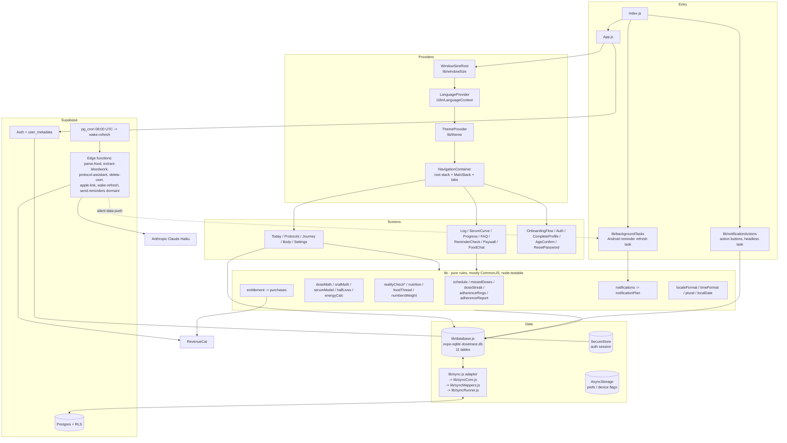
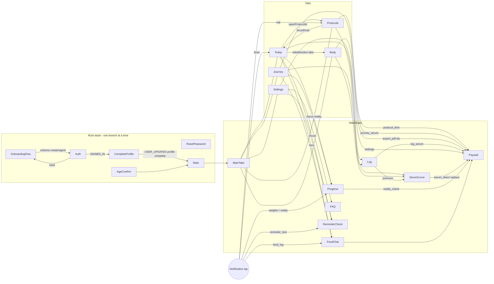

# 08 — Platform dossier (architecture, data, sync, storage, native, i18n, theme, Fold, release, tests)

> **Verified 2026-10-12 — corrections applied from docs/product/verification/06; where this dossier and the verification disagree, the verification wins.** (verification/06 checked the TRD, this dossier and the PLAT / DOCS rows, incl. live Supabase metadata.) **Round 2 applied (2026-10-12):** the findings of `docs/product/verification/round2/R2-04-trd-dossiers.md` that concern this dossier (A-OC-1, A-OC-2, A-ABSW-4, B-6) and the sync finding of `R2-06-divergences.md` M-1 (DV-222) are applied in notes 1 and 2 and where they sit (§4.3, §4.4, the §6 R8 rules).
>
> Corrections applied in this file (each marked "[Corrected 2026-10-12]" where it sits):
> 1. **Delete resurrection (§4.3 step 4).** `reinsertRow` for dose_logs means an edit on device B of a dose deleted on A **re-inserts it into the cloud**, and A's next pull brings it back on A (reproduced with the repo harness, `lib/syncCore.js:692-698`). A weigh-in (`calc_snapshots`) comes back the same way, by design (DL-90, A-92). **Narrowed in round 2 (R2-04 A-OC-2):** the vial half of the same code path is not reachable by any 1.3.0 action — a cloud vial is removed only by Delete forever (`lib/protocolEnd.js:86`; the auto-purge at `:212` is paused), and the cloud then refuses the re-insert (`refuse_child_of_purged_protocol`, `lib/syncCore.js:116-121, 697-698`); older builds could reach it. The live exposure is dose_logs, including the Missed rows an inactivity End tombstones (`lib/protocolEnd.js:67`). The stock sync harness *does* model delete invisibility; no test asserts a cross-device delete.
> 2. **Pull (§4.4).** Offset paging (`lib/sync.js:140-157`) can **permanently** skip a row when a row on an earlier page is updated mid-pull (the watermark then passes the skipped row; only a full import recovers it) — rare (> 500 changed rows per pull), not benign. And live `set_updated_at()` uses `now()` = **transaction start**, so a row committed after a later-started transaction can sit below an advanced watermark and never be fetched — every synced table. `fullImport` never updates existing rows. [Corrected round 2, R2-04 A-OC-1: its absence delete is not the *only* convergence path.] Without tombstones a device converges on another device's delete only through a full import (protocol-less users on every launch, or any user after an intended sign-out wipe or a reinstall, `isLocalDBEmpty`, `lib/syncCore.js:847-850`), its own later edit of a non-child row (the push finds 0 rows and deletes it locally, `:703`), or the protocol tombstone for purged children. **Round 2 additions:** offset paging also skips or duplicates rows with no concurrent edit when more than 500 rows share one `updated_at` (no tie-break; R2-04 B-6), and `fetchAll` (`lib/sync.js:216-232`) pages the same way and feeds the absence delete, which can then delete a live local row (DV-210); and a phone's **own push** moves its pull watermark past rows another phone pushed earlier — `markSynced` stamps pushed rows with the cloud `updated_at` (`lib/syncCore.js:47-65`), each pass pushes before it pulls (`lib/sync.js:92-93`), and the pull uses `gt` (`:147`) — so those rows are skipped for good in ordinary sequential use (R2-06 M-1, harness-reproduced; DV-222, TRD F-14 / H-15).
> 3. **Test kinds (§9, §11 item 13).** 184 files call `readFileSync`, but only **45 are pure source-text tests**; **139** mix regex checks with real execution (`require`, `extractFn`, harness); **68** are behaviour-only; 3 other.
> 4. **Live facts that were UNVERIFIED here** (now verified read-only): `handle_new_user` = `insert into public.profiles (id, email) values (new.id, new.email)` via trigger `on_auth_user_created`; `profiles → auth.users` cascades; `wake_refresh_runs` has **no `user_id` and no FK** (global run ledger: `id`, `ran_at`); `notification_sends` (and `notification_preferences`) **do not exist live**; deployed function versions are in TRD §1.6 (`parse-food-next` v2 still ACTIVE); the three migrations headed "NOT APPLIED" (`protocol_ended_at`, `protocol_history_from`, `protocol_purged_at`) **are applied**, but the 12 repo files carry **different version stamps** from live (e.g. `20261003010000` vs live `20261004035607`).
> 5. **D7 (day keys).** `CalculatorSection.js:92` already calls `localISO()`; `:94-97` is a `daysBetween`, not a formatter copy. Measured: **24 inline formatter copies in 21 files**, plus 4 keys built from picker parts, 1 UTC variant (`lib/foodEntryDay.js`) and 9 `toDateString` sites. Formulas are identical except `LogScreen.js:379` and the UTC variant.
> 6. **Smaller:** `onSignedOutNow` is not "pure" — it makes synchronous local calls (`endStashFreshness`, `consumeIntentionalSignOut`, and on an intended sign-out `discardStashNow`, `clearAuthDraft`, `setSeenOnboarding(false)`) with no `supabase` and no `await`; R8 keep rules also keep `serialPersistentFields`; `created_at` is not sent for 8 tables (vials, biomarkers, vaccines, food_logs, reality_checks, calc_snapshots, calc_targets, calc_inputs); the elided receiver path is `modules/dt-exact-alarm/android/src/main/java/expo/modules/dtexactalarm/RefreshOnUpdateReceiver.kt`.

- Read from the code on branch `redesign/graduated` @ `3100161` (2026-10-12). Read-only: no code changed.
- Sources: `index.js`, `App.js`, `lib/database.js`, `lib/schema.js`, `lib/sync.js`, `lib/syncCore.js`, `lib/syncMappers.js`, `lib/syncRunner.js`, `lib/supabase.js`, `lib/secureStore.js`, `lib/signedOut.js`, `supabase/migrations/**`, root `supabase_*.sql`, `supabase/functions/**`, `lib/theme.js`, `i18n/**`, `components/BookPanes.js`, `lib/bookLayout.js`, `lib/bookSelection.js`, `lib/windowSize.js`, `modules/dt-exact-alarm/**`, `plugins/**`, `app.json`, `eas.json`, `package.json`, `scripts/**`, `docs/security-rls-audit-2026-09-19.md`, `docs/APP-HANDOFF.md`, `docs/review/app-map.md`, `CLAUDE.md`, plus targeted greps.
- Evidence I ran: `node --test` (full suite) and `node scripts/spec-audit.cjs` on 2026-10-12 (results in §9).
- **Marking:** "UNVERIFIED" = not provable from the repo (e.g. the live Supabase state, what is deployed). I did not query the production database.

---

## 1. Architecture overview

### 1.1 Stack (verified in `package.json` / `app.json`)
| Layer | What | Version / setting |
|---|---|---|
| Runtime | Expo SDK 54 (`expo ~54.0.33`), React Native `0.81.5`, React `19.1.0` | `app.json` `newArchEnabled: true` (new architecture), Hermes (default) |
| Navigation | `@react-navigation/native ^7.2.2`, `/stack ^7.8.9`, `/bottom-tabs ^7.15.9` | stack-in-stack + 5 bottom tabs |
| Local DB | `expo-sqlite ~16.0.10` (`openDatabaseSync('dosetrace.db')`, WAL, `foreign_keys=ON`) | `lib/database.js:23-35` |
| Cloud | `@supabase/supabase-js ^2.101.1` (Postgres + Auth + Edge Functions + pg_cron) | project ref `mqfvnqfusqyhqhowfweh` |
| Auth storage | `expo-secure-store` (Keychain/Keystore, chunked, two-slot) | `lib/secureStore.js` |
| Payments | `react-native-purchases ^9.15.2` (RevenueCat) | `lib/purchases.js`, `lib/entitlement.js` |
| Notifications | `expo-notifications ~0.32.16` (local), `expo-task-manager`, `expo-background-task` (Android only) | `lib/notifications.js`, `lib/notificationActions.js`, `lib/backgroundTasks.js` |
| Motion / graphics | `react-native-reanimated ~4.1.1`, `react-native-worklets 0.5.1`, `react-native-svg 15.12.1`, gesture-handler | — |
| Fonts | `@expo-google-fonts/plus-jakarta-sans`, `geist`, `geist-mono`; `lib/fonts.js installFontMapping()` maps every `fontWeight` to Plus Jakarta Sans at module load (`App.js:39`) | — |
| Native module | `modules/dt-exact-alarm` (Expo module, Android only, Kotlin) | §6 |
| Tests | `node --test` (Node 24 test runner), `better-sqlite3 ^12.11.1` for the sync harness | §9 |

### 1.2 Process entry (`index.js`)
1. `import './lib/notificationActions'` — registers notification **action buttons** (Mark as taken / snooze / "Nothing else today") at module scope, so a tap works with the app killed (Android: a TaskManager task `dosetrace-notification-actions` runs headless).
2. `defineReminderRefreshTask()` (`lib/backgroundTasks.js`) — defines the Android background task `dosetrace-reminder-refresh` before mount (Android can start the JS headless just to run it).
3. `registerRootComponent(App)`.

### 1.3 App root (`App.js`)
- Provider order (render): `WindowSizeRoot` (measured root size, Fold) → `SafeAreaProvider` → `ErrorBoundary` → `LanguageProvider` → `ThemeProvider` → `ThemedRoot` (`NavigationContainer` + root stack + one `DTSheet` for auth-link messages) (`App.js:800-846`).
- Loading gate: waits for session read + fonts + `seenOnboarding` resolution (`App.js:786`).
- Boot effect (`App.js:521-768`), in order: `initDatabase()` → `initNotifications()` → `startSyncEngine()` (NetInfo listener) → notification-response listener + cold-start `getLastNotificationResponseAsync` (12 h staleness) → `AppState` listener (token auto-refresh only in foreground; foreground resync throttled 60 s: `requestSync()` + `syncAllNotifications()`) → `watchExactAlarms()` → `registerReminderRefresh()` → sync listener that re-plans the 8 PM food and day-21 reminders (30 s throttle) → onboarding flag → `getSession()` → pending-wipe completion → cross-account guard → `fullImportFromCloud()` if `isLocalDBEmpty` else `requestSync()` → `runRealityMigration()` → permissions → `syncAllNotifications()` → `registerPushToken()`.
- `onAuthStateChange` is kept **synchronous** (`App.js:660-736`): `setSession` first; SIGNED_OUT → `onSignedOutNow` (inline; [Corrected 2026-10-12: synchronous local calls, not pure — no `supabase`, no `await`]) + deferred `afterSignedOut`; SIGNED_IN → `bumpSignInGeneration()` inline + deferred (setTimeout) import/guard/notification work. Matches the CLAUDE.md rule.
- Apple credential revocation listener (iOS) → local sign-out without wipe (`App.js:744-757`).
- Deep links handled in-app: `dosetrace://reset-password`, `dosetrace://confirm-email`, `…auth-callback` (Android Apple web flow). De-duplicated in memory and in AsyncStorage `dosetrace_links_handled` (last 20).

### 1.4 Component diagram

### 1.5 Screen inventory (files, line counts)
| Screen file | Lines | Route name(s) |
|---|---|---|
| `screens/TodayScreen.js` | 2728 | `Today` (tab) |
| `screens/ProtocolsScreen.js` | 3609 | `Protocols` (tab) |
| `screens/JourneyScreen.js` | 297 | `Journey` (tab) |
| `screens/BodyScreen.js` | 1741 | `Body` (tab) |
| `screens/SettingsScreen.js` | 1633 | `Settings` (tab) |
| `screens/LogScreen.js` | 773 | `Log` |
| `screens/SerumCurveScreen.js` | 1238 | `SerumCurve` |
| `screens/ProgressScreen.js` | 85 | `Progress` (hosts `screens/components/CalculatorSection.js`, 1930+ lines) |
| `screens/FoodChatScreen.js` | 878 | `FoodChat` |
| `screens/FAQScreen.js` | 140 | `FAQ` |
| `screens/ReminderCheckScreen.js` | 132 | `ReminderCheck` |
| `screens/PaywallScreen.js` | 535 | `Paywall` |
| `screens/OnboardingFlowScreen.js` | 852 | `OnboardingFlow`, `CompleteProfile` |
| `screens/AuthScreen.js` | 522 | `Auth` |
| `screens/AgeConfirmScreen.js` | 225 | `AgeConfirm` |
| `screens/ResetPasswordScreen.js` | 161 | `ResetPassword` |

Embedded sections (`screens/components/`): BodyMapModal, BodySheets, CalculatorSection, FitExplainer, FoodEntryEditor, FoodGraceNote, FoodLogHero, LearnBlock, MarkerChart, NutritionLogger, ProgressChart, ProtocolAssistant, ProtocolParts (DTSheet etc.), SyringePicker, SyringeScale, TodayTracker, VaccinePage, VaccinesSection. Shared UI (`components/`): AccumulationHero, AuthField, BookPanes, CheckMark, FeatureExplainerGate, FeatureExplainers, FeatureIcon (+ featureIconsData), FeaturePreviews, FoldChevron, GradSwitch, LegalModal, ReminderSetupList, RowChevron, SegmentedBar, motion, previewFx, useColumnWidth.

---

## 2. Navigation map

### 2.1 Navigator structure (`App.js:108-341`)
- **Root stack** (`ThemedRoot`, conditional screens — only one branch exists at a time):
  1. `ResetPassword` — when a recovery link is pending (forces set-new-password even though a session exists).
  2. no session + not seen onboarding → `OnboardingFlow` (`OnboardingFlowScreen onDone`).
  3. no session + seen onboarding → `Auth` (`AuthScreen onBack initialMode`).
  4. session + `!isProfileComplete(user)` → `CompleteProfile` (same `OnboardingFlowScreen` in signed-in mode). `PROFILE_GATE_SINCE = 2020-01-01` → nobody grandfathered (`lib/supabase.js:236`). Required: name, age (birth month+year), sex (male/female), country, goal, activity, tracking_types, has_provider.
  5. session + `needsAdultConfirmation(user_metadata)` → `AgeConfirm`.
  6. otherwise `Main` → `MainStack`.
- **MainStack** (`App.js:224-241`): `MainTabs`, `Log`, `SerumCurve`, `Progress`, `FAQ`, `ReminderCheck`, `Paywall`, `FoodChat` (vertical card interpolator, swipe-down gesture).
- **MainTabs** (`App.js:178-222`): `Today`, `Protocols`, `Journey`, `Body`, `Settings` (labels `tab_today`, `tabbar_protocols`, `tab_journey`, `tab_body`, `tabbar_settings`; SVG glyphs; active = `colors.ink`, inactive = `colors.ink3`).

### 2.2 Every route: params and who navigates there
| Route | Params read (file:line) | Navigated from |
|---|---|---|
| `Today` (tab) | `focusDose {protocolId, dayKey, ti, slotMs, take?, nonce}` (`TodayScreen.js:171-175`) | Protocols take button (`ProtocolsScreen.js:2119`); dose notification tap (`lib/notificationPlan.js notifTapTarget`, `MARK_TAKEN`, `morning_summary`) |
| `Protocols` (tab) | `openProtocolId`, `openVialId` (`ProtocolsScreen.js:1083-1155`) | Today alerts/cards (`TodayScreen.js:1544,1576,1779,1857,2014,2181`); vial_low / vial_expiry notification taps |
| `Journey` (tab) | none | tab bar only |
| `Body` (tab) | `initialSection` (`BodyScreen.js:231-237`) | Today "bloodwork due" alert `{ initialSection: 'labs' }` (`TodayScreen.js:1520`) |
| `Settings` (tab) | none | tab bar only |
| `Log` | none | Today tracker (`TodayScreen.js:2170`), Protocols (`ProtocolsScreen.js:2454`), Fold-push (`components/BookPanes.js:59`) |
| `SerumCurve` | none (embedded variant gets `params` prop) | Journey (`JourneyScreen.js:207`), Body (`BodyScreen.js:849`), Log (`LogScreen.js:522`, Premium) , Fold-push |
| `Progress` | `focus` ('reality' / 'weighin'), `nonce` (`ProgressScreen.js:65-66`) | Journey tile (`JourneyScreen.js:166`), Today reality alert (`TodayScreen.js:1498`), `checkin_reminder` / `reality_check` notification taps |
| `FoodChat` | `eveningDay`, `nonce`, `logIt` (`FoodChatScreen.js:178-180`) | Today/Journey hero (`FoodLogHero.js:85`), Journey (`JourneyScreen.js:75`), 8 PM `food_log` notification tap |
| `FAQ` | none | Settings (`SettingsScreen.js:878`) |
| `ReminderCheck` | `focus` ('alarms' / 'battery' / 'hibernation' / 'refresh') (`ReminderCheckScreen.js:32`) | Today reminder-health alerts (`TodayScreen.js:1587-1653`), Settings (`SettingsScreen.js:679,789`), `lib/reminderSetup.js:20`, `reminder_test` notification tap |
| `Paywall` | `source`, `onSuccess` (`PaywallScreen.js:73-74`) | Body (`bloodwork_upload`, `serum_preview_sheet`, `export_pdf`), Journey (`journey_serum`), Log (`log_serum`), Protocols (`protocol_limit`), SerumCurve (`serum_direct`, uses `replace`), Settings (`settings`), CalculatorSection (`reality_check`, and once with no source at `CalculatorSection.js:1148`), FoodGraceNote (`food_grace`), FoodLogHero (`food_hero`), FoodChat (no source, `FoodChatScreen.js:720`) |

Notification tap routing: `lib/notificationPlan.js:161-193 notifTapTarget` (pure) → `App.js routeTap` → held in `pendingNavRef` until `Main` exists → `nav.navigate('Main', { screen, params })`. Dedupe: in-memory set + AsyncStorage `dosetrace_nav_handled` (last 30). Action buttons `SNOOZE_HOUR`, `SNOOZE_TOMORROW`, `FOOD_DAY_DONE` never navigate.

Fold transitions (`components/BookPanes.js`): `useFoldPush(tab)` pushes `Log` / `Progress` / `SerumCurve` / `FoodChat` when folding with an explicitly opened right-page item; `useUnfoldToPage(route)` pops back to `MainTabs` with `popTo('MainTabs', { screen })` and stores the selection when unfolding.

---

## 3. Data model

### 3.1 Local SQLite (`lib/schema.js` canonical DDL + `lib/database.js initDatabase` migrations)
Every table has `id INTEGER PK AUTOINCREMENT`, `remote_id TEXT` (cloud UUID, null until first push), `user_id TEXT`, `updated_at TEXT DEFAULT datetime('now')`, `sync_status TEXT DEFAULT 'pending'` (`'pending' | 'synced' | 'deleted'`). No FOREIGN KEY constraints are declared in the DDL even though `PRAGMA foreign_keys = ON` (`lib/database.js:35`) — the local `protocol_id` links are not enforced by SQLite.

| Table | Columns (beyond the common ones) | Owner of writes (lib/database.js) | Synced |
|---|---|---|---|
| `protocols` | name NOT NULL, compound_id, type ('recon' default), color ('#185FA5' default; insert uses `DEFAULT_PROTOCOL_COLOR`), amount, unit, water, diluent, dose, dose_unit, syringe_size REAL, concentration, concentration_unit ('mg'), frequency, reminder_time (comma list "HH:MM"), interval_days (1), doses_per_day (1), start_date, schedule_total, vial_valid_days, goal, notes (oral form), note (free text), composition (journal label, never parsed), serving_strength, serving_strength_unit, serving_units, container_units, units_taken (0), divisible, active (1), deleted_at, ended_at, history_from, **optional_pending** (local only), purged_at, **restored_at** (local only), **status_at** (local only), created_at | `insertProtocol`, `updateProtocol` (sets `status_at` when active/deleted_at/ended_at change), `lib/protocolEnd.js` (`endProtocol`, `endAtLastDose`, `softDeleteRow`, `restoreDeleted`, `purgeProtocol`, `restartAsNew`, `purgeOldDeleted` — paused: `AUTO_PURGE_PAUSED = true`, `lib/protocolEnd.js:188`) | yes |
| `vials` | protocol_id INTEGER (local), protocol_remote_id, mixed_on, water_ml, total_doses, doses_taken (0), expires_on, active (1), created_at | `insertVial`, `updateVial`, `deactivateVialsByProtocol` | yes |
| `dose_logs` | protocol_id INTEGER, protocol_remote_id, outcome ('Taken' / 'Skipped' / 'Missed'), injection_site, logged_at | `insertDoseLog`, `updateDoseLog` (never touches a deleted row), `deleteDoseLog` (tombstone) | yes |
| `biomarkers` | report_date, marker, value REAL, unit, created_at (one upload = same report_date + created_at) | `insertBiomarkers`, `updateBiomarker`, `deleteBiomarker`, `deleteBiomarkerReport` | yes |
| `vaccines` | name, date_given, next_due, notes, manufacturer, batch_lot, dose_number, provider, location, created_at | `insertVaccine`, `updateVaccine`, `deleteVaccine` | yes |
| `food_logs` | entry_date, raw_text, parsed_items (JSON TEXT), kcal, protein_g, carb_g, fat_g, source ('ai' default; markers 'not_recorded' / 'day_closed' / 'free_start' / 'ate_nothing'), parse_status ('pending' default), created_at | `insertFoodLog`, `updateFoodLog`, `insertFoodDayMarker` (idempotent per user/day/source), `deleteFoodLog` | yes |
| `reality_checks` | entry_date, tdee, rate_per_week_kg, created_at (one per date, latest wins by read-dedupe) | `upsertRealityCheck`, `clearRealityChecks` | yes |
| `calc_snapshots` (weigh-ins) | entry_date, weight_kg, waist_cm, body_fat_pct, lbm, bmr, tdee, created_at | `upsertCalcSnapshot`, `correctCalcSnapshot` / `deleteCalcSnapshot` (`lib/weighInEdit.js`) | yes |
| `calc_targets` | entry_date, target_weight_kg, target_body_fat_pct, target_date, start_date, start_weight_kg, start_body_fat_pct, created_at (one active row per user) | `upsertCalcTarget`, `clearCalcTarget` | yes |
| `reality_check_open` | start_date, start_weight_kg, stopped_at (set once, never cleared), created_at | `insertRealityCheckOpen`, `updateRealityCheckWeight`, `stopOpenRealityChecks`, `commitRealityMigration` | yes |
| `calc_inputs` | payload (JSON TEXT), created_at (one row per user, newest wins) | `upsertCalcInputs` (callers merge via `lib/realityCheckStore.js mergeCalcInputs`) | yes |

Indexes (`lib/schema.js:238-261`): `idx_protocols_active(active,user_id)`, `idx_vials_protocol(protocol_id,active)`, `idx_dose_logs_date(logged_at,protocol_id)`, partial `idx_sync_pending ON protocols(sync_status) WHERE pending`, `idx_food_logs_date(user_id,entry_date)`, `idx_reality_checks_date`, `idx_calc_snapshots_date`, `idx_calc_targets_user`, `idx_reality_check_open_user`, `idx_calc_inputs_user`, and one `remote_id` index per table (A-93).

Migrations in `initDatabase` (`lib/database.js:31-89`): additive `ALTER TABLE … ADD COLUMN` in try/catch (no version table): protocols.concentration_unit, diluent, compound_id, vial_valid_days, note, composition (+ one-time watermark rewind: synced protocols `updated_at = 1970-01-01` so every protocol is re-pulled, `:52-60`), serving_strength, serving_strength_unit, serving_units, container_units, units_taken, divisible, ended_at, history_from, optional_pending, purged_at, restored_at, status_at (`lib/protocolEnd.js:37-43 addStatusAtColumn`, with a one-time backfill of pending status changes); dose_logs.injection_site; vials.expires_on; vaccines.manufacturer, batch_lot, dose_number, provider, location. `deleted_at` exists in the CREATE since the first commit (verified with `git log -S`).

Local-only state inside synced tables: `optional_pending`, `restored_at`, `status_at` (never sent as such; `toCloudPayload` only reads them).

### 3.2 Cloud (Supabase Postgres) — from the repo SQL
The repo does **not** contain the CREATE TABLE of `profiles`, `protocols`, `vials`, `dose_logs`, `biomarkers`, `reminders` (only their RLS in `supabase_core_tables_rls.sql`) — their live column list is **UNVERIFIED** from the repo; inferred from `lib/syncMappers.js CLOUD_FIELDS` and the purge triggers.

| Cloud table | Defined in | Key columns / notes | RLS (as in repo) | updated_at trigger in repo |
|---|---|---|---|---|
| `profiles` | not in repo | `id` = auth uid; `plan` read by admin RPC | ALL own (`auth.uid() = id`) | — |
| `protocols` | not in repo + migrations (`composition`, `ended_at timestamptz`, `history_from date`, `purged_at timestamptz`) | uuid id; FK `dose_logs → protocols` cascades on delete (stated in `lib/protocolEnd.js` header, UNVERIFIED in repo SQL) | SELECT/INSERT/UPDATE own; **no DELETE policy** (`20261004010000_protocol_delete_guard.sql`) | not in repo (UNVERIFIED) |
| `vials` | not in repo | protocol_id uuid | SELECT/INSERT/UPDATE own; DELETE own only if the protocol is live or purged (not soft-deleted) | not in repo (UNVERIFIED) |
| `dose_logs` | not in repo | protocol_id uuid | ALL own | not in repo (UNVERIFIED) |
| `biomarkers` | not in repo | — | ALL own | not in repo (UNVERIFIED) |
| `reminders` | not in repo (legacy; no client code uses it) | — | ALL own | — |
| `vaccines` | `supabase_vaccines_table.sql` (+ detail columns added elsewhere, UNVERIFIED) | date_given/next_due TEXT | per-command own (UPDATE with CHECK added live per audit) | yes |
| `food_logs` | `supabase_food_logs_table.sql` | parsed_items JSONB, kcal NUMERIC… | per-command own | yes |
| `reality_checks` | `supabase_reality_checks_table.sql` | entry_date text NOT NULL | per-command own | **no** (see §11) |
| `calc_snapshots` | `supabase_calc_snapshots_table.sql` | weight_kg real… | per-command own | yes |
| `calc_targets` | `supabase_calc_targets_table.sql` | — | per-command own | yes |
| `reality_check_open` | `20260928000000_…sql` | start_weight_kg double precision, stopped_at timestamptz; no deleted_at (a check is stopped, never deleted) | per-command own | yes + `reality_check_open_keep_stop` (Stop wins server side) |
| `calc_inputs` | same migration | payload jsonb, UNIQUE(user_id) | per-command own | yes |
| `analytics_events` | `supabase_analytics_table.sql` + 3 migrations | user_id now always NULL (trigger `analytics_events_anonymize` strips user_id + health keys on insert/update) | INSERT own, SELECT own, INSERT `user_id is null` for authenticated | — |
| `ai_food_usage` | `supabase_ai_food_usage_table.sql` + `kind` column | service-role only | RLS on, 0 policies, grants revoked | — |
| `ai_scan_usage` | `supabase_ai_scan_usage_table.sql` | kind 'bloodwork' / vaccine / vial share one pool | service-role only | — |
| `ai_assistant_usage` | `20261003000000_…sql` | kind 'start' / 'turn', conversation_id, door | service-role only | — |
| `apple_tokens` | `supabase_apple_tokens_table.sql` | refresh_token for revoke-on-delete | service-role only | — |
| `push_tokens` | `supabase_push_tokens_table.sql` | expo_token, platform, timezone, UNIQUE(user_id, expo_token) | per-command own | — |
| `notification_sends` | `supabase_notification_sends_table.sql` | dedupe_key PK (server push ledger) [Corrected 2026-10-12: repo SQL only — the table does not exist live] | RLS on, 0 policies | — |
| `wake_refresh_runs` | `20261007000000_…sql` | run ledger [Corrected 2026-10-12: global, no `user_id`, no FK — verified live] | RLS on, 0 policies | — |
| `referral_codes`, `referrals` | `supabase_referral_tables.sql` | feature unwired in the app | own-only (public UPDATE/SELECT dropped per audit) | — |

Cloud functions / triggers (repo):
- `set_updated_at()` (shared BEFORE UPDATE trigger function).
- `protocols_purge_children()` AFTER UPDATE OF purged_at → deletes that protocol's dose_logs + vials (SECURITY INVOKER).
- `refuse_child_of_purged_protocol()` BEFORE INSERT/UPDATE on dose_logs and vials → raises `protocol % was deleted forever` (the client treats it as "stay pending", `lib/syncCore.js:101`).
- `protocols_blank_purged()` BEFORE INSERT/UPDATE → a purged protocol keeps only identity columns.
- `reality_check_open_keep_stop()` → stopped_at can never be cleared.
- `analytics_events_anonymize()`.
- `claim_wake_refresh()` SECURITY DEFINER, service_role only, advisory lock, ≥ 20 h between runs.
- `redeem_referral_code(text)` — execute revoked from everyone (`…delete_guard.sql`).
- `admin_metrics()`, `admin_activity()`, `admin_feature_adoption()` — SECURITY DEFINER, service_role only (web admin panel `api/adm.js`).
- `handle_new_user()` exists live (search_path pinned in a migration); its body is not in the repo (UNVERIFIED). [Corrected 2026-10-12: verified live — `insert into public.profiles (id, email) values (new.id, new.email)`, trigger `on_auth_user_created` on `auth.users`.]

Cron: `cron.schedule('dosetrace-wake-refresh', '0 8 * * *', net.http_post(…/functions/v1/wake-refresh))` (migration `20261007000000`). Several migration headers say "NOT APPLIED by the builder" — whether each is applied in production is **UNVERIFIED** here [Corrected 2026-10-12: all three are applied live; the repo version stamps differ from live] (the client is written to work before and after: `OPTIONAL_COLUMNS` + PGRST204 retry).

RLS evidence: `docs/security-rls-audit-2026-09-19.md` (live, 17 tables, cross-user read test passed). It predates `reality_check_open`, `calc_inputs`, `ai_assistant_usage`, `wake_refresh_runs`, `push_tokens`, `notification_sends` (repo SQL gives each owner-only or no-policy RLS; live state UNVERIFIED).

### 3.3 Edge functions (`supabase/functions/`)
| Function | Purpose | Auth | Model / external | Limits |
|---|---|---|---|---|
| `parse-food` | Free-text meal → structured items + kcal/macros JSON; optional structured `ask`; refusal for advice | user JWT (`getUser`) | Anthropic `claude-haiku-4-5-20251001` | 25 parses / local day + 25 follow-ups / day + 24 h hard ceiling; slot reserved before the model call; raw text never logged |
| `extract-bloodwork` | Lab report / vaccine card / vial label image or PDF → structured values (no interpretation) | user JWT | Anthropic `claude-haiku-4-5-20251001`; RevenueCat REST (server-side Premium check, `REVENUECAT_SECRET_KEY`) | 3 / month free, 20 / month Premium (UTC month, `quota.ts`), reserve-then-check; ~15 MB base64 cap |
| `protocol-assistant` | `start` (counts a use) / `understand` (one typed answer → structured values) | user JWT | `claude-haiku-4-5` (structured outputs, `schema.ts`) | 10 conversations / rolling 7 days (`budget.ts`), turn caps per conversation and per day; fails open on counter errors |
| `delete-user` | Apple revoke (best effort) → delete rows in 20 tables → referrals → `auth.admin.deleteUser` | user JWT, service role inside | Apple token revoke | table list must be a superset of `syncCore TABLES` (test `deleteUserCoverage`) |
| `apple-link` | Exchange Apple authorization code → store refresh_token in `apple_tokens` | user JWT | Apple | best-effort, always 200 |
| `wake-refresh` | Once a day, silent data-only push to every Android `push_tokens` row to wake the reminder refresh task | none (`verify_jwt` off per migration comment); guarded by `claim_wake_refresh()` | Expo push | ≤ 1 run / 20 h; prunes dead tokens |
| `send-reminders` | Server-side push sender (dose, morning, 8 PM food) — port of `lib/notificationPlan.js` in `plan.ts` | service role or `CRON_SECRET` | Expo push | **Dormant**: client flag `SERVER_PUSH_ACTIVE = false` (`lib/notifications.js:1079`); scheduling of this function is not in the repo |
| `_shared/apple.ts` | Apple client-secret + revoke helpers | — | — | — |

Which versions are deployed is **UNVERIFIED** (I did not call the Supabase API). [Corrected 2026-10-12: verified — see TRD §1.6; `parse-food` v10, `parse-food-next` v2 still ACTIVE.]

### 3.4 Auth `user_metadata` (cloud, not a synced table, no history/tombstones)
Read keys found in code: `display_name`, `birth_year`, `birth_month`, `gender`, `country`, `primary_goal`, `activity_level`, `tracking_types`, `has_provider`, `dose_reminders`, `vial_alerts`, `checkin_reminders`, `food_reminders`, `persistent_reminders`, `notif_show_names`, `silent_mode`, `analytics_opt_in`, `favorite_markers`, `report_tags`, legacy `calc_inputs`, `calc_reality_open`, `calc_snapshots`, `calc_reality_checks`, migration flags `rc_store_migrated`, `calc_history_migrated_v…`. Writers (`supabase.auth.updateUser`): `lib/realityCheck.js` (4), `CalculatorSection.js` (5), `SettingsScreen.js` (3), `BodyScreen.js` (2), `lib/onboardingStore.js`, `lib/supabase.js` (Apple name), `OnboardingFlowScreen.js`, `AgeConfirmScreen.js`, `ResetPasswordScreen.js`, `lib/recoveryLink.js`, `NutritionLogger.js`. CLAUDE.md requires merge-not-clobber; each writer's merge discipline is not audited in this dossier (UNVERIFIED per call site).

---

## 4. Sync engine — rules and guarantees

Files: `lib/sync.js` (Supabase adapter, NetInfo, debounce, listeners), `lib/syncCore.js` (pure algorithm, injected `db` + `cloud`), `lib/syncMappers.js` (payloads), `lib/syncRunner.js` (single-flight).

### 4.1 Triggers
- `requestSync()` — debounced 1.5 s (`lib/sync.js:84-87`). Called after local writes (TodayScreen 11×, ProtocolsScreen 11×, LogScreen 4×, BodyScreen 4×, VaccinesSection 3×, lib/realityCheck 4×, lib/notificationActions 3×, CalculatorSection, FoodChat, foodLogActions), on cold start when the DB is not empty, on SIGNED_IN, on foreground (≤ 1/min), and on every Today focus (indirectly: `cleanupOldDeletedProtocols` → `requestSync`, `TodayScreen.js:323,597-602`).
- NetInfo offline → online transition triggers a sync (`lib/sync.js:57-69`). `_isOnline` starts `true`; offline passes are skipped entirely (`syncPass` returns).
- `forceSync()` — waits for a running pass then runs a fresh one (deliberate sign-out asks "is everything backed up?" after it).
- `fullImportFromCloud()` — cold start / SIGNED_IN when `isLocalDBEmpty(userId)`; **"empty" means no `protocols` row for the user** (`lib/syncCore.js:847-850`).

### 4.2 Single-flight (`lib/syncRunner.js`)
One pass at a time; `run()` shares the running promise; `runExclusive(job)` waits until idle then runs alone (used by full import and the sign-out wipe's second pass); `waitIdle()`; a job clears `running` only if it is still its own promise (A-93).

### 4.3 Push (`pushPending`, `lib/syncCore.js:638-724`)
For each table in fixed order `TABLES = protocols, vials, dose_logs, biomarkers, vaccines, food_logs, reality_checks, calc_snapshots, calc_targets, reality_check_open, calc_inputs`, every row with `sync_status IN ('pending','deleted')` for the user:
1. `deleted` → cloud DELETE by remote_id (if any) → local hard delete. Error → retried next sync.
2. protocol with `purged_at` → `pushPurge`: delete its deleted vials/dose_logs in the cloud, then write the tombstone (`purged_at`, active false) by UPDATE; row gone → INSERT tombstone with the same id; cloud lacks the column → legacy hard delete + `optional_pending='purged_at'` for later.
3. vials / dose_logs wait until `protocol_remote_id` exists; a child of a purged protocol stays pending forever (blocks sign-out; "Sign out anyway" exists).
4. Has `remote_id` → UPDATE (`writeWithOptionalRetry`: drops an optional column the cloud reports missing, up to 4 times, and remembers it in `optional_pending`). 0 rows updated **and** same session (`sameSession`) →
   - protocols: `reviveProtocol` (re-insert soft-deleted, with its children; a pending Restore keeps it restored; a cloud tombstone wins),
   - vials/dose_logs with a live local parent: `reinsertRow` [Corrected 2026-10-12: this resurrects a dose another device deleted — it comes back in the cloud and on the deleting phone. Corrected round 2 (R2-04 A-OC-2): the vial half is not reachable in 1.3.0 — a cloud vial is removed only by Delete forever, and the cloud refuses a re-insert onto a purged protocol],
   - calc_snapshots: `reinsertRow` (A-92: a weigh-in typed after another phone deleted it wins),
   - every other table: local row deleted ("deletions win").
   - No session match → kept pending (RLS returns 0 rows without a session).
5. No `remote_id` → INSERT (`calc_inputs` uses upsert on `user_id`); protocols then re-point children (`updateChildRemoteIds`).
6. `markSynced` flips to synced **only if `updated_at` is unchanged since the read** (an edit during the request stays pending) and stamps the **cloud** `updated_at` locally (watermark on cloud time).
7. After all tables: `resendOptional` re-sends columns dropped earlier, one probe per sync.

### 4.4 Pull (`pullChanges`, `lib/syncCore.js:726-747`)
Per table: watermark = newest local `updated_at` of a **synced** row of this user; `fetchSince` pages 500 rows `updated_at > watermark` ordered ascending [Corrected 2026-10-12: by **offset**, so a mid-pull update can skip a row for good, and so can > 500 rows sharing one `updated_at` (no tie-break, round 2); and `now()` = transaction start can strand a late-committed row below the watermark; and this phone's own push moves the watermark past another phone's earlier rows (round 2, DV-222) — note 2] (`reality_check_open` is always pulled in full: `FULL_PULL`). `childGate` looks up unknown parent protocols once per batch (lookup failure → the table waits). `mergeCloudRow`:
- not present locally → import (children only if their protocol is known here or live in the cloud; purged protocols never imported),
- local `synced` → overwritten by the cloud (`updateLocalFromCloud`; protocols then `applyOptionalColumns` merge-only; a cloud `purged_at` finishes the local purge),
- local `pending` → local edit wins, **except**: `reality_check_open` Stop wins; a protocol tombstone (`purged_at`) is adopted; a protocol whose local change is not a status change (`status_at` null) takes the cloud's active / deleted_at / ended_at (A-87 "End / Delete wins").
- After `reality_check_open`: `enforceSingleOpenCheck` stops every open row but the newest.
- After all tables: `selfHealProtocols` re-imports live cloud protocols this device lacks (only with a verified same-user session before and after, never deletes).

### 4.5 Conflict rule (summary)
Row-level last-writer-by-device, not field-level: a **pending local row beats the cloud**; a **synced local row is replaced by the cloud**. Overrides: Stop wins (reality check), tombstone wins (protocol purge), status wins (protocol end/delete from another device), deletion wins on push for tables other than protocols/children/calc_snapshots. There is no per-field merge and no server timestamp comparison between two pending edits on two devices — the later push overwrites the earlier one in the cloud.

### 4.6 Tombstones
- Local soft delete = `sync_status='deleted'` (all tables) → pushed as DELETE, then purged locally.
- Protocols are never hard-deleted by absence: positive tombstone `purged_at` in the cloud; `NO_ABSENCE_DELETE` = protocols, dose_logs, vials in `fullImport`.
- `fullImport` absence rule for other tables: a local **synced** row whose remote_id is missing from a successful full fetch is deleted (`lib/syncCore.js:832-843`). Skipped on fetch error.
- `reality_check_open` has no delete: Stop (`stopped_at`) is the tombstone.

### 4.7 Offline queue
There is no separate queue: the queue **is** the `pending`/`deleted` rows in SQLite. They survive app kills and updates; retried on every pass. Food rows typed offline are tracked in AsyncStorage `dosetrace_food_local_pending` so only the typing device re-parses them (FL-19).

### 4.8 Mappers per table (`lib/syncMappers.js CLOUD_FIELDS`)
protocols (name … divisible; status fields `active`, `deleted_at`, `ended_at` only when `opts.status`, no remote_id yet, or `status_at` set; `history_from` and `created_at` when set) · vials (protocol_id ← protocol_remote_id, mixed_on, water_ml, total_doses, doses_taken, expires_on, active) · dose_logs (protocol_id ← protocol_remote_id, outcome, injection_site, logged_at) · biomarkers (report_date, marker, value, unit) · vaccines (9 fields) · food_logs (parsed_items TEXT → JSONB) · reality_checks · calc_snapshots · calc_targets · reality_check_open (stopped_at only when set; created_at for the duplicate tie-break) · calc_inputs (payload TEXT → JSONB). `OPTIONAL_COLUMNS = { protocols: ['ended_at','history_from','purged_at'] }`.

### 4.9 What is local-only (never synced)
- AsyncStorage keys (§5) — preferences, per-device flags, snoozes, handled-ids, watermarks of the missed-dose scanner, entitlement cache, food draft, AI consent.
- In-memory: drafts (`lib/draftStore.js`), Fold selections (`lib/bookSelection.js`), auth email draft, intentional-sign-out flag, sign-in generation, onboarding freshness.
- Scheduled local notifications (rebuilt from data by `syncAllNotifications`).
- Columns `optional_pending`, `restored_at`, `status_at`.

### 4.10 Sign-out / account switch guarantees (`lib/signedOut.js`, `App.js`)
- Wipe only on an **intentional** sign-out (flag from `lib/authIntent.js`); a spurious SIGNED_OUT keeps local data.
- Wipe steps (`runWipeSteps`): `clearLocalDatabase` (11 tables), cancel + dismiss notifications (also removes `dosetrace_snoozes`), RevenueCat logOut, `clearOnboarding`, remove `dosetrace_rc_start`, remove `dosetrace_rc_pulled_*` / `dosetrace_rc_store_migrated_*`, remove `dt_seen_onboarding`, remove `dosetrace_site_questions`, reset Fold selections, clear drafts.
- Marker `dosetrace_wipe_pending` (`wipe:<owner>` / `deleted:<id>` / `1`) makes an interrupted wipe complete on the next cold start, only for the data's own owner; second DB clear after the running sync ends, inside `runExclusive`, skipped if someone signed in meanwhile (sign-in generation).
- Cross-account guard on cold start and SIGNED_IN: if `getLocalDataUserId()` ≠ session user → clear DB, rc start + flags, notifications, drafts, selections, site questions (`App.js:621-634, 701-716`). `getLocalDataUserId` checks 10 tables but **not `vials`** (`lib/database.js:820-829`).

---

## 5. Storage inventory

### 5.1 SecureStore (Keychain / Keystore, `AFTER_FIRST_UNLOCK`, chunked ≤ 2000 bytes, two-slot ping-pong + `.__meta` pointer)
| Key | Owner | Content | On intended sign-out |
|---|---|---|---|
| auth-js `storageKey` (derived default `sb-mqfvnqfusqyhqhowfweh-auth-token`, exact name UNVERIFIED) + `.a.N` / `.b.N` / `.__meta` | `lib/supabase.js` via `SecureStoreAdapter` | session (access + refresh token, user) | removed by auth-js; strict removal mode verifies it (`setStrictRemoval`) |
| `<storageKey>-code-verifier` | auth-js PKCE; `lib/appleWeb.js`, `lib/recoveryLink.js` | PKCE verifier | removed after use |
| `dosetrace_pending_recovery` | `lib/recoveryLink.js` | pending password reset (≤ 1 h) | not part of the wipe; discarded by the reset flow |
| Fallback | if SecureStore throws, the session is written to AsyncStorage under the same key | — | — |

### 5.2 AsyncStorage
"Wiped" = removed by the intended sign-out wipe (`runWipeSteps`). "Guard" = also removed by the cross-account guard.

| Key | Owner (file) | Purpose | Wiped on intended sign-out |
|---|---|---|---|
| `dosetrace_wipe_pending` | `lib/signedOut.js`, `App.js`, `lib/accountActions.js`, `lib/backgroundTasks.js` | interrupted-wipe marker | managed (set then cleared) |
| `dt_onboarding_data` | `lib/onboardingStore.js` | pre-account onboarding answers | yes |
| `dt_seen_onboarding` | `lib/onboardingStore.js` | intro seen | yes |
| `dosetrace_rc_start` (`RC_START_KEY`) | `lib/notifications.js:608`, `lib/realityCheck.js` | legacy open reality check (migrated into `reality_check_open`) | yes + guard |
| `dosetrace_rc_pulled_<uid>`, `dosetrace_rc_store_migrated_<uid>` | `lib/realityCheck.js` | per-device migration flags | yes + guard |
| `dosetrace_site_questions` | `lib/siteQuestion.js` | open injection-site questions | yes + guard |
| `dosetrace_snoozes` | `lib/notifications.js:902` | snoozed reminder copies | yes (inside `cancelAllNotifications`) |
| `dosetrace_language` | `i18n/LanguageContext.js`, `App.js` ErrorBoundary, `lib/notifications.js`, `lib/notificationActions.js` | app language | no (device) |
| `dosetrace_time_format` | `i18n/LanguageContext.js` | 'auto' / '12h' / '24h' | no |
| `dosetrace_theme_mode` | `lib/theme.js` | 'light' / 'dark' / 'system' | no |
| `dosetrace_install_id` | `lib/analytics.js` | random install id for anonymous analytics | no |
| `dosetrace_ai_extraction_consent_v4` | `lib/aiConsent.js` | AI processing consent | **no — device-wide, not per account** (§11) |
| `dosetrace_entitlement_v1:<uid>`, `dosetrace_entitlement_last_uid` | `lib/entitlement.js` | offline Premium cache with expiry | no (keyed by uid) |
| `dosetrace_curve_view_<uid>` | `lib/curveView.js`, `lib/curveViewStore.js` | last curve selection | no (keyed) |
| `dosetrace_explainers_v1:<uid>` | `lib/featureExplainers.js` | explainers shown | no (keyed) |
| `dosetrace_food_draft:<uid>` | `screens/FoodChatScreen.js:55` | unsent chat text | no (keyed) |
| `orphanedPromptShown:<uid>` | `lib/orphanedPending.js`, `TodayScreen.js:964-981` | orphan prompt last count | no (keyed) |
| `dosetrace_food_local_pending` | `lib/foodLogActions.js:20` | rows typed offline on this device | no |
| `dosetrace_food_followups` | `lib/foodLogActions.js` | legacy offline answers (moved onto rows, then removed) | no |
| `dosetrace_food_asked` | `FoodChatScreen.js:54` | evening question already asked | no |
| `dosetrace_calc_history_migrated_v55` | `CalculatorSection.js:66` | metadata → table migration flag | no |
| `dosetrace_missed_since`, `dosetrace_missed_tz`, `dosetrace_missed_tz_since`, `dosetrace_zone_history` | `lib/doseActions.js:123-129` | Missed-dose scan watermark + time-zone history | no (device; carries across accounts) |
| `dosetrace_vial_low_sent` | `lib/notifications.js:474` | vial-low push sent once | no |
| `dosetrace_fg_sync_at` | `lib/notifications.js:57` | last foreground resync | no |
| `dosetrace_refresh_last` | `lib/reminderRefresh.js:12` | last background refresh `{at, ok, reason, lastOkAt}` | no |
| `dosetrace_deep_sleep_checked` | `lib/notifications.js:1119` | Samsung deep-sleep check done | no |
| `dosetrace_reminder_setup_seen` | `lib/reminderSetup.js:8` | reminder setup shown | no |
| `dosetrace_notif_handled` | `lib/notificationActions.js:28` | handled action responses | no |
| `dosetrace_nav_handled` | `App.js:424` | handled notification taps (last 30) | no |
| `dosetrace_links_handled` | `App.js:467` | handled email links (last 20) | no |
| `dosetrace_alert_snooze` | `TodayScreen.js:155` | Today alert snoozes | no |
| `dosetrace_tx_check_<localProtocolId>` | `TodayScreen.js:526-559` | inactivity prompt snooze | no (removed when that protocol ends) |
| `dosetrace_settings_collapsed` | `SettingsScreen.js:173` | Settings folds | no |
| `dosetrace_protocols_sort` | `ProtocolsScreen.js:95` | list sort | no |
| `dosetrace_paywall_views` | `PaywallScreen.js:42` | paywall view count (analytics) | no |
| Legacy auth session (pre-SecureStore) | `lib/secureStore.js` | migrated then removed | — |

In-memory only (never on disk): `lib/draftStore.js` drafts (`protocolNote:<id>`, `progress:*`, `foodChat:*`), `lib/bookSelection.js`, `lib/authDraft.js`, `lib/authIntent.js`, `lib/onboardingStore.js` `fresh`/`discarded`, `lib/signedOut.js` generation.

---

## 6. Background and native pieces

| Piece | Platform | What it does | Where |
|---|---|---|---|
| Notification action task `dosetrace-notification-actions` | Android headless; iOS via listener + drain on launch/foreground | Mark as taken, snooze 1 h / tomorrow, food "Nothing else today"; idempotent via `dosetrace_notif_handled` | `lib/notificationActions.js`, imported first in `index.js` |
| Reminder refresh task `dosetrace-reminder-refresh` | Android only (`expo-background-task`, minimumInterval 6 h; excluded from iOS autolinking in `package.json`) | Non-destructive `syncAllNotifications()` from SQLite using the **stored** session only (no token refresh), skips if a wipe is pending | `lib/backgroundTasks.js`, `lib/reminderRefresh.js` |
| `RefreshOnUpdateReceiver` | Android (`MY_PACKAGE_REPLACED`, `BOOT_COMPLETED`) | Enqueues expo-background-task's worker by class name to rebuild reminders after an update/reboot (A-111) | `modules/dt-exact-alarm/android/src/main/java/expo/modules/dtexactalarm/RefreshOnUpdateReceiver.kt` |
| `DtExactAlarm` module | Android | `canScheduleExactAlarms()` (Android 12+), `isExemptFromHibernation()` (Android 11+); JS returns null elsewhere | `modules/dt-exact-alarm/index.js`, `DtExactAlarmModule.kt` |
| `watchExactAlarms()` | Android | reschedules as exact alarms when the user grants "Alarms & reminders" | `lib/notifications.js:822` |
| Daily silent wake-up | Android | pg_cron 08:00 UTC → `wake-refresh` → data-only push → background task | migration `20261007000000`, `supabase/functions/wake-refresh` |
| Server push sender | — | dormant (`SERVER_PUSH_ACTIVE = false`) | `supabase/functions/send-reminders` |
| Token auto-refresh | both | `autoRefreshToken: false` at creation; App starts/stops it on AppState (headless starts never refresh) | `lib/supabase.js:13-32`, `App.js:563-566` |

Config plugins (`plugins/`, all CNG; `/ios` and `/android` are git-ignored, generated at prebuild):
- `withAndroidBackupDisabled` → `android:allowBackup="false"`.
- `withFoldConfigChanges` → MainActivity `configChanges` += screenSize, smallestScreenSize, screenLayout, orientation (no activity recreation on fold).
- `withoutIosBackgroundFetch` → removes `UIBackgroundModes: fetch` added by expo-task-manager.

R8 / ProGuard (`app.json` expo-build-properties, `enableMinifyInReleaseBuilds` + `enableShrinkResourcesInReleaseBuilds`): keep `expo.modules.notifications.**`; keep Serializable members (`serialVersionUID`, `writeObject`, `readObject`, `writeReplace`, `readResolve`, `serialPersistentFields` [Corrected 2026-10-12: `serialPersistentFields` is in the rule too, `app.json:82` — round 2, R2-04 A-ABSW-4]) — without it every scheduled reminder fails with NotSerializableException; keep `expo.modules.adapters.react.apploader.**`, `expo.modules.taskManager.**`, `expo.modules.backgroundtask.**`. Test: `__tests__/androidKeepRules.test.js`.

Other native config: iOS bundle `io.outcom.dosetrace`, deployment target 16.0, `useFrameworks: static`, `supportsTablet: false`, Sign in with Apple, `CFBundleLocalizations` = 6 languages, `ITSAppUsesNonExemptEncryption: false`; Android package `io.outcom.dosetrace`, `edgeToEdgeEnabled`, permission `SCHEDULE_EXACT_ALARM` (module adds `RECEIVE_BOOT_COMPLETED`), `google-services.json` (tracked in git — client config, not a secret).

---

## 7. Cross-cutting rules

### 7.1 i18n
- One file `i18n/translations.js` (13,874 lines); 6 languages en, es, pt, fr, de, it; **2,206 keys each** (counted 2026-10-12). `t(key)` falls back to English, then to the key (`i18n/LanguageContext.js:59-61`).
- Language = stored `dosetrace_language`, else device language via `expo-localization` if supported, else en. The ErrorBoundary carries its own 6-language strings (renders outside the provider).
- Parity test `__tests__/i18n.test.js`: 6 languages present; identical key sets; no empty values; placeholders `{x}` match English; every static `t('…')` key in code exists. Natural-translation quality is **not** testable (CLAUDE.md rule; human review only).
- `LANGUAGES` entries carry flag emoji (`flag` field); no screen reads `.flag` (grep), so no emoji reaches the UI from it.

### 7.2 Numbers and dates
- `lib/doseMath.js parseDecimal(v, language)`: en/no language — both separators → the last is the decimal; lone comma = decimal except `[1-9]\d{0,2},\d{3}` = thousands ("5,000 IU" = 5000). pt/es/fr/de/it — comma = decimal ("1,125" = 1.125, "5,000" = 5); dot + exact 3-digit groups with non-zero lead = thousands ("1.250" = 1250); any other dot = decimal; spaces between 3-digit groups = thousands. `parseMeasure` (body and lab numbers): comma always decimal. `canonicalDecimal` stores typed values as dot-decimal strings.
- `lib/localeFormat.js` (display only, deterministic CLDR tables, no Intl): `formatDate`, `formatNumber`, `formatInt`, `decimalText`, `numberSymbols`, `inputNumber` (prefill, never grouped — formatted strings are never parsed back).
- `lib/timeFormat.js`: 'auto' = 12 h in English, 24 h otherwise.
- `lib/localDate.js localISO()` = local calendar day; UTC `toISOString().split('T')[0]` appears only in comments (grep).
- `lib/plural.js pluralKey` for counted strings.

### 7.3 Theme tokens (`lib/theme.js`)
- `LIGHT` / `DARK` with identical keys. Graduated names: `ground, raised, well, line, tick, segOn, segOnLine, ink, ink2, ink3, onInk, data, onData, act, onAct, attention, risk, ok, slab, slabInv{…}`. Legacy names mapped to Graduated values: `bg, card, card2, text, textMuted, textFaint, border, accent, accentText, accentSoft(+Text), danger(+Soft/+SoftText), success(+…), warning(+…), overlay, scrim, tabInactive, switchTrack, toast, toastText, ringTrack, shadowCard, shadowSoft` (shadows zeroed). `RADIUS = { chip 12, card 20, cardLg 24, pill 22 }`.
- Mode 'light' / 'dark' / 'system' in `dosetrace_theme_mode`; an explicit mode also forces native components via `Appearance.setColorScheme`.
- Hardcoded colors left in UI files (grep 2026-10-12): `AuthScreen.js` (Apple/Google buttons — store-owned, allowed by CLAUDE.md), `BodyMapModal.js:96` (`FIG` figure palette), `components/FeatureIcon.js:10` (default prop `#000000`), `SettingsScreen.js:1480-1492` (inside `settingsLegacy` styles), `App.js:73-82` ErrorBoundary (white background, outside ThemeProvider — white in dark mode). Whether `settingsLegacy` is still rendered is UNVERIFIED.

### 7.4 No emoji in UI
Rule in CLAUDE.md; icons from `components/FeatureIcon.js`. Grep of `screens/`, `components/`, `App.js` for emoji code points found only a comment (`components/CheckMark.js:4`).

### 7.5 AI hard line
Server prompts and contracts in `parse-food`, `extract-bloodwork`, `protocol-assistant` state: JSON only, no prose to the screen, no advice, user text not logged; app writes every user-visible sentence. Consent gate `lib/aiConsent.js` (v4) before any AI call. Tests: `assistantAdviceGuard`, `assistantSchema`, `serverPrivacyLogs`, `scanCopy`.

### 7.6 Data never lost
Implemented as: SQLite-first writes; pending rows as the queue; no absence-deletes for protocols/children; tombstones; Stop-wins; intended-vs-spurious sign-out; wipe marker; merge-only metadata and `calc_inputs` (`mergeCalcInputs`); drafts kept in memory per item; Fold handled without activity recreation; `useUnfoldToPage(beforeLeave)` flushes typed text.

---

## 8. State ownership map

### 8.1 Single owners (pure lib functions) and consumers
| Derived state | Owner (lib) | Consumers |
|---|---|---|
| Doses expected on a day / slots / next dose / existed-on | `lib/schedule.js` (`expectedDosesOn`, `expectedSlotTimesOn`, `nextDoseAt`, `existedOn`, `elapsedDoseSlots`) | Today, Protocols, `lib/serumModel.js`, `lib/doseStreak.js`, `lib/adherenceRings.js`, `lib/missedDoses.js` |
| Missed doses | `lib/missedDoses.js` via `lib/doseActions.js scanMissedDoses` | Today, Log |
| Mark taken (planning + undo) | `lib/markTaken.js` / `lib/doseActions.js recordDoseTaken` | Today, Log, notification action |
| Protocol streak (doses in a row) | `lib/doseStreak.js` | Today (`TodayScreen.js:626`) |
| Adherence rings | `lib/adherenceRings.js` | `TodayTracker.js`, Today |
| 30-day adherence report | `lib/adherenceReport.js adherenceStats` | Settings report |
| Ended / deleted / purged status | `lib/protocolEnd.js` (`isEnded`, SQL constants) | database.js, schedule.js, serumModel, Settings, SerumCurve |
| Supply low / vial capacity | `lib/supplyLow.js supplyState` | Today alert, Protocols badge/hero, `lib/notifications.js` push |
| Serum curve | `lib/serumModel.js`, `lib/halfLives.js`, `lib/curveSampling.js`, `lib/curveAxis.js` | SerumCurve, Journey, Body |
| Premium | `lib/entitlement.js getEntitlement / hasPremium` (static guard test `entitlementGuard`) | Body, Journey, Log, Protocols, SerumCurve, Settings, CalculatorSection, Paywall, foodLogActions |
| Food access (free days / grace) | `lib/foodThread.js foodLogAccess` via `lib/foodLogActions.js loadFoodAccess` | FoodChat, FoodLogHero, CalculatorSection, notifications |
| 7-day intake run | `lib/nutrition.js intakeRun` | CalculatorSection, `lib/realityCheckNow.js`, notifications |
| Reality-check outcome | `lib/realityCheckRules.js checkOutcome / checkAlert` | Today (via `readCheckNow`), FoodLogHero (via `readCheckNow`), CalculatorSection (direct) |
| Open check / calc inputs | `lib/realityCheck.js` (`getRealityStart`, `getCalcInputs`, `saveCalcInputs`) + `lib/realityCheckStore.js` | CalculatorSection, Today, notifications, Journey |
| "Your numbers" weight | `lib/numbersWeight.js` | CalculatorSection (`:392`) |
| Energy plan / TDEE | `lib/energyCalc.js` | CalculatorSection, `lib/progressTile.js` |
| Local day | `lib/localDate.js localISO` | many |
| Number parsing / display | `lib/doseMath.js parseDecimal`, `lib/localeFormat.js` | all forms / all screens |
| Book layout | `lib/bookLayout.js`, `lib/bookSelection.js`, `lib/windowSize.js` | every tab + pushed screen |
| Notification tap target | `lib/notificationPlan.js notifTapTarget` | App.js |

### 8.2 DIVERGENCE risks (screens or modules computing shared state themselves)
| # | State | Where it is recomputed | Owner it should follow | Difference found |
|---|---|---|---|---|
| D1 | Weight shown on the Journey Progress tile | `lib/progressTile.js:55-57` (newest weigh-in always) | `lib/numbersWeight.js` (used at `CalculatorSection.js:392`) | Tile ignores `weightAt` (a weight typed after the last weigh-in), so the tile and the Progress card can show different weights; the tile's TDEE uses the saved weight `w` while it displays the weigh-in weight. |
| D2 | Streak in the Settings 30-day report | `screens/SettingsScreen.js:390-399` (consecutive calendar days with any Taken log) | `lib/doseStreak.js` (doses on due days, rest days skipped) | Founder rule (2026-10-05) is "doses, never days"; an every-3-days protocol breaks the report streak after one day. |
| D3 | Doses remaining in the Settings report | `screens/SettingsScreen.js:415` (`total_doses - doses_taken`) | `lib/supplyLow.js supplyState` | No derived capacity for vials without `total_doses` (older vials report 0 or a negative number). (The vial picked is the newest active one: `getActiveVials` orders by `created_at DESC`.) |
| D4 | Schedule length (`schedule_total`) | `lib/notificationPlan.js:35-53 dueDateKeys` honors it; `lib/schedule.js:31 expectedDosesOn` does not; `screens/TodayScreen.js:1674-1684 getProgress` computes "Day X of Y" inline (interval only) | `lib/schedule.js` | Reminders stop after N doses while Today, adherence, streak and the curve keep expecting doses (app-map L-03, still true). "Day X of Y" has no lib owner and no test named for it. |
| D5 | Reality-check status | `lib/realityCheckNow.js readCheckNow` (Today `TodayScreen.js:471`, FoodLogHero `:47`) vs `CalculatorSection.js:816-841` (own assembly of rcStart, snapshots, foodRun, typedKcal) plus inline `rcRemindOn` / `rcDayN` (`:826-832`) and Today inline due date (`TodayScreen.js:1483-1485`) | one assembler around `checkOutcome` | Same pure core, two input assemblers (A-118 class). CalculatorSection seeds `rcStart` once per mount (`loadedRef` guard at `:299`, `getRealityStart` at `:302`); a Stop pulled from another device while Progress is open may not reach it (UNVERIFIED at runtime). Notifications read `getRealityStart({ strict: true })`, the UI the non-strict form. |
| D6 | Vial days left / expiry | `screens/ProtocolsScreen.js:191-195 vialDaysLeftFor`, `screens/TodayScreen.js:1555-1560`, `lib/notificationPlan.js:262 vialExpiryPlan` | none single (recon part shares `lib/vialExpiry.daysUntilExpiry`) | Three copies of the RTU `expires_on` rule (Math.ceil vs parseDateOnly); they can disagree by a day near midnight. |
| D7 | Local day key | `TodayScreen.js:142 localDayKey`, `LogScreen.js:155 dayKeyOf`, `CalculatorSection.js:92-94 todayISO/daysBetween` [Corrected 2026-10-12: :92 already uses `localISO`; 24 copies in 21 files in all — note 5], and in lib: `entitlement.js:20`, `markTaken.js:19`, `siteQuestion.js:12`, `notificationActions.js:72,98,122`, `dayChange.js:7`, `pendingYesterday.js:17`, `dosePageState.js:35`, `protocolEnd.js:127`, `featureExplainers.js:28`, `protocolAssistant.js:38`, `assistantClient.js:36`, `protocolForm.js:23`, `database.js:112` | `lib/localDate.js localISO` | Identical formula today; risk is drift if one copy changes (e.g., a time-zone rule). |
| D8 | Premium vs food access | `lib/entitlement.js` (strict premium) and `lib/foodThread.js foodLogAccess` (free days + grace + `endedOn`) | intentional two rules | Not a bug by itself: two documented rules. app-map L-34 text ("returns false when RevenueCat can't be reached") is stale — `entitlementFrom` now uses the cached expiry. |
| D9 | "Sync after Today focus" | `TodayScreen.js:323 → 597-602` (`cleanupOldDeletedProtocols` calls `requestSync` on every focus while the purge itself is paused) | `lib/sync.js` triggers | Implicit coupling: removing the paused purge call would silently remove the pull-on-focus. |

---

## 9. Testing and QA infrastructure

- Runner: `npm test` = `node --test` (Node 24). It also picks up `docs/research/bmr-calculator/reference/energy.test.ts` (outside `__tests__`).
- Run 2026-10-12: **1,872 tests, 1,871 pass, 0 fail, 1 todo** (`__tests__/realityCheckSync.test.js:175` "FX-9 F2 … syncOnce not built yet", A-48 parked by the founder 2026-09-28). Duration ~1.7 s.
- Files: 255 `__tests__/*.test.js` + helpers `extractFn.js` (cuts one real function out of an app file and runs it with fakes), `syncHarness.js` (real SQLite via better-sqlite3 + in-memory cloud driving `syncCore`), `modalStacking.js` (Babel AST check for sibling modal stacking), `localISO.cjs`.
- Kinds: 184 of 255 test files read app **source text** (`readFileSync`) — many assert code shape, not behavior; 28 use the sync harness; the rest test pure lib functions. [Corrected 2026-10-12: only 45 are pure source-text tests; 139 also execute real code; 68 are behaviour-only; 3 other.]
- Spec gate: `node scripts/spec-audit.cjs` on 2026-10-12 → **FAIL, 31 criteria block the build, 2 warnings**: book-layout BK-1…BK-22 partial (22), background-refresh BR-9/BR-10 partial, exact-alarms EA-7 partial, fold-right-page FR-6 missing, release-1.2.5 RL-1 partial, reminder-setup-placement SP-9 missing, reminders-guaranteed RG-6/RG-7 partial + RG-8 missing; admin-panel and premium-and-auth checklists not signed. food-log shows 9 built / 39 partial (its partials did not block — approved deviations, per the tool).
- Blind spots (from `docs/review/app-map.md` and the run): **no test renders a screen or drives the app**; screen wiring (focus re-reads, navigation params, theme in both modes, layout on Fold) is untested by code; source-text tests pass when the text is present even if unreachable; live Supabase (RLS, triggers, applied migrations, deployed functions) is not exercised; native pieces (Kotlin module, R8 output, notification delivery, background task timing) only by device checks; translations' naturalness not testable.
- Device/simulator QA: `scripts/sim-load-main.sh` (embedded Hermes bundle into the iOS simulator, account Test03); `agent-device` CLI **0.21.24** installed at `~/.nvm/versions/node/v24.20.0/bin/agent-device`, with the `dogfood` skill in `~/.claude/skills/dogfood` (requires ≥ 0.14.0). No repo script or test uses agent-device yet; `docs/product/README.md` names flows as its future script.
- Process gates (CLAUDE.md): dt-council → ship-check (Gate A both themes, Gate B auth/sync, Gate S spec-audit) → founder go; journey-review for substantive flow changes; spec-auditor agent.

---

## 10. Release pipeline

- `eas.json`: CLI ≥ 18.5.0, `appVersionSource: remote` (EAS mints build numbers; `production.autoIncrement: true`). Profiles: `development` (dev client, internal, no env in eas.json — env source UNVERIFIED, likely local `.env`), `development-sim` (iOS simulator dev client), `preview` (internal, Android APK), `simulator` (iOS sim build), `production`. All but `development` inject `EXPO_PUBLIC_SUPABASE_URL` + the anon key (public by design; RLS is the perimeter).
- Submit: `production` → iOS ASC app id `6761788157`; Android Play `production` track `completed` with `./google-play-service-account.json` (git-ignored); `internal` → Play internal track.
- Versions: `app.json` 1.3.0; `package.json` version 1.0.0 (unused).
- Scripts (`scripts/`): `asc-tf-status.cjs` (TestFlight grouping + beta review check, used by `/tf-status`), `asc-create-and-submit.cjs` (create version, attach build, What's New ×6, submit), `asc-appstore-status.cjs` (read-only), `asc-demo-creds.cjs` (review demo creds from ASC, never in git), `asc-subscription-names.cjs`, `asc-ship-123.cjs` (one-off 1.2.3), `ascKey.cjs` (.p8 at `~/.appstoreconnect/private_keys`), `apple-client-secret.cjs` (6-month Apple web client secret), `play-upload-and-promote.cjs`, `play-promote-production.cjs`, `play-track-status.cjs`, `play-set-icon.cjs` (manual JWT → Android Publisher API, dry-run unless `--commit`), `store-slides.cjs` (store screenshots via headless Chrome), `sim-load-main.sh`, `spec-audit.cjs`.
- Post-submit rule (CLAUDE.md): iOS build must be added to the internal group and Early Birds external group + external beta review submitted, verified via ASC API before saying "on TestFlight". Founder ships to both stores at 100% (memory `release-full-no-staging`).
- Local native iOS build is blocked on this Mac (CocoaPods / Ruby); EAS builds only (memory + handoff).

---

## 11. Gaps and risks

1. **AI consent is per device, not per account** — `dosetrace_ai_extraction_consent_v4` (`lib/aiConsent.js:19`) survives the intended sign-out wipe, so a second account on the same phone sends data to the AI provider on the first account's consent (Apple 5.1.1/5.1.2 exposure).
2. **`reality_checks` has no `updated_at` trigger in repo SQL** (`supabase_reality_checks_table.sql`) — if production also lacks it, an UPDATE keeps the old `updated_at`; the incremental pull (`updated_at > watermark`) on other devices would never see the edit. Also no trigger in repo for `protocols`, `vials`, `dose_logs`, `biomarkers` (live state UNVERIFIED). The whole pull design depends on these triggers. [Corrected 2026-10-12: live has the trigger on every synced table except `reality_checks` (addendum), and the client never sends `updated_at`, so `reality_checks` edits do not propagate — CONFIRMED and reproduced (TRD §3.10).]
3. **Core table DDL is not versioned** (`profiles`, `protocols`, `vials`, `dose_logs`, `biomarkers`, `reminders`, `handle_new_user`): the repo cannot recreate the database; schema drift is invisible to tests.
4. **Migration apply state unknown in repo** [Corrected 2026-10-12: all three are applied live; the version stamps differ from live]: several migrations say "NOT APPLIED by the builder"; the client tolerates missing optional columns, but tombstones (`purged_at`), delete guard and Stop-wins trigger only protect once applied (UNVERIFIED).
5. **`isLocalDBEmpty` = no protocols** (`lib/syncCore.js:847`): a user who only logs food/weight runs `fullImport` on every cold start and sign-in (insert-only + absence delete of synced rows of non-protocol tables). Functional, but it is a full download each launch for that user group, and edits to existing rows arrive only through the later `requestSync`.
6. **Row-level conflict, no field merge**: two devices editing the same row while both are pending → the last push wins entirely (except the documented Stop/tombstone/status rules).
7. **`getLocalDataUserId` skips `vials`** (`lib/database.js:822`) — a device holding only another user's vials would not trigger the cross-account guard (edge case).
8. **Divergences D1–D9** (§8.2), notably D1 (Progress tile weight), D2 (report streak in days), D3 (report doses left), D4 (`schedule_total` honored only by reminders), D5 (two reality-check assemblers).
9. **`delete-user` table list** omits `ai_assistant_usage` and `profiles` (rely on `ON DELETE CASCADE`; `profiles` cascade UNVERIFIED [Corrected 2026-10-12: verified live]) and lists `notification_preferences`, which does not exist (tolerated).
10. **ErrorBoundary** renders white with hardcoded colors in dark mode (`App.js:73-82`).
11. **Stale docs**: `docs/APP-HANDOFF.md` §4 says RLS allows delete on every table and that `calc_inputs` / open check live in `user_metadata`; `docs/review/app-map.md` diagram shows the open reality check in AsyncStorage, L-21 says the day-21 reminder reads `RC_START_KEY` only, L-34 says premium is false offline — all superseded by code.
12. **Spec gate red**: `spec-audit` blocks a build today (31 criteria), mostly book-layout evidence.
13. **Tests cannot see screens**: 184/255 test files are source-text checks [Corrected 2026-10-12: 45 pure source-text, 139 mixed]; the Fold layout, both themes and navigation params rely on manual/agent-device passes that are not yet scripted.
14. **Device-wide watermarks across accounts**: `dosetrace_missed_since` / zone history and `dosetrace_alert_snooze` are not wiped on sign-out; account B inherits account A's missed-scan start (by design "start from now", effect on B's first day UNVERIFIED).
15. **Dormant server push** (`send-reminders`) has drifted before (app-map L-48, A-04); `serverPlanParity` test guards the port but the server path never runs.
16. **Secrets hygiene**: `.p8`, Play service account, `.env` are git-ignored; `STATE.md` is tracked in git — a grep found no token/key patterns in it on 2026-10-12, but CLAUDE.md says credentials there must stay out of git (keep checking).

## Addendum 2026-10-12 — live trigger check (read-only, information_schema.triggers on production)
- updated_at triggers EXIST in production for: biomarkers, calc_inputs, calc_snapshots, calc_targets, dose_logs, food_logs, protocols, reality_check_open, vaccines, vials (so the "absent in repo SQL" finding for protocols, vials, dose_logs, biomarkers is a repo-drift issue, not a live bug).
- NO updated_at trigger on **reality_checks** in production (confirmed). Whether this breaks cross-device pulls depends on whether the client sends updated_at on every push — to be checked in the sweep (TRD sync section). [Corrected 2026-10-12: answered — the client never sends `updated_at`; edits do not propagate (TRD §3.10, reproduced by verification/06).]
- Other live triggers: analytics_events_anonymize; dose_logs/vials refuse_child_of_purged_protocol; protocols_blank_purged, protocols_purge_children; reality_check_open_keep_stop.
