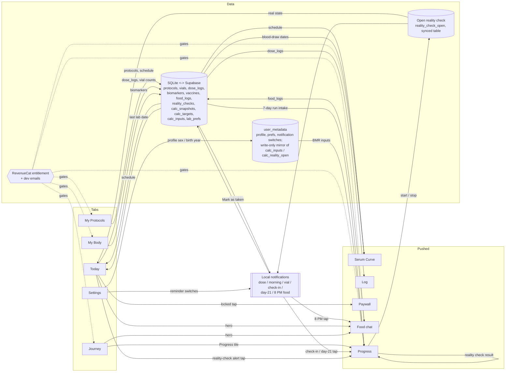

# DoseTrace — App map: cross-tab and cross-module data flows (draft)

- Drafted 27 Sep 2026 from `main` @ 902c9ea (read-only review). "Existing test" refreshed 3 Oct 2026 (pre-build pass of 1.3.0). L-02, L-11, L-12, L-13, L-16, L-20, L-21, L-34, L-42, L-45 and the diagram refreshed 31 Oct 2026 against the code (DV-177).
- Purpose: every place where data made in one tab or module is used by another. **Each link should get a test.** When a change touches the "From" or "To" code, re-check the link.
- "Existing test" gives the file that covers the link's logic. `(logic only)` means the test covers the pure function, not the screen wiring that connects the two ends. `NONE` means nothing covers the link.
- No test in the repo renders a screen or drives the app end to end. Every test in `__tests__/` is a pure-function or sync-harness test. So even links with a test path have untested wiring.

## Diagram (tabs and main links)

Your goal chain (founder, 27 Sep): **Food chat → food_logs → `intakeRun` (7 consecutive complete days) → reality-check intake (tap to use) → `realityCheckTDEE` → saved `reality_checks` → `scoreCheck` → `goalsForTdee` → Your daily plan "Measured"**. Links L-17, L-18, L-19.

## Links

| ID | From | To | What data | Where in code (file + function) | Existing test | Risk if broken |
|---|---|---|---|---|---|---|
| L-01 | My Protocols (protocol row) | Today: due doses, ring, streak, adherence | `start_date`, `interval_days`, `doses_per_day`, times, `created_at` | `ProtocolsScreen.js` save (`insertProtocol`/`updateProtocol`) → `TodayScreen.js` render + `fetchStreakData` via `lib/schedule.js` `expectedDosesOn`, `nextDoseAt`, `existedOn` | `__tests__/schedule.test.js` (logic only) · **A-121 (2026-10-15): needs the "end date changes nothing" test** — same result with and without `ends_on`, on a day before, on and after it (docs/specs/still-going-end-date.md SG-11) | Wrong or missing doses on Today; streak and adherence wrong. |
| L-02 | My Protocols (schedule) + Dose log (Taken rows) | Serum Curve | Before Now: the doses logged as Taken, each at the dose it was taken at; after Now: the planned schedule at its own dose times; dose, unit, `compound_id` (blend split) | `SerumCurveScreen.js` load: `getHistoryProtocols` → `lib/serumModel.js` `curveHistoryProtocols` (active, plus ended within 365 days) → `splitCurveProtocols` (blends split; IU, no-data, no-dose and oral protocols named) and `getLogsSince` → `curvePlan` (`expectedSlotTimesOn`, `getHalfLifeEntry`, `doseInCurveUnit`) | `__tests__/schedule.test.js`, `__tests__/halfLives.test.js`, `__tests__/compounds.test.js`, `__tests__/serumModel.test.js`, `__tests__/curvePastTaken.test.js`, `__tests__/curveEndedRestart.test.js` (logic only) · **A-121 (2026-10-15): needs the "end date changes nothing" test** — same result with and without `ends_on`, on a day before, on and after it (docs/specs/still-going-end-date.md SG-11) | The Premium moat shows a wrong curve. Refreshed 2026-10-31 (DV-177): the curve no longer loads `getActiveProtocols`, and past dates no longer use the current dose (AD-96 B, AD-95 B). |
| L-03 | My Protocols (schedule) | Dose reminders | Due dates and slot times | `lib/notifications.js` `scheduleDoseReminder` / `syncAllDoseReminders` → `lib/notificationPlan.js` `dueDateKeys` | `__tests__/notificationPlan.test.js` (dueDateKeys) · **A-121 (2026-10-15): needs the "end date changes nothing" test** — same result with and without `ends_on`, on a day before, on and after it (docs/specs/still-going-end-date.md SG-11) | Reminders on the wrong days. This is a **second schedule implementation**: `dueDateKeys` honors `schedule_total`, `expectedDosesOn` does not. |
| L-04 | My Protocols (schedule) | Morning summary notification (07:00) | Names of protocols due / days to next dose | `lib/notifications.js` `syncMorningSummary` → `morningSummaryPlan` | `__tests__/notificationPlan.test.js` · **A-121 (2026-10-15): needs the "end date changes nothing" test** — same result with and without `ends_on`, on a day before, on and after it (docs/specs/still-going-end-date.md SG-11) | Wrong or missing morning list. Only re-planned on app open/foreground, not on protocol save. |
| L-05 | My Protocols (schedule) + dose_logs | Missed-dose rows (Today, Log, streaks) | Slots 12 h+ past with no log become "Missed" | `lib/doseActions.js` `scanMissedDoses` → `lib/missedDoses.js` `computeMissedDoses`, `lib/schedule.js` `expectedSlotTimesOn` | `__tests__/missedDoses.test.js`, `__tests__/missedScanGate.test.js` (A-123: after the first sync, report cap, a later Taken / Skipped removes the app's Missed row) · **A-121 (2026-10-15): needs the "end date changes nothing" test** — same result with and without `ends_on`, on a day before, on and after it (docs/specs/still-going-end-date.md SG-11) | False "Missed" rows or real misses hidden. |
| L-06 | My Protocols (past start date) | protocols.history_from ("Same dose for the last N weeks?" → No) → the serum curve; no dose_logs, no vial change (A-30 option C, 2026-10-03: the back-fill of declared history as Taken rows is removed) | Yes = nothing written (the curve estimates from the start date, marked estimated); No = the curve starts that day | `ProtocolsScreen.js` save → `lib/declared.js` `historyQuestion` → `updateProtocol(newId, { history_from })` → `lib/serumModel.js` `scheduledDoses` / `estimatedBeforeMs` | `__tests__/appMapLinks.test.js` (L-06: one call site, only No writes, only history_from); `__tests__/historyBeforeRegistration.test.js` (the question, the curve cut, the estimated marker, logged-only counts) | Declared history counted as logged (the old back-fill); a curve drawn from the wrong dose. |
| L-07 | Today (Mark taken) | dose_logs, vials.doses_taken, protocols.units_taken → Log, streaks, Protocols card "doses left", supply alerts | New Taken row, vial count +1, oral units | `TodayScreen.js` `markTaken` (+ undo) | `__tests__/markTaken.test.js`, `__tests__/connections.test.js` FX-2 (one shared planMarkTaken, logic) | Wrong history and supply counts. |
| L-08 | Dose notification "Mark as taken" | Same as L-07 | Taken row for the reminder's own day/slot; flips a Missed row; idempotent | `lib/notificationActions.js` `markTaken` → `lib/doseActions.js` `recordDoseTaken` | `__tests__/markTaken.test.js`, `__tests__/connections.test.js` FX-2, `__tests__/siteBeforeTaken.test.js` (logic + source) | Double logging or logging on the wrong day. **Logic duplicated with L-07** ("mirrors TodayScreen.markTaken"), and the two already behave differently (see findings). |
| L-09 | dose_logs | Log screen, Today streak/adherence, week dots | Taken/Skipped/Missed rows | `LogScreen.js` (`getAllLogs`, `getLogsSince`); `TodayScreen.js` `fetchStreakData`, `fetchProtocolStreaks` | __tests__/a181UnsyncedNotice.test.js (logic; refreshed 2026-10-26) | History or streak not matching reality. |
| L-10 | dose_logs (Taken today) | Cancels today's pending reminders | Taken count per protocol | `TodayScreen.js` → `lib/notifications.js` `cancelTodaysDoseReminders` | `__tests__/appMapLinks.test.js` (L-10: the real cancelTodaysDoseReminders with a fake scheduler; Today and the notification call it) | "Dose pending" notifications after the dose was taken. |
| L-11 | Vials (Protocols / Today) | Today alerts: supply low, vial expiry | `total_doses` (or derived capacity), `doses_taken`, the protocol's pace, `mixed_on` + validity, `expires_on` | `TodayScreen.js` `alerts` useMemo; `lib/supplyLow.js` `supplyState`; `lib/vialExpiry.js` `daysUntilExpiry`, `boxDaysLeft` | __tests__/supplyLow.test.js, __tests__/vialExpiry.test.js, __tests__/dv002SnoozeVialExpiry.test.js (logic; refreshed 2026-10-26) | Missed restock warning. Refreshed 2026-10-31 (DV-177): supply low = the one rule of L-12, no longer "≤3 doses". |
| L-12 | Vials | Push "running low" notification (same rule as the Today alert, L-11) | `total_doses` (or derived capacity), `doses_taken`, the protocol's pace | `lib/notifications.js` `syncVialAlerts` → `lib/supplyLow.js` `supplyState` | `__tests__/supplyLow.test.js` (one low rule, S-05), `__tests__/vialLowOnce.test.js` (once per vial, m10), `__tests__/a66VialLowLaunch.test.js` | Push and Today alert disagree on when a vial is low. Refreshed 2026-10-31 (DV-177): one rule since S-05 / FX-11 — low when the doses left last 7 days or less at the protocol's pace, or only the last dose is left, never before the first dose (founder 2026-10-27); a vial without a stored count uses the derived capacity; a vial whose protocol is gone sends none. The old "≤2 vs ≤3" difference is gone. |
| L-13 | Today (new-vial prompt, "+ New vial") and the protocol page "New vial" | vials (a new row; the vial in use leaves use with its doses) — never `protocols.start_date` | `mixed_on`, `total_doses` (ready to use: the same size and the new box date) | `lib/newVial.js` `startNewVial` → `newVialRecords` (`protocolUpdate: null`), one transaction; called from `TodayScreen.js` and `ProtocolsScreen.js` | `__tests__/newVial.test.js` (start_date never rewritten, S-01), `__tests__/a132NewVial.test.js` | History before the new vial lost if `start_date` were rewritten. Refreshed 2026-10-31 (DV-177): the old "overwrites `start_date`" text described code fixed in S-01 (FX-1, FX-6; decisions.md:181). |
| L-14 | My Body (biomarkers) | Serum Curve blood-draw readout | Distinct `report_date` values | `SerumCurveScreen.js` load: `getBiomarkers` → `labDates` | `__tests__/appMapLinks.test.js` (L-14: the curve dedupes the report dates, newest first) | Blood-draw dates missing from the curve cross-reference. |
| L-15 | My Body (biomarkers) | Today "bloodwork due" alert → My Body › Labs | Latest `report_date` (182-day rule) | `lib/todayAlertsLoad.js` `loadAlertInputs` (`getBiomarkers`, A-120) → `TodayScreen.js` `fetchAlerts`, `alerts`; `navigation.navigate('Body', { initialSection: 'labs' })` → `BodyScreen.js` `initialSection` effect | `__tests__/appMapLinks.test.js` (L-15: 182-day rule, newest date, the tap opens My Body › Labs once) | Alert never appears, or the tap lands on the hub instead of Labs. |
| L-16 | Every synced table (protocols, vials, dose_logs, biomarkers, vaccines, food_logs, reality_checks, calc_snapshots, calc_targets, reality_check_open, calc_inputs, lab_prefs) | Exports (My Body CSV/PDF records report, Settings data export) | All records | `lib/database.js` `getAllDataForExport` → `lib/exportTables.js` `exportTableNames(TABLES)`; `lib/exportRecords.js`; `BodyScreen.js` `doExport`; `SettingsScreen.js` `handleExportData` → `lib/accountActions.js` `exportMyData` | `__tests__/exportRecords.test.js` (builders), `__tests__/exportAll.test.js`, `__tests__/dv086ExportImportsFirst.test.js` | Export silently incomplete. Refreshed 2026-10-31 (DV-177): every synced table is exported since S-07 / FX-12 (the list comes from `TABLES`). |
| L-17 | Food chat (food_logs + day_closed / not_recorded markers) | Journey reality check intake (tap to use, with working) | Average kcal of the most recent run of 7+ consecutive complete days inside the check | `CalculatorSection.js` `load` (`getFoodLogsSince`) → `foodRun` = `lib/nutrition.js` `intakeRun` → "use my log" button → `rcIntake` → `computeReality` | `__tests__/nutrition.test.js` (intakeRun), `__tests__/energyCalc.test.js` (realityCheckTDEE) (logic only) | The whole food log → reality check → Your goal chain breaks (FL-3, FL-30). |
| L-18 | Journey reality check (result) | Journey Your daily plan (Measured) | Measured TDEE, weekly rate → Lose/Maintain/Gain kcal with safety floor | `CalculatorSection.js` `scoreCheck` → `effectiveGoals` (`lib/energyCalc.js` `goalsForTdee`) | `__tests__/energyCalc.test.js` (goalsForTdee, logic only) | Daily plan stays "Estimated", or a measured plan skips the calorie floor. |
| L-19 | Journey (saved reality checks) | Your daily plan on later visits / other devices | `reality_checks` rows (latest wins) | `CalculatorSection.js` `saveRealityCheck` → `lib/database.js` `upsertRealityCheck`; read in `load` | `__tests__/sync.test.js` (reality_checks round-trip + tombstone) | Measured plan lost after reinstall or on a second device. |
| L-20 | Progress (reality check start / stop) | Today reality-check alert (follows the check's real state, A-118) | Open check `{date, weightKg}`, weigh-ins, food run, typed average | `lib/realityCheck.js` `setRealityStart` / `getRealityStart` (synced `reality_check_open`) → `lib/realityCheckNow.js` `readCheckNow` (via `lib/todayAlertsLoad.js` `loadAlertInputs`) → `TodayScreen.js` `alerts` (`lib/realityCheckRules.js` `checkAlert`); the tap opens Progress at the check | `__tests__/connections.test.js` FX-5, `__tests__/realityCheckStore.test.js`, `__tests__/rcWeighInAlert.test.js`, `__tests__/realityAlertRoute.test.js` | Alert shows for a stopped check, or never shows. Refreshed 2026-10-31 (DV-177): Today no longer removes the check (only Progress starts, restarts or stops it). |
| L-21 | Progress (reality check start) | Day-21 weigh-in notification → Progress, scrolled to the reality check | Start date | `lib/notifications.js` `syncRealityCheckReminder` (reads the synced open check, `getRealityStart({ strict: true })`; cancelled once the due day has a weigh-in, DV-057); tap → `lib/notificationPlan.js` `notifTapTarget` (`reality_check` → Progress, focus `reality`) | `__tests__/connections.test.js` FX-5, `__tests__/realityCheckStore.test.js`, `__tests__/nonDestructiveSchedule.test.js`, `__tests__/dv057DayTwentyOneAfterWeighIn.test.js`, `__tests__/notificationTapTarget.test.js` | No weigh-in reminder; the check never finishes. Refreshed 2026-10-31 (DV-177): the reminder no longer reads AsyncStorage `RC_START_KEY`, and the tap opens Progress, not Journey. |
| L-22 | Journey (reality check start) + food_logs (closed days) + access | 8 PM food question schedule | Start date, closed days, `access.canLog/until` | `lib/notifications.js` `syncFoodLogReminder` → `foodNudgeDays`, `closedDays`, `remindersForAccess` | `__tests__/notificationPlan.test.js` | Reminders for users not in a check, or locked users nagged (FL-18, FL-41). |
| L-23 | Reality check start + access | Today food-log hero visibility and text | `rcStart`, day of check, today's summary | `FoodLogHero.js` → `lib/foodThread.js` `todayFoodHeroPolicy`, `todaySummary` | `__tests__/foodThread.test.js` | Hero shows outside a check, or is missing during one (FL-33, FL-43). |
| L-24 | Entitlement + free-start marker + reality check start | Food access everywhere: chat, both heroes, Journey reality check (`rcFree`), 8 PM reminder | `premium`, Premium end date, first-use day, grace week | `lib/foodLogActions.js` `loadFoodAccess`, `ensureFreeStart` → `lib/foodThread.js` `foodLogAccess`, `freeStartDay`, `resolveEntitlement` | `__tests__/foodThread.test.js` | Free users locked early, or given unlimited access; paying users locked on a network blip (FL-41). |
| L-25 | 8 PM food notification (tap, "Log it") | Food chat with the evening question | `eveningDay`, nonce | `App.js` `routeFoodTap` (listener + `getLastNotificationResponseAsync`, held until `Main` exists) → `FoodChatScreen.js` `route.params.eveningDay` | __tests__/a171FoodTapCatchUp.test.js (logic; refreshed 2026-10-26) | Tap opens the app but not the chat (cold start is the fragile path). |
| L-26 | 8 PM notification "Nothing else today" | food_logs `day_closed` marker → intake run, reminder cancelled | Local day key | `lib/notificationActions.js` `closeFoodDayFromNotification` → `lib/notifications.js` `closeFoodDay` → `insertFoodDayMarker` | `__tests__/appMapLinks.test.js` (L-26: the real closeFoodDayFromNotification + closeFoodDay with fakes), `__tests__/notificationPlan.test.js`, `__tests__/nutrition.test.js` | Day not closed → breaks the 7-day run; reminder repeats. |
| L-27 | Food chat ("That's all for today" / typed "that's it") | Same `day_closed` marker | Local day key | `FoodChatScreen.js` → `closeFoodDay` | `__tests__/nutrition.test.js` (isDoneText, pickDayQuestion) (logic only) | Same as L-26. |
| L-28 | Sync (food logged on another device) | Re-plan 8 PM reminder | Sync-complete event | `App.js` `addSyncListener` → `syncFoodLogReminder` (throttled 30 s) | `__tests__/appMapLinks.test.js` (L-28: App.js sync listener re-plans the 8 PM and day-21 reminders, 30 s throttle; source) | Phone still asks about a day already closed on the iPad. |
| L-29 | Settings / Onboarding profile (user_metadata `gender`, `birth_year`) | Journey BMR (Mifflin) and sex gate | Sex at birth, age | `CalculatorSection.js` `load` (meta → `setSex`, `setProfileSex`, `setAge`) → `energyPlan` | __tests__/a139SexAtBirth.test.js, __tests__/calcInputsMerge.test.js (logic; refreshed 2026-10-26) | Wrong BMR. **`calc_inputs.sex/age` override the profile** (see findings). |
| L-30 | Journey sex-gate prompt | user_metadata `gender` → Settings profile | Sex | `CalculatorSection.js` `saveProfileSex` | `__tests__/appMapLinks.test.js` (L-30: the real saveProfileSex writes gender merge-only; Settings reads it) | Profile and calculator disagree. |
| L-31 | Journey Progress snapshots (incl. "add a past weigh-in") | Your target ETA | Dated weight / BF series, ≥14-day window | `CalculatorSection.js` `weightRate`/`bfRate` (`seriesRatePerWeek`) → `targetProjection` | `__tests__/energyCalc.test.js`, `__tests__/sync.test.js` (calc_targets) | Wrong or missing ETA. Reality-check weigh-ins are **not** written as snapshots, so they never feed the ETA. |
| L-32 | Progress snapshots | Reality-check start weight pre-fill | Weigh-in on the chosen start day | `CalculatorSection.js` `shiftRcStartDate` → `lib/realityCheckRules.js` `weighInOn`, `prefillStartWeight` | `__tests__/realityCheckRules.test.js` | Typed weight overwritten, or no pre-fill. |
| L-33 | Progress snapshots | Progress chart + "since first snapshot" line | Weight, waist | `CalculatorSection.js` `chartSeries`, `progressSummary` → `ProgressChart.js` | `__tests__/journeyProgress.test.js` (Progress chart parts, source/logic) | Chart wrong after a unit switch or sync. |
| L-34 | Entitlement, strict (`lib/entitlement.js` `hasPremium`) | Gates: curve (Journey tile, My Body tile, Log button, Serum Curve itself), reality-check results and the typed-calories link, the measured target ETA, PDF export, lab marker charts, more than 3 protocols | Premium yes/no | `lib/entitlement.js` `hasPremium` → `entitlementFrom` (`lib/purchases.js` only talks to the store); callers in `JourneyScreen.js`, `BodyScreen.js`, `LogScreen.js`, `SerumCurveScreen.js`, `CalculatorSection.js`, `ProtocolsScreen.js`, `SettingsScreen.js` | `__tests__/entitlement.test.js`, `__tests__/entitlementGuard.test.js`, `__tests__/connections.test.js` FX-4 (one entitlement helper) | Paid features free, or paying users locked out. Refreshed 2026-10-31 (DV-177): store unreachable → the cached answer decides (a cached expiry in the future or a lifetime purchase stays Premium; never known paying = free), not "false when RevenueCat can't be reached". Weigh-ins are never gated (FX-15); scans are limited by the server (3 free a month), not by this gate. |
| L-35 | Paywall purchase / restore | All gated screens | New entitlement | `PaywallScreen.js` → RevenueCat; each screen re-reads `isPremium` on focus | __tests__/entitlement.test.js, __tests__/entitlementGuard.test.js, __tests__/foodAccessEntitlement.test.js (logic; refreshed 2026-10-26) | User pays but stays locked until the screen is re-focused or the app restarts. |
| L-36 | Settings notification switches (user_metadata) | All local notifications | `dose_reminders`, `vial_alerts`, `checkin_reminders`, `food_reminders`, `persistent_reminders`, `notif_show_names` | `SettingsScreen.js` `toggleNotificationPref` → `syncAllNotifications`; read in each `sync*` in `lib/notifications.js`; the food switch also in `NutritionLogger.js` | __tests__/a119*, notification tests (ad87aWindowEnd, notificationsBlocked) (logic; refreshed 2026-10-26) | Switch doesn't stop reminders (it happened before: 7428909). |
| L-37 | Settings language | Notification text | Stored language | `lib/notifications.js` `getT` | `__tests__/i18n.test.js` (keys only) | Notifications in the wrong language. |
| L-38 | Onboarding answers (stored locally) | Account profile (user_metadata) on first sign-in | name, sex, birth, goal, activity… | `App.js` SIGNED_IN → `lib/onboardingStore.js` `applyPendingProfile` | `__tests__/pendingProfile.test.js` (fill only missing fields, shared device, PA-71…PA-73) | New user sent back to the profile gate, or another account's answers leak (fixed once in 8cb6ef7). |
| L-39 | Auth events | Sync engine, full import, local wipe, notification scheduling, RevenueCat identity | Session / user id | `App.js` `onAuthStateChange` (sync, deferred side-effects), cold-start `getSession` block | __tests__/a169NoHeadlessRefresh.test.js, __tests__/a119GateB.test.js, __tests__/a119TwoDevices.test.js (logic; refreshed 2026-10-26) | Data loss on a session hiccup, or cross-account leak. |
| L-40 | Local SQLite | Supabase (9 synced tables) and back | Rows, tombstones, watermark | `lib/syncCore.js` `pushPending`, `pullChanges`, `fullImport`; `lib/sync.js`; `lib/syncMappers.js` | `__tests__/sync.test.js`, `__tests__/syncMappers.test.js` · **A-121 (2026-10-15): needs the `ends_on` sync test** — set / moved / cleared round trip, a pulled NULL written, full import and rebuild bring back the latest value incl. "no date" (SG-18, SG-28) | Data lost or duplicated across devices. |
| L-41 | Settings delete account | Server erasure of every synced table | user id | `SettingsScreen.js` → `supabase/functions/delete-user` | `__tests__/deleteUserCoverage.test.js` | GDPR erasure incomplete. |
| L-42 | Notification taps (every type) | Their reason: dose → that dose on Today; vial low / expiry → its protocol (Protocols); check-in → Progress, weight entry; day-21 → Progress, reality check; morning summary and the update notice → Today; 8 PM food → Food chat; test reminder → Reminder check; team message → Today | `data.type`, `protocolId`, slot, action button | `App.js` `addNotificationResponseReceivedListener` → `routeTap` → `lib/notificationPlan.js` `notifTapTarget` (Snooze and "Nothing else today" do not navigate) | `__tests__/appMapLinks.test.js` (L-42: the real tap listener from App.js with a fake navigator — dose → Today, check-in / day-21 → Progress, vial → Protocols, food → chat), `__tests__/notificationTapTarget.test.js` | Tap opens the wrong screen. Refreshed 2026-10-31 (DV-177): morning summary and vial taps are routed now (A-44). |
| L-43 | Body map (Today, Log) | dose_logs.site → next-site suggestion | Injection site ids | `BodyMapModal.js`; `lib/injectionSites.js` `serializeForStorage`, `suggestNextSite`, `summarizeStored` | `__tests__/bodySites.test.js`, `__tests__/sitePickerKeepsSite.test.js`, `__tests__/sitePickerSides.test.js` | Site history lost or rotation suggestion wrong. |
| L-44 | Today alerts / cards | Journey, My Body › Labs, Protocols (open a card), Log | Route + params (`initialSection`, `openProtocolId`) | `TodayScreen.js` `navigation.navigate(...)`; `BodyScreen.js`, `ProtocolsScreen.js` param effects | `__tests__/realityAlertRoute.test.js` (m6), `__tests__/appMapLinks.test.js` (L-15), `__tests__/bookToday.test.js`, `__tests__/bookProtocols.test.js` (source) | Dead-end taps. |
| L-45 | AI consent | Every AI call: lab scan, vaccine scan, vial scan, food chat, protocol assistant | Consent record per account (version 4, date; DV-007) | `lib/aiConsent.js` `hasAIConsent` / `grantAIConsent` in `BodyScreen.js`, `VaccinesSection.js`, `ProtocolsScreen.js`, `FoodChatScreen.js`; withdrawn in Settings (`revokeAIConsent`, `lib/aiUseSwitch.js`) | `__tests__/dv007AiConsentPerAccount.test.js`, `__tests__/myBody.test.js` MB-25, `__tests__/protocolsWizardSheets.test.js`, `__tests__/assistantUi.test.js`, `__tests__/noNativeAlerts.test.js` (food chat; source) | Data sent to the AI provider without consent (Apple 5.1.1/5.1.2). Refreshed 2026-10-31 (DV-177): `requestAIConsent` and the phone-wide v3 flag are gone. |
| L-46 | Protocol delete | Dose reminders + snoozed copies cancelled | Protocol id | `ProtocolsScreen.js` delete → `cancelDoseReminder`; snooze pruning in `lib/notifications.js` | `__tests__/appMapLinks.test.js` (L-46: delete cancels the reminders and banners; the real cancelDoseReminder + doseSlotResolved drop a deleted protocol's snoozed copies) | Reminders for a deleted protocol. |
| L-47 | Journey "Stop reality check" (only while a check is open, AD-91) | Ends the open check only; cancels day-21 and 8 PM reminders; keeps saved results, weigh-ins and food logs | — | `CalculatorSection.js` `stopRealityCheck` → `clearRealityStart`, `syncRealityCheckReminder`, `syncFoodLogReminder` | `__tests__/connections.test.js` FX-5, `__tests__/realityCheckStore.test.js`, `__tests__/dv004StopKeepsResults.test.js` | Reminders keep firing after Stop, saved results or food logs deleted (DV-004). |
| L-48 | Reality check start (user_metadata `calc_reality_open`) + push tokens | Server push reminders (dormant) | Start date, timezone | `supabase/functions/send-reminders/plan.ts` (port of `lib/notificationPlan.js`); gated by `usesServerPush()` | `__tests__/serverPlanParity.test.js` (port parity; the server path itself is never run) · **A-121 (2026-10-15): needs the "end date changes nothing" test** — parity stays green with an `ends_on` column present and `plan.ts` never selects it (SG-11) | When switched on: double or wrong reminders. The port has already drifted (A-04). |
| L-49 | food_logs | Today hero summary; Journey totals (today / 7 days / whole check); grace note | Items, kcal, per day | `lib/foodThread.js` `todaySummary`; `lib/nutrition.js` `periodTotals`; `NutritionLogger.js`, `FoodGraceNote.js` | `__tests__/foodThread.test.js`, `__tests__/nutrition.test.js` (logic only) | Totals disagree between Today and Journey. |
| L-50 | Food chat (catch-up, offline rows) | Re-parse on chat open / hero focus / reconnect | Rows typed on this device, pending follow-ups | `lib/foodLogActions.js` `catchUpFood`, `reparseRow`; `FoodLogHero.js`; `FoodChatScreen.js` | `__tests__/nutrition.test.js` (rowsToReparse) (logic only) | Offline entries stuck or lost (FL-19, FL-46). |
| L-51 | My Protocols "Termina em" row; Today "Continua até uma data…" (A-121) | Today: "Still going?" silenced; the course-end question "Ciclo concluído — encerrar {name}?" | `protocols.ends_on` (the planned end, a local day) | PROPOSED `lib/protocolEnd.js` `setPlannedEnd` → `lib/schedule.js` `courseState` (S-15, the only reader) → `TodayScreen.js` check (S-33 `inactivityDue`), behind `lib/stillGoingGate.js` (A-122) | __tests__/a121EndDate.test.js, __tests__/a121EndDateUi.test.js, __tests__/a148StillGoingSynced.test.js (logic; refreshed 2026-10-26) | "Still going?" nags again, or the course-end question comes for a date the person removed or before the cycle's last dose. |
| L-52 | Today "Encerrar" on "Ciclo concluído" (A-121) | Ended list; reminders and delivered banners cancelled; vials deactivated; Dose log, report, rings and curve keep every earlier dose | `ended_at` (the tap, DL-99; a late answer per DL-110), protocol id | PROPOSED `lib/protocolEnd.js` `endNow` → `endProtocol`, `deactivateVialsByProtocol`, `lib/notifications.js` `cancelDoseReminder`, `dismissDeliveredDoseReminders`; app-written Missed rows after a late end removed (DL-87 / DV-025 path) | __tests__/a121EndDate.test.js, __tests__/a121GateB.test.js (logic; refreshed 2026-10-26) | Reminders after the end; the cycle's last dose lost; Missed rows piling up after a declared end. |
| L-53 | Restart / Restore / Delete forever (A-121) | `protocols.ends_on` of the restarted, restored or purged row | `ends_on` | `lib/protocolEnd.js` `restartAsNew` (allow-list, DL-114), `restoreDeleted`, `purgeProtocol`; trigger `protocols_blank_purged`; tombstone payload `lib/syncCore.js:237` | __tests__/a121GateB.test.js (logic; refreshed 2026-10-26) | A restarted run asks "Ciclo concluído" on its first day; a purged end date stays in the cloud. |
| L-54 | My Protocols edit of start / interval / doses per day / time (independent of A-121) | Missed rows, pending from yesterday, rings, streaks, week circles, reminders | `start_date`, `interval_days`, `doses_per_day`, `reminder_time` and the version in force on each day (AD-95) | `ProtocolsScreen.js` `saveProtocol` (edit) → `lib/missedDoses.js`, `lib/pendingYesterday.js`, `lib/adherenceRings.js`, `lib/doseStreak.js`, `TodayScreen.js` tracker, `lib/notificationPlan.js` | __tests__/dv244A182Missed.test.js (logic; refreshed 2026-10-26) | False Missed rows and questions for days that were not dose days; a streak or the 30-day ring erased by one edit. |

## Counts
- Links: **54** (L-51…L-54 added 2026-10-15 from docs/product/research/09-protocol-dates-wiring.md).
- `NONE` (no test at all): **4** — L-51, L-52, L-53, L-54 (new 2026-10-15; their tests come first, A-121 and DV-244…DV-247). It was 0 until then (pre-build pass 2026-10-03: L-06, L-10, L-14, L-15, L-26, L-28, L-30, L-42, L-46 got `__tests__/appMapLinks.test.js`; every other link of the old list is covered by the test named in its row).
- Partly covered (logic only for the key piece, or a wiring part with no test): L-09, L-11, L-25, L-29, L-35, L-36, L-39.
- The other 20 have a logic test, but no screen-level test.
- Need an A-121 test before the build (2026-10-15, marked in their rows): L-01, L-02, L-03, L-04, L-05, L-48 ("end date changes nothing", SG-11) and L-40 (`ends_on` sync, SG-18). L-13 was refreshed 2026-10-31 (DV-177).

## Suggested first tests (cheapest, highest value)
1. L-13: a unit test that the new-vial path never changes `start_date` (after moving the logic into `lib/`).
2. L-07/L-08: put mark-taken in one `lib/` function used by both Today and the notification; test idempotency, Missed-row flip, vial and oral counts.
3. L-17→L-18: one pure "chain" test: food rows → `intakeRun` → `realityCheckTDEE` → `goalsForTdee` → Measured plan.
4. L-34 + L-24: one `entitlement()` helper for both strict and lenient paths, tested for "store unreachable".
5. L-20/L-21/L-47: test `lib/realityCheck.js` start/stop against a fake AsyncStorage + metadata, and that stop clears both reminders.
